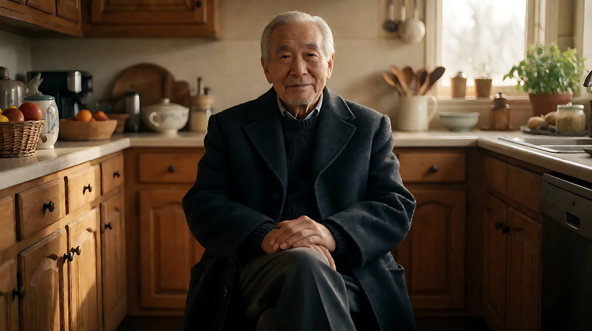
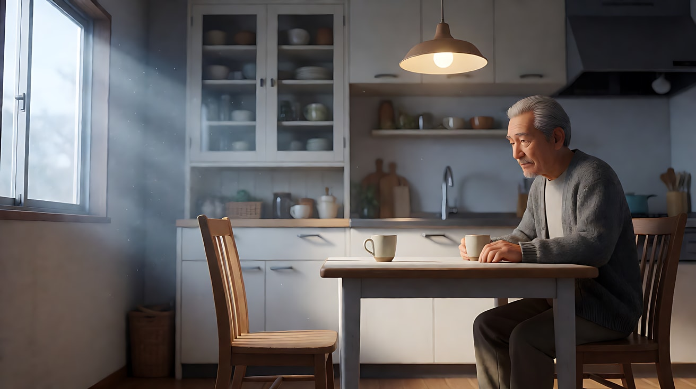
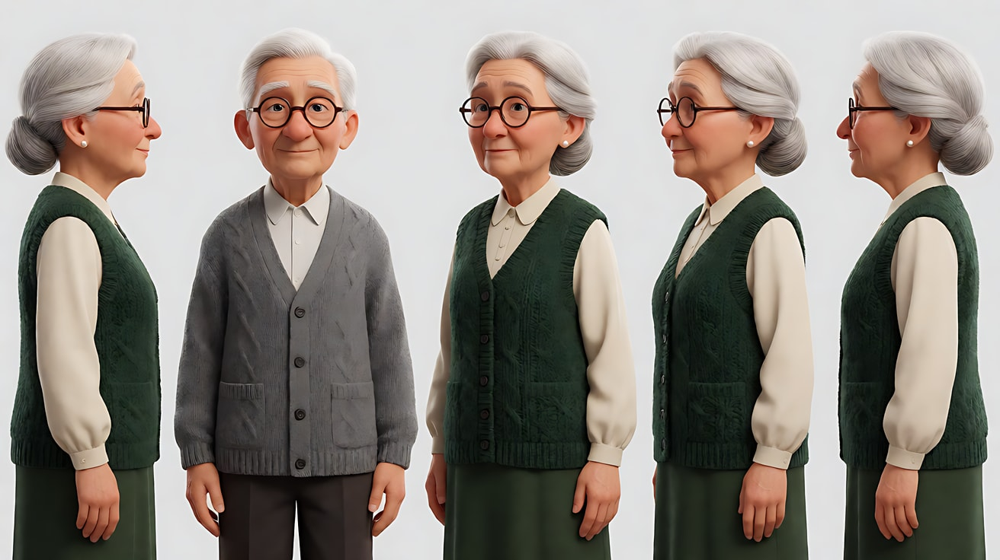
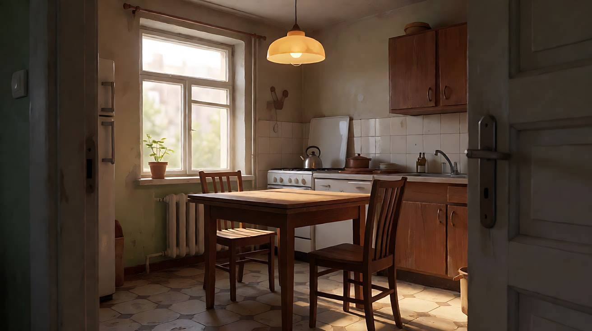
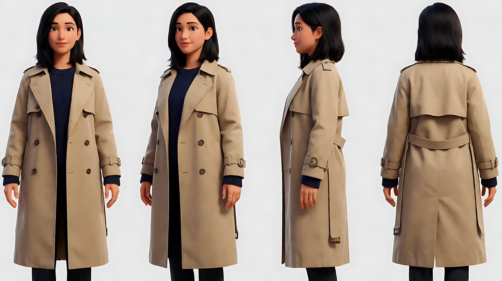
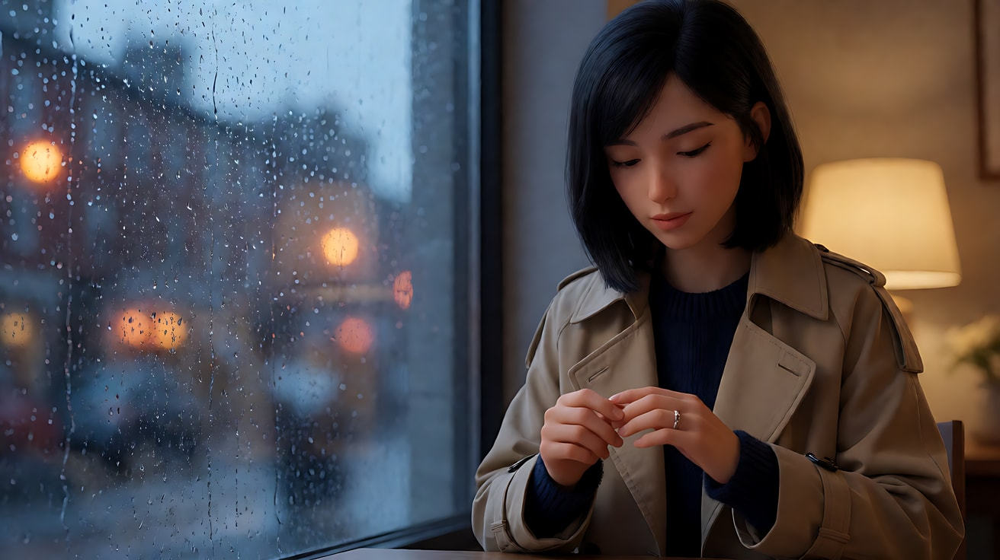
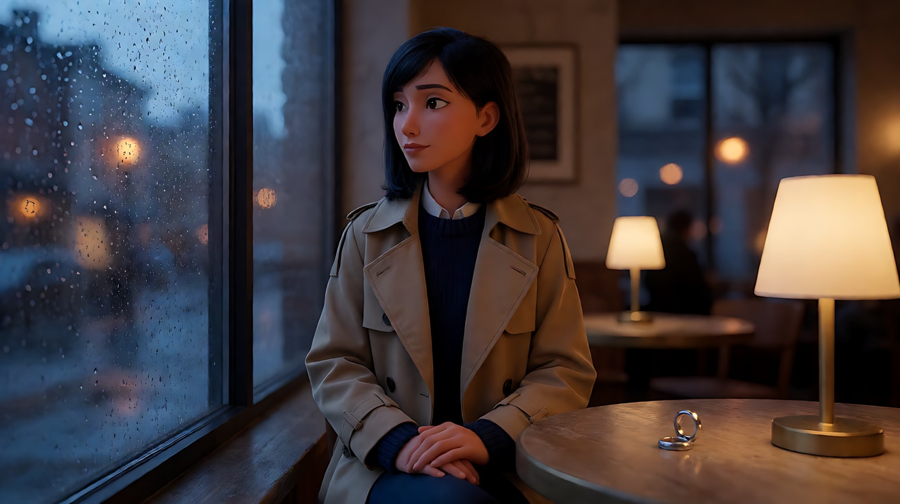
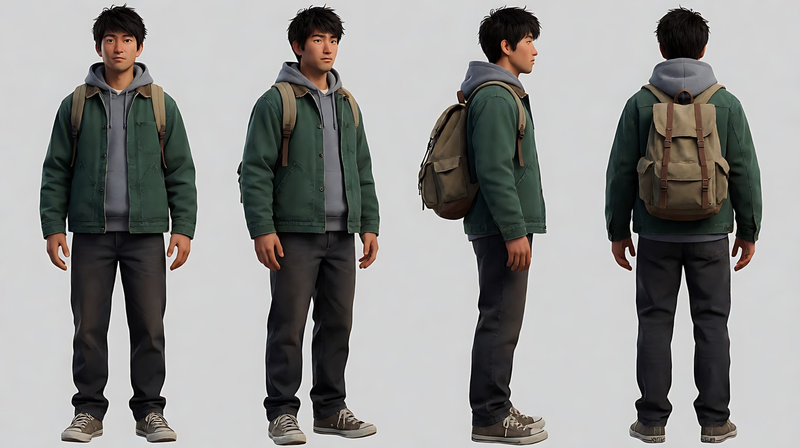
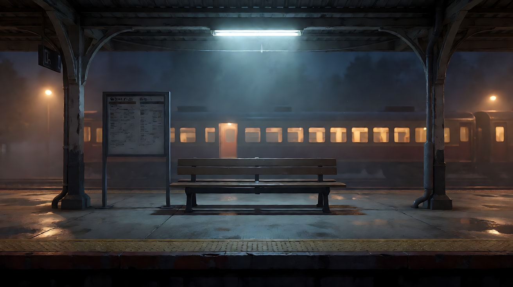
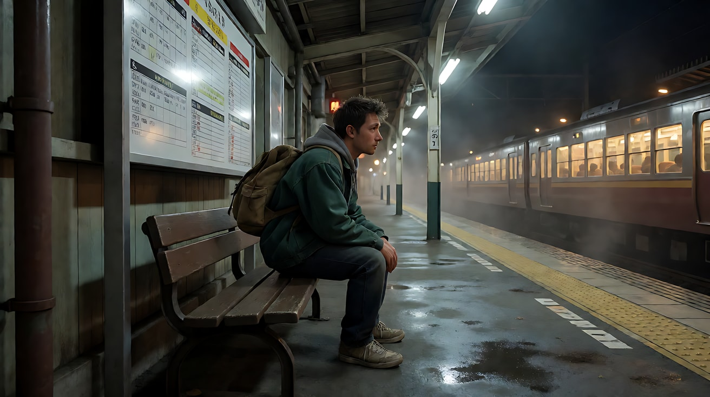

# L00-01 导演思维 · 提示词

> 本组练习：同一个场景，从"空泛词"改写成"有意图的镜头"，并体会九件乐器指向同一个意图。｜ 配套教学：[L00-01-导演思维](../教学/L00-01-导演思维.md) ｜ 规范：[写作规范](../../模板/写作规范.md)
>
> 画风默认使用开关 A（风格化写实 CG）。如改用 2D 动画，删掉所有焦段、光圈、景深词。

---

### 练习1：空泛版 vs 意图版（难度 ★）

**目标**：亲眼看到"电影感"和"具体决定"的差距。先生成空泛版，再生成意图版，并排比较。

**【生图 · Nano Banana】**

图1A 空泛版（反面教材，只用来对比）：

```
A cinematic, epic, beautiful shot of an old man in a kitchen, masterpiece, 8k, best quality.
```



图1B 意图版（意图：让观众感到他独自守着一个已经空了的家）：

```
A medium-wide shot of an original elderly man in a grey cardigan sitting alone at a small kitchen table,
two cups on the table but only one chair pulled out. He is placed on the right third of the frame,
the empty chair on the left with generous negative space.
Camera at seated eye level, 35mm lens, moderate depth of field so the cupboard behind stays readable.
Lighting: soft cool morning window light from frame left, a single warm pendant lamp above the table still switched on,
dust drifting in the window beam.
Stylized semi-realistic 3D CG rendering, feature-film animation quality. Aspect ratio 16:9.
```

中文释义：中全景，老人坐在右三分之一处，左侧是空椅子和大片留白；桌上两只杯子；坐姿视线高度、35mm、中等景深；左侧冷色晨光 + 头顶一盏还亮着的暖灯；光柱里有灰尘。



**【图生视频 · Seedance】**

```
【素材分工】@图片1 为首帧，锁定人物身份、服装与厨房布局。
【画风】风格化写实三维CG质感，电影级布光。
老人坐在桌前，伸手把对面那只杯子往自己这边挪近一点，停住，手搭在杯沿上，目光落在对面的空椅子上。镜头固定中全景，不移动。窗外冷光不变，头顶暖灯持续亮着，光柱里灰尘缓慢飘动。结尾停在他看着空椅子的侧脸上。
【声音】无配乐，冰箱低鸣，杯底与木桌轻微摩擦声，远处一声鸟叫。
【约束】保持人物脸型、发型、服装不变；不要字幕、水印、Logo。
时长：6秒
```

**参数**：时长 6 秒 ｜ 画幅 16:9

**【检查点】**
- 空椅子和留白是否在画左，构成"缺席"
- 挪杯子这个动作是否清楚可读
- 冷暖两种光是否都保留

**【常见问题与修复】**
| 现象 | 修复 |
|---|---|
| 老人站起来走动 | 加一句"他始终坐着，不起身，不离开画面" |
| 杯子变形或变多 | 写"桌上始终只有两只杯子，形状不变" |
| 画面完全静止 | 增加一个小动作：眨眼、呼吸起伏、手指轻敲杯沿 |

---

### 练习2：同一场景，三种意图（难度 ★★）

**目标**：同一对角色、同一间厨房，只改意图，九件乐器全部跟着变。

**【生图 · Nano Banana】**

图1 角色定妆（两位原创角色）：

```
Character turnaround sheet of two original characters, an elderly couple in their seventies:
the husband with short white hair, round glasses, grey cardigan over a white shirt;
the wife with a silver bun, small pearl earrings, dark green knitted vest over a cream blouse.
Front view, three-quarter view and side view of each, full body, plain light-grey background,
even soft studio light. Stylized semi-realistic 3D CG rendering, feature-film animation quality. Aspect ratio 16:9.
```



图2 场景（空厨房）：

```
Empty small old apartment kitchen in the morning, a square wooden table with two chairs facing each other,
a window on the left wall, a warm pendant lamp above the table, worn tiles, a kettle on the stove, no people.
Wide shot from the doorway, eye level, 28mm lens, deep focus.
Stylized semi-realistic 3D CG rendering, feature-film animation quality. Aspect ratio 16:9.
```



**【多图生视频 · Seedance】**

**版本 A：温馨**（意图：让观众感到几十年的默契）

```
【素材分工】@图片1 锁定两位人物的身份与服装；@图片2 仅参考厨房布局与陈设，不复制其中光线。
【画风】风格化写实三维CG质感，电影级布光。
温暖的清晨，窗外暖金色阳光从画左斜照进厨房。妻子把一碟煎蛋推到丈夫面前，丈夫没抬头，顺手把自己碗里的咸菜夹给她，两人都低头吃饭。镜头为平视中景双人镜头，缓慢向前推近一点，结束在两人同框的中近景。
【声音】煎锅余温的滋滋声，筷子碰碗声，水壶即将烧开的轻响，无配乐。
【约束】保持两人脸型、发型、服装不变；不要字幕、水印、Logo。
时长：8秒
```

**版本 B：冷战**（意图：让观众感到两人之间隔着一张桌子的距离）

```
【素材分工】@图片1 锁定两位人物的身份与服装；@图片2 仅参考厨房布局与陈设，不复制其中光线。
【画风】风格化写实三维CG质感，低饱和冷色调。
阴天，窗外灰白冷光从画左平铺进来，头顶吊灯关着。两人坐在桌子两端，丈夫翻报纸，妻子用勺子搅一杯早已不冒热气的茶，一圈又一圈。镜头固定，画面正中是桌子，两人分别贴在左右画边，中间是大片空桌面。结尾停在妻子的勺子停下来的瞬间。
【声音】报纸翻页声，勺子碰杯壁声，墙上挂钟滴答，无配乐。
【约束】保持两人脸型、发型、服装不变；不要字幕、水印、Logo。
时长：8秒
```

**版本 C：告别**（意图：让观众感到这是最后一顿早餐）

```
【素材分工】@图片1 锁定丈夫的身份与服装，本片段画面中只出现丈夫；@图片2 仅参考厨房布局与陈设。
【画风】风格化写实三维CG质感，电影级布光。
清晨，冷色窗光从画左照进，头顶暖灯亮着。丈夫独自坐在桌前，对面的椅子空着，桌上摆着两副碗筷。他把对面那副碗筷摆正，停顿一下，又把筷子轻轻并拢。镜头从门口的全景开始，极慢地推进到他的中近景。结尾停在他放在空碗边的手上。
【声音】几乎无声，只有冰箱低鸣和窗外远处的鸟叫，最后一声筷子轻碰碗沿。
【约束】保持人物脸型、发型、服装不变；不要字幕、水印、Logo。
时长：10秒
```

**参数**：时长 8–10 秒 ｜ 画幅 16:9

**【检查点】**
- 三个版本只看画面不看文字，能否分辨出温馨、冷战、告别
- 每个版本的光、景别、声音是否都在为同一个意图服务

**【常见问题与修复】**
| 现象 | 修复 |
|---|---|
| 版本 C 里出现了妻子 | 素材分工写明"本片段画面中只出现丈夫"，并在正文写"对面的椅子空着" |
| 冷战版两人互动太多 | 加"两人不对视、不交谈" |
| 三个版本光线一样 | 检查是否写了光源和方向；版本 B 要写"吊灯关着" |

---

### 练习3：情绪写成动作——首尾帧版（难度 ★★★）

**目标**：用首帧和尾帧锁定"情绪的起点和终点"，让模型只生成中间那个可见的动作。意图：让观众感到她做了一个决定。

**【生图 · Nano Banana】**

图1 角色定妆：

```
Character turnaround sheet of an original woman in her early thirties: shoulder-length black hair tucked behind one ear,
a beige trench coat over a navy sweater, a thin silver ring on her left hand.
Front, three-quarter, side and back views, full body, plain light-grey background, even soft studio light.
Stylized semi-realistic 3D CG rendering, feature-film animation quality. Aspect ratio 16:9.
```



图2 首帧：

```
Using the character from image 1: medium close-up of her sitting at a café window table at dusk,
her left hand resting on the table with the silver ring visible, her right hand turning the ring slowly,
her eyes lowered toward the ring. Placed on the right third of the frame, rain-streaked window on the left.
Camera at eye level, 85mm lens, shallow depth of field, street lights blurred into soft orange circles.
Lighting: cool blue dusk light through the window as key from frame left, a warm table lamp as low fill from the right.
Keep the face, hairstyle and outfit exactly as in image 1.
Stylized semi-realistic 3D CG rendering, feature-film animation quality. Aspect ratio 16:9.
```



图3 尾帧：

```
Using the character and the exact same framing, lighting and café table as image 2:
the silver ring now lies alone on the table in the foreground, slightly pushed away from her,
her hands are folded in her lap, she sits upright and looks out of the window, her face calm.
Keep the face, hairstyle and outfit exactly as in image 1.
Stylized semi-realistic 3D CG rendering, feature-film animation quality. Aspect ratio 16:9.
```



**【首尾帧生视频 · Seedance】**

```
【素材分工】@图片2 为首帧；@图片3 为尾帧，是最终画面目标；@图片1 锁定人物身份与服装。只生成两帧之间的连续动作。
【画风】风格化写实三维CG质感，电影级布光。
她停下转动戒指的手指，慢慢把戒指从手指上褪下来，放在桌面上，用指尖把它往前推开一点。她把双手收回膝上，坐直，转头看向窗外。镜头固定中近景，不移动。窗外雨痕缓慢下滑，冷暖两侧光线保持不变。
【声音】雨点打在玻璃上，咖啡馆里低低的杯碟声，戒指放在木桌上的一声轻响，无配乐。
【约束】保持人物脸型、发型、服装与戒指形状不变；中间动作连续，不跳切；不要字幕、水印、Logo。
时长：8秒
```

**参数**：时长 8 秒 ｜ 画幅 16:9

**【检查点】**
- 摘戒指、放下、推开、收手、转头五个动作是否连续
- 尾帧的戒指位置是否与图3一致

**【常见问题与修复】**
| 现象 | 修复 |
|---|---|
| 手指变形 | 把动作减为"摘下、放下"两步，删掉"推开" |
| 尾帧没到位 | 强调"以 @图片3 为最终画面目标" |
| 中间出现跳切 | 加"一镜到底，不切镜头" |

---

### 练习4：九件乐器同奏——三镜头意图短片（难度 ★★★★）

**目标**：在一次生成里切三个镜头，景别逐步收紧、光逐步变暖、声音逐步变稀，全部服务一个意图。意图：让观众感到他终于决定回家。

**【生图 · Nano Banana】**

图1 角色定妆：

```
Character turnaround sheet of an original man in his late twenties: short messy hair, a dark green work jacket,
a grey hoodie underneath, a canvas backpack, worn sneakers.
Front, three-quarter, side and back views, full body, plain light-grey background, even soft studio light.
Stylized semi-realistic 3D CG rendering, feature-film animation quality. Aspect ratio 16:9.
```



图2 场景（夜间火车站台）：

```
Empty small-town train platform at night, one long bench under a flickering cool fluorescent lamp,
a timetable board, wet concrete reflecting the light, distant warm windows of a waiting train, light mist, no people.
Wide shot, eye level, 24mm lens, deep focus.
Stylized semi-realistic 3D CG rendering, feature-film animation quality. Aspect ratio 16:9.
```



图3 镜头1关键帧：

```
Using the character from image 1 and the platform from image 2:
an extreme wide shot of the man sitting alone at the far end of the bench, very small in the frame,
the platform stretching away, the waiting train's warm windows in the background.
Camera at eye level from the opposite end of the platform, 24mm lens, deep focus.
Lighting: cool flickering fluorescent overhead, warm glow from the train windows behind him, light mist.
Keep the face, hairstyle and outfit exactly as in image 1.
Stylized semi-realistic 3D CG rendering, feature-film animation quality. Aspect ratio 16:9.
```



**【多图生视频 · Seedance】**

```
【素材分工】@图片1 锁定人物身份、服装与背包；@图片2 仅参考站台布局与陈设；@图片3 为首帧。
【画风】风格化写实三维CG质感，电影级布光。
镜头1：固定大远景，男人坐在长椅最远端，在画面中很小；头顶冷白日光灯闪烁，远处等候的列车车窗透出暖光。他低头看手机，手机屏幕的冷光照亮他的脸。站台广播的回声和日光灯的电流嗡声。
镜头2：镜头切至侧面中景，他把手机扣在大腿上，抬头看向列车的方向，车窗暖光落在他脸的一侧，另一侧仍是冷光。广播声变远，只剩他的呼吸声。
镜头3：镜头切至正面近景，他抓起背包站起来，镜头随他起身轻微上摇，停在他望向列车的脸上，暖光占满他的面部。车门提示音响起一声。
【锁定】光线：冷色日光灯在头顶，暖光来自画右的列车方向；人物始终穿绿色工装外套、背帆布背包；机位始终在长椅同一侧。
【声音】从嘈杂的广播与电流声逐渐变稀，到最后只剩呼吸声和一声车门提示音，无配乐。
【约束】保持人物脸型、发型、服装不变；不要字幕、水印、Logo。
时长：12秒
```

**参数**：时长 12 秒 ｜ 画幅 16:9 ｜ 负载：3 个镜头、1 个起身动作，属于"稳妥"档

**【检查点】**
- 景别是否按"大远景 → 中景 → 近景"收紧
- 光是否从"全冷"过渡到"冷暖各半"再到"暖光占满"
- 声音是否从密到疏

**【常见问题与修复】**
| 现象 | 修复 |
|---|---|
| 三个镜头连成一个长镜头 | 每个镜头块开头都写"镜头切至……"，并让三个机位明显不同 |
| 人物在镜头3换了衣服 | 在【锁定】里再写一遍服装与背包 |
| 镜头3动作太多 | 只保留"站起来、看向列车"，删掉其他小动作 |
