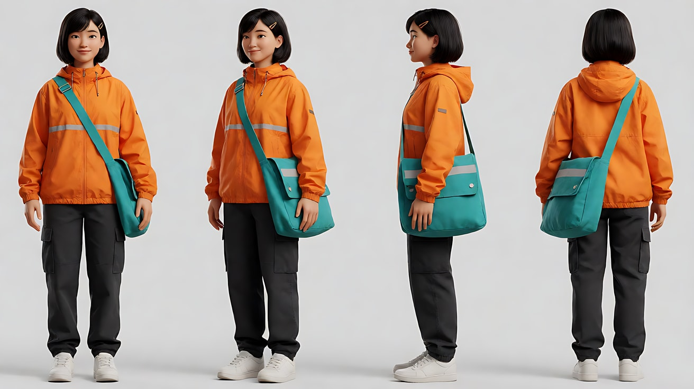
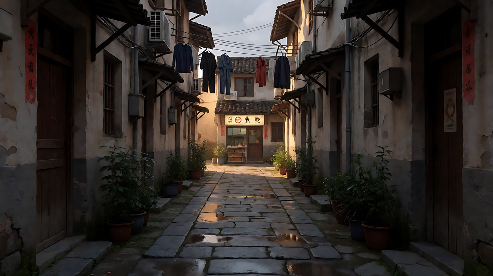
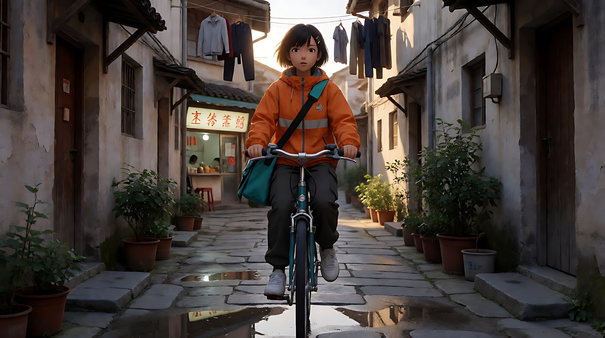
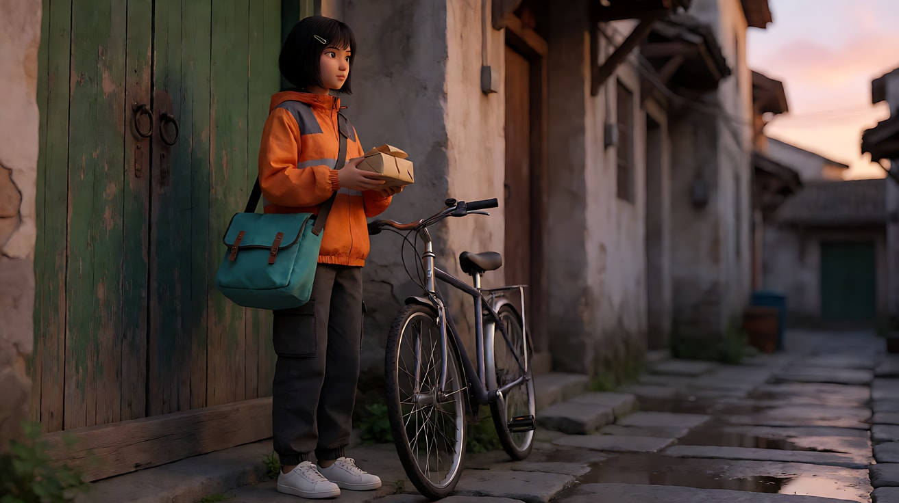
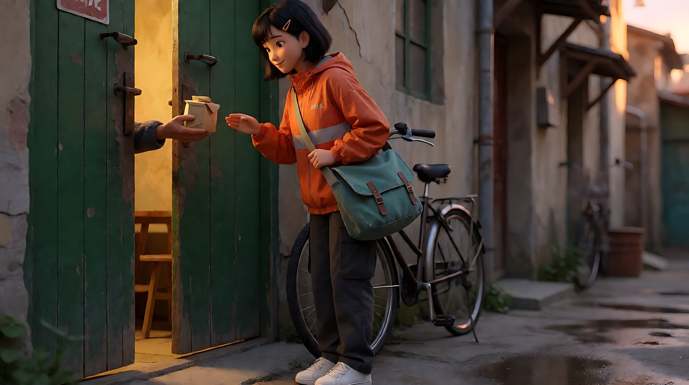

# L00-02 AI 影像工作流 · 提示词

> 本组练习：用同一个原创角色"阿禾"走完"定妆 → 定景 → 关键帧 → 图生视频 → 多图参考 → 首尾帧 → 接续"全流程。｜ 配套教学：[L00-02-AI影像工作流](../教学/L00-02-AI影像工作流.md) ｜ 规范：[写作规范](../../模板/写作规范.md)
>
> 画风默认使用开关 A（风格化写实 CG）。本组所有练习共用同一套定妆图和场景图，建议按顺序做。

---

### 练习1：角色定妆图 + 单图生视频（难度 ★）

**目标**：做出一张合格的定妆图，并直接让它"活"起来，检验角色是否稳定。

**【生图 · Nano Banana】**

图1 角色定妆：

```
Character turnaround sheet of an original character named A-He, a 24-year-old woman bicycle courier:
short black bob haircut with a small hair clip on the right side, an orange windbreaker jacket with a reflective stripe,
dark grey cargo trousers, white sneakers, a teal canvas messenger bag worn across the body.
Four views side by side: front, three-quarter, side and back, full body, standing relaxed,
plain light-grey background, even soft studio light, no shadows on the backdrop.
Stylized semi-realistic 3D CG rendering, feature-film animation quality. Aspect ratio 16:9.
```

中文释义：原创角色阿禾，24 岁女骑手；黑色短波波头、右侧小发夹；橙色带反光条风衣、深灰工装裤、白球鞋、斜挎青绿色帆布邮差包；正面、四分之三、侧面、背面四视图，浅灰纯色背景，均匀柔光。



**【图生视频 · Seedance】**

> 定妆图通常不直接做首帧。本练习只为检查角色稳定性，所以用定妆图的正面视角做一次简单的转身测试。

```
【素材分工】@图片1 锁定人物身份、发型、服装与邮差包。
【画风】风格化写实三维CG质感，均匀柔和的影棚光。
阿禾站在浅灰色纯背景前，正面全身，双手插在风衣口袋里。她先看向镜头，然后缓慢向右转身一周，回到正面后停住，抬手把右侧发夹扶正。镜头固定全景，不移动。
【声音】安静的影棚环境声，转身时风衣布料摩擦声，无配乐。
【约束】保持脸型、发型、发夹位置、服装颜色与邮差包不变；不要字幕、水印、Logo。
时长：6秒
```

**参数**：时长 6 秒 ｜ 画幅 16:9

**【检查点】**
- 转身一圈后，背面的反光条和邮差包是否与定妆图一致
- 发夹是否始终在右侧

**【常见问题与修复】**
| 现象 | 修复 |
|---|---|
| 背面服装与定妆图不同 | 定妆图里背面视角要画清楚；必要时单独生成一张背面细节图 |
| 发夹换到左边 | 在约束里写"发夹始终在人物右侧" |
| 转身时脸变了 | 改成转身半圈（只到侧面）再转回来 |

---

### 练习2：场景图 + 关键帧 + 多图参考生视频（难度 ★★）

**目标**：把角色放进场景，体会"首帧决定构图，定妆图锁身份，场景图锁空间"的分工。

**【生图 · Nano Banana】**

图2 场景：

```
An empty narrow old-town alley in the late afternoon after rain, wet stone pavement reflecting the sky,
laundry hanging between two-storey houses, potted plants by the doors, a small noodle shop with a warm lit sign at the far end,
low warm sunlight entering from the far end of the alley and casting long shadows toward camera, no people.
Wide shot, standing eye level, 28mm lens, deep focus.
Stylized semi-realistic 3D CG rendering, feature-film animation quality. Aspect ratio 16:9.
```



图3 关键帧（首帧）：

```
Using the character from image 1 and the alley from image 2:
a full shot of A-He riding her bicycle slowly toward camera down the middle of the alley,
placed in the center of the frame, the warm low sun behind her creating a bright rim around her hair and shoulders,
her face in soft shadow, reflections of her bicycle on the wet pavement.
Camera at standing eye level, 35mm lens, moderate depth of field.
Keep the face, hairstyle, hair clip, outfit and messenger bag exactly as in image 1.
Stylized semi-realistic 3D CG rendering, feature-film animation quality. Aspect ratio 16:9.
```



**【多图生视频 · Seedance】**

```
【素材分工】@图片1 锁定人物身份、发型、服装与邮差包；@图片2 仅参考小巷布局与陈设，不复制其中光线；@图片3 为首帧，决定构图与光线。
【画风】风格化写实三维CG质感，电影级布光。
阿禾骑着自行车从小巷深处朝镜头缓慢驶来，车轮压过积水溅起细小水花，晾衣绳上的衣服被风吹动。她在离镜头几步远的地方捏闸停下，单脚撑地，抬头看向画面左侧的一扇门。镜头固定，从全景开始，她骑近后自然变为中景。逆光始终在她身后，发丝边缘发亮。结尾停在她看向门口的侧脸。
【声音】车轮碾过积水声，刹车轻响，远处面馆的锅铲声，屋檐滴水声，无配乐。
【约束】保持脸型、发型、发夹、服装与邮差包不变；小巷布局不变；不要字幕、水印、Logo。
时长：8秒
```

**参数**：时长 8 秒 ｜ 画幅 16:9

**【检查点】**
- 小巷陈设（晾衣绳、花盆、面馆招牌）是否保留
- 逆光方向是否始终在她身后

**【常见问题与修复】**
| 现象 | 修复 |
|---|---|
| 光线变成正面光 | 场景图写了"不复制其中光线"后，首帧图必须本身就是逆光 |
| 自行车结构扭曲 | 减少骑行距离，改为"缓慢滑行最后几米" |
| 人物冲出画面 | 写清"在离镜头几步远的地方停下" |

---

### 练习3：首尾帧——精确控制动作终点（难度 ★★★）

**目标**：用首帧和尾帧锁定"敲门前"和"门开后"两个状态，让模型只生成中间过程。

**【生图 · Nano Banana】**

图4 首帧：

```
Using the character from image 1 and the alley from image 2:
a medium shot of A-He standing in front of a weathered green wooden door on the left side of the alley,
seen in three-quarter profile, holding a small paper-wrapped parcel in both hands, her bicycle leaning against the wall behind her.
Camera at eye level, 50mm lens, shallow depth of field, the alley softly blurred behind her.
Lighting: low warm sunset light from frame right, soft bounce from the wet pavement.
Keep the face, hairstyle, hair clip, outfit and messenger bag exactly as in image 1.
Stylized semi-realistic 3D CG rendering, feature-film animation quality. Aspect ratio 16:9.
```



图5 尾帧：

```
Using the exact same framing, lighting and location as image 4:
the green door is now half open, warm yellow interior light spilling out onto A-He,
an elderly hand from inside the doorway is holding the parcel, A-He is smiling and giving a small bow.
Keep the face, hairstyle, hair clip, outfit and messenger bag exactly as in image 1.
Stylized semi-realistic 3D CG rendering, feature-film animation quality. Aspect ratio 16:9.
```



**【首尾帧生视频 · Seedance】**

上传顺序：图片1 = 图1 定妆图，图片2 = 图4 首帧，图片3 = 图5 尾帧。

```
【素材分工】@图片2 为首帧；@图片3 为尾帧，是最终画面目标；@图片1 锁定人物身份与服装。只生成两帧之间的连续动作。
【画风】风格化写实三维CG质感，电影级布光。
阿禾用一只手轻敲木门两下，等待片刻。门从里面缓缓打开，屋内暖黄色灯光洒在她身上。她双手把包裹递进门内，一只年长的手接过包裹，她微笑着轻轻鞠躬。镜头固定中景，不移动。夕阳侧光保持不变，屋内暖光随开门逐渐扩大。
【声音】两声敲门声，门轴吱呀声，屋内收音机隐约的戏曲声，纸包摩擦声，无配乐。
【约束】保持人物脸型、发型、服装不变；门的颜色与形状不变；中间动作连续，不跳切；不要字幕、水印、Logo。
时长：8秒
```

**参数**：时长 8 秒 ｜ 画幅 16:9

**【检查点】**
- 开门时屋内光是否随门缝扩大，这就是"光随动作变化"
- 结尾是否准确落在尾帧的鞠躬姿态

**【常见问题与修复】**
| 现象 | 修复 |
|---|---|
| 屋里走出一个完整人物 | 尾帧只露一只手；提示词写"屋内的人只露出一只手" |
| 包裹交接时手部粘连 | 把"递进门内"改为"放进伸出的手里"，减少接触时间 |
| 门的颜色变了 | 约束里写"绿色木门颜色与形状不变" |

---

### 练习4：多图参考 + 多镜头（难度 ★★★★）

**目标**：同一组素材，在一次生成里切三个镜头，练习素材分工和【锁定】行。

**【生图 · Nano Banana】**

沿用图1（定妆）、图2（场景）、图3（骑行首帧）。新增：

图6 道具细节：

```
Close-up product-style image of a small parcel wrapped in brown kraft paper and tied with red string,
a handwritten paper tag attached, placed on a wooden surface, soft warm side light from the right, shallow depth of field.
Stylized semi-realistic 3D CG rendering, feature-film animation quality. Aspect ratio 16:9.
```


**【多图生视频 · Seedance】**

上传顺序：图片1 = 图1 定妆图，图片2 = 图2 场景图，图片3 = 图3 首帧，图片4 = 图6 包裹细节。

```
【素材分工】@图片1 锁定人物身份、发型、服装与邮差包；@图片2 仅参考小巷布局；@图片3 为首帧；@图片4 锁定包裹外观（牛皮纸、红绳、手写纸签）。
【画风】风格化写实三维CG质感，电影级布光。
镜头1：固定全景，阿禾骑车从小巷深处驶来，在绿色木门前停下，单脚撑地。车轮碾过积水声。
镜头2：镜头切至俯拍特写，她从邮差包里取出牛皮纸包裹，手指捏住红绳，翻过来看了一眼手写纸签。纸张摩擦声。
镜头3：镜头切至门侧的中景，她把包裹抱在胸前，抬手轻敲木门两下，侧耳等待。敲门声，屋内隐约的收音机声。
【锁定】光线：夕阳低角度暖光从画右照来，湿地面反光；阿禾始终穿橙色风衣、斜挎青绿色邮差包，发夹在右侧；绿色木门始终在画左。
【声音】小巷环境声贯穿始终，屋檐滴水，远处面馆锅铲声，无配乐。
【约束】保持人物脸型、发型、服装与包裹外观不变；不要字幕、水印、Logo。
时长：12秒
```

**参数**：时长 12 秒 ｜ 画幅 16:9 ｜ 负载：3 个镜头、1 次道具操作，属于"稳妥"档

**【检查点】**
- 三个镜头是否真的切开，而不是连成一个长镜头
- 镜头2 的包裹是否与图6（本次上传的图片4）一致

**【常见问题与修复】**
| 现象 | 修复 |
|---|---|
| 镜头2 没出现 | 镜头2 的机位要和镜头1 差异明显（俯拍特写 vs 全景） |
| 包裹在镜头3 变了样子 | 在【锁定】里补"包裹始终为牛皮纸加红绳" |
| 门在镜头3 换到画右 | 检查【锁定】里是否写了门的位置 |

---

### 练习5：多模态接续——身份、状态、运镜与音色分工（难度 ★★★★★）

**目标**：继续上一段事件，同时把身份、开场状态、摄影机运动和声音分给不同素材。本版依据 2.5 官方参考能力设计，待实测；不是原视频延长任务。

**操作步骤**

1. 只从练习4 已审片通过的视频截取接近结尾的清楚画面，保存为图7；若不是最后一帧，记录剪辑衔接点。
2. 检查图7：人物位置、朝向、光线方向，记录下来（这就是"真实结尾状态"，以它为准，不以你计划的为准）。
3. 准备自摄或已获授权的 5 秒缓慢后拉参考视频，只提供运镜；再准备一段 3 秒授权音色素材，只提供阿禾的声音，不照搬原台词。不要用陌生人声音冒充授权素材。
4. 列出下面的映射后生成。不能提供合适声音或视频参考时，删除对应素材及引用，分别改为文字“缓慢后拉”和“年轻成年女性自然说话”，完成简化版。

**【多图生视频 · Seedance】**

上传顺序：图片1 = 图1 定妆图，图片2 = 图7 上一段尾帧截图，图片3 = 图5 开门尾帧（练习3）；视频1 = 后拉运镜参考；音频1 = 阿禾的授权音色。图片2在本题是普通开场参考，不声称启用了专门首帧控制。

```
【素材分工】@图片2 参考本段开场状态，来自上一段已接受的结尾；@图片1 锁定阿禾身份与服装；@图片3 仅参考开门后的屋内暖光，不参考其构图。@视频1 仅参考后拉运镜的路径与速度，不复制原人物、地点和声音；阿禾对应 @音频1 的音色，不参考原台词与配乐。
【画风】风格化写实三维CG质感，电影级布光。
从上一段真实结尾继续，不要重演敲门动作。木门从里面缓缓打开，屋内暖黄色灯光洒到阿禾脸上。阿禾抬眼说：“您的包裹。”她把包裹递进门内，一只年长的手接过。阿禾松手后退半步，停在门边。镜头从门侧中景按参考缓慢后拉，结束在能同时看见阿禾与木门的全景，不演离开。
【锁定】光线：夕阳低角度暖光从画右照来；阿禾始终穿橙色风衣、斜挎邮差包；绿色木门在画左。
【声音】门轴吱呀声，屋内收音机低声持续，阿禾仅说正文一句台词，无其他对白、无新增配乐。
【约束】保持人物脸型、发型、服装不变；已完成的敲门动作不得重复；不要字幕、水印、Logo。
时长：10秒
```

**参数**：时长 10 秒 ｜ 画幅 16:9

**【检查点】**
- 第二段开场状态能否与原片衔接；普通参考不能保证逐帧无缝
- 敲门动作有没有被重复
- 后拉是否借用了视频1，但人物和场景没有被它替换
- 音频1只影响阿禾音色，没有把原台词或背景音乐带入

**【常见问题与修复】**
| 现象 | 修复 |
|---|---|
| 又敲了一遍门 | 写"从上一段真实结尾继续，不要重演敲门动作" |
| 开头人物位置跳了 | 核对结尾状态；需要更强约束时另选专门首帧任务，或用支持的原视频延长，不只加“严格”二字 |
| 接续几段后人物越来越走样 | 每隔两三段重新上传原始定妆图 @图片1 做重锚定 |
| 参考视频中的人或原音频台词被带入 | 检查各素材映射，移除无关参考，先分别测试运镜与音色 |
