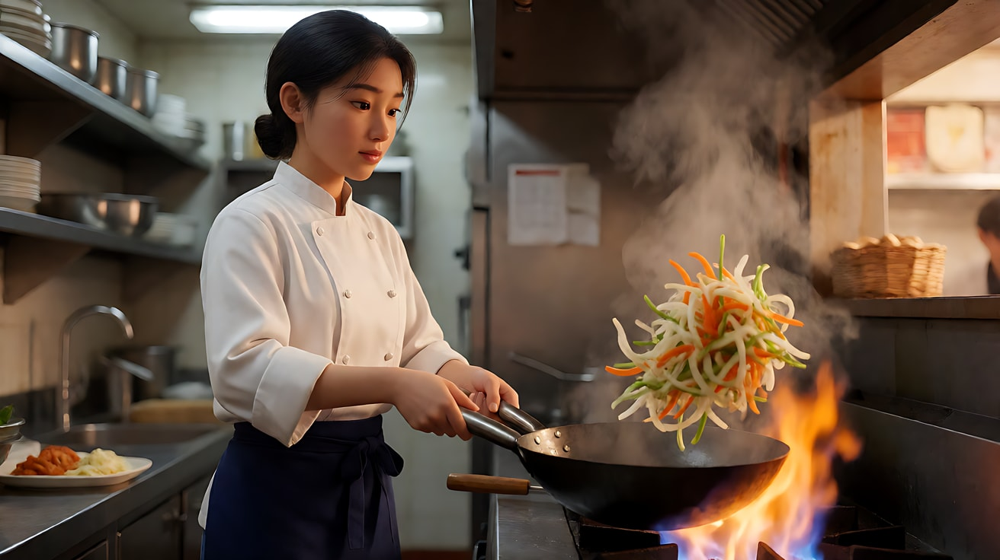
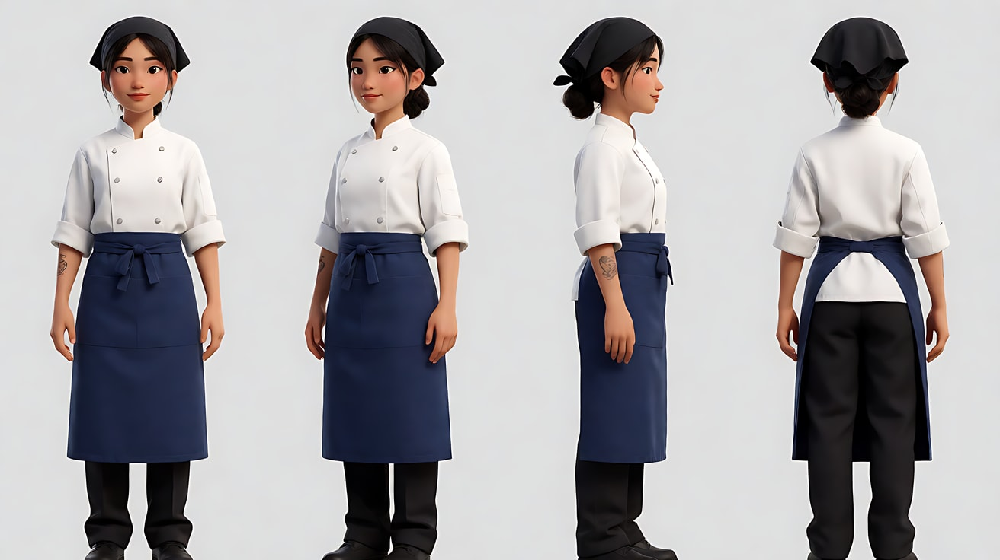
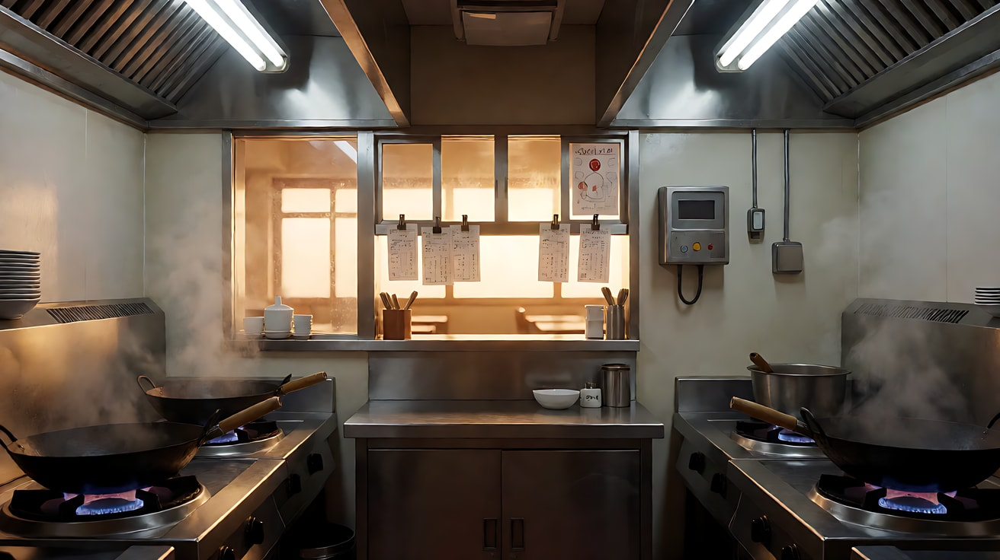
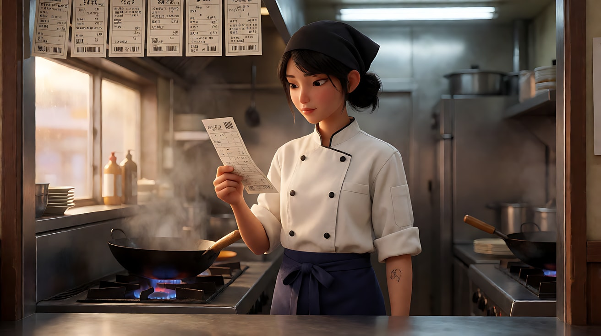
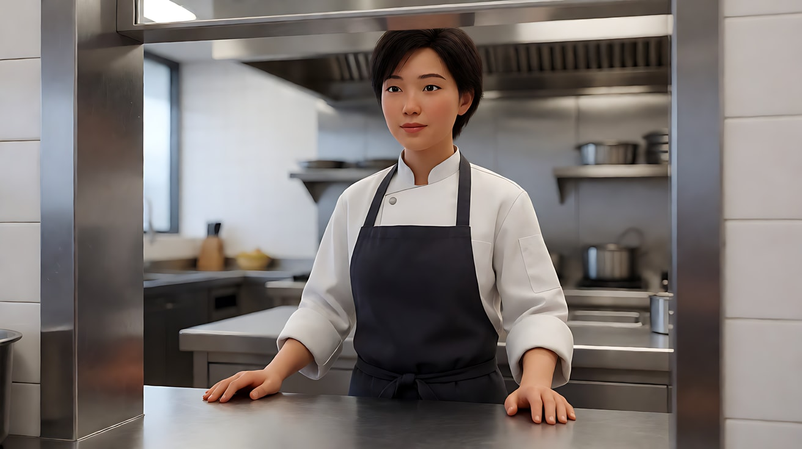
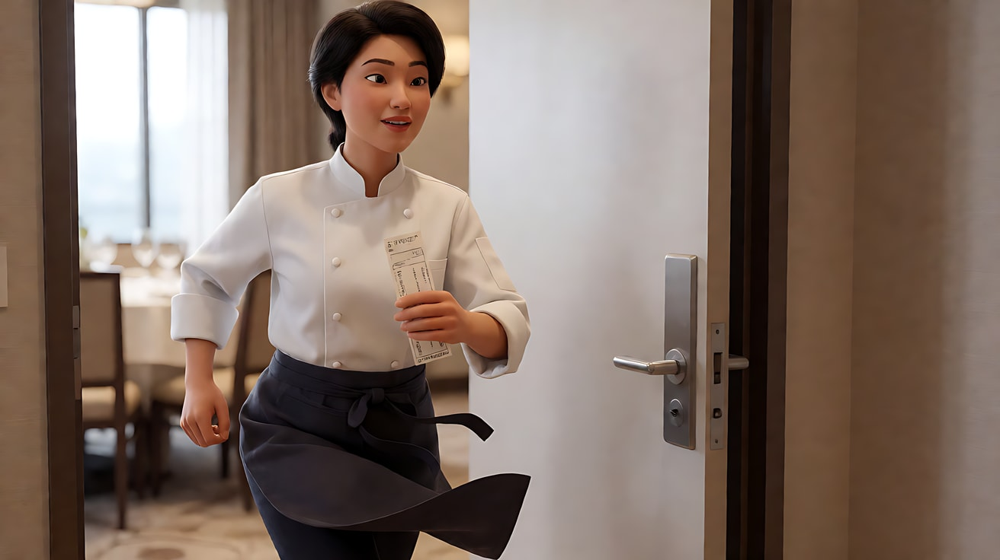
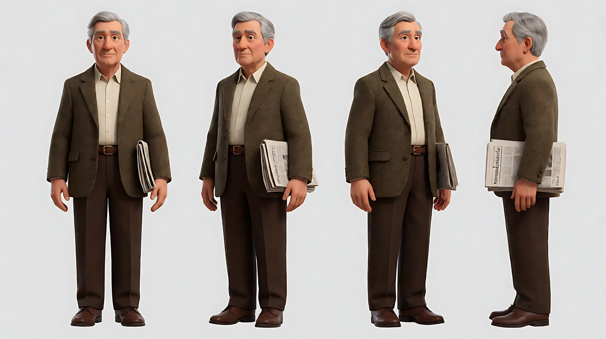
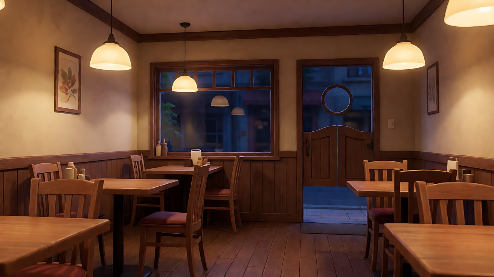

# L00-03 提示词公式与避坑 · 提示词

> 本组练习：把错误提示词改对；用镜头合同写提示词；对比不同结尾形态；学会拆分过载的片段。｜ 配套教学：[L00-03-提示词公式与避坑](../教学/L00-03-提示词公式与避坑.md) ｜ 规范：[写作规范](../../模板/写作规范.md)
>
> 画风默认使用开关 A（风格化写实 CG）。

---

### 练习1：改写一条"套话提示词"（难度 ★）

**目标**：按生图六段公式和视频公式，把一条空泛的提示词改成能执行的版本。

**原始提示词（错误示范）**

```
电影感，史诗级，一个厨师在厨房做饭，超高清8K，唯美，氛围感拉满，大片质感，酷炫运镜。
```

问题：没有景别、机位、光源；"酷炫运镜"不是运镜；"氛围感"没有可见细节；8K 不是画面内容。

**【生图 · Nano Banana】**

图1 关键帧（改写后）：

```
A medium shot of an original young chef in a white double-breasted jacket and a dark blue apron,
tossing sliced vegetables in a large wok over a roaring gas flame in a narrow restaurant kitchen just before dinner service.
She is placed on the left third of the frame, a column of steam and flame rising on the right.
Camera at eye level, 50mm lens, shallow depth of field, stainless steel shelves softly blurred behind her.
Lighting: the orange wok flame lights her face from below and the front, cool fluorescent light from above as fill,
a hard warm spill from the order window behind her as a rim on her shoulders.
Stylized semi-realistic 3D CG rendering, feature-film animation quality. Aspect ratio 16:9.
```

中文释义：中景；左三分之一处的女厨师颠锅，右侧火焰与蒸汽；平视、50mm、浅景深；锅火从下前方照脸，顶部冷色日光灯补光，身后出菜窗暖光作轮廓光。



**【图生视频 · Seedance】**

```
【素材分工】@图片1 为首帧，锁定人物身份、服装与厨房布局。
【画风】风格化写实三维CG质感，电影级布光。
她握住锅柄连续颠锅两次，蔬菜在火焰上方翻起又落回锅中，第二次颠锅时火苗腾起照亮她的脸。她把锅放回灶上，抬手用手背擦了一下额头。镜头从中景缓慢推近到中近景，结束在她擦汗后看向出菜窗的脸。
【声音】猛火的呼呼声，铁锅与灶架碰撞声，油爆声，远处出菜铃响一下，无配乐。
【约束】保持人物脸型、发型、服装不变；不要字幕、水印、Logo。
时长：6秒
```

**参数**：时长 6 秒 ｜ 画幅 16:9

**【检查点】**
- 火光是否真的在照亮她的脸（动机光）
- 推镜是否在她擦汗时结束

**【常见问题与修复】**
| 现象 | 修复 |
|---|---|
| 火焰过大吞没人物 | 写"火苗只高出锅沿一截" |
| 蔬菜飞出锅外 | 写"蔬菜翻起后全部落回锅中" |
| 推镜过快 | 写"极缓慢地推近" |

---

### 练习2：用镜头合同写提示词（难度 ★★）

**目标**：先填镜头合同八个字段，再翻译成提示词。

**镜头合同**

| 字段 | 填写 |
|---|---|
| 景别 | 中景到近景 |
| 角度 | 平视 |
| 焦段感 | 85mm 人像压缩 |
| 支撑方式 | 轨道 |
| 运镜 | 缓慢推近 |
| 起始画面 | 她站在出菜窗前读一张订单 |
| 终点画面 | 她抬眼看向画外的近景 |
| 易损锚点 | 脸、订单纸、厨师服 |

**【生图 · Nano Banana】**

图1 角色定妆：

```
Character turnaround sheet of an original young female chef: hair tied in a low bun under a black bandana,
a white double-breasted chef jacket with rolled sleeves, a dark blue apron, a small burn mark on the left forearm.
Front, three-quarter, side and back views, full body, plain light-grey background, even soft studio light.
Stylized semi-realistic 3D CG rendering, feature-film animation quality. Aspect ratio 16:9.
```



图2 场景：

```
An empty narrow restaurant kitchen just before dinner service, a stainless steel order window with paper tickets clipped on a rail,
woks on gas burners, steam in the air, warm light coming through the order window from the dining room, cool fluorescent tubes overhead, no people.
Wide shot, eye level, 28mm lens, deep focus.
Stylized semi-realistic 3D CG rendering, feature-film animation quality. Aspect ratio 16:9.
```



图3 首帧：

```
Using the character from image 1 and the kitchen from image 2:
a medium shot of the chef standing at the order window, reading a paper ticket held in her right hand, eyes lowered,
placed slightly right of center, the ticket rail above her.
Camera at eye level, 85mm lens, shallow depth of field.
Lighting: warm light from the order window as key from frame left, cool overhead fluorescent fill.
Keep the face, hairstyle and outfit exactly as in image 1.
Stylized semi-realistic 3D CG rendering, feature-film animation quality. Aspect ratio 16:9.
```



**【多图生视频 · Seedance】**

```
【素材分工】@图片1 锁定人物身份与服装；@图片2 仅参考厨房布局与陈设；@图片3 为首帧，决定构图与光线。
【画风】风格化写实三维CG质感，电影级布光。
镜头：平视，85mm 人像压缩感，轨道推镜。从她站在出菜窗前低头读订单的中景开始，极缓慢地向前推近，她读到订单最后一行时手指停住，慢慢抬眼看向画面左侧的餐厅方向，结束在她抬眼的近景上。出菜窗的暖光从画左照亮她半边脸，顶部冷光补另一侧。
【声音】后厨排风扇的低鸣，远处餐厅隐约的人声，订单纸被手指捏皱的轻响，无配乐。
【约束】保持人物脸型、发型、服装与订单纸不变；不要字幕、水印、Logo；订单上不要出现可读文字。
时长：8秒
```

**参数**：时长 8 秒 ｜ 画幅 16:9

**【检查点】**
- 推镜终点是否正好在"抬眼"那一刻
- 订单纸上没有乱码文字

**【常见问题与修复】**
| 现象 | 修复 |
|---|---|
| 订单上出现乱码字 | 约束写"订单上不要出现可读文字"，字留到后期加 |
| 推镜变成了变焦 | 写"摄影机向前移动"，不要写"拉近焦距" |
| 她抬眼过早 | 写"读到最后一行时"作为动作触发点 |

---

### 练习3：同一动作，两种结尾形态（难度 ★★★）

**目标**：用首尾帧对比"收束"和"延长锚点"。同一个起点，两个不同的尾帧。

**【生图 · Nano Banana】**

沿用练习2 的图1、图3（首帧）。新增：

图4 尾帧 A（收束：动作完成、画面稳定）：

```
Using the exact same framing, lighting and location as the reference keyframe:
the chef has pinned the paper ticket back on the rail and stands still facing the order window,
both hands resting on the steel counter, her expression settled.
Keep the face, hairstyle and outfit exactly as in the character sheet.
Stylized semi-realistic 3D CG rendering, feature-film animation quality. Aspect ratio 16:9.
```



图5 尾帧 B（延长锚点：动作仍在进行）：

```
Using the exact same location and lighting as the reference keyframe:
the chef is mid-stride walking quickly out of the frame to the left toward the dining room door,
her apron swinging, the ticket still in her hand, her body half out of the frame.
Keep the face, hairstyle and outfit exactly as in the character sheet.
Stylized semi-realistic 3D CG rendering, feature-film animation quality. Aspect ratio 16:9.
```



**【首尾帧生视频 · Seedance】版本 A：收束**

上传顺序：图片1 = 图1 定妆图，图片2 = 图3 首帧，图片3 = 图4 尾帧 A。

```
【素材分工】@图片2 为首帧；@图片3 为尾帧，是最终画面目标；@图片1 锁定人物身份与服装。只生成两帧之间的连续动作。
【画风】风格化写实三维CG质感，电影级布光。
她读完订单，深吸一口气，把订单夹回头顶的票夹上，双手撑在不锈钢台面上站定。镜头固定中景。动作完成后画面稳定停留片刻。
【声音】排风扇低鸣，票夹的金属咔嗒声，一声轻轻的呼气，无配乐。
【约束】保持人物脸型、发型、服装不变；中间动作连续，不跳切；不要字幕、水印、Logo。
时长：6秒
```

**【首尾帧生视频 · Seedance】版本 B：延长锚点**

上传顺序：图片1 = 图1 定妆图，图片2 = 图3 首帧，图片3 = 图5 尾帧 B。

```
【素材分工】@图片2 为首帧；@图片3 为尾帧，是最终画面目标；@图片1 锁定人物身份与服装。只生成两帧之间的连续动作。
【画风】风格化写实三维CG质感，电影级布光。
她读完订单，眉头一紧，把订单攥在手里，转身快步走向画面左侧的餐厅门口。镜头固定中景不跟随。结尾她的身体一半已经出画，围裙仍在摆动，脚步没有停下。
【声音】排风扇低鸣，急促的脚步声持续到最后一帧，餐厅人声随她走近而变大，无配乐。
【约束】保持人物脸型、发型、服装不变；中间动作连续，不跳切；结尾动作不停止；不要字幕、水印、Logo。
时长：6秒
```

**参数**：时长 6 秒 ｜ 画幅 16:9

**【检查点】**
- 版本 A 结尾是否完全静下来，适合独立成片
- 版本 B 结尾脚步和声音是否仍在继续，适合下一段接着拍她走进餐厅

**【常见问题与修复】**
| 现象 | 修复 |
|---|---|
| 版本 B 她在出画前停住了 | 写"结尾动作不停止，脚步声持续到最后一帧" |
| 版本 A 结尾还在晃 | 写"动作完成后画面稳定停留片刻" |

---

### 练习4：修复冲突与引用模糊——带运镜参考视频（难度 ★★★★）

**目标**：修好一条"引用模糊 + 运镜冲突"的提示词，并学会用参考视频只借运镜。

**原始提示词（错误示范）**

```
参考@视频1，@图片1在厨房里，固定镜头环绕拍摄，手持晃动，无人机升起，镜头推进，很有张力。
```

问题：`@视频1` 没说参考什么；"固定 + 环绕 + 手持 + 无人机 + 推进"五个运镜互相冲突；"张力"不可见。

**准备素材**

- 图1：练习2 的定妆图；图2：练习2 的场景图；图3：练习1 的颠锅关键帧
- 视频1：一段你自己拍摄或有授权的参考视频，内容是摄影机沿着厨房操作台从左到右平稳横移的镜头（静音上传）

**【多图生视频 · Seedance】**

上传顺序：图片1 = 定妆图，图片2 = 场景图，图片3 = 颠锅关键帧；视频1 = 横移参考视频。

```
【素材分工】@图片1 锁定人物身份与服装；@图片2 仅参考厨房布局；@图片3 为首帧；@视频1 仅参考横移运镜的速度和路径，不复制其中的人物、场景、物品与声音。
【画风】风格化写实三维CG质感，电影级布光。
镜头1：沿操作台从左到右平稳横移，前景依次掠过挂着的铜锅、码好的配菜碗，最后停在灶台前颠锅的厨师中景。猛火声与油爆声。
镜头2：镜头切至灶台火焰高度的低机位近景，铁锅颠起，火苗腾起照亮她的下巴和眼睛。铁锅碰撞声。
镜头3：镜头切至出菜窗外向内的中景，她把一盘菜推上出菜台，按响出菜铃，转身回到灶台。清脆的铃声。
【锁定】光线：锅火从下方照亮人物，顶部冷色日光灯，出菜窗暖光在她身后；厨师始终穿白色厨师服、深蓝围裙、黑色头巾。
【声音】后厨嘈杂但清晰：猛火、油爆、铁锅、出菜铃，无配乐。
【约束】保持人物脸型、发型、服装不变；不要字幕、水印、Logo。
时长：12秒
```

**参数**：时长 12 秒 ｜ 画幅 16:9 ｜ 负载：3 个镜头，镜头1 有运镜，属于"稳妥"档

**【检查点】**
- 镜头1 的横移速度是否接近参考视频
- 参考视频里的人或物品是否被带进了画面（不应该）

**【常见问题与修复】**
| 现象 | 修复 |
|---|---|
| 参考视频里的人物出现了 | 强化"不复制其中的人物、场景、物品与声音" |
| 三个镜头都在横移 | 只在镜头1 写运镜，镜头2、3 写"固定" |
| 参考视频的声音盖过了音效 | 上传前把参考视频静音 |

---

### 练习5：过载拆分——负载阶梯实战（难度 ★★★★★）

**目标**：把一个塞得太满的需求，拆成两个"稳妥"档的片段。

**原始需求（过载）**

> 10 秒内：厨师接到订单 → 跑去冷库拿食材 → 回来切菜 → 颠锅 → 装盘 → 端出去给客人 → 客人尝一口竖起大拇指。

分析：7 个事件、2 次换地点（冷库、餐厅）、2 个人物、1 次餐具交接，在 10 秒里属于"冒险"档。

**拆分方案**

| 片段 | 内容 | 镜头 | 档位 |
|---|---|---|---|
| 片段一（12 秒） | 读订单 → 切菜 → 颠锅 | 3 个镜头 | 稳妥 |
| 片段二（12 秒） | 装盘 → 端出 → 客人尝一口 | 3 个镜头 | 稳妥 |

冷库那一段删掉：它不推动意图（让观众感到这道菜是用心做的），而且多一次换地点。

**【生图 · Nano Banana】**

图4 客人定妆（片段二用）：

```
Character turnaround sheet of an original elderly male customer: neatly combed grey hair, a brown tweed jacket over a cream shirt,
a folded newspaper under his arm. Front, three-quarter and side views, full body, plain light-grey background, even soft studio light.
Stylized semi-realistic 3D CG rendering, feature-film animation quality. Aspect ratio 16:9.
```



图5 餐厅场景：

```
An empty small family restaurant dining room in the evening, a few wooden tables, warm pendant lamps over each table,
a window with a dark blue evening street outside, a swinging kitchen door with a round window on the right wall, no people.
Wide shot, seated eye level, 28mm lens, deep focus.
Stylized semi-realistic 3D CG rendering, feature-film animation quality. Aspect ratio 16:9.
```



**【片段一 · Seedance】**

上传顺序：图片1 = 厨师定妆图，图片2 = 厨房场景图，图片3 = 练习2 首帧。

```
【素材分工】@图片1 锁定厨师身份与服装；@图片2 仅参考厨房布局；@图片3 为首帧。
【画风】风格化写实三维CG质感，电影级布光。
镜头1：固定中景，厨师在出菜窗前读完订单，把订单夹上票夹，转身走向操作台。票夹咔嗒声。
镜头2：镜头切至俯拍特写，她的刀在砧板上把青椒切成细丝，刀起刀落节奏稳定。连续清脆的切菜声。
镜头3：镜头切至平视中景，她把菜丝倒进铁锅，颠锅一次，火苗腾起照亮她的脸。油爆声与猛火声。
【锁定】光线：锅火从下方照亮人物，顶部冷色日光灯，出菜窗暖光在她身后；厨师始终穿白色厨师服、深蓝围裙、黑色头巾。
【声音】后厨环境声贯穿，无配乐。
【约束】保持人物脸型、发型、服装不变；不要字幕、水印、Logo。
时长：12秒
```

**【片段二 · Seedance】**

上传顺序：图片1 = 厨师定妆图，图片2 = 客人定妆图，图片3 = 餐厅场景图，图片4 = 片段一的最后一帧截图。

```
【素材分工】@图片1 锁定厨师身份与服装；@图片2 锁定客人身份与服装；@图片3 仅参考餐厅布局与灯光；@图片4 仅作为厨房中的起始画面参考，片段从厨房开始。
【画风】风格化写实三维CG质感，电影级布光。
镜头1：固定中近景，厨师把锅里的菜倒进白瓷盘，用筷子把最后一根菜丝摆正。瓷盘轻响。
镜头2：镜头切至餐厅内的全景，厨房的摇摆门被推开，她端着盘子走到靠窗的桌前，把盘子放在客人面前，退后半步站定。门板摆动声，餐厅里低低的人声。
镜头3：镜头切至客人的中近景，他夹起一筷子尝了一口，停顿一下，抬头看向厨师，慢慢点了点头。厨师在画面边缘的身影不动。筷子放在碗沿的轻响。
【锁定】光线：餐厅暖色吊灯在桌子上方，窗外是深蓝色夜色；厨师始终站在画右，客人坐在画左靠窗；机位始终在桌子靠过道一侧。
【声音】餐厅环境声，无配乐，最后一拍安静。
【约束】保持两人脸型、发型、服装不变；不要字幕、水印、Logo。
时长：12秒
```

**参数**：每段时长 12 秒 ｜ 画幅 16:9

**【检查点】**
- 两段是否都没有出现丢镜头、动作被跳过
- 片段二的厨师与片段一是否为同一人

**【常见问题与修复】**
| 现象 | 修复 |
|---|---|
| 片段二客人和厨师长得像 | 两人定妆图在年龄、发色、服装上要差异明显 |
| 客人竖大拇指变形 | 改为"慢慢点头"，手部动作越少越稳 |
| 片段二开头不在厨房 | 镜头1 写明"在厨房的灶台旁" |

---

### 练习6：同一事件，镜号与时间轴两种编排（难度 ★★★）

**目标**：保持素材和事件不变，只比较时间组织方式。依据 2.5 官方能力设计，待实测；2.0 兼容练习优先选镜号版。

**素材准备**：复用练习2的原创厨师定妆图，本次只上传为图片1，参考身份、服装，不参考其背景。无需新生图；这是普通参考任务，不启用专门首帧。

**【参考生视频 · Seedance 2.5】共同开头与结尾**

```text
【素材分工】@图片1 参考厨师身份与服装，不参考其背景。
【画风与场景】风格化写实CG。餐厅出菜口，画左暖灯，白瓷盘放在柜台中央。
【声音】轻微厨房环境声，盘子接触柜台的声音，无对白、无配乐。
【保持】人物、服装、光源与盘子外观一致，不额外加入字幕。
时长：8秒
```

在共同说明中加入以下一种镜头正文，每次只提交一种：

```text
镜号版：
镜头1：固定中景，厨师把白瓷盘推到出菜口边，手离开盘子。
镜头2：镜头切至面部近景，她抬眼看向画右的取餐方向，点头后停住。
```

```text
时间轴版：
0–4秒：固定中景，厨师把白瓷盘推到出菜口边，手离开盘子。
4–8秒：镜头切至面部近景，她抬眼看向画右的取餐方向，点头后停住。
```

**参数**：8 秒、16:9，两版相同；时间轴表达叙事落点，不保证恰在第4秒逐帧切换。

**【检查点】**：盘子是否先放稳、手是否离开、切镜是否发生、最后是否保持等待；记录实际切镜时刻与偏差。

**【常见问题与修复】**
| 现象 | 修复 |
|---|---|
| 两个事件仍挤在一起 | 检查动作可读性；先缩减动作，再考虑增加时长 |
| 切镜提前或延迟 | 接受合理节奏偏差；必须逐帧对齐时后期剪辑 |
| 定妆图的灰背景被带入 | 明确仅参考身份与服装，或增加已准备好的场景图并分配用途 |
