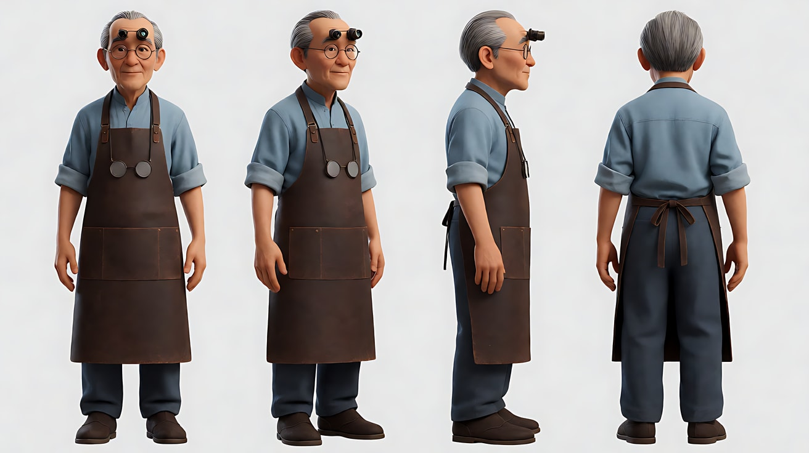
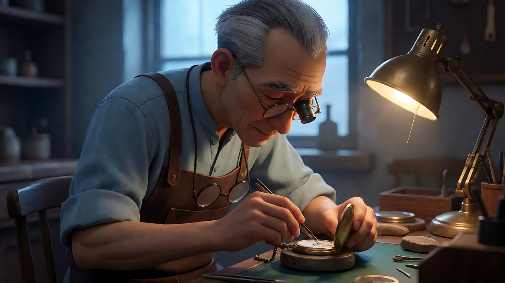
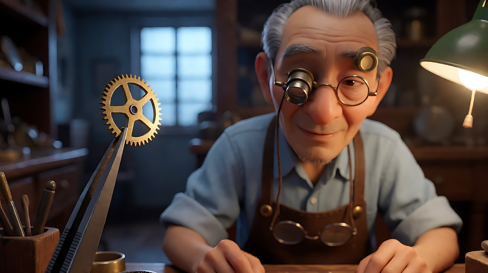
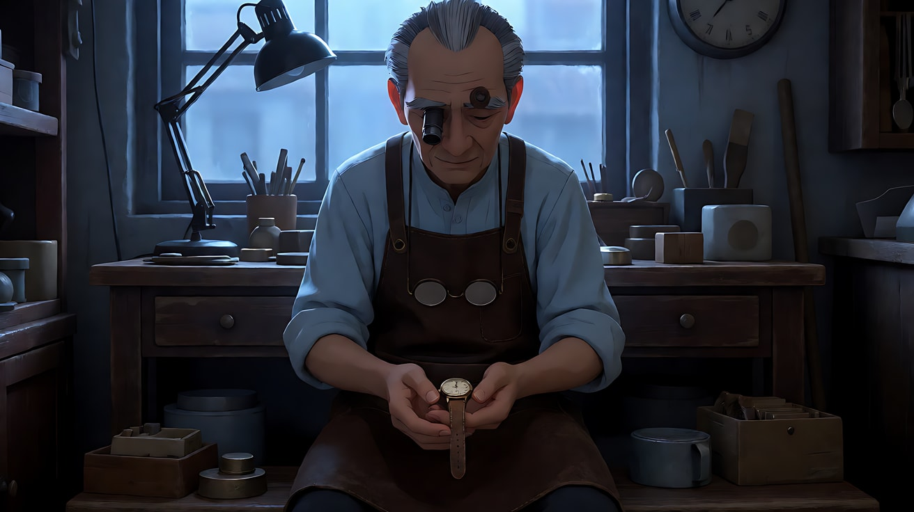
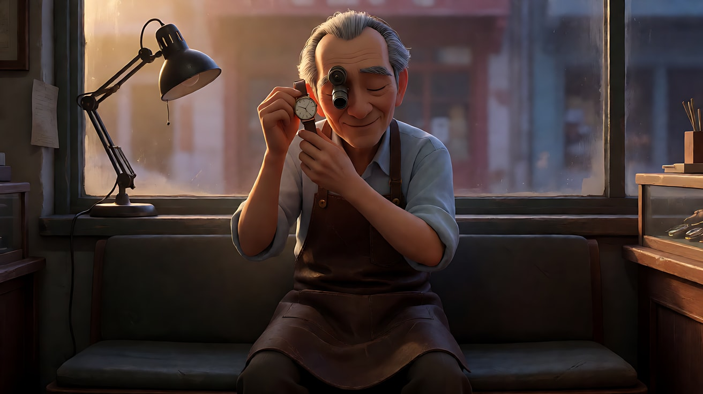
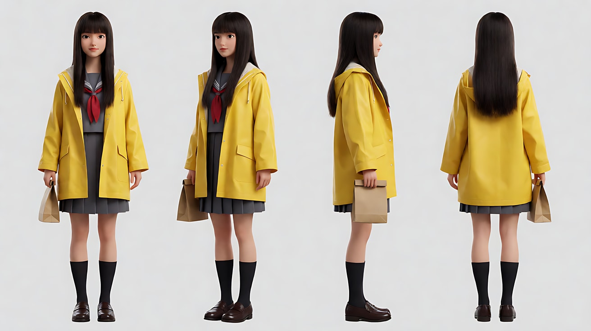
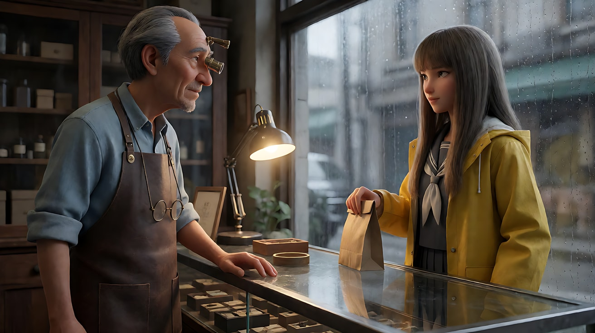

# L00-04 学习路线与五段位 · 段位测试提示词

> 本组练习：五道"段位测试题"，每道对应一个段位。从第一题做起，哪一题做不出合格结果，就从那个段位开始学。｜ 配套教学：[L00-04-学习路线与五段位](../教学/L00-04-学习路线与五段位.md) ｜ 规范：[写作规范](../../模板/写作规范.md)
>
> 每题先给"任务"，请你先自己写提示词，再对照下面的参考答案。所有题目共用一个原创角色"老周"（钟表匠）。

---

### 测试1：一段 · 入门——描述一个镜头（难度 ★）

**任务**：写一张关键帧，要求包含景别、机位、焦段、光源方向。内容：钟表匠在工作台前修表。

**【生图 · Nano Banana】参考答案**

图1 角色定妆：

```
Character turnaround sheet of an original elderly watchmaker named Lao Zhou: thinning grey hair combed back,
a jeweler's loupe pushed up on his forehead, a dark brown leather apron over a light blue shirt with rolled sleeves,
round wire-frame glasses hanging on a cord around his neck.
Front, three-quarter, side and back views, full body, plain light-grey background, even soft studio light.
Stylized semi-realistic 3D CG rendering, feature-film animation quality. Aspect ratio 16:9.
```



图2 关键帧：

```
Using the character from image 1: a medium shot of Lao Zhou sitting at a cluttered wooden watch repair bench,
bending over an open pocket watch with tweezers, the loupe now over his right eye.
Camera at seated eye level from the front-left, 50mm lens, moderate depth of field.
Lighting: a single warm brass desk lamp from frame right as the key light, the rest of the small shop in soft shadow,
a cool blue window glow far behind him.
Keep the face, hairstyle and outfit exactly as in image 1.
Stylized semi-realistic 3D CG rendering, feature-film animation quality. Aspect ratio 16:9.
```



**【图生视频 · Seedance】参考答案**

```
【素材分工】@图片2 为首帧；@图片1 锁定人物身份与服装。
【画风】风格化写实三维CG质感，电影级布光。
老周用镊子夹起一枚极小的齿轮，屏住呼吸，把它轻轻放进怀表机芯，然后放下镊子，摘下放大镜，靠回椅背。镜头固定中景，不移动。台灯暖光不变。
【声音】满墙钟表此起彼伏的滴答声，镊子碰到金属的细微声响，一声长长的呼气，无配乐。
【约束】保持人物脸型、发型、服装不变；不要字幕、水印、Logo。
时长：6秒
```

**合格标准**：人物与定妆图一致；画面里能看出台灯是主光；动作清楚。

---

### 测试2：二段 · 基础——控制观众看哪里（难度 ★★）

**任务**：同一个工作台，拍出"观众先看齿轮、再看老周的眼睛"的效果。提示：浅景深 + 焦点转移。

**【生图 · Nano Banana】参考答案**

图3 首帧（焦点在前景齿轮）：

```
Using the character from image 1, same watch repair shop and lighting as image 2:
an extreme close-up composition with a tiny brass gear held in tweezers sharp in the foreground on the left third,
Lao Zhou's face behind it in the background on the right, softly out of focus, his eye behind the loupe.
Camera at bench level, 100mm macro lens, very shallow depth of field.
Lighting: warm desk lamp from frame right catching the gear's teeth with a bright highlight.
Keep the face, hairstyle and outfit exactly as in image 1.
Stylized semi-realistic 3D CG rendering, feature-film animation quality. Aspect ratio 16:9.
```



**【多图生视频 · Seedance】参考答案**

上传顺序：图片1 = 定妆图，图片2 = 中景关键帧，图片3 = 齿轮首帧。

```
【素材分工】@图片3 为首帧；@图片1 锁定人物身份与服装；@图片2 仅参考店铺布局与台灯光线。
【画风】风格化写实三维CG质感，电影级布光。
镜头固定不动。起初焦点在前景镊子夹着的铜齿轮上，齿边被台灯照出一道亮光，老周的脸在背景里模糊。随后焦点缓慢从齿轮转移到老周的眼睛上，齿轮变成前景虚影，他透过放大镜的眼睛变得清晰，眨了一下眼。
【声音】钟表滴答声，极轻的呼吸声，无配乐。
【约束】保持人物脸型、服装不变；镜头不移动，只改变焦点；不要字幕、水印、Logo。
时长：5秒
```

**合格标准**：镜头不动，只有焦点移动；结尾观众的视线自然落在眼睛上。

---

### 测试3：三段 · 进阶——用光和运镜表达情绪（难度 ★★★）

**任务**：意图是"让观众感到他修好了一块对他很重要的表"。用首尾帧，光从冷变暖，运镜只用一个推镜。

**【生图 · Nano Banana】参考答案**

图4 首帧：

```
Using the character from image 1, same shop as image 2, at dawn:
a medium shot of Lao Zhou sitting very still at the bench, holding a small silent wristwatch with a worn leather strap in both palms,
looking down at it. The desk lamp is switched off; only cold blue pre-dawn light from the window behind him,
his face mostly in shadow.
Camera at seated eye level, 50mm lens, moderate depth of field.
Keep the face, hairstyle and outfit exactly as in image 1.
Stylized semi-realistic 3D CG rendering, feature-film animation quality. Aspect ratio 16:9.
```



图5 尾帧：

```
Using the same location, character and camera direction as image 4, but a closer medium close-up:
Lao Zhou holds the same wristwatch close to his ear, eyes closed, a faint smile.
The first warm golden sunrise light now enters through the window and falls across his face and hands.
Keep the face, hairstyle and outfit exactly as in image 1.
Stylized semi-realistic 3D CG rendering, feature-film animation quality. Aspect ratio 16:9.
```



**【首尾帧生视频 · Seedance】参考答案**

上传顺序：图片1 = 定妆图，图片2 = 图4 首帧，图片3 = 图5 尾帧。

```
【素材分工】@图片2 为首帧；@图片3 为尾帧，是最终画面目标；@图片1 锁定人物身份与服装。只生成两帧之间的连续动作。
【画风】风格化写实三维CG质感，电影级布光。
老周用拇指轻轻拨动手表的表冠，停顿，把手表慢慢举到耳边，闭上眼睛听。窗外第一缕暖金色晨光从窗沿移进来，慢慢爬上他的手和脸。镜头从中景极缓慢地推近到中近景，在他微笑出现时停下。
【声音】满屋钟表的滴答声逐渐退远，只剩手中这块表细小清晰的滴答声，无配乐。
【约束】保持人物脸型、服装与手表外观不变；中间动作连续，不跳切；不要字幕、水印、Logo。
时长：8秒
```

**合格标准**：光从冷变暖与"表走起来"同步发生；声音从满屋滴答收窄到一块表。

---

### 测试4：四段 · 高级——讲一场戏（难度 ★★★★）

**任务**：老周和一位来取表的年轻女孩，15 秒对话戏，含正反打，机位不越轴。

**【生图 · Nano Banana】参考答案**

图6 女孩定妆：

```
Character turnaround sheet of an original young woman in her early twenties: long straight hair with a fringe,
a yellow raincoat over a grey school-style uniform, a small paper bag in her hand.
Front, three-quarter, side and back views, full body, plain light-grey background, even soft studio light.
Stylized semi-realistic 3D CG rendering, feature-film animation quality. Aspect ratio 16:9.
```



图7 双人首帧：

```
Using Lao Zhou from image 1 and the young woman from image 6, inside the watch shop from image 2, rainy afternoon:
a medium two-shot across the glass counter, Lao Zhou standing behind the counter on the left facing right,
the young woman on the right facing left, rain streaks on the shop window behind her.
Camera at standing eye level, positioned on the street-window side of the counter, 40mm lens, moderate depth of field.
Lighting: warm desk lamp on the counter between them, cool grey daylight from the window.
Keep both characters' faces, hairstyles and outfits exactly as in their reference sheets.
Stylized semi-realistic 3D CG rendering, feature-film animation quality. Aspect ratio 16:9.
```



**【多图生视频 · Seedance】参考答案**

上传顺序：图片1 = 老周定妆图，图片2 = 女孩定妆图，图片3 = 店铺中景图，图片4 = 双人首帧。

```
【素材分工】@图片1 锁定老周身份与服装；@图片2 锁定女孩身份与服装；@图片3 仅参考店铺布局；@图片4 为首帧，决定两人站位与光线。
【画风】风格化写实三维CG质感，电影级布光。
镜头1：固定双人中景，老周把一块旧手表放在玻璃柜台上，推向女孩。女孩低头看着手表，没有伸手。雨声和满屋滴答声。
镜头2：镜头切至越过女孩肩膀拍老周的过肩中近景，老周看着她，轻声说："你爷爷每周都来上一次弦。"
镜头3：镜头切至越过老周肩膀拍女孩的过肩中近景，女孩伸手拿起手表，贴在耳边，眼眶慢慢泛红，抿住嘴唇。
镜头4：镜头切至柜台上的特写，她把手表戴在自己手腕上，扣好表带。表扣轻响。
【锁定】光线：柜台上的暖色台灯在两人之间，窗外冷灰色天光；老周始终在画左面朝右，女孩始终在画右面朝左；机位始终在柜台靠橱窗的一侧，不越轴。
【声音】窗外雨声与店内钟表滴答声贯穿；老周的台词低沉温和；无配乐。
【约束】保持两人脸型、发型、服装不变；不要字幕、水印、Logo。
时长：15秒
```

**合格标准**：四个镜头都切开；正反打中两人的左右位置不跳；台词清楚。

---

### 测试5：五段 · 大师——用风格统一一个三段故事（难度 ★★★★★）

**任务**：为"老周最后一天开店"设计三个片段，选定一种导演声音，三个片段的景别、光、运镜按"开端 → 上升 → 转折"演进，最后一段是"打破规律"的镜头。

**参考设计**

- 导演声音：亲密极简（近距离、小运镜、单一柔光、少切镜）
- 规律：前两段都是缓慢推镜、暖色台灯
- 打破：第三段是全片唯一的大远景、唯一的固定镜头、唯一的自然光

| 片段 | 位置 | 意图 | 景别趋势 | 光 | 运镜 |
|---|---|---|---|---|---|
| 片段一 | 开端 | 他像往常一样开店 | 中景 | 暖台灯 | 缓慢推近 |
| 片段二 | 上升 | 他一块块取下墙上的钟 | 中近景到近景 | 暖台灯，墙上的钟越来越少 | 缓慢推近 |
| 片段三 | 转折 | 他锁门离开，店里只剩一块钟在走 | 大远景 | 自然天光 | 固定 |

**【片段三 · Seedance】参考答案**（片段一、二请你按表格自己写）

上传顺序：图片1 = 老周定妆图，图片2 = 片段二最后一帧截图，图片3 = 店铺外街景图（自行生成：老店门面、黄昏、无人）。

```
【素材分工】@图片1 锁定老周身份与服装；@图片2 仅参考店内陈设的最终状态（墙上只剩一块钟）；@图片3 仅参考店铺外的街道与门面布局。
【画风】风格化写实三维CG质感，自然光。
镜头1：固定中景，店内，墙上只剩一块挂钟。老周关掉台灯，屋里暗下来，只剩窗外黄昏的天光。他拿起外套，看了一眼那块钟，没有取下它。挂钟滴答声。
镜头2：镜头切至街对面的固定大远景，老店门面在画面中很小，老周从店里走出来，锁上门，在门口站了一会儿，然后沿着街道向画左慢慢走远，消失在人群里。店里那块钟的滴答声仍隐约可闻，街上的车声和人声渐渐盖过它。
【锁定】光线：黄昏自然天光，店内台灯已关；老周始终穿棕色皮围裙外的深色外套；他始终向画左离开。
【声音】从店内唯一的滴答声，过渡到街道环境声，无配乐。
【约束】保持人物脸型、服装不变；镜头完全固定；不要字幕、水印、Logo。
时长：12秒
```

**合格标准**：三个片段放在一起看，前两段的"推镜 + 暖灯"规律清楚，第三段的"固定 + 大远景 + 自然光"让观众感到"结束了"。

---

## 测试结果怎么用

| 你卡在 | 从这里开始学 |
|---|---|
| 测试1 | [01 景别](../../01-景别/教学/L01-01-八种基本景别.md) |
| 测试2 | [02 景深与焦段](../../02-景深与焦段/教学/L02-01-景深三要素.md) |
| 测试3 | [04 光影与色彩](../../04-光影与色彩/教学/L04-01-光的基础.md) |
| 测试4 | [06 镜头语言综合与分镜](../../06-镜头语言综合与分镜/教学/L06-01-镜头合同.md) |
| 测试5 | [07 世界导演风格](../../07-世界导演风格/教学/L07-00-风格拆解方法论.md) |
| 全部合格 | 直接做 [09 毕业项目](../../09-毕业项目/教学/L09-01-从剧本到成片.md) |
