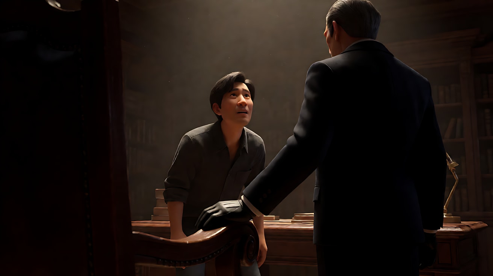

# L00-01 导演思维：用一个意图统领所有工具

> 段位：入门 ｜ 建议用时：45 分钟 ｜ 配套提示词：[L00-01-导演思维-提示词](../提示词/L00-01-导演思维-提示词.md)

## 学习目标

- 理解"好看的画面"和"有意图的镜头"的区别
- 学会用一句话写出镜头的**导演意图**
- 认识导演的九种工具：景别、角度、焦段、运镜、光、色彩、调度、表演、声音
- 能检查一个提示词里的所有选择是否指向同一个意图

## 一、概念讲解

### 1. "电影感"不是一个决定

新手最常写的提示词是："电影感，史诗级，唯美，大片质感"。这些词描述的是**你希望观众有的感受**，没有说**怎么让观众产生这个感受**。模型拿到这种词，只能给你一个"平均好看"的画面。

导演的工作方向正好相反：

```
场景要对观众做什么  →  一句话意图  →  每件工具都为这句话服务
```

### 2. 一句话意图

意图句格式：**让观众感到 + [具体的变化]**

| 场景 | 差的意图 | 好的意图 |
|---|---|---|
| 分手 | 拍得很伤感 | 让观众感到他意识到一切已经结束的那一刻 |
| 产品 | 拍得很高级 | 让观众感到这块表的金属有重量 |
| 追逐 | 拍得很刺激 | 让观众感到追的人每一步都在缩短距离 |

好的意图一定包含**一个变化**（转折）：从安全到危险、从陌生到信任、从希望到失望。没有变化的镜头只是装饰。

### 3. 导演的九种工具


| 工具 | 它管什么 | 怎么服务意图 |
|---|---|---|
| 景别 | 距离 = 亲密或审视 | 越近越进入内心，越远越看到处境 |
| 角度 | 权力 | 仰拍赋权，俯拍削弱，平视平等 |
| 焦段 | 心理空间 | 长焦压缩、孤立；广角打开空间、制造压迫 |
| 运镜 | 观众的冲动 | 推 = 靠近领悟；拉 = 抽离或揭示；不动 = 屏住呼吸 |
| 光 | 情绪曝光度 | 明暗比、光的方向和色温决定安全或威胁 |
| 色彩 | 记忆与温度 | 暖 = 亲密；冷 = 疏离；冷暖同框 = 内心撕裂 |
| 调度 | 人物关系 | 谁靠近、谁离开画面、谁转身 |
| 表演 | 真实 | 一个看得见的动作，而不是情绪名词 |
| 声音 | 耳朵的感受 | 亲密时变稀薄，威胁时变浓密 |

**一致性原则**：九种工具服务同一个意图。每种工具单独看都很专业，但指向不同方向，结果就是"贵而空"。

### 4. 情绪必须变成动作

模型只能渲染看得见的行为。"她很悲伤"没有像素；"她把信折好，用手掌压平，没有抬头"有像素。

| 情绪名词 | 可拍的动作 |
|---|---|
| 紧张 | 手指反复摩擦杯沿，眼睛没离开门口 |
| 决心 | 把戒指摘下，放在桌上，推远 |
| 震惊 | 动作停在半空，嘴唇微张，呼吸停一拍 |
| 释然 | 肩膀落下来，长出一口气，靠回椅背 |

## 二、情绪与叙事功能

导演思维的本质是**替观众做选择**：看哪里、离多近、什么时候知道真相。每个选择都要能回答"因为意图是……"。

## 三、经典影片案例

### 《教父》（1972，弗朗西斯·福特·科波拉）开场
- 场景：昏暗书房，一个人向教父求助。
- 怎么拍的：镜头从求助者的大特写**极慢地拉远**，最后露出教父的背影和手。顶光让教父眼窝陷在阴影里。
- 为什么：意图是"让观众感到权力在谁手里"。拉远让求助者变小，顶光让教父不可读，这些选择都指向"这个人掌控一切"。



### 《花样年华》（2000，王家卫）走廊擦肩
- 场景：两人在窄楼梯擦肩而过。
- 怎么拍的：慢动作、固定机位、前景遮挡、配乐重复。
- 为什么：意图是"让观众感到两人想靠近又不敢"。遮挡与窄空间制造距离，慢动作拉长那一瞬间的克制。


## 四、在 AI 中怎么实现

- **生图阶段**：先写意图，再决定景别、机位、光。不要先写"电影感"。
- **视频阶段**：入门先让一个片段承载一个意图、一个可见的转折、一个主运镜、一个有来源的光。这是简化练习的方法，不是模型容量限制；进阶可以让多个动作与运镜共同服务一个意图。
- **模型擅长**：天气、光、布料、灰尘、水、火、远处人群；一个人做一个清楚的动作。
- **要避开**：多人肢体接触、手部精细操作、面部微表情独撑全场、"意外"作为高潮。

## 五、练习作业

1. 选三部你看过的电影，各挑一个镜头，写出它的一句话意图。
2. 把"一对老夫妻在厨房吃早餐"写成三个不同意图（温馨 / 冷战 / 告别），每个意图列出景别、光、声音各一项选择。
3. 完成配套提示词的练习1–4，对比"空泛版"和"意图版"的生成结果。

## 六、自检清单

- [ ] 我能用"让观众感到……"写出意图句
- [ ] 意图句里有一个变化
- [ ] 我的提示词里没有"电影感、史诗、唯美、8K"
- [ ] 情绪都写成了可见动作
- [ ] 景别、光、运镜、声音指向同一个意图

## 七、配套提示词

→ [L00-01-导演思维-提示词](../提示词/L00-01-导演思维-提示词.md)

---

上一课：无 ｜ 下一课：[L00-02 AI 影像工作流](L00-02-AI影像工作流.md) ｜ [返回总目录](../../README.md)
