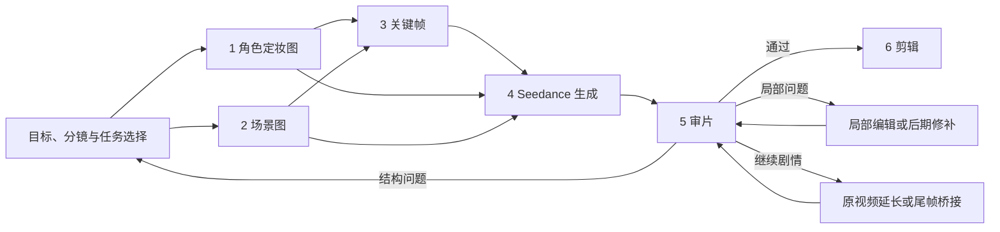
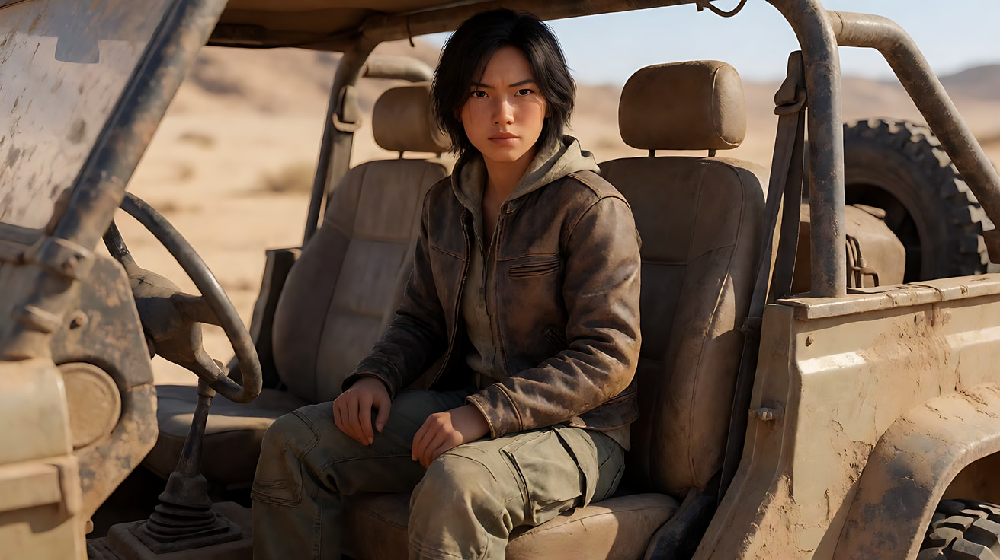
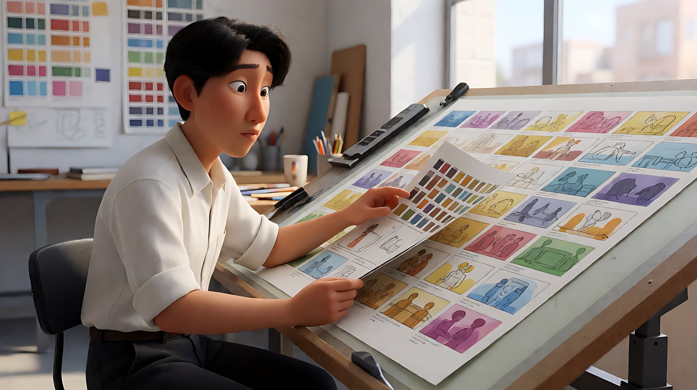

# L00-02 AI 影像工作流：Nano Banana + Seedance

> 段位：入门 ｜ 建议用时：60 分钟 ｜ 配套提示词：[L00-02-AI影像工作流-提示词](../提示词/L00-02-AI影像工作流-提示词.md)

## 学习目标

- 理解"先定妆、再定景、再出关键帧、最后动起来"的四步流程
- 会用 Nano Banana 生成一致的角色定妆图、场景图和关键帧
- 掌握素材编号与对象映射，给图片、视频和声音明确分工
- 分清参考、专门首尾帧、编辑与延长任务，不把文字意图当成实际控制

## 一、概念讲解

### 1. 先选目标，再选任务

直接文生视频适合探索创意；跨片段需要稳定身份与空间时，再准备**定妆**、**定景**与关键帧。不是所有任务都必须先生成全套图片：已有好片段只需改一句话，可以直接编辑；空间走位复杂时，先做粗白模预演更有针对性。

### 2. 四类图片素材

| 素材 | 作用 | 生图要点 |
|---|---|---|
| 角色定妆图 | 锁定长相、发型、服装、道具 | 纯色背景、均匀光、正面/四分之三/侧面/背面 |
| 场景图 | 锁定空间布局、陈设、主光方向 | 无人物；写清时间、天气、光源 |
| 关键帧 | 锁定某个镜头的景别、构图、光、动作起点 | 上传定妆图和场景图做参考，写清景别与机位 |
| 尾帧 | 锁定动作的终点 | 与首帧同机位同光，只改人物状态 |

### 3. Nano Banana 一致性三招

1. **定妆图先行**：后面所有关键帧都上传定妆图，并写 `Use the character from image 1; keep the face, hairstyle and outfit exactly the same.`
2. **一次只改一件事**：基于上一张关键帧修改时，写 `Same framing and lighting as the reference image; only change ...`
3. **描述不重复**：参考图里已经有的东西（衣服颜色、发型）不要在文字里再写一遍不同的说法，避免冲突。

### 4. 素材映射：谁控制什么

本课用 `@图片N`、`@视频N`、`@音频N` 表示按上传顺序绑定的素材；具体标签以入口为准。数量与总时长限制查 [A-04 版本表](../../附录/A-04-官方案例与版本差异.md)，不要把旧版 9 张图、12 个文件上限当成通用规则。

**每个引用只做一件主要的事，并说明不转移什么：**

| 用途 | 写法 |
|---|---|
| 首帧 | `@图片3 为首帧` |
| 尾帧 | `@图片4 为尾帧，是最终画面目标` |
| 人物身份 | `@图片1 锁定人物身份与服装` |
| 场景 | `@图片2 仅参考场景布局与光线，不复制其中人物` |
| 运镜 | `@视频1 仅参考运镜节奏，不复制人物、场景与服装` |
| 动作 | `@视频1 仅参考动作编排` |
| 节奏 | `@音频1 仅参考节奏与氛围` |

**同一个维度要有明确的依据。** 多张图可以共同补充同一角色的不同角度，但不能让同一时刻的光线同时朝两个相反方向。

把多模态映射写成“编号 → 对象 → 维度 → 不转移项”：图片1管阿禾的外观；视频1管运镜路径；音频1管阿禾的音色，不带入原台词。参考足够准确时少复述；如果白模只有几何体，仍要补充角色外观、剧情与声音，并让文字路线和白模一致。

### 5. 四种生成模式

| 模式 | 输入 | 适合 | 提示词重点 |
|---|---|---|---|
| 图生视频 | 1 张首帧 | 单镜头动起来 | 只写图里没有的：动作、运镜、光变、声音 |
| 多图参考 | 定妆 + 场景 + 首帧等 | 有人物有场景的叙事镜头 | 每张图的用途与不转移项 |
| 专门首尾帧 | 在入口指定首帧 + 尾帧，比例一致 | 强化起止构图约束 | 写中间过渡；仅在普通参考中写“为首帧”不是专门模式 |
| 延长 / 接续 | 原视频延长；或取尾帧另生成 | 连续剧情 | 两种任务分开理解；静态尾帧没有完整运动与声音上下文 |

### 6. 故事板、关键帧与白模怎么选

| 你的主要问题 | 先准备什么 | 验收重点 |
|---|---|---|
| 事件顺序不清 | 简约线稿宫格故事板 | 剧情顺序，而非逐格复刻 |
| 关键镜头构图跑偏 | 分开上传关键帧，或用专门首尾帧任务 | 对应节点的构图与终点 |
| 人物路线、摄影机位置不清 | 简单几何体的白模视频 | 地标、遮挡、主体轨迹与镜头路径 |
| 已有结果只有一处不对 | 原视频 + 编辑范围 + 改动与保持项 | 目标范围、两端接点、未编辑部分 |

**官方说明**：2.5 支持上述参考与编辑能力。**课程建议**：先解决最影响叙事的一个问题，再加复杂度；具体练习待实测。参考[多主体音乐会案例](../../附录/A-04-官方案例与版本差异.md#case-ensemble)，观察其素材分工，不必照搬素材数量。

## 二、情绪与叙事功能

工作流本身不产生情绪，但它决定你能不能**控制**情绪：人物在每个镜头里都是同一个人，观众才会对他产生感情；光线方向在各镜头间一致，观众才不会出戏。

## 三、经典影片案例

### 《疯狂的麦克斯：狂暴之路》（2015，乔治·米勒）
- 做法：开拍前先画了约 3500 格分镜，几乎没有传统剧本，整部电影按分镜执行。
- 启示：先把画面定下来再生产，就是"关键帧先行"。AI 工作流里的关键帧就是你的分镜格。

### 皮克斯的"色彩脚本"（Color Script）
- 做法：皮克斯在制作动画长片前，会先画出整部片每个段落的色彩小稿，用来规划情绪起伏。
- 启示：生成视频前先排好每个片段的光和色，片段之间才连贯。

## 四、在 AI 中怎么实现

- **生图阶段**：定妆图用纯色背景；场景图不放人；关键帧同时上传定妆图和场景图。
- **视频阶段**：素材足够清楚时少复述已有细节，多写变化与用途。普通参考指导构图，专门首帧任务加强开场约束；不要承诺绝对不变。
- **人脸策略**：默认原创风格化 CG 是教学选择。肖像、声音与参考素材需获授权，审核规则按实际使用入口核对，不保证某种画风一定通过。
- **要避开**：一次上传很多张"差不多"的图却不写用途；用两张图争夺同一个维度；在提示词里重新描述衣服颜色导致和定妆图冲突。

## 五、练习作业

1. 为一个原创角色生成定妆图，检查四个角度的服装是否一致。
2. 生成一个无人场景图，再生成该角色在此场景中的两张关键帧（中景、近景）。
3. 用同一组素材分别跑一次"图生视频"和"多图参考生视频"，对比人物稳定性。
4. 完成提示词练习5 的多模态接续：分别指出身份、开场状态、运镜、音色由哪份素材负责。支持原视频延长时，再与尾帧参考版比较动态与声音接缝。

## 六、自检清单

- [ ] 定妆图背景干净、四个角度一致
- [ ] 场景图里没有人物
- [ ] 关键帧上传了定妆图和场景图做参考
- [ ] Seedance 提示词里每个 `@图片N` 都写了用途
- [ ] 没有两张图争夺同一个维度
- [ ] 素材数量与音视频总时长符合当前版本及使用入口限制
- [ ] 我能区分语义参考、专门首尾帧与原视频延长；没有把“写了首帧”当成模式已启用

## 七、配套提示词

→ [L00-02-AI影像工作流-提示词](../提示词/L00-02-AI影像工作流-提示词.md)

---

上一课：[L00-01 导演思维](L00-01-导演思维.md) ｜ 下一课：[L00-03 提示词公式与避坑](L00-03-提示词公式与避坑.md) ｜ [返回总目录](../../README.md)
