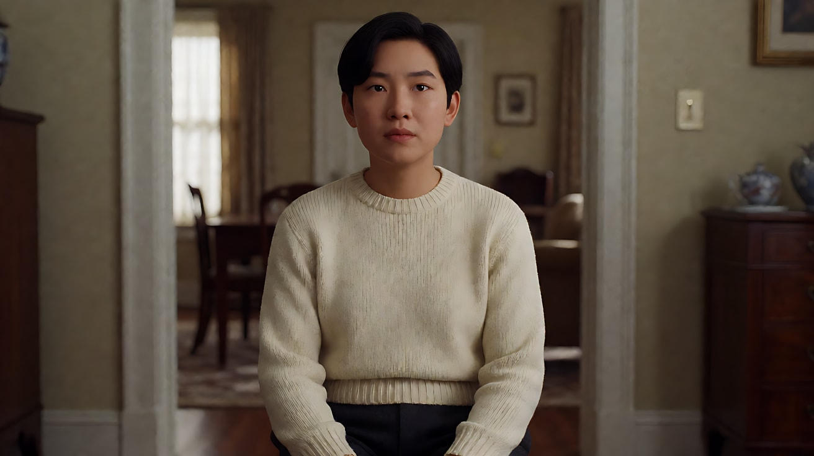
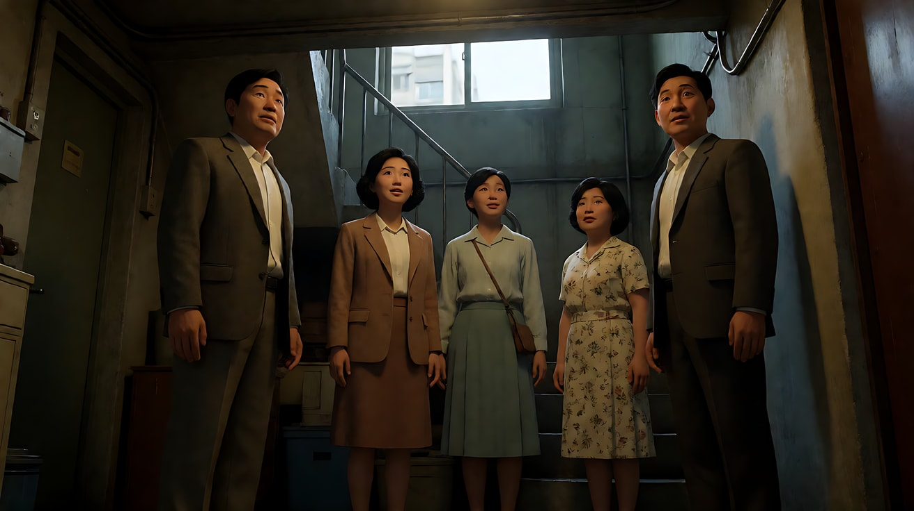

# L00-03 提示词公式与避坑

> 段位：入门 ｜ 建议用时：50 分钟 ｜ 配套提示词：[L00-03-提示词公式与避坑-提示词](../提示词/L00-03-提示词公式与避坑-提示词.md)

## 学习目标

- 背下生图提示词的六段公式和 Seedance 提示词的两种形态
- 会写"镜头合同"：景别、角度、焦段、支撑方式、运镜、起点、终点、易损锚点
- 能识别并改掉七类常见错误
- 知道参考、时间编排与后期精修的边界，并区分 2.0 与 2.5

## 一、概念讲解

### 1. 生图六段公式

```
[主体与动作] + [场景与时间] + [景别与构图] + [机位与焦段/景深] + [光源与色彩] + [画风与画幅]
```

| 段 | 示例 |
|---|---|
| 主体与动作 | An original young chef wiping her hands on her apron |
| 场景与时间 | in a narrow restaurant kitchen just before dinner service |
| 景别与构图 | medium shot, placed on the left third, steam rising on the right |
| 机位与焦段/景深 | eye level, 50mm lens, shallow depth of field |
| 光源与色彩 | hard warm light from the pass window behind her, cool fluorescent fill from above |
| 画风与画幅 | Stylized semi-realistic 3D CG rendering. Aspect ratio 16:9. |

### 2. Seedance 视频公式

```
【素材分工】每张图的用途 + 不转移什么
【画风】一句话
从[起始画面：场景、光、景别]开始，[一个运镜：方式与速度]，同时[主体动作]，结束在[结尾画面]。
【声音】环境声 / 动作音 / 对白 / 是否有配乐
【约束】保持什么不变；不要字幕、水印、Logo
时长：X秒
```

场景、光和景别写在起始画面里。运镜和主体动作同时进行。结尾画面就是这次运镜停下的那一帧。

多事件时改成分镜形态：`镜头1：…… 镜头2：镜头切至…… 镜头3：……`，末尾加【锁定】行。

> **版本提示**：2.0 通常推荐镜号，不强求精确时间段；2.5 官方指南支持镜号和时间戳。导演先确定事件因果，再决定用阶段词还是整数秒时间轴。区间连续，内容量和时间相称；逐帧落点仍需验收。依据见 [A-04](../../附录/A-04-官方案例与版本差异.md)。

**同一件事的三种写法（课程示例，待实测）**

她走到门边敲门，再切到近景抬头等待。总长 8 秒。

```shot 镜号版 · 2.0 与 2.5
镜头1：固定中景，她走到门边，敲门后收回手。
镜头2：镜头切至近景，她听到屋内回应，抬头等待。
```

```shot 阶段词版 · 先写因果
起初：固定中景，她走到门边，敲门后收回手。
随后：镜头切至近景，她听到屋内回应，抬头等待。
```

```shot 时间轴版 · 2.5 整数秒
0–4秒：固定中景，她走到门边，敲门后收回手。
4–8秒：镜头切至近景，她听到屋内回应，抬头等待。
```

三种写法选一种即可，切镜仍然要说清。时间戳不是让模型按机械频率执行“一秒敲三次”的办法。

### 3. 镜头合同

每个专业镜头都要回答这八个问题：

| 字段 | 问题 | 示例 |
|---|---|---|
| 景别 | 拍多大 | 中近景 |
| 角度 | 从哪看 | 略低于眼平的仰角 |
| 焦段感 | 空间感觉 | 85mm 人像压缩 |
| 支撑方式 | 摄影机装在什么上 | 轨道 / 手持 / 三脚架 / 无人机 |
| 运镜 | 怎么动 | 缓慢推近 |
| 起始画面 | 第一眼看到什么 | 她低头看信的中景 |
| 终点画面 | 最后停在哪 | 她抬眼的近景 |
| 易损锚点 | 什么不能变 | 脸、手、信纸上的字、戒指 |

句式：`镜头：[景别/角度/焦段]。从[起始构图]开始，以[速度][一个运镜]，同时[主体动作]，结束在[终点画面]。保持[易损锚点]不变。`

### 4. 结尾的六种形态

| 形态 | 结尾状态 | 什么时候用 |
|---|---|---|
| 收束 | 动作完成，画面稳定 | 独立片段 |
| 延长锚点 | 动作、视线、运镜仍在进行 | 下一段要接着拍 |
| 循环接缝 | 结尾与开头位置、速度一致 | 循环背景、产品旋转 |
| 英雄定格 | 主体稳定、清晰、停留足够久 | 产品、Logo、关键道具 |
| 剪辑点 | 声画都落在干净的边界 | 要插进更大的剪辑里 |
| 揭示 / 爆点 | 高潮正好落在最后一帧 | 惊吓、笑点、反转 |

## 二、七类常见错误

| 错误 | 例子 | 改法 |
|---|---|---|
| 空泛词 | 电影感、史诗、唯美、8K | 换成景别、焦段、光源、运镜 |
| 引用模糊 | "参考 @视频1" | "@视频1 仅参考运镜节奏，不复制人物与场景" |
| 指令冲突 | 同一时段"固定镜头"又"环绕" | 入门先用一个主运镜；分阶段变化写清触发点 |
| 内容过载 | 5 秒里换三个地点 | 按负载阶梯拆成多段 |
| 素材无归属 | 上传 5 张图只写 2 个 @ | 每张都写用途，用不上的就别传 |
| 情绪名词 | "她很绝望" | "她松开手，信纸滑到地上，她没去捡" |
| 缺少可见因果 | "不小心打翻杯子" | 写“衣袖碰到杯沿，杯子倾斜”；复杂接触也可放到画外 |

## 三、经典影片案例

### 《公民凯恩》（1941，奥逊·威尔斯）
- 做法：威尔斯和摄影师格雷格·托兰德为每个镜头预先设计景深、机位和光，许多镜头前后景同时清晰。
- 启示：每个镜头都是一份"合同"，拍之前就决定好看哪里、什么清晰。



### 《寄生虫》（2019，奉俊昊）
- 做法：奉俊昊以分镜精细著称，开拍前把全片画成分镜本，拍摄基本按分镜执行。
- 启示：先把镜头合同写在纸上，再花钱生成，是最省钱的工作方式。



## 四、在 AI 中怎么实现

- **Seedance 擅长**：多镜头一次生成、原生音效与对白、多素材分工、首尾帧、天气、光、布料、水、火、远处人群。
- **需要重点审片**：文字、细小脸手、多人接触、微表情与音画同步。2.5 支持时间段编排，不等于保证精确到帧；需要逐帧剪辑时用后期完成。
- **提示词长度**：删去不影响目标的重复信息，没有全平台通用的“最佳词数”。准确参考少复述；白模缺失的外观、剧情与声音要补齐。
- **正向描述**：优先写希望看见的动作与结果。2.5 官方支持字幕、音乐、音效和对白的负向控制，但不把长串“不要变形”当作质量保证。
- **任务边界**：普通参考中的“@图片1 为首帧”是语义指导；专门首尾帧任务需在入口中真实指定。编辑任务写修改范围和保持项，不把全新剧情混入已有片段。

## 五、练习作业

1. 找一条你以前写过的提示词，按"七类常见错误"逐条检查并改写。
2. 为同一个镜头写出完整的镜头合同八个字段，再翻译成一句 Seedance 提示词。
3. 用配套提示词练习3，体会同一动作在"收束"和"延长锚点"两种结尾下的区别。
4. 完成练习6，用同一素材分别写镜号版和时间轴版。若有生成结果，只比较落点与动作完整度，不把一次成功解释成普遍规律。

## 六、自检清单

- [ ] 生图提示词六段都齐了
- [ ] Seedance 提示词有【素材分工】【声音】【约束】和时长
- [ ] 镜号或阶段顺序清楚；2.5 时间轴使用连续整数秒区间
- [ ] 运镜与动作没有同一时刻互相矛盾的要求
- [ ] 首尾帧控制与普通参考任务分清了，新增写法标注了待实测
- [ ] 结尾形态是有意选择的
- [ ] 没有空泛词和情绪名词

## 七、配套提示词

→ [L00-03-提示词公式与避坑-提示词](../提示词/L00-03-提示词公式与避坑-提示词.md)

---

上一课：[L00-02 AI 影像工作流](L00-02-AI影像工作流.md) ｜ 下一课：[L00-04 学习路线与五段位](L00-04-学习路线与五段位.md) ｜ [返回总目录](../../README.md)
