# L01-01 八种基本景别 · 提示词

> 本组练习：用同一个原创角色、同一个海边山城场景，把九档景别逐一拍出来，并练习三种改变景别的方式（单景别、人物走近、切镜）。｜ 配套教学：[L01-01-八种基本景别](../教学/L01-01-八种基本景别.md) ｜ 规范：[写作规范](../../模板/写作规范.md)
>
> 画风默认使用开关 A（风格化写实 CG）。如改用 2D 动画，删掉所有焦段、光圈、景深词。

**本组共用角色与场景**

- 角色：原创年轻女邮差，二十出头，齐下巴黑色短发，墨绿色制服外套配黄铜纽扣，芥末黄针织围巾，斜挎棕色帆布邮包，深色长裤，棕色系带短靴。
- 场景：海边山城，一条长长的石阶从山坡顶一直通向海边，两侧是白墙蓝门的小房子，傍晚，低角度的暖色夕阳从画右照来。

---

### 练习1：单景别图生视频——一个稳定的中景（难度 ★）

**目标**：先掌握"最中性"的叙事景别。用一张中景关键帧生成一个镜头，检查景别在整个片段中是否保持不变、人物切点是否始终在腰部。

**【生图 · Nano Banana】**

图1 中景关键帧：

```
A medium shot of an original young woman mail carrier in her early twenties, framed from the waist up:
chin-length black bob haircut, a dark green uniform jacket with brass buttons, a mustard-yellow knitted scarf,
a brown canvas mail bag across her body. She stands on a stone staircase between white-walled houses,
holding a letter in both hands and reading the address on it, her body turned three-quarters toward frame left.
She is placed on the right third of the frame, a blue wooden door softly visible behind her.
Camera at chest height, eye level, 50mm lens, moderate depth of field so the houses behind stay recognisable.
Lighting: low warm sunset light from frame right as the key, cool sky bounce from the left as fill.
Stylized semi-realistic 3D CG rendering, feature-film animation quality. Aspect ratio 16:9.
```

中文释义：中景（腰部以上），女邮差站在石阶上、双手拿信看地址，身体四分之三朝画左，位于右三分之一；胸口高度平视、50mm、中等景深；画右暖色夕阳为主光，左侧天空冷色反光为辅光。

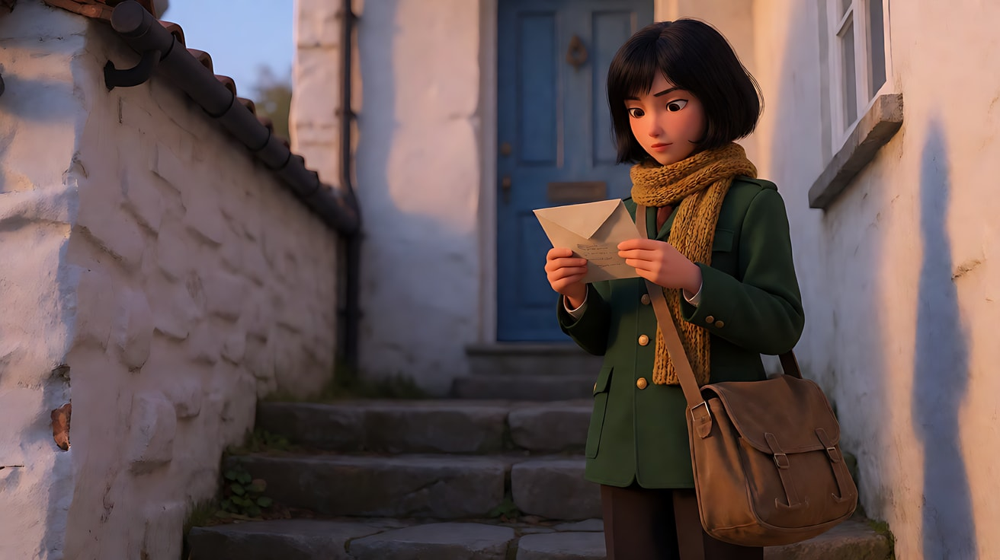

**【图生视频 · Seedance】**

```
【素材分工】@图片1 为首帧，锁定人物身份、服装、邮包与石阶场景布局，不新增其他人物。
【画风】风格化写实三维CG质感，电影级布光。
女邮差低头看手里信封上的地址，用拇指抹平信封一角，抬头望向画左上方的一扇蓝色木门，确认了一下，嘴角微微放松。镜头为固定中景，始终切在她的腰部，不推不拉。画右低角度的暖色夕阳照在她半边脸上，围巾边缘被风轻轻吹起。结尾停在她望向蓝门的四分之三侧脸上。
【声音】远处海浪声，海鸥叫两声，信纸被拇指抹过的沙沙声，无配乐。
【约束】保持人物脸型、发型、服装不变；景别保持中景不变；不要字幕、水印、Logo。
时长：5秒
```

**参数**：时长 5 秒 ｜ 画幅 16:9

**【检查点】**
- 从第一帧到最后一帧，画面下边框是否始终在腰部附近
- 抹平信封、抬头、看门三个小动作是否清楚
- 夕阳方向是否一直在画右

**【常见问题与修复】**
| 现象 | 修复 |
|---|---|
| 镜头自己推近成了近景 | 加"摄影机完全固定，景别不变" |
| 她转身走掉 | 写"她始终站在原地，不迈步" |
| 信封上的字乱码闪烁 | 不要求看清地址文字，写"信封正面朝向她自己，观众看不到字" |

---

### 练习2：景别阶梯关键帧 + 多图参考生视频（难度 ★★）

**目标**：用一张定妆图和一张场景图，生成同一角色、同一场景的九档景别关键帧，做成"景别阶梯对照图"；再选其中的全景，用多图参考生成一个视频。

**【生图 · Nano Banana】**

图1 角色定妆：

```
Character turnaround sheet of an original young woman mail carrier in her early twenties:
chin-length black bob haircut, a dark green uniform jacket with brass buttons, a mustard-yellow knitted scarf,
a brown canvas mail bag worn across the body, dark trousers, brown lace-up ankle boots.
Front view, three-quarter view, side view and back view, full body, standing on a plain light-grey background.
Camera at chest height, eye level, 50mm lens, deep focus so every detail is sharp.
Even soft studio light from the front, no shadows on the backdrop.
Stylized semi-realistic 3D CG rendering, feature-film animation quality. Aspect ratio 16:9.
```

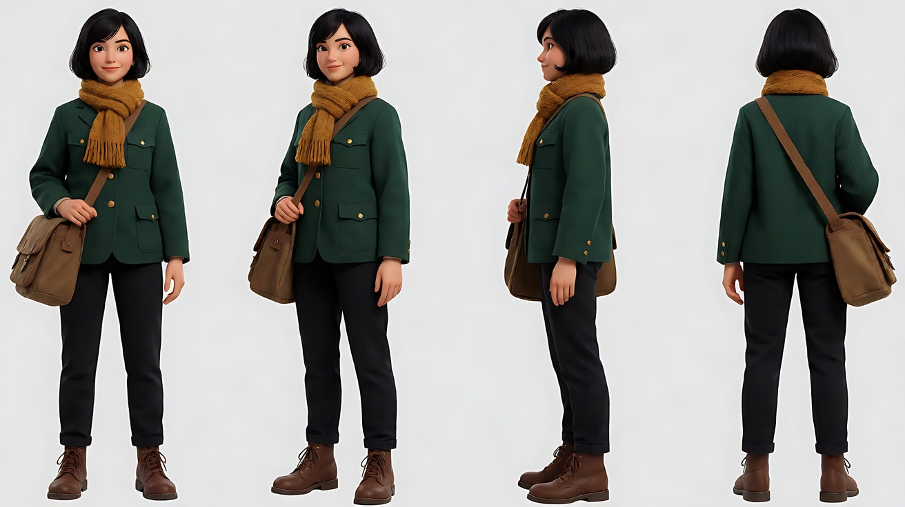

图2 场景（空镜）：

```
Empty seaside hillside town at sunset, a long stone staircase running from the top of the hill down to the sea,
white-walled houses with blue wooden doors on both sides, potted plants on the steps, the sea glowing at the bottom,
low warm sunlight from frame right casting long shadows across the steps, a few seagulls in the sky, no people.
Wide shot from the middle of the staircase looking down, eye level, 24mm lens, deep focus.
Stylized semi-realistic 3D CG rendering, feature-film animation quality. Aspect ratio 16:9.
```

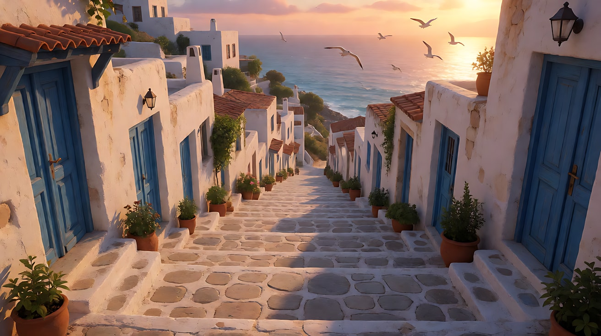

图3–图11 景别阶梯（共用句式，只替换【景别句】）：

```
Using the character from image 1 and the location from image 2:
[景别句]
Lighting: low warm sunset light from frame right as the key, cool sky bounce from the left as fill.
Keep the face, hairstyle and outfit exactly as in image 1.
Stylized semi-realistic 3D CG rendering, feature-film animation quality. Aspect ratio 16:9.
```

| 图号 | 景别 | 【景别句】 |
|---|---|---|
| 图3 | 大远景 | `An extreme wide shot of the whole hillside town and the sea; the mail carrier is a tiny figure on the staircase, less than one tenth of the frame height. Camera high on the opposite hill, 35mm lens, deep focus f/11.` |
| 图4 | 远景 | `A wide shot of the mail carrier walking down the staircase, her whole body visible but only about one third of the frame height, houses on both sides. Camera at eye level below her on the steps, 28mm lens, deep focus.` |
| 图5 | 全景 | `A full shot of the mail carrier standing on a step, head to toe fully in frame with a little space above her head and below her boots. Camera at eye level, 35mm lens, deep focus.` |
| 图6 | 中全景 | `A medium full shot (cowboy shot) of the mail carrier framed from mid-thigh up, one hand on the strap of her mail bag. Camera at eye level, 40mm lens, moderate depth of field.` |
| 图7 | 中景 | `A medium shot of the mail carrier framed from the waist up, holding a letter in both hands. Camera at chest height, 50mm lens, moderate depth of field.` |
| 图8 | 中近景 | `A medium close-up of the mail carrier framed from the chest up, looking toward a blue door at frame left. Camera at eye level, 65mm lens, shallow depth of field.` |
| 图9 | 近景（特写） | `A close-up of the mail carrier's face from the shoulders up, the top of her hair slightly cropped by the frame, a small smile. Camera at eye level, 85mm lens, shallow depth of field f/2.` |
| 图10 | 大特写 | `An extreme close-up of only her eyes and eyebrows filling the frame, the sunset reflected as a small warm highlight in her pupils. Camera at eye level, 100mm lens, very shallow depth of field.` |
| 图11 | 微距 | `A macro shot of the corner of an envelope in her fingers, the paper fibres and a postage stamp's perforated edge visible, a tiny drop of sea mist on the paper. 100mm macro lens, extremely shallow depth of field f/2.8.` |

中文释义：图3 大远景，对面山头高机位俯看整座小镇，人物不到画面高度的十分之一；图4 远景，人物约占三分之一；图5 全景，头到脚完整、上下留余量；图6 中全景，切大腿中部；图7 中景，切腰；图8 中近景，切胸口；图9 近景，肩以上、头顶略切；图10 大特写，只剩眼睛和眉毛，瞳孔里有夕阳反光；图11 微距，信封一角的纸纤维和邮票齿孔，一颗海雾水珠。光线统一为画右暖色夕阳。

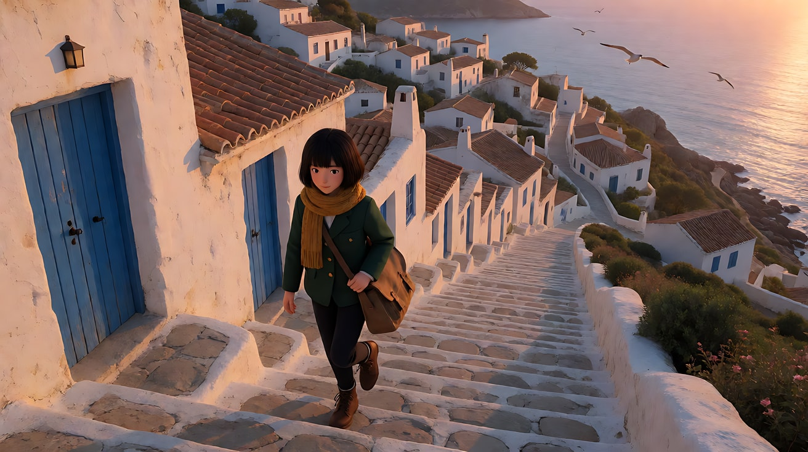

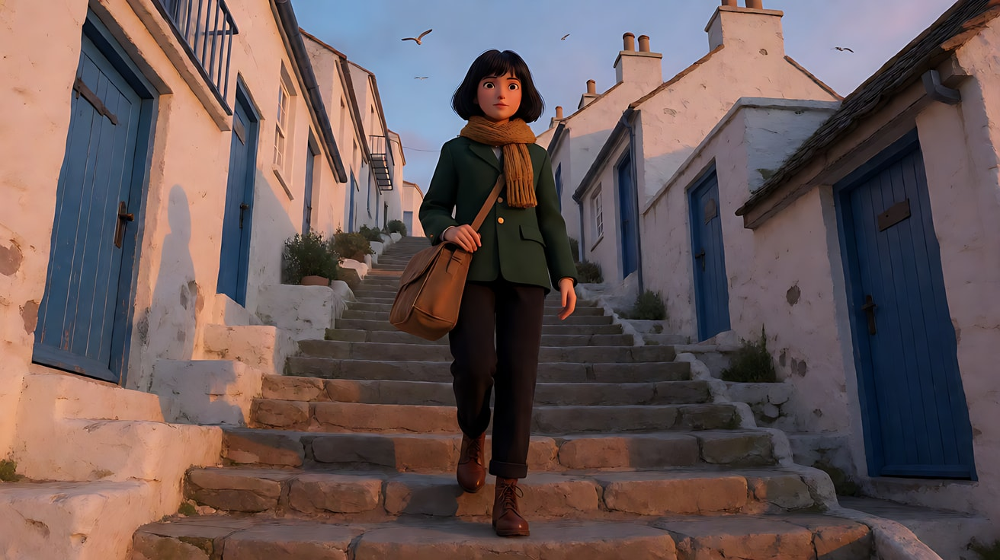

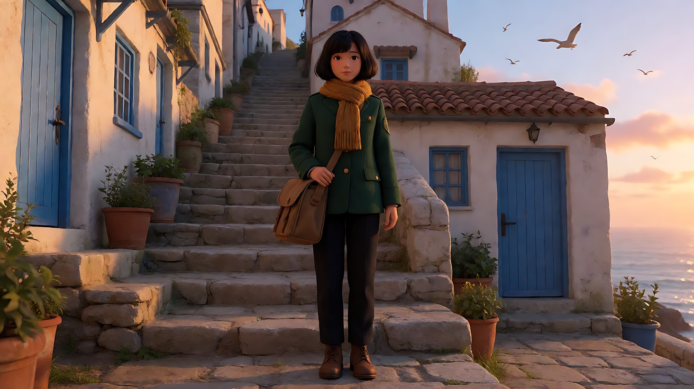

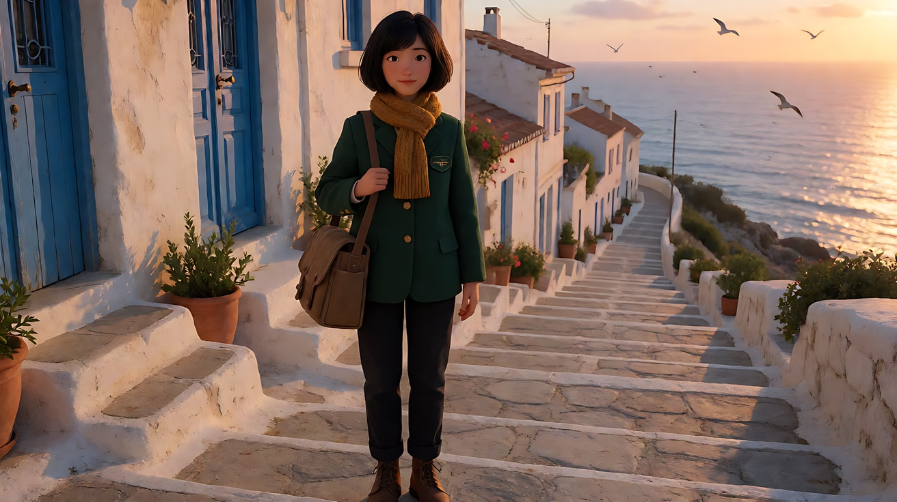

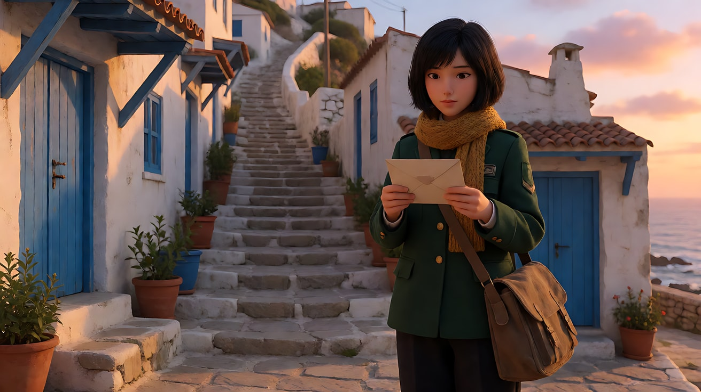

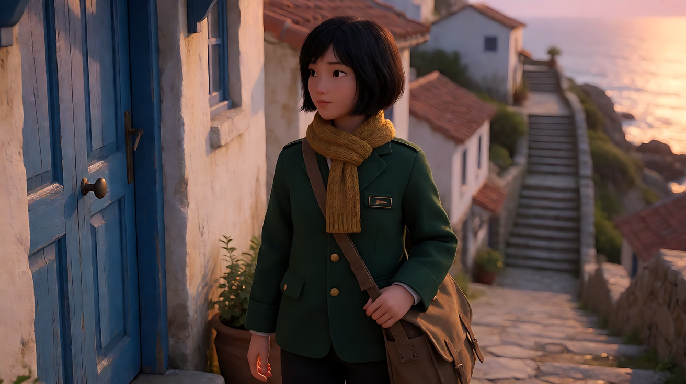

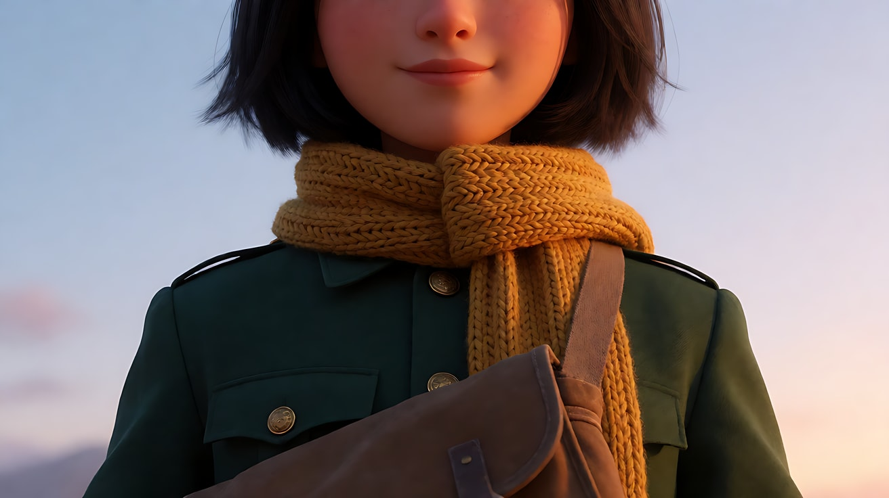

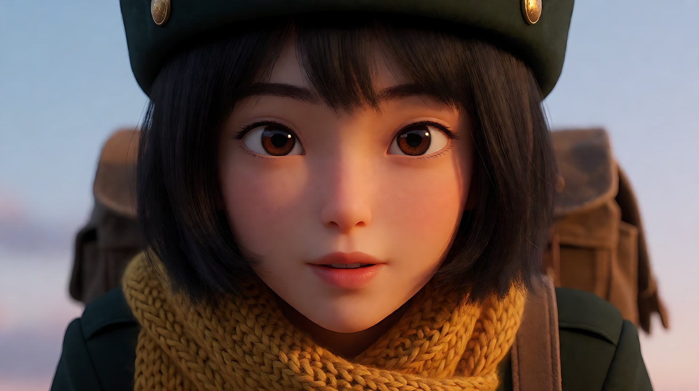

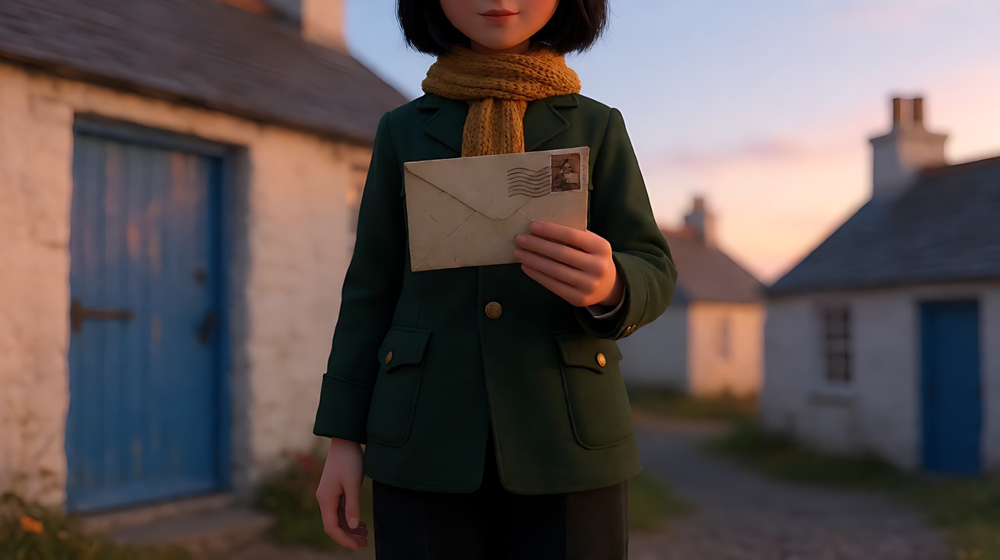

> 阶梯图只用来学习和对照，不需要全部上传给 Seedance。下面的视频只用图1和图2。

**【多图生视频 · Seedance】**

```
【素材分工】@图片1 锁定人物身份、发型、服装与邮包，不参考其灰色背景和棚拍光；@图片2 仅参考石阶、白墙蓝门和海的空间布局与夕阳光线，不复制其中的取景角度。
【画风】风格化写实三维CG质感，电影级布光。
全景，女邮差从画面上方的石阶一级一级走下来，头到脚始终完整在画面里，停在中间一级台阶上，从邮包里抽出一封信，低头看了一眼。镜头为平视固定全景，不移动。画右低角度的暖色夕阳把她的影子拉长投在台阶上，海在她身后远处泛着光。结尾停在她站定看信的全身姿态上。
【声音】靴底踩石阶的脚步声，邮包帆布摩擦声，远处海浪与海鸥，无配乐。
【约束】保持人物脸型、发型、服装不变；她的头顶和脚底始终在画面内，不被裁切；不要字幕、水印、Logo。
时长：6秒
```

**参数**：时长 6 秒 ｜ 画幅 16:9

**【检查点】**
- 九张阶梯图的人物切点是否与教学文件的示意图一致
- 九张图里角色的脸、发型、围巾颜色是否一致
- 视频里脚是否始终在画内（全景最容易被裁掉脚）

**【常见问题与修复】**
| 现象 | 修复 |
|---|---|
| 全景被生成成中全景，脚被裁掉 | 生图和视频都写 `head to toe fully in frame` / "头到脚始终完整" |
| 中近景和近景看起来一样 | 中近景写"切在胸口、能看到上衣纽扣"，近景写"头顶被画框略切" |
| 大远景里人物被放大了 | 写明比例 `less than one tenth of the frame height`，并把机位放到对面山头 |
| 角色在阶梯图里换了衣服 | 每张都重复 `Keep the face, hairstyle and outfit exactly as in image 1.` 并上传图1 |

---

### 练习3：人物走近改变景别——首尾帧（难度 ★★★）

**目标**：摄影机不动，让人物自己从全景走进中近景。体会"角色主动靠近观众"带来的感觉，与推镜头不同。

**【生图 · Nano Banana】**

图1 角色定妆：沿用练习2的图1。

图2 首帧（全景）：

```
Using the character from image 1 and the same seaside staircase location:
a full shot of the mail carrier at the top of the stone staircase, head to toe in frame, small in the upper middle of the frame,
starting to walk down toward the camera, holding a letter in her right hand.
Camera low on the steps at eye level of a standing person further down, 50mm lens, deep focus so the steps between her and the camera are sharp.
Lighting: low warm sunset light from frame right, long shadows across the steps.
Keep the face, hairstyle and outfit exactly as in image 1.
Stylized semi-realistic 3D CG rendering, feature-film animation quality. Aspect ratio 16:9.
```

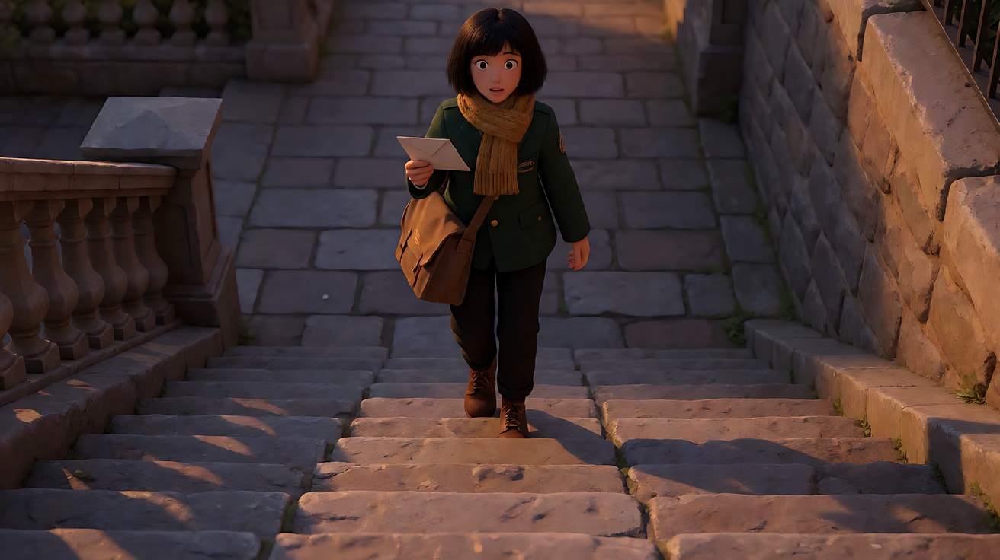

图3 尾帧（中近景）：

```
Using the character from image 1 and the exact same camera position, lens and lighting as image 2:
the mail carrier has walked down the steps and now stands close to the camera, framed from the chest up as a medium close-up,
holding the letter up at chest height toward the camera, looking straight past the lens with a friendly expression.
The staircase behind her is now softly out of focus, 50mm lens, shallow depth of field.
Keep the face, hairstyle and outfit exactly as in image 1.
Stylized semi-realistic 3D CG rendering, feature-film animation quality. Aspect ratio 16:9.
```

中文释义：首帧全景，她在石阶顶端、画面中上方，开始向镜头走来；尾帧同一机位、同一焦段，她已走到镜头前，成为切在胸口的中近景，双手把信举到胸前，视线擦过镜头，背景虚化。

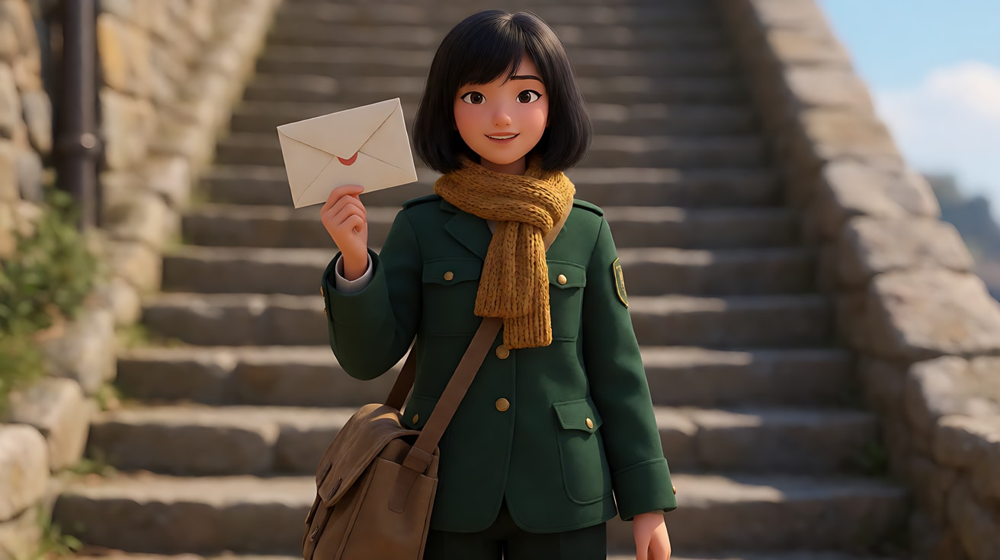

**【首尾帧生视频 · Seedance】**

```
【素材分工】@图片2 为首帧，确定起始全景构图，不新增人物；@图片3 为尾帧，是最终画面目标，不改变其中的机位和焦段；@图片1 锁定人物身份与服装，不参考其背景。只生成两帧之间的连续动作。
【画风】风格化写实三维CG质感，电影级布光。
女邮差从石阶顶端一级一级向镜头走下来，步伐轻快，邮包随步子轻轻晃动，她在画面里越来越大，从全身变成胸口以上。走到镜头前停下，把信举到胸前，视线擦过镜头，微笑。摄影机完全固定，不推不摇，景别变化只来自她的走近。夕阳始终从画右照来，她的影子在台阶上随步子移动。
【声音】由远及近的靴子踩石阶声，最后一步落定，信纸轻响，远处海浪，无配乐。
【约束】保持人物脸型、发型、服装不变；一镜到底，不切镜头；不要字幕、水印、Logo。
时长：7秒
```

**参数**：时长 7 秒 ｜ 画幅 16:9

**【检查点】**
- 摄影机是否完全没动（看背景的房子位置是否固定）
- 景别是否平滑地从全景过渡到中近景
- 尾帧切点是否在胸口

**【常见问题与修复】**
| 现象 | 修复 |
|---|---|
| 摄影机自己往前推 | 写两遍"摄影机完全固定"，并说明"景别变化只来自她的走近" |
| 她走路像滑行，脚步不落地 | 加"每一步都踩在台阶上，身体随步子上下起伏" |
| 中途跳切到尾帧 | 加"一镜到底，中间动作连续"，并适当把时长加到 8 秒 |

---

### 练习4：切镜改变景别——远景、中景、近景三镜头（难度 ★★★★，多镜头）

**目标**：用三个明显不同的景别讲一件小事：她找到地址、敲门、看见开门的人。练习"每次切镜都换一个景别"的基本分镜语法。

**【生图 · Nano Banana】**

图1 角色定妆：沿用练习2的图1。

图2 场景：沿用练习2的图2。

图3 镜头1关键帧（远景）：

```
Using the character from image 1 and the location from image 2:
a wide shot of the mail carrier walking down the long stone staircase toward a blue wooden door at frame left,
her whole body visible but only about one third of the frame height, white houses on both sides, the sea at the bottom.
Camera at eye level from further down the steps, 28mm lens, deep focus.
Lighting: low warm sunset light from frame right, long shadows across the steps.
Keep the face, hairstyle and outfit exactly as in image 1.
Stylized semi-realistic 3D CG rendering, feature-film animation quality. Aspect ratio 16:9.
```

中文释义：远景，她沿石阶向画左的蓝门走去，人物约占画面高度三分之一；从台阶下方平视，28mm，深焦；画右夕阳。

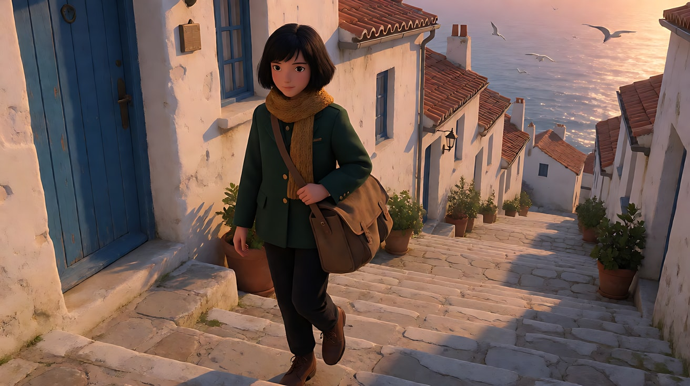

**【多图生视频 · Seedance】**

```
【素材分工】@图片1 锁定人物身份、服装与邮包，不参考其背景；@图片2 仅参考石阶与房屋布局，不复制其中取景；@图片3 为镜头1首帧，不新增人物。
【画风】风格化写实三维CG质感，电影级布光。
镜头1：固定远景，女邮差沿石阶走下来，走向画左一扇蓝色木门，在门前停住，画右的夕阳把她的影子投在门边的白墙上。脚步声和远处海浪声。
镜头2：镜头切至侧面中景，切在她的腰部，她抬起右手在蓝门上敲了三下，左手扶着胸前的邮包带，侧耳听门内的动静。三声清脆的敲门声。
镜头3：镜头切至正面近景，她的脸占满画面，门向内打开，门内的暖光照亮她的脸，她的眉毛轻轻扬起，然后笑开，把信向前递出。门轴吱呀一声，她轻声说："您的信。"
【锁定】光线：夕阳始终从画右照来，门开后门内暖光照在她脸上；人物：女邮差，墨绿制服、芥末黄围巾、斜挎棕色邮包，面朝画左的蓝门；机位始终在她的右侧，不越过她和蓝门的连线。
【声音】从开阔的海浪与脚步声，收窄到敲门声，再到门轴声和一句轻声对白，无配乐。
【约束】保持人物脸型、发型、服装不变；开门的人不出现在画面中；不要字幕、水印、Logo。
时长：12秒
```

**参数**：时长 12 秒 ｜ 画幅 16:9 ｜ 负载：3 个镜头、1 次敲门接触、1 句短对白，属于"稳妥"档

**【检查点】**
- 三个镜头是否是三个明显不同的景别：远景 → 中景 → 近景
- 镜头2切点是否在腰部，镜头3是否为肩以上
- 她在三个镜头里是否始终面朝画左

**【常见问题与修复】**
| 现象 | 修复 |
|---|---|
| 三个镜头连成一个推镜头 | 每个镜头块开头都写"镜头切至……"，并让镜头2改为侧面机位 |
| 门里出现了陌生人 | 写"开门的人不出现在画面中"，镜头3只拍她的脸和门内的光 |
| 镜头3她面朝画右 | 在【锁定】写明"面朝画左"，并强调机位不越轴 |

---

### 练习5：五档景别一次生成——大远景到微距（难度 ★★★★★，多镜头）

**目标**：在一个 15 秒片段里跨越五档景别：大远景、全景、中景、大特写、微距。练习"景别跨度大时如何用关键帧锁住两端"，并感受宏观与微观之间的节奏。

**【生图 · Nano Banana】**

图1 角色定妆：沿用练习2的图1。

图2 场景：沿用练习2的图2。

图3 镜头1关键帧（大远景）：

```
Using the character from image 1 and the location from image 2:
an extreme wide shot of the whole hillside town and the glowing sea at sunset,
the mail carrier is a tiny dark green figure climbing the long staircase, less than one tenth of the frame height,
placed on the lower right third, seagulls crossing the sky.
Camera high on the opposite hill, 35mm lens, deep focus f/11.
Lighting: low warm sun from frame right near the horizon, long blue shadows across the town.
Keep the outfit colours exactly as in image 1.
Stylized semi-realistic 3D CG rendering, feature-film animation quality. Aspect ratio 16:9.
```

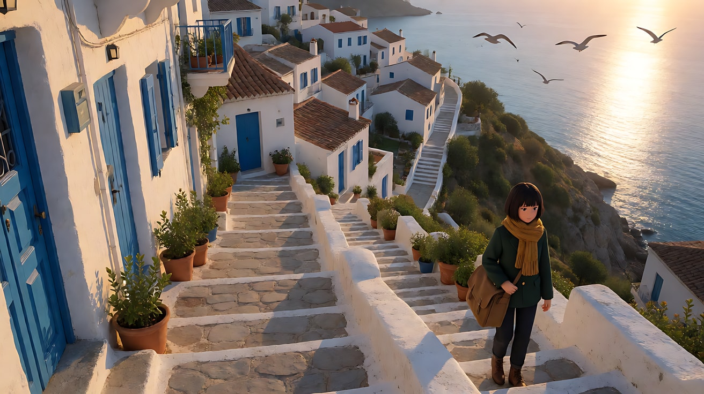

图4 镜头5关键帧（微距）：

```
A macro shot of the corner of an envelope held between two fingertips, the paper fibres and the perforated edge of a postage stamp sharply visible,
a tiny bead of sea mist resting on the paper and catching a warm sunset highlight, the dark green uniform sleeve blurred at the frame edge.
100mm macro lens, extremely shallow depth of field f/2.8, camera level with the envelope.
Lighting: low warm sunlight from frame right raking across the paper texture.
Stylized semi-realistic 3D CG rendering, feature-film animation quality. Aspect ratio 16:9.
```

中文释义：图3 大远景，对面山头高机位，小镇与海全貌，她只是右下三分之一处一个墨绿色小点；图4 微距，两根指尖捏着信封一角，纸纤维与邮票齿孔清晰，一颗海雾水珠反射夕阳，画边是虚化的墨绿袖口，暖光从画右掠过纸面。

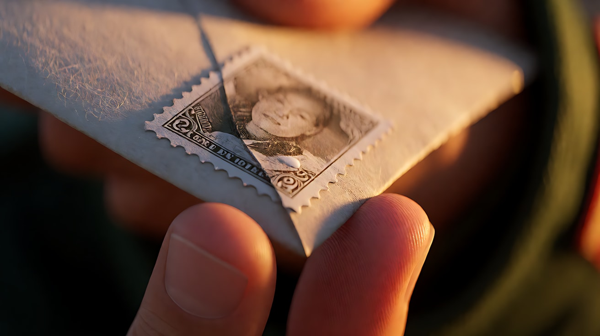

**【多图生视频 · Seedance】**

```
【素材分工】@图片1 锁定人物身份、服装与邮包，不参考其背景；@图片2 仅参考小镇与石阶布局，不复制其取景；@图片3 为镜头1首帧，确定大远景构图，不放大人物；@图片4 仅作为镜头5的微距画面参考，不改变信封与邮票的样子。
【画风】风格化写实三维CG质感，电影级布光。
镜头1：固定大远景，夕阳下的整座山城与大海，女邮差是石阶上一个墨绿色的小点，正一级一级往上爬，海鸥从画面上方横穿。海浪与海鸥声。
镜头2：镜头切至平视全景，她站在一扇蓝门前的台阶上，头到脚完整入画，停下脚步，从邮包里抽出一封信。帆布摩擦声。
镜头3：镜头切至侧面中景，切在腰部，她把信举到眼前，核对门上的门牌。呼吸声和风声。
镜头4：镜头切至大特写，只有她的眼睛和眉毛，视线从左向右移动读地址，瞳孔里映着一点暖色夕阳。几乎无声。
镜头5：镜头切至微距，她的指尖捏着信封一角，纸纤维与邮票齿孔清晰，一颗海雾水珠在纸上微微颤动，暖光掠过纸面。纸张极轻的摩擦声，一声海鸥。
【锁定】光线：低角度暖色夕阳始终从画右照来；人物：女邮差，墨绿制服、芥末黄围巾、棕色邮包，面朝画左的蓝门；机位始终在她右侧。
【声音】从开阔的海浪和海鸥，逐步收窄到呼吸和纸张摩擦，景别越近声音越细，无配乐。
【约束】保持人物脸型、发型、服装不变；镜头4只出现眼睛和眉毛，不出现完整的脸；镜头5不出现文字；不要字幕、水印、Logo。
时长：15秒
```

**参数**：时长 15 秒 ｜ 画幅 16:9 ｜ 负载：5 个镜头，其中镜头4、5为无动作插入镜头各算半拍，无对白，属于"有挑战"档。第一次生成失败时，拆成"镜头1–3"和"镜头4–5"两次生成。

**【检查点】**
- 五个镜头的景别是否依次为：大远景 → 全景 → 中景 → 大特写 → 微距
- 镜头1里人物是否足够小（不到画面高度的十分之一）
- 镜头5是否真的是微距尺度（能看到纸纤维），而不是普通的手部特写
- 声音是否随景别收窄

**【常见问题与修复】**
| 现象 | 修复 |
|---|---|
| 镜头4拍成了整张脸的近景 | 写"只有眼睛和眉毛填满画面，不出现鼻子和嘴" |
| 镜头5手指变形 | 让手指只出现在画边并虚化，把画面主体交给信封纸面 |
| 镜头数被吞掉，只出来三四个 | 按"有挑战"档的建议拆成两次生成，或把镜头3合并进镜头2 |
| 镜头1人物太大 | 在【素材分工】写"不放大人物"，并在正文写"一个墨绿色的小点" |
