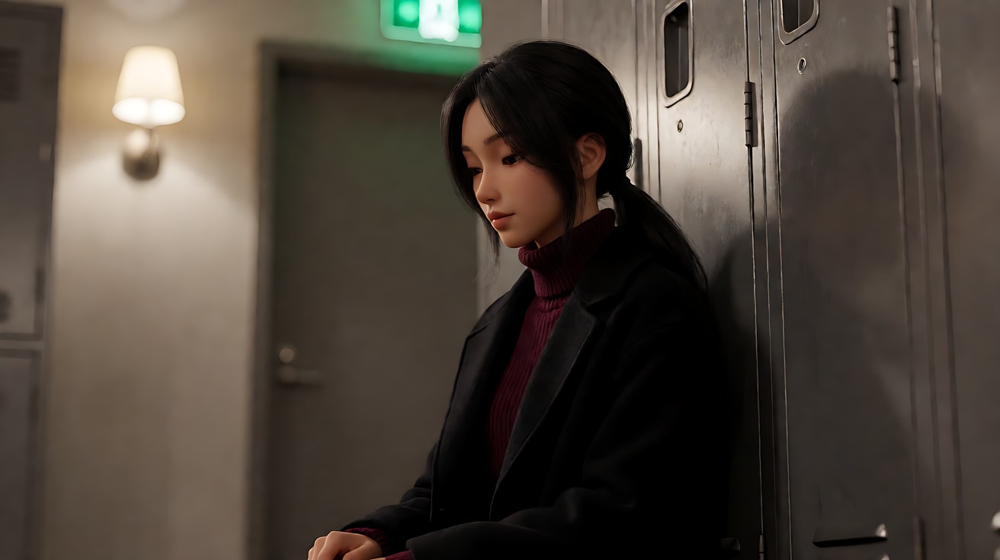
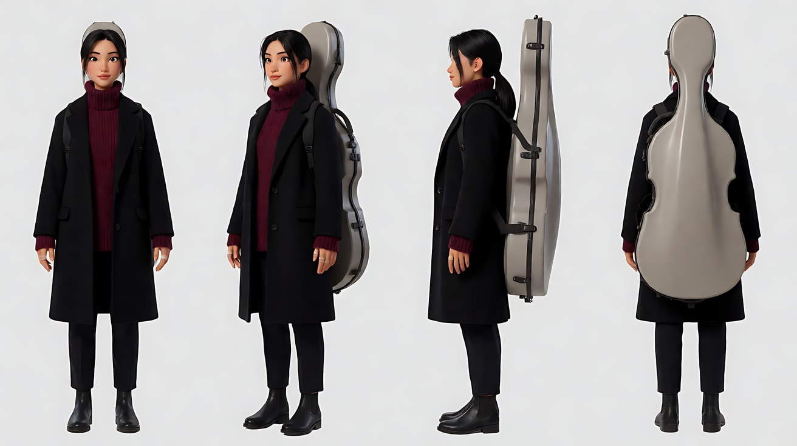
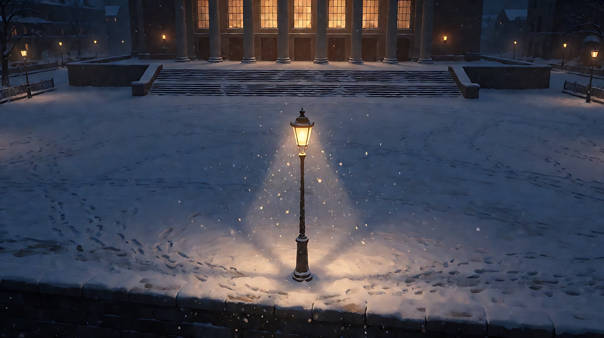
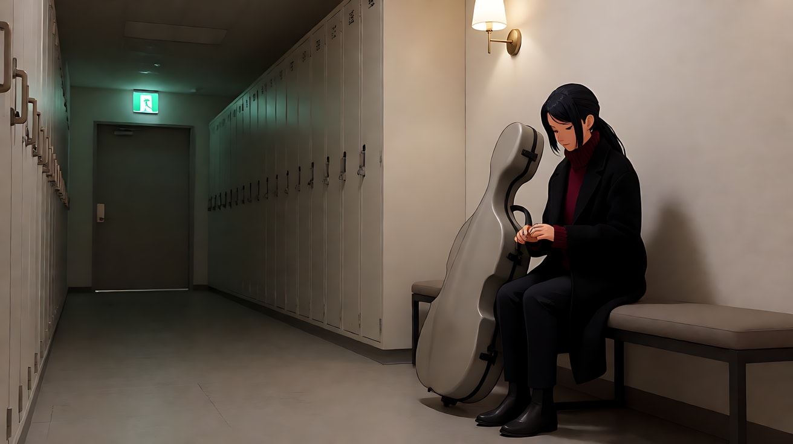
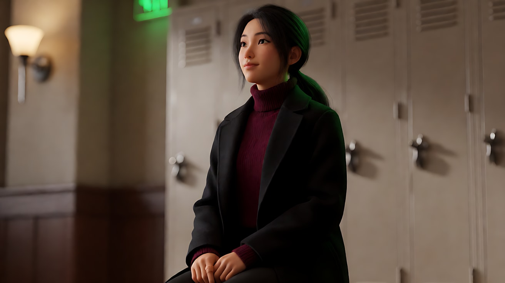
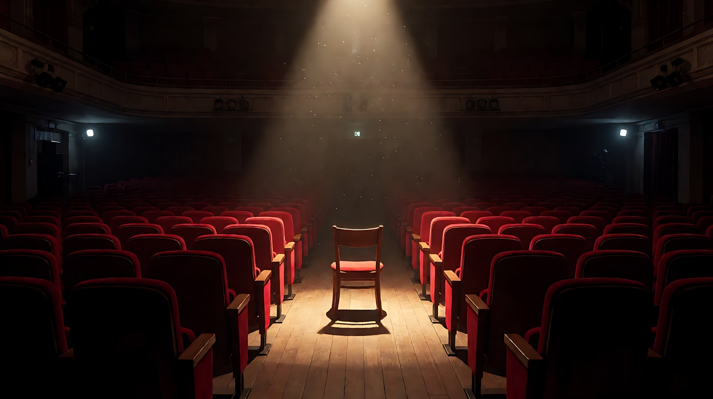
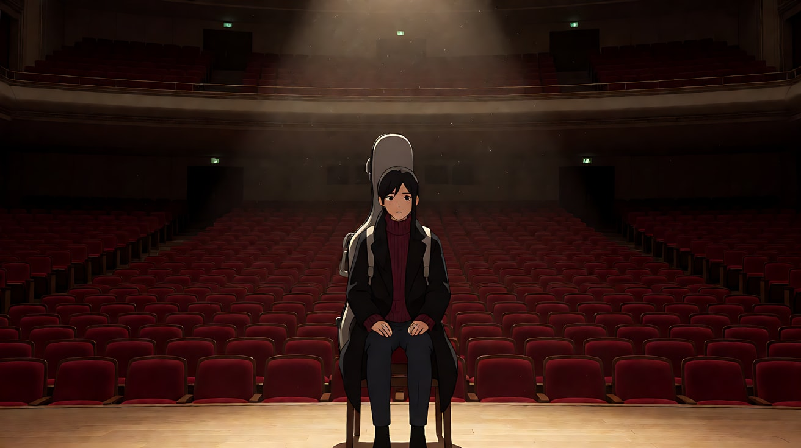
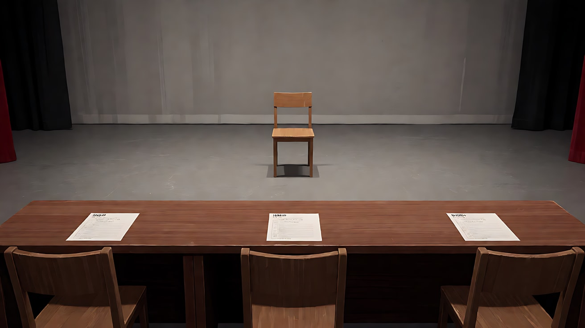
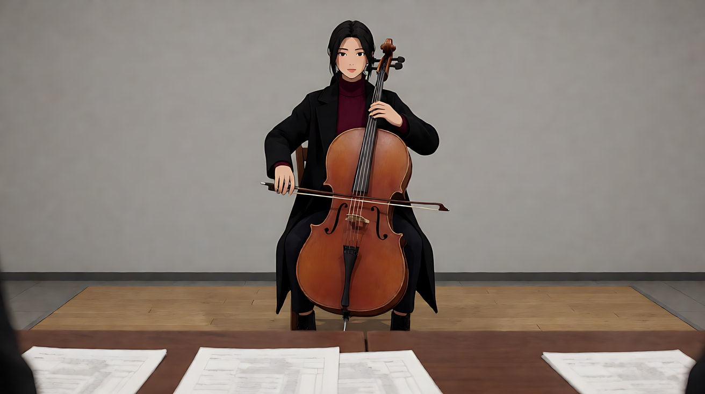
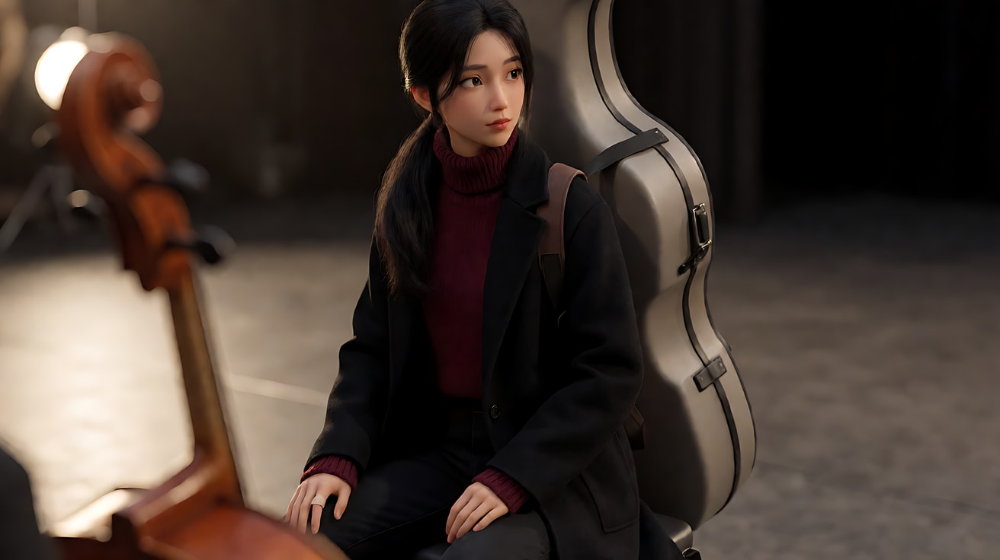

# L01-02 景别与情绪距离 · 提示词

> 本组练习：同一个角色、同一段失落的情绪，用不同的景别和机位，让观众站在"朋友""旁观者""审视者"三种距离上。｜ 配套教学：[L01-02-景别与情绪距离](../教学/L01-02-景别与情绪距离.md) ｜ 规范：[写作规范](../../模板/写作规范.md)
>
> 画风默认使用开关 A（风格化写实 CG）。如改用 2D 动画，删掉所有焦段、光圈、景深词。

**本组共用角色与场景**

- 角色：原创年轻女大提琴手，二十四五岁，黑色长发低低扎成马尾，几缕碎发落在耳边，深酒红色高领毛衣，黑色长呢大衣，背着一个浅灰色硬壳大提琴琴盒，右手食指贴着一块创可贴。
- 剧情：她刚结束一场重要的乐团选拔，没有被选上。
- 场景A：音乐厅后台的空走廊，一排旧储物柜，尽头一扇亮着绿色安全出口灯的门。
- 场景B：音乐厅外的空旷广场，雪夜，一盏路灯。

---

### 练习1：近景的情绪放大——一个小动作撑起一个镜头（难度 ★）

**目标**：用一张亲密近景关键帧，只靠一个极小的动作传达失落。体会近景如何把"咽一下口水"放大成整场戏。

**【生图 · Nano Banana】**

图1 近景关键帧：

```
A close-up of an original young woman cellist in her mid-twenties, framed from the shoulders up,
long black hair in a low ponytail with loose strands by her ears, a deep burgundy turtleneck under a black wool coat.
She sits on the floor of an empty backstage corridor leaning against a metal locker, her eyes lowered, lips pressed together.
Three-quarter view facing frame left, placed slightly right of centre.
Camera at her seated eye level, 85mm lens, shallow depth of field f/2, the lockers behind melting into soft grey shapes.
Lighting: a single warm wall sconce from frame left as soft key, a faint green glow from an exit sign behind her as rim light,
a small catchlight in her eyes.
Stylized semi-realistic 3D CG rendering, feature-film animation quality. Aspect ratio 16:9.
```

中文释义：近景（肩以上），她靠着储物柜坐在地上，垂着眼，嘴唇抿紧；四分之三侧脸朝画左；与她坐姿视线同高、85mm、浅景深；画左暖色壁灯为柔和主光，背后安全出口绿光做轮廓光，眼里有一点反光。



**【图生视频 · Seedance】**

```
【素材分工】@图片1 为首帧，锁定人物身份、服装与走廊布局，不新增其他人物。
【画风】风格化写实三维CG质感，电影级布光。
她垂着眼，喉咙轻轻动了一下，咽了一口气；用力眨了两下眼睛，眼眶微微发红；然后慢慢抬起视线看向画左走廊尽头，下巴绷紧，又低下头。镜头为平视四分之三侧近景，以几乎察觉不到的速度缓慢推近，停在她低下头后的侧脸上。画左暖色壁灯照着她的半边脸，背后安全出口的绿光勾出她的发丝边缘。
【声音】空走廊的低频通风声，远处舞台上隐约传来下一位演奏者的大提琴声，她一次压住的呼吸声，无配乐。
【约束】保持人物脸型、发型、服装不变；不要哭出声，不要流大量眼泪；不要字幕、水印、Logo。
时长：6秒
```

**参数**：时长 6 秒 ｜ 画幅 16:9

**【检查点】**
- 情绪是否完全由小动作传达：咽气、眨眼、抬眼、低头
- 推近是否慢到几乎察觉不到
- 远处的大提琴声是否让"别人在台上，她在台下"的对比成立

**【常见问题与修复】**
| 现象 | 修复 |
|---|---|
| 表情夸张，五官扭曲 | 删掉所有情绪形容词，只保留"眨眼、咽气、下巴绷紧" |
| 推镜太快变成大特写 | 写"推近幅度很小，结束时仍是肩以上近景" |
| 她站起来走掉 | 加"她始终坐在地上靠着柜子" |

---

### 练习2：远景的孤独——人在雪夜广场里变小（难度 ★★）

**目标**：用定妆图和场景图，拍一个大远景。人物只占画面极小一块，靠处境和姿态讲孤独，不靠表情。

**【生图 · Nano Banana】**

图1 角色定妆：

```
Character turnaround sheet of an original young woman cellist in her mid-twenties:
long black hair in a low ponytail with loose strands by her ears, a deep burgundy turtleneck sweater, a long black wool coat,
dark trousers, black ankle boots, carrying a light-grey hard-shell cello case on her back, a small bandage on her right index finger.
Front view, three-quarter view, side view and back view, full body, standing on a plain light-grey background.
Camera at chest height, eye level, 50mm lens, deep focus.
Even soft studio light from the front, no shadows on the backdrop.
Stylized semi-realistic 3D CG rendering, feature-film animation quality. Aspect ratio 16:9.
```



图2 场景B（空镜）：

```
Empty wide stone plaza in front of a concert hall on a snowy night, a single old street lamp in the middle casting a warm cone of light,
falling snow drifting through the lamp light, the concert hall's tall windows glowing warmly far behind, footprints-free fresh snow, no people.
Extreme wide shot from a high position at the edge of the plaza, slight high angle, 35mm lens, deep focus f/11.
Lighting: warm sodium street lamp from the centre, cold blue moonlit ambience everywhere else.
Stylized semi-realistic 3D CG rendering, feature-film animation quality. Aspect ratio 16:9.
```

中文释义：图1 定妆，含琴盒和右手食指的创可贴；图2 雪夜广场空镜，中央一盏暖色路灯形成光圈，远处音乐厅窗户亮着，雪地无脚印；高处略俯拍的大远景，35mm、深焦；路灯暖光与四周冷蓝夜色。



**【多图生视频 · Seedance】**

```
【素材分工】@图片1 锁定人物身份、服装与琴盒，不参考其灰色背景和棚拍光；@图片2 仅参考广场布局、路灯位置、高处俯拍的取景和雪夜光线，不据此新增任何路人。
【画风】风格化写实三维CG质感，低饱和冷色调。
大远景，雪夜空旷的广场，女大提琴手背着琴盒从画右走进路灯的光圈，人物只占画面高度的十分之一左右。她在路灯下停住，慢慢把琴盒从背上卸下来立在雪地上，自己蹲下，双臂抱住膝盖，靠着琴盒不动。身后远处的音乐厅窗户依然亮着暖光。镜头为高处略俯拍的固定大远景，不推不拉。雪持续落进路灯的光圈里，她身后的雪地上留下一串脚印。结尾停在她蹲在光圈中的小小身影上。
【声音】雪夜几乎无声，脚踩新雪的咯吱声，琴盒落在雪地上的一声闷响，远处音乐厅里隐约的掌声，无配乐。
【约束】保持人物服装与琴盒不变；人物始终很小，不放大，不出现面部特写；广场上没有其他人；不要字幕、水印、Logo。
时长：8秒
```

**参数**：时长 8 秒 ｜ 画幅 16:9

**【检查点】**
- 人物是否始终只占画面很小的比例
- 孤独是否来自姿态和处境：蹲下、抱膝、靠着琴盒、身后亮着的音乐厅
- 远处的掌声是否和她的独处形成对比

**【常见问题与修复】**
| 现象 | 修复 |
|---|---|
| 模型把人物放大成全景 | 写明"人物只占画面高度的十分之一"，并把机位放在广场边缘高处 |
| 广场上出现路人 | 写"广场上没有其他人" |
| 脚印没出现或凭空出现 | 首帧雪地无脚印，正文写"她走过的地方留下一串脚印" |

---

### 练习3：由远推近——观众从旁观者变成朋友（难度 ★★★，首尾帧）

**目标**：用首帧（远景）和尾帧（近景）锁定距离的起点和终点，让一个缓慢推镜把观众从旁观拉进她的内心。

**【生图 · Nano Banana】**

图1 角色定妆：沿用练习2的图1。

图2 首帧（远景）：

```
Using the character from image 1:
a wide shot of the cellist sitting alone on a bench in the empty backstage corridor, her cello case standing beside her,
her whole body visible but small, about one third of the frame height, a long row of lockers stretching away,
a green exit sign glowing at the far end. She is placed on the right third, looking down at her hands.
Camera at seated eye level from the far end of the corridor, 35mm lens, deep focus.
Lighting: a single warm wall sconce above the bench from frame left, the rest of the corridor in dim cool light.
Keep the face, hairstyle and outfit exactly as in image 1.
Stylized semi-realistic 3D CG rendering, feature-film animation quality. Aspect ratio 16:9.
```



图3 尾帧（近景）：

```
Using the character from image 1, the same corridor, same bench and same lighting as image 2:
a close-up of the cellist from the shoulders up, three-quarter view facing frame left,
she has just looked up from her hands, her eyes wet but steady, a faint brave smile at one corner of her mouth.
Camera at her seated eye level directly in front of the bench, 85mm lens, shallow depth of field, the lockers behind softly blurred.
Lighting: warm wall sconce from frame left as soft key, green exit-sign rim light on her hair.
Keep the face, hairstyle and outfit exactly as in image 1.
Stylized semi-realistic 3D CG rendering, feature-film animation quality. Aspect ratio 16:9.
```

中文释义：首帧远景，从走廊另一端平视，她坐在长凳上低头看手，只占画面三分之一，画面右三分之一处；尾帧近景，同一走廊同一光线，她刚抬起头，眼里含泪但目光稳定，嘴角有一丝勉强的笑；85mm、浅景深。



**【首尾帧生视频 · Seedance】**

```
【素材分工】@图片2 为首帧，确定远景起始构图，不新增人物；@图片3 为尾帧，是最终画面目标，不改变其中的光线和机位高度；@图片1 锁定人物身份、服装与琴盒，不参考其背景。只生成两帧之间的连续动作。
【画风】风格化写实三维CG质感，电影级布光。
她坐在长凳上，低头看着贴着创可贴的右手食指，用拇指轻轻按了按那块创可贴。镜头从走廊尽头开始，以平稳缓慢的速度沿走廊向她推进，越过一排排储物柜，从远景推到她的近景。推到近处时，她深吸一口气，抬起头，眼里含着泪但没有落下，嘴角轻轻扬起一点。壁灯暖光始终从画左照着她，背后安全出口的绿光留在她的发丝边缘。
【声音】一开始是空走廊的回声和通风声，越靠近她越安静，最后只剩她深吸一口气的声音，无配乐。
【约束】保持人物脸型、发型、服装不变；一镜到底，只有一个向前推进的运镜，不切镜头；不要字幕、水印、Logo。
时长：10秒
```

**参数**：时长 10 秒 ｜ 画幅 16:9

**【检查点】**
- 推进是否匀速、单一，没有混入横移或摇镜
- 声音是否随距离变近而变安静
- 尾帧的表情是否是"含泪但稳住"，而不是大哭

**【常见问题与修复】**
| 现象 | 修复 |
|---|---|
| 推镜中途跳到尾帧 | 加"推进速度均匀，中间画面连续"，时长不低于 10 秒 |
| 推近时镜头左右晃 | 写"摄影机沿走廊中线直线推进，不左右偏移" |
| 想要相反的"抽离"效果 | 交换首尾帧，并把动作改为"她低下头，把脸埋进手里"，运镜改为"缓慢向后拉远" |

---

### 练习4：距离递进——空舞台上的四个镜头（难度 ★★★★，多镜头）

**目标**：选拔结束后她回到空无一人的舞台，独自拉完那首没机会拉完的曲子。用"大远景 → 中景 → 近景 → 大特写"四个镜头，让观众一步步走近她。

**【生图 · Nano Banana】**

图1 角色定妆：沿用练习2的图1。

图2 场景（空舞台）：

```
Empty concert hall stage after the audition, rows of empty red velvet seats in the dark auditorium,
a single wooden chair at the centre of the stage under one remaining spotlight from above, the rest of the hall in deep shadow,
dust floating in the spotlight beam, no people.
Wide shot from the back of the auditorium, eye level, 28mm lens, deep focus.
Lighting: one hard warm top spotlight on the chair, faint cool work lights on the side walls.
Stylized semi-realistic 3D CG rendering, feature-film animation quality. Aspect ratio 16:9.
```



图3 镜头1关键帧（大远景）：

```
Using the character from image 1 and the stage from image 2:
an extreme wide shot of the empty concert hall from the very back row, the cellist is a tiny figure seated on the chair in the single spotlight
at the centre of the stage, holding her cello, hundreds of empty seats in darkness filling the lower half of the frame.
Camera at eye level from the last row, 28mm lens, deep focus f/11.
Lighting: one hard warm top spotlight on her, the auditorium in deep shadow, dust in the beam.
Keep the face, hairstyle and outfit exactly as in image 1.
Stylized semi-realistic 3D CG rendering, feature-film animation quality. Aspect ratio 16:9.
```

中文释义：图2 空舞台，中央一把椅子，头顶仅剩一盏暖色硬光聚光灯，观众席空着；图3 大远景，从最后一排平视，她是舞台中央聚光灯下抱着大提琴的一个小人，下半画面是黑暗中几百个空座位。



**【多图生视频 · Seedance】**

```
【素材分工】@图片1 锁定人物身份、服装与创可贴，不参考其背景；@图片2 仅参考舞台、座椅布局和聚光灯光线，不复制其取景；@图片3 为镜头1首帧，确定大远景构图，不放大人物。
【画风】风格化写实三维CG质感，电影级布光。
镜头1：固定大远景，从观众席最后一排望去，她坐在舞台中央唯一的聚光灯下，在画面里很小，抬起琴弓，拉出第一个长音。空旷大厅里的混响很长。
镜头2：镜头切至侧面中景，切在腰部，她闭着眼拉琴，身体随旋律轻轻前倾，琴弓在弦上来回，聚光灯从头顶照下，灰尘在光束里飘。琴声变得清晰、贴近。
镜头3：镜头切至平视四分之三侧近景，她的脸占满画面，睫毛在颤，嘴唇抿紧，一滴眼泪停在下眼睑上没有落下。琴声继续，能听见她的呼吸。
镜头4：镜头切至大特写，只有她按弦的左手手指和右手食指上的创可贴，手指在弦上稳稳揉出最后一个长音，然后停住。琴声余音在大厅里慢慢散去。
【锁定】光线：只有头顶一盏暖色硬光聚光灯，其余全黑；人物：女大提琴手，深酒红高领毛衣，右手食指贴创可贴，坐在舞台中央的木椅上，面朝观众席；机位始终在观众席一侧。
【声音】一首缓慢低沉的大提琴独奏贯穿四个镜头，从远处带着混响逐渐变得贴近、干净，最后一个长音在寂静中消失。
【约束】保持人物脸型、发型、服装与大提琴形状不变；舞台和观众席没有其他人；不要字幕、水印、Logo。
时长：15秒
```

**参数**：时长 15 秒 ｜ 画幅 16:9 ｜ 负载：4 个镜头，镜头4为插入镜头算半拍，无对白，属于"稳妥"到"有挑战"之间

**【检查点】**
- 四个镜头的景别是否逐步收紧：大远景 → 中景 → 近景 → 大特写
- 声音是否也在"靠近"：混响逐渐减少
- 镜头4的创可贴是否保留，形成与练习1、2的呼应

**【常见问题与修复】**
| 现象 | 修复 |
|---|---|
| 拉琴手势混乱，琴弓穿过琴身 | 镜头2写"琴弓只在琴弦中段来回"，镜头4只拍左手按弦，不拍运弓 |
| 镜头3眼泪流成一片 | 写"一滴眼泪停在下眼睑上没有落下" |
| 观众席出现了人 | 在【约束】写"观众席全空" |
| 镜头4拍成了整只手臂 | 写"只有手指、琴弦和创可贴填满画面" |

---

### 练习5：同一刻，两种距离——审视版 vs 亲密版（难度 ★★★★★，多镜头对照）

**目标**：同一个瞬间——评委宣布结果时她的反应——拍两遍。审视版让观众像评委一样冷冷地看她；亲密版让观众站在她身边。只改景别、机位高度、角度、光和运镜，剧情完全不变。

**【生图 · Nano Banana】**

图1 角色定妆：沿用练习2的图1。

图2 场景（选拔现场）：

```
Empty audition stage seen from the judges' table, a long wooden judges' table with three empty chairs and paper scoring sheets in the foreground,
a single wooden chair for the performer at the centre of a bare stage, plain grey back wall, no people.
Wide shot from behind the judges' table, slightly high angle, 35mm lens, deep focus.
Lighting: hard flat white overhead work lights, no warmth.
Stylized semi-realistic 3D CG rendering, feature-film animation quality. Aspect ratio 16:9.
```



图3 审视版首帧：

```
Using the character from image 1 and the stage from image 2:
a frontal medium shot of the cellist sitting upright on the performer's chair holding her cello, centred and symmetrical,
small in the middle of the bare grey wall, the blurred edge of the judges' table and a scoring sheet in the foreground.
Camera slightly above her eye level from the judges' table, 50mm lens, moderate depth of field.
Lighting: hard flat white overhead light, shadows under her eyes, no catchlight.
Keep the face, hairstyle and outfit exactly as in image 1.
Stylized semi-realistic 3D CG rendering, feature-film animation quality. Aspect ratio 16:9.
```



图4 亲密版首帧：

```
Using the character from image 1 and the stage from image 2:
a three-quarter close-up of the cellist from the shoulders up, seated with her cello neck resting against her shoulder,
looking off toward frame right where the judges are, the cello scroll softly blurred in the foreground at frame left.
Camera at her seated eye level, very close beside her on the stage, 85mm lens, shallow depth of field f/2.
Lighting: soft warm side light from a stage lamp at frame left, a small catchlight in her eyes, the overhead work lights far behind out of focus.
Keep the face, hairstyle and outfit exactly as in image 1.
Stylized semi-realistic 3D CG rendering, feature-film animation quality. Aspect ratio 16:9.
```

中文释义：图2 从评委席后方看向空舞台，前景是评委长桌与评分表；图3 审视版，从评委席略高于她视线的正面中景，对称居中，背景是光秃秃的灰墙，平而硬的白色顶光，眼里没有反光；图4 亲密版，她身边平视的四分之三侧近景，前景是虚化的琴头，画左暖色侧光，眼里有反光。



**【多图生视频 · Seedance】审视版**

```
【素材分工】@图片1 锁定人物身份与服装，不参考其背景；@图片2 仅参考舞台与评委桌布局，不复制其中的取景；@图片3 为镜头1首帧，确定正面对称构图，不新增人物。
【画风】风格化写实三维CG质感，低饱和冷色调。
镜头1：固定正面中景，从评委席略高于她视线的位置望去，她端坐在舞台中央，双手扶着大提琴，画面前景边缘是虚化的评委桌和评分表。画外一个平淡的男声说："谢谢，请回去等通知。"她点了一下头。
镜头2：镜头切至同一正面方向的近景，机位仍略高，摄影机一动不动，她的脸被平而硬的白色顶光照着，眼下有阴影；她维持着礼貌的表情，嘴角往上提了一下又落下，喉咙动了动。长时间的沉默，只有顶灯的电流嗡声。
镜头3：镜头切至评委席后方的远景，前景是三把空椅子的椅背和散落的评分表，她在远处的舞台中央站起来，提起大提琴，向画右退场，身影很小。
【锁定】光线：平而硬的白色顶光，没有暖色；人物：女大提琴手，深酒红高领毛衣，坐在舞台中央，正面朝向评委席；机位始终在评委席一侧。
【声音】顶灯电流嗡声，画外一句平淡的男声对白，纸张翻页声，她离开时的脚步声在空舞台回响，无配乐。
【约束】保持人物脸型、发型、服装不变；评委不出现正脸；不要字幕、水印、Logo。
时长：12秒
```

**【多图生视频 · Seedance】亲密版**

上传顺序：图片1 = 图1 定妆图，图片2 = 图2 场景图，图片3 = 图4 亲密版首帧（本次不上传图3）。

```
【素材分工】@图片1 锁定人物身份与服装，不参考其背景；@图片2 仅参考舞台布局，不复制其中的硬光；@图片3 为镜头1首帧，确定她身边平视近景的构图与暖色侧光，不新增人物。
【画风】风格化写实三维CG质感，电影级布光。
镜头1：平视四分之三侧近景，摄影机就在她身边，带轻微呼吸感的手持，前景是虚化的琴头。画外一个平淡的男声说："谢谢，请回去等通知。"她的睫毛颤了一下，视线没有离开画右的评委方向。
镜头2：镜头切至大特写，她扶着琴颈的左手，手指慢慢收紧又松开，右手食指的创可贴在暖光里清晰可见。她极轻的一次换气。
镜头3：镜头切回她的近景，摄影机以很慢的速度再靠近一点，她轻轻点头，低声说："谢谢。"嘴角抿出一个小小的、撑住的笑，眼眶发红。暖色侧光停在她的脸上。
【锁定】光线：画左舞台灯的暖色侧光为主，背景的白色顶光虚化在远处；人物：女大提琴手，深酒红高领毛衣，坐在舞台中央，视线朝向画右的评委；机位始终在她左前方。
【声音】顶灯电流声被压得很低，画外一句平淡的男声，她的换气声和一句很轻的"谢谢"，无配乐。
【约束】保持人物脸型、发型、服装不变；评委不出现在画面中；不要字幕、水印、Logo。
时长：12秒
```

**参数**：每版时长 12 秒 ｜ 画幅 16:9 ｜ 负载：3 个镜头、1 句画外对白（亲密版另有 1 句短对白），属于"稳妥"档

**【检查点】**
- 关掉声音看两版，能否分辨出"被审视"和"被陪伴"
- 审视版：正面、略高、对称、固定、硬光、景别最后拉远
- 亲密版：侧面、平视、浅景深、暖光、手持轻微呼吸、景别最后再靠近
- 两版的剧情和台词是否完全相同

**【常见问题与修复】**
| 现象 | 修复 |
|---|---|
| 审视版的近景看起来也很温柔 | 删掉所有暖色描述，写"平而硬的白色顶光，眼睛里没有反光"，机位写"略高于她的视线" |
| 亲密版手持晃得太厉害 | 改为"几乎察觉不到的轻微呼吸感"，或直接改成固定 |
| 画外男声变成了画面里的人 | 写"说话的人始终不出现在画面中" |
| 两版剧情不一致 | 把台词和"点头"这个动作在两版里写成完全相同的文字 |
