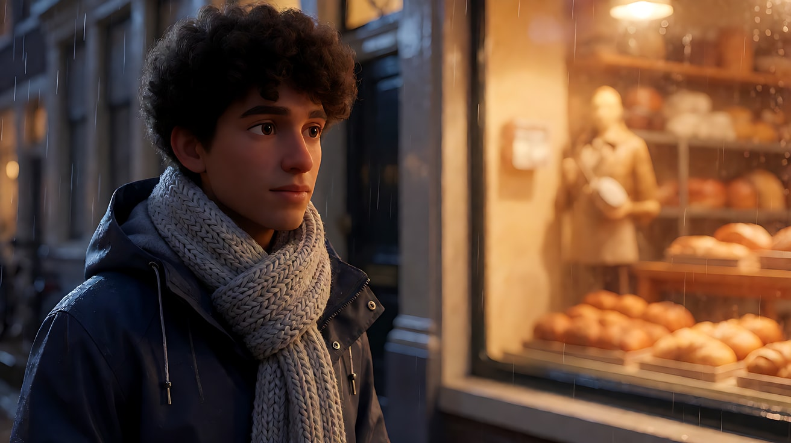
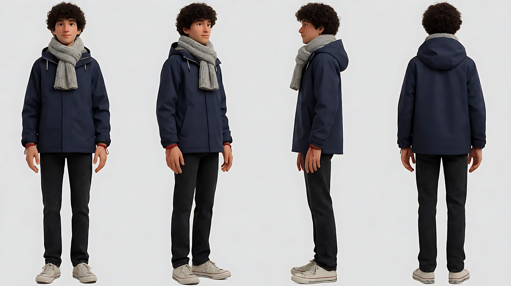
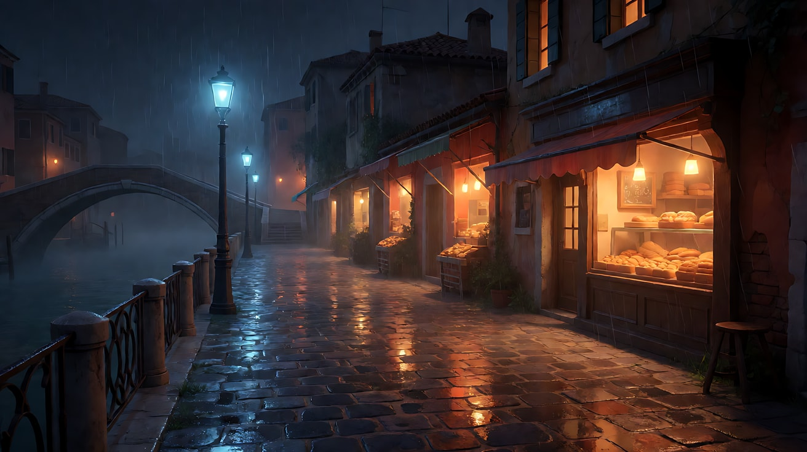
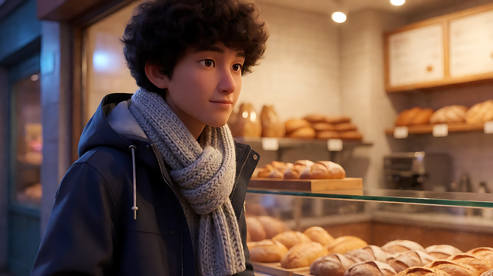
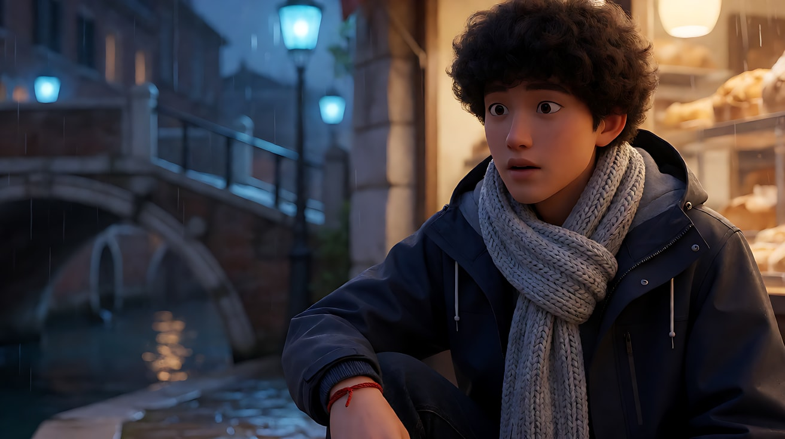
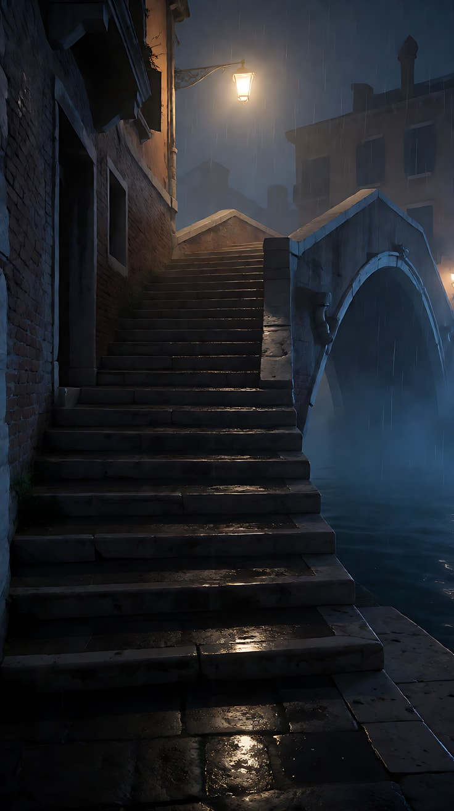
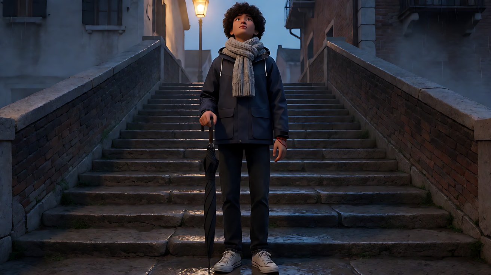
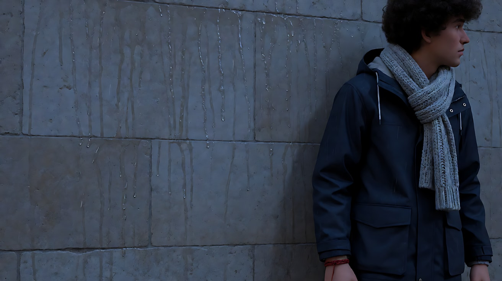
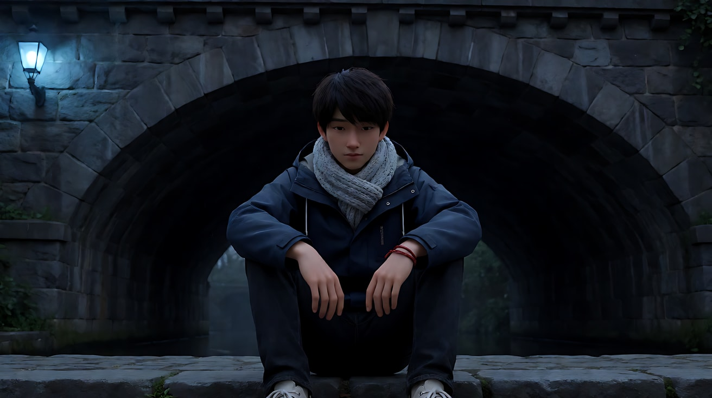
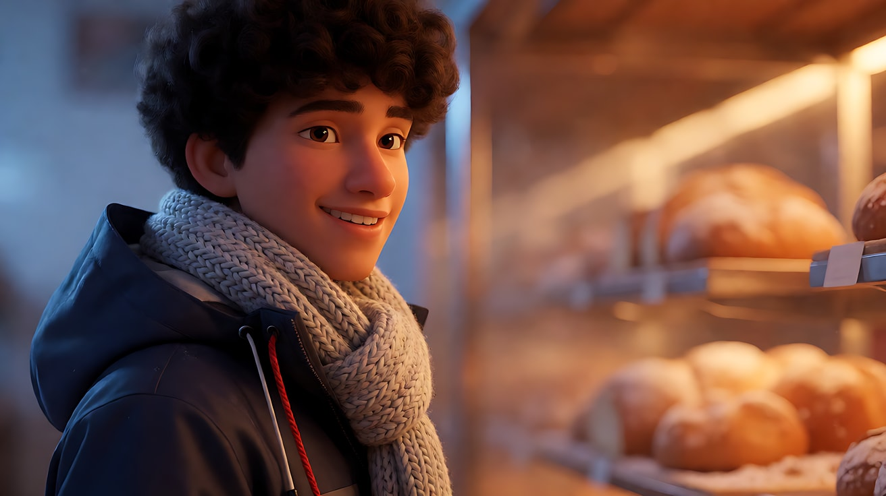

# L01-03 人物切点与画面空间 · 提示词

> 本组练习：把切点、头顶空间、视线空间、行进空间写进提示词，再练习竖屏 9:16 的景别选择和"故意打破规则"。｜ 配套教学：[L01-03-人物切点与画面空间](../教学/L01-03-人物切点与画面空间.md) ｜ 规范：[写作规范](../../模板/写作规范.md)
>
> 画风默认使用开关 A（风格化写实 CG）。如改用 2D 动画，删掉所有焦段、光圈、景深词。

**本组共用角色与场景**

- 角色：原创青年男子，二十七八岁，短而蓬松的深棕色卷发，墨蓝色连帽防水外套，浅灰色粗针围巾，深色牛仔裤，旧白色帆布鞋，左手腕戴一根红色编织绳。
- 场景：雨夜的运河边老街，石板路积着水，一侧是低矮护栏和运河，另一侧是一排小店，街对面有一间亮着暖光的面包店，远处一座拱形石桥。

> 本组每条生图提示词都写明了切点和留白位置。生成后请先用教学文件的"禁切线"示意图检查一遍，再拿去生视频。

---

### 练习1：视线空间——他看向哪边，哪边就留空（难度 ★）

**目标**：生成一张切点正确、视线空间充足的中近景，并让人物在视频里保持视线方向，画面不失衡。

**【生图 · Nano Banana】**

图1 中近景关键帧：

```
A medium close-up of an original young man in his late twenties, framed from the chest up, the frame edge cutting across his chest below the armpits,
short fluffy dark-brown curly hair damp from the rain, a navy hooded waterproof jacket, a chunky light-grey knitted scarf.
He stands on a rainy canal-side street at night, placed on the left third of the frame, his face turned in three-quarter view toward frame right,
looking across the street at a warmly lit bakery window; the right two thirds of the frame are open space showing the blurred bakery glow.
His eyes sit on the upper third line, with a small amount of headroom.
Camera at eye level, 65mm lens, shallow depth of field, rain drops glinting as soft bokeh.
Lighting: warm orange glow from the bakery window at frame right as the key on his face, cool blue street light from behind as rim on his hair.
Stylized semi-realistic 3D CG rendering, feature-film animation quality. Aspect ratio 16:9.
```

中文释义：中近景，画框下缘切在胸口腋下以下；他位于画左三分之一，四分之三侧脸看向画右街对面的面包店，右侧三分之二为视线空间；眼睛在上三分之一线，头顶留少量空间；平视、65mm、浅景深；画右面包店暖光为主光，身后冷蓝路灯做轮廓光。



**【图生视频 · Seedance】**

```
【素材分工】@图片1 为首帧，锁定人物身份、服装、构图位置与视线方向，不新增其他人物。
【画风】风格化写实三维CG质感，电影级布光。
他站在雨里望着街对面的面包店，呼出的白气在面前散开；他抬手把被雨打湿的一缕卷发拨到耳后，又把手插回口袋，视线始终看向画右。镜头为平视固定中近景，他始终在画左三分之一，右侧始终留着面包店暖光的空间，画框始终切在胸口。雨丝在暖光里斜斜落下，路灯冷光勾出他的发梢。结尾停在他望向画右的四分之三侧脸上。
【声音】细雨落在雨衣帽檐和石板路上的声音，远处运河水声，面包店门上的风铃隐约一响，无配乐。
【约束】保持人物脸型、发型、服装不变；他不转身，不走动，视线保持朝向画右；不要字幕、水印、Logo。
时长：5秒
```

**参数**：时长 5 秒 ｜ 画幅 16:9

**【检查点】**
- 画框下缘是否在胸口，没有切在脖子或手肘
- 拨头发的手是否完整入画，或在手腕以上就出画，没有只切掉几根手指
- 视线空间是否始终在画右

**【常见问题与修复】**
| 现象 | 修复 |
|---|---|
| 模型把他移到了画面中间 | 写两遍"始终在画左三分之一，右侧留空" |
| 拨头发时手被画框切掉一半 | 改成"他把手插回口袋"这类不抬到画框边缘的动作 |
| 头顶空间越来越多 | 写"景别与构图保持不变，眼睛始终在上三分之一" |

---

### 练习2：行进空间——横移跟拍时前方留路（难度 ★★）

**目标**：用定妆图 + 场景图生成一个横移跟拍的中全景。他沿运河从画左走向画右，前方始终比身后留更多空间，切点保持在大腿中部。

**【生图 · Nano Banana】**

图1 角色定妆：

```
Character turnaround sheet of an original young man in his late twenties:
short fluffy dark-brown curly hair, a navy hooded waterproof jacket, a chunky light-grey knitted scarf,
dark straight jeans, worn white canvas sneakers, a thin red braided cord on his left wrist.
Front view, three-quarter view, side view and back view, full body, standing on a plain light-grey background.
Camera at chest height, eye level, 50mm lens, deep focus.
Even soft studio light from the front, no shadows on the backdrop.
Stylized semi-realistic 3D CG rendering, feature-film animation quality. Aspect ratio 16:9.
```



图2 场景（空镜）：

```
Empty canal-side old street on a rainy night, wet cobblestones reflecting warm shop lights, a low iron railing along the canal on the left,
a row of small shops on the right with a warmly lit bakery, a stone arch bridge in the distance, light rain and thin mist, no people.
Wide shot along the street, eye level, 28mm lens, deep focus.
Lighting: warm orange shop windows from the right, cool blue street lamps along the railing, reflections on the wet ground.
Stylized semi-realistic 3D CG rendering, feature-film animation quality. Aspect ratio 16:9.
```

中文释义：图1 定妆，含左手腕红色编织绳；图2 雨夜运河老街空镜，左侧护栏与运河，右侧小店与亮着暖光的面包店，远处石桥；28mm 深焦；右侧店铺暖光，护栏边冷蓝路灯，湿地面反光。



**【多图生视频 · Seedance】**

```
【素材分工】@图片1 锁定人物身份、发型、服装与红色编织绳，不参考其灰色背景和棚拍光；@图片2 仅参考运河老街的布局、石桥位置与雨夜光线，不复制其中的取景角度。
【画风】风格化写实三维CG质感，电影级布光。
中全景，画框切在他的大腿中部，他沿着运河护栏从画左向画右行走，双手插在外套口袋里，步伐稳定，偶尔抬眼看前方远处的石桥。镜头与他保持相同速度向画右横移跟拍，他始终位于画面左三分之一，前方右侧三分之二留出湿漉漉的石板路和远处的石桥。路边店铺的暖光一块一块从他身上滑过，运河一侧是冷蓝路灯的倒影。结尾停在他继续向前走、前方留着长长一段路的画面上。
【声音】帆布鞋踩在积水石板上的脚步声，细雨声，运河轻微的水声，经过一家小店时隐约的收音机音乐，无配乐。
【约束】保持人物脸型、发型、服装不变；画框始终切在大腿中部，不切膝盖；他始终在画左三分之一，不追上画面中心；不要字幕、水印、Logo。
时长：8秒
```

**参数**：时长 8 秒 ｜ 画幅 16:9

**【检查点】**
- 他是否始终在画左，前方（画右）始终留有空间
- 切点是否稳定在大腿中部，没有在走动中漂到膝盖
- 店铺光是否一块块滑过他的身体，形成运动感

**【常见问题与修复】**
| 现象 | 修复 |
|---|---|
| 他走到画面右侧，前方被堵 | 写"镜头与他保持相同速度横移"，并强调"他始终在画左三分之一" |
| 切点变成膝盖 | 写"画框切在大腿中部，不切膝盖"，并在参数中避免过长的时长 |
| 镜头变成从背后跟拍 | 写"镜头在他的侧面，与运河平行横移" |

---

### 练习3：视线换边——他回头时画面重新平衡（难度 ★★★，首尾帧）

**目标**：首帧他在画左看向画右；身后有人叫他，他转身看向画左。用首尾帧锁定"视线空间换边"的构图，用一个缓慢横移重新平衡画面。

**【生图 · Nano Banana】**

图1 角色定妆：沿用练习2的图1。

图2 首帧：

```
Using the character from image 1 and the rainy canal-side street:
a medium close-up of the young man framed from the chest up, placed on the left third of the frame,
three-quarter view looking toward frame right at the warmly lit bakery, open space in front of his face on the right.
His eyes on the upper third line, a small amount of headroom.
Camera at eye level, 65mm lens, shallow depth of field.
Lighting: warm bakery glow from frame right as key, cool blue street light from frame left as rim.
Keep the face, hairstyle and outfit exactly as in image 1.
Stylized semi-realistic 3D CG rendering, feature-film animation quality. Aspect ratio 16:9.
```



图3 尾帧：

```
Using the character from image 1, the same street, same lens and same lighting as image 2:
a medium close-up of the young man framed from the chest up, now placed on the right third of the frame,
he has turned his head and shoulders to look toward frame left, eyebrows slightly raised in surprise,
open space in front of his face on the left showing the blurred stone bridge and cool blue street lamps.
His eyes on the upper third line. Camera at eye level, 65mm lens, shallow depth of field.
Lighting: warm bakery glow now from behind him as rim light, cool blue street light from frame left on his face.
Keep the face, hairstyle and outfit exactly as in image 1.
Stylized semi-realistic 3D CG rendering, feature-film animation quality. Aspect ratio 16:9.
```

中文释义：首帧他在画左三分之一看向画右，视线空间在右；尾帧他在画右三分之一，转头看向画左，略带惊讶，视线空间换到左边，露出虚化的石桥和冷蓝路灯；面包店暖光变成他身后的轮廓光。



**【首尾帧生视频 · Seedance】**

```
【素材分工】@图片2 为首帧，确定他在画左、看向画右的起始构图，不新增人物；@图片3 为尾帧，是最终画面目标，不改变其中的景别与切点；@图片1 锁定人物身份与服装，不参考其背景。只生成两帧之间的连续动作。
【画风】风格化写实三维CG质感，电影级布光。
他望着画右的面包店，画外画左方向传来一声呼唤，他停顿一拍，先转动眼睛，再把头和肩膀转向画左，眉毛轻轻扬起。在他转头的同时，镜头缓慢向左横移，让他从画面左三分之一移到右三分之一，他面前的画左重新留出视线空间。景别始终保持胸口以上的中近景。暖光从正面渐渐移到他身后成为轮廓光，冷蓝路灯落在他的脸上。
【声音】细雨声，画外画左方向一个年轻女声喊了一声他的名字："阿屿！"他的呼吸停了一拍，无配乐。
【约束】保持人物脸型、发型、服装不变；只有一个横移运镜，不推不拉；喊他的人不出现在画面中；一镜到底，不切镜头；不要字幕、水印、Logo。
时长：6秒
```

**参数**：时长 6 秒 ｜ 画幅 16:9

**【检查点】**
- 转头和横移是否同步，结尾视线空间是否落在画左
- 景别是否保持中近景，没有因为横移变远或变近
- 光的变化是否合理：面包店暖光转到他身后

**【常见问题与修复】**
| 现象 | 修复 |
|---|---|
| 镜头没动，他转头后"撞墙" | 写"在他转头的同时镜头向左横移"，并强调尾帧为最终目标 |
| 镜头横移变成环绕 | 写"摄影机朝向不变，沿街道方向平行横移" |
| 画面里出现喊他的人 | 写"喊他的人始终在画外" |

---

### 练习4：竖屏 9:16 短剧——为窄画框重新选择景别（难度 ★★★★，多镜头）

**目标**：同一个角色、同一条雨夜老街，改为竖屏短剧的三个镜头。练习竖屏的三个原则：全景用纵向元素、人物镜头紧一档并居中偏上、双人戏改为前后纵深站位；同时避开下方字幕区。

**【生图 · Nano Banana】**

图1 角色定妆：沿用练习2的图1。

图2 竖屏场景（石桥台阶）：

```
Empty stone arch bridge over a canal on a rainy night, seen from the bottom of its steep stone steps rising toward the top of the frame,
an old street lamp at the top of the steps glowing warmly, wet steps reflecting the light, mist over the canal, no people.
Vertical full shot, camera low at the bottom of the steps looking slightly up, 28mm lens, deep focus.
Lighting: warm street lamp at the top of the frame, cool blue ambient light below.
Stylized semi-realistic 3D CG rendering, feature-film animation quality. Vertical 9:16 frame.
```



图3 镜头1关键帧（竖屏全景）：

```
Using the character from image 1 and the bridge steps from image 2:
a vertical full shot of the young man standing in the middle of the steep bridge steps, head to toe in frame, centred horizontally,
holding a closed black umbrella, looking up toward the street lamp at the top of the steps.
The steps lead the eye upward; his face is in the upper half of the frame; the lower fifth of the frame shows only wet steps with no important detail.
Camera low at the bottom of the steps, 28mm lens, deep focus.
Lighting: warm street lamp from the top of the frame as key on his upturned face, cool blue ambient below.
Keep the face, hairstyle and outfit exactly as in image 1.
Stylized semi-realistic 3D CG rendering, feature-film animation quality. Vertical 9:16 frame.
```

中文释义：图2 竖屏石桥台阶空镜，台阶纵向向上延伸，顶端一盏暖色路灯；图3 竖屏全景，他站在台阶中段，头到脚完整、水平居中，手拿收起的黑伞，仰头看台阶顶端；台阶把视线向上引，他的脸在画面上半部；下方五分之一只有台阶，留给字幕。



**【多图生视频 · Seedance】**

```
【素材分工】@图片1 锁定人物身份、服装与红色编织绳，不参考其背景；@图片2 仅参考石桥台阶的纵向布局与路灯位置，不复制其取景；@图片3 为镜头1首帧，确定竖屏全景构图，不新增人物。
【画风】风格化写实三维CG质感，电影级布光。
镜头1：固定竖屏全景，他站在石桥陡峭的台阶中段，头到脚完整入画，水平居中，手握收起的黑伞，仰头望向台阶顶端的路灯。雨丝在路灯暖光里斜落。雨声与运河水声。
镜头2：镜头切至竖屏中近景，画框切在胸口，他的脸居中、位于画面上三分之一，雨水顺着发梢滴下，他咬了一下嘴唇，慢慢撑开黑伞，伞沿停在画面上缘。伞面撑开的一声"嘭"。
镜头3：镜头切至竖屏纵深镜头，他在前景偏下，背影占画面下半部，伞面向上；台阶顶端的路灯下，一个穿米白色风衣的年轻女子出现在画面上方的背景中，站定看着他，身形较小、略虚。他轻声说："我以为你不会来了。"
【锁定】光线：暖色路灯始终在画面上方台阶顶端，下方为冷蓝夜色；人物：他穿墨蓝连帽外套、浅灰围巾，始终水平居中、面朝台阶上方；构图：所有镜头的脸和关键动作都在画面中上部，下方五分之一不放关键内容。
【声音】持续的细雨声，伞面撑开声，一句低声对白，最后雨声里加入一声远处的船笛，无配乐。
【约束】保持人物脸型、发型、服装不变；镜头3只有他说话，女子保持站立不动只轻轻呼吸；两人不左右并排；不要字幕、水印、Logo。
时长：12秒
```

**参数**：时长 12 秒 ｜ 画幅 9:16 ｜ 负载：3 个镜头、1 句对白、镜头3有第二个只站立的人物（半拍），属于"稳妥"档

**【检查点】**
- 镜头1的全景是否利用了台阶的纵向线条，人物顶天立地
- 镜头2是否比横屏同场景"紧一档"，脸在上三分之一
- 镜头3两人是否是前后纵深关系，而不是左右并排
- 所有镜头下方五分之一是否没有关键内容

**【常见问题与修复】**
| 现象 | 修复 |
|---|---|
| 生成成横屏或被裁成竖屏 | 平台参数选 9:16，生图句尾写 `Vertical 9:16 frame.`，从首帧起就是竖构图 |
| 镜头3两人并排站在画面中间 | 写"他在前景偏下，女子在画面上方背景中，两人前后错开" |
| 伞挡住了脸 | 镜头2写"伞沿停在画面上缘，不遮住他的脸" |
| 脸太靠下被字幕挡 | 每个镜头都写"脸在画面上三分之一" |

---

### 练习5：故意打破规则——短边构图与过多头顶空间（难度 ★★★★★，多镜头）

**目标**：用"错误"的构图表达压力，再用"正确"的构图表达释然。前两个镜头故意让他贴着画框、头顶留出大片压迫的空间；后两个镜头恢复正常的视线空间。观众应该能在不看剧情的情况下感到"从憋闷到松开"。

**【生图 · Nano Banana】**

图1 角色定妆：沿用练习2的图1。

图2 镜头1关键帧（短边构图）：

```
Using the character from image 1 on the rainy canal-side street:
a medium close-up of the young man framed from the chest up, pushed against the right edge of the frame,
his face in profile looking toward frame right, his nose almost touching the frame edge with no look room at all.
The left two thirds of the frame behind him are a large blank wet stone wall streaked with rain.
Camera at eye level, 50mm lens, moderate depth of field so the wall texture is visible.
Lighting: flat cold blue street light from the left, no warm light on him.
Keep the face, hairstyle and outfit exactly as in image 1.
Stylized semi-realistic 3D CG rendering, feature-film animation quality. Aspect ratio 16:9.
```



图3 镜头2关键帧（过多头顶空间）：

```
Using the character from image 1 on the same street:
a medium shot of the young man framed from just below the hip up, sitting alone on a low stone step at the very bottom of the frame,
his head only reaching the lower third line; the upper two thirds of the frame are filled with the dark heavy underside of the stone arch bridge.
Camera slightly above his eye level, 35mm lens, deep focus.
Lighting: cold blue light from a single lamp at frame left, the bridge above in deep shadow.
Keep the face, hairstyle and outfit exactly as in image 1.
Stylized semi-realistic 3D CG rendering, feature-film animation quality. Aspect ratio 16:9.
```



图4 镜头4关键帧（恢复正常构图）：

```
Using the character from image 1 on the same street:
a close-up of the young man from the shoulders up, placed on the left third of the frame, three-quarter view looking toward frame right,
generous open space in front of his face filled with warm blurred bakery light, his eyes on the upper third line, a small relieved smile.
Camera at eye level, 85mm lens, shallow depth of field.
Lighting: warm orange glow from frame right as key on his face, cool blue rim light from behind.
Keep the face, hairstyle and outfit exactly as in image 1.
Stylized semi-realistic 3D CG rendering, feature-film animation quality. Aspect ratio 16:9.
```

中文释义：图2 短边构图，他被推到画右边缘，侧脸几乎贴着画框，身后三分之二是空白的湿石墙，平而冷的蓝光；图3 头顶空间过多，他坐在画面最底部的台阶上，头只到下三分之一线，上方三分之二是石桥沉重的暗色桥洞；图4 恢复正常，近景，画左三分之一、看向画右，前方留出温暖的面包店光，眼睛在上三分之一线，露出松了口气的笑。



**【多图生视频 · Seedance】**

```
【素材分工】@图片1 锁定人物身份、服装与红色编织绳，不参考其背景；@图片2 为镜头1首帧，确定短边构图，不移动人物位置；@图片3 仅作为镜头2的构图参考，不改变桥洞压在上方的比例；@图片4 仅作为镜头4的构图参考，不改变他在画左、看向画右的位置。
【画风】风格化写实三维CG质感，电影级布光。
镜头1：固定中近景，他贴着画面右边缘站着，侧脸几乎碰到画框，身后画左是一大片被雨水冲刷的空白石墙。他低头看着手里亮着的手机屏幕，拇指停在屏幕上没有动。冷蓝路灯平平地照在他脸上。雨声密集，手机震动一下。
镜头2：镜头切至略高机位的中景，他独自坐在石桥下最低一级台阶上，只占画面最底部，上方三分之二是沉重的暗色桥洞。他把手机扣在膝盖上，双肘撑在腿上，低着头。桥洞下滴水的回声。
镜头3：镜头切至街对面面包店门口的远景，店门被推开，暖色灯光从门里铺到湿漉漉的石板路上，一个系着围裙的身影站在门口朝他的方向招手。风铃声，画外女声喊："阿屿，进来避避雨！"
镜头4：镜头切至平视近景，他在画面左三分之一，抬起头看向画右的暖光，前方留出大片温暖的空间，他的肩膀落下来，长出一口气，嘴角露出一点笑。暖光落在他的脸上，雨声变轻。
【锁定】光线：前两个镜头只有冷蓝路灯，镜头3起面包店暖光从画右出现；人物：他穿墨蓝连帽外套、浅灰围巾，左手腕红绳，面包店始终在他的画右方向；机位始终在运河一侧。
【声音】从密集的雨声和手机震动，到桥洞下空洞的滴水回声，再到风铃和一句呼唤，最后雨声变轻，无配乐。
【约束】保持人物脸型、发型、服装不变；镜头1他的脸不离开画面右边缘；镜头3门口的人保持远景小身形，不出现面部特写；不要字幕、水印、Logo。
时长：15秒
```

**参数**：时长 15 秒 ｜ 画幅 16:9 ｜ 负载：4 个镜头、1 句画外对白、镜头3有第二个人物招手，属于"有挑战"档。第一次失败时，把镜头3删掉，改由镜头4里的画外呼唤承担转折。

**【检查点】**
- 镜头1和镜头2是否让你感到憋闷、被压
- 镜头4恢复视线空间后，是否明显感到"松开"
- 四个镜头里面包店是否始终在他的画右方向（空间关系一致）

**【常见问题与修复】**
| 现象 | 修复 |
|---|---|
| 模型"纠正"了短边构图，把他放回画面中间 | 用 @图片2 作为首帧，并写"他的脸不离开画面右边缘，身后画左是空墙" |
| 镜头2桥洞比例不够压迫 | 写"他只占画面最底部，头只到下三分之一线" |
| 镜头4和镜头1看起来差不多 | 对比要拉满：镜头4写"前方留出大片空间、暖光、眼睛在上三分之一" |
| 手机屏幕上出现乱码文字 | 写"屏幕只是一块亮光，看不到内容" |
