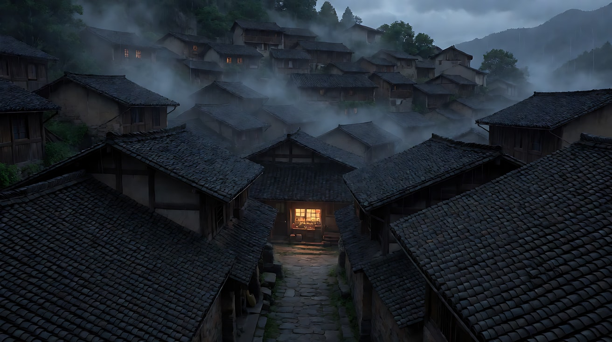
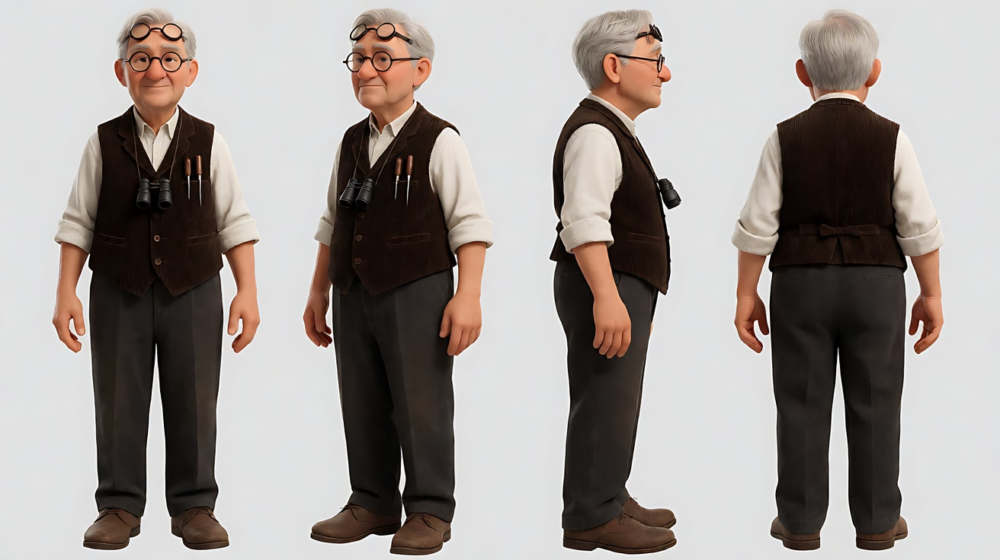
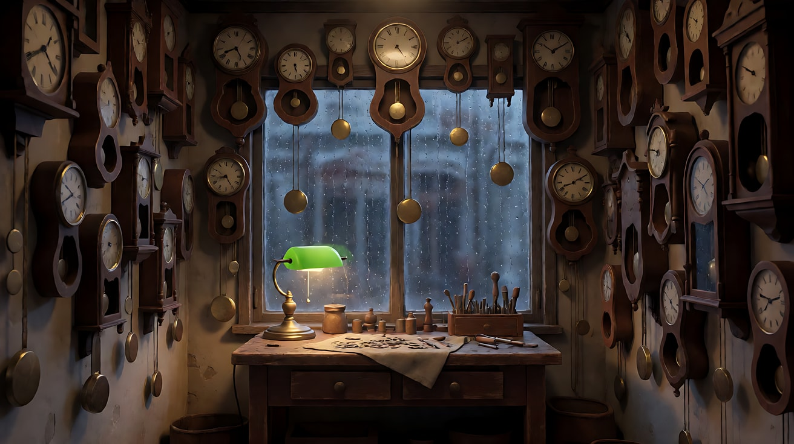
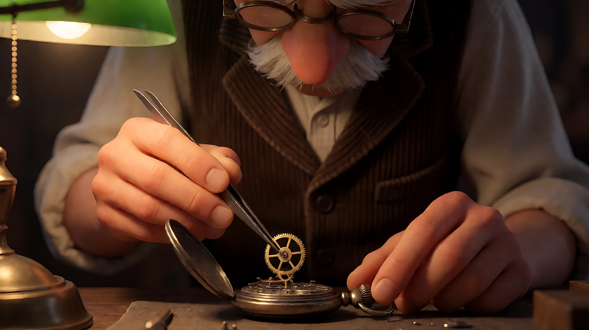
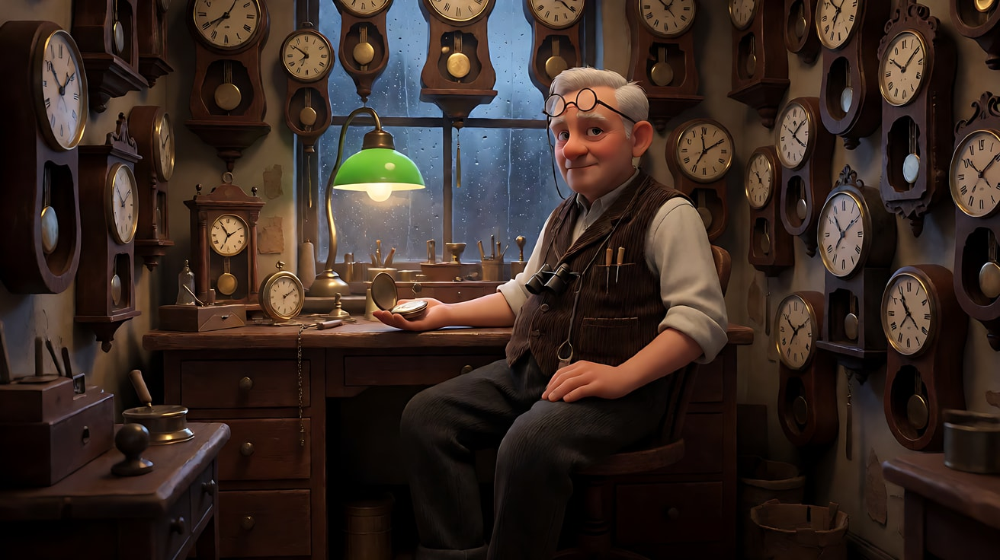
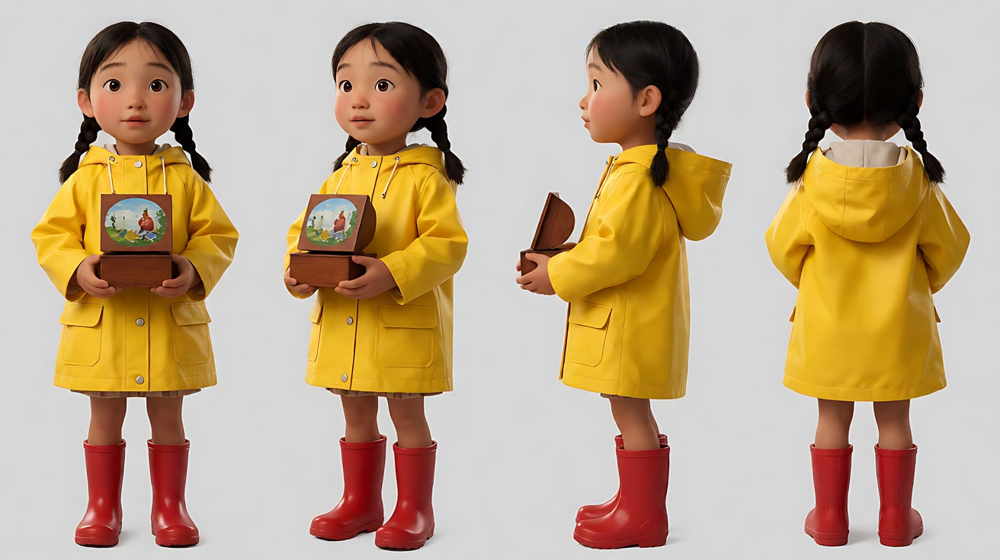
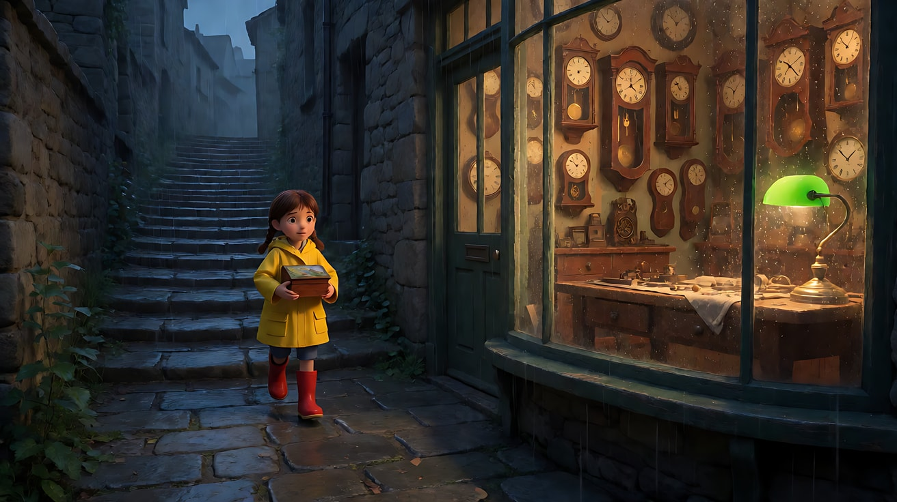
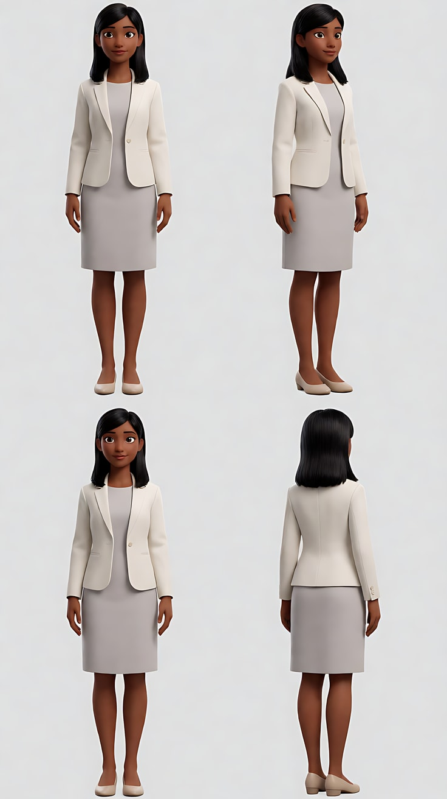
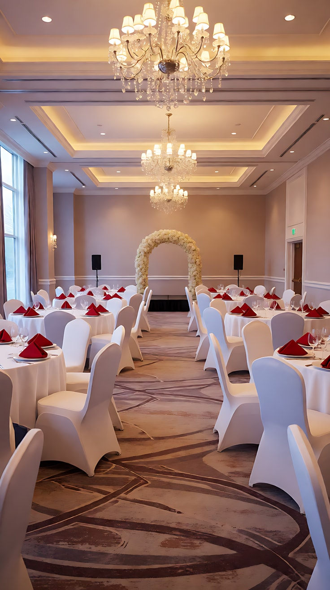
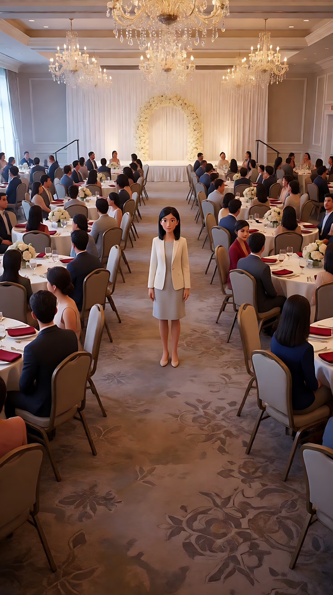

# L01-04 景别序列 · 提示词

> 本组练习：用"建立 → 推进 → 揭示"三种序列讲同一个老钟表铺的故事，再为竖屏短剧设计一个倒装开场。｜ 配套教学：[L01-04-景别序列](../教学/L01-04-景别序列.md) ｜ 规范：[写作规范](../../模板/写作规范.md)
>
> 画风默认使用开关 A（风格化写实 CG）。如改用 2D 动画，删掉所有焦段、光圈、景深词。

**练习1–4 共用角色与场景**

- 角色：原创老钟表匠，七十岁左右，花白短发，圆框老花镜推在额头上，右眼常戴一只黑色单筒放大镜，深棕色灯芯绒马甲配白衬衫，袖子挽到手肘，胸前别着一支细长的钟表起子。
- 场景：雨中黄昏的山间小镇，青瓦屋顶层层叠叠；镇上一间小小的钟表铺，四面墙上挂满了几十只老挂钟，工作台上一盏绿色玻璃罩台灯。

---

### 练习1：建立镜头——先告诉观众"这是哪里"（难度 ★）

**目标**：生成一个合格的建立镜头：时间、天气、地点、"故事将在哪里发生"都清楚。用一个缓慢推镜把观众的注意力引向那扇亮着灯的窗。

**【生图 · Nano Banana】**

图1 建立镜头关键帧（大远景）：

```
An extreme wide shot of a small mountain town at dusk in steady rain, layers of dark grey tiled roofs stepping down a hillside,
mist drifting between the roofs, most windows dark, one small shop window in the lower middle of the frame glowing warm amber,
a narrow stone lane leading toward it. No visible people.
Camera high on a hill opposite the town, slight high angle, 35mm lens, deep focus f/11 so every roof is readable.
Lighting: cold blue-grey dusk ambience from an overcast sky, the single warm window as the only warm light source.
Stylized semi-realistic 3D CG rendering, feature-film animation quality. Aspect ratio 16:9.
```

中文释义：大远景，雨中黄昏的山间小镇，青瓦屋顶层层叠叠，雾在屋顶间飘，大部分窗户是黑的，只有画面中下方一扇小店的窗亮着琥珀色暖光，一条石板小巷通向它；对面山头略俯拍，35mm、深焦；阴天冷色暮光，唯一的暖光来自那扇窗。



**【图生视频 · Seedance】**

```
【素材分工】@图片1 为首帧，锁定小镇布局、屋顶层次与那扇亮灯的窗户位置，不新增人物。
【画风】风格化写实三维CG质感，电影级布光。
雨中黄昏的山间小镇，雨丝持续落下，雾在青瓦屋顶之间缓慢流动，屋檐不断滴水。镜头从对面山头的大远景开始，以很慢的速度向前推进，画面中下方那扇亮着琥珀色暖光的窗户逐渐变大，结尾停在能看清窗内墙上挂满钟表轮廓的远景上。其余窗户始终是暗的。
【声音】连绵的雨声，屋檐滴水声，远处一声狗叫，推近时隐约听到窗内许多钟表此起彼伏的滴答声，无配乐。
【约束】保持小镇布局和窗户位置不变；画面里不出现人物；不要字幕、水印、Logo。
时长：8秒
```

**参数**：时长 8 秒 ｜ 画幅 16:9

**【检查点】**
- 第一眼能否读出：黄昏、下雨、山间小镇
- 那扇暖光窗户是否始终是画面中唯一的暖色，并且被推镜"选中"
- 结尾是否从大远景推到了远景，而不是一路推到室内

**【常见问题与修复】**
| 现象 | 修复 |
|---|---|
| 好几扇窗都亮了 | 写"其余窗户始终是暗的，只有这一扇亮着" |
| 推镜推进了窗户里面 | 写"结尾停在窗外的远景上，不穿过窗户" |
| 雨看不出来 | 加"屋檐滴水""雨丝在暖光窗前清晰可见" |

---

### 练习2：推进——从全景走进他的工作（难度 ★★）

**目标**：用定妆图 + 场景图生成一个连续推镜：从钟表铺全景推进到老钟表匠的中近景。这是前进式序列的"单镜头版"。

**【生图 · Nano Banana】**

图1 角色定妆：

```
Character turnaround sheet of an original elderly clockmaker around seventy:
short grey-white hair, round reading glasses pushed up on his forehead, a small black monocular loupe hanging on a cord around his neck,
a dark brown corduroy waistcoat over a white shirt with sleeves rolled to the elbows, a slim watchmaker's screwdriver clipped to his chest pocket,
dark grey trousers, soft brown leather shoes.
Front view, three-quarter view, side view and back view, full body, standing on a plain light-grey background.
Camera at chest height, eye level, 50mm lens, deep focus.
Even soft studio light from the front, no shadows on the backdrop.
Stylized semi-realistic 3D CG rendering, feature-film animation quality. Aspect ratio 16:9.
```



图2 场景（钟表铺内景空镜）：

```
Empty tiny old clock repair shop at dusk, all four walls covered with dozens of antique wall clocks of different shapes, pendulums hanging still,
a worn wooden workbench under the rain-streaked front window, a green glass desk lamp switched on, tiny gears and tools laid on a cloth, no people.
Full shot of the room from the doorway, eye level, 28mm lens, deep focus.
Lighting: warm pool of light from the green glass desk lamp on the workbench, cool blue dusk light through the rainy window behind.
Stylized semi-realistic 3D CG rendering, feature-film animation quality. Aspect ratio 16:9.
```

中文释义：图1 定妆，含挂在脖子上的单筒放大镜和胸前的起子；图2 钟表铺空镜，四面墙挂满老挂钟，窗下旧木工作台，绿色玻璃罩台灯亮着，工具和小齿轮摆在布上；从门口拍的全景，28mm、深焦；台灯暖光与窗外冷蓝暮光。



**【多图生视频 · Seedance】**

```
【素材分工】@图片1 锁定人物身份、发型、眼镜、放大镜与服装，不参考其灰色背景和棚拍光；@图片2 仅参考钟表铺的陈设布局与台灯、窗光的方向，不据此新增其他人物。
【画风】风格化写实三维CG质感，电影级布光。
老钟表匠坐在窗下的工作台前，背后墙上挂满老挂钟。他把额头上的老花镜拉下来戴好，拿起一只打开后盖的怀表，凑到台灯下仔细端详。镜头从门口的全景开始，沿着地板缓慢平稳地向他推进，越过前景一只落地钟的侧面，停在他胸口以上的中近景，台灯的暖光照亮他专注的脸，窗外冷蓝的雨夜在他身后。
【声音】满屋钟表此起彼伏的滴答声，窗外雨声，怀表后盖轻轻扣动的一声"咔"，无配乐。
【约束】保持人物脸型、发型、服装不变；只有一个向前推进的运镜，不切镜头；墙上挂钟数量与位置不变；不要字幕、水印、Logo。
时长：8秒
```

**参数**：时长 8 秒 ｜ 画幅 16:9

**【检查点】**
- 推镜是否从全景（能看到满墙挂钟）推到中近景（胸口以上）
- 观众在推进过程中，信息是否从"这间屋子"变成了"这个人"
- 戴眼镜、拿怀表两个动作是否清楚

**【常见问题与修复】**
| 现象 | 修复 |
|---|---|
| 推镜太快，全景一闪而过 | 写"缓慢平稳地推进"，并把时长保持在 8 秒以上 |
| 墙上的钟在推进中变形或增多 | 写"墙上挂钟数量与位置不变" |
| 眼镜戴上后又出现在额头上 | 拆掉这个动作，首帧就让他戴着眼镜 |

---

### 练习3：后退式揭示——从一颗齿轮拉到满墙钟表（难度 ★★★，首尾帧）

**目标**：首帧只给一个谜面——镊子夹着一颗细小的齿轮；尾帧揭示谜底——满墙的钟在同一刻重新走动。一个连续拉远把观众从"这是什么"带到"原来如此"。

**【生图 · Nano Banana】**

图1 角色定妆：沿用练习2的图1。

图2 首帧（大特写）：

```
Using the character from image 1:
an extreme close-up of the clockmaker's fingertips holding fine steel tweezers, gripping one tiny brass gear above the open movement of an old pocket watch,
the gear sharply in focus with its teeth catching a warm highlight, everything else melting into dark warm blur; no face visible.
Camera at workbench level, 100mm macro lens, very shallow depth of field f/2.8.
Lighting: warm green-glass desk lamp from frame upper left, deep shadow on the right.
Keep the shirt sleeve and skin tone consistent with image 1.
Stylized semi-realistic 3D CG rendering, feature-film animation quality. Aspect ratio 16:9.
```



图3 尾帧（全景揭示）：

```
Using the character from image 1 and the clock shop interior:
a full shot of the tiny clock repair shop, the clockmaker small at his workbench under the green glass lamp, head to toe visible, leaning back in his chair,
the pocket watch closed in his palm; all four walls covered with dozens of antique wall clocks, every pendulum swinging,
all the clock hands showing the same time. Rain-streaked window behind him.
Camera at eye level from the far corner of the room, 28mm lens, deep focus.
Lighting: warm desk lamp pool on the workbench, cool blue dusk light through the window, soft warm reflections on the clock faces.
Keep the face, hairstyle and outfit exactly as in image 1.
Stylized semi-realistic 3D CG rendering, feature-film animation quality. Aspect ratio 16:9.
```

中文释义：首帧大特写，只有指尖和细镊子夹着一颗黄铜小齿轮，悬在打开的怀表机芯上方，齿尖反着暖光，其余全部虚化，看不到脸；尾帧全景揭示，满屋几十只挂钟的钟摆全部在摆动、指针指向同一时刻，他靠在椅背上，怀表合起握在掌心。



**【首尾帧生视频 · Seedance】**

```
【素材分工】@图片2 为首帧，确定大特写的谜面构图，不出现人脸；@图片3 为尾帧，是最终揭示画面，不改变墙上钟表的数量与位置；@图片1 锁定人物身份与服装，不参考其背景。只生成两帧之间的连续动作。
【画风】风格化写实三维CG质感，电影级布光。
镊子把那颗细小的黄铜齿轮轻轻放进怀表机芯，齿轮咬合，开始转动。镜头从大特写开始，以平稳的速度连续向后拉远，依次露出他的手、他戴着老花镜的专注的脸、整个工作台，最后拉到房间角落的全景。在镜头拉远的过程中，满墙原本静止的挂钟一只接一只地开始摆动。他合上怀表握在掌心，靠回椅背，长出一口气。
【声音】起初几乎无声，只有齿轮咬合的一声细响；随着镜头拉远，挂钟的滴答声一只接一只加入，最后满屋滴答声汇成一片，窗外雨声，无配乐。
【约束】保持人物脸型、发型、服装不变；一镜到底，只有一个向后拉远的运镜，不切镜头；墙上钟表的形状不变；不要字幕、水印、Logo。
时长：10秒
```

**参数**：时长 10 秒 ｜ 画幅 16:9

**【检查点】**
- 首帧是否真的"看不懂全貌"：没有脸、没有房间
- 拉远过程中信息是否逐级释放：手 → 脸 → 工作台 → 满墙钟
- 声音是否随揭示从一声变成一片

**【常见问题与修复】**
| 现象 | 修复 |
|---|---|
| 拉远中途画面变形、钟表融化 | 时长加到 12 秒，或拆成"大特写 → 中景"和"中景 → 全景"两段首尾帧 |
| 钟摆一开始就全在摆 | 写"满墙挂钟原本静止，在镜头拉远时一只接一只开始摆动" |
| 镊子和手指变形 | 首帧让手指只露出指尖，主体是镊子和齿轮 |

---

### 练习4：前进式三段式 + 跳切对照（难度 ★★★★，多镜头）

**目标**：用"建立 → 动作 → 结果"三镜头讲完一件小事：雨夜里，一个小女孩把坏掉的八音盒送到钟表铺。再生成一个"同角度小变景"的对照版，亲眼看看跳切问题。

**【生图 · Nano Banana】**

图1 角色定妆：沿用练习2的图1。

图2 场景：沿用练习2的图2。

图3 小女孩定妆：

```
Character turnaround sheet of an original girl about eight years old: two short braids, a bright yellow raincoat with the hood down,
red rubber rain boots, holding a small wooden music box with a painted lid.
Front view, three-quarter view, side view and back view, full body, standing on a plain light-grey background.
Camera at her chest height, eye level, 50mm lens, deep focus.
Even soft studio light from the front, no shadows on the backdrop.
Stylized semi-realistic 3D CG rendering, feature-film animation quality. Aspect ratio 16:9.
```



图4 镜头1关键帧（远景建立）：

```
Using the girl from image 3 and the clock shop from image 2:
a wide shot of the rainy stone lane outside the clock shop at dusk, the shop window glowing warm amber on the right,
the small girl in her yellow raincoat walking up the lane toward the shop door, about one quarter of the frame height, holding the music box against her chest.
Camera at eye level further down the lane, 28mm lens, deep focus.
Lighting: warm shop window light from frame right, cool blue dusk ambience, rain visible against the warm glow.
Keep the face, hairstyle and outfit exactly as in image 3.
Stylized semi-realistic 3D CG rendering, feature-film animation quality. Aspect ratio 16:9.
```

中文释义：图3 小女孩定妆，两根短辫，明黄色雨衣，红色雨靴，抱着一只彩绘木盖的小八音盒；图4 远景建立，雨中石板巷，钟表铺的窗在画右亮着暖光，小女孩沿小巷走向店门，只占画面高度四分之一。



**【多图生视频 · Seedance】正确版**

```
【素材分工】@图片1 锁定老钟表匠的身份与服装，不参考其背景；@图片2 仅参考钟表铺内景布局和台灯位置，不复制其取景；@图片3 锁定小女孩的身份、雨衣与八音盒，不参考其背景；@图片4 为镜头1首帧，确定远景建立构图，不新增人物。
【画风】风格化写实三维CG质感，电影级布光。
镜头1：固定远景，雨中石板巷，小女孩穿着明黄色雨衣，双手抱着八音盒，沿小巷走向画右亮着暖光的钟表铺，推开门走进去。雨声和门上铜铃的一声响。
镜头2：镜头切至店内侧面中景，老钟表匠坐在工作台前，小女孩站在台前，把八音盒放到台面上，用手指推到他面前；他放下手里的怀表，拉下额头上的老花镜。小女孩小声说："它不唱歌了。"满屋钟表的滴答声。
镜头3：镜头切至老钟表匠正面近景，台灯暖光照亮他的脸，他低头看着八音盒，嘴角慢慢扬起，轻轻点了一下头，伸手打开盒盖。盒盖打开的一声轻响。
【锁定】光线：店内只有工作台上的绿色玻璃罩台灯暖光，窗外冷蓝暮色；人物：老钟表匠坐在工作台后，面朝画左；小女孩站在台前画左，面朝画右；机位始终在工作台的同一侧。
【声音】从室外的雨声，到门铃，再到满屋滴答声和一句童声对白，最后盒盖轻响，无配乐。
【约束】保持两位人物的脸型、发型、服装不变；镜头2里只有小女孩做主动作，老钟表匠只做放下怀表、拉下眼镜的小动作；不要字幕、水印、Logo。
时长：13秒
```

**【多图生视频 · Seedance】跳切对照版**（只用来观察问题，不作为成片）

```
【素材分工】@图片1 锁定老钟表匠的身份与服装，不参考其背景；@图片2 仅参考钟表铺内景布局，不复制其取景。
【画风】风格化写实三维CG质感，电影级布光。
镜头1：正面中景，老钟表匠坐在工作台前，低头看一只怀表。滴答声。
镜头2：镜头切至同一正面角度、只稍微靠近一点的中景，他仍在低头看怀表。滴答声。
镜头3：镜头切至同一正面角度、再稍微靠近一点的中景，他抬起头。滴答声。
【锁定】光线：台灯暖光从画左；人物：老钟表匠坐在工作台后，正面朝向镜头；机位始终在正前方。
【声音】满屋钟表滴答声，无配乐。
【约束】保持人物脸型、发型、服装不变；不要字幕、水印、Logo。
时长：8秒
```

**参数**：正确版 13 秒、对照版 8 秒 ｜ 画幅 16:9 ｜ 正确版负载：3 个镜头、1 句对白、镜头2有两人（一人主动作、一人小动作），属于"稳妥"到"有挑战"之间

**【检查点】**
- 正确版三个镜头的景别是否为远景 → 中景 → 近景，且角度各不相同
- 对照版是否出现"画面抖一下"的跳切感，或被模型合并成一个推镜
- 正确版里两人的左右位置在镜头2和镜头3之间是否一致

**【常见问题与修复】**
| 现象 | 修复 |
|---|---|
| 正确版镜头1直接跳到店内 | 写"推开门走进去"作为镜头1的终点，镜头2开头写"镜头切至店内" |
| 镜头2两人都在大幅动作 | 写清"只有小女孩做主动作"，老钟表匠只做小动作 |
| 对照版被生成得很顺滑 | 这本身也说明问题：模型把它理解成了推镜。对照的目的是看清"同角度小变景"无法成为有意的切换 |
| 镜头3老钟表匠面朝方向反了 | 在【锁定】写明"面朝画左"，并保持机位在工作台同一侧 |

---

### 练习5：竖屏短剧倒装开场——五镜头钩子（难度 ★★★★★，多镜头）

**目标**：为一部原创竖屏短剧设计 15 秒开场。不从建立镜头开始，而是按"冲突细节 → 反应 → 揭示处境 → 推进 → 钩子"的顺序。景别：大特写 → 近景 → 全景 → 中景 → 近景。

**本练习角色与场景**：原创女主，二十六七岁，黑色及肩直发别在耳后，简洁的米白色西装外套配浅灰连衣裙，右手无名指没有戒指，只有一圈浅浅的戒痕；场景为酒店宴会厅，圆桌白桌布，水晶吊灯，几十位宾客。

**【生图 · Nano Banana】**

图1 女主定妆：

```
Character turnaround sheet of an original woman in her late twenties: straight shoulder-length black hair tucked behind her ears,
a simple off-white tailored blazer over a light-grey knee-length dress, nude low heels, no jewellery, a faint pale ring mark on her right ring finger.
Front view, three-quarter view, side view and back view, full body, standing on a plain light-grey background.
Camera at chest height, eye level, 50mm lens, deep focus.
Even soft studio light from the front, no shadows on the backdrop.
Stylized semi-realistic 3D CG rendering, feature-film animation quality. Vertical 9:16 frame.
```



图2 场景（宴会厅空镜）：

```
Empty hotel banquet hall prepared for an engagement party, round tables with white tablecloths and red napkins, a long central aisle,
a small stage at the far end with a pale floral arch, crystal chandeliers overhead, no people.
Vertical full shot looking down the central aisle from the entrance, eye level, 28mm lens, deep focus.
Lighting: warm golden light from the crystal chandeliers above, soft cool spill from tall windows at frame left.
Stylized semi-realistic 3D CG rendering, feature-film animation quality. Vertical 9:16 frame.
```



图3 镜头1关键帧（大特写钩子）：

```
Using the character from image 1:
an extreme close-up of her right hand placing a red engagement invitation card face down on a white tablecloth and pressing it flat with two fingers,
the faint pale ring mark visible on her ring finger, a crystal wine glass softly blurred in the background.
Camera just above table level, 100mm lens, very shallow depth of field.
Lighting: warm chandelier light from above, a small highlight on the red card edge.
Keep the skin tone and blazer sleeve consistent with image 1.
Stylized semi-realistic 3D CG rendering, feature-film animation quality. Vertical 9:16 frame.
```


图4 镜头3关键帧（全景揭示）：

```
Using the character from image 1 and the banquet hall from image 2:
a vertical full shot from the far end of the central aisle, the woman standing alone at the entrance end of the aisle, head to toe in frame, small but centred,
dozens of seated guests at round tables on both sides all turned in their chairs to look at her, frozen mid-conversation,
crystal chandeliers in the upper part of the frame. Her figure sits in the middle of the frame, the lower fifth shows only the empty aisle carpet.
Camera at eye level near the stage, 35mm lens, deep focus.
Lighting: warm golden chandelier light from above, cool window spill from frame left.
Keep the face, hairstyle and outfit exactly as in image 1.
Stylized semi-realistic 3D CG rendering, feature-film animation quality. Vertical 9:16 frame.
```

中文释义：图1 女主定妆，无名指只有浅浅的戒痕；图2 订婚宴宴会厅空镜，竖构图沿中央通道看去；图3 大特写，她的右手把一张红色订婚请柬背面朝上放在白桌布上，用两根手指压平，戒痕清晰可见；图4 竖屏全景揭示，从舞台一端回望，她独自站在通道入口，两侧几十位宾客全部转身看着她，下方五分之一只有空地毯。



**【多图生视频 · Seedance】**

```
【素材分工】@图片1 锁定女主身份、发型与服装，不参考其背景；@图片2 仅参考宴会厅布局、吊灯与通道位置，不复制其空场状态；@图片3 为镜头1首帧，确定大特写构图，不出现人脸；@图片4 仅作为镜头3的构图参考，不改变她居中、宾客两侧转身的布局。
【画风】风格化写实三维CG质感，电影级布光。
镜头1：固定大特写，她的右手把一张红色请柬背面朝上放在白桌布上，两根手指把它压平，无名指上一圈浅浅的戒痕。请柬落在桌布上的一声轻响，背景里宾客的谈笑声。
镜头2：镜头切至竖屏正面近景，她的脸位于画面上三分之一，下巴微抬，嘴唇抿着，目光直直看向画面前方远处，眼眶发红但没有眨眼。背景谈笑声骤然变小。
镜头3：镜头切至竖屏全景，从舞台一端回望，她独自站在中央通道的入口，两侧几十位宾客都在椅子上转过身看着她，整个大厅安静下来。只剩吊灯下极轻的空调声。
镜头4：镜头切至竖屏中景，镜头在她前方后退跟随，她沿着中央通道一步一步向前走，高跟鞋踩在地毯上，双手垂在身侧，步子不快也不停。两侧宾客的身影在画面边缘虚化掠过。清晰的脚步声。
镜头5：镜头切至竖屏近景，她停下脚步，脸位于画面上三分之一，嘴角慢慢扬起一个平静的笑，轻声说："今天这杯酒，我来敬。"
【锁定】光线：暖金色吊灯光从上方，画左有冷色窗光；人物：女主穿米白西装外套、浅灰连衣裙，始终沿中央通道朝舞台方向前进；构图：所有镜头的脸和关键动作在画面中上部，下方五分之一不放关键内容。
【声音】从宾客的谈笑声，到骤然安静，再到只剩脚步声，最后一句平静的对白，无配乐。
【约束】保持女主脸型、发型、服装不变；宾客只转身注视、轻微呼吸，不起身、不说话；不要字幕、水印、Logo。
时长：15秒
```

**参数**：时长 15 秒 ｜ 画幅 9:16 ｜ 负载：5 个镜头（镜头1、2为短插入与反应镜头各算半拍）、1 次跟拍运镜、1 句对白、背景群像，属于短剧典型的"有挑战"档。第一次失败时，拆成"镜头1–3"与"镜头4–5"两次生成。

**【检查点】**
- 第一个镜头是否"就有事"：请柬 + 戒痕，不需要解释也能感到冲突
- 镜头3的全景是否成功揭示"所有人都在看她"的处境
- 景别顺序是否为：大特写 → 近景 → 全景 → 中景 → 近景
- 竖屏安全区：脸和请柬是否都在画面中上部

**【常见问题与修复】**
| 现象 | 修复 |
|---|---|
| 镜头1请柬上出现乱码文字 | 写"请柬背面朝上"，不展示文字面 |
| 镜头3宾客乱动或起身 | 写"宾客只转身注视、轻微呼吸，不起身、不说话" |
| 镜头4跟拍变成从背后跟 | 写"镜头在她前方后退跟随，拍她的正面" |
| 镜头数被吞掉 | 按建议拆成两次生成，用镜头3的尾帧作为第二次生成的首帧 |
| 镜头2和镜头5看起来一样 | 镜头2写"眼眶发红、嘴唇抿着"，镜头5写"嘴角扬起、开口说话"，两者情绪方向相反 |
