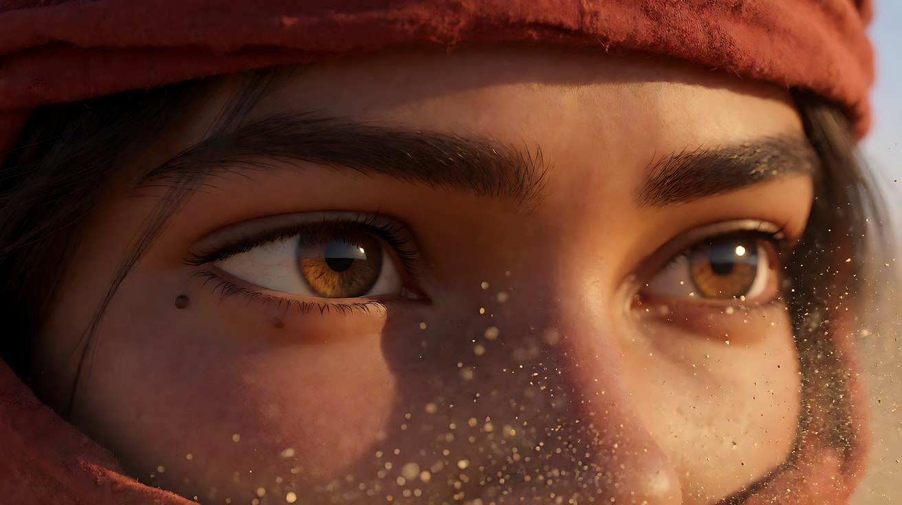
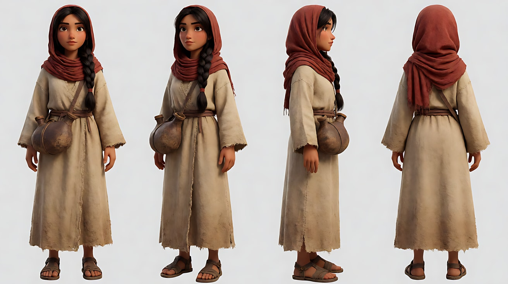
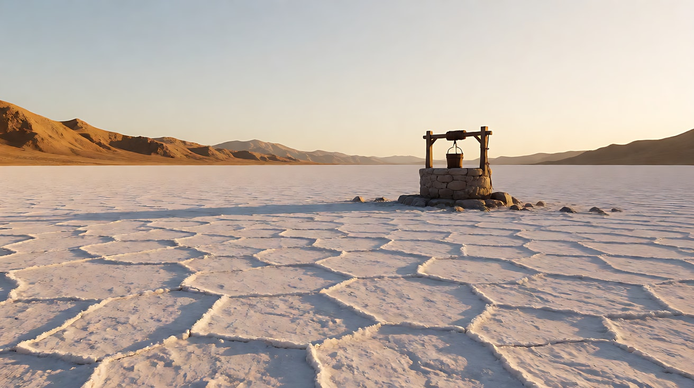
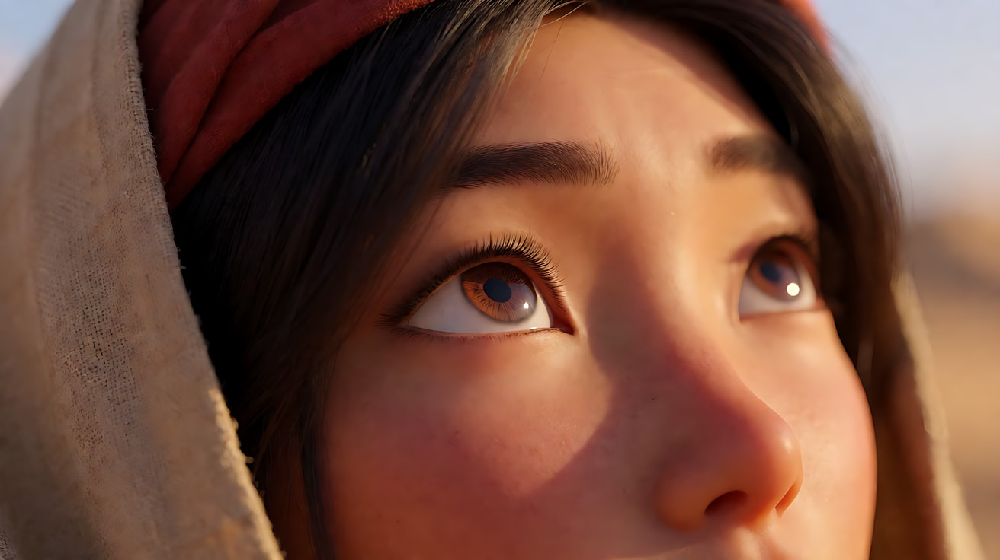
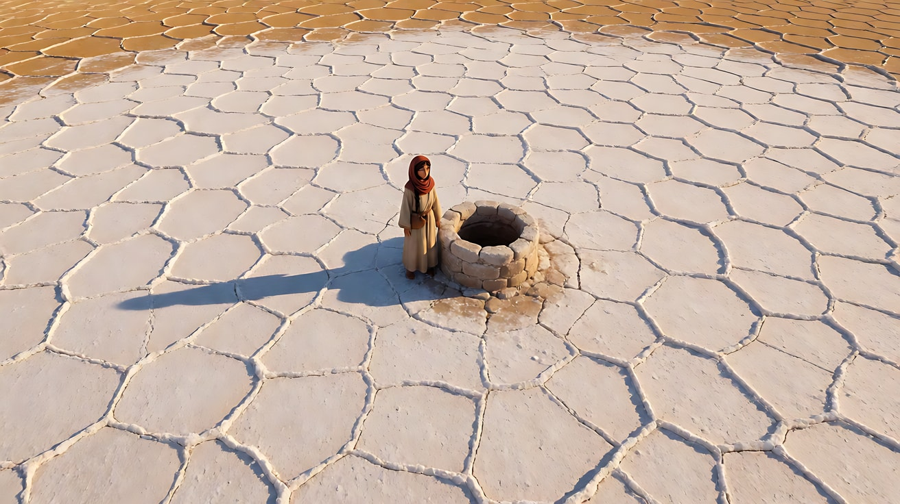
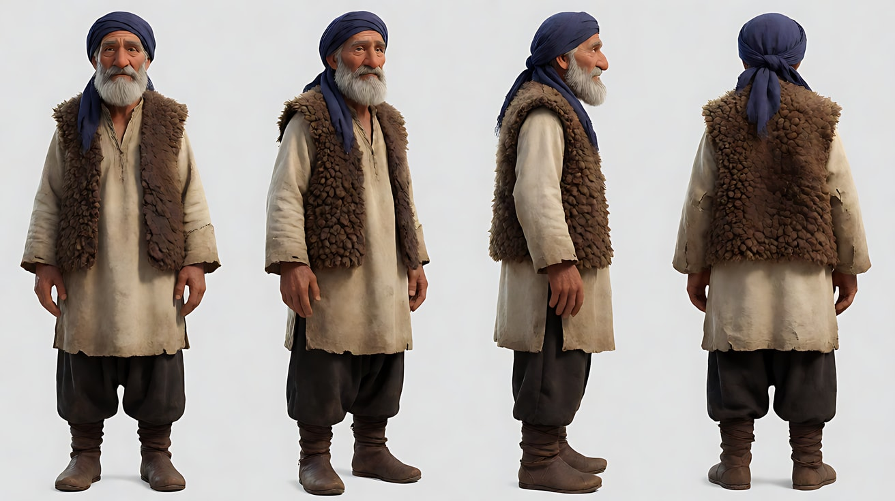
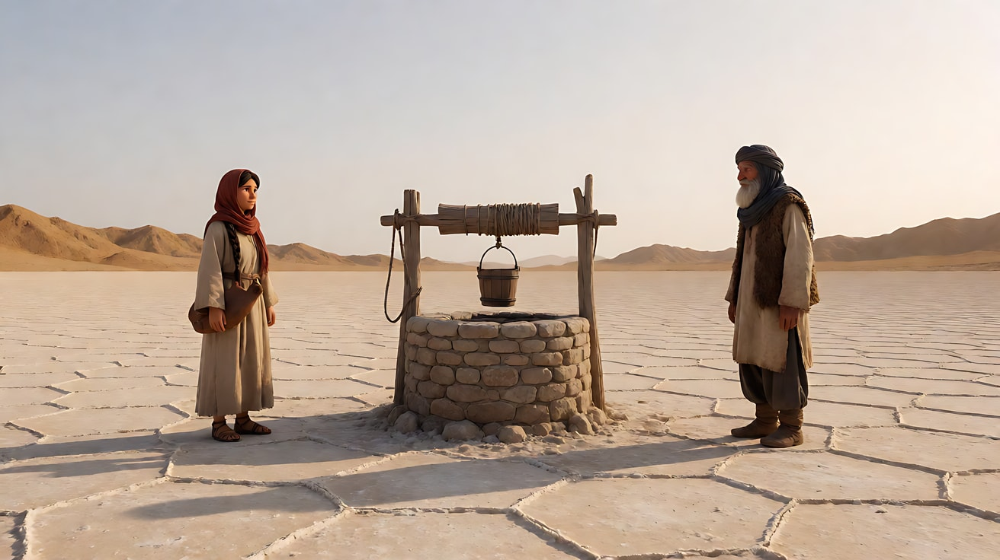
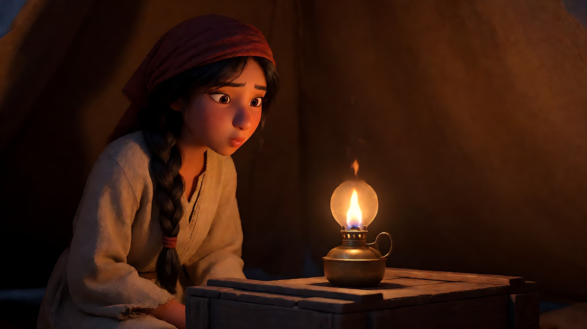
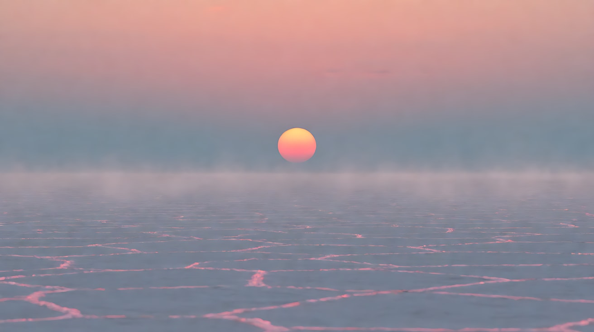
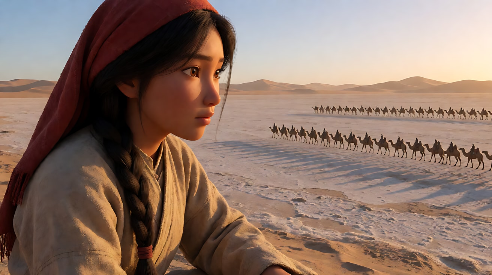

# L01-05 景别反差叙事 · 提示词

> 本组练习：在一片盐碱荒原上，用大远景与大特写的对撞、交替加速、跨尺度匹配剪辑和画内纵深反差，制造尺度带来的冲击。｜ 配套教学：[L01-05-景别反差叙事](../教学/L01-05-景别反差叙事.md) ｜ 规范：[写作规范](../../模板/写作规范.md)
>
> 画风默认使用开关 A（风格化写实 CG）。如改用 2D 动画，删掉所有焦段、光圈、景深词。

**本组共用角色与场景**

- 角色A：原创年轻女向导，二十三四岁，晒成小麦色的皮肤，深棕色长发编成一根粗辫子，赭红色头巾，沙色粗布长袍，腰间一只旧皮水囊，左眼角有一颗小痣。
- 角色B（练习4使用）：原创年长牧人，五十多岁，灰白络腮胡，深蓝色头巾，磨旧的褐色羊皮坎肩，手背上有很深的皱纹。
- 场景：一望无际的白色盐碱荒原，地面龟裂成多边形纹路，远处是低矮的赭色山脊；荒原中央有一口石砌的老井，井边一根木架和一只吊桶。

---

### 练习1：大特写——一双眼睛装下整片风沙（难度 ★）

**目标**：先单独练好反差的一端：只装下眼睛和眉毛的大特写。让大特写"有事"：风沙吹来，眼睛眯起，视线锁定远方。

**【生图 · Nano Banana】**

图1 大特写关键帧：

```
An extreme close-up of an original young woman desert guide, only her eyes and eyebrows filling the frame horizontally,
sun-tanned skin, a small mole at the outer corner of her left eye, the edge of a rust-red headscarf at the top of the frame,
her eyes narrowed against the wind, looking steadily toward frame right; fine grains of sand drifting across the frame.
Camera at her eye level, 100mm lens, very shallow depth of field, focus on her irises.
Lighting: hard low afternoon sun from frame right as the key, a warm reflection of the bright salt flat in her pupils, deep shadow under the headscarf.
Stylized semi-realistic 3D CG rendering, feature-film animation quality. Aspect ratio 2.39:1 widescreen.
```

中文释义：大特写，画面横向只装下她的双眼和眉毛，左眼角有一颗小痣，画面上缘是赭红头巾的边；她迎风眯着眼，稳稳看向画右；细沙飘过画面；平视、100mm、极浅景深，焦点在虹膜；画右低角度硬质午后阳光，瞳孔里映着发亮的盐碱地；宽银幕 2.39:1。



**【图生视频 · Seedance】**

```
【素材分工】@图片1 为首帧，锁定人物眼部特征、左眼角的痣与头巾颜色，不扩大成整张脸。
【画风】风格化写实三维CG质感，电影级布光。
大特写，只有她的双眼和眉毛。一阵风把细沙吹过画面，她眯起眼，睫毛上沾了几粒沙，眨了一下，视线没有离开画右远方的某处，瞳孔微微收缩。镜头完全固定，不推不拉，景别始终只装下眼睛。画右低角度的硬质阳光照在她的眼睛上，头巾边缘被风吹得抖动。结尾停在她锁定远方、一动不动的眼神上。
【声音】持续的风声，细沙打在头巾布料上的沙沙声，她一次压低的呼吸声，无配乐。
【约束】保持眼部特征、痣的位置与头巾颜色不变；画面中不出现鼻子和嘴；不要字幕、水印、Logo。
时长：5秒
```

**参数**：时长 5 秒 ｜ 画幅 21:9（平台无 2.39:1 时选最宽的比例，或用 16:9 生成后在剪辑中加遮幅）

**【检查点】**
- 画面是否始终只有眼睛和眉毛
- 大特写里是否"有事"：沙吹过、眯眼、眨眼、瞳孔收缩
- 视线是否始终朝向画右

**【常见问题与修复】**
| 现象 | 修复 |
|---|---|
| 模型拉远成了整张脸 | 写"景别始终只装下眼睛，画面中不出现鼻子和嘴" |
| 眼睛不自然地乱转 | 写"视线锁定画右远方，不转动眼球" |
| 平台不支持宽银幕 | 用 16:9 生成，剪辑时上下加黑边遮幅，构图时把眼睛放在画面中线 |

---

### 练习2：大远景——一个小点与一堵沙墙（难度 ★★）

**目标**：练好反差的另一端：人物小到只有画面高度的二十分之一，身后是一整面压过来的沙尘暴。用定妆图 + 场景图多图参考生成。

**【生图 · Nano Banana】**

图1 角色A定妆：

```
Character turnaround sheet of an original young woman desert guide in her early twenties:
sun-tanned skin, dark brown hair in one thick braid, a rust-red headscarf, a long sand-coloured coarse cotton robe,
an old leather water skin at her waist, a small mole at the outer corner of her left eye, worn leather sandals.
Front view, three-quarter view, side view and back view, full body, standing on a plain light-grey background.
Camera at chest height, eye level, 50mm lens, deep focus.
Even soft studio light from the front, no shadows on the backdrop.
Stylized semi-realistic 3D CG rendering, feature-film animation quality. Aspect ratio 16:9.
```



图2 场景（盐碱荒原空镜）：

```
Empty endless white salt flat in the late afternoon, the ground cracked into polygon patterns stretching to the horizon,
low ochre mountain ridges far away, an old stone well with a wooden frame and a hanging bucket in the middle distance,
a vast pale sky. No people.
Extreme wide shot, camera low near the ground, 24mm lens, deep focus f/11.
Lighting: hard low sun from frame right casting long shadows from every crack ridge.
Stylized semi-realistic 3D CG rendering, feature-film animation quality. Aspect ratio 2.39:1 widescreen.
```

中文释义：图1 角色A定妆，含赭红头巾、粗辫子、腰间皮水囊、左眼角的痣；图2 盐碱荒原空镜，地面龟裂成多边形纹路延伸到地平线，远处赭色山脊，中景有一口石井；低机位大远景，24mm、深焦；画右低角度硬光拉出每条裂纹的长影。



**【多图生视频 · Seedance】**

```
【素材分工】@图片1 锁定人物服装颜色、头巾与辫子轮廓，不参考其灰色背景和棚拍光；@图片2 仅参考盐碱荒原的地面纹路、山脊与石井位置，不复制其晴朗无风的天空。
【画风】风格化写实三维CG质感，电影级布光。
大远景，白色盐碱荒原一望无际，女向导站在画面左下方，只是一个赭红色的小点，不到画面高度的二十分之一。远处地平线上，一整面赭黄色的沙尘暴像墙一样缓缓压过来，占满画面右侧三分之二的天空。她没有逃，而是解下腰间的水囊，把头巾拉起来遮住口鼻，转身面对沙墙站定。镜头为低机位固定大远景，不推不拉。画右的阳光逐渐被沙墙吞没，地面的长影一点点变淡。结尾停在小小的她面对巨大沙墙站立的画面上。
【声音】由远及近的低沉风啸，越来越密的沙粒声，没有人声，无配乐。
【约束】人物始终很小，不放大，不出现面部；保持人物服装颜色不变；荒原上没有其他人；不要字幕、水印、Logo。
时长：8秒
```

**参数**：时长 8 秒 ｜ 画幅 21:9 或 16:9

**【检查点】**
- 她是否小到只有画面高度的二十分之一左右
- 沙墙是否占满画面大部分，形成压倒性的比例
- 光是否随沙墙逼近而变暗

**【常见问题与修复】**
| 现象 | 修复 |
|---|---|
| 人物被放大成全景 | 写"不到画面高度的二十分之一，只是一个赭红色的小点" |
| 沙尘暴一下子吞没画面 | 写"缓缓压过来"，结尾停在沙墙还在远处的时刻 |
| 她的动作看不清 | 远景里动作要大：转身、拉起头巾、站定，不写表情 |

---

### 练习3：从一只眼睛升到整片荒原——运动中的尺度揭示（难度 ★★★，首尾帧）

**目标**：首帧是她的眼睛大特写，尾帧是荒原大远景。一个连续的"后拉并升起"把观众从个人抛回世界。这是反差最极端的一种单镜头形态。

**【生图 · Nano Banana】**

图1 角色A定妆：沿用练习2的图1。

图2 首帧（大特写）：

```
Using the character from image 1:
an extreme close-up of her left eye and eyebrow filling the frame, the small mole at the outer corner visible,
looking up toward the sky at frame upper right, a single grain of sand on her eyelashes.
Camera at her eye level, 100mm lens, very shallow depth of field.
Lighting: hard low sun from frame right, warm reflection in the pupil.
Keep the eye shape, mole and skin tone exactly as in image 1.
Stylized semi-realistic 3D CG rendering, feature-film animation quality. Aspect ratio 16:9.
```



图3 尾帧（大远景，生成时同时上传练习2的场景空镜作为环境参考）：

```
Using the character from image 1 and the salt flat environment plate as the location reference:
an extreme wide aerial shot looking down on the endless cracked white salt flat, the woman a tiny rust-red figure standing beside the old stone well
in the exact centre of the frame, less than one fiftieth of the frame height, her long shadow stretching toward frame left,
the polygon crack patterns forming a giant mosaic around her, ochre ridges at the top edge.
Camera high above, looking down at about forty-five degrees, 24mm lens, deep focus f/11.
Lighting: hard low sun from frame right, long shadows.
Keep the outfit colours exactly as in image 1.
Stylized semi-realistic 3D CG rendering, feature-film animation quality. Aspect ratio 16:9.
```

中文释义：首帧大特写，只有她的左眼和眉毛，眼角的痣可见，抬眼望向画右上方的天空，睫毛上一粒沙；尾帧高空约四十五度俯拍的大远景，她是石井旁一个赭红色的小点，位于画面正中，长影朝向画左，周围龟裂的地纹像巨大的马赛克。



**【首尾帧生视频 · Seedance】**

```
【素材分工】@图片2 为首帧，确定眼睛大特写的起点，不出现整张脸；@图片3 为尾帧，是最终的大远景俯拍目标，不放大其中的人物；@图片1 锁定人物服装颜色与眼角的痣，不参考其背景。只生成两帧之间的连续动作。
【画风】风格化写实三维CG质感，电影级布光。
她的左眼望向画右上方的天空，眨了一下。镜头从眼睛的大特写开始，以平稳加速的速度连续向后拉并向上升起，依次露出她的整张脸、头巾、站在石井边的全身、石井和木架，再越升越高，直到她成为龟裂盐碱地正中的一个小点。她始终站在井边仰头望天，不移动。画右低角度的阳光始终不变，她的长影朝向画左。
【声音】起初是极近的呼吸声和睫毛眨动时细微的风声，随着镜头升高，呼吸声消失，只剩越来越空旷的风声，无配乐。
【约束】保持人物服装、头巾颜色和眼角的痣不变；一镜到底，只有一个后拉并升起的运镜，不切镜头；荒原上没有其他人；不要字幕、水印、Logo。
时长：10秒
```

**参数**：时长 10 秒 ｜ 画幅 16:9

**【检查点】**
- 尺度变化是否连续：眼睛 → 脸 → 全身 → 石井 → 荒原
- 结尾她是否足够小，且位于画面正中
- 声音是否从"呼吸"变成"空旷的风"

**【常见问题与修复】**
| 现象 | 修复 |
|---|---|
| 中途画面变形或跳到尾帧 | 时长加到 12 秒；仍失败就拆成"大特写 → 全景"与"全景 → 大远景"两段首尾帧，在剪辑里接起来 |
| 拉远时人物跟着移动 | 写"她始终站在井边仰头望天，不移动" |
| 升起时镜头旋转 | 写"镜头不旋转，只后拉并升起" |

---

### 练习4：井边对峙——大远景与大特写的交替加速（难度 ★★★★，多镜头）

**目标**：女向导与年长牧人在荒原上最后一口井边对峙，谁先取水。用"大远景 → 大特写交替 → 大远景放气"的结构，让镜头越来越短，紧张不断累积，最后一个大远景释放。不写任何器械，紧张全部来自眼神和手。

**【生图 · Nano Banana】**

图1 角色A定妆：沿用练习2的图1。

图2 角色B定妆：

```
Character turnaround sheet of an original elderly herdsman in his fifties: a grey-white full beard, a deep blue headscarf,
a worn brown sheepskin vest over a faded cream tunic, loose dark trousers tucked into leather boots, deeply wrinkled weathered hands.
Front view, three-quarter view, side view and back view, full body, standing on a plain light-grey background.
Camera at chest height, eye level, 50mm lens, deep focus.
Even soft studio light from the front, no shadows on the backdrop.
Stylized semi-realistic 3D CG rendering, feature-film animation quality. Aspect ratio 16:9.
```



图3 场景：沿用练习2的图2。

图4 镜头1关键帧（对峙大远景）：

```
Using the character from image 1, the character from image 2 and the salt flat from image 3:
an extreme wide shot of the endless cracked salt flat, the old stone well with its wooden frame exactly in the centre,
the young woman guide standing far to the left of the well and the elderly herdsman standing far to the right, both tiny,
each less than one fifteenth of the frame height, facing each other across the well, long shadows stretching toward frame left.
Camera low near the ground, eye level, 28mm lens, deep focus f/11.
Lighting: hard low sun from frame right.
Keep the outfits and headscarf colours exactly as in images 1 and 2.
Stylized semi-realistic 3D CG rendering, feature-film animation quality. Aspect ratio 2.39:1 widescreen.
```

中文释义：图2 年长牧人定妆，灰白络腮胡、深蓝头巾、褐色羊皮坎肩、满是皱纹的手；图4 对峙大远景，石井位于画面正中，女向导在井的远左侧，牧人在井的远右侧，两人都很小、隔井相望，长影朝向画左；低机位、28mm、深焦；宽银幕。



**【多图生视频 · Seedance】**

```
【素材分工】@图片1 锁定女向导的服装、赭红头巾与眼角的痣，不参考其背景；@图片2 锁定年长牧人的胡须、深蓝头巾与羊皮坎肩，不参考其背景；@图片3 仅参考盐碱荒原与石井的布局，不复制其取景；@图片4 为镜头1首帧，确定两人隔井对峙的大远景站位，不放大人物。
【画风】风格化写实三维CG质感，电影级布光。
镜头1：固定大远景，荒原正中是石井，女向导在画左远处，牧人在画右远处，两人隔着井一动不动地对望，长影朝向画左。风声和井架木头的吱呀声。
镜头2：硬切到女向导眼睛的大特写，只有双眼和眉毛，她眯着眼看向画右，眼角的痣清晰。风声骤然变小。
镜头3：镜头切至牧人眼睛的大特写，只有双眼和灰白的眉毛，他看向画左，眼角的皱纹抽动了一下。他呼吸的声音。
镜头4：镜头切至女向导右手的大特写，手悬在腰间的水囊绳结旁，手指微微张开又收紧。只停留一拍。皮绳摩擦的细响。
镜头5：镜头切至牧人右手的大特写，满是皱纹的手指在羊皮坎肩边缘轻轻敲了两下，停住。只停留一拍。
镜头6：镜头切回固定大远景，与镜头1同一机位，牧人忽然仰头大笑，抬手示意让她先走；女向导愣了一下，向石井走去，两人在画面里依然很小。远远传来一声粗哑的笑声，风声重新变大。
【锁定】光线：低角度硬质阳光始终从画右照来，长影朝向画左；人物：女向导始终在井的画左一侧、面朝画右，赭红头巾；牧人始终在井的画右一侧、面朝画左，深蓝头巾；机位始终在两人连线的同一侧。
【声音】大远景是开阔的风声与井架吱呀；大特写时风声被压低，只剩呼吸、皮绳和指尖敲击的细节声；最后一个大远景风声重新涌回，加入一声笑，无配乐。
【约束】保持两人的脸型、服装、头巾颜色不变；画面中不出现任何器械；大特写镜头只出现眼睛或手，不出现嘴；不要字幕、水印、Logo。
时长：15秒
```

**参数**：时长 15 秒 ｜ 画幅 21:9 或 16:9 ｜ 负载：6 个镜头，其中镜头2–5为无运镜、无对白的插入镜头（各算半拍），镜头6有两人动作，属于"有挑战"档。第一次失败时，删掉镜头4和镜头5，保留"大远景 → 两个眼睛大特写 → 大远景"的四镜头骨架。

**【检查点】**
- 是否先用大远景建立了"两人隔井对望"的空间关系，大特写才出现
- 大特写是否越来越短：眼睛 → 眼睛 → 手（一拍）→ 手（一拍）
- 两人的视线方向是否一致：她看画右，他看画左
- 最后一个大远景是否成功"放气"

**【常见问题与修复】**
| 现象 | 修复 |
|---|---|
| 大特写变成了整张脸的近景 | 每个大特写都写"只有双眼和眉毛"或"只有手" |
| 两人视线方向反了 | 在【锁定】写明左右位置与朝向，并强调机位不越轴 |
| 镜头4和镜头5被吞掉 | 这是负载过高的信号：拆成两次生成，或采用四镜头骨架 |
| 镜头6两人突然变大 | 写"与镜头1同一机位"，并用 @图片4 锁定站位 |
| 画面里出现了器械 | 在【约束】写"画面中不出现任何器械"，手部只写"悬在水囊绳结旁" |

---

### 练习5：火光与日出——跨尺度匹配剪辑与画内纵深反差（难度 ★★★★★，多镜头）

**目标**：一个四镜头的转场段落。夜里她在帐篷中吹灭油灯，圆形的火光位于画面正中；硬切到黎明的大远景，圆形的太阳从地平线升起，位于画面同一位置。随后商队出发，最后一个镜头用"前景大特写尺度的侧脸 + 背景大远景尺度的商队"同框，把个人和世界放进同一个画面。

**【生图 · Nano Banana】**

图1 角色A定妆：沿用练习2的图1。

图2 镜头1关键帧（火光近景）：

```
Using the character from image 1:
a close-up inside a dark canvas tent at night, a small brass oil lamp on a low wooden crate, its round warm flame exactly in the centre of the frame,
the young woman guide's face in three-quarter view at frame left, leaning toward the flame with her lips slightly pursed, about to blow it out.
Camera at the height of the flame, 85mm lens, shallow depth of field, the tent wall behind dissolving into dark orange blur.
Lighting: the oil lamp flame as the only light source, warm orange key on her face from below right, deep darkness everywhere else.
Keep the face, hairstyle and outfit exactly as in image 1.
Stylized semi-realistic 3D CG rendering, feature-film animation quality. Aspect ratio 2.39:1 widescreen.
```



图3 镜头2关键帧（日出大远景）：

```
An extreme wide shot of the endless cracked white salt flat at dawn, a perfectly round orange sun just rising above the flat horizon,
the sun placed exactly in the centre of the frame, the same size and position as a small flame would appear in a close-up,
the ground crack patterns glowing faintly pink, a thin layer of ground mist, no people.
Camera low near the ground, eye level, 200mm telephoto lens to make the sun large, deep focus.
Lighting: the rising sun directly ahead as the only light source, soft pink and blue pre-dawn sky.
Stylized semi-realistic 3D CG rendering, feature-film animation quality. Aspect ratio 2.39:1 widescreen.
```



图4 镜头4关键帧（画内纵深反差）：

```
Using the character from image 1 and the salt flat at sunrise:
a deep-focus composition: in the extreme foreground at frame left, the young woman guide's face in profile looking toward frame right,
so close that her eye, cheek and the edge of the rust-red headscarf fill the left third of the frame;
in the far background at frame right, a long line of a camel caravan crossing the salt flat, each camel a tiny silhouette against the low sun.
Camera at her eye level, 24mm lens, deep focus f/16 so both her eye and the distant caravan are sharp.
Lighting: low warm sunrise from frame right, rim light on her profile, long shadows of the caravan.
Keep the face, mole, hairstyle and outfit exactly as in image 1.
Stylized semi-realistic 3D CG rendering, feature-film animation quality. Aspect ratio 2.39:1 widescreen.
```

中文释义：图2 火光近景，帐篷里低矮木箱上一盏黄铜油灯，圆形火苗位于画面正中，她的四分之三侧脸在画左，嘴唇微撅准备吹灭，火光是唯一光源；图3 日出大远景，圆形橙色太阳刚从地平线升起，位于画面正中，大小与位置和火苗一致，用 200mm 长焦把太阳放大；图4 画内纵深反差，画左前景是她极近的侧脸（眼睛、脸颊、头巾边缘占左三分之一），画右远景是一长串骆驼商队的剪影，24mm 深焦让两者都清晰。



**【多图生视频 · Seedance】**

```
【素材分工】@图片1 锁定女向导的脸型、眼角的痣、辫子与头巾颜色，不参考其背景；@图片2 为镜头1首帧，确定火苗位于画面正中的构图，不新增人物；@图片3 仅作为镜头2的构图参考，不改变太阳位于画面正中的位置与大小；@图片4 仅作为镜头4的构图参考，不改变前景侧脸与远景商队的比例关系。
【画风】风格化写实三维CG质感，电影级布光。
镜头1：固定近景，夜里的帐篷中，圆形的油灯火苗在画面正中轻轻跳动，她的侧脸在画左，凑近火苗，轻轻一吹，火苗熄灭的瞬间画面陷入黑暗。一声轻轻的吹气声。
镜头2：硬切到黎明的大远景，圆形的橙色太阳从盐碱荒原的地平线升起，位于画面正中，大小和位置与刚才的火苗相同，地面的龟裂纹路泛着淡淡的粉色。镜头固定不动。辽阔的风声。
镜头3：镜头切至低机位远景，一列骆驼商队在晨光中从画左向画右缓缓走过荒原，女向导牵着领头的骆驼走在最前面，所有人和骆驼都很小。驼铃声和远处的风。
镜头4：镜头切至画内纵深构图，画左前景是她极近的侧脸，眼睛和头巾边缘占据画面左三分之一，她望向画右；画右远景是那一列小小的商队剪影正向地平线走去。她眨了一下眼，风吹动头巾边缘。镜头固定。驼铃声渐远，她一次平静的呼吸。
【锁定】光线：镜头1只有油灯火光；镜头2起为画面正前方或画右的低角度朝阳；人物：女向导，赭红头巾，左眼角有痣，深棕色粗辫子；商队始终从画左向画右行进；机位始终在商队行进方向的同一侧。
【声音】从帐篷里极近的吹气声，硬切到辽阔的风声，再加入驼铃，最后驼铃远去只剩她的呼吸和风，无配乐。
【约束】保持人物脸型、服装、头巾颜色和痣的位置不变；镜头2画面中不出现人物；不要字幕、水印、Logo。
时长：15秒
```

**参数**：时长 15 秒 ｜ 画幅 21:9 或 16:9 ｜ 负载：4 个镜头，镜头2为空镜插入（半拍），镜头3有群体行进但只有一个领头人物，属于"稳妥"到"有挑战"之间

**【检查点】**
- 镜头1的火苗与镜头2的太阳是否位置相同、大小相近——这是匹配剪辑成立的关键
- 火苗熄灭到太阳出现之间是否是干脆的硬切，没有溶接过渡
- 镜头4里前景的眼睛和远景的商队是否都清晰，构成"个人与世界同框"
- 尺度的旅程是否成立：一盏灯 → 一个太阳 → 一支商队 → 一只眼睛与整片荒原

**【常见问题与修复】**
| 现象 | 修复 |
|---|---|
| 火苗和太阳不在同一位置 | 两张关键帧都写"位于画面正中"，并在镜头2写"大小和位置与刚才的火苗相同" |
| 硬切被生成成了溶接 | 写"火苗熄灭的瞬间画面陷入黑暗"，镜头2开头写"硬切到" |
| 镜头4前景的脸是虚的 | 写"深焦，前景侧脸与远景商队同时清晰"；仍失败可接受前景略虚，但眼睛必须可辨 |
| 镜头3商队走向和镜头4相反 | 在【锁定】写明"商队始终从画左向画右行进" |
| 太阳被生成得很小 | 生图写长焦 `200mm telephoto lens to make the sun large`，视频里不写焦段数字也可以，靠 @图片3 锁定构图 |
