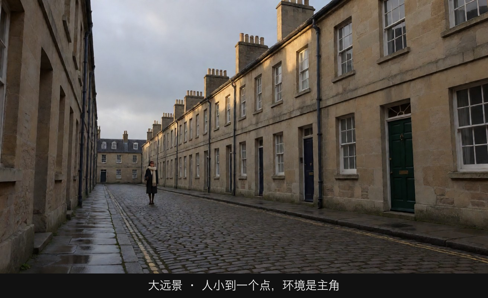
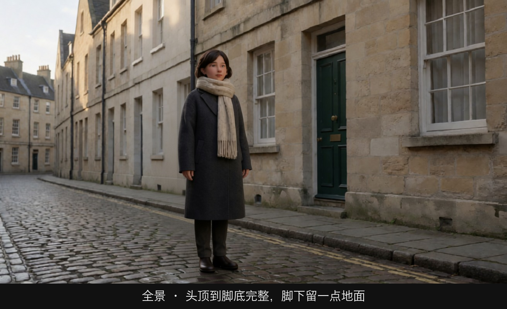
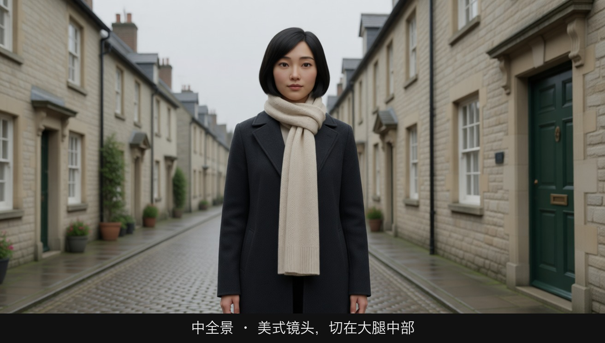
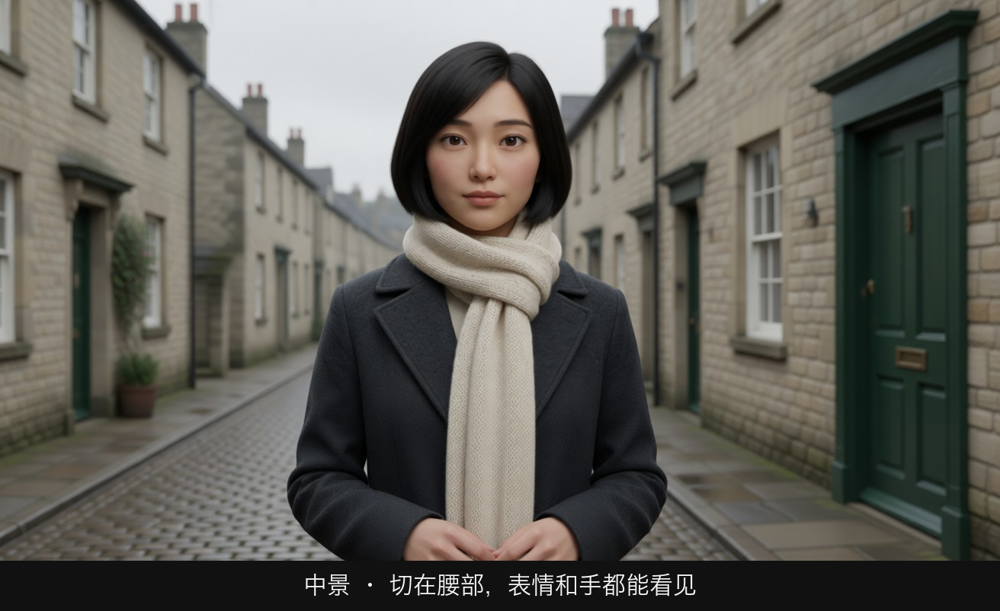
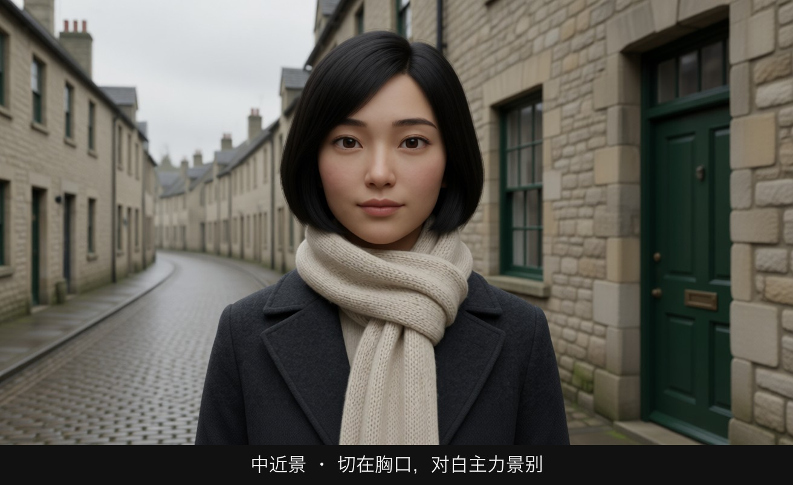
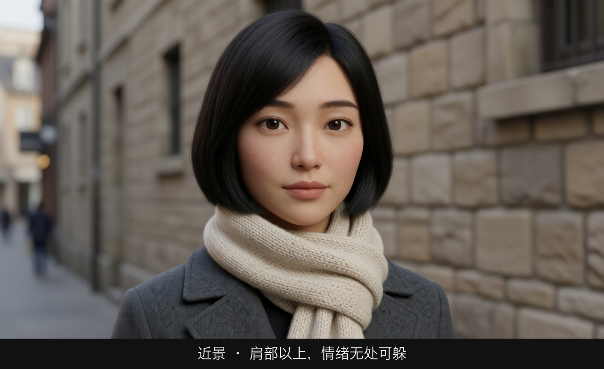
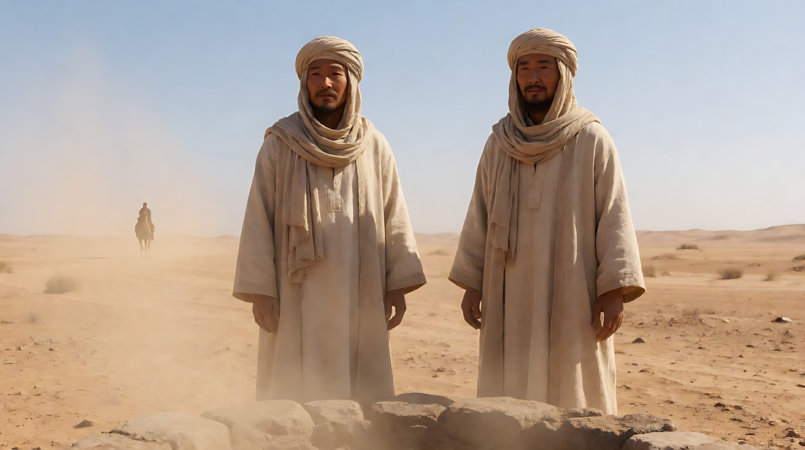
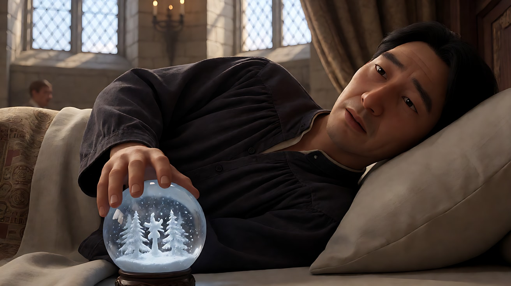
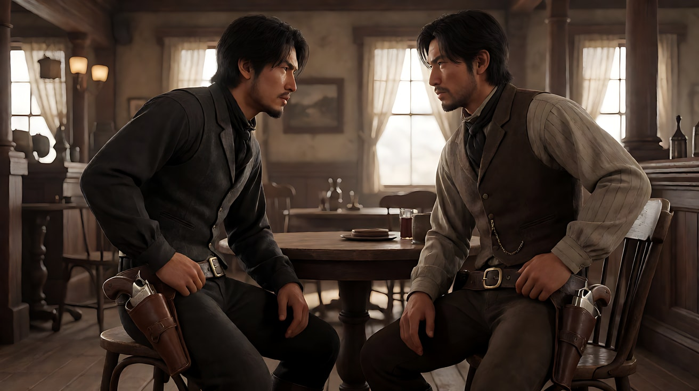

# L01-01 八种基本景别：从大远景到微距

> 段位：入门 ｜ 建议用时：50 分钟 ｜ 配套提示词：[L01-01-八种基本景别-提示词](../提示词/L01-01-八种基本景别-提示词.md)

## 学习目标

- 能说出八种基本景别加微距的中英文名称、定义和人物切点
- 看到一个画面，能在 3 秒内判断它属于哪种景别
- 知道每种景别"最擅长讲什么"，不再凭感觉选景别
- 能在生图和 Seedance 提示词里用准确的景别词，并知道哪些景别容易让模型出错

## 一、概念讲解

### 1. 景别是什么

**景别 = 被摄主体在画面里占多大比例。** 它决定观众"站得离人物多远"。同一个人、同一个地点，换一个景别，观众接收到的信息完全不同：

- 景别越大（越远）：看到的是**环境、处境、人与空间的关系**
- 景别越小（越近）：看到的是**表情、细节、内心**

景别由两件事共同决定：**摄影机离主体的距离**和**焦段**。用 24mm 站近和用 135mm 站远都可能拍出"近景"，但空间感不同（这一点在模块 02 细讲）。本模块只讨论"画面里人物有多大"。

### 2. 人体切点示意图

以站立的人为标尺，每种景别的下边框大致切在下面这些位置：

```
                 ┌─ 头顶 ─────────────────────────────┐
      ( o o )    │  大特写 ECU：只剩眼睛 / 嘴 / 一只手     │ ← 切在眉毛与下巴之间的局部
       \ - /     │                                     │
   ──────────────┼── 下巴 / 肩部以上 ────────────────── │ ← 近景(特写) CU：头部充满画面
        |   |    │                                     │
   ──────────────┼── 胸口(上衣口袋) ─────────────────── │ ← 中近景 MCU
       /|   |\   │                                     │
   ──────────────┼── 腰部 / 腰带略下 ────────────────── │ ← 中景 MS
      / |   | \  │                                     │
   ──────────────┼── 大腿中部(膝盖以上) ──────────────── │ ← 中全景 / 美式 MFS（Cowboy shot）
        |   |    │                                     │
        |   |    │                                     │
   ──────────────┼── 脚下留一点地面 ─────────────────── │ ← 全景 FS：头到脚完整
       _|   |_   │                                     │
                 └──────────────────────────────────────┘
   远景 WS：全身可见，但人只占画面高度的三分之一左右，环境开始说话
   大远景 EWS：人小到一个点，甚至看不出是谁，环境是主角
   微距 Macro：比大特写更近，拍的是肉眼平时看不清的纹理、水珠、昆虫
```

注意：所有切点都**避开关节**（脖子、腰、膝盖、脚踝、手腕），切在两个关节之间的"肉"上。原因在 [L01-03](L01-03-人物切点与画面空间.md) 详细讲。

### 3. 九档景别速查

| 景别 | 英文（生图用） | 人物切到哪里 | 人物占画面高度 | 最擅长讲什么 |
|---|---|---|---|---|
| 大远景 | extreme wide shot (EWS) | 人小到一个点 | 不到 1/10 | 世界的规模、人的渺小、地理位置、时代背景 |
| 远景 | wide shot / long shot (WS) | 全身可见但很小 | 约 1/3 | 人在环境里的处境、行进路线、多人调度 |
| 全景 | full shot (FS) | 头顶到脚底完整 | 约 3/4 以上 | 完整肢体动作、服装造型、站位关系 |
| 中全景（美式） | medium full shot / cowboy shot | 大腿中部 | 超出画面下缘 | 身体姿态 + 手部动作 + 一点环境；对峙、群戏 |
| 中景 | medium shot (MS) | 腰部 | — | 对话、手上的事情、两人关系，最"中性"的叙事景别 |
| 中近景 | medium close-up (MCU) | 胸口 | — | 对白主力景别，表情可读又保留一点肢体 |
| 近景（特写） | close-up (CU) | 肩部以上 / 头部充满画面 | — | 情绪、反应、做决定的那一刻 |
| 大特写 | extreme close-up (ECU) | 脸的局部或物体局部 | — | 眼神、嘴唇、颤抖的手指，把一个细节放大成事件 |
| 微距 | macro shot | 物体的微观纹理 | — | 材质、昆虫、水滴、齿轮、食物，"看见看不见的" |

> **术语差异提醒**：国内影视行业传统上把"胸部以上"叫近景、"肩部以上"叫特写，和英文的 MCU / CU 对应关系会有出入。本教程统一采用上表：**中近景 = MCU（胸口）**，**近景（特写）= CU（肩以上）**。写提示词时以英文词为准，不会有歧义。

### 4. 每种景别的细节与常见用途

**大远景（EWS）**：常作为一场戏、一部片的开篇定场。人在画面里可能只有几个像素，观众看的是"这是什么地方、什么时代、什么天气"。也用于结尾，让人物"回到世界里去"。

**远景（WS）**：人物能被认出来（靠服装颜色、身形），但环境仍占主导。适合拍"他走向那栋房子""两拨人在广场两端"——有路线、有方位。

**全景（FS）**：头和脚都在画里，是展示**完整动作**的最小景别：舞蹈、打斗、摔倒、起身。头顶和脚下各留一点余量，不要顶天立地。

**中全景 / 美式（MFS / Cowboy shot）**：切在大腿中部。这个名字来自法国影评人对美国西部片的称呼（plan américain），通常认为是为了让腰间的枪套也进画。今天它是**群戏和站立对峙**的好景别：既能看清表情，又能看清手在做什么。

**中景（MS）**：切在腰部。人物上半身 + 手部动作 + 一部分背景，是信息量最均衡的景别，也是很多对话戏的"母镜头"。

**中近景（MCU）**：切在胸口。脸足够大，能读出表情；肩膀和一点手势还在。电视剧、短剧对白的主力景别。

**近景 / 特写（CU）**：脸几乎占满画面，额头或头顶可以略被切掉。观众被迫直视人物的情绪，没有地方可以躲。用在"做决定""听到消息""忍住眼泪"的瞬间。

**大特写（ECU）**：只剩一只眼睛、一张嘴、一个指尖。它把一个微小的变化放大成整场戏的焦点。用多了会疲劳，一场戏用一两次最有力。

**微距（Macro）**：比大特写更进一步，进入肉眼看不到的尺度：信封邮票的纸纤维、金属表面的划痕、叶子上的露珠。常用于产品、美食、科幻、自然纪录片。

### 5. 景别不只由摄影机决定

```mermaid
flowchart LR
    A[景别变化的三种来源] --> B[换机位：剪辑切换]
    A --> C[摄影机移动：推近或拉远]
    A --> D[人物移动：走近或走远]
    B --> B1[最清楚、最可控]
    C --> C1[观众感到"我在靠近"]
    D --> D1[观众感到"他在靠近我"]
```

同样是从全景变成近景：**剪辑切换**最干脆；**推镜头**让观众主动靠近；**人物走向镜头**则是角色主动靠近观众。三种方法的情绪不同，在配套练习3里你会亲手对比。

## 图解

> 这些示意图由多种生图模型分别生成（包括 Nano Banana、GPT Image 等），只用来说明镜头概念；不同模型的画面不能互相比较效果，也不能当作视频成片。


这一组图锁定同一个人（齐下巴黑短发、炭灰大衣、米色围巾）和同一条雨后石板街，只改变景别。图下黑条是景别名称。先看总览，再逐张看切在身体的哪里。




人在街道里很小，房子、湿石板和天占据几乎整幅画。这个景别讲的是地方和规模。人小到这个程度时，不要要求模型表演表情。


全身还在，也能靠大衣和围巾认出她，但环境仍然比人重。适合交代「她站在这条街的什么位置」。



头顶和两只鞋都在画里，鞋底下还留着一条石板。这是能看清完整站姿的最小景别。再往近切，脚就会出画。



美式镜头。下边框切在大腿中部，膝盖在画外。脸、手和身体姿态同时在，腰间如果有道具也进得了画。



切在腰部。表情可读，手也在。这是信息最均衡的一档，对话戏的母镜头经常从这里开始。



切在胸口。脸已经足够大，肩膀还留着。短剧对白的主力景别。



肩部以上，脸几乎占满画宽。观众没有别处可看，只能接收她的表情。


只保留眼睛这一块。一个眨眼、一次视线移动，就会变成整幅画的事件。不要在这一档里写走路、转身这类大动作。


比大特写更近，进入围巾纤维和水珠的尺度。微距改变的是观众的身体尺度，不只是「拍得更清楚」。

## 二、情绪与叙事功能

| 景别 | 观众的感受 | 常用场景 |
|---|---|---|
| 大远景 | 世界很大，人很小；安静、孤独或敬畏 | 开场定场、旅途、结尾告别 |
| 远景 | 旁观者，看清处境 | 人物进场、追逐路线、两方对峙全貌 |
| 全景 | 看到完整的人和完整的动作 | 舞蹈、打斗、造型亮相、起身离开 |
| 中全景 | 既看身体也看表情，带一点紧张 | 群戏、站立对峙、多人对话 |
| 中景 | 中立、客观，像在同一个房间 | 日常对话、手上做事 |
| 中近景 | 开始关心这个人 | 对白主力、采访 |
| 近景（特写） | 进入情绪，无处可逃 | 决定、反应、告白、震惊 |
| 大特写 | 一个细节变成事件，紧张被放大 | 眼神、手指、倒计时、线索 |
| 微距 | 好奇、惊叹，"原来它长这样" | 产品质感、自然、线索物证 |

## 三、经典影片案例

### 《阿拉伯的劳伦斯》（1962，大卫·里恩）阿里从海市蜃楼中出现
- 场景：劳伦斯和向导在沙漠中的一口井边取水，远处地平线的热浪里出现一个小黑点。
- 怎么拍的：用固定的大远景长时间注视这个黑点，它在蒸腾的热气中慢慢变大、慢慢显出骑骆驼的人形，观众和劳伦斯一样，很久都看不清来者是谁。
- 为什么这样拍：大远景让沙漠成为真正的主角，人在其中渺小得几乎不存在；同时"看不清"本身就是悬念。一个景别同时完成了地理、规模和威胁三件事。



### 《公民凯恩》（1941，奥逊·威尔斯）"玫瑰花蕾"
- 场景：影片开场，垂死的凯恩躺在床上，手里握着一个雪景水晶球。
- 怎么拍的：先是城堡的远景和一系列逐渐靠近的画面，然后出现凯恩嘴唇的**大特写**，他说出"玫瑰花蕾"，水晶球从手中滑落摔碎。
- 为什么这样拍：大特写把一句两个字的遗言放大成整部电影的谜题。观众没有看到他的整张脸，只看到嘴唇，这个"只看局部"的选择让这句话显得私密又神秘，全片的调查就从这一个大特写出发。



### 美式镜头与西部片（1930–1950 年代好莱坞西部片）
- 场景：西部片中枪手对峙、酒馆群戏。
- 怎么拍的：大量使用切在大腿中部的中全景，人物的脸和腰间的枪套同时在画面里。
- 为什么这样拍：观众需要同时看到"他的眼神"和"他的手离枪有多远"。法国影评人把这种景别称为 plan américain（美式镜头），名字沿用至今。它提醒我们：**景别的选择取决于"这场戏观众必须看到什么"**。



### 《微观世界》（1996，克洛德·努里德萨尼、玛丽·佩雷努）
- 场景：一片普通草地上一天里昆虫的生活。
- 怎么拍的：几乎全片使用微距摄影，蚂蚁、甲虫、蜗牛被拍得像大型动物。
- 为什么这样拍：微距把观众的尺度缩小到昆虫的世界，一滴雨落下就像一颗炸弹。它证明了微距不只是"拍得清楚"，而是**改变观众的身体尺度**。


## 四、在 AI 中怎么实现

- **生图阶段**：景别词放在句首，英文要用标准写法（extreme wide shot / wide shot / full shot / medium full shot / medium shot / medium close-up / close-up / extreme close-up / macro shot）。再补一句人物切点，例如 `framed from mid-thigh up`、`framed from the chest up`，模型会更准。全景要写 `head to toe fully in frame, a little space above the head and below the feet`，否则常被裁掉脚。
- **视频阶段**：Seedance 里直接写中文景别词："固定中景""缓慢推近到近景""切至大特写"。景别变化写成"起点景别 → 运镜 → 终点景别"，例如"从全景缓慢推近，停在中近景"。
- **一致性**：同一角色的景别阶梯，先生成定妆图和场景图，再用 `Using the character from image 1 and the location from image 2` 逐张生成关键帧，脸和服装才不会漂。
- **模型擅长**：中景、中近景、近景的表情和小动作；大远景的天气、光线、云雾；微距的水珠、金属、纸张纹理。
- **要避开**：
  - 大远景里要求人物"表情变化"——人只有几个像素，模型会乱演或把人放大
  - 大特写里做大动作——眼睛大特写只适合眨眼、视线移动、瞳孔里的反光
  - 全景里写复杂手部操作——手太小，容易变形
  - 一个 5 秒片段里同时写"从大远景推到大特写"——跨度太大，中间会变形，拆成两段或用切镜

## 五、练习作业

1. **看片识别**：选一部你喜欢的电影，任意截 20 张画面，逐张标注景别，统计每种景别出现的次数。你会发现中景、中近景通常占大多数。
2. **景别阶梯**：用配套提示词练习2，为同一个原创角色、同一个场景生成大远景到微距的 9 张关键帧，打印或拼成一张对照图。
3. **一句话用途**：给每一张阶梯图写一句"如果用这个景别，这场戏是在讲……"。
4. 完成配套提示词练习1–5，重点对比练习3中"人物走近"与练习4中"切镜"两种改变景别的方式。

### 参考答案

**1. 看片识别（示范：《公民凯恩》开场，取 12 个镜头）**

| # | 画面 | 景别 |
|---|---|---|
| 1 | "禁止入内"的牌子 | 近景 |
| 2 | 铁栅栏后的庄园，人小到几乎没有 | 大远景 |
| 3 | 空无一人的场地、荒废的设施 | 远景 |
| 4 | 庄园越来越近，仍看不到室内 | 远景 |
| 5 | 一扇亮着灯的窗 | 全景（窗是主体） |
| 6 | 床上的人与手里的水晶球 | 中景 |
| 7 | 水晶球里的雪 | 近景 |
| 8 | 嘴唇说出"玫瑰花蕾" | 大特写 |
| 9 | 水晶球脱手、掉落 | 近景 |
| 10 | 球摔碎，雪在玻璃里散开 | 大特写 |
| 11 | 护士进门，只在球的碎片里看见她 | 中景 |
| 12 | 被单盖上 | 中近景 |

统计会偏向两头：开场用大远景、远景定场，遗言用大特写。若把统计范围拉到一整场对话戏，中景和中近景会变成多数。近景以上留给"必须让观众无处可躲"的那一句。

**2. 景别阶梯**

对照图就是本课图解里的 [九档总览](图/L01-01-景别阶梯总览.jpg)。合格标准：

| 景别 | 下边框 | 人占画面高度 |
|---|---|---|
| 大远景 | 不切身体，人是一个点 | 不到 1/10 |
| 远景 | 头到脚都在，但人仍小 | 约 1/3 |
| 全景 | 头顶和鞋底都在，脚下留一条地面 | 约 3/4 |
| 中全景 | 大腿中部，膝盖在画外 | 头将近顶边 |
| 中景 | 腰部，手在画内 | — |
| 中近景 | 胸口 | — |
| 近景 | 肩以上 | — |
| 大特写 | 只剩眼睛，嘴在画外 | — |
| 微距 | 围巾纤维和水珠，没有脸 | — |

全景若切到小腿，不算通过。提示词要写 `head to toe fully in frame, a little space above the head and below the feet`。

**3. 一句话用途（同一条雨后石板街）**

- 大远景：这场戏在讲这条街有多长、她有多不重要。
- 远景：这场戏在讲她站在这扇绿门前，还没有走进去。
- 全景：这场戏在讲她整个人的站姿，她还没有迈步。
- 中全景：这场戏在讲她的手是否会抬起来敲门。
- 中景：这场戏在讲她把一封信拿在腰前，信和脸一样重要。
- 中近景：这场戏在讲她开口之前的犹豫。
- 近景：这场戏在讲她决定不敲了。
- 大特写：这场戏在讲她的眼睛有没有看向门。
- 微距：这场戏在讲信纸上的一滴雨，字还没被看清。

**4. 人物走近 vs 切镜**

同一件事：她走到绿门前，看见开门的人。

- 练习3，人物走近：机位锁死。她从全景自己走进中近景。观众感到的是"她在靠近我"。
- 练习4，切镜：远景（她在街的另一头找门牌）→ 切到中景（手敲在门上）→ 切到近景（门开了一条缝，她看见里面的人）。景别一次跳一档以上，角度也换。观众感到的是信息在跳，不是身体在靠近。

做对的标志：走近那条，背景几乎不动，只有人变大；切镜那条，三个镜头的背景范围明显不同，不会被模型收成一个连续推镜。

## 六、自检清单

- [ ] 我能说出九档景别的中英文名称
- [ ] 我知道每种景别的下边框切在身体哪个位置
- [ ] 我能区分中近景（胸口）和近景（肩以上）
- [ ] 我的生图提示词里景别词写在句首，并补了人物切点
- [ ] 我没有在大远景里要求人物表情，也没有在大特写里写大动作
- [ ] 我知道改变景别的三种方式：切镜、推拉、人物移动

## 七、配套提示词

→ [L01-01-八种基本景别-提示词](../提示词/L01-01-八种基本景别-提示词.md)

---

上一课：[L00-04 学习路线与五段位](../../00-导论与工作流/教学/L00-04-学习路线与五段位.md) ｜ 下一课：[L01-02 景别与情绪距离](L01-02-景别与情绪距离.md) ｜ [返回总目录](../../README.md)
