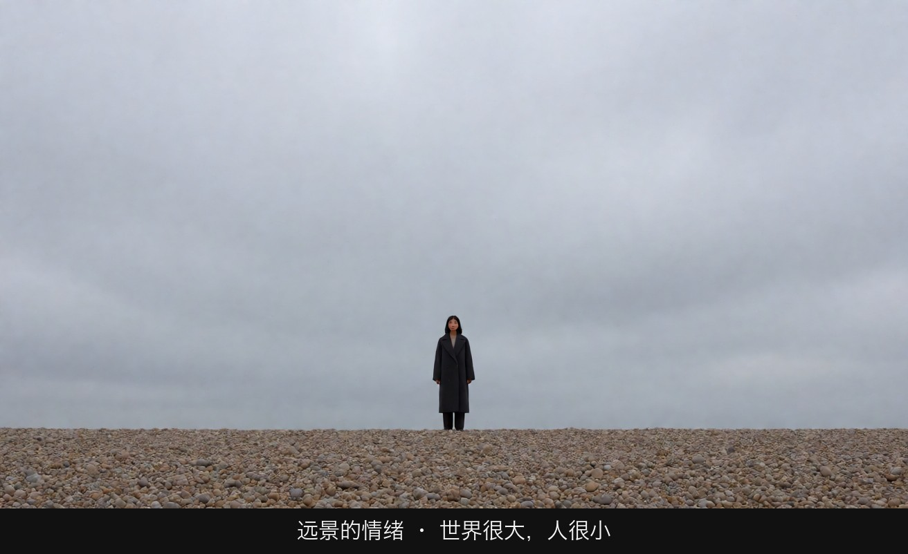
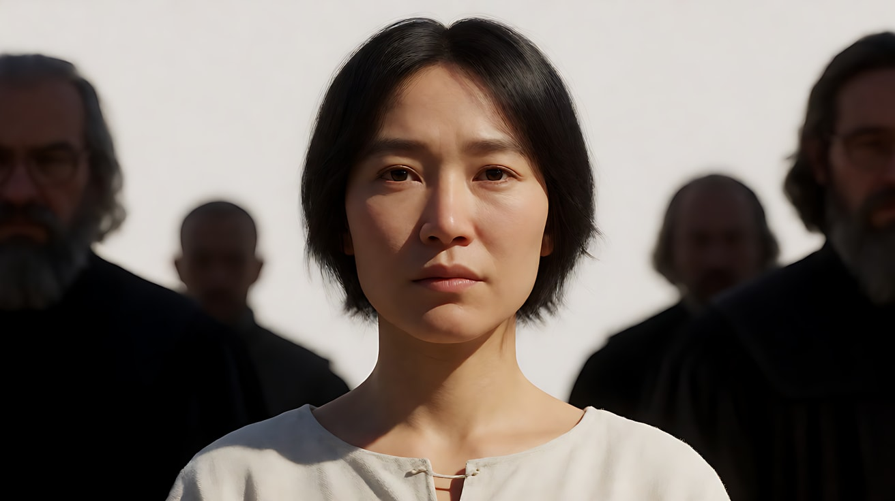
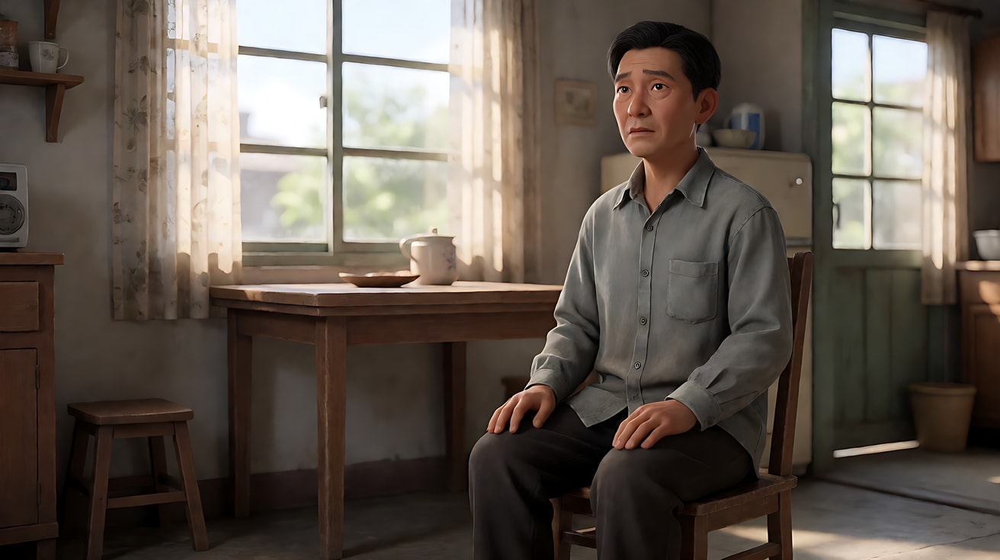
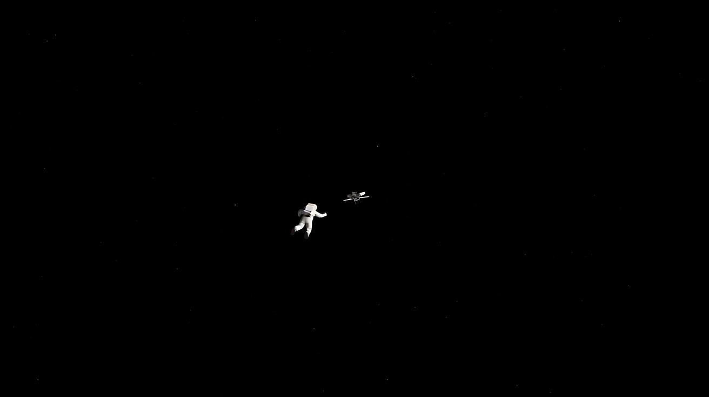

# L01-02 景别与情绪距离：观众站得多近，就感受多深

> 段位：入门 ｜ 建议用时：45 分钟 ｜ 配套提示词：[L01-02-景别与情绪距离-提示词](../提示词/L01-02-景别与情绪距离-提示词.md)

## 学习目标

- 理解"景别 = 观众与角色之间的心理距离"
- 能区分近景的两种用法：**亲密**（和他站在一起）与**审视**（盯着他看）
- 知道近景为什么会放大情绪，远景为什么会制造孤独和渺小
- 能根据一场戏的情绪目标选择景别，而不是只按"信息够不够"来选
- 能在提示词里用景别 + 机位高度 + 运镜，把同一个瞬间拍出亲密或疏离两种结果

## 一、概念讲解

### 1. 物理距离就是心理距离

人类学家爱德华·霍尔在《隐藏的维度》（1966）里提出"人际距离"理论：人与人之间的物理距离对应不同的关系。景别其实就是把这个距离搬到银幕上——**观众离角色多近，就默认自己和角色有多亲近**。

```
 观众 ●──────────────────────────────────────────────────────▶ 角色
       │ 亲密距离   │ 个人距离     │ 社交距离        │ 公共距离
       │ 0–45cm     │ 45–120cm     │ 1.2–3.6m        │ 3.6m 以上
       │            │              │                 │
       │ 大特写     │ 近景         │ 中景 / 中全景   │ 全景 / 远景 / 大远景
       │ 近景       │ 中近景       │                 │
       │            │              │                 │
       │ 恋人、家人 │ 朋友、交谈   │ 同事、陌生人    │ 演讲者、路人
       │ 或者：威胁 │              │                 │
```

当摄影机进入"亲密距离"，观众的身体会产生和现实中一样的反应：要么觉得亲近，要么觉得被冒犯、有压力。**同一个大特写，可以是爱，也可以是恐惧**——取决于是谁、从哪个角度、在什么情境里靠近。

### 2. 近景的两种性格：亲密 vs 审视

近景让观众看清一张脸，但"看"有两种方式：

| | 亲密的近景 | 审视的近景 |
|---|---|---|
| 观众的位置 | 和角色站在一起，像朋友 | 站在角色对面，像法官 |
| 机位高度 | 平视，与角色眼睛同高 | 略高俯视，或正面直对 |
| 角度 | 四分之三侧脸，视线擦过镜头 | 正面，或冷冷的侧面，人物被"钉"在画中 |
| 运镜 | 缓慢推近，或轻微呼吸感的手持 | 固定不动，或极慢的压迫式推进 |
| 光 | 柔和侧光，暖色，眼睛里有反光 | 硬光、顶光或平光，没有温度 |
| 时长 | 让情绪有时间展开 | 拖到让人不舒服 |
| 观众内心 | "我懂你" | "你在隐瞒什么？" |

所以选景别时不能只问"拍近还是拍远"，还要问"**观众是以什么身份靠近的**"。

### 3. 近景为什么会放大情绪

- **面积放大**：脸占满银幕时，一次眨眼、一次吞咽、嘴角的一毫米都成了大动作
- **背景消失**：近景配合浅景深，环境信息被抹掉，观众没有别处可看，只能面对这个人的感受
- **共情反射**：人看到面孔会本能地模仿表情。脸越大，这种模仿越强
- **副作用**：近景用得太多，情绪会"通货膨胀"——每个镜头都在喊，观众反而麻木。好导演会**把近景留给最重要的那一刻**

### 4. 远景为什么会制造孤独与渺小

- **人在画面中的比例 = 人在世界中的分量**。人只占画面的一小块，环境的压倒性就成了情绪本身
- **距离带来克制**：观众离得远，看不清表情，只能从姿态和处境去猜。这种"看不清"反而让悲伤更沉
- **留白放大缺失**：一个人站在空旷的广场、雪原、海边，周围的空就是他内心的空
- 常被归于卓别林的一句话很好地概括了这一点：**"人生近看是悲剧，远看是喜剧。"** 景别不仅改变情绪的强度，甚至可以改变情绪的种类

### 5. 距离的运动：靠近与抽离


- **由远到近**：观众逐渐被拉进角色内心，常用于"意识到""下决心"的时刻
- **由近到远**：观众被抽离出来，看到角色的处境，常用于告别、失落、命运感的结尾
- **在近景上停太久**：亲密会变质为审视，观众开始不舒服——这可以是刻意的

## 图解

> 这些示意图由多种生图模型分别生成（包括 Nano Banana、GPT Image 等），只用来说明镜头概念；不同模型的画面不能互相比较效果，也不能当作视频成片。


同一个人，两种距离。景别决定观众站得离她多远，距离直接变成情绪。



空沙滩把她缩成一个小点。观众是旁观者，感到的是世界大、人小。


咖啡馆里只剩脸。距离近到能看见眼神，观众被拉进她的情绪，没有环境可以躲。

## 二、情绪与叙事功能

| 技法 | 观众的感受 | 常用场景 |
|---|---|---|
| 平视四分之三侧近景 + 柔光 | 亲近、理解、心疼 | 告白、安慰、回忆、独白 |
| 正面固定近景 + 硬光 | 被审视、压迫、不安 | 审问、面试、对峙、谎言被识破 |
| 大特写（眼睛、手） | 情绪被放大到极限 | 崩溃前一秒、做决定、恐惧 |
| 远景 / 大远景独处 | 孤独、渺小、无助 | 失去之后、迷路、被抛下 |
| 远景 + 喜剧动作 | 荒诞、可笑 | 人物出糗、命运的玩笑 |
| 由远推近 | 被拉进内心 | 顿悟、下决心 |
| 由近拉远 | 抽离、命运感 | 结尾、告别、"他将独自面对" |

## 三、经典影片案例

### 《圣女贞德受难记》（1928，卡尔·西奥多·德莱叶）审判
- 场景：贞德在教会法庭上接受一群法官的反复盘问。
- 怎么拍的：几乎整场审判都用近景和大特写拍摄，演员不化妆，脸上的泪痕和皱纹清晰可见；贞德常被拍在简洁的白色背景前，法官们多用低角度仰拍。
- 为什么这样拍：近景在这里同时承担两种功能。对贞德是**亲密**：观众被迫贴着她的脸，感受她的恐惧与坚定；对法官是**审视与压迫**：仰拍的近景让他们像一堵堵墙。没有环境、没有远景可以逃，观众和贞德一样被困在一张张脸之间。



### 《悲情城市》（1989，侯孝贤）
- 场景：二战结束后台湾一个家族的命运，大量家庭生活与重大变故的戏。
- 怎么拍的：侯孝贤习惯把摄影机放在一段距离之外，以中远距离的固定长镜头观看人物，极少用近景强调情绪，很多悲伤的时刻观众只能看到人物的身体和他们所在的房间。
- 为什么这样拍：距离带来克制与尊重。观众不被要求哭，而是像一个站在门口的家人那样旁观。正因为看不清脸，那些情绪才显得更深、更真实，也让个人悲剧和时代背景同时留在画面里。



### 《2001太空漫游》（1968，斯坦利·库布里克）太空中的渺小
- 场景：宇航员在飞船外进行太空行走，后来一名宇航员在太空中漂离。
- 怎么拍的：大量使用大远景，人与飞船都只是黑色宇宙中的小小形体，声音只有呼吸声或彻底的寂静。
- 为什么这样拍：远景把"人在宇宙中的分量"直接变成画面比例。宇航员漂离时，观众看不到他的表情，只看到一个越来越小的身影——这种距离感比任何近景都更让人感到孤独和无助。



## 四、在 AI 中怎么实现

- **生图阶段**：
  - 亲密近景：`close-up, eye level, three-quarter view, 85mm lens, shallow depth of field, soft warm side light, catchlight in the eyes`
  - 审视近景：`frontal close-up, camera slightly above eye level, 50mm lens, hard flat overhead light, neutral grey background`
  - 孤独远景：`extreme wide shot, the figure is tiny, less than one tenth of the frame height, large empty negative space`
- **视频阶段**：情绪距离要靠"景别 + 机位高度 + 一个运镜 + 光"共同完成。只写"近景"不够，要写"平视四分之三侧近景，缓慢推近"或"正面固定近景，镜头一动不动"。
- **情绪写成动作**：近景里的情绪动作要小（眨眼、咽口水、嘴唇抿紧、睫毛颤一下）；远景里的情绪动作要大（蹲下、抱住膝盖、停下脚步、仰头）。
- **模型擅长**：近景里的眼睛反光、细小表情和呼吸起伏；远景里的雪、雾、风、空旷的城市。
- **要避开**：
  - 近景里写"痛哭流涕""嚎啕大哭"——表情容易夸张变形，改成"眼眶发红，用力眨了两下眼睛"
  - 远景里写面部表情——看不见，模型会把人物放大破坏比例
  - 同一片段里"从大远景推到大特写"——跨度太大，拆成两段或两个镜头

## 五、练习作业

1. **一刻两拍**：选一个情绪瞬间（例如"她收到了落选通知"），分别写出亲密近景版、审视近景版、孤独远景版的生图提示词，各生成一张，并排比较。
2. **找变质点**：找一部电影里一个时间很长的近景，记录从第几秒开始你觉得"不舒服"了，想想导演是否故意这样做。
3. **距离日记**：把一段 3 句话的小故事写成 3 个镜头，每个镜头标注"观众与角色的心理距离"在变近还是变远。
4. 完成配套提示词练习1–5，重点对比练习5的审视版与亲密版。

### 参考答案

情境统一为：她在空教室里拆开一封落选通知。

**1. 一刻两拍：三张生图提示词**

亲密近景（观众站在她身边）：

```
Close-up of an original woman in her early thirties, chin-length black bob, charcoal coat, cream scarf, seated in an empty classroom. Three-quarter view, eye level, 85mm lens, shallow depth of field. She looks down at a folded letter, lips pressed together, one slow blink. Soft window light from frame left, catchlight in the eyes. Stylized semi-realistic 3D CG. Aspect ratio 16:9.
```

观众被拉到她的呼吸距离，只能看她忍住。

审视近景（观众像评委在看她）：

```
Frontal close-up of the same woman, looking slightly up toward the lens. Camera a little above eye level, 50mm, deep enough that the plain grey wall behind her stays readable. Hard flat overhead light, no catchlight, face fully exposed. She holds the letter at the bottom edge of the frame and does not look away. Stylized semi-realistic 3D CG. Aspect ratio 16:9.
```

没有可以躲的侧脸，光是平的，像被检查。

孤独远景（观众离她很远）：

```
Extreme wide shot of an empty classroom. The same woman sits at one desk near the lower left, less than one tenth of the frame height, shoulders rounded over a small white letter. Large empty negative space of desks and grey afternoon light. No readable facial expression. Stylized semi-realistic 3D CG. Aspect ratio 16:9.
```

表情看不见。孤独来自她和整间教室的比例。

**2. 找变质点（示范）**

用本课案例《圣女贞德受难记》的审判近景来记：镜头停在她脸上，问话已经结束，她不再有新的小动作。大约在"这句话已经说完"之后的第 6–8 秒，眼睛会开始找画框外面。若导演这时仍不切，不舒服就是故意的：不给远景，就是不给退路。记录时写三列即可：第几秒、画面里还有没有新信息、你想把眼睛放到哪里。

**3. 距离日记**

三句话：她推开琴房的门。她把琴盒放上台面，没有打开。她坐下来，手停在盒扣上。

| 镜头 | 景别与机位 | 心理距离 |
|---|---|---|
| 1 | 远景，平视，她在空琴房门口，人很小 | 远。观众是路过的人 |
| 2 | 中景，平视，手把琴盒放上台面 | 近了一档。开始关心她要不要拉 |
| 3 | 近景，略俯，盒扣和她抿住的嘴都在画里，固定不动 | 近。观众被留下看着她下不了手 |

三镜头只往近走，没有推到大特写。落选这件事还没被说出口，近景就够了。

**4. 审视版 vs 亲密版（练习5）**

剧情同为"结果被宣布的那一秒"。

| | 审视版 | 亲密版 |
|---|---|---|
| 景别 | 正面近景，脸被看全 | 四分之三侧近景，略紧 |
| 机位 | 略高于眼睛，像坐在评委席看下来 | 与眼睛平齐 |
| 光 | 顶上的硬光，没有眼神光 | 侧面的窗光，眼睛里有一点反光 |
| 运镜 | 固定，不靠近 | 非常慢地推近一点 |
| 观众感到 | 她被观看 | 我们站在她那边 |

两版都不写"她很伤心"。审视版的动作是她没有低头；亲密版的动作是她把嘴唇抿紧，眨了一下眼。

## 六、自检清单

- [ ] 我能说出近景的两种性格（亲密 / 审视）以及它们在机位、光、运镜上的区别
- [ ] 我理解为什么远景能制造孤独和渺小
- [ ] 近景里我写的是小动作，远景里写的是大动作
- [ ] 我没有让近景"通货膨胀"，把它留给了最重要的时刻
- [ ] 我能用"推近 / 拉远"表达"靠近 / 抽离"

## 七、配套提示词

→ [L01-02-景别与情绪距离-提示词](../提示词/L01-02-景别与情绪距离-提示词.md)

---

上一课：[L01-01 八种基本景别](L01-01-八种基本景别.md) ｜ 下一课：[L01-03 人物切点与画面空间](L01-03-人物切点与画面空间.md) ｜ [返回总目录](../../README.md)
