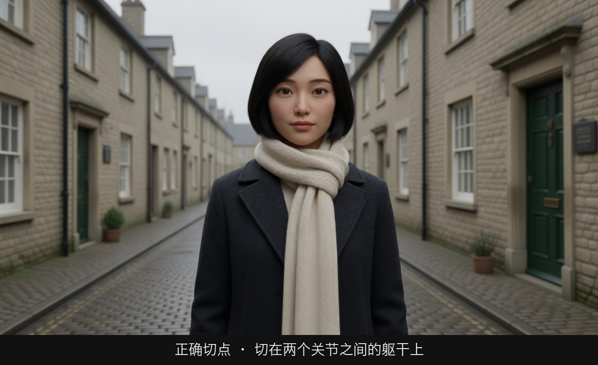
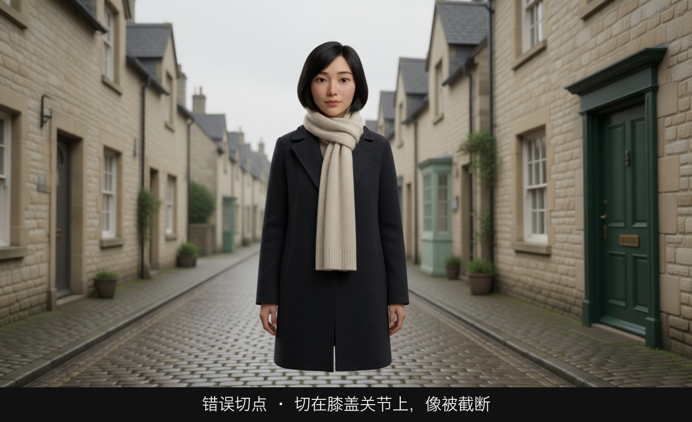
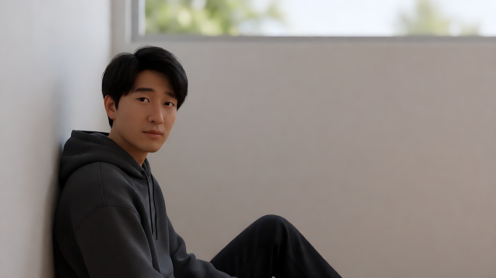

# L01-03 人物切点与画面空间：画框切在哪里，空间留在哪里

> 段位：入门 ｜ 建议用时：50 分钟 ｜ 配套提示词：[L01-03-人物切点与画面空间-提示词](../提示词/L01-03-人物切点与画面空间-提示词.md)

## 学习目标

- 知道为什么画框不能切在关节上，能指出身体上的"禁切线"和"安全线"
- 掌握三种画面空间：头顶空间（headroom）、视线空间（look room / nose room）、行进空间（lead room）
- 能判断一个构图"挤""空"还是"刚好"，并知道什么时候该故意打破规则
- 理解竖屏 9:16 与横屏 16:9 在同一景别下的差异，能为竖屏短剧重新选择景别
- 能在生图和视频提示词里精确写出切点与留白

## 一、概念讲解

### 1. 为什么不在关节处切

画框边缘就像一把刀。切在关节上（脖子、肘、手腕、腰、膝盖、脚踝、指关节），观众的眼睛会觉得这个人"被截肢了"——身体在一个可以弯曲的地方戛然而止，画框外的部分显得不完整、不稳定。切在两个关节之间的"肉"上，大脑会自动把画框外的身体补完整。

```
          头顶 ─ ─ ─ ─ ─ ─   ✔ 近景可略切头顶（切发际线以上，不切额头中间）
          眉毛            
          下巴 ═══════════   ✘ 不切下巴
          脖子 ═══════════   ✘ 不切脖子（像被斩首）
          肩下 ─ ─ ─ ─ ─ ─   ✔ 近景（特写）
          胸口 ─ ─ ─ ─ ─ ─   ✔ 中近景（上衣口袋 / 腋下以下）
          手肘 ═══════════   ✘ 不切手肘
          腰   ═══════════   ✘ 不正好切在腰线 / 腰带上
          胯上 ─ ─ ─ ─ ─ ─   ✔ 中景（腰带略下 / 胯骨上方）
          手腕 ═══════════   ✘ 不切手腕（手垂下时尤其注意）
          大腿 ─ ─ ─ ─ ─ ─   ✔ 中全景（大腿中部）
          膝盖 ═══════════   ✘ 不切膝盖
          小腿 ─ ─ ─ ─ ─ ─   △ 可以但少见
          脚踝 ═══════════   ✘ 不切脚踝（全景一定要把脚放进来）

          ═══ 禁切线（关节）     ─ ─ 安全线（两个关节之间）
```

> 中景"切在腰部"是口语说法，实际操作时要切在腰带略下或胯骨上方，避开腰线这个"弯折点"，也避开垂下来的手腕。

手也一样：画面里出现的手，要么完整，要么在手腕以上就被切掉，不要只切掉几根手指。

### 2. 头顶空间（Headroom）

头顶到画框上缘的距离。

```
  太多 ✘                 刚好 ✔                 太少 / 切头 △
 ┌───────────────┐      ┌───────────────┐      ┌───────────────┐
 │               │      │               │      │    ( o  o )   │
 │               │      │    ( o  o )   │      │      \_/      │
 │    ( o  o )   │      │      \_/      │      │     /   \     │
 │      \_/      │      │     /   \     │      │    /     \    │
 │     /   \     │      │    /     \    │      │   /       \   │
 └───────────────┘      └───────────────┘      └───────────────┘
 人物在往下掉            眼睛在上三分之一线      近景/特写可以切掉头顶
 显得渺小、被压          稳定、自然              但要切发际线以上
```

- 一般规律：**眼睛放在画面上三分之一线附近**。景别越近，头顶空间越少，近景时可以切掉头顶。
- 头顶空间过多：人物显得往下沉、被环境压住——可以作为刻意的表达（压抑、渺小）。
- 头顶空间过少（但没切头）：最难看，像人物顶着天花板，大多是失误。

### 3. 视线空间（Look Room / Nose Room）

人物脸朝哪边看，哪边就要多留空间。

```
  正确：看向右边，右边留空                 打破：看向右边，却贴着右边框
 ┌──────────────────────────────┐        ┌──────────────────────────────┐
 │                              │        │                              │
 │     ( o )  ────▶  · · · ·    │        │  · · · ·          ( o ) ──▶│ │
 │      /|\        视线空间      │        │   身后的空            /|\     │
 │                              │        │                              │
 └──────────────────────────────┘        └──────────────────────────────┘
  人物在左三分之一，视线有去处               人物"撞墙"：憋闷、被困、不安
                                            或者暗示身后有东西（恐怖片常用）
```

- 视线空间让观众觉得"她在看某个东西"，并下意识地想知道那里有什么。
- **故意不留视线空间（short-siding，"短边构图"）**：人物脸贴着画框，身后却留一大片空。观众会感到压抑、孤立、不对劲。恐怖片还常把危险放在那片空里。
- 在对话的正反打里，A 看右、B 看左，两人各自的视线空间指向对方，观众才会觉得他们在对视（模块 06 细讲）。

### 4. 行进空间（Lead Room）

人物或物体在运动时，前方要比后方留更多空间。

```
  正确：前方留空                           打破：前方被堵
 ┌──────────────────────────────┐        ┌──────────────────────────────┐
 │                              │        │                              │
 │  (人)──────▶  · · · · · ·   │        │   · · · · · ·     (人)──▶ │  │
 │       前方的路                │        │     走过的路                  │
 └──────────────────────────────┘        └──────────────────────────────┘
  观众感到"他要去某个地方"                  观众感到"他被追赶""前路不通"
```

- 追逐戏里，**被追者**常被放在前方留空少的位置，暗示前路被堵；**追的人**画面里留出大片前方空间，暗示他正在逼近。
- 车、马、飞行物同理。跟拍时，摄影机要预判运动方向，让主体始终"走进"空间而不是"走出"空间。

### 5. 竖屏 9:16 的景别差异

同一个景别词，在竖屏和横屏里给观众的感觉完全不同。

```
     16:9 横屏中近景                    9:16 竖屏中近景
 ┌──────────────────────────────┐      ┌──────────────┐
 │                              │      │  上方：头顶   │
 │        ( o  o )   · · · ·    │      │  空间与环境   │
 │          \_/      环境 / 视线 │      │  ( o  o )    │  ← 脸在上三分之一
 │         /   \     空间        │      │    \_/       │
 │        /     \                │      │   /   \      │
 └──────────────────────────────┘      │  /     \     │
  左右很宽：可以放视线空间、            │  胸口以下     │
  第二个人、环境                        │ ─ ─ ─ ─ ─ ─ │
                                        │ 字幕 / 界面区 │  ← 下方约 1/5 留给字幕和按钮
                                        └──────────────┘
                                         左右很窄：视线空间少，
                                         脸显得更大，更有压迫感
```

| 问题 | 横屏 16:9 | 竖屏 9:16 |
|---|---|---|
| 全景 | 人物偏小，环境多 | **人物顶天立地，正好装下全身**，是竖屏最舒服的景别之一 |
| 中景 / 中近景 | 有宽裕的左右空间 | 左右挤，人物居中，常需要更多头顶空间 |
| 近景 | 留得下视线空间 | 脸几乎占满宽度，情绪冲击更强 |
| 双人镜头 | 两人左右并排 | 很难并排，常改成**前后纵深站位**或拆成单人镜头 |
| 远景 / 大远景 | 横向展开地理 | 横向地理装不下，改用**纵向**元素：高楼、楼梯、瀑布、天空 |
| 视线 / 行进空间 | 左右留白 | 左右余量少，**改为上下留白**，或让人物朝镜头纵深方向运动 |
| 安全区 | 下方字幕区较小 | 下方约五分之一和右侧边缘常被字幕、点赞按钮遮挡，脸和关键动作放在画面中上部 |

**实用结论**：竖屏短剧的人物镜头通常比横屏**"紧一档"**（横屏用中景的地方，竖屏常用中近景），环境镜头要找纵向构图，双人戏多用前后景纵深。

## 图解

> 这些示意图由多种生图模型分别生成（包括 Nano Banana、GPT Image 等），只用来说明镜头概念；不同模型的画面不能互相比较效果，也不能当作视频成片。


下边框要切在两个关节之间的躯干或大腿上。切在关节上，腿会像被截断。



下边框落在腰部软组织上，手肘还在画内。这是中景的正常切法。



下边框正好经过膝盖。人还站着，但腿像被画框切掉。这种切法要避免，除非你故意要用「被切断」制造不适。

## 二、情绪与叙事功能

| 技法 | 观众的感受 | 常用场景 |
|---|---|---|
| 切在安全线、留足视线空间 | 舒服、自然，注意力在剧情上 | 绝大多数镜头的默认状态 |
| 头顶空间过多 | 人物被压、渺小、抑郁 | 失意、被权力压迫、空旷的大房间 |
| 短边构图（视线贴边） | 憋闷、孤立、不对劲、身后有危险 | 心理压力、恐怖片、人物关系破裂 |
| 行进空间充足 | 有方向、有希望、在前进 | 出发、追赶、寻找 |
| 行进空间被堵 | 被追、走投无路 | 逃跑、困境 |
| 中心构图、不留侧边空间 | 直接、强烈、眼睛无需寻找 | 快速剪辑的动作戏、竖屏短剧、直视镜头的独白 |

## 三、经典影片案例

### 《黑客军团》（Mr. Robot，2015–2019，剧集，山姆·埃斯梅尔创作）
- 场景：主角艾略特是一个社交焦虑、与世界疏离的黑客，大量对话和独处戏。
- 怎么拍的：这部剧最出名的视觉特征是**反常规的切点与留白**：人物经常被挤在画面的下角或侧边，视线朝向近处的画框（短边构图），头顶和身后留出大面积的墙面、天空或空白；对话中两人甚至都被放在画面的同一侧。
- 为什么这样拍：主角的世界是失衡的。观众在画面里找不到"舒服"的位置，就像主角在社会里找不到位置一样。这个例子说明：**规则被打破时，观众是能感觉到的——所以打破要有理由，而且要贯彻到底**。



### 《疯狂的麦克斯：狂暴之路》（2015，乔治·米勒）
- 场景：几乎全片是高速的追车动作戏，剪辑极快。
- 怎么拍的：导演和摄影指导约翰·西尔在多次访谈中谈到，他们让拍摄时把主体尽量保持在**画面中心**，被称为"十字准星"式构图，而不是按常规留出大量行进空间。
- 为什么这样拍：剪辑越快，观众每个镜头的阅读时间越短。如果每个镜头的主体位置都不同，眼睛来不及寻找，就会看不懂。主体始终在中心，观众的视线不用移动，快速剪辑依然清楚。这条思路对**竖屏短剧**尤其重要：手机屏幕小、节奏快、左右空间窄，主体居中是最可靠的选择。


### 横屏转竖屏的启示
- 无论是剧集还是电影的竖屏切条版本，直接从 16:9 中裁出 9:16 时，常出现"人物被切掉一半""视线看向画外不知何处""双人只剩一个"的问题。
- 这说明竖屏不是横屏的裁切，而是**一套需要重新选择景别和站位的构图系统**。在 AI 生成时，应从生图阶段就以 9:16 构图，而不是先生成横屏再裁。


## 四、在 AI 中怎么实现

- **生图阶段**：
  - 切点要写具体身体部位：`framed from the chest up` / `cropped just below the hip, hands fully in frame` / `head to toe in frame, feet not cropped`
  - 头顶空间：`eyes on the upper third line, a small amount of headroom` / `the top of the head slightly cropped`
  - 视线空间：`placed on the left third, looking toward frame right, open space in front of her face`
  - 短边构图：`placed against the right edge of the frame, facing right toward the edge, large empty wall behind her on the left`
  - 竖屏：`Vertical 9:16 frame`，并写 `face in the upper third, keep the lower fifth of the frame clear of important details`
- **视频阶段**：运动中最容易丢失行进空间和视线空间。写跟拍时要写"镜头在她前方后退跟随，她前方始终留出空间"或"横移跟拍，她始终在画左三分之一，前方留空"。人物转头时，可以用一个小幅横移或摇镜重新平衡视线空间。
- **模型擅长**：按三分法放置人物、横移跟拍时保持主体位置、竖屏人物居中。
- **要避开**：
  - 只写"中景"不写切点——模型常把画框切在手腕或膝盖上
  - 横屏生成后再裁成竖屏——构图会坏，要从生图起就用 9:16
  - 竖屏里安排两人左右并排对话——改成前后站位或单人正反打
  - 竖屏把关键动作放在画面底部——会被字幕和平台按钮挡住

## 五、练习作业

1. **找禁切线**：截 10 张自己手机里的人像照片，用红笔在画框边缘标出它切到了身体哪里，判断是否切在关节上。
2. **三种空间**：用配套提示词练习1–3，分别生成"视线空间正确""行进空间正确""短边构图"三张图，并排比较。
3. **横竖对照**：同一个中近景，分别生成 16:9 与 9:16 两版，写出两版给你的感觉差异。
4. 完成配套提示词练习1–5，重点体会练习4的竖屏景别选择。

### 参考答案

**1. 找禁切线**

在照片边缘只标切到的身体部位，再判一次。下面四种就够对照：

| 下边框切在 | 判断 |
|---|---|
| 腰部软组织，手肘在画内 | 通过。这是中景 |
| 胸口，肩膀完整 | 通过。这是中近景 |
| 膝盖正中，小腿像被截断 | 不通过。关节禁切 |
| 手腕，手只剩一半 | 不通过。要手就收到肘以上，不要手就把切点抬到胸口 |
| 脖子 | 不通过。头会像摆在画框上 |

头顶另标一笔：眼睛大致在上三分线，头顶留一指宽，算正常；头顶上面空出三分之一画面，人就被压矮了。

**2. 三种空间**

三张并排时，看空白在她的前面还是后面。

- 视线空间正确：人在左三分线，脸朝右，右半边是空的街道。眼睛有地方可去。
- 行进空间正确：她向画右走，人在左三分线，前方的路比身后长。切点在大腿中部，膝盖不进画。
- 短边构图：人贴右边缘，仍朝右看，前方就是画框，大块空白留在身后。这张应该让人发闷。若看起来只是"没摆正"，说明空得不够、或者脸没有真正朝向画框。

**3. 横竖对照**

同一个中近景：

- 16:9：脸在左或右三分线，视线前方还有墙。感觉是"她在一个房间里看向某处"。
- 9:16：脸几乎占满画宽，只能居中偏上，左右不再有留白。感觉从"看向某处"变成"看着我"。下方五分之一若空着，是留给字幕的，不是构图失败。

竖屏比横屏紧一档：横屏的中近景，到竖屏里常常要改成近景，否则左右会切进耳朵旁边的空气，人却显得小。

**4. 竖屏三镜头（练习4）做对的样子**

雨夜老街，9:16，同一个人：

1. 全景不用左右展开的街，用纵向的楼梯或窄巷。人在纵深里，头顶仍有招牌。
2. 人物镜头用近景，不是中景。脸在上三分，下缘空出。
3. 两个人不并排。她在前景靠近镜头，对方站在她身后的门洞里，更小、更高。

右侧边缘和下方五分之一没有脸、没有信、没有手部动作。

## 六、自检清单

- [ ] 我的画框没有切在脖子、手肘、手腕、腰线、膝盖、脚踝上
- [ ] 人物的眼睛大致在画面上三分之一线
- [ ] 人物看向哪边，哪边就留了空间（除非我故意打破）
- [ ] 运动的主体前方留了行进空间
- [ ] 我能说出竖屏比横屏"紧一档"的原因
- [ ] 竖屏的关键内容没有放在下方五分之一和右侧边缘
- [ ] 每次打破规则时，我都能说出它服务于什么情绪

## 七、配套提示词

→ [L01-03-人物切点与画面空间-提示词](../提示词/L01-03-人物切点与画面空间-提示词.md)

---

上一课：[L01-02 景别与情绪距离](L01-02-景别与情绪距离.md) ｜ 下一课：[L01-04 景别序列](L01-04-景别序列.md) ｜ [返回总目录](../../README.md)
