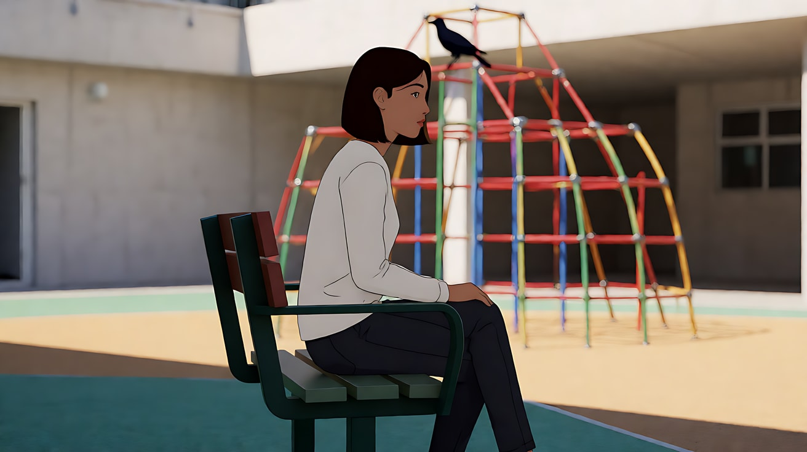

# L01-04 景别序列：建立、推进、揭示

> 段位：入门 ｜ 建议用时：55 分钟 ｜ 配套提示词：[L01-04-景别序列-提示词](../提示词/L01-04-景别序列-提示词.md)

## 学习目标

- 理解"单个景别是词，景别序列是句子"
- 掌握三种基本句型：前进式（建立 → 推进）、后退式（细节 → 揭示）、环形式
- 能区分相邻景别切换与跳景别切换，并避免"同机位小幅变景"造成的跳切
- 了解竖屏短剧开场常用的景别节奏，能为一个 15 秒开场设计景别顺序
- 能把一个景别序列写成 Seedance 多镜头提示词

## 一、概念讲解

### 1. 景别序列 = 观众获取信息的顺序

一场戏里，观众先看到什么、后看到什么，决定了他们的理解和情绪。景别序列就是在安排**信息释放的顺序**：

- 先给全貌，再给细节：观众**先懂处境，再进入情绪**（稳、清楚）
- 先给细节，再给全貌：观众**先好奇，再恍然大悟**（悬念、揭示）

### 2. 三种基本句型

```
前进式（建立 → 推进）       远景 ──▶ 全景 ──▶ 中景 ──▶ 近景 ──▶ 特写
                            "这是哪里" → "谁在这里" → "他在做什么" → "他在想什么"

后退式（细节 → 揭示）       特写 ──▶ 近景 ──▶ 中景 ──▶ 全景 ──▶ 远景
                            "这是什么？" → "谁的？" → "在哪里？" → "原来如此"

环形式（推进后再退出）      远景 ──▶ 中景 ──▶ 近景 ──▶ 中景 ──▶ 远景
                            进入一个人的内心，再回到世界中
```

**前进式**是最经典的"建立镜头（establishing shot）"句型：用大远景或远景交代时间、地点、环境，然后一步步走近人物。适合一场戏的开头、观众需要先搞清楚状况的时候。

**后退式**是"揭示（reveal）"句型：先用特写只给一个细节，故意隐藏上下文，然后逐步扩大，让观众在最后一刻看懂全貌。适合悬念、反转、喜剧包袱、恐怖。

**环形式**常用于一场戏的完整结构：从世界进入人物，在人物身上发生转折，再回到世界，让观众看到这个转折对他的处境意味着什么。

### 3. 三段式：最实用的最小序列

在 AI 生成里，一个 10–15 秒片段最稳妥的就是三个镜头。三段式的经典分工：


反过来，揭示三段式：**特写（谜面）→ 中景（线索）→ 远景（谜底）**。

### 4. 相邻景别与跳景别

**相邻景别**：一次切换只变一两档，例如中景 → 中近景、全景 → 中景。观众感觉平稳、连贯，是对话和日常戏的主流。

**跳景别（两极镜头）**：一次跨越很多档，例如大远景 → 大特写。观众会感到冲击、断裂、注意力被猛然抓住。这是下一课 [L01-05 景别反差叙事](L01-05-景别反差叙事.md) 的主题。

**要避免的"跳切"**：同一个机位、同一个角度，只把景别改变一点点（例如中景切到稍紧一点的中景），画面看起来像"抖了一下"或"丢了几帧"，而不像一次有意的切换。业界通行的经验：

| 切换方式 | 结果 |
|---|---|
| 同角度、景别变化很小 | ✘ 跳切感，像失误 |
| 同角度、景别变化至少两档（如全景 → 近景） | ✔ 有意的强调，常用于"轴线上的推进切"（cut-in） |
| 景别相近，但机位角度变化明显（经验上约 30° 以上） | ✔ 平稳的覆盖切换 |
| 景别和角度都变化 | ✔ 最安全 |

> 跳切也可以是风格：让-吕克·戈达尔在《精疲力尽》（1960）中大量使用跳切制造躁动与不安。但那是刻意贯彻全片的选择，不是"差不多就切"。

### 5. 竖屏短剧的开场景别节奏

竖屏短剧的观众是"划过来的"，前几秒抓不住就会划走。所以短剧开场常常**不从建立镜头开始**，而是倒过来：

```
传统电影开场：  大远景（这是哪里） → 全景 → 中景 → 近景（冲突）
                慢慢进入，信任观众有耐心

竖屏短剧开场：  特写/近景（冲突或钩子） → 近景（反应） → 全景（揭示处境） → 中景/近景（推进）
                先给刺激，再补交代
```

短剧开场景别节奏的常见规律：

1. **第一个镜头就有事**：一个能看懂的冲突细节（被撕的合同、摔在地上的戒指、一只拦住去路的手），景别通常是近景或特写
2. **第二个镜头是反应**：主角的脸，让观众立刻知道"她是主角，她受了委屈"
3. **第三个镜头揭示处境**：全景或中全景，交代是在什么场合、有多少人在看——这是"压迫感"的来源
4. **之后回到中近景、近景**推进对白，并在结尾留一个近景钩子
5. 竖屏下"全景"足够当建立镜头用，大远景很少用（横向地理装不下）

## 二、情绪与叙事功能

| 句型 | 观众的感受 | 常用场景 |
|---|---|---|
| 前进式（远 → 近） | 稳、清楚、逐渐投入 | 开场、新场景、人物登场 |
| 后退式（近 → 远） | 好奇 → 恍然大悟；或从个人到处境 | 悬念、反转、喜剧包袱、结尾 |
| 环形式 | 进入内心再回到世界 | 完整的一场戏、转折场面 |
| 相邻景别切换 | 平顺、自然、不打扰 | 对话、日常 |
| 跳景别 | 冲击、断裂、注意力被抓住 | 惊吓、高潮、强调 |
| 同角度小变景 | 跳切、躁动、像失误 | 一般避免；刻意风格化除外 |
| 短剧倒装开场 | 被立刻抓住，急着知道前因 | 竖屏短剧、广告、预告片 |

## 三、经典影片案例

### 《后窗》（1954，阿尔弗雷德·希区柯克）开场
- 场景：影片开头，摄影师杰夫因腿伤困在公寓里，窗外是一个四面住满人家的庭院。
- 怎么拍的：窗帘升起后，摄影机从窗口出发，横扫整个庭院，掠过各家各户的邻居，建立起整个空间；然后回到室内，依次停在杰夫满头大汗熟睡的脸、打着石膏的腿（石膏上写着字）、一台摔坏的相机、墙上赛车事故的照片和杂志封面等物件上。
- 为什么这样拍：这是一个前进式的建立序列，**用景别从大到小的顺序完成全部背景交代**，没有一句台词：先告诉你"这是一个能看到所有邻居的庭院"，再告诉你"他是谁、为什么动不了、他是做什么的"。观众在开场几分钟内就掌握了整部电影的空间和人物前提。


### 《群鸟》（1963，阿尔弗雷德·希区柯克）操场攀爬架
- 场景：女主角梅兰妮坐在学校操场边的长椅上等待，背后是一个儿童攀爬架。
- 怎么拍的：镜头在她的近景和身后攀爬架之间交替。每次切回攀爬架，上面落下的乌鸦就多一些，而她背对着，毫不知情地抽着烟。直到她注意到一只飞过的乌鸦，视线跟着它转过去，才看到整个攀爬架已经落满了乌鸦。
- 为什么这样拍：观众比主角先知道危险，这是希区柯克所说的"悬念"。景别序列在这里是**交替推进 + 最终揭示**：近景让观众贴着她的无知，攀爬架镜头一次次累积威胁，最后的揭示镜头把累积的紧张一次释放。



### 《精疲力尽》（1960，让-吕克·戈达尔）跳切
- 场景：男主角开着敞篷车，一边开一边念叨着女主角的样子，画面拍的是坐在副驾驶座上的女主角。
- 怎么拍的：几乎同一机位、同一景别拍她的画面被剪掉中间的时间，直接接在一起，背景的街景一下一下地跳，而他的声音照常继续。
- 为什么这样拍：戈达尔故意违反连贯剪辑的规则，制造一种躁动、随性、不安的节奏，与人物的生活态度一致。这个例子提醒我们：**同机位小变景会被观众察觉**——要么避免，要么像他一样有意为之。


## 四、在 AI 中怎么实现

- **生图阶段**：为序列中最关键的两端各生成一张关键帧——前进式锁住"建立镜头"和"最终特写"，后退式锁住"开头细节"和"揭示全景"。中间的景别可以交给 Seedance。
- **视频阶段**：
  - 序列写成「镜头1 / 镜头2 / 镜头3」，每个镜头开头写明景别和机位，切镜写"镜头切至……"
  - 相邻两个镜头之间，**景别和角度至少有一个明显变化**，否则模型容易把它们合成一个连续推镜，或者生成跳切
  - 后退式揭示可以用一个连续的"拉远"运镜（首尾帧锁两端），也可以用多镜头切换，前者更流畅，后者更有节奏
  - 竖屏短剧开场的第一个镜头要写清"一个能看懂的冲突细节"，不要写意外（"杯子被碰倒"），要写成有意的动作（"她把请柬放在桌上，推到对方面前"）
- **模型擅长**：前进式的三段推进、建立镜头的天气和光、后退式的平稳拉远。
- **要避开**：
  - 一次生成里塞五档以上景别，又有对白——按负载阶梯拆成两次生成
  - 揭示镜头里需要模型"凭空"生成大量复杂元素——用尾帧锁定揭示后的画面
  - 相邻镜头写成"中景"和"稍近的中景"——会被生成成跳切或被合并

## 五、练习作业

1. **拉片**：选一部电影的开场 3 分钟，逐个镜头记录景别，标出它属于前进式、后退式还是环形式。
2. **改写句型**：把"一位老钟表匠在修理一只怀表"分别写成前进式三段和后退式三段，比较两种版本给观众的感受。
3. **短剧开场**：找三部竖屏短剧，记录它们第一个、第二个、第三个镜头分别是什么景别，验证"倒装开场"规律。
4. 完成配套提示词练习1–5，并对比练习4的正确版与跳切对照版。

### 参考答案

**1. 拉片（示范：《后窗》开场，前进式）**

| 顺序 | 景别 | 观众新知道的事 |
|---|---|---|
| 窗帘升起，庭院全貌 | 大远景 / 远景 | 这是一个四面都能看见的院子 |
| 扫过各家窗户 | 远景 → 全景 | 邻居们各自在过自己的白天 |
| 回到室内，熟睡的脸 | 近景 | 看院子的人是他 |
| 打着石膏的腿 | 近景 / 特写 | 他走不了 |
| 摔坏的相机、事故照片 | 近景 | 他是摄影师，腿是这么伤的 |

句型是前进式：先世界，再这个人，再他为什么被困在这里。没有对白，信息靠景别从大到小送完。若你拉的片第一个镜头就是脸，它更可能是后退式或短剧倒装，不要把它标成前进式。

**2. 改写句型：老钟表匠修理一只怀表**

前进式（先懂处境，再进入手）：

1. 远景。雨夜的钟表铺，整面墙的钟，人很小，只有一盏工作灯。观众知道：这是哪里、什么时间。
2. 中景。老人坐在灯下，镊子和怀表都在画里。观众知道：他在修，不是在卖。
3. 近景。眼睛和镊子尖，齿轮咬合的那一下。观众知道：他修好了。

感受：稳，像推门进去。情绪发生在最后。

后退式（先给谜面）：

1. 大特写。镊子夹起一颗齿轮，看不出它属于什么。观众只知道：有一个很小的金属零件。
2. 中景。齿轮落进一只打开的怀表，老人的手在，脸还不全。观众改口：这是在修表。
3. 全景。拉远，满墙的钟同时开始走，老人靠在椅背上。观众最后才看见：不是一只表，是整面墙被这只表带动。

感受：先好奇，最后一镜才恍然。后退式的第一镜必须藏起上下文，不能先给铺名。

**3. 短剧开场核对**

三部剧都按这三个格子记，不记剧名也行：

| | 第 1 镜 | 第 2 镜 | 第 3 镜 |
|---|---|---|---|
| 景别 | 近景或大特写 | 近景（脸） | 全景或中全景 |
| 信息 | 一件已经发生的事 | 她的反应 | 这是在什么场合、谁在看 |
| 不符合规律的信号 | 第一个镜头是空镜大远景，还没有任何事 | 第二镜仍在拍物件 | 第三镜又是脸，处境始终没交代 |

一组符合规律的原创开场，用来对照你的笔记：大特写，请柬被推到桌边，对方没有接；近景，她的手还停在半空；全景，酒席满桌，所有人看向她。前三秒已经有冲突，地点补在第三镜。

**4. 正确三段 vs 跳切对照（练习4）**

正确版，景别和角度都变：

1. 远景，雨夜街面，女孩抱着八音盒走向亮灯的橱窗。
2. 切到铺内中景，另一侧机位，老人抬头。
3. 切到近景，盒盖打开，缺了一颗齿。

跳切对照版：三个镜头都是铺内、同一角度的中景，只是一个比一个稍微近一点。它看起来像画面抖了一下，不是三次有意的切换。

合格线：正确版的三个背景范围明显不同；对照版会被看成一个没剪好的推镜。

## 六、自检清单

- [ ] 我能说出前进式、后退式、环形式的景别顺序和各自适合的场景
- [ ] 我的建立镜头交代了时间、地点、环境
- [ ] 揭示镜头前，我确实隐藏了上下文
- [ ] 相邻镜头之间，景别或角度至少有一个明显变化
- [ ] 竖屏短剧开场的第一个镜头"就有事"
- [ ] 镜头数量符合负载阶梯，必要时拆成两次生成

## 七、配套提示词

→ [L01-04-景别序列-提示词](../提示词/L01-04-景别序列-提示词.md)

---

上一课：[L01-03 人物切点与画面空间](L01-03-人物切点与画面空间.md) ｜ 下一课：[L01-05 景别反差叙事](L01-05-景别反差叙事.md) ｜ [返回总目录](../../README.md)
