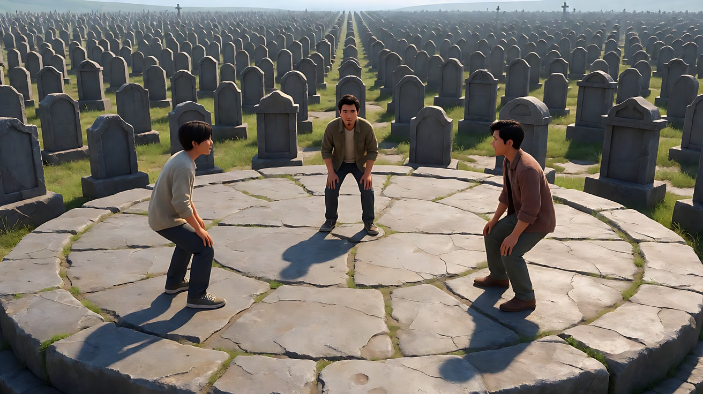
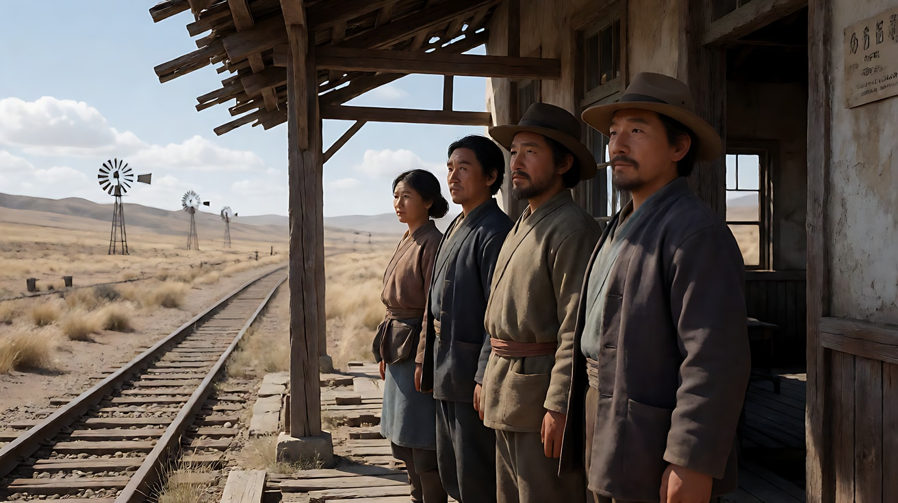
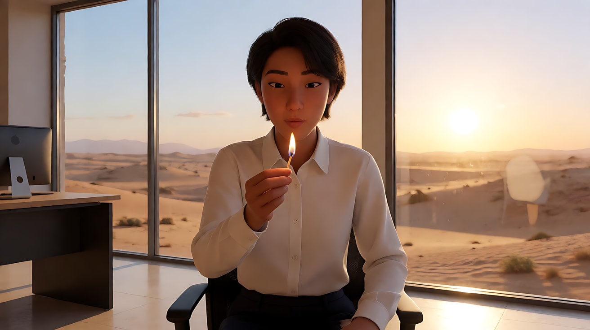
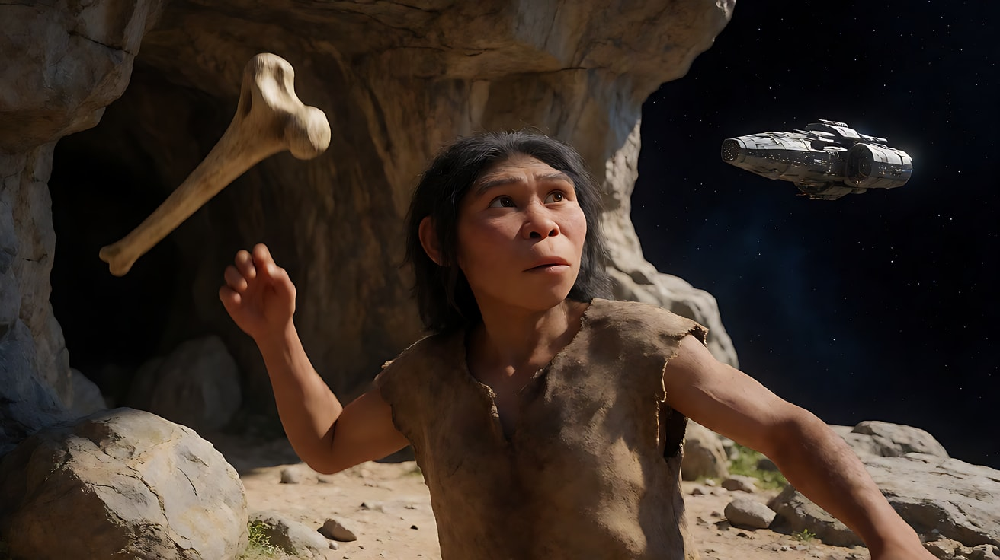

# L01-05 景别反差叙事：大远景与大特写的对撞

> 段位：入门 ｜ 建议用时：55 分钟 ｜ 配套提示词：[L01-05-景别反差叙事-提示词](../提示词/L01-05-景别反差叙事-提示词.md)

## 学习目标

- 理解"尺度反差"为什么能制造冲击：观众的大脑在两个极端尺度之间被猛然拉扯
- 掌握五种景别反差手法：对撞剪辑、交替加速、跨尺度匹配剪辑、画内纵深反差、运动中的尺度揭示
- 能分析塞尔乔·莱昂内等导演如何用大远景与大特写构建对峙和高潮
- 知道反差什么时候有效、什么时候会变成"乱剪"
- 能把景别反差写成 Seedance 多镜头和首尾帧提示词

## 一、概念讲解

### 1. 反差 = 两个镜头之间的"尺度跳跃"

上一课讲了相邻景别（平稳）和跳景别（冲击）。本课把跳景别推到极限：**大远景直接接大特写，或反过来**。

```
 尺度  ▲
 世界  │ ■ 大远景 ─────────┐                ┌──────── ■ 大远景
       │                   │                │
       │                   │   对撞剪辑     │
       │                   │  （中间没有    │
       │                   │   过渡景别）   │
       │                   ▼                │
 细节  │                   ■ 大特写 ────────┘
       └──────────────────────────────────────────────▶ 时间
            镜头1               镜头2              镜头3
```

前苏联导演爱森斯坦提出过"碰撞蒙太奇"的思想：两个镜头相接时，意义不是简单相加，而是在碰撞中产生第三种东西。景别反差就是最直观的碰撞：

- **大远景**说：这个世界很大，人很渺小，命运在更高的尺度上运行
- **大特写**说：这一刻、这只眼睛、这根手指，就是全部
- **两者相接**：观众同时感到"宏大"与"私密"，命运与个人，在一次切换里被并置

### 2. 五种景别反差手法

| 手法 | 怎么做 | 观众的感受 |
|---|---|---|
| ① 对撞剪辑 | 大远景直接硬切大特写（或反过来），没有中间景别 | 被猛然拉近或推远，注意力被抓住 |
| ② 交替加速 | 大远景与大特写反复交替，每个镜头越来越短 | 紧张不断累积，直到爆发 |
| ③ 跨尺度匹配剪辑 | 一个小物体的形状/位置，匹配一个巨大物体的形状/位置 | 时间或空间瞬间跳跃，有诗意与哲思 |
| ④ 画内纵深反差 | 同一画面里，前景是大特写尺度的脸，背景是大远景尺度的世界 | 个人与世界同时在场，压迫或孤独 |
| ⑤ 运动中的尺度揭示 | 一个连续运镜从近景升起或拉远到大远景 | 个人被放回世界中，命运感、释放感 |

### 3. 交替加速的节奏图

```
镜头时长  ████████████  大远景（对峙全貌）
          ██████        大特写（A的眼睛）
          ██████        大特写（B的眼睛）
          ████████      远景（两人与空地）
          ███           大特写（A的手指）
          ███           大特写（B的手指）
          ██            大特写（A的眼睛）
          ██            大特写（B的眼睛）
          █             大特写（C的眼睛）
          ████████████  大远景 —— 爆发 / 释放
```

规律：**越接近高潮，大特写越短越密；高潮之后用一个大远景"放气"**。

### 4. 反差什么时候有效

1. **先建立，再对撞**：观众必须先在大远景里看懂空间关系，大特写才知道"这是谁的眼睛、他在看谁"。没有建立就对撞，只是乱剪
2. **大特写的内容要"有事"**：眼睛在移动、手指在动、汗珠在滑落。静止的大特写只是装饰
3. **声音配合尺度**：大远景配风声、空旷的环境声；大特写配极近的细节声（呼吸、皮革摩擦、指节声），或者突然的寂静
4. **省着用**：一场戏用一次对撞最有力。全片都在对撞，观众会麻木
5. **画幅帮忙**：宽银幕（2.39:1）横向更宽，大远景更辽阔，大特写可以只装下一双眼睛；竖屏 9:16 则相反，大远景宜改用纵向尺度（高楼、悬崖、天空），大特写装下的是一张完整的脸或一只手

## 二、情绪与叙事功能

| 技法 | 观众的感受 | 常用场景 |
|---|---|---|
| 大远景 → 大特写 | 从命运被猛然拉进个人，紧张、聚焦 | 对峙开始、危险逼近、决定时刻 |
| 大特写 → 大远景 | 从个人被抛回世界，孤独、释放、命运感 | 高潮之后、结局、告别 |
| 交替加速 | 紧张累积，屏住呼吸 | 对峙、倒计时、比赛决胜 |
| 跨尺度匹配剪辑 | 时空跳跃，诗意，"一个时代过去了" | 转场、时间飞逝、主题升华 |
| 画内纵深反差 | 个人与世界同时在场 | 等待、对峙、命运压迫 |
| 运动中的尺度揭示 | 世界展开，个人变小 | 抵达新城市、结尾、情绪释放 |

## 三、经典影片案例

### 《黄金三镖客》（1966，塞尔乔·莱昂内）墓地三方对决
- 场景：影片结尾，三个主角在一片巨大墓地中央的圆形石地上三方对峙，谁先动谁就可能输。
- 怎么拍的：先用大远景交代三人在圆形空地上的三角站位和四周无边无际的墓碑；随后在远景、中景、大特写之间切换，大特写越来越多：只装下一双眼睛的画面、悬在腰侧微微抽动的手指。随着配乐推进，镜头越来越短、切换越来越快，最后在爆发的一刻结束。
- 为什么这样拍：这是"交替加速"的教科书。大远景让观众记住"三个人、一个圆、无处可逃"；大特写让观众读每一个人眼睛里的盘算。两种尺度反复对撞，观众的注意力被拉扯到极限，台词完全不需要。莱昂内在这类片子里使用宽银幕画幅，横向的宽度让大远景更辽阔，也让"只有一双眼睛"的大特写成为可能。



### 《西部往事》（1968，塞尔乔·莱昂内）开场与吉尔抵达小镇
- 场景一：开场，三个人在荒野中一个破旧小车站等火车。
- 怎么拍的：长达十多分钟、几乎没有台词。大量大特写拍等待的细节：一只在脸上爬来爬去的苍蝇、从屋檐滴落到帽檐上的水、被掰响的指关节；与之交替的是荒凉车站和空旷原野的远景，配着风车吱呀的声音。
- 为什么这样拍：大特写把"等待"放大到让人坐立不安，远景又不断提醒观众这片土地有多空旷、没有人会来帮忙。尺度反差把一段"什么都没发生"的时间变成了紧张。
- 场景二：女主角吉尔下火车后在车站等人，无人来接。她走进车站建筑，镜头随即升起，越过车站屋顶，露出远处正在建设、熙熙攘攘的小镇全貌，配乐随之扬起。
- 为什么这样拍：这是"运动中的尺度揭示"。一个连续升镜把一个孤单的女人放进了一整片正在被开拓的土地，观众感到她的命运将和这片土地绑在一起。



### 《阿拉伯的劳伦斯》（1962，大卫·里恩）火柴与日出
- 场景：劳伦斯在开罗的办公室里点燃一根火柴，看着火苗，然后把它吹灭。
- 怎么拍的：火苗被吹灭的一瞬间，硬切到沙漠地平线上太阳升起的大远景。
- 为什么这样拍：这是"跨尺度匹配剪辑"。一个最小的火光，接一个最大的光源；一个封闭的办公室，接无边的沙漠。观众在一次切换里跨越了时间、空间和尺度，也感到劳伦斯将从这个小房间进入一个巨大的命运。



### 《2001太空漫游》（1968，斯坦利·库布里克）骨头与飞行器
- 场景：远古猿人把一根作为工具的骨头抛向空中。
- 怎么拍的：骨头在空中翻转，硬切到在太空中运行的飞行器，两者形状和运动方向相近。
- 为什么这样拍：同样是跨尺度匹配剪辑，一次切换跨越了数百万年。工具的尺度从手中之物变成了太空中的庞然大物，观众直接"看见"了人类文明的跨度。



## 四、在 AI 中怎么实现

- **生图阶段**：反差的两端都要用关键帧锁住。大远景写清人物比例（`the figures are tiny, less than one twentieth of the frame height`），大特写写清只装下什么（`only the eyes and eyebrows fill the frame`）。两张图的光源方向要一致，否则对撞时会像两部片子。
- **视频阶段**：
  - 对撞剪辑：写成两个相邻的镜头块，第二个镜头开头写"硬切到……"
  - 交替加速：用多镜头块，后面的镜头写"更短的一瞥""只停留一拍"；2.5 也可用连续整数秒时间轴，2.0 优先用行为节奏。镜头太密时拆开生成后剪辑。
  - 跨尺度匹配剪辑：两个镜头里写清"形状相同、位置相同"的承载物，例如"圆形的火光位于画面正中"→"圆形的太阳位于画面正中"
  - 运动中的尺度揭示：用首尾帧锁住起点近景和终点大远景，运镜写"连续升起并后拉"；跨度太大时分两段
- **模型擅长**：大远景里的荒原、风沙、天空；大特写里的眼睛反光、汗珠、风吹动的发丝；圆形光源的匹配。
- **要避开**：
  - 一次生成塞进八九个交替镜头——模型会吞镜头，拆成两次
  - 大特写里出现嘴巴说话——容易变形，大特写只给眼睛和手
  - 危险对峙写触发词——不写具体器械，写"手悬在腰侧，手指微微抽动"
  - 大远景与大特写光线不一致——在【锁定】里写同一个光源方向

## 五、练习作业

1. **拉片计时**：找一段对峙戏（可以是西部片，也可以是武侠片或体育比赛的决胜时刻），记录每个镜头的景别和大致时长，画出类似上面的"节奏图"。
2. **找承载物**：为"从童年跳到成年"设计三组跨尺度匹配剪辑，每组写出两端画面和共同的形状。
3. **画内纵深**：生成一张前景是大特写尺度的眼睛、背景是大远景尺度的人物或地平线的画面。
4. 完成配套提示词练习1–5，重点体会练习4的交替加速节奏。

### 参考答案

**1. 节奏图（示范：井边对峙，不依赖任何一部具体的枪战场面）**

先给一个大远景，再让两端交替变短，最后用大远景把气放掉。以下用"一拍"表达相对节奏；2.5 可用时间轴编排，但半秒闪切和逐帧落点仍宜后期处理，见 [版本差异](../../附录/A-04-官方案例与版本差异.md)。

```
大远景  井与两个人，一长拍
大特写  她的眼睛，一拍
大特写  他的手悬在腰侧，一拍
大远景  风把沙抬过井沿，稍短
大特写  她眨眼，半拍
大特写  他的手指抽动，半拍
大特写  她的瞳孔里有沙，更短
大远景  两个人仍站着，谁也没动，长拍，放气
```

越靠近决定，镜头越短；高潮之后必须回到大远景。若全程都是大特写，观众会麻，空间关系也丢了。

**2. 三组跨尺度匹配剪辑：从童年跳到成年**

每组只共用一个形状，位置也对齐。

| 组 | 童年一端 | 成年一端 | 共同形状与位置 |
|---|---|---|---|
| 1 | 近景：孩子把一颗玻璃弹珠举在画面正中，对着窗光 | 大远景：圆形的太阳停在画面正中，同一个人站在堤坝上 | 正中的圆 |
| 2 | 大特写：木门上的一条横向门缝，光从缝里进来 | 大远景：地平线横过画面同一高度，光从地平线后面来 | 同一高度的横线 |
| 3 | 近景：纸飞机从画面下方向上飞出画 | 远景：同一飞行方向，一架小飞机飞过同一条对角线 | 从下到上的对角线 |

硬切，中间不溶解。两端的光源方向写成同一种：都是逆光，或都是侧光。

**3. 画内纵深**

一张画面里同时装下两个尺度，而不是两个镜头对切。

```
Extreme close-up of a woman's eye filling the left foreground, lashes and a grain of sand sharp. Far behind her, out on the horizon, a tiny caravan is less than one twentieth of the frame height, deep focus so both the eye and the horizon stay readable. Same side light. Stylized semi-realistic 3D CG. Aspect ratio 16:9.
```

前景的眼睛是大特写的尺度，地平线上的商队是大远景的尺度。观众不用等下一个镜头，就已经同时看到"她"和"世界"。

**4. 交替加速（练习4）做对的样子**

结构固定为：一个长的大远景建立井和两个人的距离 → 眼睛与手的大特写成对出现，一对比一对短 → 最后硬切回大远景，两人仍站在原位。大特写里只有眨眼、眯眼、手指抽动，没有说话。两个大远景的太阳方向相同。镜头超过负载时拆成两次生成：一次负责建立加前两对特写，一次负责最后的加速和放气。

## 六、自检清单

- [ ] 在对撞之前，我已经用大远景建立了空间关系
- [ ] 我的大特写里"有事"：眼睛在动、手指在动、汗珠在滑
- [ ] 大远景和大特写的光源方向一致
- [ ] 交替加速时，越接近高潮镜头越短，高潮后用大远景放气
- [ ] 跨尺度匹配剪辑有一个形状和位置都一致的承载物
- [ ] 危险情节没有写触发词
- [ ] 镜头数量符合负载阶梯，必要时拆成两次生成

## 七、配套提示词

→ [L01-05-景别反差叙事-提示词](../提示词/L01-05-景别反差叙事-提示词.md)

---

上一课：[L01-04 景别序列](L01-04-景别序列.md) ｜ 下一课：[L02-01 景深三要素](../../02-景深与焦段/教学/L02-01-景深三要素.md) ｜ [返回总目录](../../README.md)
