# L02-01 景深三要素 · 提示词

> 本组练习：用光圈、焦距、对焦距离控制"清晰的范围"，体会浅景深的孤立、深景深的处境，以及焦外光斑的情绪。｜ 配套教学：[L02-01-景深三要素](../教学/L02-01-景深三要素.md) ｜ 规范：[写作规范](../../模板/写作规范.md)
>
> 画风默认使用开关 A（风格化写实 CG）。如改用 2D 动画，删掉所有焦段、光圈、景深词。

---

### 练习1：夜市里的等待——浅景深单图生视频（难度 ★）

**目标**：用"长焦 + 大光圈 + 背景远 + 背景有点光源"四个条件，生成一张背景化成大光斑的人像，再让它动起来，景深不漂移。意图：让观众感到整个夜市都与她无关，她只在等一个人。

**【生图 · Nano Banana】**

图1 关键帧：

```
A medium close-up of an original young woman in her early twenties standing still at the edge of a busy night market,
short bob haircut, a mustard-yellow raincoat over a white T-shirt, holding a folded paper umbrella with both hands,
her eyes looking past the camera toward frame right as if searching for someone. She is placed on the left third of the frame.
Camera at eye level, 85mm lens, f/1.4, very shallow depth of field, focus on her eyes.
The market stalls are about fifteen meters behind her; their string lights and paper lanterns dissolve into large, soft, round warm bokeh,
the crowd behind her is reduced to unreadable moving shapes of color.
Lighting: warm orange key from a stall lamp at frame left, a faint cool rim light from a neon sign behind her on the right.
Stylized semi-realistic 3D CG rendering, feature-film animation quality. Aspect ratio 16:9.
```

中文释义：中近景，原创年轻女孩站在夜市边缘，位于左三分之一；视线高度、85mm、f/1.4、极浅景深，焦点在眼睛；摊位在她身后约十五米，灯串和灯笼化成大颗柔和的暖色圆形光斑，人群只剩颜色块；左侧摊灯暖光为主光，身后右侧霓虹给一点冷色轮廓光。

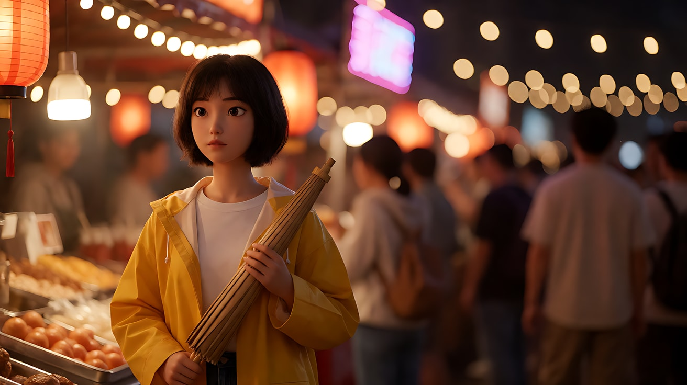

**【图生视频 · Seedance】**

```
【素材分工】@图片1 为首帧，锁定人物身份、服装、构图位置与浅景深效果。
【画风】风格化写实三维CG质感，电影级布光。
女孩站在夜市边缘不动，双手握着折好的纸伞，目光在人群方向缓慢地从右往左扫过一遍，又回到画右，轻轻抿了一下嘴唇，手指在伞柄上收紧。镜头固定中近景，不移动。焦点始终在她的眼睛上，身后的灯串与灯笼保持大颗柔和的暖色光斑，人群只是虚化的色块在流动，虚化程度始终不变。画左摊灯暖光稳定，身后霓虹冷光轻微闪动。结尾停在她望向画右的半侧脸上。
【声音】夜市嘈杂但发闷的人声，远处铁板的滋滋声，偶尔一声吆喝，风吹动纸灯笼的沙沙声，无配乐。
【约束】保持人物脸型、发型、服装不变；背景始终虚化，不变清晰；不要字幕、水印、Logo。
时长：6秒
```

**参数**：时长 6 秒 ｜ 画幅 16:9

**【检查点】**
- 她的眼睛是否始终清晰，背景是否始终是光斑而不是清楚的摊位
- 光斑是否来自画面里有的灯，而不是凭空漂浮的圆点
- 她"找人"的情绪是否靠视线和手指动作表现出来

**【常见问题与修复】**
| 现象 | 修复 |
|---|---|
| 背景中途变清晰，看得见人脸 | 在正文和约束里都写"背景虚化程度始终不变"；首帧里把人群距离写远一点（twenty meters behind her） |
| 光斑像贴纸一样漂浮、不随画面变化 | 生图时写清光斑来源（string lights, paper lanterns），视频里写"光斑随风轻微晃动" |
| 脸也有点虚 | 光圈改为 f/2，视频里删掉转头动作，只保留眼神移动 |
| 她走动起来 | 加"她始终站在原地，双脚不动" |

---

### 练习2：同一场景，两种景深（难度 ★★）

**目标**：用同一张定妆图和同一张场景图，只改景深，生成两个片段并排比较。意图 A（浅景深）：让观众感到他在旧书店里只想着手里那封信；意图 B（深景深）：让观众感到他身处一个满是旧物和回忆的空间，门口随时可能有人进来。

**【生图 · Nano Banana】**

图1 角色定妆：

```
Character turnaround sheet of an original man in his late thirties: short neat black hair with a few grey strands,
round wire-frame glasses, a brown corduroy jacket over a cream knitted sweater, dark trousers, an old leather satchel.
Front view, three-quarter view, side view and back view, full body, standing on a plain light-grey background.
Camera at eye level, 50mm lens, deep focus so the whole figure is sharp, even soft studio light from the front, no shadows on the backdrop.
Stylized semi-realistic 3D CG rendering, feature-film animation quality. Aspect ratio 16:9.
```

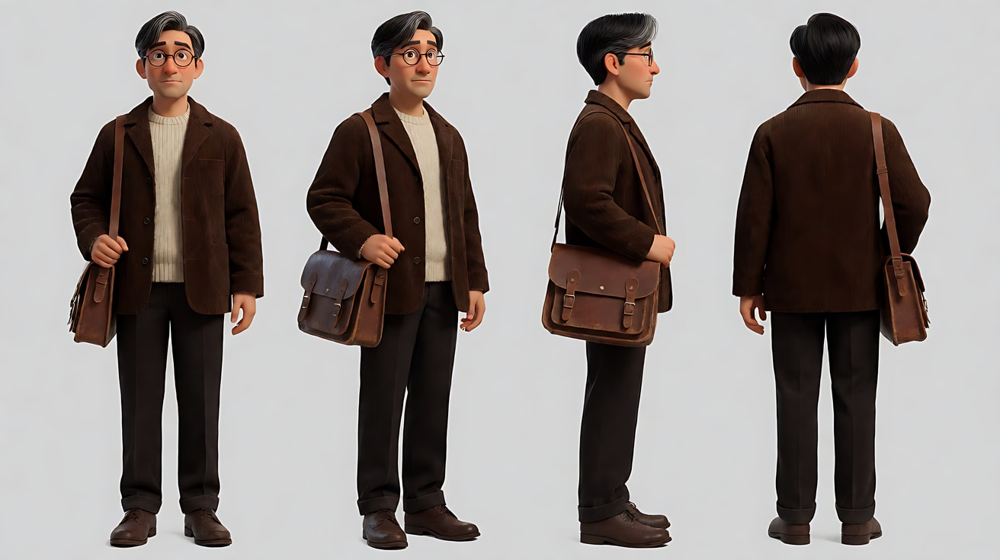

图2 场景：

```
Empty narrow second-hand bookshop on a rainy afternoon, tall wooden shelves packed with old books on both sides forming a deep corridor,
a small reading table with a green-shaded brass lamp switched on in the foreground, a glass front door at the far end with rain on it,
grey daylight coming through the door, dust in the air, no people.
Wide shot from the back of the shop looking toward the door, eye level, 24mm lens, f/11, deep focus from the table to the door.
Lighting: cool grey daylight from the far door, warm lamp light pooling on the table in the foreground.
Stylized semi-realistic 3D CG rendering, feature-film animation quality. Aspect ratio 16:9.
```

中文释义：图1 为原创中年男子定妆，戴圆框眼镜、灯芯绒外套；图2 为空旧书店，两侧高书架形成纵深走廊，前景小桌和绿色台灯，远端是挂着雨痕的玻璃门；24mm、f/11、深焦；远处门口冷色天光，前景台灯暖光。

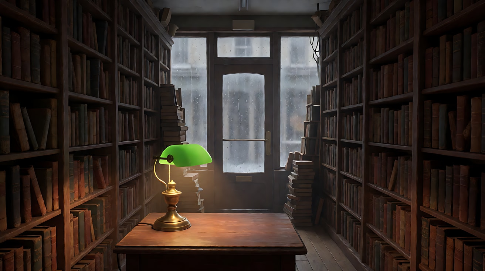

**【多图生视频 · Seedance】**

**版本 A：浅景深**

```
【素材分工】@图片1 锁定人物身份、眼镜与服装，不参考其中的灰色背景；@图片2 仅参考书店布局、台灯与门的位置，不复制其中的景深。
【画风】风格化写实三维CG质感，电影级布光。
男人坐在前景的小桌旁，侧身对镜头，中近景，85毫米长焦，大光圈浅景深，焦点在他的眼睛和手里的信上。他把一封泛黄的信从信封里抽出来，展开，低头读，读到一半手指停在一行字上。身后的书架和远处的玻璃门完全虚化成暗色与冷灰色的柔和色块，看不清门口。台灯暖光从画左照亮他的脸和信纸。镜头固定，不移动。结尾停在他停住的手指和低垂的眼睛上。
【声音】雨点打在玻璃门上的闷响，信纸展开的脆响，台灯的轻微电流声，无配乐。
【约束】保持人物脸型、发型、眼镜、服装不变；背景始终虚化；不要字幕、水印、Logo。
时长：8秒
```

**版本 B：深景深**

```
【素材分工】@图片1 锁定人物身份、眼镜与服装，不参考其中的灰色背景；@图片2 参考书店布局、台灯、门的位置与深焦效果。
【画风】风格化写实三维CG质感，电影级布光。
男人坐在前景的小桌旁，侧身对镜头，中景，24毫米广角，小光圈深景深，从前景的台灯、信封到两侧书脊的文字、远端玻璃门上的雨痕全部清晰。他把一封泛黄的信从信封里抽出来，展开，低头读，读到一半抬起眼睛，看向远处的玻璃门。门外雨中有一个模糊的行人身影走过，没有进来。镜头固定，不移动。台灯暖光照亮前景，门口冷灰天光照亮走廊尽头。结尾停在他望向门口、手里还捏着信的画面。
【声音】雨点打在玻璃门上，信纸展开的脆响，门外远处一声车辆驶过的水声，无配乐。
【约束】保持人物脸型、发型、眼镜、服装不变；前景到远景始终清晰；不要字幕、水印、Logo。
时长：8秒
```

**参数**：时长 8 秒 ｜ 画幅 16:9 ｜ 两个版本使用同一组参考图

**【检查点】**
- 版本 A 是否只看得清人和信，版本 B 是否看得清门口和书脊
- 只看画面，能否感到 A 是"内心"、B 是"处境"
- 两个版本的人物是否是同一个人（眼镜、外套一致）

**【常见问题与修复】**
| 现象 | 修复 |
|---|---|
| 两个版本景深差不多 | 版本 A 写清"85毫米、大光圈、身后完全虚化"，版本 B 写清"24毫米、小光圈、全部清晰"，并把版本 A 的景别收紧到中近景 |
| 版本 B 中门外行人走进书店 | 改成"门外行人走过，没有推门，没有进来" |
| 版本 A 的信纸上出现乱码文字 | 加"信纸上的字迹模糊不可读"，并让镜头不要正对信纸 |
| 人物摘下或换了眼镜 | 在素材分工和约束里都写"始终戴着同一副圆框眼镜" |

---

### 练习3：走近，背景化开——首尾帧对焦距离实验（难度 ★★★）

**目标**：保持机位、焦段、光圈都不变，只让人物从远处走到镜头前。对焦距离变近，景深自然变浅，背景从清晰变成光斑。意图：让观众感到他从街道的一部分，变成了这一刻唯一重要的人。

**【生图 · Nano Banana】**

图1 角色定妆：

```
Character turnaround sheet of an original delivery rider in his mid-twenties: short spiky hair, a bright teal windbreaker jacket,
black cargo trousers, white sneakers, a small square insulated delivery bag on his back.
Front view, three-quarter view, side view and back view, full body, plain light-grey background.
Camera at eye level, 50mm lens, deep focus, even soft studio light from the front.
Stylized semi-realistic 3D CG rendering, feature-film animation quality. Aspect ratio 16:9.
```

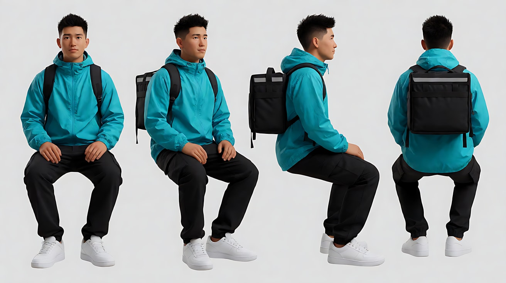

图2 首帧：

```
Using the character from image 1: a wide shot of him walking toward the camera down the middle of a narrow old alley at night,
about twenty meters away, small in the frame, centered. Rows of red paper lanterns hang across the alley above him,
shop signs and lantern strings run all the way to the far end.
Camera at eye level, locked on a tripod, 85mm lens, f/2, focus on him at twenty meters, so he and the lanterns around him are fairly sharp
and only the far end of the alley softens slightly.
Lighting: warm red-orange lantern light from above, cool blue light spilling from a shop window on frame right.
Keep the face, hairstyle and outfit exactly as in image 1.
Stylized semi-realistic 3D CG rendering, feature-film animation quality. Aspect ratio 16:9.
```

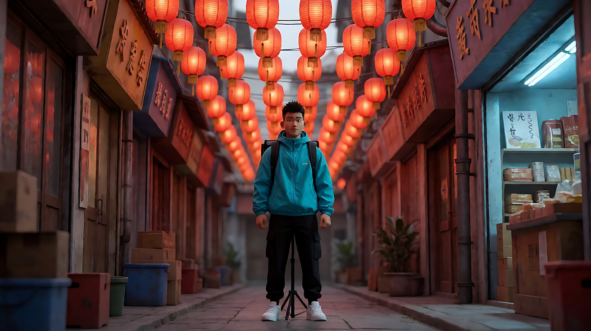

图3 尾帧：

```
Using the character from image 1 and the exact same camera position, lens and alley as image 2:
he has walked up close to the camera and stopped, now a medium close-up, centered, looking slightly down at his phone, then up toward the lens.
85mm lens, f/2, focus on his eyes at two meters, very shallow depth of field;
the lanterns and the whole alley behind him have dissolved into large soft round red and orange bokeh, the shop window becomes a blurred blue glow on the right.
Lighting: warm red-orange lantern light from above on his hair and shoulders, cool blue window light on the right side of his face.
Keep the face, hairstyle and outfit exactly as in image 1.
Stylized semi-realistic 3D CG rendering, feature-film animation quality. Aspect ratio 16:9.
```

中文释义：首帧是远景，他在二十米外的巷子中央朝镜头走来，85mm、f/2，对焦在二十米，人物和周围灯笼都比较清楚；尾帧机位、焦段、光圈完全相同，他走到两米处停下成中近景，对焦距离变近，身后整条巷子化成大颗红橙色光斑。

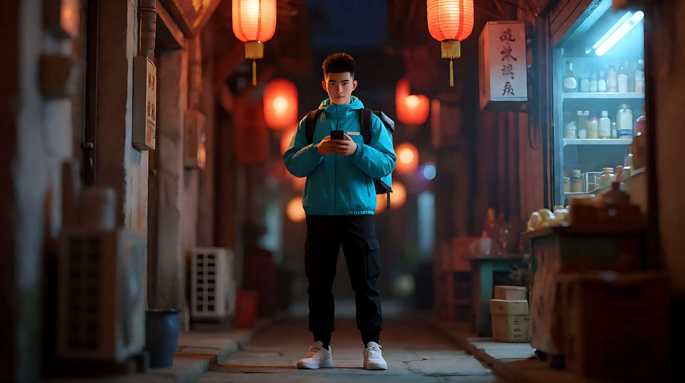

**【首尾帧生视频 · Seedance】**

```
【素材分工】@图片2 为首帧；@图片3 为尾帧，是最终画面目标；@图片1 仅锁定人物身份、服装与背包，不参考其中的灰色背景。只生成两帧之间的连续动作。
【画风】风格化写实三维CG质感，电影级布光。
骑手从巷子深处朝镜头匀速走来，边走边低头看手机，走到镜头前两米处停下，抬起眼睛看向镜头。镜头固定在三脚架上，不移动、不变焦。焦点始终跟随他的脸，随着他走近，身后的灯笼和整条巷子逐渐从清晰化开，变成大颗柔和的红橙色光斑，画右店铺窗口变成一团模糊的蓝光。头顶灯笼暖光与画右窗口冷光保持不变。
【声音】运动鞋踩在湿石板上的脚步声由远及近，灯笼在风里轻轻晃动的吱呀声，手机一声提示音，远处隐约的人声，无配乐。
【约束】保持人物脸型、发型、服装与背包不变；机位与焦段不变，背景虚化只因他走近而逐渐加深；动作连续，不跳切；不要字幕、水印、Logo。
时长：8秒
```

**参数**：时长 8 秒 ｜ 画幅 16:9

**【检查点】**
- 机位是否真的没动（巷子两侧的灯笼位置是否与首帧一致）
- 背景是"逐渐"化开，而不是在某一帧突然变虚
- 尾帧的光斑颜色与位置是否接近图3

**【常见问题与修复】**
| 现象 | 修复 |
|---|---|
| 镜头自己往前推，而不是人物走近 | 写"镜头固定在三脚架上，不移动、不变焦，只有人物在走" |
| 人物走到一半变清晰、背景却始终清晰 | 强调"以 @图片3 为最终画面目标"，并写"背景随他走近逐渐化成光斑" |
| 人物走路姿态僵硬或滑步 | 把距离缩短：首帧写 fifteen meters away，减少走路时长 |
| 手机屏幕出现文字 | 加"手机屏幕只有亮光，不显示文字" |

---

### 练习4：景深越来越浅——三镜头情绪孤立（难度 ★★★★）

**目标**：一次生成三个镜头，景深从深到浅逐级收窄，与景别一起把观众从"环境"带进"内心"。意图：让观众感到她在人潮中听到了一个只与她有关的消息。

**【生图 · Nano Banana】**

图1 角色定妆：

```
Character turnaround sheet of an original woman in her late twenties: long straight black hair in a low ponytail,
a charcoal wool coat over a light-blue shirt, a burgundy scarf, a black tote bag on her shoulder.
Front view, three-quarter view, side view and back view, full body, plain light-grey background.
Camera at eye level, 50mm lens, deep focus, even soft studio light from the front.
Stylized semi-realistic 3D CG rendering, feature-film animation quality. Aspect ratio 16:9.
```

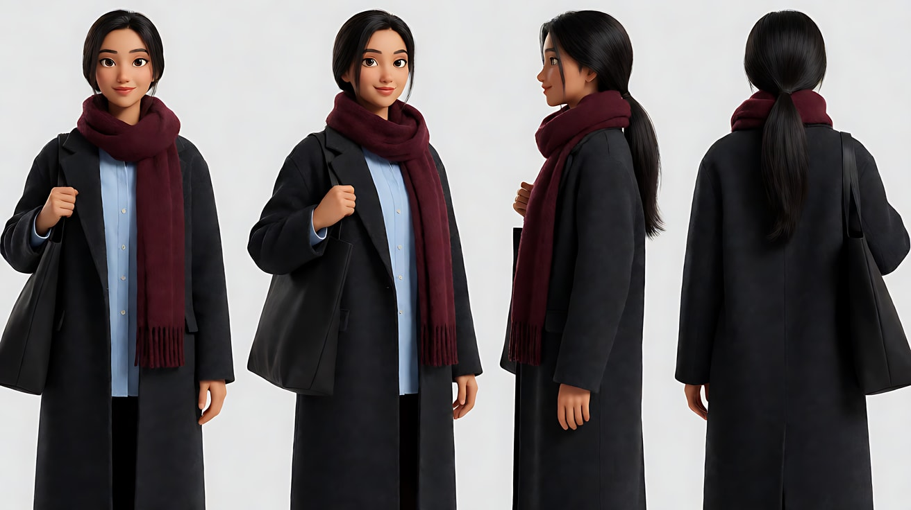

图2 场景：

```
Empty large railway station concourse in the early evening, a huge arched glass roof, rows of departure boards glowing amber,
polished stone floor reflecting the lights, tall columns receding into the distance, no people.
Extreme wide shot from a raised balcony, high angle, 18mm lens, f/11, deep focus across the whole hall.
Lighting: deep-blue dusk light through the glass roof from above, warm amber glow from the departure boards on frame left.
Stylized semi-realistic 3D CG rendering, feature-film animation quality. Aspect ratio 16:9.
```

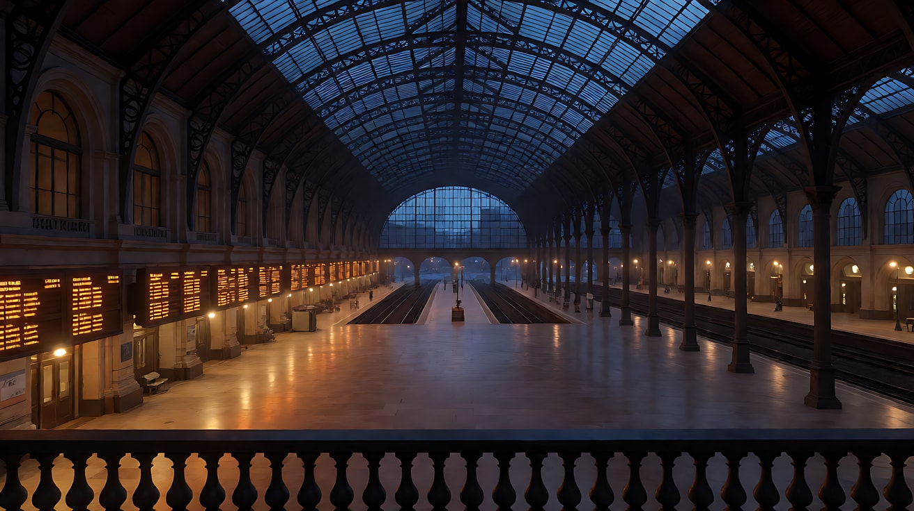

图3 镜头1关键帧：

```
Using the character from image 1 and the station from image 2:
a wide shot of the busy concourse full of travelers walking in all directions; she stands still in the middle third of the frame,
slightly left of center, phone held to her ear, the only person not moving.
Camera at a high angle from the balcony, 24mm lens, f/11, deep focus: every traveler, the departure boards and the far columns are sharp.
Lighting: deep-blue dusk light from the glass roof above, warm amber glow from the departure boards on frame left.
Keep the face, hairstyle and outfit exactly as in image 1.
Stylized semi-realistic 3D CG rendering, feature-film animation quality. Aspect ratio 16:9.
```

中文释义：图3 为镜头1首帧，高角度广角远景，人潮流动，她握着手机贴在耳边站在中间偏左，是唯一不动的人；24mm、f/11 深焦，所有人和远处的柱子都清楚。

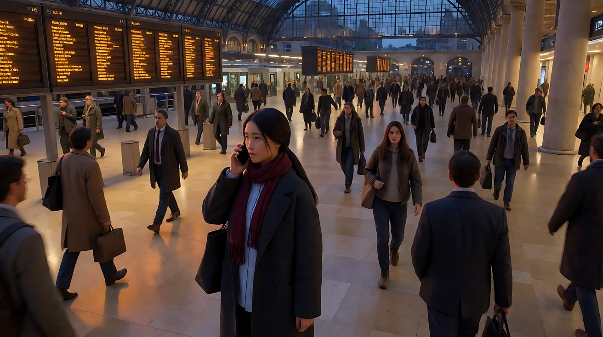

**【多图生视频 · Seedance】**

```
【素材分工】@图片1 锁定人物身份、服装、围巾与包；@图片2 仅参考车站大厅布局与光线，不复制其中的空旷；@图片3 为首帧，锁定镜头1的构图与深景深。
【画风】风格化写实三维CG质感，电影级布光。
镜头1：高角度广角远景，镜头固定。小光圈深景深，旅客、发车牌、远处立柱全部清晰。旅客们从四面八方穿过大厅，她站在画面中间偏左，手机贴在耳边，一动不动。大厅广播回声、行李箱滚轮声、密集的脚步声。
镜头2：镜头切至平视中景，50毫米，中等景深，她在画面中间，身后经过的旅客变得柔和但仍能看出人形。她握手机的手慢慢放低，嘴唇微张，没有说话。环境声变远，像隔着一层玻璃。
镜头3：镜头切至正面特写，85毫米，极大光圈极浅景深，只有她的眼睛清晰，连耳边的发丝都已虚化，身后的发车牌化成一排柔和的琥珀色光斑。镜头极慢地向前推近一点，停在她眼眶泛红、睫毛轻轻颤动的画面上。环境声几乎消失，只剩她的一次呼吸。
【锁定】光线：玻璃顶棚的深蓝暮光在上方，琥珀色发车牌光在画左；人物始终穿炭灰色大衣、酒红色围巾，手机在右手；她始终面朝镜头方向；景深逐镜头变浅：镜头1全部清晰，镜头2背景柔和，镜头3只有眼睛清晰。
【声音】从嘈杂的广播与脚步声，逐渐变稀，到最后只剩一次呼吸，无配乐。
【约束】保持人物脸型、发型、服装不变；旅客不与她发生接触；不要字幕、水印、Logo。
时长：12秒
```

**参数**：时长 12 秒 ｜ 画幅 16:9 ｜ 负载：3 个镜头、无对白、动作极少，属于"稳妥"档

**【检查点】**
- 三个镜头的景深是否明显一级比一级浅
- 镜头3的光斑是否来自发车牌的琥珀色，而不是随机颜色
- 声音是否与景深同步变"窄"

**【常见问题与修复】**
| 现象 | 修复 |
|---|---|
| 镜头2和镜头3景深一样 | 在【锁定】里写清三级景深，并在镜头3写"连耳边的发丝都已虚化" |
| 镜头1里有旅客撞到她 | 加"旅客从她身边绕开，与她保持一臂距离" |
| 三个镜头连成一个推镜 | 每个镜头块开头写"镜头切至……"，并让镜头1是高角度、镜头2和3是平视 |
| 镜头3眼睛变形 | 删掉"推近"，改为"镜头固定"，只保留睫毛颤动 |

---

### 练习5：光斑里的离开——四镜头焦外叙事（难度 ★★★★★）

**目标**：把焦外光斑当作情绪道具，前三个镜头让城市一直是虚的光斑，最后一个镜头景深突然变深、城市变清楚。意图：让观众感到她终于看清并放下了这座城市。

**【生图 · Nano Banana】**

图1 角色定妆：

```
Character turnaround sheet of an original woman in her early thirties: shoulder-length wavy auburn hair,
a cream turtleneck sweater under a camel trench coat, small gold hoop earrings, a slim silver watch on her left wrist.
Front view, three-quarter view, side view and back view, full body, plain light-grey background.
Camera at eye level, 50mm lens, deep focus, even soft studio light from the front.
Stylized semi-realistic 3D CG rendering, feature-film animation quality. Aspect ratio 16:9.
```

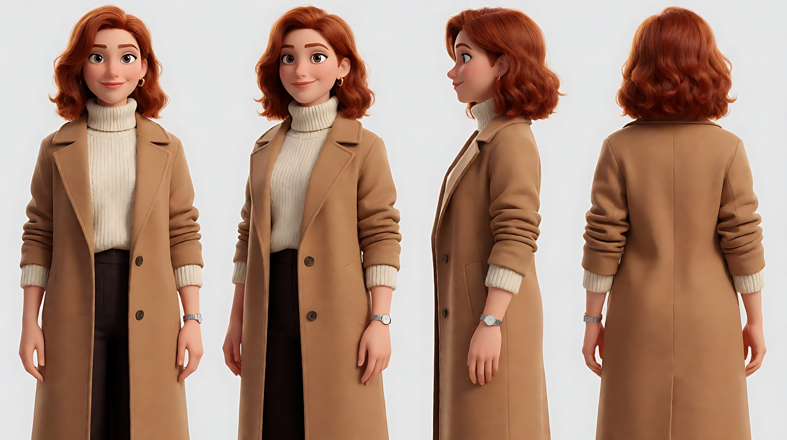

图2 场景（出租车后座，夜雨）：

```
Empty back seat of a taxi at night in the rain, dark fabric seats, the right rear window covered in raindrops,
outside the window a city street of neon signs, traffic lights and shop windows, no people.
Medium shot from the left rear seat looking toward the right window, eye level, 50mm lens, f/1.8, shallow depth of field,
focus on the raindrops on the glass, the neon outside dissolves into large soft colored bokeh.
Lighting: shifting magenta, amber and cyan neon light through the window from frame right, very dim cabin.
Stylized semi-realistic 3D CG rendering, feature-film animation quality. Aspect ratio 16:9.
```

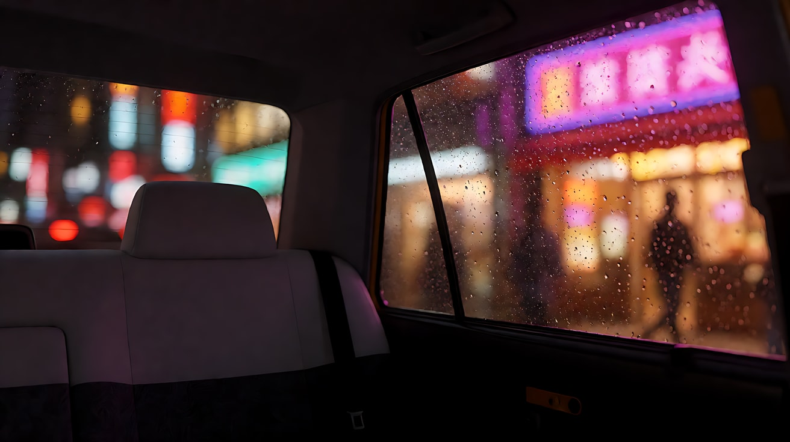

图3 镜头1关键帧：

```
Using the character from image 1 and the taxi interior from image 2:
a medium close-up of her sitting in the back seat, three-quarter profile facing the right window, her head resting lightly against the headrest.
Camera at eye level from the left side of the cabin, 85mm lens, f/1.4, very shallow depth of field, focus on her eyes;
the rain-covered window behind her and the city outside melt into large overlapping round bokeh of magenta, amber and cyan.
Lighting: neon light through the window from frame right washing over her face, very dim warm cabin light from above.
Keep the face, hairstyle and outfit exactly as in image 1.
Stylized semi-realistic 3D CG rendering, feature-film animation quality. Aspect ratio 16:9.
```

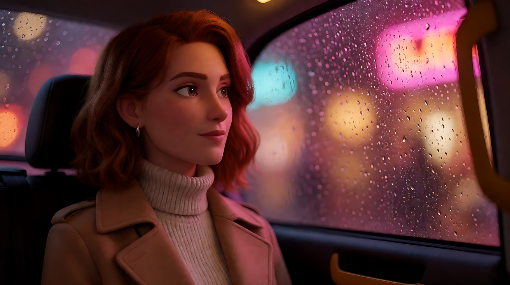

图4 镜头4关键帧（深景深结尾）：

```
Using the character from image 1: a wide shot from the sidewalk of a long straight city avenue at night after the rain has stopped,
she stands beside a stopped taxi on the right third of the frame with a small suitcase, looking down the avenue.
Camera at eye level, 24mm lens, f/11, deep focus: the wet pavement, every neon sign, the traffic lights and the buildings far down the avenue are all sharp and readable as shapes.
Lighting: neon and street lights reflecting on the wet road, cool blue night sky, warm light from the taxi's interior.
Keep the face, hairstyle and outfit exactly as in image 1.
Stylized semi-realistic 3D CG rendering, feature-film animation quality. Aspect ratio 16:9.
```

中文释义：图2 是空出租车后座，焦点在车窗雨珠上，窗外霓虹化成光斑；图3 是镜头1首帧，85mm、f/1.4，她靠在头枕上看窗外，身后城市化成洋红、琥珀、青色的大光斑；图4 是结尾，雨停后的长街，24mm、f/11 深焦，她站在停下的出租车旁，整条街清晰可见。

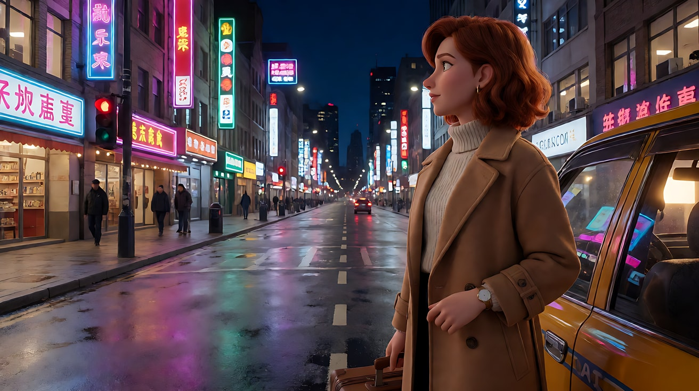

**【多图生视频 · Seedance】**

```
【素材分工】@图片1 锁定人物身份、发型、风衣与手表；@图片2 仅参考出租车内部布局与车窗雨珠，不复制其中的空座；@图片3 为首帧，锁定镜头1构图与浅景深；@图片4 仅作为镜头4的构图与深景深参考，不改变人物服装。
【画风】风格化写实三维CG质感，电影级布光。
镜头1：固定中近景，85毫米，极浅景深，焦点在她的眼睛上。她靠在后座头枕上看着窗外，身后整片车窗化成洋红、琥珀、青色交叠的大光斑，光斑随车辆行驶缓慢向画左滑过。她眨了一下眼，没有其他动作。雨刷声、轮胎压过积水的嘶嘶声。
镜头2：镜头切至车窗玻璃的近景，焦点落在玻璃上的雨珠，每颗雨珠里都映着一小点霓虹；窗外的城市完全虚化成大块流动的彩色光斑。她的手指从画面下方伸入，在起雾的玻璃上轻轻抹开一道。雨点打在车顶的密集声音。
镜头3：镜头切至她的特写，镜头固定，前景是虚化的雨珠光斑，挡住画面左下角，她的脸在焦点上。她把额头轻轻靠在玻璃上，闭上眼，再睁开。车内只剩发动机低鸣。
镜头4：镜头切至雨停后人行道上的平视广角远景，24毫米，小光圈深景深，湿漉漉的长街、每一块霓虹招牌、远处的红绿灯与楼群全部清晰。她站在停下的出租车旁，位于画右三分之一，提着小行李箱望向长街尽头。镜头固定，停在她站定远望的画面上。城市夜晚的远处车流声和一声出租车关门声。
【锁定】光线：车内始终是窗外洋红、琥珀、青色的霓虹从画右照进，车外是湿地面反射的霓虹与冷蓝夜色；人物始终穿驼色风衣、奶白高领毛衣，左手腕戴银色手表；镜头1到镜头3城市始终是虚化光斑，只有镜头4变为全部清晰。
【声音】雨声与轮胎水声从密到疏，镜头3几乎只剩发动机低鸣，镜头4雨停，换成开阔的城市远声，无配乐。
【约束】保持人物脸型、发型、服装不变；玻璃上不出现文字；不要字幕、水印、Logo。
时长：15秒
```

**参数**：时长 15 秒 ｜ 画幅 16:9 ｜ 负载：4 个镜头、无对白，属于"有挑战"档。若镜头4不稳定，拆成两次生成：镜头1–3 一次（10 秒），镜头4 单独用图4 做图生视频（5 秒）

**【检查点】**
- 镜头1–3 的城市是否一直是光斑，镜头4 是否明显"变清楚"
- 镜头2 的焦点是否真的在雨珠上，而不是在窗外
- 光斑颜色在四个镜头里是否一致（洋红、琥珀、青色）
- 只看画面，是否能感到"从模糊的心事到看清并放下"

**【常见问题与修复】**
| 现象 | 修复 |
|---|---|
| 镜头4 仍然是浅景深 | 镜头4 单独生成，用 @图片4 做首帧，正文写"从前景地面到远处楼群全部清晰" |
| 镜头2 手指变形 | 删掉抹玻璃的动作，改为"雨珠沿玻璃缓慢滑落" |
| 光斑变成乱闪的色块 | 写"光斑柔和、缓慢滑过"，并删除多余的颜色，只保留两种 |
| 镜头3 和镜头1 看起来一样 | 镜头3 景别收紧为特写，并加"前景雨珠光斑挡住画面左下角" |
