# L02-02 焦段性格 · 提示词

> 本组练习：用广角、标准、长焦、微距和变形宽银幕镜头，拍出同一个世界的不同"性格"，并亲手验证"换焦段并后退"的透视变化。｜ 配套教学：[L02-02-焦段性格](../教学/L02-02-焦段性格.md) ｜ 规范：[写作规范](../../模板/写作规范.md)
>
> 画风默认使用开关 A（风格化写实 CG）。如改用 2D 动画，删掉所有焦段、光圈、景深词。

---

### 练习1：后厨的主人——广角低角度单图生视频（难度 ★）

**目标**：用 18mm 广角贴近 + 低角度，让人物显得高大、空间向她汇聚；再让她向镜头俯身，体会广角把"靠近"放大的效果。意图：让观众感到在这间后厨里她说了算。

**【生图 · Nano Banana】**

图1 关键帧：

```
A low-angle medium shot of an original head chef in her forties standing behind a long stainless-steel prep counter in a busy restaurant kitchen,
short cropped grey hair, a crisp white double-breasted chef jacket with rolled sleeves, a dark apron, arms crossed, looking straight down at the camera.
She is centered in the frame. Camera very close to the counter edge at waist height, tilted up, 18mm wide-angle lens, about one meter from her,
deep focus at f/8: the steel counter in the foreground looks long and enlarged, the rows of hanging pans and ceiling lamps behind her
converge toward the top of the frame with slight barrel distortion at the edges.
Lighting: hard white overhead fluorescent strip lights directly above her as key, warm orange glow from the stove flames on frame right.
Stylized semi-realistic 3D CG rendering, feature-film animation quality. Aspect ratio 16:9.
```

中文释义：低角度中景，原创女厨师长站在不锈钢操作台后，双臂交叉低头看镜头，居中；机位贴近台面、腰部高度上仰，18mm 广角，距离约一米，f/8 深焦；前景台面被拉长放大，身后吊挂的锅和顶灯向画面上方汇聚，边缘轻微桶形畸变；头顶白色灯管硬光为主光，画右灶火暖光。

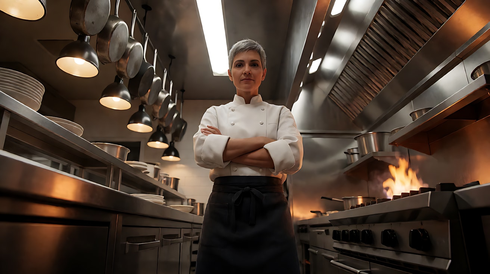

**【图生视频 · Seedance】**

```
【素材分工】@图片1 为首帧，锁定人物身份、厨师服、后厨布局与广角低角度透视。
【画风】风格化写实三维CG质感，电影级布光。
女厨师长松开交叉的双臂，双手撑在不锈钢台面上，身体缓慢地朝镜头俯过来，目光始终压着镜头。广角之下她的双手和肩膀随着靠近明显变大，身后的锅具和顶灯继续向上汇聚。镜头固定低角度，不移动。头顶白色灯管硬光不变，画右灶火暖光轻轻跳动。结尾停在她俯身撑台、俯视镜头的画面上。
【声音】后厨排风扇的轰鸣，远处油锅的爆响，不锈钢台面被手掌按下的一声闷响，无配乐。
【约束】保持人物脸型、发型、服装不变；她不开口说话；手指数量与形状正常；不要字幕、水印、Logo。
时长：5秒
```

**参数**：时长 5 秒 ｜ 画幅 16:9

**【检查点】**
- 低角度和广角汇聚线是否保留
- 她俯身靠近时，手和肩膀是否被广角"放大"
- 画面是否让人感到压迫，而不是滑稽

**【常见问题与修复】**
| 现象 | 修复 |
|---|---|
| 脸部畸变过度、显得滑稽 | 生图时把距离改为 about 1.5 meters，或焦段改为 24mm |
| 镜头自己往上升或后退 | 写"镜头固定低角度，不移动" |
| 她走出操作台 | 加"她始终站在操作台后，只是俯身" |
| 手掌变形 | 动作改为"双手平放在台面上"，不要写抓、握 |

---

### 练习2：换焦段并后退——三焦段透视对比实验（难度 ★★）

**目标**：同一个人、同一个背景、同样的中近景，只换焦段并改变机位距离，生成三个片段并排比较。亲眼看到"透视由距离决定"。意图：A 24mm"我就在他身边"；B 50mm"我在正常地看着他"；C 135mm"我在远处看着他，他被城市压住"。

**【生图 · Nano Banana】**

图1 角色定妆：

```
Character turnaround sheet of an original young man in his mid-twenties: short wavy dark-brown hair, light stubble,
an olive-green bomber jacket over a grey T-shirt, a silver chain necklace, black jeans.
Front view, three-quarter view, side view and back view, full body, plain light-grey background.
Camera at eye level, 50mm lens, deep focus, even soft studio light from the front.
Stylized semi-realistic 3D CG rendering, feature-film animation quality. Aspect ratio 16:9.
```

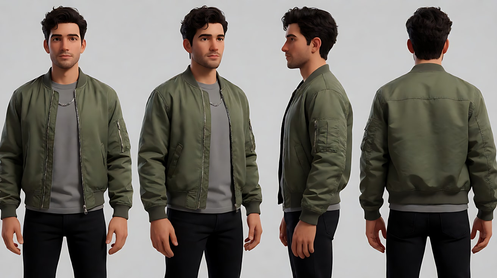

图2 场景：

```
Empty rooftop of an old apartment building at golden hour, a low concrete parapet, a rusty water tank and a clothesline with white sheets
about eight meters away, and behind them a dense skyline of residential towers and a distant TV tower, no people.
Wide shot, eye level, 35mm lens, f/8, deep focus.
Lighting: low warm sun from frame left behind the buildings, long shadows across the rooftop, hazy orange sky.
Stylized semi-realistic 3D CG rendering, feature-film animation quality. Aspect ratio 16:9.
```

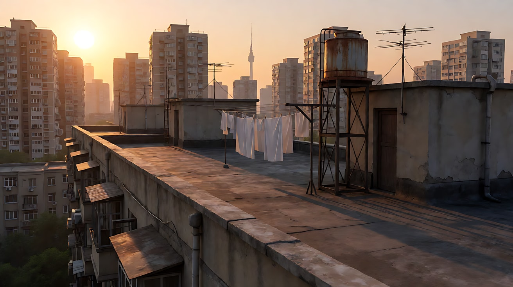

图3A / 图3B / 图3C 三张关键帧（只换焦段与距离，其他字一字不改）：

```
Using the character from image 1 and the rooftop from image 2:
a medium close-up of him leaning on the concrete parapet, three-quarter view facing frame left, placed in the center of the frame,
the water tank, the white sheets and the skyline behind him.
Camera at eye level, [A: 24mm lens about 0.6 meters from his face, his nose and forehead slightly enlarged,
a very wide background with the whole skyline small and far away]
[B: 50mm lens about 1.3 meters away, natural facial proportions, a moderate slice of skyline behind him]
[C: 135mm lens about 3.5 meters away, his face slightly flattened, only a narrow slice of background visible,
the water tank and towers enlarged and compressed into a wall right behind his head], f/4.
Lighting: low warm golden sun from frame left as key on his face, soft orange haze behind.
Keep the face, hairstyle and outfit exactly as in image 1.
Stylized semi-realistic 3D CG rendering, feature-film animation quality. Aspect ratio 16:9.
```

中文释义：同一个中近景，他靠在天台矮墙上，三分之四侧脸朝画左。A：24mm 贴近 0.6 米，鼻子额头略大、背景天际线又宽又小；B：50mm 约 1.3 米，比例自然；C：135mm 后退约 3.5 米，脸略扁，只看到一小块背景，水箱和楼群被放大、压缩成贴在脑后的一堵墙。生成时把方括号里的三段分别替换进去，每次只用一段。

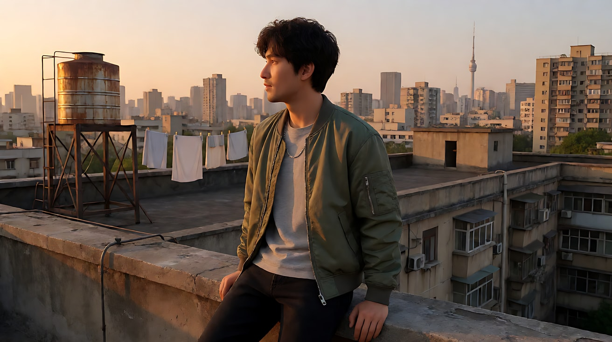

**【多图生视频 · Seedance】**

三个版本使用同一段视频提示词，只替换 `@图片3` 为对应的 3A / 3B / 3C，并替换第二行的焦段描述：

```
【素材分工】@图片1 锁定人物身份、发型、夹克与项链，不参考其中的灰色背景；@图片2 仅参考天台布局与金色夕光，不复制其中的构图；@图片3 为首帧，锁定焦段、机位距离与透视关系。
【画风】风格化写实三维CG质感，电影级布光。
镜头保持首帧的焦段与距离不变【A：24毫米广角贴近，背景开阔；B：50毫米标准，比例自然；C：135毫米长焦后退，背景被压缩成一堵墙】。他手肘撑着矮墙，望着画左的远方，风吹动额前的头发和身后的白床单，他慢慢转过头看向镜头，停住，又把视线收回远方。镜头固定，不移动、不变焦。夕阳暖光从画左照在他脸上。结尾停在他重新望向远方的三分之四侧脸上。
【声音】天台上的风声，床单被吹动的扑扑声，远处城市的车流低鸣，一声遥远的鸽哨，无配乐。
【约束】保持人物脸型、发型、服装不变；透视与背景大小与首帧一致；不要字幕、水印、Logo。
时长：6秒
```

**参数**：时长 6 秒 ｜ 画幅 16:9 ｜ 三个版本各生成一次，剪辑时并排放置

**【检查点】**
- 三个版本人物在画面中的大小是否接近（这是实验成立的前提）
- A 的背景是否最宽最小，C 的背景是否最窄最大
- 他转头看镜头时，三个版本给你的距离感有什么不同：A 像贴脸、B 像对视、C 像被偷看

**【常见问题与修复】**
| 现象 | 修复 |
|---|---|
| 三张关键帧背景大小差不多 | 写出后果而不只写数字：A 写 "the whole skyline small and far away"，C 写 "towers enlarged and compressed into a wall right behind his head" |
| 24mm 版脸部变形太夸张 | 把距离改为 0.8 米，人物改为三分之四侧脸，不要正脸贴镜头 |
| 135mm 版背景被虚化成一片看不出楼 | 光圈从 f/4 改为 f/8，写 "the towers remain recognizable" |
| 视频里镜头自己推拉 | 写"不移动、不变焦"，并删掉任何表示靠近的词 |

---

### 练习3：怎么也跑不近——长焦压缩首尾帧（难度 ★★★）

**目标**：用 200mm 长焦正面拍人物朝镜头奔跑，首帧和尾帧中人物大小只有一点点变化，背景人群和招牌始终压缩成密不透风的一片。意图：让观众感到她拼命在跑，却怎么也赶不上。

**【生图 · Nano Banana】**

图1 角色定妆：

```
Character turnaround sheet of an original teenage girl around seventeen: a high ponytail tied with a red ribbon,
a navy school blazer with a white shirt and a pleated grey skirt, white sneakers, a light-blue backpack.
Front view, three-quarter view, side view and back view, full body, plain light-grey background.
Camera at eye level, 50mm lens, deep focus, even soft studio light from the front.
Stylized semi-realistic 3D CG rendering, feature-film animation quality. Aspect ratio 16:9.
```

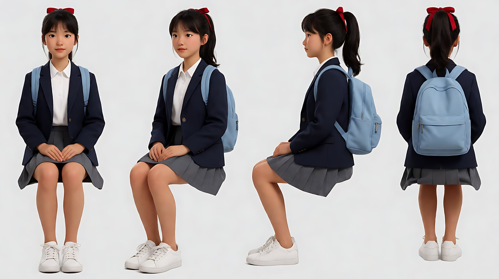

图2 首帧：

```
Using the character from image 1: a full shot of her running straight toward the camera along a crowded shopping street at dusk,
mid-stride, ponytail flying, centered in the frame. Shot from about eighty meters away with a 200mm telephoto lens, eye level, f/5.6:
the pedestrians around and behind her, the hanging shop signs and street lamps are compressed into one dense flat wall of people and color,
they look stacked right on top of each other.
Lighting: warm low sunset light from behind frame right as a rim on her hair and shoulders, glowing shop signs, slight heat shimmer in the air.
Keep the face, hairstyle and outfit exactly as in image 1.
Stylized semi-realistic 3D CG rendering, feature-film animation quality. Aspect ratio 16:9.
```

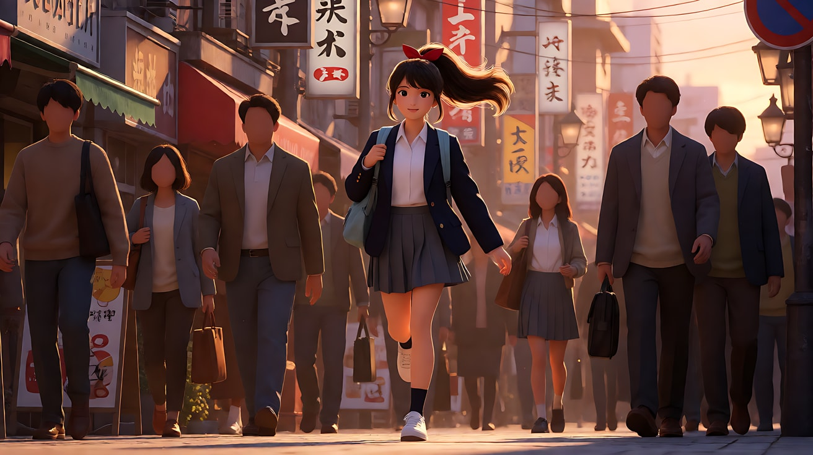

图3 尾帧：

```
Using the character from image 1 and the exact same camera position, 200mm telephoto lens and street as image 2:
she is still running toward the camera, only slightly larger in the frame, now a medium-full shot from the knees up, breathing hard, mouth open, eyes fixed ahead.
The same compressed wall of pedestrians, shop signs and street lamps fills the background exactly as before.
Lighting: warm low sunset rim light from behind frame right, slight heat shimmer.
Keep the face, hairstyle and outfit exactly as in image 1.
Stylized semi-realistic 3D CG rendering, feature-film animation quality. Aspect ratio 16:9.
```

中文释义：首帧是 200mm 长焦从约八十米外正面拍她奔跑，全景，身后行人、招牌、路灯被压缩成一面扁平的墙；尾帧机位与焦段不变，她只大了一点点（膝上中全景），气喘吁吁，背景依旧是压缩的人墙。

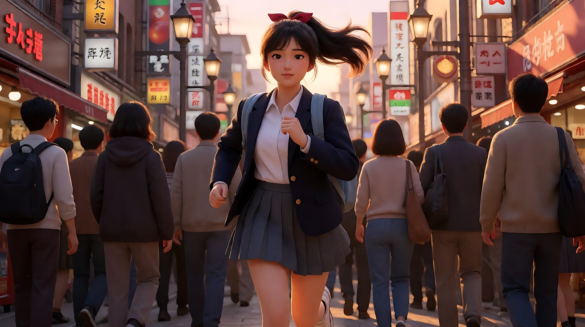

**【首尾帧生视频 · Seedance】**

```
【素材分工】@图片2 为首帧；@图片3 为尾帧，是最终画面目标；@图片1 仅锁定人物身份、校服、马尾与红发带，不参考其中的灰色背景。只生成两帧之间的连续动作。
【画风】风格化写实三维CG质感，电影级布光。
少女朝镜头拼命奔跑，马尾和书包带上下甩动，她侧身绕过一个迎面走来的行人，又继续向前。长焦压缩之下，她跑了很久，在画面里只变大了一点点，身后的行人、招牌和路灯始终挤成一面扁平的墙。镜头固定，不移动、不变焦。夕阳从画右后方给她的头发和肩膀勾出暖色轮廓，空气里有轻微热浪抖动。
【声音】她急促的喘息声和脚步声，被压在嘈杂的商业街人声和店铺音乐之下，远处一声电车铃，无配乐。
【约束】保持人物脸型、发型、服装不变；她始终朝镜头方向奔跑，不停下；行人不与她发生碰撞；动作连续，不跳切；不要字幕、水印、Logo。
时长：8秒
```

**参数**：时长 8 秒 ｜ 画幅 16:9

**【检查点】**
- 她跑了整整 8 秒，大小变化是否很小
- 背景是否始终是"贴在一起"的压缩人墙，而不是有纵深的街道
- 你是否感到了焦急和徒劳

**【常见问题与修复】**
| 现象 | 修复 |
|---|---|
| 她很快跑到镜头前，变成特写 | 强调"尾帧只变大一点点"，并以 @图片3 为最终目标；首帧写更远（one hundred meters away） |
| 背景像广角一样有纵深 | 生图时写出后果："compressed into one dense flat wall, stacked right on top of each other" |
| 她撞到行人 | 改为"行人自动向两侧让开" |
| 奔跑动作像原地踏步 | 加"身后的人群相对她缓慢后退"，并写"步幅大、手臂用力摆动" |

---

### 练习4：三个焦段，三种心理——厨艺比赛三镜头（难度 ★★★★）

**目标**：同一场戏用三个焦段切三个镜头：广角压迫 → 标准客观 → 长焦专注。意图：让观众感到年轻厨师从被审视的慌乱，进入只看得见锅的专注。

**【生图 · Nano Banana】**

图1 角色定妆：

```
Character turnaround sheet of an original young cook around twenty: a short undercut hairstyle, a white chef jacket with a black collar,
a black bandana tied on his head, a small burn scar on the back of his left hand, black work trousers and non-slip shoes.
Front view, three-quarter view, side view and back view, full body, plain light-grey background.
Camera at eye level, 50mm lens, deep focus, even soft studio light from the front.
Stylized semi-realistic 3D CG rendering, feature-film animation quality. Aspect ratio 16:9.
```

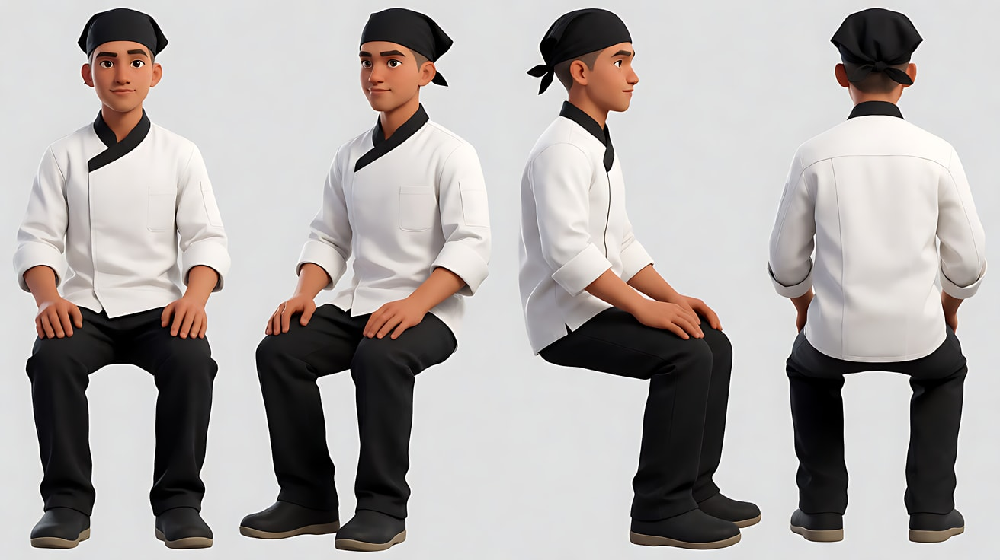

图2 场景：

```
Empty cooking competition studio, a single cooking station with a gas stove and a black wok in the middle of a dark stage,
a long judges' table with three empty chairs in the foreground, bright stage spotlights overhead, tiered audience seats fading into darkness behind, no people.
Wide shot from behind the judges' table, eye level, 24mm lens, f/8, deep focus.
Lighting: hard white top spotlight on the cooking station, cool blue wash over the audience seats, warm small lamps on the judges' table.
Stylized semi-realistic 3D CG rendering, feature-film animation quality. Aspect ratio 16:9.
```

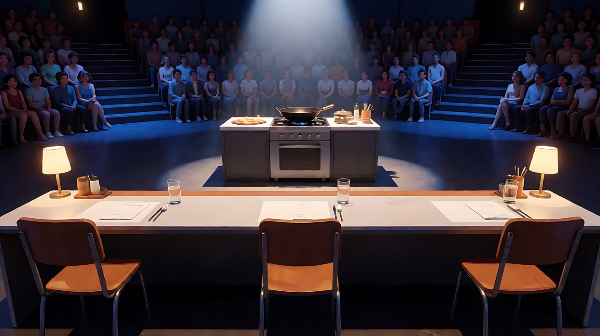

图3 镜头1关键帧：

```
Using the character from image 1 and the studio from image 2:
a wide shot from behind the judges' table, the backs and shoulders of three judges large and dark in the foreground occupying the bottom third of the frame,
the young cook small and far away at his cooking station in the center, standing stiffly with both hands on the counter edge.
Camera at seated eye level just behind the judges, 18mm wide-angle lens, f/8, deep focus: the judges' table looks huge and long,
the distance to the cook exaggerated.
Lighting: hard white top spotlight on the cook, warm small lamps on the judges' table, cool blue haze over the dark audience.
Keep the face, hairstyle and outfit exactly as in image 1.
Stylized semi-realistic 3D CG rendering, feature-film animation quality. Aspect ratio 16:9.
```

中文释义：镜头1首帧从评审席背后拍，三位评审的肩背又大又暗占据画面下三分之一，年轻厨师在远处灶台显得很小；18mm 广角、f/8，评审桌被拉长，距离被夸大。

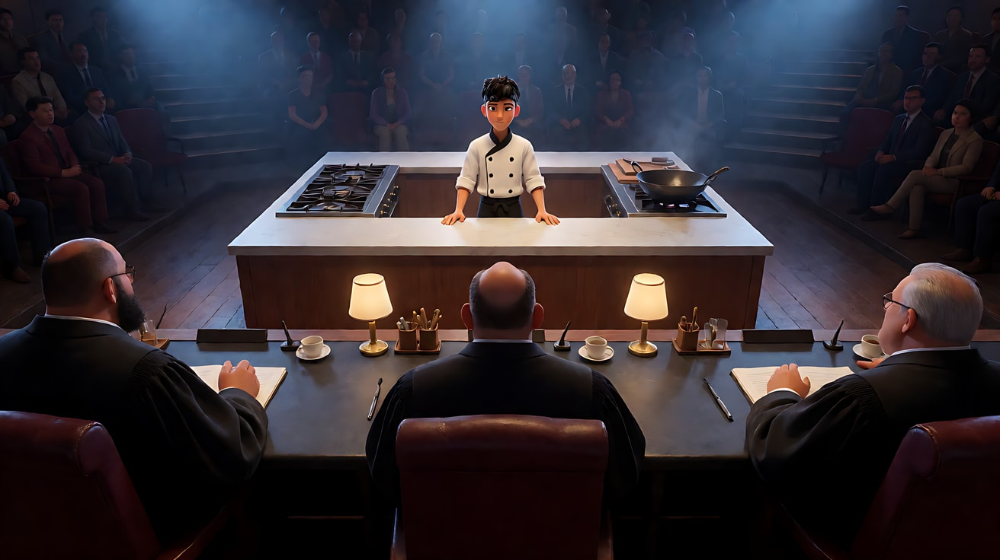

**【多图生视频 · Seedance】**

```
【素材分工】@图片1 锁定年轻厨师的身份、头巾、厨师服与左手背的小疤痕；@图片2 仅参考演播室布局与光线，不复制其中的空座；@图片3 为首帧，锁定镜头1的广角构图。
【画风】风格化写实三维CG质感，电影级布光。
镜头1：18毫米广角远景，镜头固定，从评审席背后拍。前景三位评审的肩背又大又暗，其中一位评审用笔在桌面轻点了两下；远处的年轻厨师站在灶台后显得很小，双手撑着台沿，咽了一下口水。演播室空调低鸣，笔尖敲桌的两声。
镜头2：镜头切至平视中景，50毫米标准焦段，他在画面中间，打着灶火，蓝色火苗腾起，他把油倒进铁锅，手微微发抖，油面泛起波纹。灶火点燃的噗声，热油的滋滋声。
镜头3：镜头切至正面近景，135毫米长焦，他的脸被顶光照亮，身后的观众席和灯光压缩成一面柔和虚化的蓝色光斑墙。他手腕一抖颠起锅，火焰从锅边窜起照亮他的脸，他的眼睛始终盯着锅里，眉头松开。镜头固定，停在他被火光照亮、专注的脸上。锅铲碰撞铁锅的清脆声，火焰呼的一声，其他声音全部退远。
【锁定】光线：舞台顶部白色硬光照在灶台，观众席是冷蓝色，镜头3加上锅边火焰的暖光；人物始终戴黑色头巾、穿黑领白色厨师服；镜头2和镜头3机位都在灶台正面，与镜头1的评审席同一侧。
【声音】从安静、紧张的空调声和笔尖声，到热油和火焰的声音占满耳朵，无配乐。
【约束】保持人物脸型、发型、服装不变；评审只露背影不露正脸；火焰只在锅边，不蔓延；不要字幕、水印、Logo。
时长：12秒
```

**参数**：时长 12 秒 ｜ 画幅 16:9 ｜ 负载：3 个镜头、无对白，属于"稳妥"档

**【检查点】**
- 镜头1 评审是否显得巨大、厨师是否显得渺小遥远
- 镜头2 是否像"正常地看着他做菜"，没有夸张变形
- 镜头3 背景是否被压缩成一面光斑墙，人物是否被"挑出来"

**【常见问题与修复】**
| 现象 | 修复 |
|---|---|
| 三个镜头焦段感差不多 | 每个镜头块都写焦段和后果：镜头1"评审又大又暗、厨师很小"，镜头3"背景压缩成光斑墙" |
| 火焰过大、像事故 | 写"火焰只在锅边窜起一下就回落"，删掉"火焰照亮整个舞台"之类的描述 |
| 评审转身露出正脸 | 加"评审始终背对镜头" |
| 镜头3 颠锅动作手部变形 | 把颠锅改为"他晃动铁锅，火苗在锅边跳动" |

---

### 练习5：雨夜重启——变形宽银幕与微距四镜头（难度 ★★★★★）

**目标**：用一组镜头集中练习微距与变形宽银幕的三大特征：2.39:1 宽画幅、竖向椭圆光斑、横向拉丝光晕。意图：让观众感到一台旧机器和她一起重新活了过来。

**【生图 · Nano Banana】**

图1 角色定妆：

```
Character turnaround sheet of an original female mechanic in her late twenties: an asymmetrical short black haircut with one side shaved,
a faded orange work jumpsuit with the top half tied around her waist, a black tank top, fingerless leather gloves, grease marks on her forearms,
heavy work boots. Front view, three-quarter view, side view and back view, full body, plain light-grey background.
Camera at eye level, 50mm lens, deep focus, even soft studio light from the front.
Stylized semi-realistic 3D CG rendering, feature-film animation quality. Aspect ratio 16:9.
```

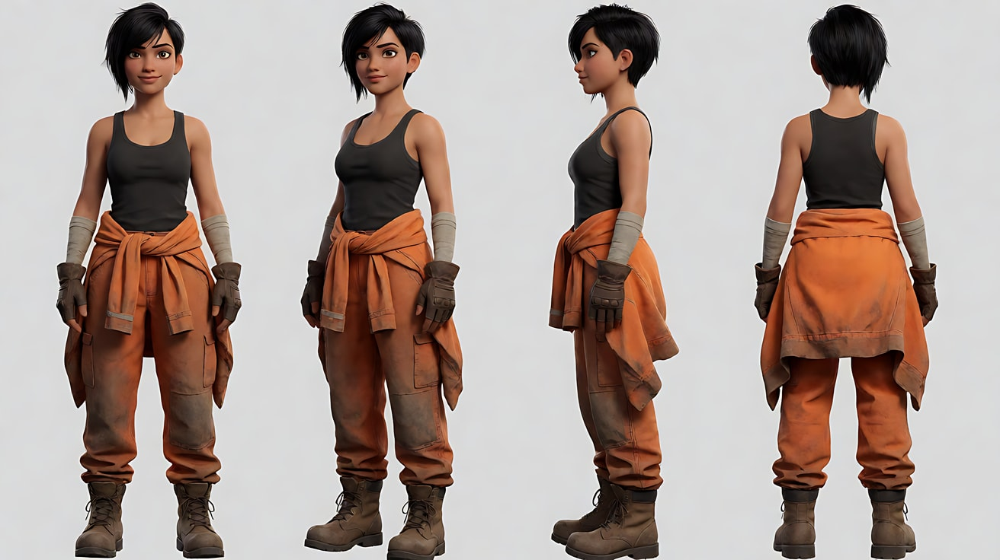

图2 场景：

```
Empty space under a concrete highway overpass on a rainy night, an old dark-green motorcycle with a round headlamp parked on wet asphalt,
a toolbox open beside it, rain falling at the edge of the overpass like a curtain, distant city lights beyond.
Wide shot, eye level, 35mm anamorphic lens look, f/2.8, the distant city lights rendered as vertically oval bokeh.
Lighting: a single sodium street lamp from frame left casting warm orange light, cool blue city glow in the background.
Stylized semi-realistic 3D CG rendering, feature-film animation quality. Aspect ratio 21:9, 2.39:1 widescreen.
```

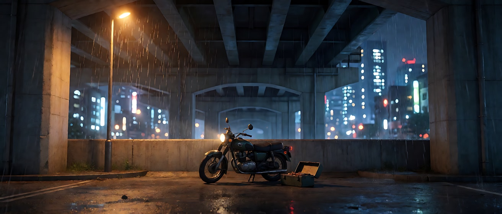

图3 镜头1关键帧（微距）：

```
Extreme macro close-up of the round headlamp of the old motorcycle, the glass lens covered in tiny raindrops,
the thin tungsten filament inside visible and dark. Camera at the same height as the headlamp, macro lens about ten centimeters away,
focus on the raindrops on the front of the glass, depth of field only a few millimeters, the chrome rim behind melting into soft orange.
Lighting: warm orange sodium street lamp from frame left reflecting as a curved highlight on the glass.
Stylized semi-realistic 3D CG rendering, feature-film animation quality. Aspect ratio 21:9, 2.39:1 widescreen.
```

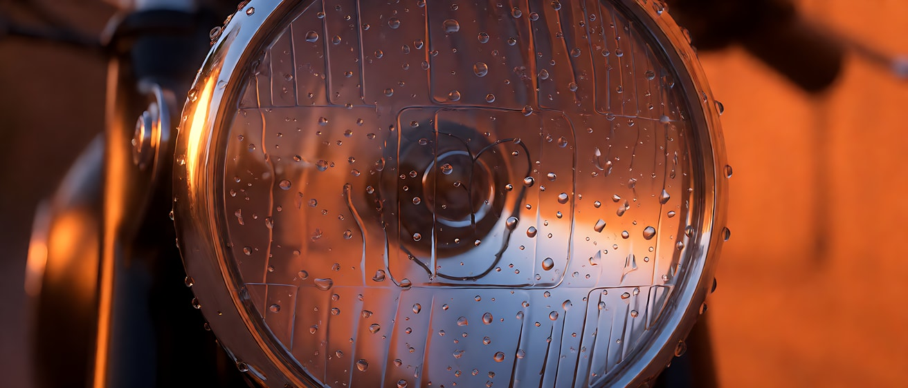

图4 镜头2关键帧：

```
Using the character from image 1 and the overpass from image 2:
a medium shot of her kneeling beside the motorcycle on the right third of the frame, turning a wrench near the engine, head tilted, concentrating.
Camera at low eye level, 50mm anamorphic lens look, f/2, shallow depth of field, focus on her face;
the distant city lights and the rain curtain behind her dissolve into vertically oval bokeh, slight barrel distortion at the frame edges.
Lighting: warm orange sodium street lamp from frame left as key, cool blue city glow behind her as rim light.
Keep the face, hairstyle and outfit exactly as in image 1.
Stylized semi-realistic 3D CG rendering, feature-film animation quality. Aspect ratio 21:9, 2.39:1 widescreen.
```

中文释义：图2 为高架桥下雨夜空场景，变形镜头质感，远处城市灯光呈竖向椭圆光斑；图3 为微距特写，焦点在车头灯玻璃的雨珠上，灯丝未亮，景深只有几毫米；图4 为她跪在摩托车旁拧扳手的中景，身后城市灯光和雨幕化成竖向椭圆光斑，画边轻微桶形畸变。全部为 21:9 宽银幕。

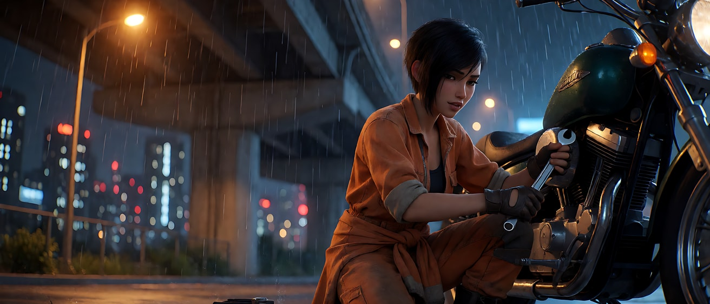

**【多图生视频 · Seedance】**

```
【素材分工】@图片1 锁定人物身份、发型、工装、手套与油污；@图片2 仅参考高架桥下的布局、摩托车外形与雨幕，不复制其中的空场；@图片3 为首帧，锁定镜头1的微距构图；@图片4 仅作为镜头2的构图与椭圆光斑参考。
【画风】风格化写实三维CG质感，电影级布光，变形宽银幕镜头质感。
镜头1：微距特写，镜头固定，焦点在车头灯玻璃的细小雨珠上，景深只有几毫米。一颗雨珠沿着玻璃缓缓滑下，灯罩里的钨丝先是暗的，然后微微泛出一点橙红色，又暗下去。雨点打在金属上的细碎声。
镜头2：镜头切至低机位中景，她跪在摩托车旁，位于画右三分之一，用扳手拧紧最后一下，抬起手背擦了一下额头，留下一道油痕。身后远处的城市灯光和雨幕化成一排竖向椭圆光斑。扳手的咔哒声，雨幕声。
镜头3：镜头切至车头正前方的低角度近景，135毫米长焦，她跨上车，拧动钥匙，圆形车头灯骤然亮起，一道细长的蓝色横向光晕从灯芯向左右两侧横贯整个画面，她的脸在灯后被映亮一半。镜头固定。发动机两声咳嗽后轰然点着的声音。
镜头4：镜头切至高架桥外的平视广角远景，24毫米，她骑着摩托车从桥下驶出，冲进雨幕，车头灯在湿地面上拖出长长的倒影，远处城市灯光仍是竖向椭圆光斑。镜头缓慢向右横摇，跟随她驶向画右，停在她的尾灯消失在雨夜里的画面上。引擎声由近及远，雨声重新占满。
【锁定】光线：画左橙色钠灯为主光，背景城市冷蓝色，镜头3起加入车头灯白光；人物始终穿橙色工装（上半身系在腰间）、黑背心、半指皮手套；摩托车始终是深绿色、圆形车头灯；全片保持变形镜头特征：竖向椭圆光斑，只在镜头3出现一次横向光晕。
【声音】雨声贯穿全片；镜头1细碎雨点，镜头2扳手声，镜头3引擎点火的轰鸣，镜头4引擎声远去、雨声回来，无配乐。
【约束】保持人物脸型、发型、服装与摩托车外形不变；车身上不出现文字或标志；不要字幕、水印、Logo。
时长：15秒
```

**参数**：时长 15 秒 ｜ 画幅 21:9 ｜ 负载：4 个镜头、无对白，属于"有挑战"档。不稳定时拆成两次：镜头1–2（8 秒）+ 镜头3–4（8 秒）

**【检查点】**
- 镜头1 的焦点是否在雨珠上，景深是否极浅
- 夜景光斑是否是竖向椭圆而不是正圆
- 横向光晕是否只在车灯亮起时出现一次，且横贯画面
- 四个镜头的焦段性格是否不同：微距凝视 → 中景陪伴 → 长焦聚焦 → 广角放归

**【常见问题与修复】**
| 现象 | 修复 |
|---|---|
| 光斑仍是圆形 | 生图时写 "vertically oval bokeh, like upright eggs"，并在视频【画风】里写"变形宽银幕镜头质感" |
| 每个镜头都有光晕，像滤镜 | 在【锁定】里写"只在镜头3出现一次横向光晕"，其他镜头不写光晕 |
| 镜头1 灯丝亮得太早或爆白 | 写"钨丝只微微泛红，又暗下去"，把亮灯留给镜头3 |
| 画面被裁成 16:9 | 在平台参数里选 21:9，生图提示词结尾写 "Aspect ratio 21:9" |
| 镜头4 横摇时摩托车变形 | 改为"镜头固定"，让她从画左驶向画右出画 |
