# L02-03 焦点转移与前景虚化 · 提示词

> 本组练习：锁定机位，只靠焦点在两个明确对象之间移动来完成注意力转移与揭示；再用前景虚化遮挡和焦外人物制造窥视与悬念。｜ 配套教学：[L02-03-焦点转移与前景虚化](../教学/L02-03-焦点转移与前景虚化.md) ｜ 规范：[写作规范](../../模板/写作规范.md)
>
> 画风默认使用开关 A（风格化写实 CG）。如改用 2D 动画，删掉所有焦段、光圈、景深词。

---

### 练习1：一碗汤与门口的人——单图焦点转移（难度 ★）

**目标**：首帧焦点在前景的汤碗上，门锁一响，焦点转移到后景门口的人。体会"机位不动、只动焦点"的注意力转移。意图：让观众感到这碗汤等的人终于回来了。

**【生图 · Nano Banana】**

图1 关键帧：

```
A medium shot inside a small, dim family dining room late at night. In the foreground at the bottom left of the frame,
about half a meter from the lens, a white ceramic bowl of soup covered with a small plate, a faint wisp of steam escaping at the edge,
on a worn wooden table, in sharp focus. In the background at the right third of the frame, about four meters away,
the apartment's front door is half open and an original middle-aged man in a dark-blue work uniform and a reflective vest
stands in the doorway, soft and blurred, only his silhouette and the vest's reflective strips readable.
Camera locked at seated eye level, 85mm lens, f/2, shallow depth of field, focus on the bowl.
Lighting: a single warm pendant lamp hanging above the table as key from the top, cool white corridor light spilling through the door from behind the man.
Stylized semi-realistic 3D CG rendering, feature-film animation quality. Aspect ratio 16:9.
```

中文释义：深夜的小餐厅，中景。前景画左下方、离镜头半米，一碗用小盘子盖着的汤，边缘冒出一丝热气，焦点清晰；后景右三分之一、约四米外，门半开，一个穿深蓝工装和反光背心的原创中年男人站在门口，虚成剪影，只看得出反光条；机位固定在坐姿高度，85mm、f/2、浅景深；桌子上方一盏暖色吊灯，门外走廊冷白光从他身后漏进来。

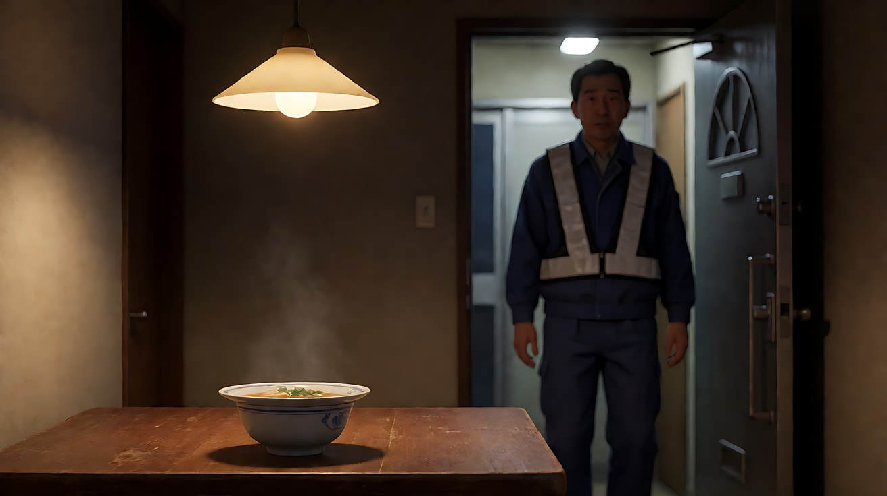

**【图生视频 · Seedance】**

```
【素材分工】@图片1 为首帧，锁定人物身份、服装、汤碗位置、门的位置与浅景深构图。
【画风】风格化写实三维CG质感，电影级布光。
画左下方前景的汤碗清晰，盖着的小盘子边缘冒出一丝淡淡的热气。门口传来钥匙在锁孔里转动的一声轻响，焦点随之从前景的汤碗缓慢转移到画右后景门口的男人身上，汤碗逐渐虚化成一团暖白色。男人变清晰后，弯腰把鞋脱下，抬起头，目光落在桌上那碗汤上，停住。镜头固定，不移动，不推近。头顶吊灯暖光不变，门外走廊冷光从他身后照进来。结尾停在他站在门口、望向汤碗的画面上。
【声音】深夜的安静，冰箱低鸣，钥匙转动的轻响，鞋子落在地垫上的闷声，无配乐。
【约束】保持人物脸型、服装不变；汤碗形状和位置不变；整个镜头只转一次焦；不要字幕、水印、Logo。
时长：6秒
```

**参数**：时长 6 秒 ｜ 画幅 16:9

**【检查点】**
- 开头是否只有汤碗清楚、男人是虚的
- 焦点转移是否发生在钥匙声之后，速度是否平缓
- 转焦后汤碗是否真的虚掉了

**【常见问题与修复】**
| 现象 | 修复 |
|---|---|
| 汤碗和男人一直都清楚 | 首帧光圈改为 f/1.8，并把汤碗再拉近（about 0.4 meters from the lens） |
| 镜头往门口推过去 | 写"镜头固定，不移动，不推近，只有焦点在移动" |
| 男人直接走到桌边 | 加"他停在门口，没有走进来" |
| 热气变成浓烟 | 写"一丝淡淡的热气"，或干脆删掉热气 |

---

### 练习2：书架缝隙里的她——前景虚化窥视（难度 ★★）

**目标**：用虚化的书架前景挡住画面左右两侧，只留中间一道缝隙看她。意图：让观众感到有人在偷偷喜欢她，而她似乎察觉到了。

**【生图 · Nano Banana】**

图1 角色定妆：

```
Character turnaround sheet of an original female university student around twenty: long black hair with straight bangs,
round tortoiseshell glasses, an oversized cream cable-knit cardigan over a pale-pink blouse, a long brown pleated skirt, a canvas tote bag.
Front view, three-quarter view, side view and back view, full body, plain light-grey background.
Camera at eye level, 50mm lens, deep focus, even soft studio light from the front.
Stylized semi-realistic 3D CG rendering, feature-film animation quality. Aspect ratio 16:9.
```

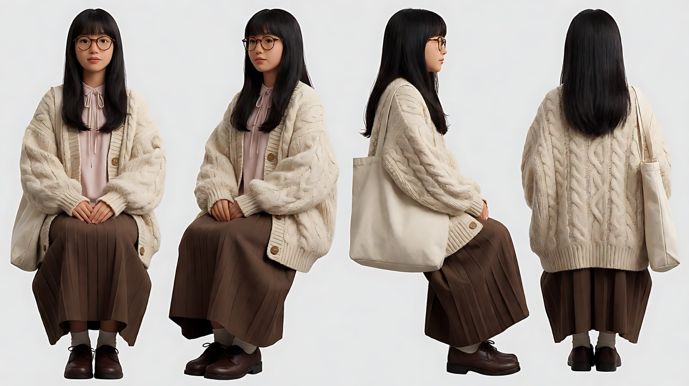

图2 场景：

```
Empty old university library reading room on a sunny afternoon, rows of tall dark wooden bookshelves,
a long reading table with green banker's lamps by a large arched window, dust floating in the sunbeams, no people.
Medium-wide shot from between two bookshelves looking toward the reading table, eye level, 85mm lens, f/2,
the book spines on both sides in the foreground out of focus.
Lighting: warm afternoon sunlight streaming through the arched window from frame right, soft green lamp glow on the table.
Stylized semi-realistic 3D CG rendering, feature-film animation quality. Aspect ratio 16:9.
```


图3 关键帧：

```
Using the character from image 1 and the library from image 2:
a medium shot of her sitting at the reading table reading a thick book, seen through a narrow vertical gap between books on a shelf.
Dark out-of-focus book spines cover the left third and the right quarter of the frame in the foreground,
she is sharp in the remaining vertical strip in the center.
Camera at standing eye level hidden behind the shelf, 85mm lens, f/2, shallow depth of field, focus on her face.
Lighting: warm sunlight from the arched window on frame right as key on her hair and cheek, dust drifting in the beam, soft green lamp glow from below.
Keep the face, hairstyle and outfit exactly as in image 1.
Stylized semi-realistic 3D CG rendering, feature-film animation quality. Aspect ratio 16:9.
```

中文释义：图3 为关键帧，透过书架上两摞书之间的竖直缝隙看她读书；左侧三分之一和右侧四分之一被深色、虚化的书脊挡住；85mm、f/2，焦点在她脸上；画右拱形窗暖阳为主光，光柱里有灰尘。

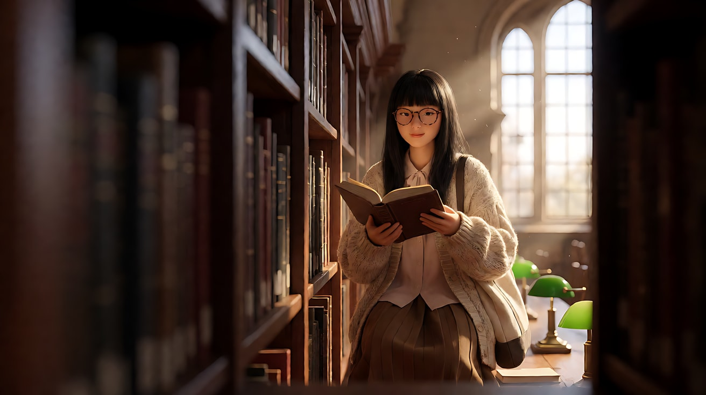

**【多图生视频 · Seedance】**

```
【素材分工】@图片1 锁定人物身份、眼镜、发型与开衫；@图片2 仅参考图书馆布局与窗光，不复制其中的空桌；@图片3 为首帧，锁定前景书脊遮挡的位置、比例与虚化程度。
【画风】风格化写实三维CG质感，电影级布光。
透过书架缝隙，她低头读书，用手指把垂下来的头发别到耳后，翻过一页。她停了一下，慢慢抬起头，透过眼镜看向镜头所在的书架方向，与镜头对视了一瞬，又低下头，嘴角轻轻弯了一下。镜头固定，藏在书架后不移动。前景两侧的书脊始终虚化并挡住画面左右两侧，焦点始终在她的脸上。画右窗外暖阳照在她的头发和脸颊上，光柱里的灰尘缓慢飘动。结尾停在她低头、嘴角微弯的画面上。
【声音】图书馆的安静，翻书页的沙沙声，远处一声椅子轻轻挪动，窗外隐约的鸟叫，无配乐。
【约束】保持人物脸型、发型、眼镜、服装不变；前景书脊遮挡位置不变；书页上的字迹模糊不可读；不要字幕、水印、Logo。
时长：8秒
```

**参数**：时长 8 秒 ｜ 画幅 16:9

**【检查点】**
- 前景书脊是否始终虚化、始终挡在两侧
- 观众是否有"躲在书架后偷看"的感觉
- 她抬眼看镜头的那一瞬是否清楚，回到低头时是否带一点笑意

**【常见问题与修复】**
| 现象 | 修复 |
|---|---|
| 书脊变清晰，书名文字出现 | 写"前景书脊始终虚化，看不清任何文字"，首帧里光圈保持 f/2 |
| 镜头从缝隙里钻出去 | 写"镜头藏在书架后，不移动，不穿过书架" |
| 她一直盯着镜头 | 写"对视一瞬后立刻低下头" |
| 遮挡比例太大，看不清她 | 在首帧把遮挡改为 "the left quarter and the right fifth of the frame" |

---

### 练习3：后台门口的人——首尾帧揭示型焦点转移（难度 ★★★）

**目标**：首帧焦点在前景她的脸上，后景门口的人是虚的；尾帧构图完全相同，焦点转到门口的人身上，她变虚。只生成两帧之间的转焦。意图：让观众感到多年没见的人，就站在她身后。

**【生图 · Nano Banana】**

图1 角色定妆（两位原创角色）：

```
Character turnaround sheet of two original characters:
a stage actress in her late twenties with her long dark hair pinned up, light stage makeup, wearing a simple white silk dressing robe;
and her younger brother in his early twenties with short messy light-brown hair, a navy hooded parka over a grey sweatshirt, holding a small bouquet of yellow freesias.
Front view, three-quarter view and side view of each, full body, plain light-grey background.
Camera at eye level, 50mm lens, deep focus, even soft studio light from the front.
Stylized semi-realistic 3D CG rendering, feature-film animation quality. Aspect ratio 16:9.
```

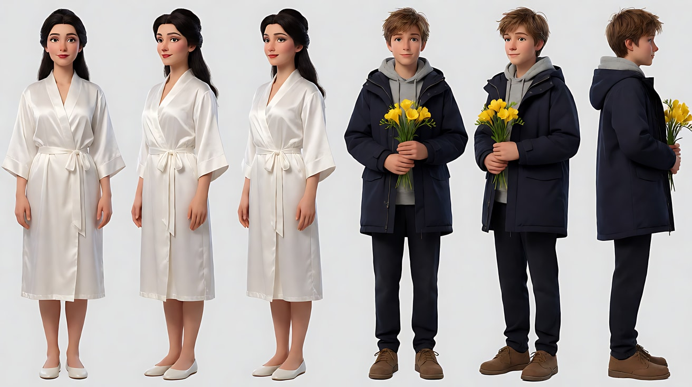

图2 首帧：

```
Using the characters from image 1: a backstage dressing room after a performance.
In the foreground on the right half of the frame, a close-up of the actress in three-quarter profile facing frame left,
removing her makeup with a cotton pad, about one meter from the lens, in sharp focus.
In the background on the left third, about four meters away, the dressing room door is open and her brother stands in the doorway holding the yellow bouquet,
completely soft and blurred, only a navy shape with a spot of yellow.
Camera locked at seated eye level, 85mm lens, f/1.8, shallow depth of field, focus on the actress's eyes.
Lighting: a row of warm bulbs around the mirror off frame right as key on her face, dim cool corridor light behind the brother.
Keep the faces, hairstyles and outfits exactly as in image 1.
Stylized semi-realistic 3D CG rendering, feature-film animation quality. Aspect ratio 16:9.
```

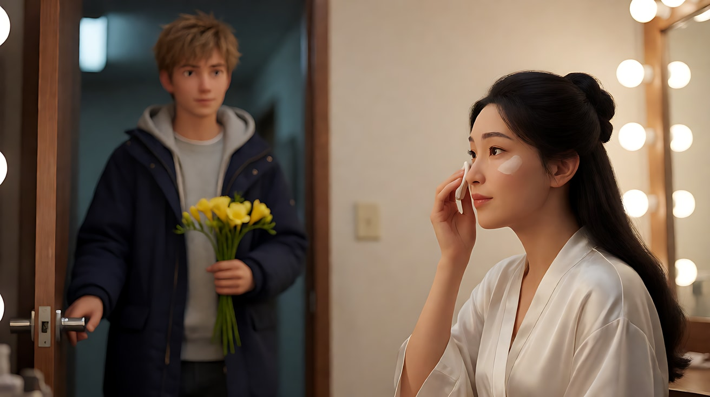

图3 尾帧：

```
Using the characters from image 1 and the exact same camera position, framing, lens and lighting as image 2:
the actress in the foreground right has stopped moving, the cotton pad held still near her cheek, now soft and blurred;
the focus has shifted to her brother in the doorway on the left third, now sharp: he holds the yellow freesias in front of his chest,
looking toward her with an uncertain small smile.
85mm lens, f/1.8, shallow depth of field, focus on the brother's face.
Keep the faces, hairstyles and outfits exactly as in image 1.
Stylized semi-realistic 3D CG rendering, feature-film animation quality. Aspect ratio 16:9.
```

中文释义：首帧前景画右是女演员的近景，正在卸妆，焦点清晰；后景画左门口站着弟弟，捧着黄色小苍兰，虚成一团深蓝和一点黄色。尾帧机位、构图、光线完全相同，她的手停在脸边，变虚；焦点转到门口的弟弟脸上，他把花捧在胸前，带着不确定的微笑看着她。

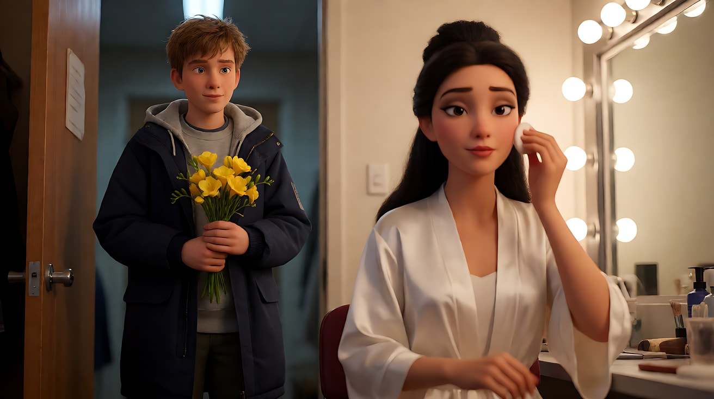

**【首尾帧生视频 · Seedance】**

```
【素材分工】@图片2 为首帧；@图片3 为尾帧，是最终画面目标；@图片1 仅锁定两位人物的身份、发型与服装，不参考其中的灰色背景。只生成两帧之间的连续变化。
【画风】风格化写实三维CG质感，电影级布光。
前景画右的女演员用化妆棉擦拭脸颊，动作忽然停住，化妆棉停在脸边，她没有回头。焦点从她的脸缓慢转移到画左后景门口的弟弟身上，她逐渐虚化，弟弟逐渐清晰。弟弟把黄色小苍兰捧到胸前，嘴角露出一个不确定的微笑。镜头固定，不移动，不推近。镜子灯泡的暖光从画右照在她脸上，门外走廊冷光在弟弟身后。
【声音】化妆间里空调低鸣，化妆棉擦过皮肤的细微声音停下，门口包装纸轻微的窸窣声，远处舞台方向隐约的掌声余响，无配乐。
【约束】保持两人脸型、发型、服装不变；两人的位置不变，弟弟不走进房间；只转一次焦；动作连续，不跳切；不要字幕、水印、Logo。
时长：6秒
```

**参数**：时长 6 秒 ｜ 画幅 16:9

**【检查点】**
- 首帧到尾帧，两人的位置和构图是否完全没变
- 焦点转移是否是"渐变"，而不是一帧切换
- 她停住的动作是否发生在转焦之前（先察觉，再揭示）

**【常见问题与修复】**
| 现象 | 修复 |
|---|---|
| 生成成两个镜头的硬切 | 写"一镜到底，焦点连续地从前景移到后景" |
| 弟弟走进房间 | 写"弟弟始终站在门口，不迈步" |
| 她回头看弟弟 | 写"她没有回头，始终面朝画左"；回头留到下一个镜头 |
| 尾帧两人都清晰 | 尾帧生图时写 "she is now completely soft and blurred"，光圈保持 f/1.8 |

---

### 练习4：渡轮上的告别——对话中的关系型转焦（难度 ★★★★）

**目标**：三镜头对话，镜头2 是过肩镜头，前景他的肩膀虚化、后景她清晰；她说完最后一句，焦点转到前景他的侧脸上，看他的反应。意图：让观众感到这句话真正落在了他身上。

**【生图 · Nano Banana】**

图1 角色定妆（两位原创角色）：

```
Character turnaround sheet of two original characters in their early thirties:
a woman with a short pixie haircut, a long red wool coat, a black turtleneck, a cream scarf;
and a man with medium-length wavy black hair tied back, a grey peacoat, a dark-green knitted scarf, a small duffel bag.
Front view, three-quarter view and side view of each, full body, plain light-grey background.
Camera at eye level, 50mm lens, deep focus, even soft studio light from the front.
Stylized semi-realistic 3D CG rendering, feature-film animation quality. Aspect ratio 16:9.
```

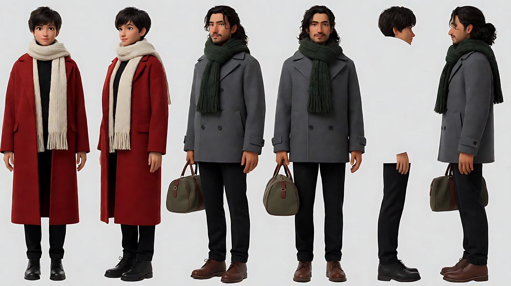

图2 场景：

```
Empty open deck of a small ferry on a grey winter afternoon, white painted railings, a wooden bench, life rings on the wall,
the sea and a distant harbor city behind, seagulls far away, no people.
Medium-wide shot, eye level, 35mm lens, f/5.6.
Lighting: soft overcast daylight from above and slightly from frame left, cool silver reflections on the water.
Stylized semi-realistic 3D CG rendering, feature-film animation quality. Aspect ratio 16:9.
```

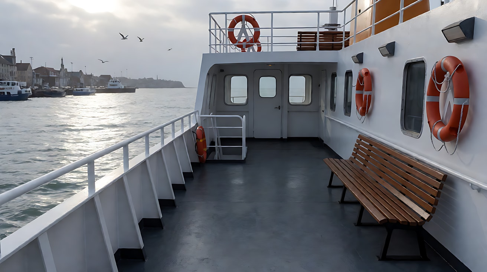

图3 镜头2关键帧（过肩）：

```
Using the characters from image 1 and the ferry deck from image 2:
an over-the-shoulder medium close-up. In the foreground on the left third, the back of the man's head, his tied-back hair and grey peacoat shoulder,
out of focus and dark, about 0.7 meters from the lens. On the right half, about two meters away, the woman faces him and the camera,
leaning on the railing, in sharp focus.
Camera locked at standing eye level, 85mm lens, f/2, shallow depth of field, focus on the woman's eyes.
Lighting: soft overcast daylight from frame left, cool silver sea behind her.
Keep the faces, hairstyles and outfits exactly as in image 1.
Stylized semi-realistic 3D CG rendering, feature-film animation quality. Aspect ratio 16:9.
```

中文释义：镜头2 为过肩中近景，前景画左是男人虚化的后脑与肩膀，离镜头约 0.7 米；画右约两米外是女人，倚着栏杆面向他，焦点清晰；85mm、f/2；阴天柔光从画左来。

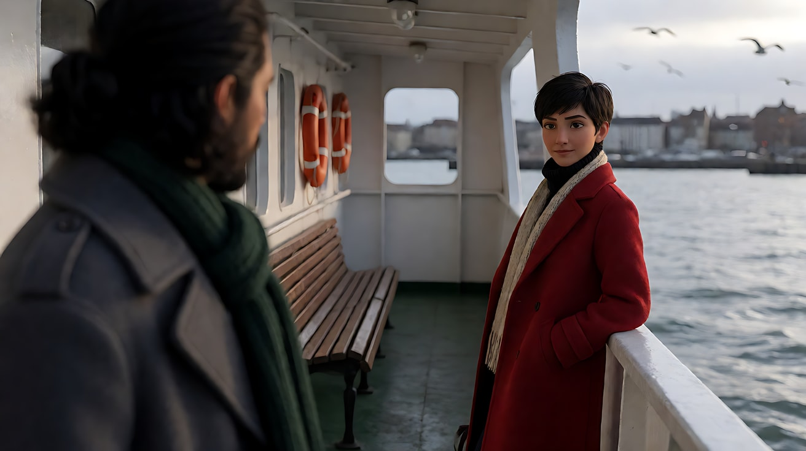

**【多图生视频 · Seedance】**

```
【素材分工】@图片1 锁定两位人物的身份、发型与服装；@图片2 仅参考渡轮甲板布局与阴天光线，不复制其中的空景；@图片3 为镜头2的构图与焦点参考。
【画风】风格化写实三维CG质感，电影级布光。
镜头1：平视中全景双人镜头，镜头固定。男人在画左，女人在画右，两人倚着白色栏杆并排站着，中间隔着一臂距离，身后是灰色海面和远处的港口。男人把行李包从肩上放到脚边。海浪拍打船身声，远处海鸥叫，渡轮发动机低鸣。
镜头2：镜头切至过肩中近景，前景画左是男人虚化的后脑与肩膀，焦点在画右的女人脸上。女人看着他，平静地说："到了那边，就别再回来了。"说完，焦点从她的脸缓慢转移到前景男人的侧脸上，她随之虚化，男人的侧脸变清晰，他的下颌收紧了一下，没有说话。镜头固定，不移动。
镜头3：镜头切至男人的正面近景，他身后的海面和港口虚化，海风吹动他的围巾。他低下头，又抬起来看向画右的她，长出一口气，点了一下头。镜头固定，停在他点头后的脸上。只剩风声和发动机低鸣。
【锁定】光线：阴天柔光始终从画左照来，海面冷银色；男人始终在画左、面朝画右，女人始终在画右、面朝画左；机位始终在两人同一侧；女人穿红色长大衣，男人穿灰色呢大衣、深绿围巾。
【声音】海浪、海鸥、渡轮发动机贯穿全片；镜头2女人的台词清晰、语速平缓；镜头3声音变稀，只剩风声；无配乐。
【约束】保持两人脸型、发型、服装不变；只有镜头2中的女人说话；两人没有肢体接触；不要字幕、水印、Logo。
时长：12秒
```

**参数**：时长 12 秒 ｜ 画幅 16:9 ｜ 负载：3 个镜头、1 句对白、镜头内 1 次转焦，属于"稳妥"偏"有挑战"档

**【检查点】**
- 镜头2 开头焦点是否在她身上，台词说完后是否转到他的侧脸
- 两人在三个镜头里是否始终一左一右，没有越轴
- 他的反应是否靠下颌、低头、点头这些动作表现，而不是说话

**【常见问题与修复】**
| 现象 | 修复 |
|---|---|
| 镜头2 一直没有转焦 | 把"说完，焦点从她的脸缓慢转移到前景男人的侧脸上"单独成句，并写"她随之虚化" |
| 男人在镜头2 转过头露出正脸 | 写"男人始终背对镜头，只露出侧脸轮廓" |
| 镜头3 男人开口说话 | 在约束里写"只有镜头2中的女人说话"，镜头3 写"他没有说话" |
| 两人位置在镜头3 互换 | 在【锁定】里写左右位置和朝向，并写"机位始终在两人同一侧" |

---

### 练习5：玻璃门外的人影——焦外人物与揭示（难度 ★★★★★）

**目标**：四镜头悬疑段落。前两个镜头让后景玻璃门外有一个**焦外人影**，观众看得到、她看不到；镜头3 用焦点转移揭示人影；镜头4 是她的反应。意图：让观众感到她以为店里只有自己，其实一直有人在外面看着。

**【生图 · Nano Banana】**

图1 角色定妆（店员）：

```
Character turnaround sheet of an original convenience store clerk in her early twenties: a short black bob with a hair clip,
a green-and-white striped store uniform shirt with a plain name tag that has no text, black trousers, white sneakers.
Front view, three-quarter view, side view and back view, full body, plain light-grey background.
Camera at eye level, 50mm lens, deep focus, even soft studio light from the front.
Stylized semi-realistic 3D CG rendering, feature-film animation quality. Aspect ratio 16:9.
```

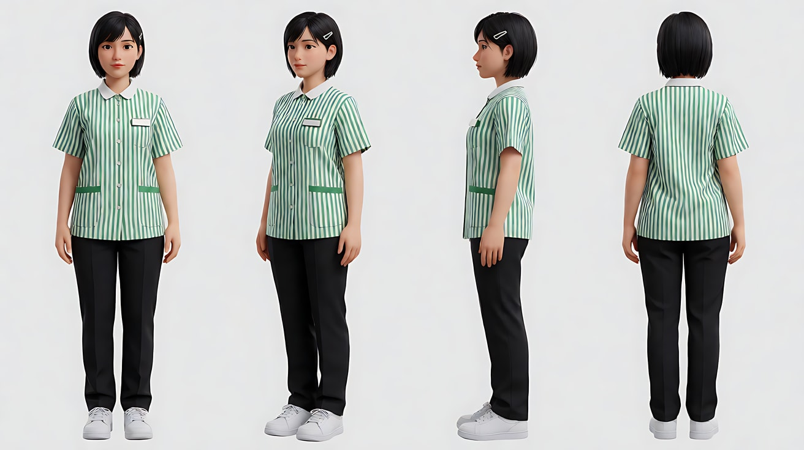

图2 角色定妆（门外的人）：

```
Character turnaround sheet of an original tall elderly man in his sixties: thin grey hair, a long dark-olive raincoat buttoned to the neck,
holding a large closed black umbrella, worn leather shoes, a calm unreadable expression.
Front view, three-quarter view, side view and back view, full body, plain light-grey background.
Camera at eye level, 50mm lens, deep focus, even soft studio light from the front.
Stylized semi-realistic 3D CG rendering, feature-film animation quality. Aspect ratio 16:9.
```

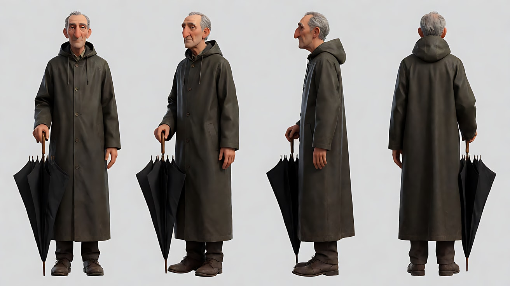

图3 场景：

```
Empty small 24-hour convenience store at three in the morning, bright white ceiling lights, rows of snack shelves and a glowing drinks fridge on the right,
a glass entrance door at the far end with rain streaking down it, the dark wet street outside, no people.
Medium-wide shot from the back of the store toward the entrance, eye level, 50mm lens, f/4.
Lighting: flat cold white fluorescent light inside, a cool blue-green glow from the fridge on frame right, darkness and rain outside the glass door.
Stylized semi-realistic 3D CG rendering, feature-film animation quality. Aspect ratio 16:9.
```

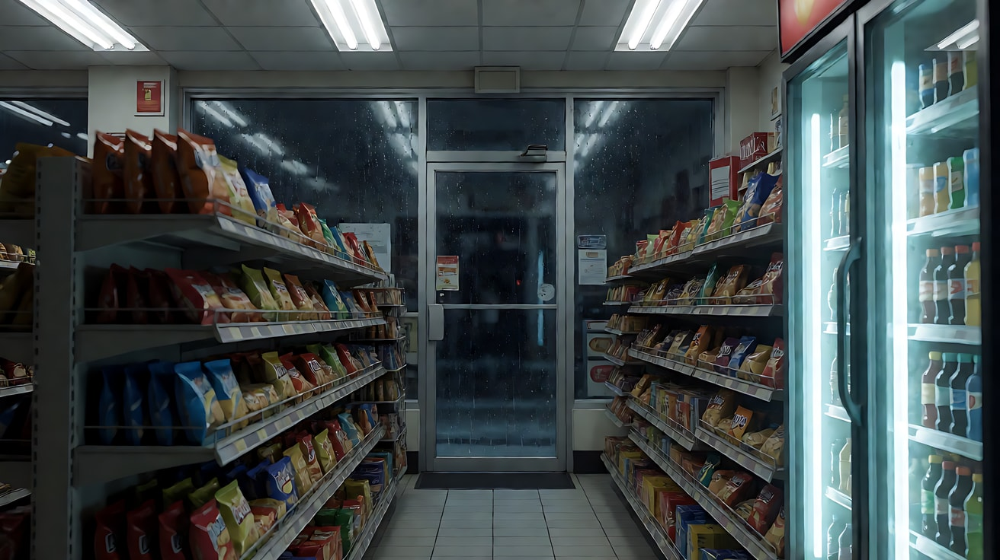

图4 镜头1关键帧：

```
Using the clerk from image 1, the man from image 2 and the store from image 3:
a medium shot of the clerk in the foreground on the left third, in profile facing frame right, stacking canned drinks onto a shelf, in sharp focus, about 1.5 meters from the lens.
Far in the background on the right third, about eight meters away, beyond the rain-streaked glass door, the tall man in the raincoat stands outside on the street,
heavily out of focus, only a dark vertical silhouette.
Camera locked at eye level, 85mm lens, f/1.8, shallow depth of field, focus on the clerk.
Lighting: cold white fluorescent ceiling light on the clerk from above, blue-green fridge glow from frame right, darkness outside.
Keep the faces, hairstyles and outfits exactly as in images 1 and 2.
Stylized semi-realistic 3D CG rendering, feature-film animation quality. Aspect ratio 16:9.
```

中文释义：图4 为镜头1首帧。前景画左是店员侧身理货，焦点清晰；画右远处约八米外、挂着雨痕的玻璃门外，雨衣老人站在街上，严重虚化，只剩一个深色竖直剪影；85mm、f/1.8；店内冷白顶光，冰柜蓝绿光从画右来。

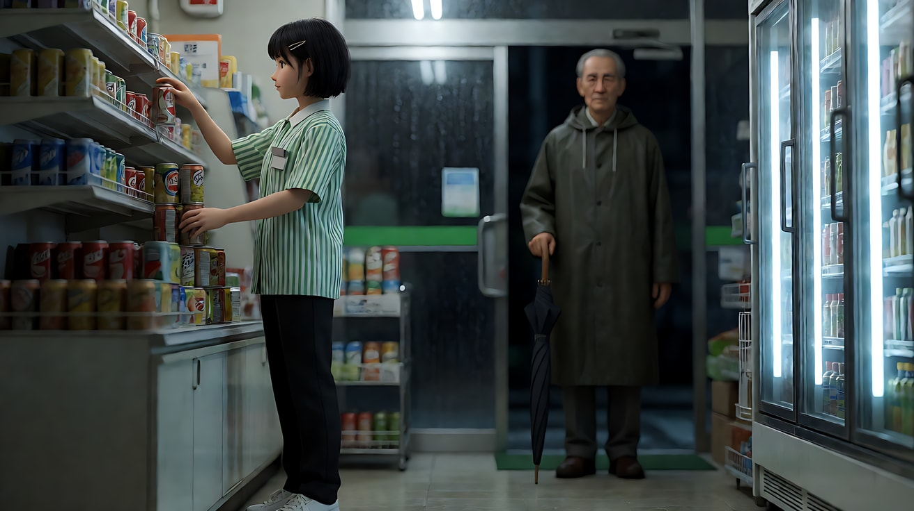

**【多图生视频 · Seedance】**

```
【素材分工】@图片1 锁定店员身份、发型与制服；@图片2 锁定门外老人的身份、雨衣与黑伞；@图片3 仅参考便利店布局与光线，不复制其中的空店；@图片4 为首帧，锁定镜头1构图、焦点位置与焦外人影的位置。
【画风】风格化写实三维CG质感，电影级布光。
镜头1：固定中景，焦点在前景画左的店员身上，她侧身把饮料罐一罐罐码上货架。画右远处的玻璃门外，一个虚化的深色高个人影站在雨里，一动不动。她没有察觉。冰柜压缩机的嗡鸣，饮料罐碰在金属货架上的叮当声，门外的雨声。
镜头2：镜头切至店员侧脸的近景，焦点在她脸上，画右后景的玻璃门仍然虚化，那个深色人影比刚才离门近了一步。她低声哼着一段没有歌词的旋律，打了个哈欠。冰柜嗡鸣，哼唱声。
镜头3：镜头切回与镜头1相同的固定中景。她手里的动作停住，拿着一罐饮料没有放上货架。焦点从她身上缓慢转移到画右后景的玻璃门外，她逐渐虚化，门外的人影变清晰：一个穿深橄榄色长雨衣的高个子老人，手里握着收起的黑伞，雨水顺着伞尖滴落，他平静地看着店里。镜头固定，不移动。哼唱声停下，只剩雨声和冰柜嗡鸣。
镜头4：镜头切至店员的正面近景，她身后的货架虚化。她慢慢转过头，看向画右门口的方向，手里还握着那罐饮料，指节收紧，呼吸停了一拍。镜头固定，停在她看向门口的半侧脸上。门上的感应铃轻轻响了一声。
【锁定】光线：店内冷白顶光，冰柜蓝绿光始终在画右，门外是黑暗与雨；店员始终在画左或画中、面朝画右，门口始终在画右；老人始终站在门外，不进店；镜头1到镜头2老人是虚化剪影，只在镜头3焦点转移后变清晰。
【声音】冰柜嗡鸣与雨声贯穿全片；镜头2有轻轻的哼唱；镜头3哼唱停止；镜头4结尾一声门铃；无配乐。
【约束】保持两人脸型、发型、服装不变；老人不进入店内，不做任何动作，只是站着；店员名牌上没有文字；不要字幕、水印、Logo。
时长：15秒
```

**参数**：时长 15 秒 ｜ 画幅 16:9 ｜ 负载：4 个镜头、镜头内 1 次转焦、无对白，属于"有挑战"档。不稳定时拆成两次：镜头1–2（8 秒）+ 镜头3–4（8 秒），第二次用第一次的末帧做首帧

**【检查点】**
- 镜头1–2 老人是否一直是虚的剪影，观众能看到、她没看到
- 镜头3 的焦点转移是否在她停住动作之后发生
- 镜头3 老人变清晰后是否静止不动，平静而不狰狞
- 镜头4 是否只靠转头、指节收紧、呼吸停顿来表现惊觉

**【常见问题与修复】**
| 现象 | 修复 |
|---|---|
| 镜头1 老人就很清晰 | 首帧写 "heavily out of focus, only a dark vertical silhouette"，光圈 f/1.8，老人距离写远到八米 |
| 老人推门进店 | 在约束和【锁定】里都写"老人始终站在门外，不进店"；门铃声改为"远处一声汽车鸣笛" |
| 镜头3 变成推镜冲向门口 | 写"镜头固定，不移动，只有焦点在移动" |
| 老人表情变得夸张吓人 | 写"他表情平静，没有表情变化"，删掉任何形容他危险的词 |
| 镜头4 她尖叫或扔掉饮料 | 写"她没有出声，手里的饮料始终握着" |
