# L02-04 深焦与多层调度 · 提示词

> 本组练习：用广角 + 小光圈让前景、中景、后景同时清晰，并在三层之间安排人物、视线与纵深走位，让一个画面同时讲几件事。｜ 配套教学：[L02-04-深焦与多层调度](../教学/L02-04-深焦与多层调度.md) ｜ 规范：[写作规范](../../模板/写作规范.md)
>
> 画风默认使用开关 A（风格化写实 CG）。如改用 2D 动画，删掉所有焦段、光圈、景深词。

---

### 练习1：慢棋与快风筝——三层深焦单图生视频（难度 ★）

**目标**：先学会搭一个"三层都清楚"的画面：前景棋盘、中景下棋的老人、后景公园里放风筝的孩子。视频里只让中景动一下，后景保持循环小动作。意图：让观众感到老人的棋下得很慢，而外面的世界跑得很快。

**【生图 · Nano Banana】**

图1 关键帧：

```
A wide shot in a quiet old park pavilion on a windy spring afternoon, three layers all in sharp focus.
Foreground: a wooden Chinese chess board with round pieces on a stone table at the bottom left of the frame, about 0.6 meters from the lens.
Middle ground: an original elderly man in his seventies with a white crew cut, a navy Mao-collar jacket and cloth shoes, sitting at the stone table
on the center-left about three meters away, one hand on his knee, studying the board.
Background: beyond the pavilion's open arch on the right third, about twenty meters away, a small child in a red jacket runs across the grass
pulling a kite string, a bright yellow kite high in the sky.
Camera at seated eye level, 24mm lens, f/11, deep focus: the chess pieces, the old man's face and the running child are all sharp.
Lighting: soft warm afternoon sun from frame right falling across the grass outside, cooler shade inside the pavilion, the outside noticeably brighter.
Stylized semi-realistic 3D CG rendering, feature-film animation quality. Aspect ratio 16:9.
```

中文释义：远景，公园凉亭，三层全部清晰。前景：画左下石桌上的象棋盘，离镜头 0.6 米；中景：画面中偏左约三米外，原创老人坐着看棋；后景：右三分之一的拱门外约二十米，穿红衣的小孩拉着风筝线跑过草地，黄色风筝高飞；坐姿视线高度、24mm、f/11 深焦；画右暖阳照在亭外草地上，亭内是较冷的阴影，外面明显更亮。

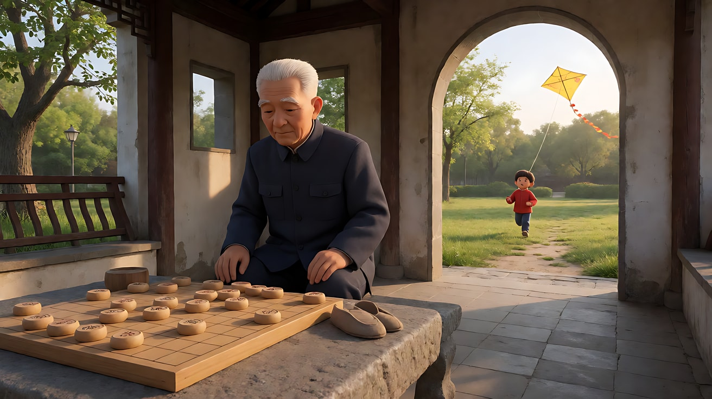

**【图生视频 · Seedance】**

```
【素材分工】@图片1 为首帧，锁定人物身份、服装、三层空间布局与深焦效果。
【画风】风格化写实三维CG质感，电影级布光。
前景的棋盘、中景的老人和后景草地上的孩子始终全部清晰。老人盯着棋盘想了很久，慢慢伸出手，捏起一枚棋子，在半空停了一下，轻轻放下，又把手收回膝上。后景拱门外，红衣小孩拉着风筝线来回奔跑，黄色风筝在风里上下飘动。镜头固定，不移动。亭外暖阳明亮，亭内阴影偏冷。结尾停在老人重新看着棋盘、远处风筝高飞的画面上。
【声音】风吹过凉亭的呼呼声，棋子落在木棋盘上清脆的一声，远处孩子隐约的笑声，几声鸟叫，无配乐。
【约束】保持人物脸型、服装不变；前中后景始终清晰，不虚化；孩子始终在拱门外，不跑进凉亭；棋子上的字模糊不可读；不要字幕、水印、Logo。
时长：6秒
```

**参数**：时长 6 秒 ｜ 画幅 16:9

**【检查点】**
- 三层是否同时清晰，后景孩子是否没有被虚化
- 主动作是否只有老人放棋子，孩子只是循环奔跑
- 亭外亮、亭内暗的对比是否把视线引到后景

**【常见问题与修复】**
| 现象 | 修复 |
|---|---|
| 后景孩子被虚化成色块 | 首帧写 "the running child is sharp and readable"，视频约束写"前中后景始终清晰，不虚化" |
| 棋子上出现错乱文字 | 写"棋子上的字模糊不可读"，或棋盘不正对镜头 |
| 孩子跑进凉亭 | 写"孩子始终在拱门外的草地上" |
| 老人一直不动 | 动作只写一个"捏起一枚棋子、放下"，并加呼吸与眨眼 |

---

### 练习2：小面馆的一家三口——三层人物调度（难度 ★★）

**目标**：三个人物分占三层并左右错开，用一次"视线连接"把三层串起来。意图：让观众感到这一家人各忙各的，却都在彼此的视线里。

**【生图 · Nano Banana】**

图1 角色定妆（三位原创角色）：

```
Character turnaround sheet of an original family of three:
the mother in her forties with a low bun and a red floral apron over a grey long-sleeve top;
the father in his late forties, stocky, with a buzz cut, a white sleeveless undershirt and a white towel over his shoulder;
the son around ten with a bowl haircut, a blue-and-white school tracksuit and a red scarf.
Front view, three-quarter view and side view of each, full body, plain light-grey background.
Camera at eye level, 50mm lens, deep focus, even soft studio light from the front.
Stylized semi-realistic 3D CG rendering, feature-film animation quality. Aspect ratio 16:9.
```

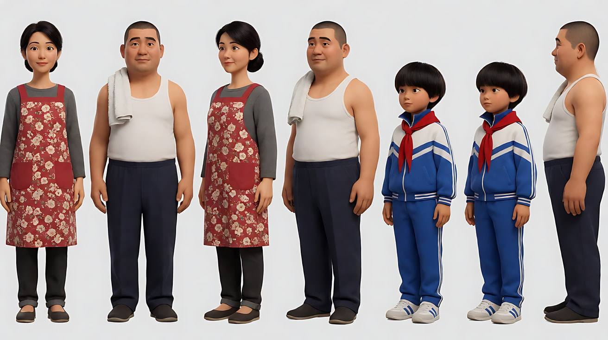

图2 场景：

```
Empty small family noodle shop in the evening, a cashier counter by the entrance in the foreground,
four square tables with stools in the middle, an open kitchen doorway at the far back with a big steaming pot on the stove,
handwritten paper menus on the walls (blank, no readable text), no people.
Wide shot from just behind the cashier counter, eye level, 24mm lens, f/11, deep focus from the counter to the kitchen.
Lighting: warm tungsten bulbs above the tables, bright white light and steam in the kitchen doorway at the back, blue dusk outside the front window on frame left.
Stylized semi-realistic 3D CG rendering, feature-film animation quality. Aspect ratio 16:9.
```

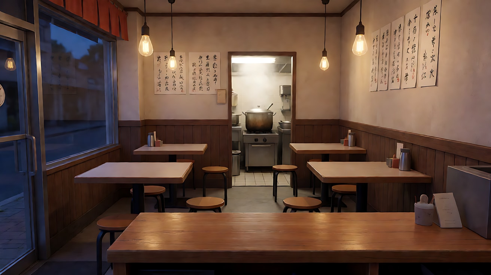

图3 关键帧：

```
Using the characters from image 1 and the noodle shop from image 2, three layers all in sharp focus:
Foreground on the right third, about one meter from the lens: the mother at the cashier counter in profile facing frame left, counting coins into a tin box.
Middle ground at the center-left, about four meters away: the son sitting at a table doing homework, head down, pencil in hand.
Background on the right, about eight meters away, framed by the bright kitchen doorway: the father stirring noodles in the big steaming pot.
Camera at standing eye level behind the counter, 24mm lens, f/11, deep focus: the coins, the son's pencil and the father's face are all sharp.
Lighting: warm tungsten bulbs above the tables, bright white kitchen light and steam behind the father, blue dusk through the front window on frame left.
Keep the faces, hairstyles and outfits exactly as in image 1.
Stylized semi-realistic 3D CG rendering, feature-film animation quality. Aspect ratio 16:9.
```

中文释义：三层全部清晰。前景画右约一米：母亲在收银台侧身数硬币；中景画面中偏左约四米：儿子低头写作业；后景画右约八米，被明亮的厨房门框住：父亲在大锅前搅面。24mm、f/11；餐桌上方暖色灯泡，厨房门里白光和蒸汽，画左前窗外蓝色暮色。

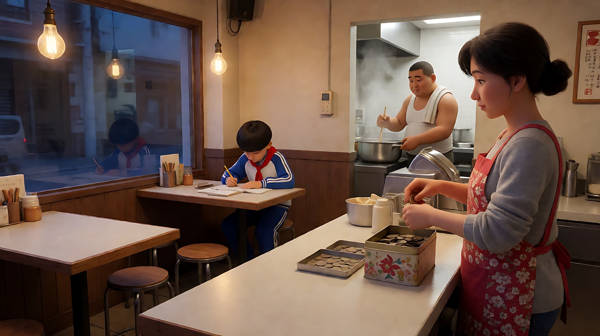

**【多图生视频 · Seedance】**

```
【素材分工】@图片1 锁定三位人物的身份、发型与服装；@图片2 仅参考面馆布局与陈设，不复制其中的空店；@图片3 为首帧，锁定三层人物位置与深焦效果。
【画风】风格化写实三维CG质感，电影级布光。
前景、中景、后景始终全部清晰。中景的儿子停下笔，抬起头，越过桌子望向后景厨房门里的父亲；父亲正把面捞进碗里，蒸汽腾起，他没有察觉儿子的目光。儿子看了一会儿，又低下头继续写字。前景母亲一直在数硬币，数到一半停顿一下，侧过眼瞟了儿子一眼，又继续数。镜头固定，不移动。餐桌上方暖光，厨房白光和蒸汽在后景，前窗外是蓝色暮色。结尾停在儿子低头写字、父亲端起面碗的画面上。
【声音】大锅沸水的咕嘟声，硬币落进铁盒的叮当声，铅笔在纸上的沙沙声，门外远处的自行车铃声，无配乐。
【约束】保持三人脸型、发型、服装不变；三人不说话，不离开各自位置；墙上菜单没有可读文字；不要字幕、水印、Logo。
时长：8秒
```

**参数**：时长 8 秒 ｜ 画幅 16:9

**【检查点】**
- 三人是否左右错开（前景画右、中景偏左、后景画右），没有互相遮挡
- 儿子的视线是否把中景和后景连起来，母亲的一瞥是否把前景和中景连起来
- 主动作是否集中在儿子身上，父母只做循环的小动作

**【常见问题与修复】**
| 现象 | 修复 |
|---|---|
| 后景父亲被虚化 | 首帧写 "the father's face is sharp"，视频开头写"前景、中景、后景始终全部清晰" |
| 三人同时做大动作，画面乱 | 只给儿子写"抬头—看—低头"，父母写成循环小动作 |
| 前景母亲挡住了儿子 | 首帧把母亲固定在画右三分之一，儿子在画面中偏左 |
| 儿子作业本上出现乱码 | 写"作业本上的字迹模糊不可读" |

---

### 练习3：从门口走到桌前——纵深走位首尾帧（难度 ★★★）

**目标**：机位锁定，前景坐着的上司始终不动，后景门口的年轻职员从远处一路走到前景桌边。她在画面里由小变大，上司由"最大"变成"第二大"。意图：让观众感到她走完这段路，权力已经换了手。

**【生图 · Nano Banana】**

图1 角色定妆（两位原创角色）：

```
Character turnaround sheet of two original characters:
a department manager in his fifties, heavy-set, slicked-back grey hair, a dark three-piece suit with a gold tie clip;
and a young employee in her mid-twenties with a sleek low ponytail, a light-grey trouser suit, a white blouse, low black heels, holding a plain white envelope.
Front view, three-quarter view and side view of each, full body, plain light-grey background.
Camera at eye level, 50mm lens, deep focus, even soft studio light from the front.
Stylized semi-realistic 3D CG rendering, feature-film animation quality. Aspect ratio 16:9.
```

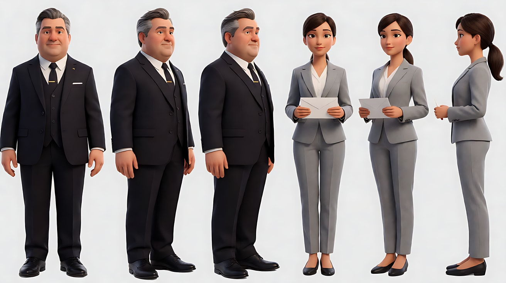

图2 首帧：

```
Using the characters from image 1: a wide shot of a long, wood-panelled executive office.
Foreground on the right third, about one meter from the lens: the manager seated at a large dark desk in three-quarter back view, his shoulder and head large in the frame,
a heavy crystal paperweight and a desk lamp on the desk.
Background on the left third, about ten meters away at the far end: the young employee standing just inside the open double door, small in the frame, holding the white envelope at her side.
Camera locked at seated eye level, 24mm lens, f/11, deep focus: the manager's shoulder, the desk and the employee at the door are all sharp.
Lighting: warm green-shaded desk lamp in the foreground, a tall window on the left wall casting cool afternoon daylight in long stripes across the floor between them.
Keep the faces, hairstyles and outfits exactly as in image 1.
Stylized semi-realistic 3D CG rendering, feature-film animation quality. Aspect ratio 16:9.
```

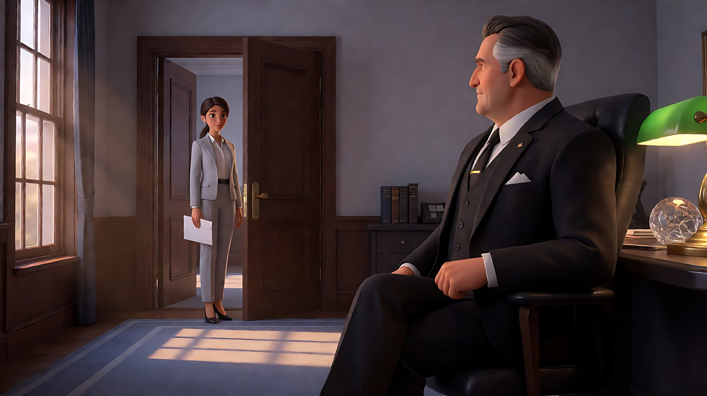

图3 尾帧：

```
Using the characters from image 1 and the exact same camera position, lens and office as image 2:
the young employee now stands in the foreground on the left third right beside the desk, about one meter from the lens, large in the frame, from the waist up,
her hand placing the white envelope flat on the desk, looking down at him.
The manager remains seated on the right, now leaning back in his chair, looking up at her, appearing smaller than her in the frame.
24mm lens, f/11, deep focus: both of them and the empty doorway far behind are sharp.
Lighting: warm desk lamp in the foreground, cool window daylight stripes across the floor behind them.
Keep the faces, hairstyles and outfits exactly as in image 1.
Stylized semi-realistic 3D CG rendering, feature-film animation quality. Aspect ratio 16:9.
```

中文释义：首帧是长长的办公室，前景画右是上司三分之四背影坐在大桌后，肩和头很大；后景画左十米外，年轻职员站在门口，很小，手里拿着白信封；24mm、f/11 深焦。尾帧机位相同，她已走到前景画左桌边，腰部以上，把信封平放在桌上，低头看他；上司靠回椅背抬头看她，在画面里比她小；远处门口空着，依旧清晰。

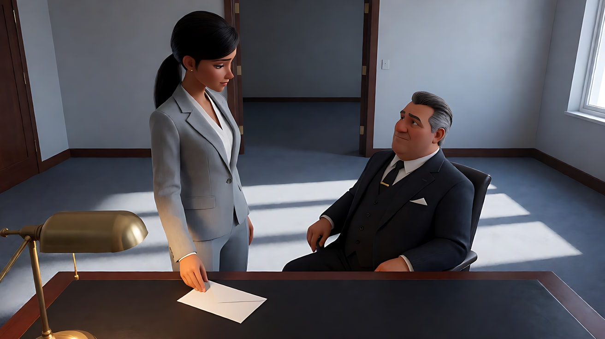

**【首尾帧生视频 · Seedance】**

```
【素材分工】@图片2 为首帧；@图片3 为尾帧，是最终画面目标；@图片1 仅锁定两位人物的身份、发型与服装，不参考其中的灰色背景。只生成两帧之间的连续动作。
【画风】风格化写实三维CG质感，电影级布光。
后景门口的年轻职员迈步向前，沿着办公室的长地板笔直走来，穿过窗光投在地上的一道道冷色光条，步速平稳，没有停顿。她在画面里由小变大，最后停在前景画左的桌边，把白色信封平放在桌上，手指在信封上按了一下，再收回。前景的上司一直坐着，随着她走近，慢慢靠回椅背，抬起头看她。镜头固定，不移动。前中后景始终全部清晰。前景绿罩台灯暖光，左墙高窗的冷色日光在地上投出光条。
【声音】高跟鞋踩在木地板上的脚步声由远及近、节奏均匀，墙上挂钟滴答，信封落在桌面的轻响，皮椅靠背的一声吱呀，无配乐。
【约束】保持两人脸型、发型、服装不变；上司始终坐着，不起身；两人不说话，没有肢体接触；信封上没有文字；动作连续，不跳切；不要字幕、水印、Logo。
时长：8秒
```

**参数**：时长 8 秒 ｜ 画幅 16:9

**【检查点】**
- 机位是否完全没动，窗光光条是否位置不变
- 她走近的过程中是否始终清晰（深焦，不需要跟焦）
- 尾帧中她是否在画面里比上司大

**【常见问题与修复】**
| 现象 | 修复 |
|---|---|
| 她走到一半突然出现在桌边 | 写"一步一步走完全程，步速平稳，不跳切"，时长改为 10 秒 |
| 远处的她被虚化 | 首帧和视频里都写"前中后景始终全部清晰" |
| 上司站起来迎她 | 写"上司始终坐着，只是靠回椅背" |
| 镜头向前推 | 写"镜头固定，不移动，只有她在走" |

---

### 练习4：婚宴门口的人——深焦、切入、回到深焦（难度 ★★★★）

**目标**：三个镜头：深焦全景交代三层关系 → 切入浅景深近景看新娘的反应 → 回到同一个深焦全景，后景的人离开。体会"深焦负责关系，切入负责情绪"。意图：让观众感到满堂热闹里，只有她看见了远处那个人在告别。

**【生图 · Nano Banana】**

图1 角色定妆（两位原创角色）：

```
Character turnaround sheet of two original characters in their late twenties:
a bride with a low braided bun decorated with small white flowers, a simple long-sleeve ivory lace wedding dress, pearl drop earrings;
and a man with short neat black hair, a plain charcoal-grey suit with no tie, a white shirt with the top button open.
Front view, three-quarter view and side view of each, full body, plain light-grey background.
Camera at eye level, 50mm lens, deep focus, even soft studio light from the front.
Stylized semi-realistic 3D CG rendering, feature-film animation quality. Aspect ratio 16:9.
```

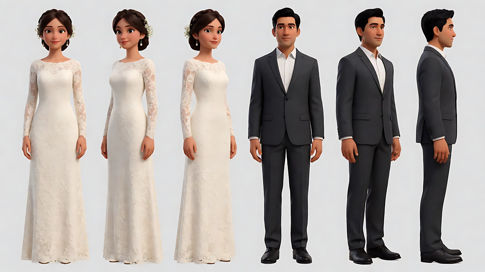

图2 场景：

```
Empty hotel wedding banquet hall at night, round tables with white cloths and centerpieces, warm crystal chandeliers,
a small stage with a flower arch in the foreground area, a pair of tall double doors at the far end opening onto a bright corridor, no people.
Wide shot from beside the stage looking toward the doors, eye level, 24mm lens, f/11, deep focus.
Lighting: warm golden chandelier light over the tables, cool bright white light from the corridor beyond the far doors.
Stylized semi-realistic 3D CG rendering, feature-film animation quality. Aspect ratio 16:9.
```

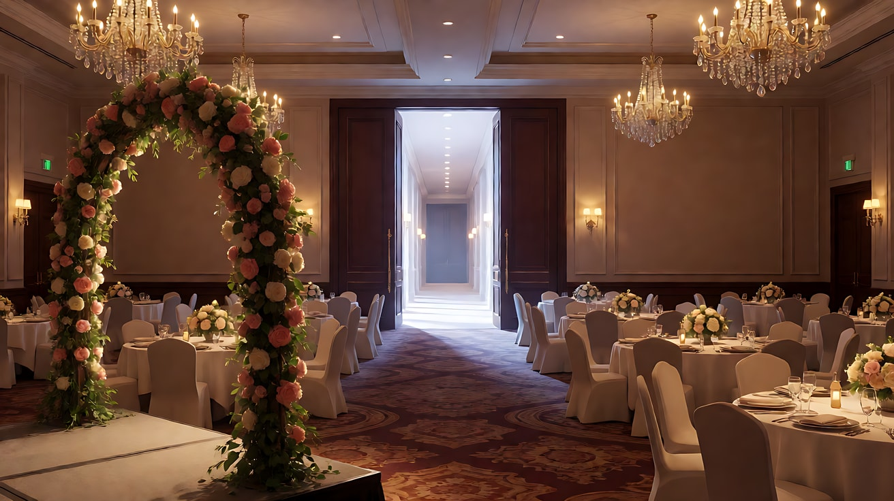

图3 镜头1关键帧：

```
Using the characters from image 1 and the banquet hall from image 2, three layers all in sharp focus:
Foreground on the left third, about one meter from the lens: the bride in three-quarter view facing frame right, raising a glass for a toast.
Middle ground across the center, four to ten meters away: guests at the round tables standing and raising their glasses, laughing.
Background on the right third, about twenty meters away, framed in the bright open doorway: the man in the charcoal suit standing alone, hands at his sides, looking toward the bride.
Camera at standing eye level beside the stage, 24mm lens, f/11, deep focus: the bride, the guests and the man in the doorway are all sharp.
Lighting: warm golden chandeliers over the hall, cool white corridor light behind the man making his silhouette stand out.
Keep the faces, hairstyles and outfits exactly as in image 1.
Stylized semi-realistic 3D CG rendering, feature-film animation quality. Aspect ratio 16:9.
```

中文释义：镜头1首帧，三层全部清晰：前景画左是举杯的新娘；中景是起立举杯欢笑的宾客；后景画右二十米外，明亮的门口站着一个穿炭灰色西装的男人，独自望向新娘。24mm、f/11；吊灯暖光，门外走廊冷白光把他的轮廓勾出来。

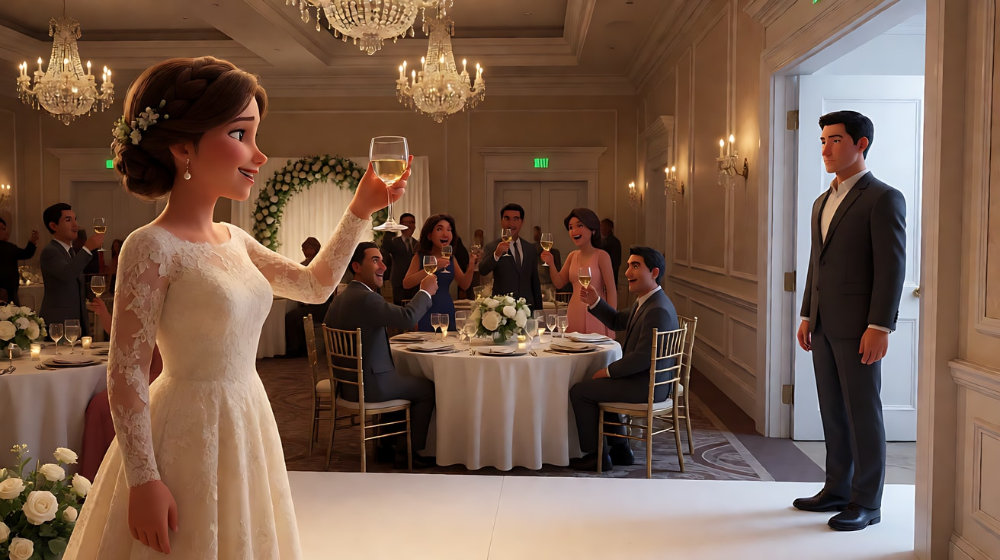

**【多图生视频 · Seedance】**

```
【素材分工】@图片1 锁定新娘与男人的身份、发型与服装；@图片2 仅参考宴会厅布局与吊灯，不复制其中的空桌；@图片3 为首帧，锁定镜头1的三层位置与深焦效果。
【画风】风格化写实三维CG质感，电影级布光。
镜头1：固定深焦全景，前景、中景、后景全部清晰。前景画左的新娘举着酒杯，中景的宾客起立举杯、欢笑；后景画右明亮的门口，炭灰色西装的男人一个人站着，望向新娘。新娘的笑容停住，目光越过满堂宾客，落在远处门口。宾客的欢呼声、碰杯声。
镜头2：镜头切至新娘的正面近景，85毫米，浅景深，身后的宾客虚成金色光斑。她举着酒杯的手停在半空，嘴唇抿紧，眼睛一直看着画右远处，轻轻吸了一口气。欢呼声变远、变闷。
镜头3：镜头切回与镜头1完全相同的固定深焦全景，三层全部清晰。后景门口的男人朝新娘微微点了一下头，转身走进明亮的走廊，消失在门外。前景的新娘慢慢放下酒杯，中景的宾客仍在欢笑、坐下。镜头固定，停在空荡荡的明亮门口与前景新娘的侧脸同框的画面上。宾客的笑声重新响起，盖过一切。
【锁定】光线：宴会厅吊灯暖金色，门外走廊冷白光始终在画右后景；新娘始终在画左前景、面朝画右，男人始终在画右后景门口；镜头1与镜头3机位、焦段、构图完全一致，只有镜头2是浅景深近景。
【声音】宾客欢呼与碰杯声贯穿；镜头2声音变闷，只剩她的呼吸；镜头3笑声重新涌上来；无配乐。
【约束】保持两人脸型、发型、服装不变；宾客只做举杯、欢笑、坐下等小动作，不走动；男人不走进宴会厅；不要字幕、水印、Logo。
时长：12秒
```

**参数**：时长 12 秒 ｜ 画幅 16:9 ｜ 负载：3 个镜头、无对白、背景群演，属于"稳妥"偏"有挑战"档

**【检查点】**
- 镜头1 和镜头3 是否是同一个构图，三层都清晰
- 镜头2 的浅景深是否和前后两个深焦镜头形成明显对比
- 后景男人离开这个动作是否清楚可读

**【常见问题与修复】**
| 现象 | 修复 |
|---|---|
| 镜头3 构图和镜头1 不一样 | 写"镜头切回与镜头1完全相同的固定深焦全景"，并在【锁定】里重复 |
| 后景男人太小，脸部漂移 | 他只做剪影级动作（点头、转身、走出），不写表情 |
| 宾客走动挡住门口 | 写"宾客只在原位举杯、欢笑、坐下，不走动" |
| 镜头2 背景也清晰 | 镜头2 单独写"85毫米，浅景深，身后的宾客虚成金色光斑" |

---

### 练习5：照相馆的最后一个下午——四镜头多层调度（难度 ★★★★★）

**目标**：用深焦组织四个层次的信息：前景签字转让、中景学徒挂老照片、后景门外的老夫妇来拍纪念照。观众知道照相馆要关了，学徒和老夫妇都不知道。意图：让观众感到一家老店的结束，就发生在它最后一个温暖的下午。

**【生图 · Nano Banana】**

图1 角色定妆（店主与学徒）：

```
Character turnaround sheet of two original characters:
a photo studio owner in his sixties with neatly combed silver hair, round gold-rimmed glasses, a brown knitted vest over a white shirt with sleeve garters;
and his apprentice, a young man around nineteen with a short side-parted haircut, a dark-blue work apron over a light-grey shirt, a cloth for cleaning lenses in his pocket.
Front view, three-quarter view and side view of each, full body, plain light-grey background.
Camera at eye level, 50mm lens, deep focus, even soft studio light from the front.
Stylized semi-realistic 3D CG rendering, feature-film animation quality. Aspect ratio 16:9.
```

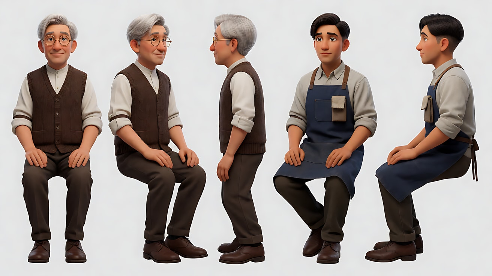

图2 角色定妆（老夫妇）：

```
Character turnaround sheet of an original elderly couple in their late seventies dressed in their best clothes:
the husband with thin white hair, a dark-navy suit slightly too big for him, a red tie;
the wife with short permed white hair, a deep-red qipao-style dress with a cream cardigan, holding a small black handbag.
Front view, three-quarter view and side view of each, full body, plain light-grey background.
Camera at eye level, 50mm lens, deep focus, even soft studio light from the front.
Stylized semi-realistic 3D CG rendering, feature-film animation quality. Aspect ratio 16:9.
```

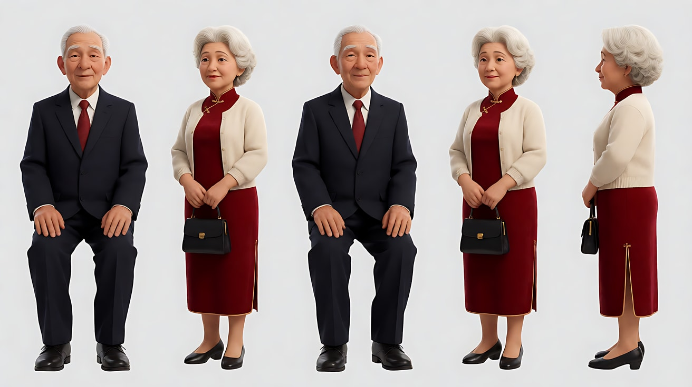

图3 场景：

```
Empty old neighborhood photo studio on a late autumn afternoon, a glass-topped wooden counter in the front,
walls covered with framed black-and-white family portraits, an old wooden tripod camera and a painted backdrop in the middle,
a glass front door with an old brass bell at the far end, a quiet street with falling yellow leaves outside, no people.
Wide shot from behind the counter toward the front door, eye level, 24mm lens, f/11, deep focus.
Lighting: low warm golden sunlight through the glass door from the far end, soft warm tungsten lamp on the counter in the foreground.
Stylized semi-realistic 3D CG rendering, feature-film animation quality. Aspect ratio 16:9.
```

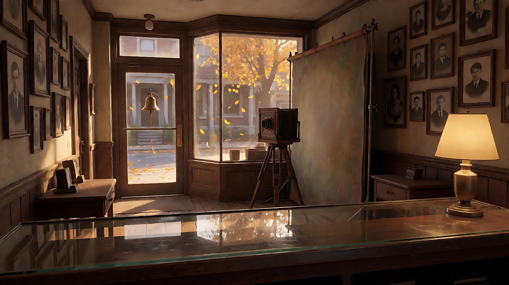

图4 镜头1关键帧：

```
Using the owner and apprentice from image 1, the couple from image 2 and the studio from image 3, three layers all in sharp focus:
Foreground on the right third, about one meter from the lens: the owner seated at the glass counter signing a document, a buyer's hand in a black suit sleeve
resting on the counter from the right frame edge, the buyer's body out of frame.
Middle ground at the center-left, about four meters away: the apprentice standing on a short wooden stepladder hanging a framed black-and-white wedding portrait on the wall.
Background at the center, about nine meters away, outside the glass front door: the elderly couple standing on the street, the wife straightening her husband's red tie.
Camera at seated eye level behind the counter, 24mm lens, f/11, deep focus: the pen, the apprentice's hands and the couple outside are all sharp.
Lighting: low warm golden sunlight through the glass door behind the couple, warm tungsten counter lamp on the owner, yellow leaves drifting outside.
Keep the faces, hairstyles and outfits exactly as in images 1 and 2.
Stylized semi-realistic 3D CG rendering, feature-film animation quality. Aspect ratio 16:9.
```

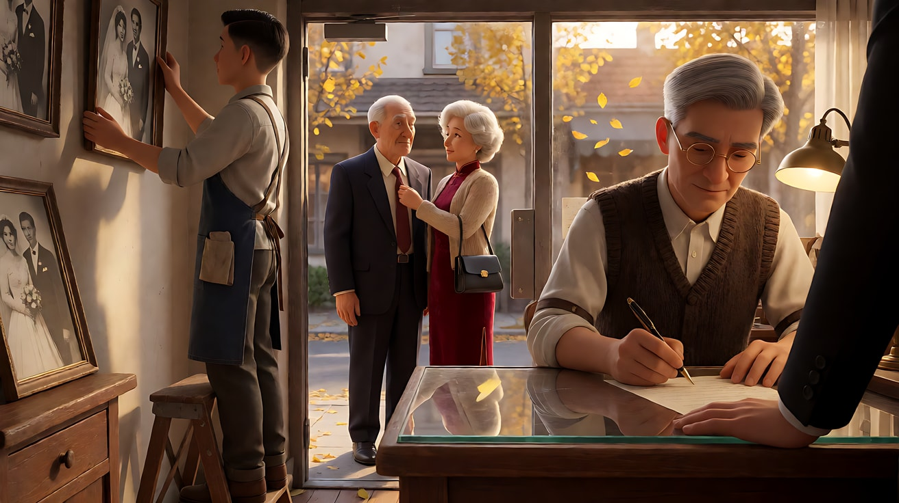

图5 镜头3关键帧：

```
Using the characters from images 1 and 2 and the exact same camera position, lens and studio as image 4, three layers all in sharp focus:
the elderly couple has just stepped inside the open glass door, now in the middle-back of the room, the wife smiling and pointing at the wedding portrait on the wall;
the apprentice on the stepladder at center-left turns to greet them; in the foreground right the owner has turned the signed document face down on the counter
and placed his palm on it, no buyer's hand visible anymore.
24mm lens, f/11, deep focus. Lighting: low golden sunlight flooding through the open door, warm counter lamp.
Keep the faces, hairstyles and outfits exactly as in images 1 and 2.
Stylized semi-realistic 3D CG rendering, feature-film animation quality. Aspect ratio 16:9.
```

中文释义：图4 为镜头1首帧，三层全部清晰：前景画右店主在玻璃柜台签字，买家只露出一只黑西装袖口的手；中景偏左学徒站在矮梯上往墙上挂一张黑白结婚照；后景玻璃门外，老太太正给老先生整理红领带。图5 为镜头3参考：老夫妇刚进门，老太太指着墙上的结婚照；学徒在梯子上转身迎客；店主已把合同翻扣在柜台上，用手掌压住，买家的手不见了。

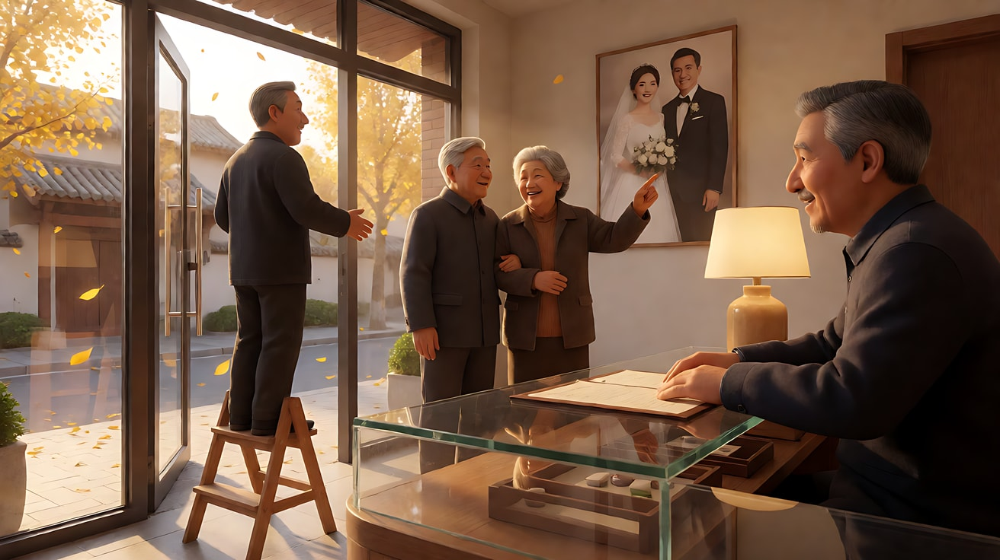

**【多图生视频 · Seedance】**

```
【素材分工】@图片1 锁定店主与学徒的身份、眼镜与服装；@图片2 锁定老夫妇的身份与服装；@图片3 仅参考照相馆布局、墙上相框与秋日光线，不复制其中的空店；@图片4 为首帧，锁定镜头1三层位置与深焦效果；@图片5 仅作为镜头3的人物位置参考。
【画风】风格化写实三维CG质感，电影级布光。
镜头1：固定深焦全景，前景、中景、后景全部清晰。前景画右，店主在柜台上一笔一笔签下名字，画右边缘那只黑西装袖口的手把合同往回收了一下又停住。中景的学徒站在矮梯上，把一张黑白结婚照挂正。后景玻璃门外，老太太替老先生整理红领带，落叶从他们身边飘过。钢笔划过纸面的沙沙声，门外的风声。
镜头2：镜头切至学徒的中景，他扶着相框回头，望向前景柜台的方向，眼神里有一点疑惑，然后低头看了看手里的相框，用袖口擦了擦玻璃。相框挂钩轻轻一响。
镜头3：镜头切回与镜头1完全相同的固定深焦全景，三层全部清晰。门上的铜铃一响，老夫妇推门进来，停在房间中后部，老太太笑着指向墙上那张结婚照；学徒在梯子上转身向他们点头；前景的店主把签好的合同翻过来扣在柜台上，用手掌压住，画右边缘的那只手已经不见了。金色的阳光从敞开的门涌进来。铜铃声，老太太轻轻的笑声。
镜头4：镜头切至店主的中近景，柜台台灯照亮他的侧脸，他身后的房间仍然清晰：老夫妇站在墙前看照片，学徒从梯子上下来。店主摘下眼镜，用衣角擦了擦，重新戴上，脸上换成平常的笑容，站起身。镜头固定，停在他起身迎客的画面上。老先生说："老板，还是老样子，给我们拍一张。"
【锁定】光线：低角度金色秋阳从后景玻璃门照进来，前景柜台台灯暖光；店主始终在前景画右，学徒始终在中景画左，老夫妇在后景，进门后停在房间中后部；镜头1与镜头3机位、焦段、构图完全一致；所有镜头前中后景都保持清晰。
【声音】秋风与落叶声在门开前隐约可闻；钢笔声、相框挂钩声、铜铃声依次出现；镜头4只有老先生一句台词，语气熟络；无配乐。
【约束】保持所有人物脸型、发型、服装不变；买家只露出一只手，不露身体和脸；合同、墙上照片里没有可读文字；只有镜头4的老先生说话；不要字幕、水印、Logo。
时长：15秒
```

**参数**：时长 15 秒 ｜ 画幅 16:9 ｜ 负载：4 个镜头、4 个人物、1 句对白，属于"有挑战"档。不稳定时拆成两次：镜头1–2（7 秒）+ 镜头3–4（8 秒，用 @图片5 做首帧）

**【检查点】**
- 镜头1 和镜头3 三层是否都清晰，三层人物是否左右错开、互不遮挡
- 观众能否从画面看懂"前景在签转让，中景和后景都不知道"
- 镜头3 的主动作是否集中在老夫妇进门，店主和学徒只是小动作
- 镜头4 店主的情绪是否靠摘眼镜、擦拭、换上笑容表现

**【常见问题与修复】**
| 现象 | 修复 |
|---|---|
| 买家整个人出现在画面里 | 写"买家只露出画右边缘一只黑西装袖口的手，身体在画外" |
| 后景老夫妇被虚化 | 首帧写 "the couple outside are sharp"，视频写"所有镜头前中后景都保持清晰" |
| 镜头3 人物太多动作，画面乱 | 只让老夫妇进门是主动作，学徒"点头"、店主"翻扣合同"写成小动作 |
| 老先生的台词被别人说出 | 写"只有镜头4的老先生说话"，并把台词放在镜头4 最后 |
| 合同或照片上出现乱码 | 约束写"没有可读文字"，并让合同不正对镜头 |
