# L02-05 移轴、分屈光镜与滑动变焦 · 提示词

> 本组练习：用三种"违反人眼"的光学技法制造不对劲的感觉——移轴把世界变成玩具，分屈光镜让近处和远处同时清晰，滑动变焦让人不动而世界在动；并练习每种技法失败时的退路。｜ 配套教学：[L02-05-移轴分屈光镜与滑动变焦](../教学/L02-05-移轴分屈光镜与滑动变焦.md) ｜ 规范：[写作规范](../../模板/写作规范.md)
>
> 画风默认使用开关 A（风格化写实 CG）。如改用 2D 动画，删掉所有焦段、光圈、景深词。本课三种技法都是光学现象，2D 与水墨画风不使用。

---

### 练习1：上了发条的早高峰——移轴微缩单图生视频（难度 ★）

**目标**：用"高角度俯拍 + 一条水平清晰带 + 上下虚化 + 高饱和硬光"四个条件，把真实的城市路口拍成微缩模型，再让车流和行人像玩具一样动起来。意图：让观众感到整座城市的早高峰，像一盒被上紧了发条的玩具。

**【生图 · Nano Banana】**

图1 关键帧：

```
An extreme wide shot of a busy city intersection during the morning rush hour, seen from the top of a tall building,
a steep high overhead angle looking down at about sixty degrees. Yellow taxis, red buses, cyclists and crowds of tiny pedestrians
crossing white zebra stripes, a small green park corner and a row of food carts.
Tilt-shift miniature effect: a narrow horizontal band of sharp focus across the middle of the frame covering the zebra crossing,
the rooftops at the bottom and the buildings at the top strongly blurred, 24mm tilt-shift lens look, very shallow plane of focus.
Saturated, toy-like colors. Lighting: hard bright morning sun from the upper left casting short crisp shadows.
Stylized semi-realistic 3D CG rendering, feature-film animation quality. Aspect ratio 16:9.
```

中文释义：大远景，从高楼顶部约六十度俯拍早高峰十字路口，黄色出租车、红色公交、骑车人和细小的行人穿过白色斑马线；移轴微缩效果：画面中部一条水平清晰带落在斑马线上，下方屋顶与上方楼群强烈虚化；色彩饱和像玩具；左上方硬朗晨光投下短而清晰的影子。

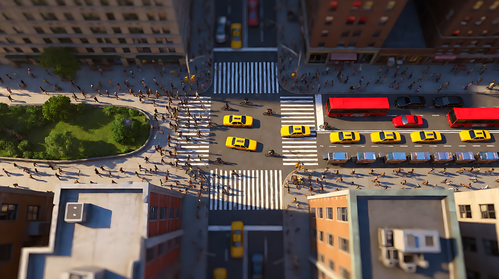

**【图生视频 · Seedance】**

```
【素材分工】@图片1 为首帧，锁定俯拍角度、路口布局、水平清晰带的位置与微缩模型质感。
【画风】风格化写实三维CG质感，移轴微缩效果，色彩饱和。
高角度俯拍的十字路口，信号灯变绿，斑马线上的行人像微缩模型里的小人一样成群涌过马路，步伐轻快、略快于正常速度；出租车和公交车像玩具车一样整齐地起步、转弯。画面中部斑马线所在的一条水平带始终清晰，上方楼群和下方屋顶始终强烈虚化。镜头固定，不移动。左上方硬朗晨光投下短而清晰的影子。结尾停在行人走完、车流开始通过路口的画面上。
【声音】被压低、显得遥远的城市车流声，一声清脆的自行车铃，信号灯提示音，轻快的八音盒式配乐若有若无。
【约束】清晰带位置始终不变，上下虚化不消失；车辆不发生碰撞；车身和招牌没有可读文字；不要字幕、水印、Logo。
时长：6秒
```

**参数**：时长 6 秒 ｜ 画幅 16:9

**【检查点】**
- 清晰区是"一条水平带"，而不是某一个主体
- 上下虚化在整个片段里是否保持
- 行人和车辆的运动是否有"玩具感"（轻快、整齐、略快）

**【常见问题与修复】**
| 现象 | 修复 |
|---|---|
| 看起来只是普通的高空俯拍，没有模型感 | 生图时加强 "strongly blurred top and bottom, very narrow band of focus, saturated toy-like colors"，并把俯角加大 |
| 视频里上下虚化逐渐消失 | 在【画风】和正文里都写"移轴微缩效果""上方和下方始终强烈虚化" |
| 运动太慢像监控画面 | 写"步伐轻快、略快于正常速度"，也可在剪辑时整体加速到 1.5 倍 |
| 车辆互相穿插、碰撞 | 写"车辆按车道整齐行驶，不发生碰撞" |

---

### 练习2：门框两边的两个人——分屈光镜双焦平面（难度 ★★）

**目标**：在一个画面里让近处的她和远处的他同时清晰，中间层虚化，分界线藏在一道深色门框上。镜头锁定，人物只做原地小动作。意图：让观众感到她信任的那个人，一直在远处看着她。

**【生图 · Nano Banana】**

图1 角色定妆（两位原创角色）：

```
Character turnaround sheet of two original characters:
a young woman in her mid-twenties with long dark wavy hair, a black mourning dress with a high collar, a thin silver locket necklace;
and a family butler in his sixties, tall and thin, with slicked-back white hair, a black tailcoat, a grey waistcoat and white gloves.
Front view, three-quarter view and side view of each, full body, plain light-grey background.
Camera at eye level, 50mm lens, deep focus, even soft studio light from the front.
Stylized semi-realistic 3D CG rendering, feature-film animation quality. Aspect ratio 16:9.
```

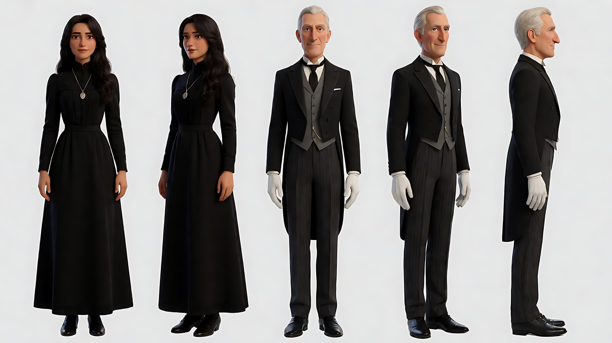

图2 场景：

```
Empty old mansion study on a rainy afternoon, a heavy dark-wood desk in the foreground on the left, an open doorway with a thick dark door frame in the middle,
beyond the doorway a long hall ending in a tall window with grey rain light, an antique grandfather clock in the hall, no people.
Medium-wide shot, eye level, 35mm lens, f/5.6.
Lighting: a single warm brass desk lamp on the desk in the foreground, cool grey rain light from the tall window at the far end of the hall.
Stylized semi-realistic 3D CG rendering, feature-film animation quality. Aspect ratio 16:9.
```

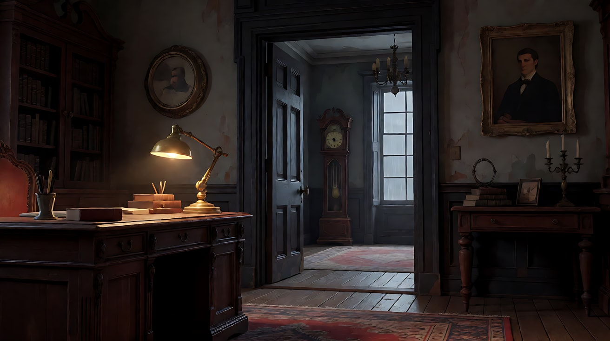

图3 关键帧（分屈光镜）：

```
Using the characters from image 1 and the mansion from image 2:
a split diopter shot. The left half of the frame is focused very close to the lens: a close-up of the young woman in three-quarter profile facing frame right,
about half a meter away, sitting at the desk holding an old letter, her face sharp.
The right half of the frame is focused far away: about seven meters behind her, beyond the doorway, the butler standing still by the tall window in the hall,
hands folded in front, looking toward her, also sharp.
The middle ground between them is blurred, and a soft vertical blur seam runs exactly along the thick dark door frame at the center of the frame.
Camera locked at seated eye level, 50mm lens with a half split diopter look.
Lighting: warm brass desk lamp from frame left as key on her face, cool grey rain light from the tall window behind the butler.
Keep the faces, hairstyles and outfits exactly as in image 1.
Stylized semi-realistic 3D CG rendering, feature-film animation quality. Aspect ratio 16:9.
```

中文释义：分屈光镜画面。画面左半边对焦在离镜头半米处：她坐在书桌前拿着旧信，三分之四侧脸朝画右，清晰；右半边对焦在七米外：走廊尽头高窗边，管家双手交叠站着望向她，同样清晰；两人之间的中间层虚化，一条竖直的模糊分界线恰好落在画面中央深色的门框上。左侧黄铜台灯暖光，远处高窗冷灰雨光。

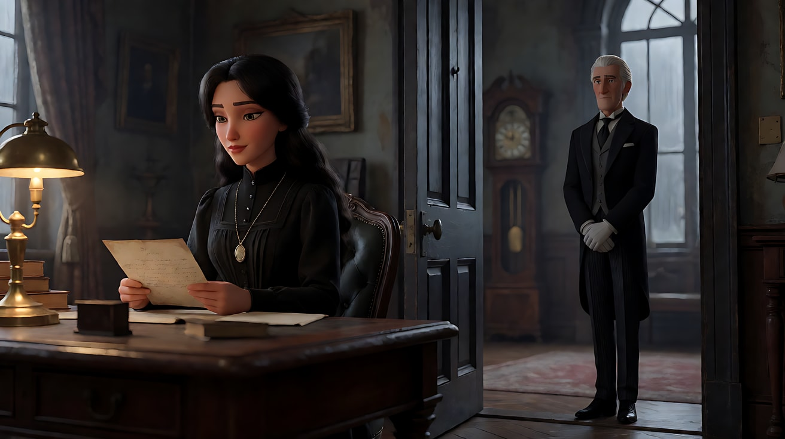

> **退路（分层合成）**：如果图3 生成不出两半同时清晰的效果，分别生成两张同构图的图：A 只有她清晰（85mm f/1.8 focus on her），B 只有管家清晰（focus on the butler），在剪辑或修图软件里沿门框画一条竖直羽化遮罩拼合，把拼合图作为 @图片3。

**【多图生视频 · Seedance】**

```
【素材分工】@图片1 锁定两位人物的身份、发型与服装；@图片2 仅参考书房与走廊的布局、光线，不复制其中的空景；@图片3 为首帧，锁定分屈光镜构图：左半边近处的她与右半边远处的管家同时清晰，中间虚化，分界线在门框上。
【画风】风格化写实三维CG质感，电影级布光。
画面左半边，她低头读着手里的旧信，手指慢慢摩挲信纸的折痕，读到一处停下，嘴唇轻轻抿紧。画面右半边远处，管家站在走廊尽头的高窗边，一动不动地望着她，只在她停下的那一刻，戴白手套的手指轻轻动了一下。两人都始终清晰，中间的门框和走廊中段始终虚化，分界线始终落在门框上。镜头固定，不移动。她不回头，管家不走动。左侧台灯暖光照在她脸上，远处高窗的冷灰雨光勾出管家的轮廓。结尾停在她握着信、管家静静注视的画面上。
【声音】窗外持续的雨声，走廊里落地钟沉稳的滴答声，信纸摩擦的细响，无配乐。
【约束】保持两人脸型、发型、服装不变；两人始终留在各自的半边画面，不横穿门框；信纸上的字迹模糊不可读；不要字幕、水印、Logo。
时长：6秒
```

**参数**：时长 6 秒 ｜ 画幅 16:9

**【检查点】**
- 近处的她和远处的管家是否同时清晰，中间层是否是虚的
- 分界线是否藏在门框上，而不是横切人物
- 两人是否都只做原地小动作，没有越过分界线

**【常见问题与修复】**
| 现象 | 修复 |
|---|---|
| 生成成普通深焦，中间也清晰 | 首帧写 "the middle ground between them is blurred"，或使用上面的分层合成退路 |
| 生成成普通浅景深，管家是虚的 | 首帧写 "the right half is focused far away, the butler also sharp"；视频写"两人都始终清晰" |
| 分界线随时间漂移，切过她的肩膀 | 镜头必须固定；删掉她的头部转动，只保留手指和嘴唇的小动作 |
| 管家走向她 | 写"管家始终站在高窗边，不走动" |

---

### 练习3：走廊压过来——首尾帧滑动变焦（难度 ★★★）

**目标**：用首尾帧法做"后退 + 变焦推近"：首帧是广角近距离（走廊又长又远），尾帧是长焦远距离（走廊被放大、压到他身后），**人物在两帧里大小和位置完全相同**。意图：让观众感到他听完那句话的一瞬间，整条走廊都压向了他。

**【生图 · Nano Banana】**

图1 角色定妆：

```
Character turnaround sheet of an original man in his early thirties: short dark hair slightly messy, a light stubble,
a navy windbreaker over a grey hoodie, dark jeans, holding a white paper cup of coffee.
Front view, three-quarter view, side view and back view, full body, plain light-grey background.
Camera at eye level, 50mm lens, deep focus, even soft studio light from the front.
Stylized semi-realistic 3D CG rendering, feature-film animation quality. Aspect ratio 16:9.
```

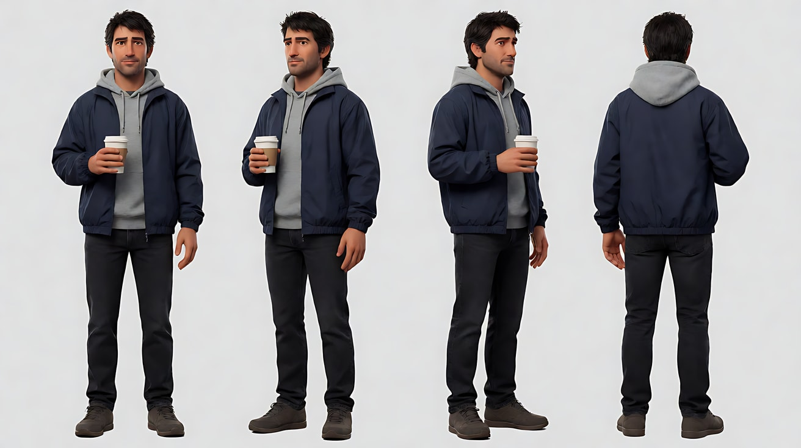

图2 首帧：

```
Using the character from image 1: a medium close-up of him standing still in the middle of a long, straight hospital corridor at night,
facing the camera, centered, his head and shoulders filling the middle third of the frame, holding the paper cup at chest height, eyes fixed slightly off camera left.
Camera at eye level about one meter from him, 24mm wide-angle lens, f/8, deep focus: the corridor behind him looks very long,
the rows of ceiling lights and the doors on both sides recede far into a small vanishing point, lots of space around his head.
Lighting: cold white fluorescent ceiling panels running down the corridor, a faint green exit-sign glow at the far end.
Keep the face, hairstyle and outfit exactly as in image 1.
Stylized semi-realistic 3D CG rendering, feature-film animation quality. Aspect ratio 16:9.
```

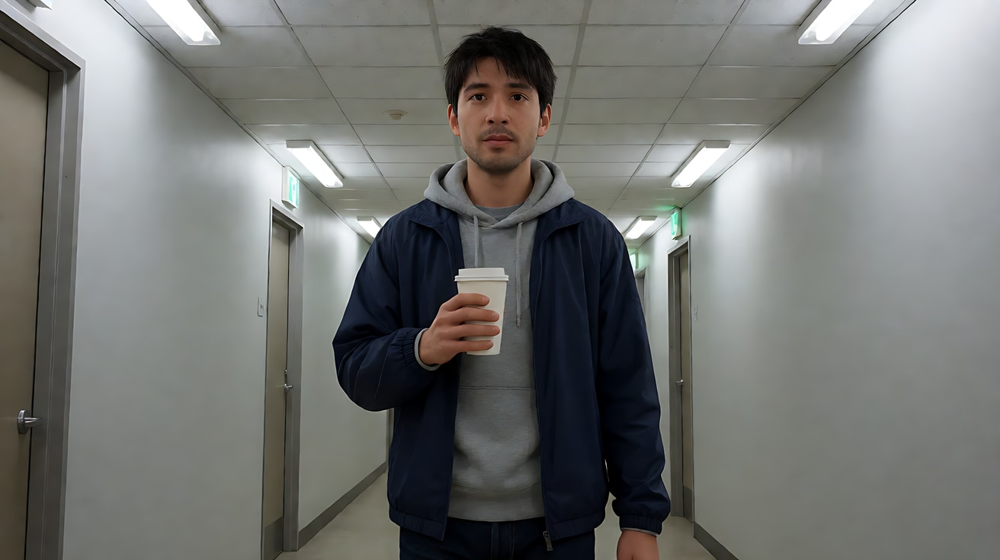

图3 尾帧：

```
Using the character from image 1 and the same hospital corridor as image 2:
the exact same medium close-up of him, same size and same position in the frame, centered, head and shoulders filling the middle third,
holding the paper cup at chest height, eyes fixed slightly off camera left, his grip on the cup tighter.
Camera now about four meters away, 100mm telephoto lens, f/8: the corridor behind him is strongly compressed and enlarged,
the ceiling lights and doors are packed tightly right behind his head, the far end of the corridor looms large and close.
Lighting: the same cold white fluorescent ceiling panels, the green exit-sign glow now large behind him.
Keep the face, hairstyle and outfit exactly as in image 1.
Stylized semi-realistic 3D CG rendering, feature-film animation quality. Aspect ratio 16:9.
```

中文释义：首帧：医院长走廊，他站在中央面朝镜头，中近景，24mm 广角、距离一米，走廊又长又远，顶灯和两侧的门缩成远处一个小小的消失点。尾帧：同样的中近景，人物大小和位置完全一致，只是相机退到四米、换 100mm 长焦，走廊被强烈压缩放大，顶灯和门挤在他脑后，尽头的绿色出口灯变得又大又近；他握杯子的手更紧了。

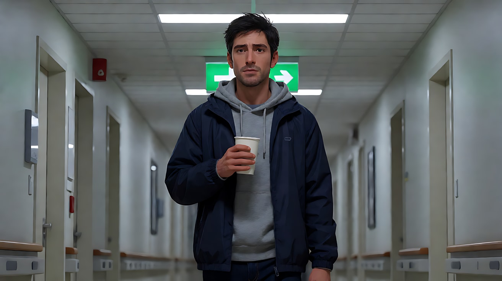

**【首尾帧生视频 · Seedance】**

```
【素材分工】@图片2 为首帧；@图片3 为尾帧，是最终画面目标；@图片1 仅锁定人物身份、服装与纸杯，不参考其中的灰色背景。只生成两帧之间的连续变化。
【画风】风格化写实三维CG质感，电影级布光。
他站在走廊中央一动不动，眼睛盯着画左镜头外的某处，听着什么。镜头沿轨道匀速向后退，同时变焦推近，他在画面中的大小和位置始终不变；身后的走廊、顶灯和两侧的门被逐渐放大、压缩，像整条走廊向他涌过来，尽头的绿色出口灯越来越大。他的表情几乎不变，只是喉结动了一下，握纸杯的手指慢慢收紧，杯壁微微凹下去。冷白顶灯光线保持不变。
【声音】画外一个模糊、听不清内容的说话声停下，随后走廊里只剩日光灯的电流嗡声越来越响，他的一次吞咽声，纸杯被捏紧的轻响，无配乐。
【约束】保持人物脸型、发型、服装不变；人物大小与画面位置始终不变，只有背景在变化；他不走动、不转头；动作连续，不跳切；不要字幕、水印、Logo。
时长：5秒
```

**参数**：时长 5 秒 ｜ 画幅 16:9

**【检查点】**
- 他在整个片段里大小是否基本不变（这是滑动变焦成立的前提）
- 背景是否由"宽而远"逐渐变成"窄而近"
- 是否感到"人没动，世界在动"

**【常见问题与修复】**
| 现象 | 修复 |
|---|---|
| 首尾帧里他大小不一致 | 尾帧生图时上传图2 作参考，写 "the exact same size and position in the frame as image 2" |
| 中间过渡变成普通推镜，人也变大 | 写"他在画面中的大小和位置始终不变，只有背景在变化" |
| 背景扭曲、门框弯折融化 | 走廊保持简单规则的结构，删掉两侧多余的人和设备 |
| 脸部在过渡中变形 | 改为三分之四侧脸，或把景别放宽到中景 |

---

### 练习4：对面站台的人——视频直写滑动变焦（难度 ★★★★）

**目标**：三镜头，前两个镜头建立"他看见了谁"，镜头3 用"前推 + 变焦拉远"直接在 Seedance 里写滑动变焦，表达认出那一刻的失重感。和练习3 对比，体会直写法的成功率。意图：让观众感到他认出她的那一瞬间，脚下的站台像被抽走了。

**【生图 · Nano Banana】**

图1 角色定妆（两位原创角色）：

```
Character turnaround sheet of two original characters in their mid-thirties:
a man with short neat brown hair, rectangular black glasses, a beige trench coat over a dark suit, carrying a leather briefcase;
and a woman with a chin-length black bob, a mustard-yellow wool coat, a grey scarf, a small backpack.
Front view, three-quarter view and side view of each, full body, plain light-grey background.
Camera at eye level, 50mm lens, deep focus, even soft studio light from the front.
Stylized semi-realistic 3D CG rendering, feature-film animation quality. Aspect ratio 16:9.
```

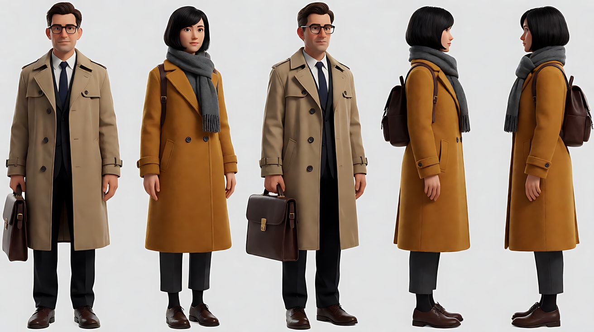

图2 场景：

```
Empty long underground subway station with two parallel platforms facing each other across the tracks,
a long straight row of square columns and ceiling lights receding far into the distance on both sides, tiled walls, no people.
Wide shot from the end of one platform, eye level, 24mm lens, f/8, deep focus, strong one-point perspective.
Lighting: cool white ceiling light strips running the length of the station, a warm glow from the tunnel mouth at the far end.
Stylized semi-realistic 3D CG rendering, feature-film animation quality. Aspect ratio 16:9.
```

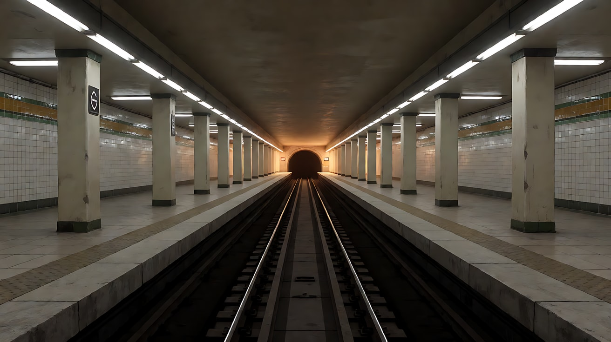

图3 镜头3关键帧：

```
Using the man from image 1 and the station from image 2:
a medium close-up of him standing on the platform in three-quarter view facing frame right, centered, his head and shoulders filling the middle third of the frame,
briefcase in his left hand, eyes wide, looking across the tracks.
Behind him the long platform, the row of columns and the ceiling lights recede toward a vanishing point on frame left.
Camera at eye level about three meters away, 85mm lens, f/5.6, the columns behind him moderately compressed.
Lighting: cool white ceiling light strips from above, a warm glow from the tunnel mouth far behind on the left.
Keep the face, hairstyle and outfit exactly as in image 1.
Stylized semi-realistic 3D CG rendering, feature-film animation quality. Aspect ratio 16:9.
```

中文释义：图3 为镜头3首帧，他在站台上的中近景，三分之四侧脸朝画右，望向轨道对面；身后长长的站台、一排方柱和顶灯向画左的消失点延伸；85mm、距离三米，柱子适度压缩。

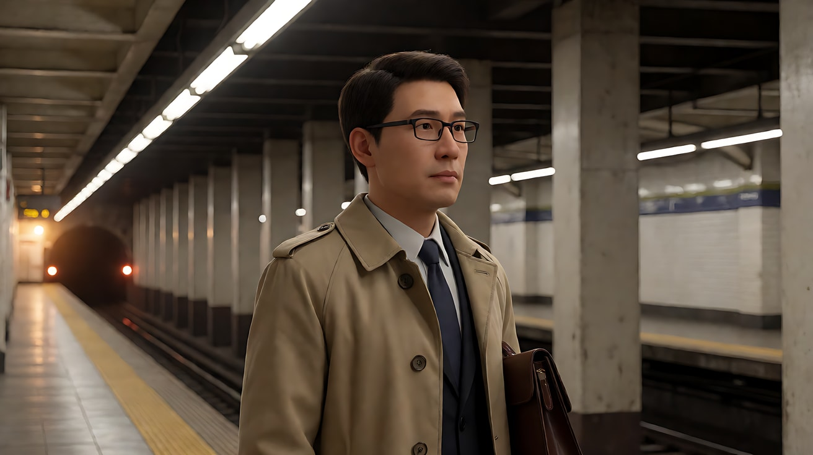

**【多图生视频 · Seedance】**

```
【素材分工】@图片1 锁定男人与女人的身份、发型与服装；@图片2 仅参考地铁站布局与一点透视的柱列，不复制其中的空站；@图片3 为镜头3的构图与焦段起点参考。
【画风】风格化写实三维CG质感，电影级布光。
镜头1：平视中景，镜头固定。男人站在站台边，提着公文包，低头看了一眼手表，又抬头随意望向轨道对面。身后零星的乘客走过。站台广播的回声，远处隧道里的风声。
镜头2：镜头切至他视线方向的长焦镜头，135毫米，越过轨道看向对面站台，人群被压缩在一起。人群中一个穿芥末黄大衣的短发女人慢慢转过身，朝这边看过来，停住。远处列车进站前的低沉轰鸣。
镜头3：镜头切至男人的中近景，以 @图片3 为起始构图。镜头沿轨道匀速向他推近，同时变焦拉远，他在画面中的大小和位置始终不变；身后的站台、柱列和顶灯逐渐向后退去、被拉长，消失点越来越远，像脚下的站台被抽走。他的眼睛睁大，嘴唇微张，提公文包的手松了一下。镜头运动结束后停在他怔住的脸上。周围声音全部被抽空，只剩一声长长的低频嗡鸣。
【锁定】光线：冷白顶灯光带贯穿车站，隧道口暖光在远处；男人始终在本侧站台、面朝画右看向对面，女人始终在对面站台、面朝画左；男人穿米色风衣、戴黑框眼镜，女人穿芥末黄大衣。
【声音】广播回声与隧道风声，镜头2加入列车进站的低沉轰鸣，镜头3所有声音被抽空，只剩一声低频嗡鸣，无配乐。
【约束】保持两人脸型、发型、服装不变；两人不说话、不挥手；镜头3中人物大小始终不变，只有背景在变化；站名与指示牌没有可读文字；不要字幕、水印、Logo。
时长：12秒
```

**参数**：时长 12 秒 ｜ 画幅 16:9 ｜ 负载：3 个镜头、无对白，属于"稳妥"档；但镜头3 的滑动变焦本身不稳定，建议同一提示词生成 3–4 次挑选

**【检查点】**
- 镜头2 的长焦是否把对面人群压缩在一起，她转身是否清楚
- 镜头3 中他大小是否基本不变，背景柱列是否向后拉长
- 对比练习3：直写法与首尾帧法，哪一种更接近你想要的效果

**【常见问题与修复】**
| 现象 | 修复 |
|---|---|
| 镜头3 变成普通推镜，他越来越大 | 强调"他在画面中的大小和位置始终不变"；仍失败就改用练习3 的首尾帧法单独生成镜头3 |
| 镜头3 只变焦不移动，人和背景一起变小 | 写清"镜头沿轨道推近"和"同时变焦拉远"两个动作 |
| 柱列弯曲变形 | 背景只保留整齐的柱列和顶灯，删掉乘客与广告牌 |
| 镜头2 女人脸部模糊漂移 | 长焦下她只做"转身、停住"，不写表情 |

---

### 练习5：钟表铺的早晨——三种光学技法串联四镜头（难度 ★★★★★）

**目标**：用一组镜头串起本课三种技法，每种只用一次，各有一句意图：移轴开场让小镇像玩具（世界很小、日子很平常）；分屈光镜让近处的他和门外的她同时清晰（她就在那里，他还没看见）；滑动变焦表达他认出她的一瞬（世界压了过来）；最后回到普通 50mm（只剩两个人）。总意图：让观众感到二十年没回家的女儿，在一个普通的早晨回来了。

**【生图 · Nano Banana】**

图1 角色定妆（两位原创角色）：

```
Character turnaround sheet of two original characters:
an old clockmaker in his late sixties with thin white hair, a short white beard, a jeweler's loupe pushed up on his forehead,
a dark-green cardigan over a striped shirt and a brown leather work apron;
and his daughter in her late thirties with shoulder-length dark hair, a camel coat over a cream sweater, a small travel suitcase.
Front view, three-quarter view and side view of each, full body, plain light-grey background.
Camera at eye level, 50mm lens, deep focus, even soft studio light from the front.
Stylized semi-realistic 3D CG rendering, feature-film animation quality. Aspect ratio 16:9.
```

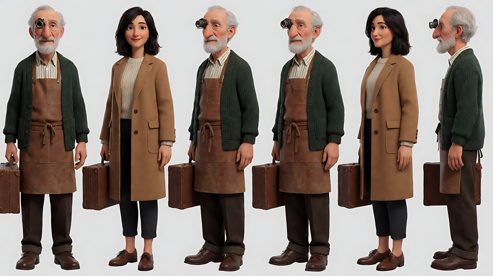

图2 场景（钟表铺内）：

```
Empty small old clock repair shop in the morning, a wooden workbench with a lamp and tiny tools in the foreground,
the back wall completely covered with dozens of wall clocks of different shapes, a tall grandfather clock standing beside the glass front door,
a quiet cobblestone street outside, no people.
Medium-wide shot from behind the workbench toward the door, eye level, 35mm lens, f/5.6.
Lighting: soft low morning sunlight through the glass door from the far end, a warm work lamp on the bench in the foreground.
Stylized semi-realistic 3D CG rendering, feature-film animation quality. Aspect ratio 16:9.
```

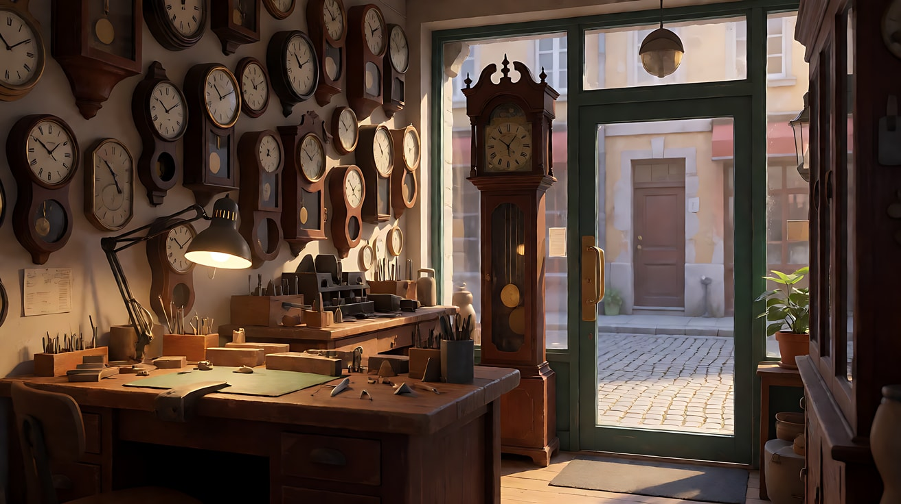

图3 镜头1关键帧（移轴）：

```
Using the character from image 1: an extreme wide shot of a small old town square in the early morning seen from a church tower, steep high overhead angle,
cobblestone streets, a fountain, a bakery with a striped awning, a few tiny townspeople and a bicycle,
and the old clockmaker as a tiny figure in his dark-green cardigan unlocking the door of his small clock shop on the right.
Camera on the tower about forty meters above the square, 35mm tilt-shift lens look.
Tilt-shift miniature effect: a narrow horizontal band of sharp focus across the middle of the frame through the square and the shop front,
the rooftops at the bottom and the hills at the top strongly blurred, saturated toy-like colors.
Lighting: soft golden low morning sun from frame left with long shadows.
Keep the face, hairstyle and outfit exactly as in image 1.
Stylized semi-realistic 3D CG rendering, feature-film animation quality. Aspect ratio 16:9.
```

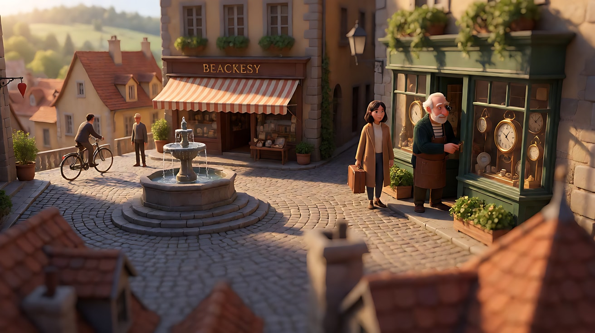

图4 镜头2关键帧（分屈光镜）：

```
Using the characters from image 1 and the clock shop from image 2:
a split diopter shot. The left half of the frame is focused very close: a close-up of the clockmaker bent over the workbench,
looking down through his loupe at an open pocket watch, about half a meter from the lens, sharp.
The right half of the frame is focused far away: outside the glass front door about six meters away, his daughter stands on the street with her suitcase,
looking in through the glass, also sharp.
The middle of the shop between them is blurred, and the soft vertical blur seam is hidden along the tall dark grandfather clock at the center of the frame.
Camera locked at seated eye level, 50mm lens with a half split diopter look.
Lighting: warm work lamp from frame left on his face and hands, soft low morning sunlight behind the daughter outside.
Keep the faces, hairstyles and outfits exactly as in image 1.
Stylized semi-realistic 3D CG rendering, feature-film animation quality. Aspect ratio 16:9.
```

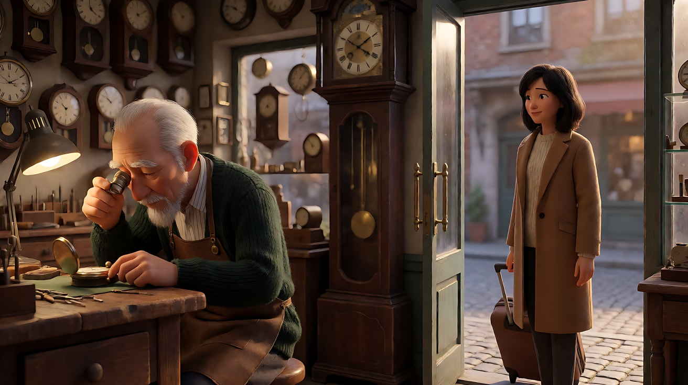

图5 镜头3关键帧（滑动变焦起点）：

```
Using the clockmaker from image 1 and the clock shop from image 2:
a medium close-up of the clockmaker seated at the workbench, now looking up toward the door on frame right, the loupe pushed up on his forehead, centered,
his head and shoulders filling the middle third of the frame, the wall of dozens of clocks behind him.
Camera at eye level about one meter away, 28mm lens, f/8, deep focus: the wall of clocks looks wide and relatively far behind him.
Lighting: warm work lamp from frame left, soft morning light from the door on frame right.
Keep the face, hairstyle and outfit exactly as in image 1.
Stylized semi-realistic 3D CG rendering, feature-film animation quality. Aspect ratio 16:9.
```

中文释义：图3 为移轴俯拍的小镇广场，钟表匠的小人在画右打开店门；图4 为分屈光镜画面，左半边近处是低头修怀表的钟表匠，右半边远处是站在玻璃门外的女儿，两人同时清晰，分界线藏在画面中央深色的落地钟上；图5 为滑动变焦起点，他抬头看向门口，28mm 近距离，身后满墙的挂钟显得宽而远。

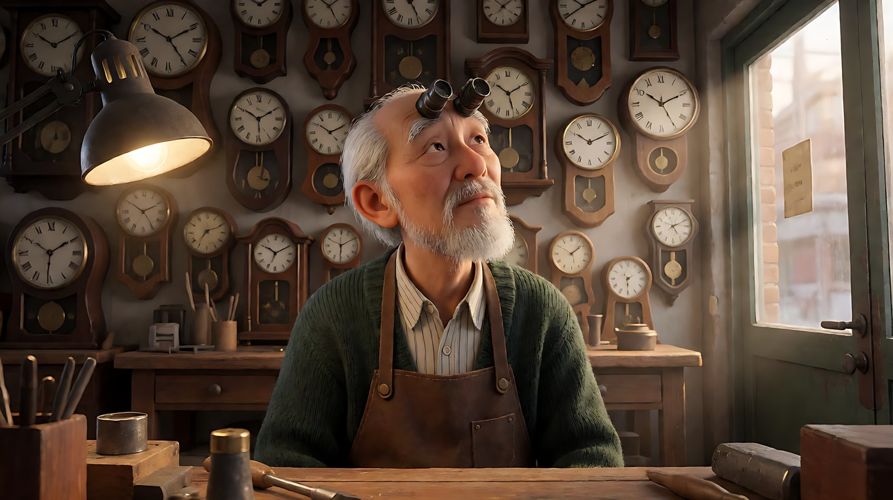

**【多图生视频 · Seedance】**

```
【素材分工】@图片1 锁定钟表匠与女儿的身份、发型与服装；@图片2 仅参考钟表铺布局、满墙挂钟与落地钟的位置，不复制其中的空景；@图片3 为首帧，锁定镜头1的移轴微缩构图；@图片4 仅作为镜头2的分屈光镜构图参考；@图片5 仅作为镜头3的起始构图参考。
【画风】风格化写实三维CG质感，电影级布光。
镜头1：移轴微缩俯拍大远景，镜头固定。清晨的小镇广场像一个微缩模型，画面中部一条水平带清晰，上下强烈虚化。面包店老板支起条纹遮阳篷，一辆自行车轻快地驶过广场，画右的钟表匠小人打开店门走进去。远处教堂钟声，鸽子振翅声。
镜头2：镜头切至钟表铺内的分屈光镜画面，镜头固定。左半边近处，钟表匠戴着放大镜低头修一只怀表，镊子轻轻拨动齿轮；右半边远处，女儿提着行李箱站在玻璃门外，隔着玻璃看着他，没有推门。两人同时清晰，中间的店堂虚化，分界线始终落在落地钟上。满墙挂钟的滴答声。
镜头3：镜头切至钟表匠的中近景，以 @图片5 为起始构图。他抬起头，把放大镜推到额头上，望向画右的门口，认出了她。镜头沿轨道匀速向后退，同时变焦推近，他在画面中的大小和位置始终不变，身后满墙的挂钟被逐渐放大、压缩，像几十只钟一起向他涌来。他的嘴唇动了一下，没有出声。滴答声越来越密、越来越响。
镜头4：镜头切至平视中景，50毫米，自然透视。门上的铜铃一响，女儿推门进来，停在柜台另一边。钟表匠慢慢站起身，两人隔着柜台面对面站着。镜头固定，停在两人隔着柜台相望的画面上。所有滴答声在铜铃响后一齐安静下来，只剩落地钟一声报时。
【锁定】光线：清晨低角度柔和阳光从门口照进，工作台台灯暖光在画左；钟表匠始终穿深绿开衫和棕色皮围裙，额头上有放大镜；女儿始终穿驼色大衣、提行李箱；店内机位始终在工作台一侧，门在画右；三种光学技法各只出现一次：移轴只在镜头1，分屈光镜只在镜头2，滑动变焦只在镜头3。
【声音】镜头1小镇清晨的钟声与鸽子；镜头2满墙挂钟的滴答声；镜头3滴答声越来越密；镜头4铜铃响后突然安静，只剩一声报时；无配乐。
【约束】保持两人脸型、发型、服装不变；两人不说话，没有肢体接触；钟面上没有可读文字与数字乱码，店招无文字；不要字幕、水印、Logo。
时长：15秒
```

**参数**：时长 15 秒 ｜ 画幅 16:9 ｜ 负载：4 个镜头、三种脆弱的光学技法，属于"冒险"档。**强烈建议拆成三次生成**：镜头1 单独用 @图片3 图生视频（5 秒）；镜头2 单独用 @图片4 图生视频（5 秒）；镜头3–4 一次生成（8 秒），或镜头3 改用练习3 的首尾帧法

**【检查点】**
- 每种技法是否只出现在指定的镜头里，没有互相"串味"
- 镜头1 的玩具感 → 镜头2 的双焦平面 → 镜头3 的世界压来 → 镜头4 的普通透视，是否形成"世界从很大到只剩两个人"的情绪曲线
- 镜头4 回到普通 50mm 后，是否因为前三个"不对劲"而显得格外安静

**【常见问题与修复】**
| 现象 | 修复 |
|---|---|
| 一次生成里四个镜头风格混乱 | 按参数里的建议拆成三次生成，在剪辑软件里拼接 |
| 镜头2 女儿推门进来 | 写"她隔着玻璃看着他，没有推门"；推门留给镜头4 |
| 镜头3 墙上的钟面变形融化 | 生图时让挂钟形状简洁、排列整齐；视频里写"挂钟形状始终不变" |
| 钟面出现乱码数字 | 约束写"钟面只有简洁刻度，没有数字"，并让钟面不正对镜头 |
| 镜头4 两人拥抱 | 写"两人隔着柜台站着，没有肢体接触"，拥抱留给下一个片段 |
