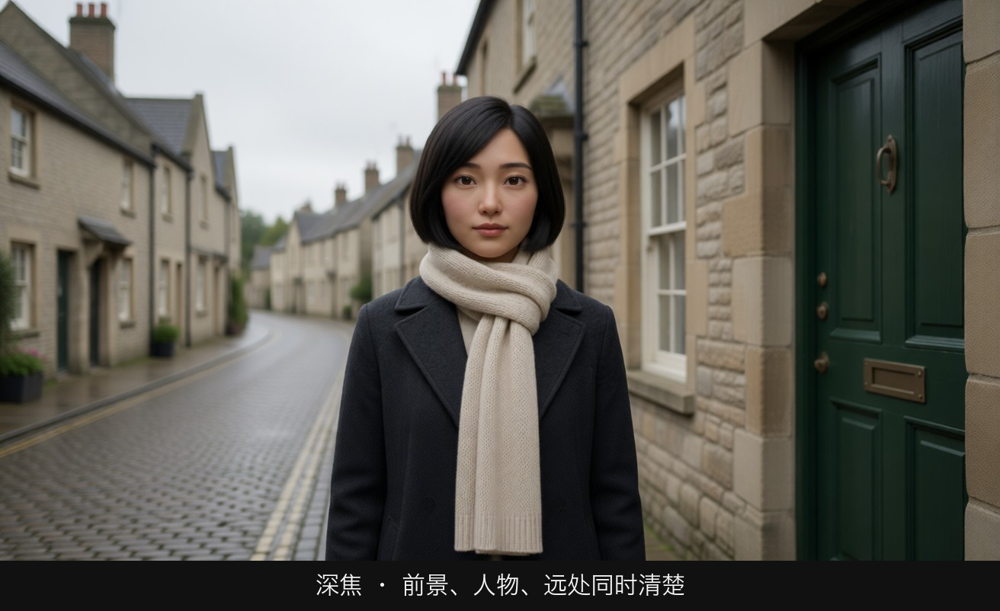
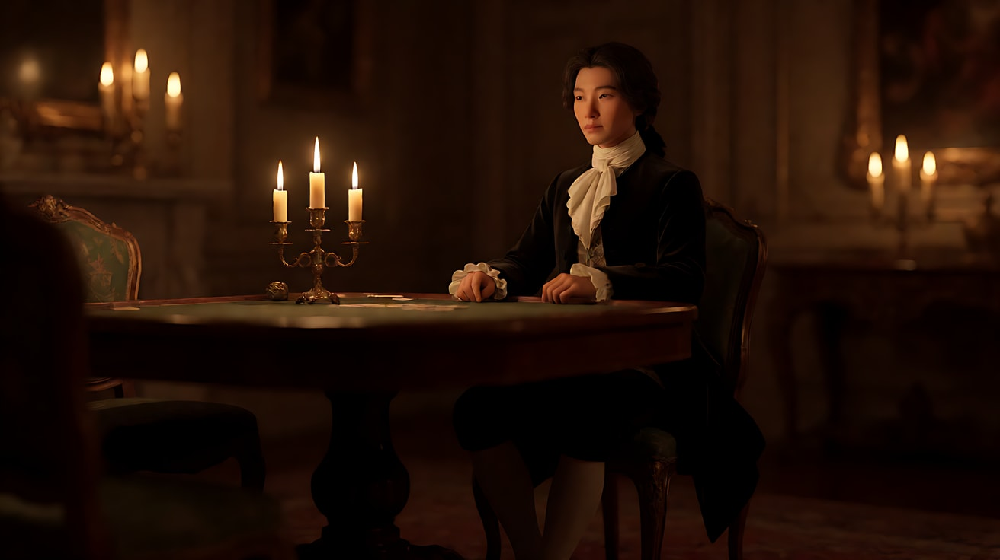
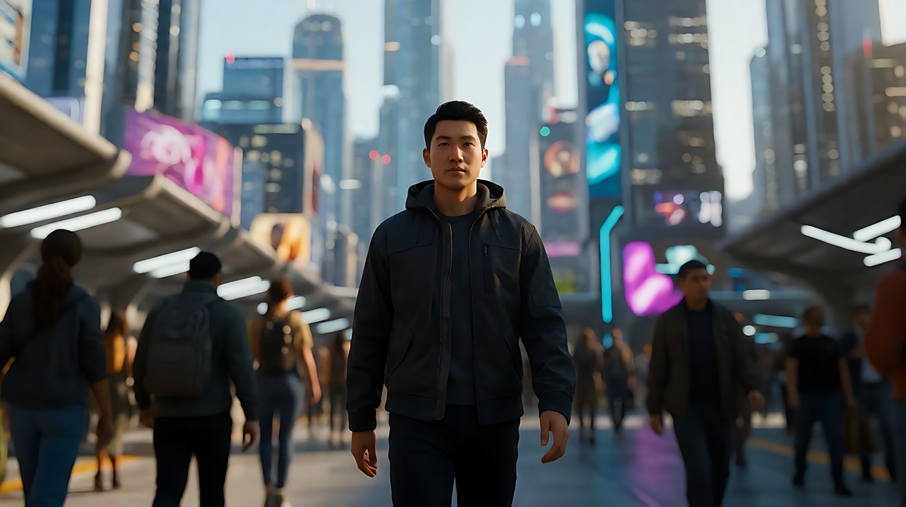
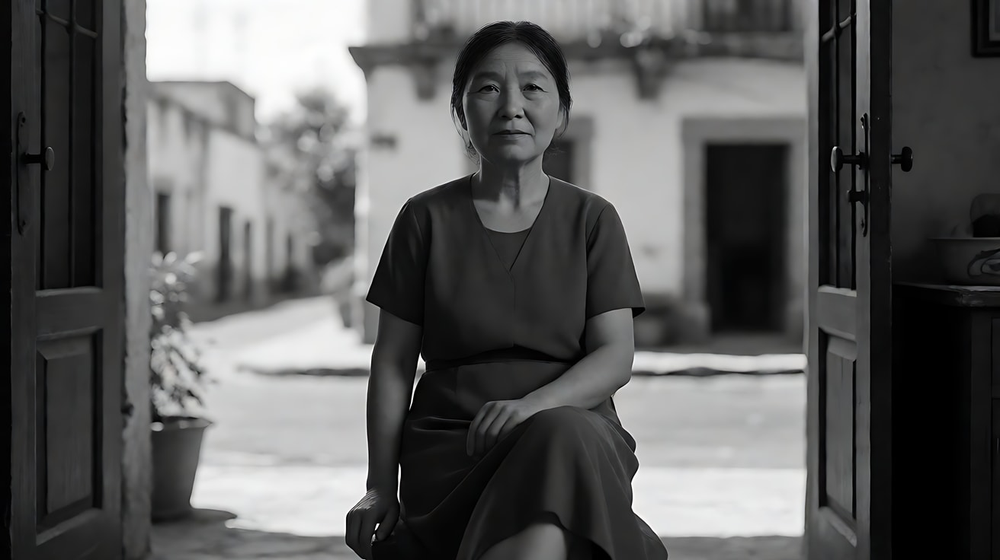

# L02-01 景深三要素：光圈、焦距、对焦距离（以及画幅）

> 段位：基础 ｜ 建议用时：50 分钟 ｜ 配套提示词：[L02-01-景深三要素-提示词](../提示词/L02-01-景深三要素-提示词.md)

## 学习目标

- 能用一句话说清"景深"是什么，并画出焦平面、前景深、后景深的示意图
- 能说出光圈、焦距、对焦距离、画幅四个因素各自如何让景深变浅或变深
- 能根据情绪选择浅景深（孤立、亲密、主观）或深景深（客观、处境、信息）
- 能描述焦外光斑（bokeh）的形状与大小从哪里来，并在提示词里写准
- 能在生图提示词里写出"焦段 + 光圈 + 对焦点 + 背景状态"四件套，并在 Seedance 里锁住景深不漂移

## 一、概念讲解

### 1. 景深是"可接受的清晰范围"

镜头一次只能精确对焦在**一个距离**上，这个距离形成一个看不见的面，叫**焦平面**。焦平面前后有一段区域，虽然不是绝对清晰，但人眼看起来仍然"够清楚"，这段区域就是**景深**。

```
  相机              近界限            焦平面                     远界限
   ▣ ─────────────────┼────────────────┃──────────────────────────┼──────────→ 距离
                      │◄── 前景深 ───►│◄──────── 后景深 ────────►│
                      │    （约 1/3）   │          （约 2/3）       │
   虚 · · · · · · · · │        清  晰  区  域  =  景  深          │ · · · · · · 虚

   · 焦平面前方的清晰范围短，后方的清晰范围长（中远距离时大致 1:2）
   · 拍得越近，这个比例越接近 1:1，整个景深也越薄
```

记住两个直觉：

- **景深不是开关，是渐变。** 离焦平面越远越虚，所以"浅景深"指清晰区很薄，"深景深"指清晰区很厚。
- **焦平面是导演指定的。** 对焦在哪里，就是告诉观众"看这里"。景深是导演控制注意力的第一把钥匙。

### 2. 四个因素

| 因素 | 往"浅景深"调 | 往"深景深"调 | 导演备注 |
|---|---|---|---|
| 光圈（f 值） | 开大光圈：f/1.4、f/2 | 收小光圈：f/8、f/11、f/16 | f 值越小，光圈越大，景深越浅。最直接的旋钮 |
| 焦距 | 长焦：85mm、135mm | 广角：18mm、24mm | 在**同一拍摄距离**下，焦距越长景深越浅 |
| 对焦距离 | 对焦很近：贴近人物、微距 | 对焦很远：远处山脉、超焦距 | 拍摄距离越近景深越浅，微距时景深只有几毫米 |
| 画幅（传感器/胶片尺寸） | 大画幅：全画幅、65mm | 小画幅：Super 16、手机 | 同一景别、同一视角、同一光圈下，画幅越大景深越浅 |

**光圈刻度**（每一档进光量减半，景深变深一点）：

```
 f/1.4   f/2   f/2.8   f/4   f/5.6   f/8   f/11   f/16
  ◉       ◉      ●      ●      •      •     ·      ·      ← 光圈开口由大到小
 [极浅]──[浅]──────[中等]─────────[深]──────[极深]          ← 景深由薄到厚
 人像特写  情绪近景   双人中景    街景群像   风光/深焦调度
```

### 3. 一个容易误解的点：焦距与景别

很多教程说"长焦景深浅"。准确地说：**如果保持景别不变**（用长焦就要后退），景深的总厚度变化没有想象中那么大，真正变化最大的是**背景被放大了多少**。长焦把背景里的一盏灯放大成一个大光斑，看起来就"更虚"。

所以写提示词时，想要"背景化成一片奶油"，最可靠的组合是：**长焦 + 大光圈 + 背景离人物很远**。人物贴着墙站，用什么光圈都虚不掉墙。

```
  人物离背景近：                    人物离背景远：
  ▣ ────────── 人│墙                ▣ ────────── 人 ─────────────────── 灯光
  墙在景深边缘，只是微微软           背景远离焦平面，化成大块柔和光斑
```

### 4. 画幅为什么影响景深

画幅越大，要拍出同样的景别就要用更长的焦距（或离得更近），于是景深变浅。粗略换算：

| 画幅 | 要拍出全画幅 50mm 的视角，大约用 | 同光圈下景深 |
|---|---|---|
| Super 16 | 约 18–20mm | 很深，背景难虚化（纪录片、怀旧感） |
| Super 35（电影最常见） | 约 35mm | 中等 |
| 全画幅 | 50mm | 较浅 |
| 65mm 大画幅 | 约 70–80mm | 很浅，人物与背景分离度高 |

> 本教程提到的焦段都是**全画幅等效焦段**。写提示词时直接写 `50mm lens` 即可，生图模型默认按这个习惯理解。

### 5. 焦外光斑（bokeh）

焦平面以外的**点光源**（路灯、霓虹、烛火、水面反光）不会消失，而是扩散成一块块光斑。光斑是浅景深最有情绪的副产品。

```
  焦平面上的路灯：  ·              焦外的路灯：   ◯   ◯
                                                ◯   ◯   ◯      ← 越远离焦平面，光斑越大越淡
  圆形光圈叶片 → 圆形光斑 ◯     少叶片光圈收小 → 多边形光斑 ⬡
  画面边缘 → 被镜筒切掉一角的"猫眼"光斑 ◐      变形宽银幕镜头 → 竖向椭圆光斑 ⬭（见 L02-02）
```

| 光斑变量 | 由什么决定 | 情绪 |
|---|---|---|
| 大小 | 光圈越大、焦距越长、点光源离焦平面越远，光斑越大 | 大光斑：梦境、回忆、心事；小光斑：克制、写实 |
| 形状 | 光圈叶片形状、镜头类型 | 圆形柔和；多边形偏硬、偏冷；椭圆带宽银幕质感 |
| 前景光斑 | 点光源在人物和镜头之间 | 像隔着一层东西看人，窥视、距离感 |
| 背景光斑 | 点光源在人物身后 | 城市、节日、人群在远处热闹，人物在近处孤独 |

### 6. 超焦距：让"从近到无穷远都清楚"

把焦点对在某个特定距离（超焦距）上，景深会从这个距离的一半一直延伸到无穷远。广角镜头 + 小光圈时，超焦距很近，所以纪录片和风光镜头常常"什么都清楚"。下一课和 L02-04 的深焦调度都建立在这个原理上。

## 图解

> 这些示意图由多种生图模型分别生成（包括 Nano Banana、GPT Image 等），只用来说明镜头概念；不同模型的画面不能互相比较效果，也不能当作视频成片。


85mm、大光圈。脸是清楚的，窗外的灯变成圆斑。观众只能先看她。



24mm、小光圈。绿门、她的脸、远处的房子同时清楚。观众的眼睛可以在三层之间自己走。

## 二、情绪与叙事功能

| 技法 | 观众的感受 | 常用场景 |
|---|---|---|
| 极浅景深（f/1.4，只有眼睛清楚） | 进入人物内心，世界消失，只剩这一刻 | 顿悟、告白、回忆闪现、主观感受 |
| 浅景深（f/2–f/2.8，人物清楚背景虚） | 主角从环境中被"挑出来"，孤立或被珍视 | 人群中的孤独、人像近景、爱情片 |
| 中等景深（f/4–f/5.6） | 人物与环境都可读，平衡、日常 | 对话中景、生活流 |
| 深景深（f/8–f/16，前后都清楚） | 客观、冷静，观众自己选看哪里；人物被处境包围 | 建立镜头、群像、权力关系、悬疑线索 |
| 大背景光斑 | 温暖、梦幻，或"热闹是他们的" | 夜景、节日、城市夜归 |
| 前景光斑遮挡 | 隔着东西看，距离、窥视 | 偷看、暗恋、监视 |

**导演公式**：先问"这个镜头里，观众需要知道环境吗？"需要，就加深景深；不需要、甚至要让环境消失，就变浅。

## 三、经典影片案例

### 《巴里·林登》（1975，斯坦利·库布里克）烛光室内戏
- 场景：18 世纪的贵族沙龙与赌桌，室内只有蜡烛照明。
- 怎么拍的：摄影指导约翰·奥尔考特使用了蔡司为航天拍摄制造的 50mm f/0.7 超大光圈镜头，只靠烛光曝光。代价是景深极浅，演员前后移动一点就会跑焦，因此调度以静坐、小幅动作为主。
- 为什么这样拍：意图是让观众感到"这是一个只被烛火照亮的、尚无电灯的世界"。极大光圈既解决了曝光，也让烛光化成柔软的光斑，背景沉进暖黑，画面像古典油画，人物被困在小小的光圈里。
- 学到什么：**光圈不只是景深工具，也是"在什么光下能拍"的工具**。光越暗，越被迫开大光圈，景深越浅，这本身就会成为风格。



### 《她》（2013，斯派克·琼斯）城市中的独处
- 场景：主人公西奥多在未来洛杉矶的街道、地铁、高楼间独自行走，与操作系统交谈。
- 怎么拍的：摄影指导霍伊特·范·霍伊特玛大量使用浅景深近景，人物清晰，身后的城市、人群与灯光虚成柔和的色块。
- 为什么这样拍：意图是让观众感到"他和周围所有人都隔着一层"。背景里的人都在，但看不清；只有他自己是清晰的，而他交谈的对象根本不在画面里。浅景深在这里不是"好看"，而是孤独的视觉化。



### 《罗马》（2018，阿方索·卡隆）反例：大画幅也可以很深
- 场景：女佣克里奥在墨西哥城的家中、街道和海边的日常。
- 怎么拍的：卡隆亲自掌镜，用 65mm 大画幅数字摄影机拍黑白，大量使用广角、收小光圈、缓慢横摇的长镜头，前景人物与远处街景同时清楚。
- 为什么这样拍：意图是让观众"像站在房间里一样旁观她的生活"，不替观众挑重点。大画幅本来容易浅，但导演主动用广角和小光圈把景深加深，说明**四个因素是组合使用的，最终服务于意图**。



## 四、在 AI 中怎么实现

- **生图阶段**：景深在关键帧里就定死了，Seedance 很少主动改变它。每条关键帧都写"四件套"：
  - 焦段：`85mm lens`
  - 光圈与景深：`f/1.8, shallow depth of field`
  - 对焦点：`focus on her eyes` / `focus on the letter in the foreground`
  - 背景状态：`the night market behind her dissolves into large soft round bokeh` 或 `everything from the foreground table to the far doorway is sharp`
  - 想要大光斑，记得在背景里**放点光源**（灯串、路灯、烛火、车灯），并让人物离背景远
- **视频阶段**：在 Seedance 提示词里用中文再说一遍"焦点始终在她的脸上，背景保持柔和虚化"或"前景到远景始终清晰"。人物移动时写清是否需要焦点跟随：`她向镜头走近，焦点始终跟随她的脸`。
- **模型擅长**：浅景深人像、夜景光斑、烛光与霓虹的焦外、深焦风景。
- **要避开**：
  - 只写 `bokeh` 不写光源，模型会随机生成发光圆点，像贴纸。
  - 写 `f/1.4` 又写 `everything sharp`，自相矛盾。
  - 运动中景深"呼吸"：背景时清时虚。用"背景虚化程度保持不变"锁住。
  - 极浅景深 + 大幅动作：模型会把脸也弄虚。动作越大，景深写得越保守（f/2.8）。
  - **画风开关 C（2D 动画）和 D（水墨）不写焦段、光圈、景深**，改写成"背景虚化处理""远景色块简化"。本模块练习一律用开关 A。

## 五、练习作业

1. 拿手机或相机做一个实验：同一个人物、同一个背景，分别让人物贴墙站、离墙三米站，各拍一张人像模式照片，比较背景虚化。写下你的结论。
2. 找三部电影的截图，判断它们大约是浅、中、深哪种景深，并写一句"导演为什么选这个景深"。
3. 把"女孩在夜市等人"写成两个版本：浅景深（她在等的人还没来，世界与她无关）和深景深（她在人群中，随时可能看见他）。各写一条生图提示词，标出四件套。
4. 完成配套提示词练习1–5，重点比较练习2的两个版本。

## 六、自检清单

- [ ] 我能画出焦平面、前景深、后景深的示意图
- [ ] 我能说出四个因素各自让景深变浅的方向
- [ ] 我知道"背景离人物多远"对虚化的影响比焦距更直观
- [ ] 我的每条关键帧都写了焦段、光圈、对焦点、背景状态
- [ ] 想要光斑时，我在背景里写了具体的点光源
- [ ] 我的 Seedance 提示词写了"焦点在哪里、背景虚化保持不变"
- [ ] 2D 或水墨画风时，我删掉了所有镜头参数

## 七、配套提示词

→ [L02-01-景深三要素-提示词](../提示词/L02-01-景深三要素-提示词.md)

---

上一课：[L01-05 景别反差叙事](../../01-景别/教学/L01-05-景别反差叙事.md) ｜ 下一课：[L02-02 焦段性格](L02-02-焦段性格.md) ｜ [返回总目录](../../README.md)
