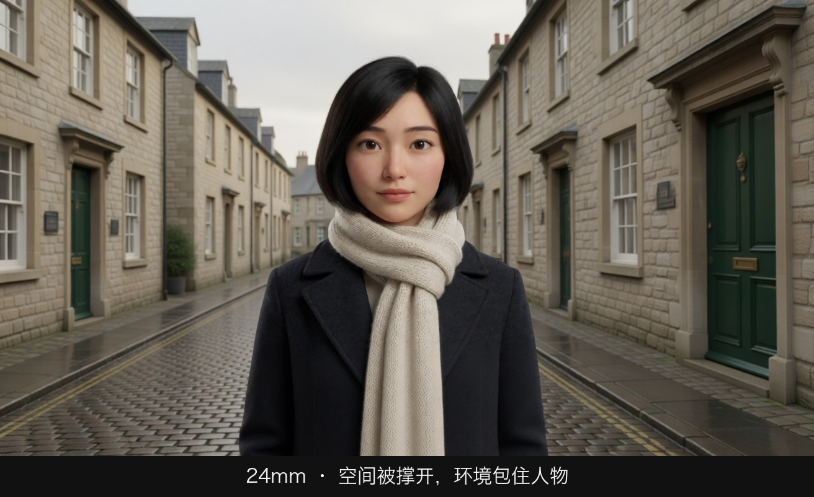
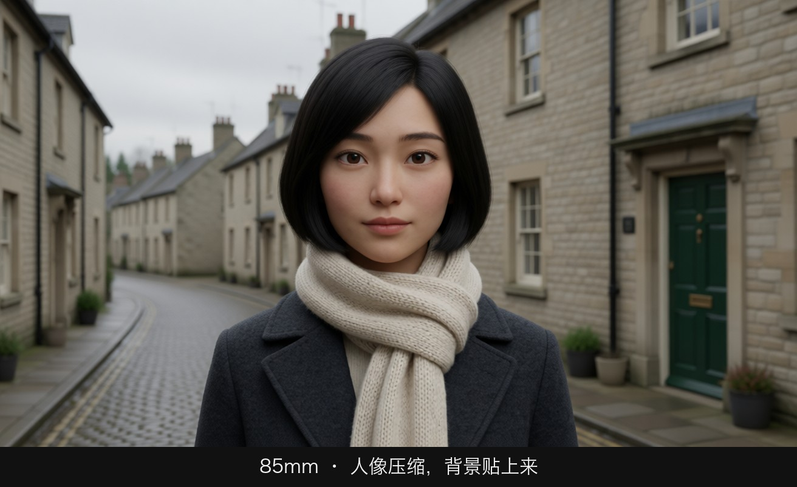
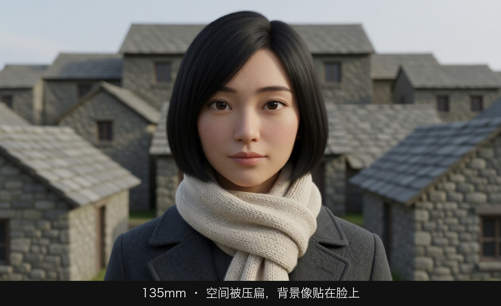
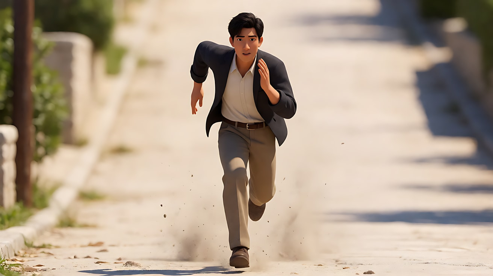
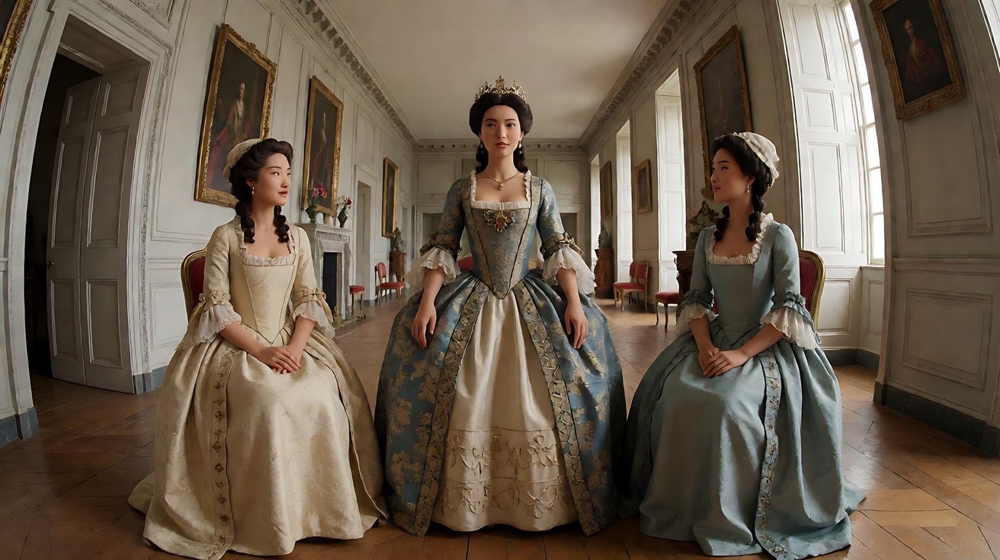
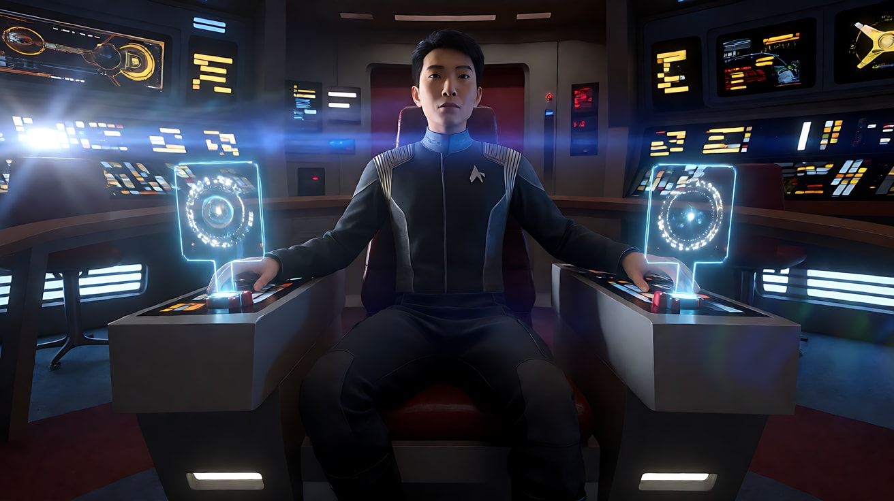

# L02-02 焦段性格：从 14mm 到微距

> 段位：基础 ｜ 建议用时：60 分钟 ｜ 配套提示词：[L02-02-焦段性格-提示词](../提示词/L02-02-焦段性格-提示词.md)

## 学习目标

- 能说出 14/18/24/35/50/85/135/200mm 与微距各自的视角、透视特征和"性格"
- 理解"透视由机位距离决定，焦段决定你必须站多远"这一核心原理
- 能分辨广角畸变带来的空间张力与长焦压缩带来的拥挤、孤立、徒劳感
- 能说出变形宽银幕镜头（anamorphic）的三大标志：2.39:1 画幅、竖向椭圆光斑、横向拉丝光晕
- 能在提示词里用"焦段 + 机位距离 + 背景状态"写出焦段性格，而不是只写一个数字

## 一、概念讲解

### 1. 焦段是"性格"，不只是"远近"

新手以为焦段只是"拉近还是推远"。其实不同焦段拍同一个景别，画面里的**空间关系**完全不同：脸的形状、背景的大小、人物与环境的距离感、运动的速度感都会变。导演选焦段，就是选这个镜头的"世界观"。

### 2. 焦段性格表（全画幅等效）

| 焦段 | 水平视角（约） | 透视特征 | 性格 | 典型用途 |
|---|---|---|---|---|
| 14mm 超广角 | 104° | 强烈桶形畸变，边缘拉伸，近大远小极端 | 不安、怪诞、压迫、扭曲的主观 | 噩梦、醉酒、狭小空间的窒息、强权人物的低角度 |
| 18mm | 90° | 明显的空间夸张，走廊被拉长 | 张力、动感、侵略性 | 动作戏贴身跟拍、建筑空间、狂乱 |
| 24mm | 74° | 空间开阔，近景人物轻微变形 | 环境叙事、临场、"在场" | 建立镜头、纪录片感、带环境的人物镜头 |
| 35mm | 54° | 接近人眼注意的视野，轻微广角感 | 自然、亲切、叙事中性 | 剧情片的"默认"焦段、双人中景、街头 |
| 50mm 标准 | 40° | 透视最接近人眼对单一主体的观看 | 客观、诚实、不评论 | 对话、日常、克制的风格 |
| 85mm 人像 | 24° | 脸部比例好看，背景开始放大 | 亲密、温柔、把人"挑出来" | 人像近景、爱情、内心戏 |
| 135mm | 15° | 明显压缩，背景像一堵墙贴上来 | 窥视、孤立、隔着距离观看 | 偷拍视角、人群中的孤独、情绪特写 |
| 200mm 及以上 | 10° 以下 | 极度压缩，前后层次挤成一片 | 徒劳、拥挤、宿命、热浪 | 跑不近的奔跑、城市人海、沙漠热浪、体育 |
| 微距（Macro） | 视镜头而定 | 1:1 放大，景深只有毫米级 | 显微镜般的凝视，物件有了生命 | 眼睛虹膜、水滴、昆虫、机械零件、产品质感 |

### 3. 核心原理：透视由距离决定

这是整课最重要的一句话：**透视（脸的变形、背景的大小）只由相机到被摄体的距离决定。焦段的作用是：为了拍出同样的景别，你必须站在哪里。**

同一个人物、同一个中近景，换焦段并后退：

```
  俯视图（人物与背景墙距离不变，相机后退以保持中近景）

  背景墙 ════════════════════════════════════════════════
          ↑ 24mm 看到的背景：一大片（整面墙、两扇窗）
          ↑ 50mm 看到的背景：一扇窗
          ↑ 135mm 看到的背景：窗框的一角，被放大成"一堵墙"
                         ☺  人物
                         │
               ▣ 24mm    │ 0.6 米  → 鼻子显大，脸被拉长，背景小而远，空间开阔
                         │
               ▣ 50mm    │ 1.3 米  → 比例自然，背景适中
                         │
                         │
               ▣ 135mm   │ 3.5 米  → 脸部扁平好看，背景被放大、贴近，人被"压"在环境上
```

| 对比项 | 24mm 贴近 | 50mm | 135mm 后退 |
|---|---|---|---|
| 脸型 | 鼻子与额头前突，脸部拉长 | 自然 | 略扁平，五官紧凑 |
| 背景范围 | 很宽，环境信息多 | 适中 | 很窄，只剩一小块 |
| 背景大小 | 小、远 | 适中 | 大、近，像贴在身后 |
| 观众心理 | 我就在他身边，甚至太近了 | 我在正常交谈 | 我在远处看着他，他看不见我 |

**配套提示词练习2 就是这个实验**，请务必做。

### 4. 广角：畸变与空间张力

- **桶形畸变**：直线在画面边缘向外弯曲。超广角下，靠近画边的人脸被横向拉伸。
- **空间夸张**：前景物体巨大、背景物体很小，走廊显得更长，房间显得更大。
- **低角度 + 广角**：人物腿部和身体被拉长，头部变小，显得高大、有威胁。
- **贴脸广角**：鼻子放大，表情怪异，常用于噩梦、醉态、精神失控。
- **运动速度感**：广角跟拍时前景快速掠过，速度感被放大。

### 5. 长焦：压缩

- **层次压缩**：前后相距几十米的物体看起来挤在一起。城市的楼群、车流、人潮显得密不透风。
- **运动"无效"**：人物向镜头奔跑，体积几乎不变，看起来怎么也跑不近，产生徒劳或焦急感。
- **孤立**：长焦配合浅景深，把人物从人群中剥离出来。
- **偷看感**：长焦意味着摄影机离得很远，观众天然带上"监视者"的身份。
- **热浪**：远距离拍摄时空气扰动可见，沙漠、柏油路的画面会微微抖动。

### 6. 微距：把小东西拍成世界

微距镜头能把硬币大小的东西拍满画面。景深极浅（可能只有几毫米），所以：

- 对焦点必须精确：写清"焦点在虹膜的纹理上""焦点在水滴的边缘"
- 运动要小：微距下任何移动都被放大
- 常与"揭示"连用：先看到一个看不懂的纹理，再拉出看到它是什么

### 7. 变形宽银幕镜头（anamorphic）

变形镜头在拍摄时把画面**横向压缩**（常见 2 倍），放映或后期再拉伸回来，得到约 **2.39:1** 的宽银幕画幅。它的光学结构带来三个辨识度极高的特征：

```
  球面镜头的焦外光斑：   ◯  ◯  ◯          （圆形）
  变形镜头的焦外光斑：   ⬮  ⬮  ⬮          （竖向椭圆，像竖起来的鸡蛋）

  变形镜头的光晕：
     ──────────────────────✺──────────────────────     ← 强光源产生一条横贯画面的拉丝光晕（常见偏蓝）

  其他特征：画面边缘轻微桶形畸变；焦点改变时画面有"呼吸"；同样视角下景深更浅
```

| 特征 | 视觉结果 | 情绪 |
|---|---|---|
| 2.39:1 宽画幅 | 横向空间大，适合大场面和人物之间的距离 | 史诗、疏离、仪式感 |
| 竖向椭圆光斑 | 夜景灯光变成竖立的椭圆 | 宽银幕的"电影院"质感、夜色迷离 |
| 横向拉丝光晕 | 车灯、手电、阳光拉出水平光带 | 科幻、霓虹都市、未来感、紧张 |
| 边缘畸变与焦点呼吸 | 画面有"镜头感"，不完美 | 有温度的胶片质感 |

## 图解

> 这些示意图由多种生图模型分别生成（包括 Nano Banana、GPT Image 等），只用来说明镜头概念；不同模型的画面不能互相比较效果，也不能当作视频成片。


同一个人，三档焦段。看的不是「清不清」，是空间被撑开还是压扁。



站得近、用广角。街道被撑开，环境包住她，近处的肩膀会略大。



退远再用 85mm 把人框回中近景。脸的比例自然，身后的房子被压近。



长焦把背景叠到脸后面，空间变薄，景深也更浅。

## 二、情绪与叙事功能

| 技法 | 观众的感受 | 常用场景 |
|---|---|---|
| 超广角贴脸 | 不适、怪诞、精神失控 | 噩梦、醉酒、偏执、反派登场 |
| 广角低角度 | 人物高大、威压，空间在倾斜 | 权力、威胁、英雄登场 |
| 广角大全景 | 人物渺小、处境开阔 | 建立镜头、荒野、孤独 |
| 35/50mm | 自然、诚实、不加评论 | 日常对话、生活流、写实 |
| 85mm 近景 | 温柔、亲密、被珍视 | 爱情、内心、告白 |
| 135/200mm 压缩 | 拥挤、徒劳、被监视、孤立 | 人海、追逐、偷拍视角、宿命 |
| 微距 | 显微镜般的专注，物件有了情绪 | 线索、产品、细节揭示 |
| 变形宽银幕光晕 | 宽银幕的仪式感、科幻、都市夜色 | 科幻、动作、霓虹夜景 |

## 三、经典影片案例

### 《毕业生》（1967，迈克·尼科尔斯）奔向教堂
- 场景：本杰明得知伊莱恩即将在教堂结婚，一路赶去，车没油后徒步狂奔。
- 怎么拍的：用长焦镜头从远处正面拍他朝镜头奔跑。由于长焦压缩，他拼命跑了很久，在画面里的大小几乎没有变化。
- 为什么这样拍：意图是让观众感到"他拼尽全力，却怎么也到不了"。长焦把"距离"变成了心理上的焦虑，观众和他一起着急。
- 学到什么：**长焦不是"拍远处的工具"，而是"让运动失效"的工具。**



### 《宠儿》（2018，欧格斯·兰斯莫斯）宫廷里的鱼眼
- 场景：18 世纪英国宫廷，女王与两位争宠女性之间的权力游戏。
- 怎么拍的：摄影指导罗比·瑞安大量使用超广角乃至鱼眼镜头拍摄宫廷走廊与房间，画面边缘严重弯曲，人物在巨大空间里显得渺小而荒诞。
- 为什么这样拍：意图是让观众感到"这个宫廷是一个扭曲的、像在玻璃球里被窥看的世界"。超广角的畸变让华丽变得怪诞，权力斗争显得滑稽又令人不安。



### 《星际迷航》（2009，J·J·艾布拉姆斯）满屏的横向光晕
- 场景：企业号舰桥、太空战斗与各种室内戏。
- 怎么拍的：使用变形宽银幕镜头，并刻意在画外布置强光源打向镜头，让画面频繁出现横贯全屏的蓝色拉丝光晕。
- 为什么这样拍：意图是让观众感到"未来是明亮的、充满能量的"。光晕成为影片的视觉签名。这也是一个教训：光晕用得太多，会喧宾夺主——这部电影的光晕至今被观众反复讨论，褒贬都有。



### 补充：黑泽明的长焦战场
黑泽明在《七武士》（1954）的雨中混战里使用长焦镜头多机位拍摄，人群、马匹、雨幕被压缩成密不透风的一团，观众感到的是混乱与拥挤，而非清楚的地理。长焦压缩也能用来制造"乱"。


## 四、在 AI 中怎么实现

- **生图阶段**：
  - 焦段要和**机位距离、景别**一起写，模型才能推断出正确的透视：`85mm lens from about three meters away, medium close-up`。
  - 广角要写出它的后果：`24mm lens very close to his face, his nose slightly enlarged, the corridor stretching far behind him`。
  - 长焦要写出压缩的后果：`200mm telephoto from far away, the crowd and buildings compressed into a dense wall behind her`。
  - 微距要写对焦点：`macro lens, focus on the edge of a single water droplet, depth of field only a few millimeters`。
  - 变形镜头写三件套：`anamorphic lens look, vertically oval bokeh, a thin horizontal blue lens flare streak across the frame, 2.39:1 widescreen`。不要写镜头品牌。
- **视频阶段**：Seedance 很少主动改变焦段，所以焦段性格主要由首帧决定。视频提示词里用中文复述一次焦段感受：`长焦压缩，背景楼群像一堵墙贴在她身后`。多镜头时，在每个镜头块里写焦段，让模型拉开差异。
- **模型擅长**：广角大空间、长焦人像、长焦城市压缩、微距物件、横向光晕。
- **要避开**：
  - 只写 `135mm` 却又写 `wide shot of the whole street`，自相矛盾，模型通常会忽略焦段。
  - 超广角贴脸拍正脸：容易被平台判为人脸异常，也容易变形失控。改用三分之四侧面或低角度。
  - 光晕和光斑写得太多：每个镜头最多一条光晕，否则像滤镜。
  - 视频里写"变焦"：Seedance 的"变焦"和"推镜"容易混淆，本课不在镜头内变焦，变焦留到 L02-05 滑动变焦。
  - **开关 C（2D）/ D（水墨）不写焦段**，改用"夸张透视的广角构图""远景层层叠压"之类的绘画语言。

## 五、练习作业

1. 用手机的 0.5x、1x、3x（或更高）三个镜头，拍同一个朋友的中近景：每换一次焦段就后退，让他的脸在画面里大小相同。并排比较脸型和背景。
2. 为下面三句意图各选一个焦段并写出理由：①"他被困在拥挤的城市里"；②"她第一次走进这座巨大的空房子"；③"他在偷偷观察她"。
3. 找一部使用变形宽银幕镜头的电影截图，圈出竖向椭圆光斑和横向光晕。
4. 完成配套提示词练习1–5，重点完成练习2 的三焦段对比。

## 六、自检清单

- [ ] 我能说出九个焦段（含微距）各自的性格
- [ ] 我知道透视由机位距离决定，焦段决定我要站多远
- [ ] 我写焦段时同时写了机位距离和景别
- [ ] 广角镜头我写出了"畸变/空间拉长"的后果，长焦镜头我写出了"压缩"的后果
- [ ] 我能认出变形宽银幕的椭圆光斑和横向光晕
- [ ] 提示词里没有镜头品牌名
- [ ] 2D 或水墨画风时，我没有写焦段数字

## 七、配套提示词

→ [L02-02-焦段性格-提示词](../提示词/L02-02-焦段性格-提示词.md)

---

上一课：[L02-01 景深三要素](L02-01-景深三要素.md) ｜ 下一课：[L02-03 焦点转移与前景虚化](L02-03-焦点转移与前景虚化.md) ｜ [返回总目录](../../README.md)
