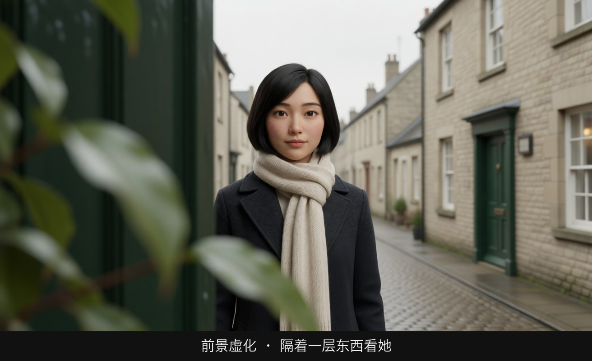

# L02-03 焦点转移与前景虚化：在一个镜头里移动观众的眼睛

> 段位：基础 ｜ 建议用时：55 分钟 ｜ 配套提示词：[L02-03-焦点转移与前景虚化-提示词](../提示词/L02-03-焦点转移与前景虚化-提示词.md)

## 学习目标

- 能说清焦点转移（rack focus）和跟焦（follow focus）的区别
- 能说出焦点转移的四种叙事作用：注意力转移、揭示、反应、关系
- 能用前景虚化遮挡制造窥视、距离和压迫，用焦外人物制造"有人在那里"的不安
- 能在 Seedance 中写出稳定的焦点转移：机位锁定、两个对象明确、位置明确、有触发
- 能识别并修复 AI 焦点转移的常见失败：两者同时清晰、变成推镜、对象互换或变形

## 一、概念讲解

### 1. 焦点转移：不动机位，移动注意力

**焦点转移（rack focus / focus pull）**：摄影机不动，焦点在镜头内从一个对象移到另一个对象。原来清晰的变虚，原来虚的变清晰。观众的眼睛会**不由自主地跟着清晰的那个走**。

```
  侧视图（浅景深，两个对象在不同距离）

   ▣ 相机 ──────── A（前景：桌上的钥匙） ───────────────── B（后景：门口的人）
                    │                                      │
   开始：           ┃ 焦平面在 A                            │  B 虚成一团人影
                    │                                      │
   转移中：         │ ─────── 焦平面向后滑动 ─────────────► │
                    │                                      │
   结束：           │  A 虚成一团金属反光                    ┃ 焦平面在 B
```

**与跟焦的区别**：

| | 焦点转移 rack focus | 跟焦 follow focus |
|---|---|---|
| 对象 | 两个对象之间切换 | 同一个对象 |
| 目的 | 移动观众的注意力，"现在看这个" | 让运动中的对象始终清晰 |
| 观众是否察觉 | 察觉，是一个叙事动作 | 不应察觉，是技术保障 |

### 2. 焦点转移的四种叙事作用

| 类型 | 方向 | 例子 | 观众的感受 |
|---|---|---|---|
| 注意力转移 | 任意 | 从说话的人移到听的人 | "该看他了" |
| 揭示 | 常从近到远 | 从主角的脸移到她身后门口站着的人 | "原来他一直在那里" |
| 反应 | 常从物到人 | 从桌上的信移到读信人的脸 | "看到了，然后呢？" |
| 关系 | 在两人之间来回 | 前景的他、后景的她，焦点在两人之间往返 | 两人之间有一根看不见的线 |

**节奏**：转移速度本身就是表演。慢转（两三拍）像思考、像逐渐意识到；快转（一拍）像惊觉、像被打断。

### 3. 前景虚化遮挡

把一个虚化的物体放在镜头和主体之间，挡住画面的一部分：

```
  ┌──────────────────────────────────────────────┐
  │▓▓▓▓▓▓▓▓░░                                     │
  │▓▓▓▓▓▓▓▓▓░░          ☺ 主体（清晰）            │   ▓ = 前景虚化物体（门框、书架、
  │▓▓▓▓▓▓▓▓▓░░            ╱│╲                      │       植物叶子、玻璃反光、人的肩膀）
  │▓▓▓▓▓▓▓▓▓░░            ╱ ╲                      │   ░ = 前景物体的虚化边缘
  │▓▓▓▓▓▓▓▓░░                                     │
  └──────────────────────────────────────────────┘
       观众像是"躲在什么东西后面"在看
```

| 前景物 | 效果 |
|---|---|
| 门框、墙角、窗帘 | 窥视、偷听，观众像在门外 |
| 植物、栏杆、铁丝网 | 隔阂、监视、被困 |
| 另一个人的肩膀（过肩虚化） | 对话中的关系，我们站在他这一边 |
| 玻璃上的雨珠、灯光反射 | 内心与外界隔着一层 |
| 杯子、花瓶、桌上道具 | 生活细节，或一个即将重要的线索 |

### 4. 焦外人物

画面后景里一个**看不清的人影**，比清楚的人更让人不安：

- 观众知道"那里有人"，却看不清是谁、在做什么
- 主角往往不知道（观众比角色知道得多 = 悬念）
- 常与揭示型焦点转移配合：先让人影虚着，最后焦点转过去

### 5. 焦点转移的物理条件

想让焦点转移"看得出来"，必须满足：

1. **浅景深**：长焦（85mm 以上）+ 大光圈（f/2 左右）。深景深下两者都清楚，转了等于没转。
2. **两个对象距离差够大**：前景在一米内，后景在三米外。
3. **两个对象在画面中错开**：一左一右，或一上一下，不要重叠。
4. **机位不动**：转焦时再加运镜，观众的注意力会被运镜抢走。

## 图解

> 这些示意图由多种生图模型分别生成（包括 Nano Banana、GPT Image 等），只用来说明镜头概念；不同模型的画面不能互相比较效果，也不能当作视频成片。




焦点在她身上，最靠近镜头的门边和叶子是糊的。观众感到自己隔着一层东西在看。


第一帧：杯子清楚，人是软的。观众先读到「这杯东西」。


同一张桌子，焦点交给脸，杯子变糊。这就是一次焦点转移的两端，视频里让焦点从杯子走到眼睛。

## 二、情绪与叙事功能

| 技法 | 观众的感受 | 常用场景 |
|---|---|---|
| 慢速焦点转移 | 逐渐意识到、思考、发现 | 线索、顿悟、回忆 |
| 快速焦点转移 | 惊觉、被打断、危险出现 | 悬疑、惊悚、意外登场 |
| 物 → 人的转移 | 看到了东西，看他怎么反应 | 读信、看照片、发现证据 |
| 人 → 人的来回转移 | 两人之间的张力与连接 | 爱情、对峙、暗中较劲 |
| 前景虚化遮挡 | 窥视、偷听、隔阂、被困 | 暗恋、监视、家庭冷战 |
| 焦外人物 | 不安、悬念、被注视 | 惊悚、悬疑、跟踪 |

## 三、经典影片案例

### 《毕业生》（1967，迈克·尼科尔斯）伊莱恩明白真相
- 场景：本杰明吞吞吐吐地向伊莱恩坦白自己与一位已婚女人有过私情，却说不出那个人是谁——而那个人正是她的母亲罗宾逊太太。
- 怎么拍的：伊莱恩处在清晰的近景中，罗宾逊太太出现在她身后的门口，起初是虚的；焦点在两人之间转移，罗宾逊太太变清楚的那一刻，伊莱恩也终于明白了一切，随后焦点回到伊莱恩的脸上。
- 为什么这样拍：意图是让观众感到"真相就站在她身后"。不用切镜头，不用台词点破，焦点本身完成了揭示和反应两个动作。
- 学到什么：**揭示型焦点转移 = 后景的人物 + 前景的反应**，两者都在同一个画面里。


### 《花样年华》（2000，王家卫）被遮挡的两个人
- 场景：周慕云和苏丽珍在公寓、走廊、办公室里来往。
- 怎么拍的：摄影机常常放在门框、窗帘、柱子、栏杆后面，画面的一侧被虚化的前景挡住，人物在剩下的狭窄空间里活动。
- 为什么这样拍：意图是让观众感到"这段感情一直处在别人的目光之下，也处在两人自己的克制之下"。前景遮挡把观众放在了邻居的位置上：我们在偷看，他们在躲。


### 延伸观察：对话中的过肩虚化
几乎所有剧情片的对话戏都会使用过肩镜头：前景是听者虚化的肩膀和后脑，后景是清晰的说话者。这是最日常的前景虚化。下一次看电影时留意：**导演在关键台词上是否把焦点从说话者转到了听者的侧脸上**。


## 四、在 AI 中怎么实现

- **生图阶段**：
  - 首帧要先"摆好"两个对象：写清前景对象在画面哪里、距离多近，后景对象在哪里、距离多远，以及**首帧焦点在谁身上**。
  - 例：`a brass key on the table in the foreground at the bottom left, about half a meter from the lens, in sharp focus; a man standing in the doorway at the right third about four meters away, soft and blurred`。
  - 必写浅景深条件：`85mm lens, f/2, shallow depth of field`。
  - 前景遮挡要写虚化程度和占比：`a dark out-of-focus bookshelf edge covers the left third of the frame`。
- **视频阶段**（Seedance）：
  - **锁定机位**：明确写"镜头固定，不移动，不推近"。焦点转移本身就是这个镜头的主运镜。
  - **两个对象明确**：写清 A 是什么、在哪里，B 是什么、在哪里，不要有第三个对象抢戏。
  - **写方向和速度**：`焦点从前景画左的钥匙缓慢转移到后景画右门口的男人身上，钥匙随之虚化`。
  - **给一个触发**：用声音或小动作作为转焦的理由：`门轴吱呀一声，焦点随之转向门口`。
  - **转焦后再给一个落点**：B 变清晰后，让他做一个小动作并停住。
  - 首尾帧是最稳的做法：首帧焦点在 A，尾帧焦点在 B，构图完全相同。
- **模型擅长**：前景到后景的单次转焦、静物到人物的转焦、过肩虚化、雨窗前景。
- **要避开**：
  - 景深写得不够浅，结果两者一直都清楚。
  - 不写"镜头固定"，模型会用推镜代替转焦。
  - 来回转焦两次以上：模型很难稳定完成，拆成多个镜头。
  - 两个对象都是人且都在动：模型会把两个人的焦点都给到，或者两人融合。让一个人不动。
  - **开关 C / D 不写焦点、景深**，改写"前景大色块遮挡""背景人物简化为剪影"。

## 五、练习作业

1. 在家里用手机人像模式或手动对焦，拍一段焦点从桌上的杯子转到门口家人的视频，比较快转和慢转的感觉。
2. 设计三个焦点转移镜头，分别承担"揭示""反应""关系"三种作用，每个写一句意图和 A、B 两个对象的位置。
3. 为"她在咖啡馆里偷偷看他"设计一个前景遮挡镜头：选一个前景物，写出它挡住画面的哪一部分、为什么选它。
4. 完成配套提示词练习1–5，重点做练习3 的首尾帧转焦。

## 六、自检清单

- [ ] 我能区分焦点转移和跟焦
- [ ] 我的焦点转移镜头有一句意图（揭示、反应、注意力或关系）
- [ ] 首帧写了浅景深条件，两个对象距离差够大且在画面中错开
- [ ] Seedance 提示词写了"镜头固定，不移动"
- [ ] 两个对象都写了是什么、在画面哪里
- [ ] 转焦有一个触发（声音或动作），转焦后有一个落点
- [ ] 一个镜头里只转一次焦

## 七、配套提示词

→ [L02-03-焦点转移与前景虚化-提示词](../提示词/L02-03-焦点转移与前景虚化-提示词.md)

---

上一课：[L02-02 焦段性格](L02-02-焦段性格.md) ｜ 下一课：[L02-04 深焦与多层调度](L02-04-深焦与多层调度.md) ｜ [返回总目录](../../README.md)
