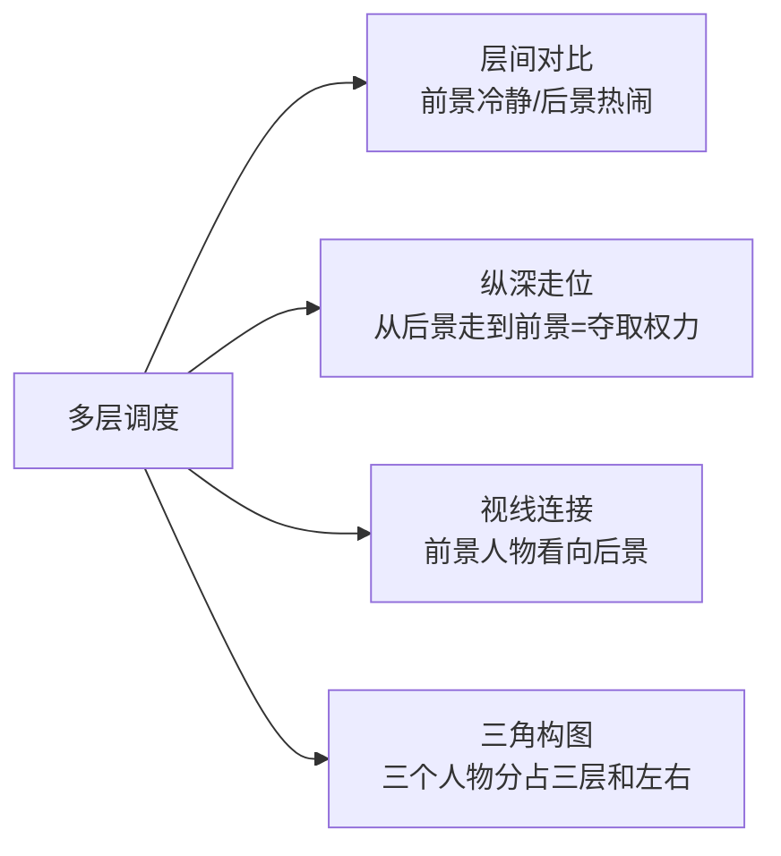
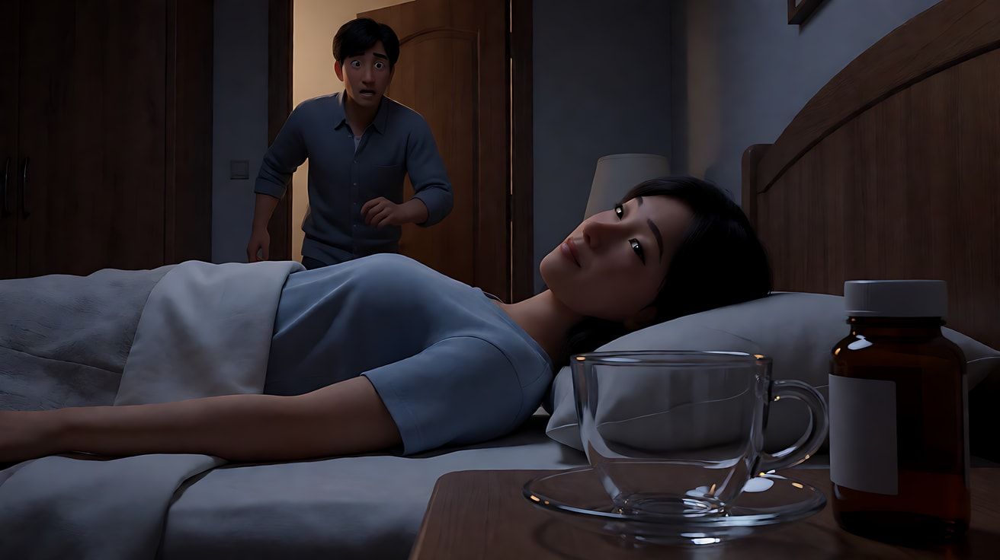
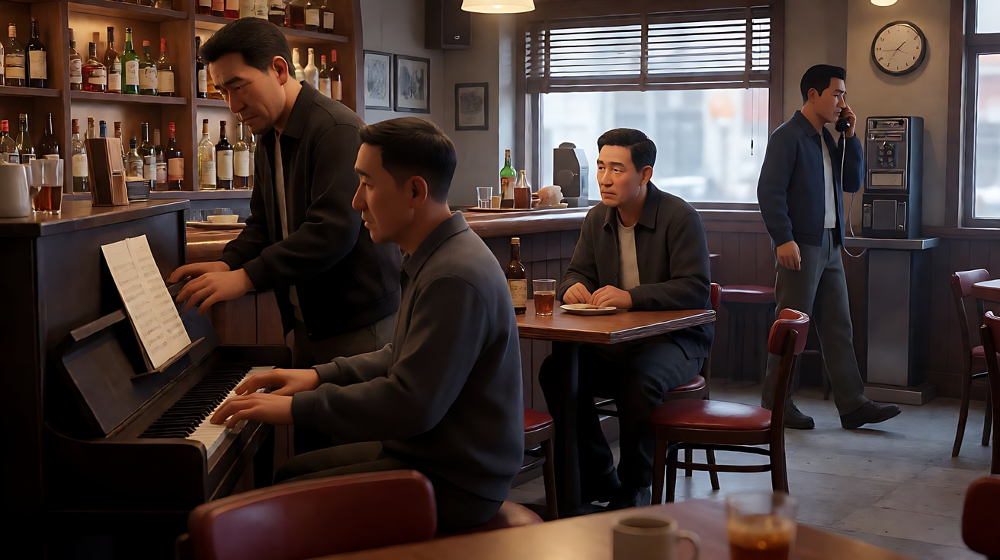

# L02-04 深焦与多层调度：让一个画面同时讲三件事

> 段位：基础 ｜ 建议用时：60 分钟 ｜ 配套提示词：[L02-04-深焦与多层调度-提示词](../提示词/L02-04-深焦与多层调度-提示词.md)

## 学习目标

- 能说清深焦（deep focus）的技术条件：广角、小光圈、充足照明、合理的对焦距离
- 理解深焦的美学意义：不替观众挑重点，让观众自己在画面里"剪辑"
- 能设计前景、中景、后景三层的人物调度，并让每一层承担不同的叙事功能
- 能用纵深方向的走位改变人物之间的权力关系
- 能在 AI 中写出"前中后景全部清晰"且层次不塌的关键帧与视频提示词

## 一、概念讲解

### 1. 什么是深焦

**深焦**：从离镜头很近的前景，到很远的后景，**全部清晰**。上一课的焦点转移是"导演替你决定看哪里"；深焦是"导演把所有东西都放在你面前，你自己看"。

技术条件（四个景深因素全部往"深"调）：

| 因素 | 深焦的做法 |
|---|---|
| 焦距 | 广角：18mm、24mm、28mm |
| 光圈 | 小光圈：f/8、f/11、f/16 |
| 对焦距离 | 对在超焦距附近，让景深覆盖从近到远 |
| 照明 | 小光圈进光少，需要强光或高感光度；早期胶片时代这是最大的难题 |

### 2. 三层空间

深焦画面最经典的结构是三层：

```
  侧视图                                                     画面里看到的
                                                         ┌───────────────────────────┐
   ▣ 相机                                                │           ☺ C            │ ← 后景：小
    │                                                    │      （窗外 / 门口）      │
    ├── 前景 A ── 0.5–1.5 米 ── 大，压在画面边缘           │                           │
    │                                                    │       ☺ B                 │ ← 中景：中
    ├──────── 中景 B ── 3–5 米 ── 主要冲突发生            │      ╱│╲                  │
    │                                                    │██                         │
    └───────────────────── 后景 C ── 8 米以上 ── 小        │██☺ A  （大，半出画）     │ ← 前景：大
                                                         └───────────────────────────┘
           全部清晰（f/11，24mm）
```

| 层次 | 常见承担 | 例子 |
|---|---|---|
| 前景 | 权力、威胁、道具线索、观察者 | 签字的手、一杯毒酒、背对镜头的上司 |
| 中景 | 主要冲突、对话、决定 | 争吵的夫妻、谈判的双方 |
| 后景 | 命运、旁观者、被决定的人、真相 | 窗外玩耍的孩子、门口偷听的人 |

**关键**：三层要**同时**有意义，并且彼此**有关系**。前景在决定后景的命运，而后景的人毫不知情——这就是深焦最强的戏剧张力。

### 3. 多层调度的四种手法



| 手法 | 做法 | 效果 |
|---|---|---|
| 层间对比 | 前景静、后景动；前景在做决定、后景在玩耍 | 反讽、命运感 |
| 纵深走位 | 人物从后景走到前景，或从前景退到后景 | 走向镜头 = 变大、变强；退后 = 变小、失势 |
| 视线连接 | 前景人物的视线越过中景落在后景 | 观众顺着视线把三层串起来 |
| 三角构图 | 三个人物在三层中各占一个位置，左右错开 | 关系清楚，没有人被挡住 |

### 4. 深焦与长镜头

深焦常和长镜头、固定机位一起使用。因为所有层次都清晰，导演不需要切镜头来交代"谁在哪里、在做什么"，演员在纵深里走位就能完成剪辑的工作。电影理论家安德烈·巴赞因此高度评价深焦：它尊重空间的完整，让观众保留选择的自由。

### 5. 深焦的反面：什么时候不用

- 需要观众只看一个东西时（线索、表情），用浅景深或焦点转移
- 背景杂乱、没有叙事信息时，深焦只会让画面变脏
- 层次之间没有关系时，深焦变成"什么都清楚，但什么都没说"

## 图解

> 这些示意图由多种生图模型分别生成（包括 Nano Banana、GPT Image 等），只用来说明镜头概念；不同模型的画面不能互相比较效果，也不能当作视频成片。


深焦的用处是让前、中、后三层同时可读，调度才站得住。下面这张和 [L02-01](L02-01-景深三要素.md) 共用：绿门在前景，人在中景，街道消失在后景，三层都清楚。


## 二、情绪与叙事功能

| 技法 | 观众的感受 | 常用场景 |
|---|---|---|
| 三层同时清晰 | 客观、冷静，像在现场旁观 | 家庭戏、群像、权力关系 |
| 前景决定后景命运 | 反讽、无力、悲剧预感 | 交易、签约、密谋 |
| 后景出现观察者 | 被看见、秘密暴露的紧张 | 偷听、监视、背叛 |
| 人物走向前景 | 掌握主动、夺取权力 | 谈判反转、对峙 |
| 人物退到后景 | 失势、被排挤、被遗忘 | 失败、离开、边缘人 |
| 深焦大空间里的小人物 | 孤独、被环境吞没 | 建筑空间、荒野 |

## 三、经典影片案例

### 《公民凯恩》（1941，奥逊·威尔斯）雪地里的孩子
- 场景：凯恩的母亲在寄宿公寓里签字，把年幼的凯恩交给银行家撒切尔监护。
- 怎么拍的：摄影指导格雷格·托兰德用广角镜头、小光圈、强照明和当时较新的高感光胶片，拍出一个三层同时清晰的画面——前景是母亲与撒切尔在桌前签字，中景是不情愿的父亲，后景透过窗户，小凯恩在雪地里独自玩雪橇，声音隐约传进来。镜头在室内向后移动、调整，但始终把窗外的孩子保留在画面里。
- 为什么这样拍：意图是让观众感到"一个孩子的一生，正在他不知道的地方被决定"。前景在签字，后景在玩耍，两层同时清晰，命运与天真被放在同一个画面里，不需要任何剪辑来提醒观众。
- 学到什么：**深焦最强的用法 = 前景决定后景的命运，而后景毫不知情。**


### 《公民凯恩》（1941）苏珊服药的镜头
- 场景：凯恩的妻子苏珊服药后昏迷在床上。
- 怎么拍的：画面最前景是巨大的药杯和药瓶，中景是床上昏暗中的苏珊，后景是凯恩撞开房门冲进来。三层同时清晰。据记载，这一镜头并非单次曝光直接拍成，而是借助多次曝光等手段合成，以达到超出当时镜头能力的景深。
- 为什么这样拍：意图是让观众在凯恩冲进来之前，就先看到"发生了什么"。前景道具交代原因，中景交代结果，后景是迟到的人。
- 学到什么：**当技术达不到时，导演会用合成实现意图**——这和今天在 AI 里分层生成、合成的思路一致。



### 《黄金时代》（1946，威廉·惠勒）钢琴与电话亭
- 场景：三位退伍军人在酒吧里。前景，失去双手的霍默与店主弹钢琴；中景，阿尔看着他们；后景，弗雷德走进远处的电话亭打一通决定感情去留的电话。
- 怎么拍的：同样由格雷格·托兰德掌镜，深焦让三层同时清晰。阿尔在中景一边看着钢琴，一边不时望向后景的电话亭。
- 为什么这样拍：意图是让观众和阿尔一样，"表面上在看热闹，心里在担心远处那个人"。观众的注意力在前景的欢快和后景的电话亭之间来回拉扯，这种拉扯就是戏。巴赞曾专门分析过这个镜头。



## 四、在 AI 中怎么实现

- **生图阶段**：
  - 必写三件事：`deep focus`、广角焦段（`24mm`）、小光圈（`f/11`），并**明确写出每一层都清晰**：`everything from the teacup in the foreground to the child outside the window is in sharp focus`。
  - 三层分开写，每层写"是什么、在画面哪里、离镜头多远、在做什么"。
  - 左右错开：前景在画左下、中景在画中、后景在画右上，避免人物互相遮挡。
  - 用光分层：后景比中景亮（窗外天光、门口走廊光），观众的眼睛才会被引到最深处。
  - 生成后检查后景人物是否清楚，模型很爱把后景"自动虚化"。
- **视频阶段**（Seedance）：
  - 正文开头复述"前中后景始终全部清晰"。
  - **一个镜头里只让一层做主动作**，其他层保持小动作（呼吸、翻页、玩耍的循环动作），不要冻结。
  - 机位固定或极慢移动；大幅运镜会让后景人物变形。
  - 纵深走位写清起点和终点：`他从后景门口走到前景桌边，停在画左`。
- **模型擅长**：深焦大空间、建筑纵深、两层人物（前景 + 后景）。
- **要避开**：
  - 三层都有人做大动作：模型会混乱，后景人物融化。
  - 后景人物太小又要表演：远处的脸会漂移。后景只给剪影级动作（走过、停下、挥手）。
  - 只写 `deep focus` 不写焦段和光圈：模型偏好浅景深人像，常常无视。
  - 前景物体太大太近：画面变成前景特写，层次被压扁。前景占画面四分之一到三分之一为宜。
  - **开关 C / D 不写焦段光圈**，改写"前中后景层层叠放，远景细节清楚，不做虚化"。

## 五、练习作业

1. 重看《公民凯恩》母亲签字那场戏，画出前景、中景、后景三层各是谁、在做什么、彼此是什么关系。
2. 为"父亲在客厅接到一通坏消息的电话"设计一个三层深焦镜头：前景、中景、后景各放什么，谁知道、谁不知道。
3. 设计一个纵深走位：一个人物从后景走到前景，权力发生了什么变化？写一句意图。
4. 完成配套提示词练习1–5，重点做练习3 的纵深走位首尾帧。

## 六、自检清单

- [ ] 我的深焦关键帧写了广角焦段、小光圈，并明确写出"每一层都清晰"
- [ ] 三层各有叙事功能，并且彼此有关系
- [ ] 三层人物左右错开，没有互相遮挡
- [ ] 后景用光或视线被引导出来
- [ ] 视频里一次只有一层在做主动作
- [ ] 后景人物只做剪影级的大动作，不承担面部表演
- [ ] 我能说出这个镜头为什么必须用深焦，而不是焦点转移

## 七、配套提示词

→ [L02-04-深焦与多层调度-提示词](../提示词/L02-04-深焦与多层调度-提示词.md)

---

上一课：[L02-03 焦点转移与前景虚化](L02-03-焦点转移与前景虚化.md) ｜ 下一课：[L02-05 移轴、分屈光镜与滑动变焦](L02-05-移轴分屈光镜与滑动变焦.md) ｜ [返回总目录](../../README.md)
