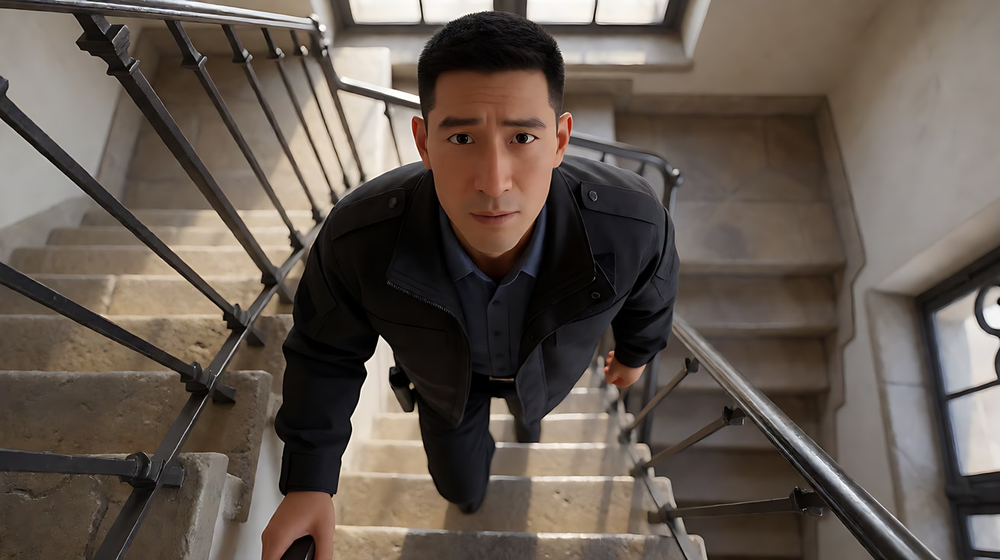
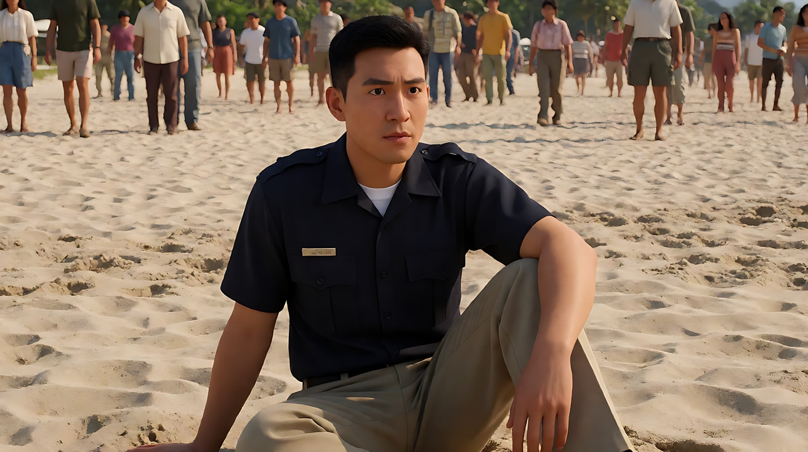
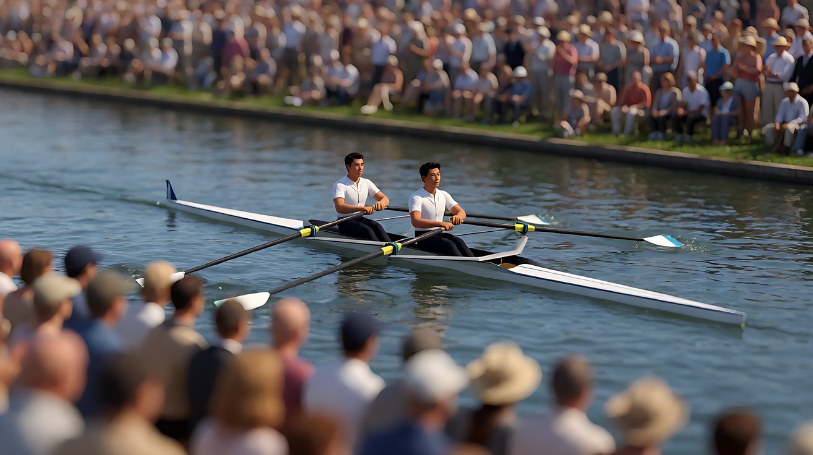

# L02-05 移轴、分屈光镜与滑动变焦：三种"违反人眼"的光学

> 段位：基础 ｜ 建议用时：65 分钟 ｜ 配套提示词：[L02-05-移轴分屈光镜与滑动变焦-提示词](../提示词/L02-05-移轴分屈光镜与滑动变焦-提示词.md)

## 学习目标

- 能说清移轴（tilt-shift）为什么能把真实世界拍成"微缩模型"，以及平移（shift）的透视校正用途
- 能说清分屈光镜（split diopter）如何在一个画面里制造两个焦平面，以及它的分界线该藏在哪里
- 能用示意图解释滑动变焦（dolly zoom）的光学原理：主体大小不变，背景透视改变
- 能为三种技法各写出一句意图，判断什么时候该用、什么时候是炫技
- 能在 AI 中描述这三种技法，识别常见失败并知道退路（首尾帧、分层生成、后期合成）

## 一、概念讲解

前四课讲的都是"正常"镜头：一个焦平面，平行于传感器，焦段在镜头内不变。这一课的三种技法都**故意打破其中一条**，所以观众会立刻感到"不对劲"——这种不对劲就是它们的表现力。

| 技法 | 打破了什么 | 观众感受到的"不对劲" |
|---|---|---|
| 移轴 | 焦平面不再平行于传感器 | 真实世界看起来像玩具 |
| 分屈光镜 | 画面里同时有两个焦平面 | 近处和远处同时清晰，但中间是虚的 |
| 滑动变焦 | 镜头内焦段变化 + 机位反向移动 | 人没动，世界在动 |

### 1. 移轴（Tilt-shift）

移轴镜头的镜片可以相对传感器**倾斜（tilt）**或**平移（shift）**。

**倾斜 → 焦平面倾斜**。普通镜头的焦平面和传感器平行；镜片倾斜后，焦平面也跟着倾斜（光学上称为沙姆定律）。

```
  普通镜头：焦平面与传感器平行             移轴镜头"反向倾斜"：焦平面陡然倾斜，只剩一条窄带清晰

  ▣│                                        ▣╱
   │      ┃ 焦平面                           ╱   ╲ 焦平面
   │      ┃                                ╱       ╲
   │      ┃                                            ╲
   └──────┸─────── 地面                    └──────────────╲──── 地面
                                                    ▲ 只有这一条窄带落在焦平面附近

  画面效果（高角度俯拍城市路口）：
  ┌──────────────────────────────────────────┐
  │░░░░░░░░░░░ 远处楼群：虚 ░░░░░░░░░░░░░░░░│
  │▒▒▒▒▒▒▒▒▒▒▒▒▒▒▒▒▒▒▒▒▒▒▒▒▒▒▒▒▒▒▒▒▒▒▒▒▒▒▒▒▒│
  │██ 中间一条窄带：清晰的车、行人、斑马线 ██│
  │▒▒▒▒▒▒▒▒▒▒▒▒▒▒▒▒▒▒▒▒▒▒▒▒▒▒▒▒▒▒▒▒▒▒▒▒▒▒▒▒▒│
  │░░░░░░░░░░░ 近处屋顶：虚 ░░░░░░░░░░░░░░░░│
  └──────────────────────────────────────────┘
```

**为什么像微缩模型**：人眼只有在**近距离**看小东西时才会看到这么浅的景深。大脑看到"高角度俯视 + 极浅景深"，就会推断"这是一个离我很近的小模型"。再加上高饱和色彩、硬阳光、略快的动作，效果更强。

**平移 → 校正透视**。相机仰拍高楼时，竖线会向上汇聚。平移镜片可以让相机保持水平、只移动画面，楼的竖线保持笔直。建筑摄影和"正面平视、严格对称"的风格常用它。

### 2. 分屈光镜（Split diopter）

把一块**近摄附加镜片切成一半**，装在镜头前面只盖住画面的一半。盖住的那一半能对焦到很近的地方，没盖住的那一半照常对焦在远处。

```
  侧视图                                      画面效果
                                             ┌─────────────────────┬─────────────────────┐
   ▣ 镜头 ┃半片屈光镜                         │                     ┊                     │
         ┃ ─────► 近处 A（0.5 米）清晰         │   ☺ A 近处的脸       ┊        ☺ B 远处的人 │
          ─────────────────► 远处 B（6 米）清晰 │   （大、清晰）       ┊        （小、清晰）  │
                                             │                     ┊                     │
   中间：两个焦平面之间的东西都是虚的           │                     ┊ ← 分界线：一条竖直的 │
                                             └─────────────────────┴─────────────────────┘    虚化带，常藏在门框、
                                                                                              墙角、柱子、背景暗处
```

**特征**：
- 近处和远处同时清晰，比深焦"更不自然"：中间层是虚的，而且有一条看得出的模糊分界线
- 两个对象被**同等强调**，观众被迫同时看两个人
- 分界线是破绽，高手会把它藏在画面里本来就有的竖直线条上

**与深焦的区别**：深焦是"从近到远全部清晰"，分屈光镜是"只有两个距离清晰"。深焦像客观的旁观，分屈光镜像导演把两个人硬塞进同一个画面里对质。

### 3. 滑动变焦（Dolly zoom，又称"眩晕镜头"）

摄影机在轨道上**向一个方向移动**，同时镜头**反向变焦**，让主体在画面里的大小保持不变。因为焦段在变，视角在变，**背景的透视关系会剧烈改变**。

```
  俯视图：镜头后退 + 变焦推近（焦距从 24mm 变到 85mm）

  起始：  ▣ 24mm ── 1 米 ── ☺ 人物 ═══════ 背景走廊（看起来又长又远，空间开阔）
                  ◄═════ 后退
  结束：  ▣ 85mm ──────────── 3.5 米 ──── ☺ 人物 ═══ 背景走廊（被放大、压缩，像涌到他身后）

  人物大小：始终不变          背景：起始时宽而远 → 结束时窄而近，像整个世界向他压过来
```

| 方向 | 机位 | 焦段 | 背景看起来 | 常见情绪 |
|---|---|---|---|---|
| 后退 + 变焦推近 | 远离主体 | 由短变长 | 被放大、向前涌来，空间收缩 | 压迫、世界逼近、窒息、心事压顶 |
| 前推 + 变焦拉远 | 靠近主体 | 由长变短 | 向后退去、被拉长，空间扩张 | 眩晕、坠落感、顿悟、恐惧、失重 |

**关键**：观众会感到"人没有动，可世界变了"。这正是顿悟、惊恐、眩晕时的主观体验。

### 4. 三种技法的使用纪律

- 它们都是**强调号**，一部片子里用一两次就够了。每个镜头都移轴，就只是滤镜。
- 每次使用都要能回答一句"让观众感到……"。如果答案是"这样很酷"，换成普通镜头。
- 它们都**很脆弱**：画面里的动作越多、运镜越复杂，越容易穿帮。

## 图解

> 这些示意图由多种生图模型分别生成（包括 Nano Banana、GPT Image 等），只用来说明镜头概念；不同模型的画面不能互相比较效果，也不能当作视频成片。


清晰带只留在画面中部，上下被虚化。真的街道看起来像微缩模型。


极近的钥匙和远处的脸同时清楚，中间那一层反而不自然。这是分屈光镜的视觉特征：两个焦平面，而不是均匀的深焦。

## 二、情绪与叙事功能

| 技法 | 观众的感受 | 常用场景 |
|---|---|---|
| 移轴微缩 | 世界像玩具，人物渺小、被摆布，童话感或冷眼旁观 | 城市开场、命运的俯视、讽刺、蒙太奇段落 |
| 平移校正 | 建筑端正、画面平面化、秩序感 | 对称构图、建筑、仪式 |
| 分屈光镜 | 两个人被同时强调，对质、威胁、隐藏的关系 | 悬疑、心理惊悚、对峙、"他就在你身后" |
| 后退 + 变焦推近 | 世界压过来，压迫、窒息 | 坏消息、被困、心事压顶 |
| 前推 + 变焦拉远 | 失重、眩晕、地面裂开的顿悟 | 惊恐、顿悟、恐高、意识到真相 |

## 三、经典影片案例

### 《迷魂记》（1958，阿尔弗雷德·希区柯克）钟楼楼梯
- 场景：患恐高症的前警探斯科蒂爬上钟楼楼梯，向下看楼梯井。
- 怎么拍的：从他的视角俯看楼梯井，机位移动的同时镜头反向变焦，楼梯井的底部像在伸长、远离。据记载，这个镜头借助横放的楼梯井模型拍摄完成。这一技法因此常被称为"希区柯克变焦"或"眩晕镜头"。
- 为什么这样拍：意图是让观众感到"恐高的人看到的世界"。楼梯井并没有动，但透视在变，观众的胃会跟着往下坠。主观生理感受第一次被一个光学技巧直接复制出来。



### 《大白鲨》（1975，史蒂文·斯皮尔伯格）海滩上的警长
- 场景：警长布罗迪坐在海滩上，紧盯海面，然后目睹鲨鱼袭击发生。
- 怎么拍的：布罗迪的脸在画面中大小不变，身后的海滩与人群在透视上诡异地变形、滑动。
- 为什么这样拍：意图是让观众感到"他最害怕的事情发生了，周围的世界在那一刻失去了正常的形状"。这里不是恐高的眩晕，而是认知被击中的瞬间。



### 《社交网络》（2010，大卫·芬奇）亨利赛艇赛
- 场景：温克莱沃斯兄弟在英国亨利皇家赛艇赛上比赛。
- 怎么拍的：大量使用移轴效果拍摄河道、赛艇和岸上观众，画面只有中间一条带清晰，上下都虚，赛艇像微缩模型。
- 为什么这样拍：意图是让观众感到"这是一个精致、遥远、像玩具一样的上流世界"，兄弟俩用尽全力的比赛，在更大的故事里只是一个被俯视的小插曲。



### 布莱恩·德·帕尔玛的分屈光镜：《魔女嘉莉》（1976）、《凶线》（1981）
- 场景：德·帕尔玛在多部影片中反复使用分屈光镜，这两部影片里都出现过近处人物的脸与远处的人物或物件同时清晰的画面，已成为他的视觉签名之一。
- 怎么拍的：画面一半对焦在离镜头很近的人物脸上，另一半对焦在远处的人或物上，中间通常是一条借助背景暗处或竖线掩盖的虚化带。
- 为什么这样拍：意图是让观众"被迫同时盯着两件事"。在悬疑片里，这往往意味着：人物没意识到的危险或线索，和人物本人一样清晰。


## 四、在 AI 中怎么实现

### 移轴（最容易）
- **生图**：`tilt-shift miniature effect, high overhead angle, a narrow horizontal band of sharp focus across the middle of the frame, the top and bottom strongly blurred, saturated toy-like colors, hard sunlight`。必须是**高角度俯拍**，平视的移轴效果很弱。
- **视频**：镜头固定或极慢横移；写"人和车像微缩模型里的小人和玩具车一样移动，动作略快、轻快"；写"清晰带的位置始终不变"。
- **常见失败**：变成普通浅景深（只有一个主体清晰，不是一条带）；上下虚化在运动中消失。修复：反复写"一条水平清晰带""上下虚化"。

### 分屈光镜（最难）
- **生图**：明确写两半：`split diopter shot: the left half is focused on her face very close to the lens, the right half is focused on the man standing far away by the window, both sharp, the middle ground between them blurred, a soft vertical blur seam hidden along a dark door frame at the center`。生图模型命中率不高，多生成几张挑选。
- **视频**：**镜头必须固定**，人物不要横穿分界线，只做原地小动作。分界线一旦随运动漂移，效果就穿帮。
- **退路**：分别生成"近处人物清晰"和"远处人物清晰"两张图，在剪辑软件里用一条竖直羽化遮罩拼成一张，再作为首帧交给 Seedance。这和《公民凯恩》用合成实现超景深是同一个思路。

### 滑动变焦（中等，不稳定）
- **视频直写**：`镜头沿轨道向后退，同时变焦推近，人物在画面中的大小始终不变，身后的走廊被放大、向他涌来`。
- **提高成功率**：
  - 背景要有**强烈的线性透视**：长走廊、隧道、林荫道、楼梯井、整齐的书架。背景越有规律，透视变化越明显。
  - 主体基本不动，只有表情或呼吸变化。
  - 时长短：5–6 秒，一个镜头只做这一件事。
- **首尾帧法（更稳）**：首帧用广角近距离（背景宽而远），尾帧用长焦远距离（背景窄而近），**人物在两帧里大小和位置完全相同**。Seedance 只需要补中间的过渡。
- **常见失败**：变成普通推镜（人物也变大）；只变焦不移动（人物和背景一起放大）；背景扭曲融化；人脸在透视变化中变形。修复：强调"人物大小始终不变"，背景简化，人物换成三分之四侧脸或中景。
- **退路**：在剪辑软件里用缩放关键帧模拟，或干脆改用缓慢推镜 + 声音收窄表达同样的意图。

### 画风提醒
三种技法本质上都是**光学现象**。**开关 C（2D）/ D（水墨）不使用**这些写法，2D 中可以改写为"俯视的玩具般场景，上下边缘柔化""画面一分为二，两侧各自清楚""背景透视向后拉伸的动画变形"。本课练习一律使用开关 A。

## 五、练习作业

1. 用手机的"移轴"或"微缩"滤镜，从高处拍一段路口的视频，再从平视角度拍一段。比较哪一段更像模型，写下原因。
2. 为分屈光镜设计一个悬疑镜头：近处是谁、远处是谁、分界线藏在哪条竖线上、观众比人物多知道什么。
3. 用一句话意图分别说明：什么时候用"后退 + 变焦推近"，什么时候用"前推 + 变焦拉远"。
4. 完成配套提示词练习1–5，重点比较练习3（首尾帧法）和练习4（视频直写法）的滑动变焦成功率。

## 六、自检清单

- [ ] 我能解释移轴为什么让真实世界像模型（高角度 + 极浅清晰带）
- [ ] 我的移轴提示词写了高角度俯拍、水平清晰带、上下虚化
- [ ] 我能说出分屈光镜和深焦的区别，并知道分界线要藏在竖直线条上
- [ ] 分屈光镜镜头我锁定了机位，人物不横穿分界线
- [ ] 我能画出滑动变焦的示意图，说清两个方向各自的情绪
- [ ] 滑动变焦我写了"人物大小始终不变"，并选了线性透视强的背景
- [ ] 我准备好了退路：首尾帧、分层合成、后期缩放
- [ ] 提示词里没有导演名和片名

## 七、配套提示词

→ [L02-05-移轴分屈光镜与滑动变焦-提示词](../提示词/L02-05-移轴分屈光镜与滑动变焦-提示词.md)

---

上一课：[L02-04 深焦与多层调度](L02-04-深焦与多层调度.md) ｜ 下一课：[L03-01 三分法、中心构图与黄金比例](../../03-构图/教学/L03-01-三分法中心构图与黄金比例.md) ｜ [返回总目录](../../README.md)
