# L03-01 三分法、中心构图与黄金比例 · 提示词

> 本组练习：用明确的画面坐标控制人物位置，体会三分法的"呼吸"、中心构图的"对抗"、黄金螺旋的"视线路线"，并学会让构图在镜头里变化。｜ 配套教学：[L03-01-三分法中心构图与黄金比例](../教学/L03-01-三分法中心构图与黄金比例.md) ｜ 规范：[写作规范](../../模板/写作规范.md)
>
> 画风默认使用开关 A（风格化写实 CG）。如改用 2D 动画，删掉所有焦段、光圈、景深词。

---

### 练习1：三分法 + 视线留白（难度 ★）

**目标**：把人物放在右三分线、地平线放在下三分线，人物面朝左，左侧大面积留白。意图：让观众感到他在等一个还没出现的人。

**【生图 · Nano Banana】**

图1 关键帧：

```
A wide shot of an original old fisherman in a faded yellow oilskin jacket and a knitted grey cap,
standing at the end of a wooden pier, placed on the right third of the frame, his body and gaze turned toward frame left.
The horizon line sits on the lower third of the frame, so the overcast sky fills the upper two thirds.
The left two thirds of the frame are open sea and sky with generous empty space in the direction he is looking.
Camera at eye level from the pier, 35mm lens, deep focus, the pier planks sharp to the horizon.
Lighting: soft diffused overcast light from above, a faint brighter patch of sky low on the left horizon, light sea mist.
Stylized semi-realistic 3D CG rendering, feature-film animation quality. Aspect ratio 16:9.
```

中文释义：远景，老渔夫站在码头尽头，位于右三分线，身体和视线朝画左；地平线在下三分线，阴天的天空占画面上方三分之二；画左是他视线方向的大片海天留白；平视、35mm、深焦；阴天漫射顶光，左侧地平线有一块略亮的天空，薄薄的海雾。

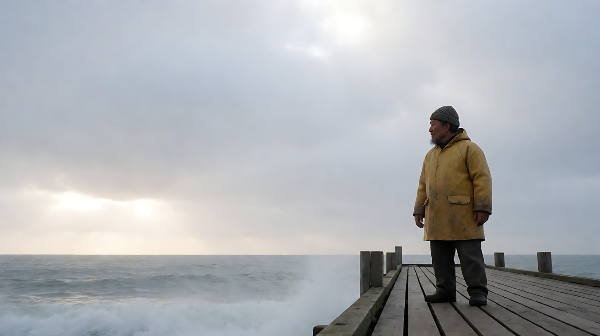

**【图生视频 · Seedance】**

```
【素材分工】@图片1 为首帧，锁定人物身份、服装、码头布局与构图位置。
【画风】风格化写实三维CG质感，电影级布光。
老渔夫站在码头尽头，抬起右手搭在眉骨上挡光，望向画左的海面，停住不动，只有外套下摆被海风吹动。镜头固定远景，不移动，人物始终位于画右三分线，地平线始终在画面下三分线。阴天的漫射光不变，画左地平线那块亮区缓慢变亮一点，海雾向左飘散。结尾停在他望着海面的背侧影上。
【声音】海浪拍打木桩，海风呼呼声，远处两声海鸥叫，木板轻微吱呀，无配乐。
【约束】保持人物脸型、服装不变；人物不走动、不离开画右三分线；不要出现船只或其他人物；不要字幕、水印、Logo。
时长：6秒
```

**参数**：时长 6 秒 ｜ 画幅 16:9

**【检查点】**
- 人物是否始终在右三分线，没有漂到画面中心
- 地平线是否在下三分线，而不是切在画面正中
- 画左的留白是否"有内容"（海雾、亮区在动），而不是死板的空

**【常见问题与修复】**
| 现象 | 修复 |
|---|---|
| 人物慢慢漂向画面中心 | 在正文和【约束】里各写一次"人物始终位于画右三分线" |
| 画左凭空出现一艘船 | 在【约束】写"海面上不出现船只"，留白就是这个镜头要的"等待" |
| 画面完全静止像照片 | 加一个持续的小动作：海风吹动衣角、手搭眉骨的动作 |
| 地平线跑到画面中间 | 生图阶段重写 `horizon on the lower third`，并在视频里锁定 |

---

### 练习2：中心构图的力量（难度 ★★）

**目标**：同一个人物，放在空旷空间的正中央，正面平视，让她"面对"观众。意图：让观众感到她必须独自面对接下来的一切。

**【生图 · Nano Banana】**

图1 角色定妆：

```
Character turnaround sheet of an original girl about sixteen years old: straight black hair in a low ponytail,
a navy school blazer with a white shirt, a grey pleated skirt, black shoes, a small paper envelope held in both hands.
Front view, three-quarter view, side view and back view, full body, standing on a plain light-grey background,
even soft studio light, no shadows on the backdrop.
Stylized semi-realistic 3D CG rendering, feature-film animation quality. Aspect ratio 16:9.
```

中文释义：原创十六岁女孩定妆，低马尾黑直发，藏青校服外套、白衬衫、灰百褶裙、黑鞋，双手拿着一个小纸信封；正、四分之三侧、侧、背四视图，浅灰底，均匀柔光。

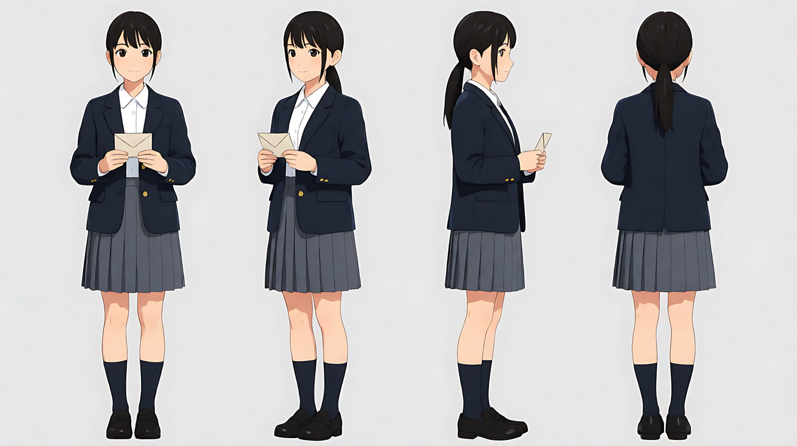

图2 场景：

```
Empty old school auditorium, rows of dark wooden seats on both sides of a straight central aisle,
the aisle running from the camera straight to a small empty stage, a single tall window above the stage letting in pale afternoon light,
dust in the light beam, worn red carpet on the aisle, no people.
Wide shot from the back of the aisle, eye level, 35mm lens, deep focus, perfectly frontal and symmetrical.
Stylized semi-realistic 3D CG rendering, feature-film animation quality. Aspect ratio 16:9.
```

中文释义：空无一人的老礼堂，中间一条笔直过道两侧是深色木椅，过道通向空舞台，舞台上方一扇高窗透进午后浅光，光柱中有灰尘，过道铺旧红地毯；从过道后端正面拍摄远景，平视、35mm、深焦、正面对称。

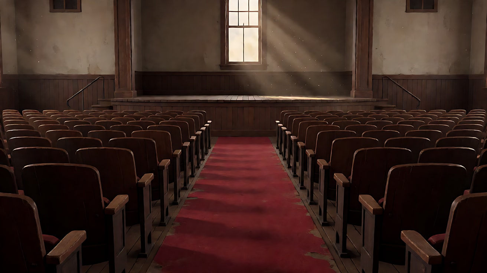

**【多图生视频 · Seedance】**

```
【素材分工】@图片1 锁定人物身份、校服与手中信封，不参考其灰色背景；@图片2 仅参考礼堂布局、过道与窗光，不复制其中机位以外的任何人物。
【画风】风格化写实三维CG质感，电影级布光。
女孩站在礼堂过道正中央，身体正对镜头，位于画面正中，背后是空舞台和高窗。她双手攥着信封，指节发白，慢慢抬起下巴，目光直视镜头，不眨眼。镜头从过道后方的全景缓慢向前推进到中景，推进过程中她始终位于画面正中，左右两侧座椅对称。高窗的午后浅光从她背后照来，在她肩头勾出一圈亮边，光柱里灰尘缓慢飘动。结尾停在她直视镜头的中景正面上。
【声音】礼堂空旷的回声，远处走廊隐约的脚步声，她一次克制的呼吸，无配乐。
【约束】保持人物脸型、发型、校服不变；人物不走动，始终在画面正中；不要出现其他人物；不要字幕、水印、Logo。
时长：8秒
```

**参数**：时长 8 秒 ｜ 画幅 16:9

**【检查点】**
- 推近过程中人物是否一直在画面正中，左右座椅是否保持对称
- 她是否直视镜头（中心构图 + 直视 = 面对观众）
- 逆光肩部轮廓是否把她从背景里"分"出来

**【常见问题与修复】**
| 现象 | 修复 |
|---|---|
| 人物侧身或偏离中心 | 正文写"身体正对镜头，位于画面正中"，生图时用 `dead center, perfectly frontal` |
| 推镜后人物偏到一侧 | 写清终点："推进到中景后她仍在画面正中" |
| 座椅上出现观众 | @图片2 已标注不复制人物，再在【约束】写"座椅全部空着" |
| 她一直在眨眼、东张西望 | 写"目光直视镜头，不眨眼，不移开视线" |

---

### 练习3：从中心走到三分线（难度 ★★★，首尾帧）

**目标**：镜头不动，让人物用走位完成构图变化：从"被审视的中心"走到"有去处的三分线"。意图：让观众感到他从一场对质中脱身，重新看向自己的路。

**【生图 · Nano Banana】**

图1 角色定妆：

```
Character turnaround sheet of an original man in his mid thirties: short neat black hair, light stubble,
a charcoal wool overcoat over a white shirt without tie, dark trousers, a leather shoulder bag.
Front view, three-quarter view, side view and back view, full body, plain light-grey background, even soft studio light.
Stylized semi-realistic 3D CG rendering, feature-film animation quality. Aspect ratio 16:9.
```

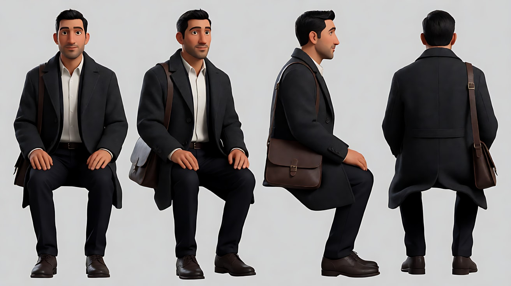

图2 首帧：

```
Using the character from image 1: a full shot of him standing dead center in a quiet old railway station hall,
perfectly frontal, looking straight into the lens, arms at his sides, the bag on his shoulder.
Behind him a large arched window, rows of empty benches symmetrical on both sides.
Camera at eye level, 35mm lens, deep focus. Lighting: cool late-afternoon daylight through the arched window behind him as backlight,
soft bounce from the polished floor as fill, faint haze in the air.
Keep the face, hairstyle and outfit exactly as in image 1.
Stylized semi-realistic 3D CG rendering, feature-film animation quality. Aspect ratio 16:9.
```

中文释义：全景，他站在旧火车站大厅正中，正面直视镜头；身后巨大拱窗，两侧长椅对称；平视、35mm、深焦；拱窗冷色午后光做逆光，抛光地面反光补光，空气中有薄雾。

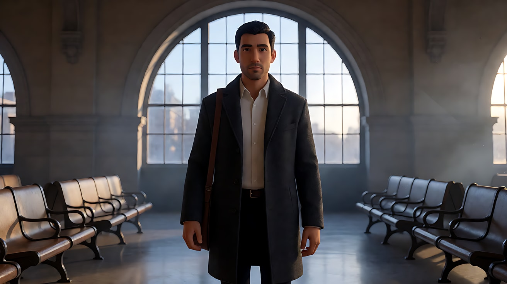

图3 尾帧：

```
Using the character and the exact same camera position, framing, lighting and station hall as image 2:
he now stands on the left third of the frame in a three-quarter profile, his body and gaze turned toward frame right,
looking at a departure board glowing softly on the right side of the hall, generous empty space on the right in the direction of his gaze.
His shoulders are lowered and relaxed.
Keep the face, hairstyle and outfit exactly as in image 1.
Stylized semi-realistic 3D CG rendering, feature-film animation quality. Aspect ratio 16:9.
```

中文释义：同一机位、同一光线，他已走到画左三分线，四分之三侧身，朝画右看向大厅右侧一块发着柔光的发车信息牌，画右是视线方向的留白；肩膀放松下沉。

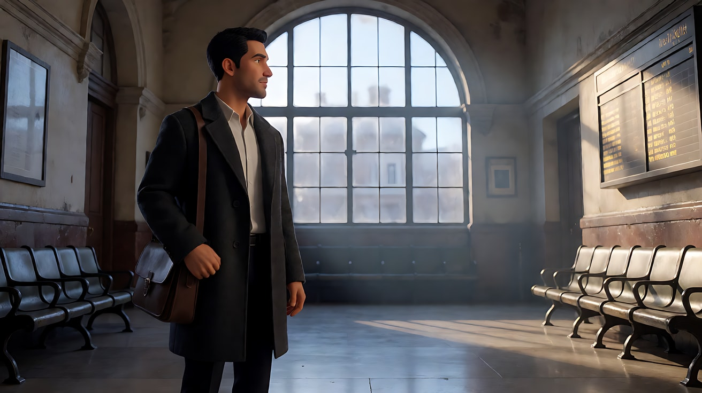

**【首尾帧生视频 · Seedance】**

```
【素材分工】@图片2 为首帧；@图片3 为尾帧，是最终画面目标；@图片1 锁定人物身份、大衣与挎包，不参考其灰色背景。只生成两帧之间的连续动作。
【画风】风格化写实三维CG质感，电影级布光。
他站在大厅正中直视镜头，停顿一拍，垂下视线，长出一口气，肩膀落下来。他转身向画左走出三四步，在画左三分线处停下，侧过身望向画右的发车信息牌。镜头固定全景，机位与焦段始终不变，构图由他的走位完成变化。拱窗的冷色逆光保持不变，地面上他的倒影跟随移动。
【声音】大厅空旷的回声，皮鞋踩在石材地面的四声脚步，远处一声模糊的站台广播，无配乐。
【约束】保持人物脸型、发型、大衣与挎包不变；镜头不移动、不推拉；中间动作连续，不跳切；不要字幕、水印、Logo。
时长：8秒
```

**参数**：时长 8 秒 ｜ 画幅 16:9

**【检查点】**
- 首帧"正中直视"与尾帧"左三分侧望"两种构图是否都到位
- 镜头是否真的固定，构图变化完全靠人物走位
- 尾帧画右是否留出视线空间

**【常见问题与修复】**
| 现象 | 修复 |
|---|---|
| 镜头跟着人物横移，构图没变 | 写"镜头固定，机位与焦段始终不变，构图由他的走位完成变化" |
| 人物走过头，出了画 | 写清"走出三四步，在画左三分线处停下"，并以 @图片3 为目标 |
| 信息牌上出现乱码文字 | 生图写 `glowing softly, text not readable`，或换成"一扇亮着的出口门" |
| 尾帧他仍直视镜头 | 首尾帧之间写清"侧过身望向画右" |

---

### 练习4：三个镜头，三种位置（难度 ★★★★，多镜头）

**目标**：一次生成三个镜头：远景三分法交点 → 中景三分线视线留白 → 近景中心构图直视。人物在画面中的位置逐步"走向中心"，同时景别逐步收紧。意图：让观众感到她从一个远处的旁观者，变成直面我们的人。

**【生图 · Nano Banana】**

图1 角色定妆：

```
Character turnaround sheet of an original woman in her late twenties: wavy shoulder-length auburn hair,
a long rust-red wool coat, a cream turtleneck, dark jeans, ankle boots, a thin black scarf.
Front view, three-quarter view, side view and back view, full body, plain light-grey background, even soft studio light.
Stylized semi-realistic 3D CG rendering, feature-film animation quality. Aspect ratio 16:9.
```

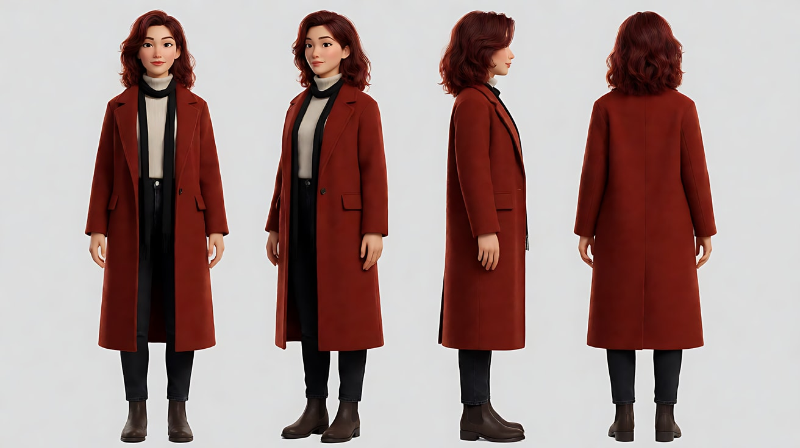

图2 场景（空旷的冬日湖岸）：

```
Empty frozen lakeshore in winter at early morning, a flat expanse of pale ice, a low line of bare trees on the far bank,
a single wooden bench near the shore, thin snow on the ground, low pale sun just above the trees on frame right, light mist, no people.
Extreme wide shot, eye level, 35mm lens, deep focus. The horizon on the lower third.
Stylized semi-realistic 3D CG rendering, feature-film animation quality. Aspect ratio 16:9.
```

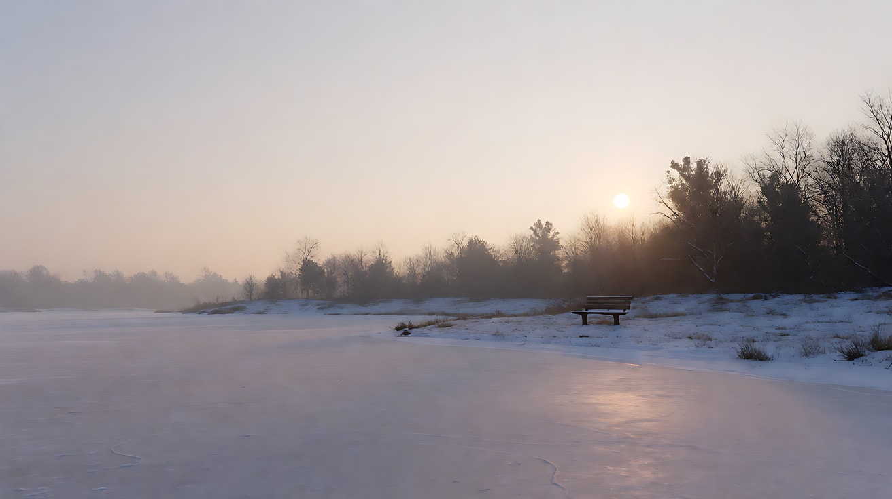

图3 镜头1关键帧：

```
Using the character from image 1 and the lakeshore from image 2:
an extreme wide shot of her standing beside the wooden bench, very small in the frame,
placed exactly on the lower-right intersection of the rule-of-thirds grid, her rust-red coat the only strong colour in a pale grey-white world.
The horizon on the lower third, a vast pale sky above. She faces frame left, looking across the ice.
Camera at eye level, 35mm lens, deep focus. Lighting: low pale morning sun from frame right as backlight, soft mist diffusing the light.
Keep the face, hairstyle and outfit exactly as in image 1.
Stylized semi-realistic 3D CG rendering, feature-film animation quality. Aspect ratio 16:9.
```

中文释义：大远景，她站在长椅旁，非常小，正好落在九宫格右下交点；红锈色大衣是灰白世界里唯一的强色；地平线在下三分线；她面朝画左望向冰面；低角度晨光从画右逆光照来，薄雾柔化光线。

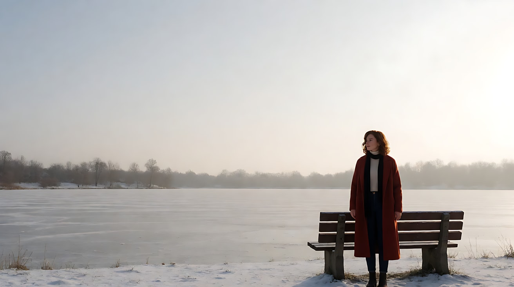

**【多图生视频 · Seedance】**

```
【素材分工】@图片1 锁定人物身份与服装，不参考其灰色背景；@图片2 仅参考湖岸布局、长椅与冬日光线，不复制其构图；@图片3 为镜头1的首帧。
【画风】风格化写实三维CG质感，电影级布光，整体低饱和灰白，唯一强色为她的红锈色大衣。
镜头1：固定大远景，她很小，站在画面右下交点，面朝画左望着冰面，围巾被风轻轻吹起；地平线在下三分线，大片苍白天空压在上方。画右低垂的晨光从她背后照来。风声与冰面细微的开裂声。
镜头2：镜头切至侧面中景，她位于画左三分线，身体朝画右，前方留出大片冰面空间；她把双手插进大衣口袋，呼出一口白气，目光从远处收回，转向镜头方向。机位缓慢向她横移一小段。风声变小，只剩她的呼吸和脚下积雪的轻响。
镜头3：镜头切至正面近景，她位于画面正中，直视镜头，嘴唇抿紧，下巴微微抬起。镜头固定不动。逆光在她发丝边缘勾出一圈浅金色。环境声几乎消失，只剩一声远处的鸟叫。
【锁定】光线：低角度晨光始终来自画右，三个镜头都是逆光或侧逆光；人物始终穿红锈色长大衣、奶白高领、黑色细围巾；人物位置依次为右下交点、左三分线、正中；机位始终在湖岸同一侧。
【声音】从开阔的风声与冰裂声逐渐收窄到呼吸声，再到几乎无声，无配乐。
【约束】保持人物脸型、发型、服装不变；画面中只有她一个人；不要字幕、水印、Logo。
时长：12秒
```

**参数**：时长 12 秒 ｜ 画幅 16:9 ｜ 负载：3 个镜头、无对白，属于"稳妥"档

**【检查点】**
- 三个镜头的人物位置是否分别为"右下交点 → 左三分线 → 正中"
- 镜头2的视线方向前方是否有留白
- 镜头3的正中直视是否比前两个镜头更有"压迫感"
- 红色大衣是否始终是画面唯一的强色

**【常见问题与修复】**
| 现象 | 修复 |
|---|---|
| 镜头1人物被放大到中景 | 依赖 @图片3 做首帧，正文写"她很小" |
| 三个镜头人物都在中心 | 每个镜头块写明位置，并在【锁定】行列出位置顺序 |
| 镜头3她没看镜头 | 写"直视镜头"，并删掉镜头3里其他动作，只保留抿嘴与抬下巴 |
| 光线方向在镜头2翻转 | 【锁定】写清"晨光始终来自画右" |

---

### 练习5：黄金螺旋与视觉重心接力（难度 ★★★★★，多关键帧 + 多镜头）

**目标**：用"大面积安静区 → 小而亮的收束点"引导视线，再用重心平衡和中心构图收尾。四个镜头里，观众的眼睛一路被带到一块怀表上，最后落到人物脸上。意图：让观众感到这块表对他和对客人都很重要。

**【生图 · Nano Banana】**

图1 角色定妆：

```
Character turnaround sheet of an original elderly watchmaker in his seventies: thin silver hair combed back,
round wire glasses pushed up on his forehead, a jeweller's loupe hanging on a cord around his neck,
a dark brown leather apron over a pale blue shirt with rolled sleeves.
Front view, three-quarter view, side view and back view, full body, plain light-grey background, even soft studio light.
Stylized semi-realistic 3D CG rendering, feature-film animation quality. Aspect ratio 16:9.
```

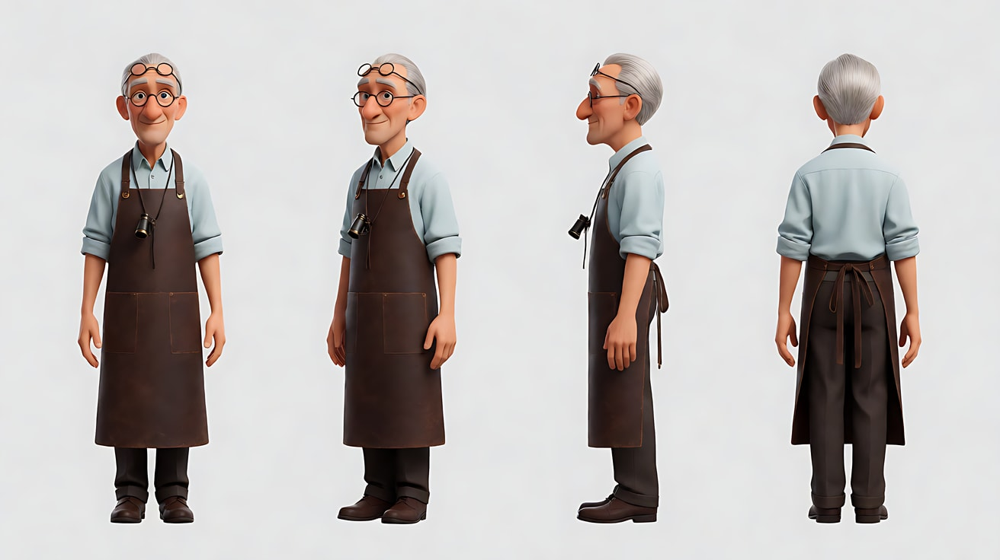

图2 场景（旧钟表铺）：

```
Empty narrow old watch repair shop at dusk, the entire left wall covered with dozens of dark wooden wall clocks in shadow,
a small cluttered workbench in the lower right corner under a single brass desk lamp with a warm pool of light,
tiny tools and an open pocket watch on a green felt mat, dust in the air, no people.
Wide shot, eye level, 35mm lens, deep focus.
Stylized semi-realistic 3D CG rendering, feature-film animation quality. Aspect ratio 16:9.
```

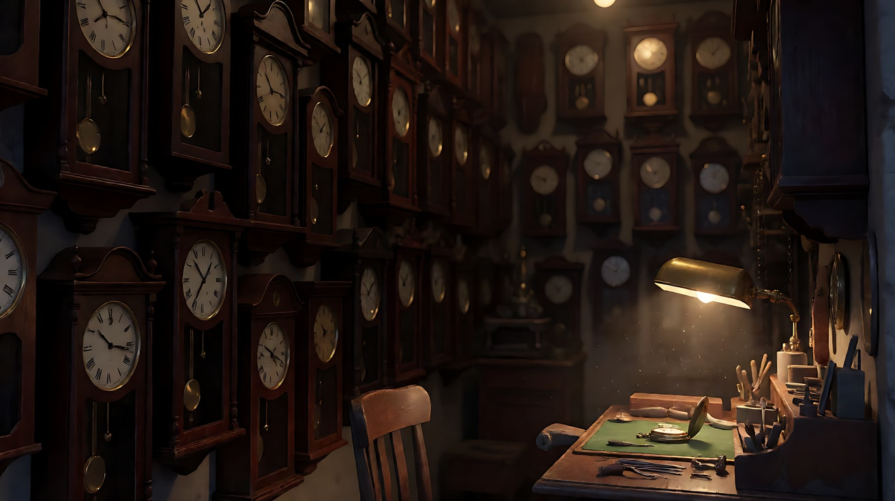

图3 镜头1关键帧（黄金螺旋）：

```
Using the character from image 1 and the shop from image 2:
a wide shot where the large dark wall of clocks fills the left two thirds of the frame as a calm, shadowed area,
its rows of clock faces curving the eye down and to the right toward a small bright point:
the watchmaker's hands and an open pocket watch under the warm desk lamp in the lower right of the frame.
The watchmaker sits hunched at the workbench, seen in three-quarter back view, his face not visible.
Camera at standing eye level, 35mm lens, deep focus. Lighting: the brass desk lamp is the only strong light, warm,
everything else falls into soft blue dusk shadow from a small window off frame left.
Keep the face, hairstyle and outfit exactly as in image 1.
Stylized semi-realistic 3D CG rendering, feature-film animation quality. Aspect ratio 16:9.
```

中文释义：远景，左侧三分之二是一整面暗处的挂钟墙，作为安静的大面积区域，一排排钟面把视线向右下方引导，收束到画面右下角台灯下的一个亮点：钟表匠的双手和打开的怀表；人物四分之三背身，看不到脸；台灯是唯一强光，其余是画左窗外的蓝色暮光阴影。

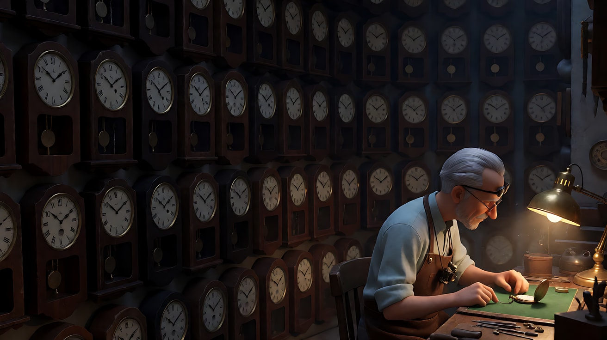

图4 镜头4关键帧（中心构图）：

```
Using the character from image 1 and the shop from image 2:
a medium close-up of the watchmaker sitting at the workbench, placed dead center of the frame, perfectly frontal,
looking up directly into the lens over the top of his glasses, holding the closed pocket watch up in his right hand at chest height.
Behind him, the wall of clocks is softly out of focus and symmetrical on both sides.
Camera at seated eye level, 50mm lens, shallow depth of field at f/2.
Lighting: the warm desk lamp from frame right below as key, cool blue dusk from frame left as soft fill.
Keep the face, hairstyle and outfit exactly as in image 1.
Stylized semi-realistic 3D CG rendering, feature-film animation quality. Aspect ratio 16:9.
```

中文释义：中近景，钟表匠居中、正面，从眼镜上方抬眼直视镜头，右手在胸前举着合上的怀表；背后钟墙虚化、左右对称；坐姿平视、50mm、f/2 浅景深；右下方台灯暖光为主光，左侧蓝色暮光为柔和辅光。

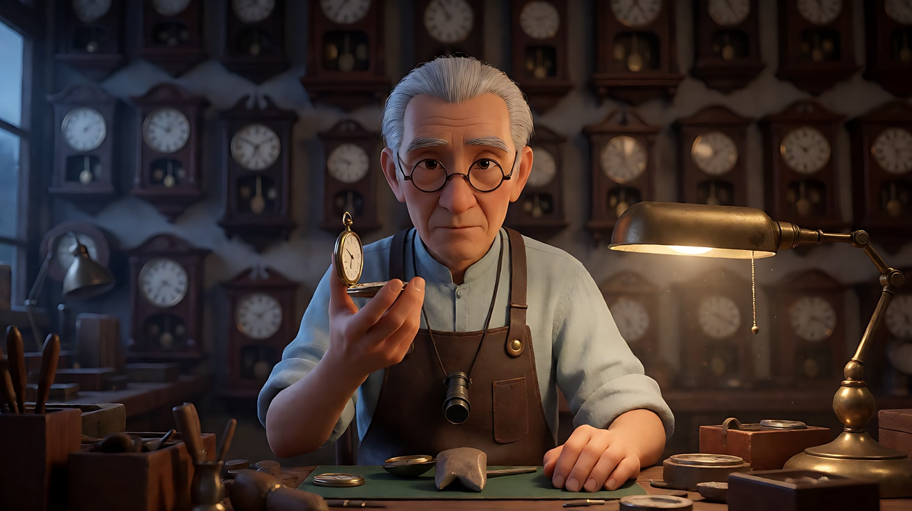

**【多图生视频 · Seedance】**

```
【素材分工】@图片1 锁定钟表匠身份、眼镜、放大镜与皮围裙，不参考其灰色背景；@图片2 仅参考钟表铺陈设与台灯位置，不复制其构图；@图片3 为镜头1的首帧，锁定黄金螺旋式构图；@图片4 为镜头4的目标画面，锁定中心构图，不作为首帧。
【画风】风格化写实三维CG质感，电影级布光。
镜头1：固定远景，画左大片暗处是整面挂钟墙，钟摆缓慢摆动，视线顺着钟面一路落到画面右下角台灯下的亮处，钟表匠背身弓着腰，双手在怀表上做极细微的调整。几十只挂钟交错的滴答声。
镜头2：镜头切至侧面中景，钟表匠的深色身形占据画左一大块，画右是一盏小而亮的黄铜台灯，暗的大身形与亮的小台灯左右平衡；他把额头上的眼镜拉下来，拿起镊子。镜头固定不动。滴答声变轻，台灯灯泡细微的电流声。
镜头3：镜头切至怀表特写，怀表位于画面右下三分交点，台灯暖光在表盘玻璃上留下一个小亮点；镊子尖把一枚细小的齿轮放进表芯，秒针开始走动。镜头缓慢向表盘推近一点。秒针清脆的一声"嗒"。
镜头4：镜头切至正面中近景，钟表匠位于画面正中，合上怀表，举到胸前，从眼镜上方抬眼直视镜头。镜头固定不动。钟表匠举起怀表，轻声说："修好了，它还会走很多年。"
【锁定】光线：黄铜台灯是唯一暖色主光，始终在画右；窗外蓝色暮光始终从画左进入；人物始终戴圆框眼镜、脖子挂放大镜、穿深棕皮围裙；机位始终在工作台同一侧。
【声音】从满屋挂钟的滴答声，收窄到台灯电流声，再到怀表秒针的一声"嗒"，最后是一句轻声对白，无配乐。
【约束】保持人物脸型、发型、服装不变；画面中只有钟表匠一个人；钟面与表盘上不出现可读文字；不要字幕、水印、Logo。
时长：15秒
```

**参数**：时长 15 秒 ｜ 画幅 16:9 ｜ 负载：4 个镜头、1 句对白，属于"有挑战"档；若失败，拆成镜头1–2 与镜头3–4 两次生成

**【检查点】**
- 镜头1的视线路线是否成立：先看到大片暗墙，再落到右下角亮点
- 镜头2是否做到"大而暗"与"小而亮"左右平衡
- 镜头3怀表是否在三分交点，镜头4人物是否在正中直视
- 四个镜头的视觉重心是否依次为：亮点 → 平衡 → 怀表 → 人脸

**【常见问题与修复】**
| 现象 | 修复 |
|---|---|
| 镜头1里钟表匠转过脸来 | 写"背身弓着腰，看不到脸"，@图片3 也要是背身 |
| 镜头2台灯太大或太暗，画面失衡 | 写清"小而亮的黄铜台灯"，并在【锁定】写台灯是唯一暖色主光 |
| 四个镜头挤成一个长镜头 | 每个镜头块开头写"镜头切至……"，四个机位景别差异拉大 |
| 钟面出现乱码数字 | 【约束】写"钟面与表盘上不出现可读文字"，或生图写 `clock faces without readable numerals` |
| 对白口型不对或说了两遍 | 对白缩短为一句，删掉镜头4其他动作 |

---

返回教学：[L03-01 三分法、中心构图与黄金比例](../教学/L03-01-三分法中心构图与黄金比例.md)
