# L03-02 引导线、框中框与前景遮挡 · 提示词

> 本组练习：借用场景里已有的线条、门窗和前景物，修一条通向主体的"视线之路"，并用匹配的运镜让它动起来。｜ 配套教学：[L03-02-引导线框中框与前景遮挡](../教学/L03-02-引导线框中框与前景遮挡.md) ｜ 规范：[写作规范](../../模板/写作规范.md)
>
> 画风默认使用开关 A（风格化写实 CG）。如改用 2D 动画，删掉所有焦段、光圈、景深词，前景虚化改写为"前景大色块遮挡"。

---

### 练习1：汇聚引导线 + 沿线推进（难度 ★）

**目标**：雨夜小巷的路沿、墙线、电线全部汇聚到巷子尽头的一个人身上，镜头沿线推进。意图：让观众感到巷子尽头那个人在等他，而且只能往那里走。

**【生图 · Nano Banana】**

图1 关键帧：

```
A wide shot down a long narrow old alley on a rainy night, wet cobblestones, low walls on both sides,
a line of small warm lanterns hanging along the right wall, overhead wires and the wall edges all converging toward one point at the far end.
At that vanishing point stands a small original figure in a long dark coat holding a pale umbrella, facing the camera, too far to see the face.
Camera at eye level in the centre of the alley, 28mm lens, deep focus, the converging lines very strong.
Lighting: warm lantern light from the right wall reflecting in long streaks on the wet stones, a cool blue glow from the street behind the distant figure, light rain and mist.
Stylized semi-realistic 3D CG rendering, feature-film animation quality. Aspect ratio 16:9.
```

中文释义：远景，雨夜的狭长老巷，湿石板路，两侧矮墙，右墙挂一排暖色小灯笼，头顶电线和墙沿全部汇聚到巷子尽头一点；消失点处站着一个穿深色长外套、撑浅色伞的小人影，面朝镜头，远得看不清脸；平视、巷子中央、28mm、深焦；右侧灯笼暖光在湿石板上拉出长倒影，人影背后有街道的冷蓝光，细雨薄雾。

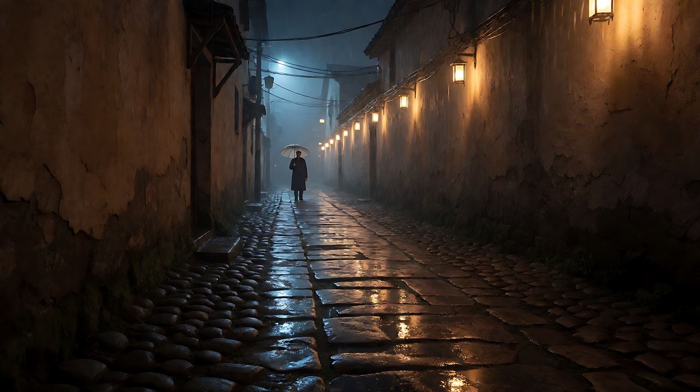

**【图生视频 · Seedance】**

```
【素材分工】@图片1 为首帧，锁定小巷布局、汇聚线条、灯笼位置与远处人影的构图位置。
【画风】风格化写实三维CG质感，电影级布光。
细雨落在湿石板上，右墙的灯笼在风里轻轻晃动，倒影在积水里拉长又收短。镜头沿着小巷正中线缓慢匀速向前推进，墙沿、电线与地面石缝始终汇聚向巷子尽头的人影。远处的人影一动不动地撑着伞站着，随推进逐渐变大，但仍是远景，看不清脸。结尾停在人影仍位于画面消失点、巷子线条全部指向他的画面上。
【声音】细密的雨声，雨水从屋檐滴进积水的嗒嗒声，灯笼挂钩轻微的吱呀，远处街道隐约的车流低鸣，无配乐。
【约束】镜头只向前推进，不摇不转；远处人影不走动；保持巷子线条与灯笼位置不变；不要字幕、水印、Logo。
时长：6秒
```

**参数**：时长 6 秒 ｜ 画幅 16:9

**【检查点】**
- 推进过程中所有线条是否始终汇聚到人影身上
- 人影是否一直在消失点，没有偏到一边
- 灯笼倒影是否让引导线更强（地面也有"线"）

**【常见问题与修复】**
| 现象 | 修复 |
|---|---|
| 推进中镜头偏转，人影偏离中心 | 写"沿着小巷正中线推进，不摇不转" |
| 人影走过来或消失 | 写"人影一动不动地撑着伞站着"，并在【约束】重复 |
| 推进太快变成冲刺 | 写"缓慢匀速"，时长不要短于 5 秒 |
| 灯笼变成霓虹招牌 | 生图写 `small paper lanterns, no signs, no text` |

---

### 练习2：门框困住一个人（难度 ★★）

**目标**：机位在暗的客厅，透过一道窄窄的厨房门框看到人物，门框外大片黑暗，人物被"关"在亮的小框里。意图：让观众感到他被日复一日的生活困住了。

**【生图 · Nano Banana】**

图1 角色定妆：

```
Character turnaround sheet of an original man in his early forties: short slightly greying hair, tired eyes,
a faded grey t-shirt under an unbuttoned dark blue work shirt, rolled sleeves, a dish towel over one shoulder, worn slippers.
Front view, three-quarter view, side view and back view, full body, plain light-grey background, even soft studio light.
Stylized semi-realistic 3D CG rendering, feature-film animation quality. Aspect ratio 16:9.
```

中文释义：原创四十出头男子定妆，短发微白，眼神疲惫，褪色灰T恤外敞穿深蓝工装衬衫，袖子卷起，肩上搭一条擦碗布，旧拖鞋。

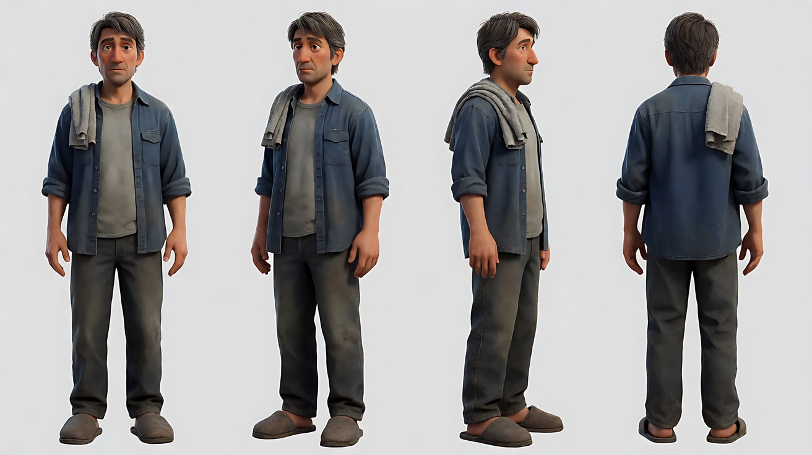

图2 场景：

```
Empty small apartment at night seen from a dark living room: in the centre of the frame a narrow open kitchen doorway,
inside the doorway a cramped bright kitchen with a sink under a cold fluorescent tube light, a stack of dirty dishes, a small window showing night.
The dark living room walls fill most of the frame around the doorway, only a faint edge of a sofa visible in the foreground darkness, no people.
Medium-wide shot from the living room, eye level, 35mm lens, deep focus.
Stylized semi-realistic 3D CG rendering, feature-film animation quality. Aspect ratio 16:9.
```

中文释义：夜晚的小公寓，从暗的客厅看出去，画面中央是一道窄窄的厨房门洞，门里是被冷白日光灯照亮的拥挤厨房、水槽和一摞脏碗、一扇小窗；门洞四周是大片暗的客厅墙面，前景暗处只露出一点沙发边；中全景、平视、35mm、深焦。

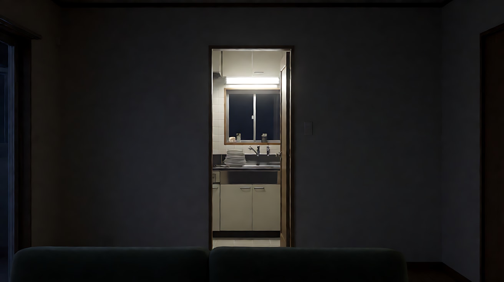

**【多图生视频 · Seedance】**

```
【素材分工】@图片1 锁定人物身份与服装，不参考其灰色背景；@图片2 锁定机位与门框构图，人物出现在门框内的厨房水槽前，不改变门框位置与大小。
【画风】风格化写实三维CG质感，电影级布光。
镜头固定在暗的客厅里，透过画面中央窄窄的厨房门框看进去。男人背对镜头站在水槽前洗碗，冲净一只碗，放到沥水架上，又拿起下一只，动作机械而缓慢。他停下手，双手撑在水槽边，低着头，肩膀塌下去，停了一拍，又拿起一只碗继续洗。门框外的客厅一直是暗的，厨房的冷白日光灯是画面里唯一的光源，灯管偶尔轻微闪一下。结尾停在门框里他撑着水槽、低头的背影上。
【声音】水龙头持续的流水声，碗碟碰撞声，日光灯管的电流嗡声，客厅墙上挂钟的滴答声，无配乐。
【约束】镜头固定不动；保持人物脸型、服装不变；人物始终在门框之内，不走出厨房；客厅保持黑暗；不要字幕、水印、Logo。
时长：8秒
```

**参数**：时长 8 秒 ｜ 画幅 16:9

**【检查点】**
- 门框外的暗区是否占画面一半以上，门框内是否明显更亮
- 人物是否被门框"框住"，没有走出框
- 撑住水槽这个动作是否把"困住"的意思补足

**【常见问题与修复】**
| 现象 | 修复 |
|---|---|
| 客厅也被照亮，框中框消失 | 写"门框外的客厅一直是暗的，厨房日光灯是唯一光源" |
| 镜头推进门里，框没了 | 写"镜头固定在暗的客厅里"，【约束】再写"镜头固定不动" |
| 门框被画成墙上的画框 | 生图写 `shot from the dark living room through an open kitchen doorway` |
| 人物转身面对镜头 | 写"背对镜头"，结尾停在背影 |

---

### 练习3：越过前景，揭示秘密（难度 ★★★，首尾帧）

**目标**：首帧大部分被虚化的书架边挡住，镜头横移，尾帧揭示书架后的人物。意图：让观众感到自己正在偷看一个不该被看见的时刻。

**【生图 · Nano Banana】**

图1 角色定妆：

```
Character turnaround sheet of an original young woman in her early twenties: short black bob haircut with straight bangs,
a mustard-yellow cardigan over a white collared blouse, a dark green corduroy skirt, round tortoiseshell-coloured glasses.
Front view, three-quarter view, side view and back view, full body, plain light-grey background, even soft studio light.
Stylized semi-realistic 3D CG rendering, feature-film animation quality. Aspect ratio 16:9.
```

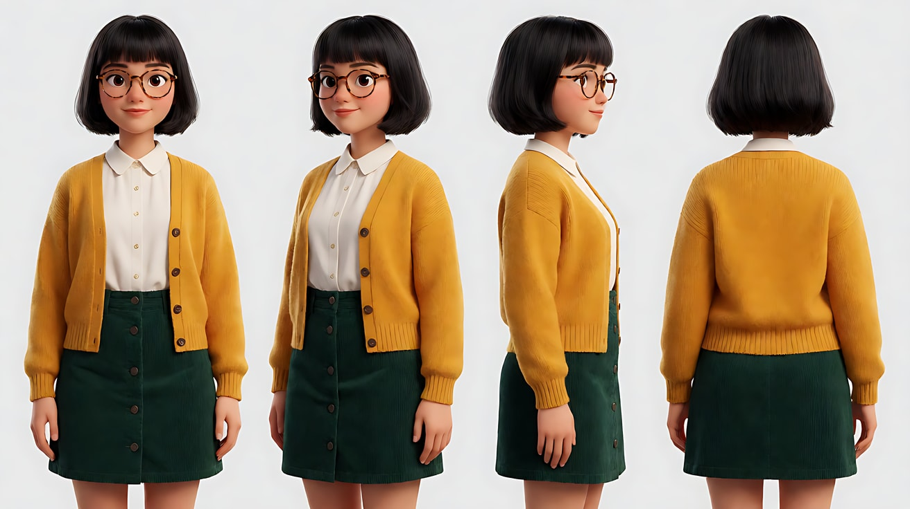

图2 首帧：

```
Using the character from image 1: a medium shot inside a quiet old library at late afternoon.
The out-of-focus edge of a tall dark wooden bookshelf fills the left sixty percent of the frame in the foreground.
In the remaining right part of the frame, only her shoulder and part of her yellow cardigan are visible, sitting at a reading table, her face hidden behind the bookshelf.
Camera at seated eye level from behind the bookshelf, 50mm lens, shallow depth of field at f/2, the foreground shelf soft and dark.
Lighting: warm low sunlight from a tall window on frame right, dust floating in the beam.
Keep the face, hairstyle and outfit exactly as in image 1.
Stylized semi-realistic 3D CG rendering, feature-film animation quality. Aspect ratio 16:9.
```

中文释义：中景，傍晚的老图书馆；前景虚化的深色高书架边占画面左侧六成；右侧只露出她坐在阅览桌旁的肩膀和一点黄色开衫，脸藏在书架后；坐姿高度、从书架后拍、50mm、f/2 浅景深；右侧高窗低角度暖光，光柱里有浮尘。

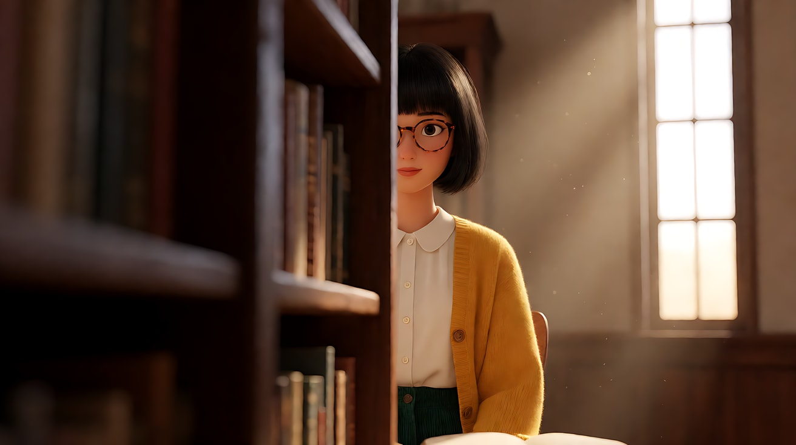

图3 尾帧：

```
Using the character and the same library, lighting and lens as image 2, the camera has moved to the right:
the soft dark bookshelf edge now only covers the left fifth of the frame.
She is fully revealed sitting at the reading table on the right third of the frame, holding an old handwritten letter close to her chest with both hands,
eyes closed, a small smile, a faded photograph lying face down on the table in front of her.
Keep the face, hairstyle and outfit exactly as in image 1.
Stylized semi-realistic 3D CG rendering, feature-film animation quality. Aspect ratio 16:9.
```

中文释义：同一图书馆、光线和焦段，机位已向右移动；虚化的书架边只占画面左侧五分之一；她完整出现在右三分线处，双手把一封手写旧信贴在胸前，闭着眼，嘴角微笑，面前桌上一张褪色照片背面朝上。

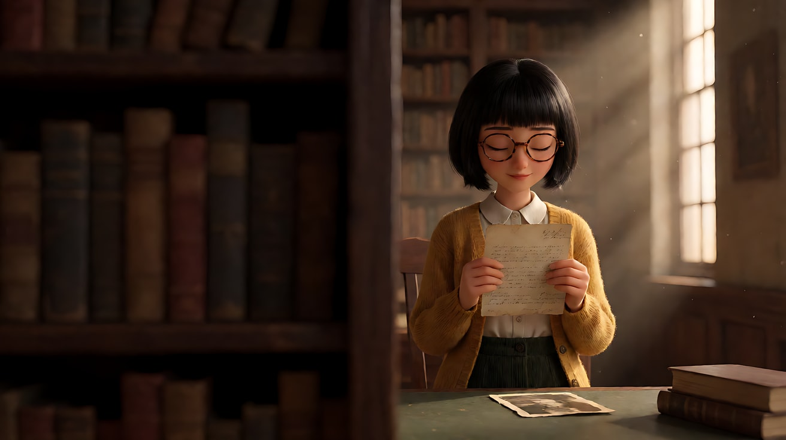

**【首尾帧生视频 · Seedance】**

```
【素材分工】@图片2 为首帧；@图片3 为尾帧，是最终画面目标；@图片1 锁定人物身份、发型、眼镜与服装，不参考其灰色背景。只生成两帧之间的连续画面。
【画风】风格化写实三维CG质感，电影级布光。
镜头从书架后方开始，缓慢匀速向右横移，虚化的深色书架边从画面左侧大半逐渐退到左侧一窄条。随着横移，她逐渐从书架后显露：她正读完手里的信，把信慢慢贴到胸前，闭上眼睛，嘴角出现一个很小的笑。右侧窗口的暖色低角度阳光始终照在她身上，光柱里浮尘缓慢飘动。结尾停在她闭眼抱信、前景书架只剩左侧一窄条的画面上。
【声音】图书馆的安静底噪，远处一次翻书声，信纸轻微的摩擦声，她一次轻轻的吸气，无配乐。
【约束】只有一个横移运镜，不推不摇；前景书架始终虚化；保持人物脸型、发型、眼镜、服装不变；信纸上不出现可读文字；不要字幕、水印、Logo。
时长：8秒
```

**参数**：时长 8 秒 ｜ 画幅 16:9

**【检查点】**
- 首帧是否真的"看不全"，尾帧是否真的"看见了"
- 前景书架是否全程虚化、偏暗，没有变清楚
- 揭示的时刻（贴信、闭眼）是否发生在人物被完全看见之后

**【常见问题与修复】**
| 现象 | 修复 |
|---|---|
| 书架被拍清楚，画面变乱 | 写"前景书架始终虚化"，生图写 `out-of-focus foreground, f/2` |
| 镜头横移变成推进 | 写"只有一个横移运镜，不推不摇"，首尾帧机位高度和焦段保持一致 |
| 她在横移一开始就做完了动作 | 写清顺序："随着横移，她逐渐显露……"，把动作放在显露之后 |
| 信纸上出现乱码 | 【约束】写"信纸上不出现可读文字"，或让信纸背面朝镜头 |

---

### 练习4：引导线、镜子、门框——三个镜头三种框（难度 ★★★★，多镜头）

**目标**：同一个人物在出门前的三个镜头，分别用引导线、镜子框、门框组织视线。意图：让观众感到她在给自己打气，然后迈出这一步。

**【生图 · Nano Banana】**

图1 角色定妆：

```
Character turnaround sheet of an original woman in her late twenties: long straight black hair tied in a neat low bun,
a tailored light grey suit jacket over a white blouse, black trousers, low black heels, a slim black document folder.
Front view, three-quarter view, side view and back view, full body, plain light-grey background, even soft studio light.
Stylized semi-realistic 3D CG rendering, feature-film animation quality. Aspect ratio 16:9.
```

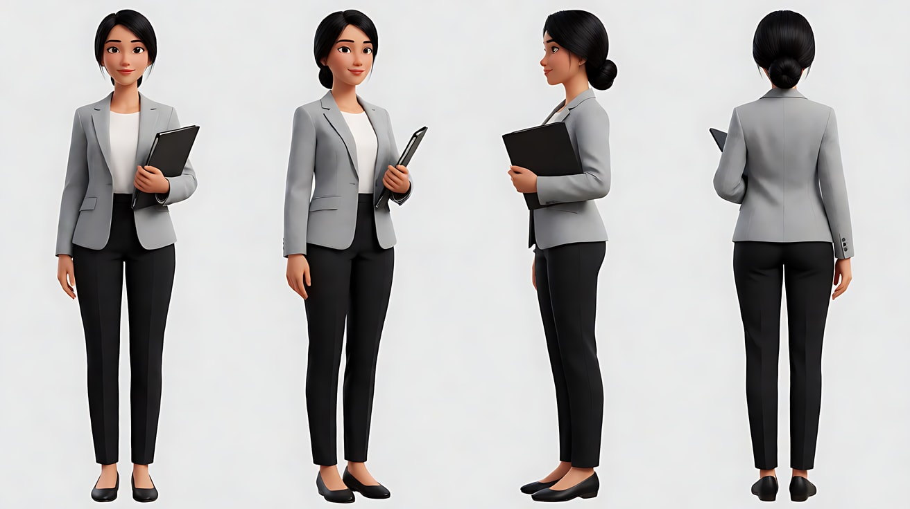

图2 场景（小公寓玄关与走廊）：

```
Empty narrow apartment hallway in the early morning, plain white walls and wooden floorboards converging toward a front door at the far end,
a small round mirror on the left wall beside the door, a coat hook with a scarf, the door has a frosted glass panel letting in bright cool daylight, no people.
Wide shot from the far end of the hallway, eye level, 28mm lens, deep focus, strong one-point convergence toward the door.
Stylized semi-realistic 3D CG rendering, feature-film animation quality. Aspect ratio 16:9.
```

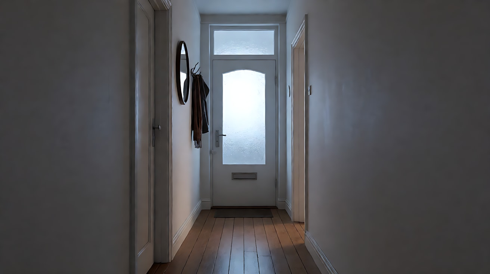

图3 镜头1关键帧：

```
Using the character from image 1 and the hallway from image 2:
a wide shot down the hallway, the floorboard lines, the wall edges and the ceiling line all converge on her as she stands in front of the front door at the far end,
seen from behind, small in the frame, her hand not yet on the door handle.
Camera at eye level from the far end of the hallway, 28mm lens, deep focus.
Lighting: bright cool daylight through the frosted glass panel of the door as backlight, the hallway slightly darker toward the camera.
Keep the face, hairstyle and outfit exactly as in image 1.
Stylized semi-realistic 3D CG rendering, feature-film animation quality. Aspect ratio 16:9.
```

中文释义：远景，走廊地板线、墙沿和天花板线全部汇聚到站在尽头门前的她身上；背面、人物小、手还没放到门把上；门上磨砂玻璃的冷色日光逆光，靠近镜头的走廊略暗。

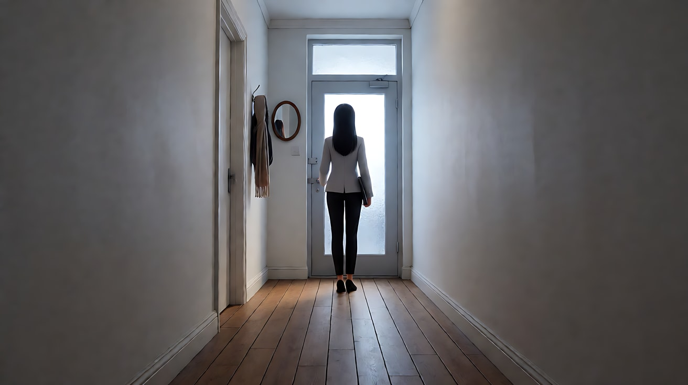

**【多图生视频 · Seedance】**

```
【素材分工】@图片1 锁定人物身份、发髻与西装，不参考其灰色背景；@图片2 仅参考走廊布局、圆镜与门的位置，不复制其构图；@图片3 为镜头1的首帧。
【画风】风格化写实三维CG质感，电影级布光。
镜头1：固定远景，走廊的地板线、墙沿全部汇聚到尽头门前的她身上。她背对镜头站着，抬手想去握门把，停在半空，又放下。门上磨砂玻璃透进冷色日光，把她勾成半个剪影。楼道外隐约的电梯提示音。
镜头2：镜头切至圆镜中的近景，圆形镜框框住她的脸，她看着镜中的自己，抬手把一缕碎发别到耳后，深吸一口气，对镜子里的自己轻轻点了一下头。镜头固定不动。她对着镜子轻声说："可以的。"
镜头3：镜头切至门内侧的中景，机位在走廊里，门框框住她；她拉开门，门外明亮的日光涌进来，她跨出门槛，背影走进亮处，门框里只剩一片白亮的光。镜头固定不动。门锁"咔哒"一声，然后是门外清晨的鸟叫和远处街道声。
【锁定】光线：冷色日光始终来自门的方向；人物始终穿浅灰西装、白衬衫，头发盘成低发髻，手拿黑色文件夹；机位始终在走廊一侧，看向门的方向。
【声音】从室内安静的底噪，到一句轻声的自我对话，再到开门后涌进来的鸟叫和街道声，无配乐。
【约束】保持人物脸型、发型、服装不变；镜中反射与本人动作一致；画面中只有她一个人；不要字幕、水印、Logo。
时长：12秒
```

**参数**：时长 12 秒 ｜ 画幅 16:9 ｜ 负载：3 个镜头、1 句短对白，属于"稳妥"档

**【检查点】**
- 镜头1线条是否全部汇聚到她身上
- 镜头2圆镜框是否把她的脸单独框出来，镜像是否正常
- 镜头3门框是否形成"框外暗、框内亮"，她走进光里

**【常见问题与修复】**
| 现象 | 修复 |
|---|---|
| 镜头2出现两个她（本人和反射都正脸） | 写"镜头切至圆镜中的近景"，只拍镜中的她；或改成"越过她的肩膀看镜中的脸" |
| 镜头2镜中人物动作和本人不同步 | 动作减到一个：只保留"点头"，删掉别头发 |
| 镜头3门外过曝成全白，看不到人 | 写"背影走进亮处"，生图门外写 `bright but readable street` |
| 三个镜头机位方向混乱 | 【锁定】写"机位始终在走廊一侧，看向门的方向" |

---

### 练习5：栏杆后的窥视——三层组合段落（难度 ★★★★★，多关键帧 + 多镜头）

**目标**：前景遮挡（楼梯栏杆）+ 框中框（客厅门洞）+ 引导线（走廊）三层组合在一个段落里。意图：让观众感到孩子听见了不该听的事，而且差点被发现。

**【生图 · Nano Banana】**

图1 角色定妆（孩子）：

```
Character turnaround sheet of an original boy about nine years old: messy short brown hair,
oversized striped pajamas in pale blue and white, barefoot, holding a small worn plush rabbit.
Front view, three-quarter view, side view and back view, full body, plain light-grey background, even soft studio light.
Stylized semi-realistic 3D CG rendering, feature-film animation quality. Aspect ratio 16:9.
```

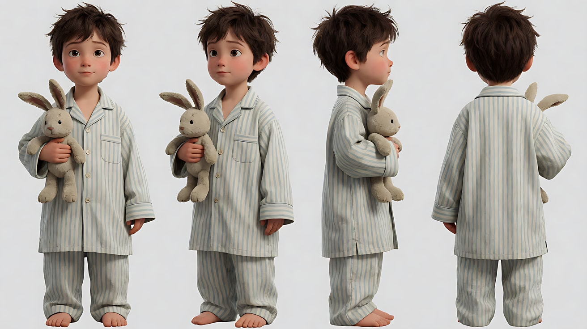

图2 角色定妆（父母）：

```
Character turnaround sheet of two original adults in their late thirties:
a father with short black hair, a loosened white shirt and dark trousers; a mother with a shoulder-length brown hair, a long beige cardigan over a dark dress.
Front view, three-quarter view and side view of each, full body, plain light-grey background, even soft studio light.
Stylized semi-realistic 3D CG rendering, feature-film animation quality. Aspect ratio 16:9.
```

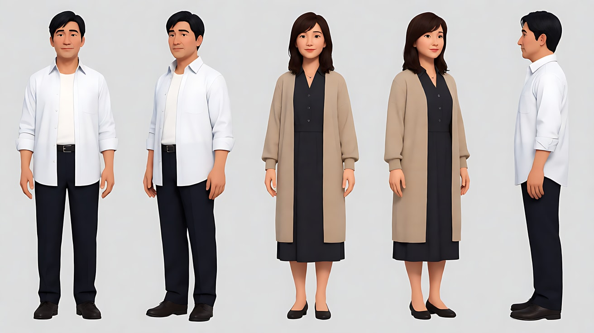

图3 场景（夜晚的两层住宅）：

```
Empty two-storey house interior at night: a wooden staircase with vertical white banister rails on the right,
a dark ground-floor hallway leading straight to an open living room doorway at the far end,
inside the doorway a warm floor lamp lit, a sofa and a low table, the rest of the house dark, no people.
Wide shot from halfway up the staircase looking down through the banister rails, 35mm lens, deep focus.
Stylized semi-realistic 3D CG rendering, feature-film animation quality. Aspect ratio 16:9.
```

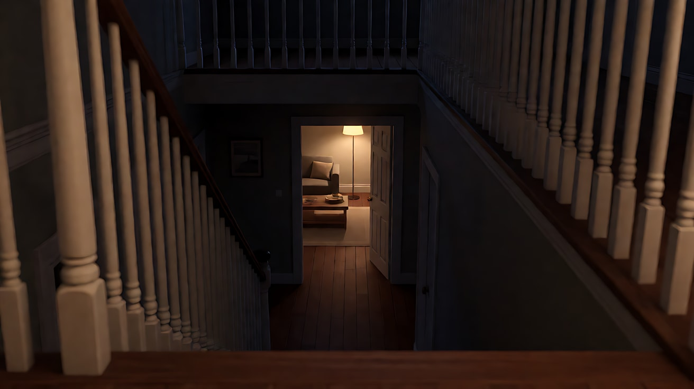

图4 镜头1关键帧：

```
Using the characters from image 2 and the house from image 3:
a wide shot from halfway up the staircase, looking down through the vertical banister rails which fill the foreground slightly out of focus and dark,
cutting the frame into narrow vertical strips. Down the dark hallway, framed by the bright living room doorway at the far end,
the father stands with his back half turned and the mother sits on the sofa arm, both small in the frame.
The hallway floor lines lead the eye straight to the bright doorway.
Camera at the eye level of a child sitting on the stairs, 35mm lens, the rails soft, the doorway sharp.
Lighting: warm floor lamp inside the living room as the only light source, the hallway and staircase in cool dark shadow.
Keep the faces, hairstyles and outfits exactly as in image 2.
Stylized semi-realistic 3D CG rendering, feature-film animation quality. Aspect ratio 16:9.
```

中文释义：远景，从楼梯半腰透过竖直栏杆往下看，前景栏杆略虚略暗，把画面切成一条条竖缝；暗走廊尽头是亮着的客厅门洞，门洞里父亲半背身站着，母亲坐在沙发扶手上，两人都很小；走廊地板线把视线直接引到门洞；坐在楼梯上的孩子视线高度、35mm；客厅落地灯是唯一光源，走廊和楼梯在冷暗阴影里。

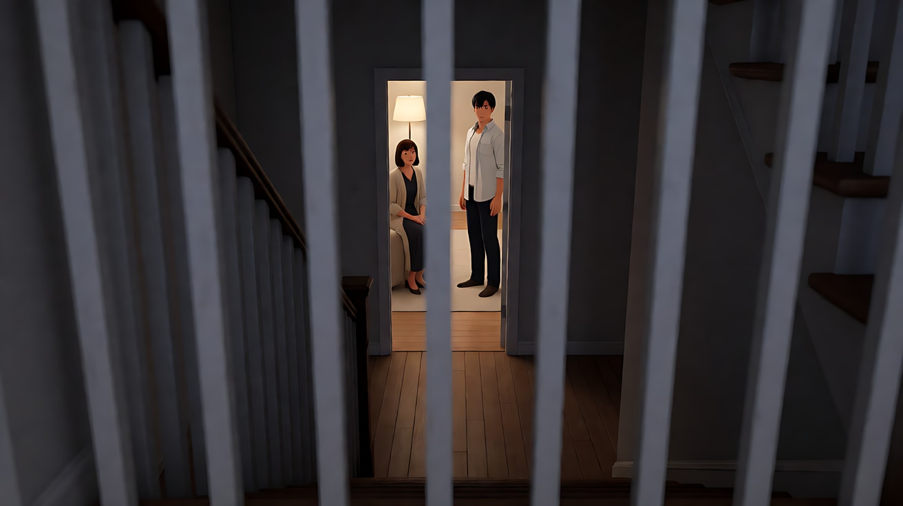

图5 镜头2关键帧：

```
Using the boy from image 1 and the staircase from image 3:
a close-up of the boy sitting on the stairs, his face seen between two vertical banister rails which are sharp in the foreground on both sides of his face,
his eyes wide, both hands gripping the rails, the plush rabbit pressed against his chest.
Camera at his eye level from the hallway side of the banister, 85mm lens, shallow depth of field, the stairs behind him dark and soft.
Lighting: a thin strip of warm light from the distant living room doorway falling across his eyes, the rest of his face in cool shadow.
Keep the face, hairstyle and outfit exactly as in image 1.
Stylized semi-realistic 3D CG rendering, feature-film animation quality. Aspect ratio 16:9.
```

中文释义：近景，男孩坐在楼梯上，脸夹在两根竖直栏杆之间，双手握着栏杆，毛绒兔子压在胸前，眼睛睁大；从栏杆外侧、他的视线高度拍，85mm 浅景深；远处客厅门洞透来的一条暖光正好落在他眼睛上，脸的其余部分在冷色阴影中。

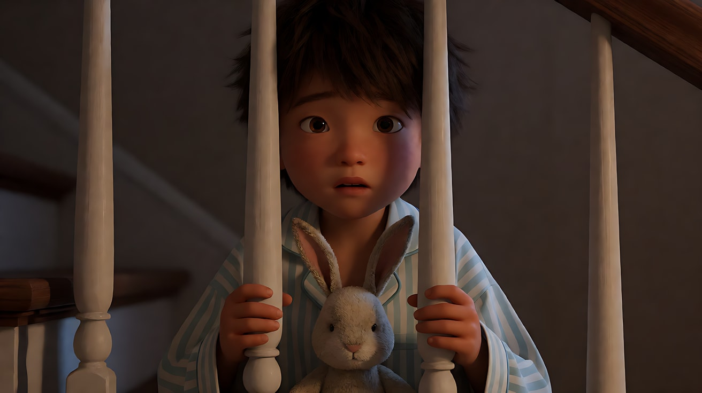

**【多图生视频 · Seedance】**

```
【素材分工】@图片1 锁定男孩身份、睡衣与毛绒兔子，不参考其灰色背景；@图片2 锁定父母两人的身份与服装，不参考其灰色背景；@图片3 仅参考房屋布局、楼梯栏杆与客厅门洞位置；@图片4 为镜头1的首帧；@图片5 为镜头2的构图参考，不作为首帧。
【画风】风格化写实三维CG质感，电影级布光。
镜头1：固定远景，从楼梯半腰透过前景虚化的竖直栏杆往下看，暗走廊尽头的客厅门洞亮着暖光，门洞里父亲半背身站着，一只手按着额头，母亲坐在沙发扶手上，双手交握，两人都很小。只有父亲在做主动作，母亲只低头不动。门洞里传来压得很低、听不清内容的争执声。
镜头2：镜头切至男孩近景，他的脸夹在两根竖直栏杆之间，一条暖光落在他眼睛上；他把毛绒兔子抱得更紧，下巴抵在兔子头上，嘴唇抿住，不出声。镜头固定不动。压低的争执声继续，一声杯子放在桌上的重响，他的肩膀跟着一缩。
镜头3：镜头切回走廊远景，机位与镜头1相同，父亲从客厅门洞里走出来，沿着走廊朝楼梯方向走来，走廊的线条把他一步步送向镜头，门洞里的暖光在他背后拉出长长的影子。镜头固定不动。拖鞋踩在木地板上的脚步声越来越近。
镜头4：镜头切至楼梯台阶的低机位近景，前景是两根虚化的栏杆，画面里只有男孩赤着的双脚和睡衣裤脚，他悄悄起身，双脚一级一级退上楼梯，退出画面上方，台阶上只剩一片空。镜头固定不动。木台阶极轻的一声吱呀，楼下脚步声停住。
【锁定】光线：客厅落地灯的暖光是唯一光源，始终在走廊尽头；走廊与楼梯始终是冷暗阴影；男孩始终穿蓝白条纹睡衣、赤脚、抱毛绒兔子；父亲白衬衫，母亲米色长开衫；楼梯栏杆始终在前景；机位始终在楼梯一侧，看向走廊尽头。
【声音】听不清内容的压低争执声、一声杯子重放在桌上、渐近的拖鞋脚步声、一声木台阶的吱呀，最后是突然的安静，无配乐。
【约束】保持三人的脸型、发型、服装不变；父母之间没有肢体接触；争执内容不可听清；不要字幕、水印、Logo。
时长：15秒
```

**参数**：时长 15 秒 ｜ 画幅 16:9 ｜ 负载：4 个镜头、无清晰对白、1 段走位，属于"有挑战"档；若失败，拆成镜头1–2 与镜头3–4 两次生成，第二次用第一次的末帧接续

**【检查点】**
- 镜头1是否同时有三层：前景栏杆、走廊引导线、亮的门洞框
- 镜头2栏杆是否像"牢笼"一样框住孩子的脸
- 镜头3父亲是否沿引导线走向镜头，制造逼近感
- 镜头4是否只拍脚，留下一个空台阶作为结尾

**【常见问题与修复】**
| 现象 | 修复 |
|---|---|
| 镜头1栏杆清楚而门洞模糊 | 写"前景虚化的竖直栏杆"，生图写 `the rails soft, the doorway sharp` |
| 父母在镜头1里大幅动作或有肢体接触 | 写"只有父亲在做主动作，母亲只低头不动"，【约束】写"没有肢体接触" |
| 争执声变成清晰台词 | 写"压得很低、听不清内容的争执声" |
| 镜头4拍到孩子的全身 | 写"画面里只有男孩赤着的双脚和睡衣裤脚"，低机位 |
| 栏杆在运动中闪烁变形 | 四个镜头都用固定机位；栏杆改为较粗的方形木栏杆 |

---

返回教学：[L03-02 引导线、框中框与前景遮挡](../教学/L03-02-引导线框中框与前景遮挡.md)
