# L03-03 对称与一点透视 · 提示词

> 本组练习：用中轴机位、水平镜头和广角焦段做出稳定的对称与一点透视，再学会用一个动作把对称打破，让"破缺"成为叙事事件。｜ 配套教学：[L03-03-对称与一点透视](../教学/L03-03-对称与一点透视.md) ｜ 规范：[写作规范](../../模板/写作规范.md)
>
> 画风默认使用开关 A（风格化写实 CG）。如改用 2D 动画，删掉所有焦段、光圈、景深词。

---

### 练习1：对称的压迫——沿中轴拉远（难度 ★）

**目标**：一个小职员站在巨大对称大厅的正中，镜头沿中轴线向后拉远，他越来越小，两侧柱子越来越多。意图：让观众感到他在这个体制里微不足道。

**【生图 · Nano Banana】**

图1 关键帧：

```
A full shot of an original young office clerk in an ill-fitting grey suit, holding a thin paper folder against his chest,
standing dead center in a vast empty marble hall, perfectly frontal, looking up toward something above the camera.
Two identical rows of massive pale stone columns on both sides, a polished floor reflecting them, a tall closed bronze-coloured double door far behind him on the central axis.
Perfectly symmetrical composition, camera on the central axis, eye level, 28mm lens, deep focus, one-point perspective with all lines converging behind him.
Lighting: cold hard daylight falling from high clerestory windows on both sides in identical slanted beams, the floor between the beams in shadow.
Stylized semi-realistic 3D CG rendering, feature-film animation quality. Aspect ratio 16:9.
```

中文释义：全景，原创年轻职员穿不合身的灰西装，把薄文件夹抱在胸前，站在巨大空旷大理石大厅的正中，正面，抬头望向镜头上方某处；两侧各一排相同的巨大浅色石柱，抛光地面倒映石柱，身后中轴线远端是一扇紧闭的青铜色双开门；严格对称、机位在中轴线、平视、28mm、深焦、一点透视；两侧高窗投下完全相同的冷硬斜光束。

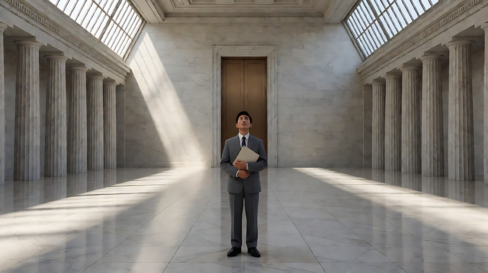

**【图生视频 · Seedance】**

```
【素材分工】@图片1 为首帧，锁定人物身份、服装与大厅的对称布局。
【画风】风格化写实三维CG质感，电影级布光，冷色调。
职员站在大厅正中，双手把文件夹抱得更紧，喉结动了一下，仍然抬头望着上方。镜头沿中轴线缓慢匀速向后拉远，从全景拉到大远景，两侧不断有新的石柱进入画面，他在画面正中越来越小，左右始终严格对称。高窗投下的冷硬光束保持不变，地面倒影清晰。结尾停在他只占画面高度很小一部分、站在中轴线正中的大远景上。
【声音】巨大空间里的低沉回声，远处一声沉重的关门回响，他一次紧张的吞咽声，无配乐。
【约束】镜头只沿中轴后拉，不偏移、不摇；画面始终左右对称；人物不走动；不要出现其他人物；不要字幕、水印、Logo。
时长：8秒
```

**参数**：时长 8 秒 ｜ 画幅 16:9

**【检查点】**
- 拉远全程是否保持左右对称，人物始终在正中
- 人物缩小的过程是否让观众感到"渺小"
- 两侧光束是否对称，地面倒影是否加强了对称

**【常见问题与修复】**
| 现象 | 修复 |
|---|---|
| 拉远时机位偏向一侧，对称破坏 | 写"沿中轴后拉，不偏移、不摇"，生图写 `camera on the central axis` |
| 竖直柱子向内倾斜 | 生图加 `eye level, vertical lines perfectly straight` |
| 人物转身走开 | 写"人物不走动"，并让他只做抱紧文件夹、吞咽这样的小动作 |
| 光束两侧不一致 | 生图写 `identical slanted beams on both sides` |

---

### 练习2：对称的刻板与喜剧（难度 ★★）

**目标**：同样是对称，换成鲜明的粉彩色、正面平视、人物站定直视镜头，情绪从压迫变成一本正经的幽默。意图：让观众感到这位门童把一切都看得过分认真。

**【生图 · Nano Banana】**

图1 角色定妆：

```
Character turnaround sheet of an original hotel bellboy in his early twenties: neatly parted short ginger hair,
a burgundy uniform jacket with two rows of brass-coloured buttons, a matching pillbox cap, white gloves, black trousers with a gold side stripe.
Front view, three-quarter view, side view and back view, full body, plain light-grey background, even soft studio light.
Stylized semi-realistic 3D CG rendering, feature-film animation quality. Aspect ratio 16:9.
```

中文释义：原创年轻门童定妆，整齐分头的姜红色短发，酒红色制服外套配两排铜色纽扣，同色小圆筒帽，白手套，黑裤子带金色侧条。

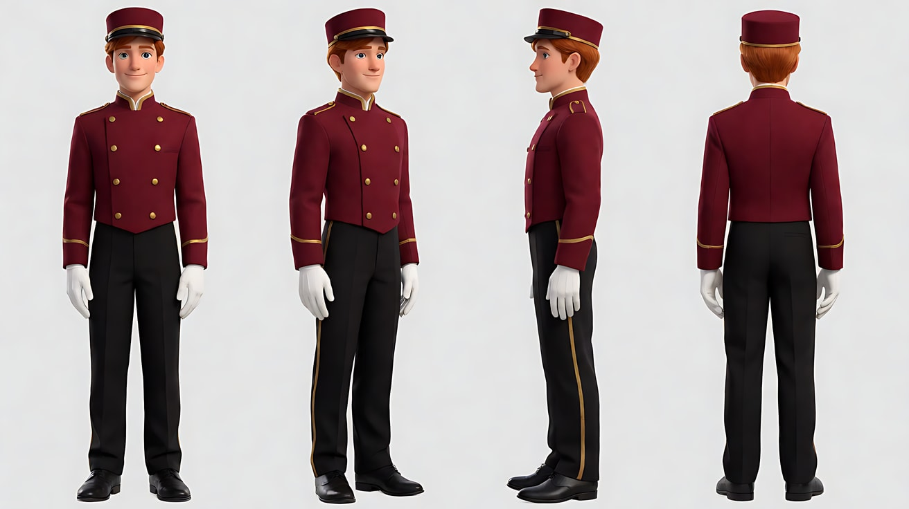

图2 场景：

```
Empty small old hotel lobby, perfectly symmetrical: a pale pink wall with a central arched doorway,
an identical potted fern on each side, two identical wall lamps with soft yellow shades, a small polished wooden reception desk dead center with a brass service bell on it,
a mint-green and cream checkered floor, no people.
Medium-wide shot, perfectly frontal, camera on the central axis, eye level, 35mm lens, deep focus.
Lighting: soft even frontal light, the two wall lamps glowing warmly. Pastel colour palette with low contrast.
Stylized semi-realistic 3D CG rendering, feature-film animation quality. Aspect ratio 16:9.
```

中文释义：空无一人的小旧酒店大堂，严格对称：浅粉色墙面中间一道拱门，两侧各一盆相同的蕨类植物，两盏相同的黄色灯罩壁灯，正中一张小木前台，台上一只铜色服务铃，薄荷绿与奶白的棋盘格地面；中全景、正面、中轴机位、平视、35mm、深焦；柔和均匀的正面光，粉彩低反差色调。

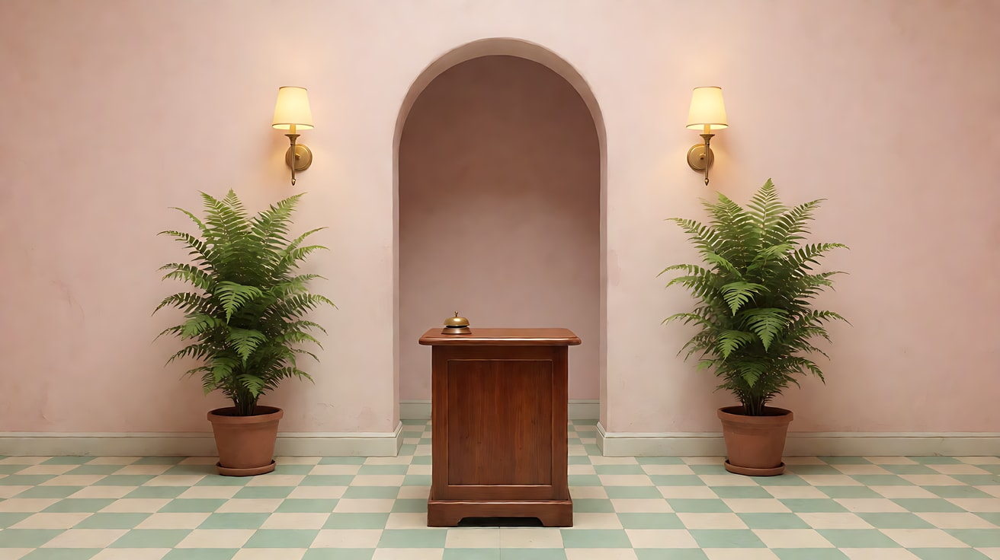

**【多图生视频 · Seedance】**

```
【素材分工】@图片1 锁定门童身份、制服与帽子，不参考其灰色背景；@图片2 锁定大堂的对称布局、配色与机位，门童出现在前台后方正中。
【画风】风格化写实三维CG质感，粉彩低饱和配色，柔和均匀的正面光。
门童站在前台后方，位于画面正中，身体正对镜头，直视镜头，表情一本正经。他用戴白手套的右手食指精准地按一下服务铃，然后把铃铛往正中挪了一点点，再退后半步，双手背到身后，下巴微抬，站定不动，眨一下眼。镜头固定中全景，严格正面、左右对称，不移动。两侧壁灯稳定发着暖黄光。结尾停在他背手站定、直视镜头的对称画面上。
【声音】服务铃清脆的"叮"一声，大堂安静的底噪，远处电梯轻微的运转声，无配乐。
【约束】镜头固定不动；画面始终左右对称；保持人物脸型、发型、制服不变；不要出现其他人物；不要字幕、水印、Logo。
时长：6秒
```

**参数**：时长 6 秒 ｜ 画幅 16:9

**【检查点】**
- 画面是否严格对称，门童是否在正中
- "把铃铛挪正一点"这个动作是否把刻板的幽默做出来
- 色彩是否保持粉彩低饱和，没有被拍成冷硬的压迫感

**【常见问题与修复】**
| 现象 | 修复 |
|---|---|
| 门童侧身站或走动 | 写"身体正对镜头，直视镜头"，动作限定在原地 |
| 两侧植物或灯不对称 | 生图重写 `an identical ... on each side`，用同一张场景图做参考 |
| 气氛变得阴沉 | 写清光是"柔和均匀的正面光"，色调"粉彩低饱和" |
| 门童表情夸张做鬼脸 | 写"表情一本正经"，只保留眨眼一个面部动作 |

---

### 练习3：打破对称——她从中轴走开（难度 ★★★，首尾帧）

**目标**：首帧是一个完美对称的舞台，钢琴手坐在正中；尾帧她已起身走到画右边缘，钢琴凳空在中轴上。意图：让观众感到她决定离开被安排好的人生。

**【生图 · Nano Banana】**

图1 角色定妆：

```
Character turnaround sheet of an original young pianist in her early twenties: long straight black hair loose over her shoulders,
a simple long black velvet concert dress with thin straps, a thin silver bracelet, black flat shoes.
Front view, three-quarter view, side view and back view, full body, plain light-grey background, even soft studio light.
Stylized semi-realistic 3D CG rendering, feature-film animation quality. Aspect ratio 16:9.
```

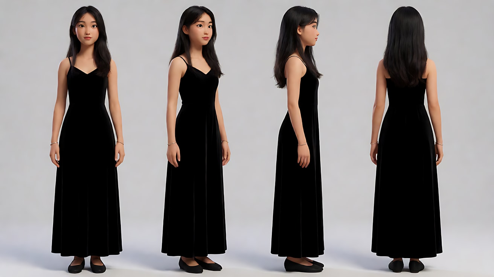

图2 首帧：

```
Using the character from image 1: a wide shot of an empty concert hall stage seen from the centre of the empty auditorium,
a black grand piano placed dead center with the keyboard facing the camera, she sits on the piano bench behind it, perfectly centered, hands resting in her lap, looking down at the keys.
Identical tall dark red curtains on both sides, a single hard white spotlight from directly above creating a perfect circle of light around the piano, the rest of the stage in darkness.
Perfectly symmetrical composition, camera on the central axis, eye level, 35mm lens, deep focus.
Keep the face, hairstyle and outfit exactly as in image 1.
Stylized semi-realistic 3D CG rendering, feature-film animation quality. Aspect ratio 16:9.
```

中文释义：远景，从空观众席正中看舞台，黑色三角钢琴在正中、琴键朝向镜头，她坐在琴凳上，严格居中，双手放在膝上，低头看琴键；两侧相同的深红高幕布，正上方一束冷硬白色追光在钢琴周围投下正圆形光圈，其余舞台全黑；严格对称、中轴机位、平视、35mm、深焦。

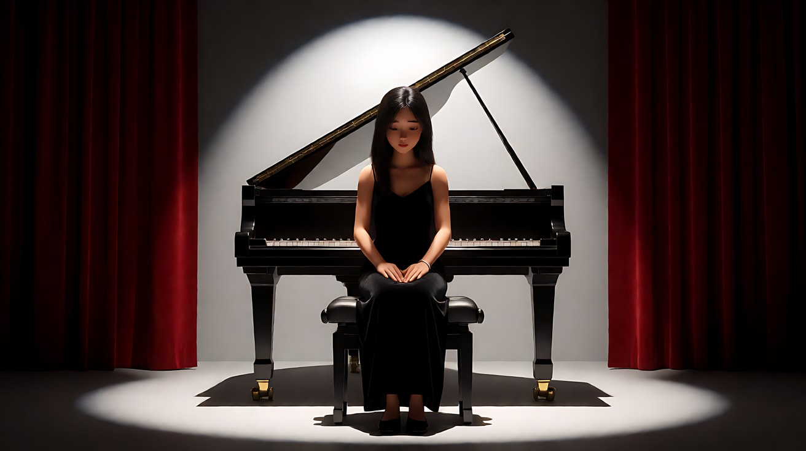

图3 尾帧：

```
Using the character and the exact same camera position, framing and stage as image 2:
the piano bench at the center is now empty, still lit by the circle of spotlight.
She stands at the far right edge of the stage near the dark red curtain, half in darkness, her body turned toward the exit offstage right, looking back over her shoulder at the empty piano.
The composition is no longer balanced: the lit empty piano in the center, her small figure on the right edge.
Keep the face, hairstyle and outfit exactly as in image 2.
Stylized semi-realistic 3D CG rendering, feature-film animation quality. Aspect ratio 16:9.
```

中文释义：同一机位、构图和舞台；正中的琴凳已空，仍在追光圈里；她站在舞台最右边、靠近深红幕布处，半身在暗里，身体朝向右侧的下场口，回头望向空着的钢琴；画面不再平衡：亮着的空钢琴在中央，她的小身影在右边缘。

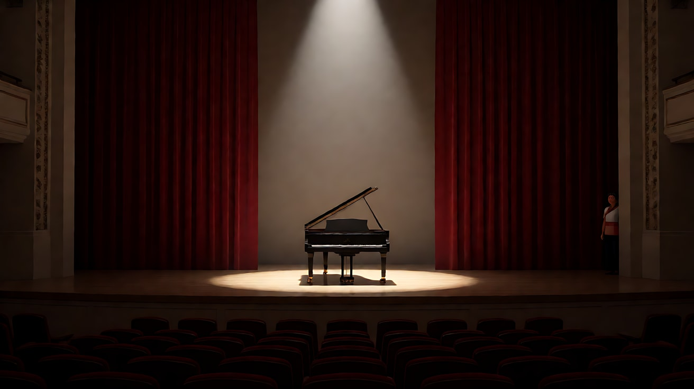

**【首尾帧生视频 · Seedance】**

```
【素材分工】@图片2 为首帧；@图片3 为尾帧，是最终画面目标；@图片1 锁定人物身份、发型与黑色长裙，不参考其灰色背景。只生成两帧之间的连续动作。
【画风】风格化写实三维CG质感，电影级布光。
她坐在钢琴正中，双手从膝上抬起，悬在琴键上方，停住，没有按下去。她慢慢合上琴盖，站起身，从琴凳右侧走出追光圈，一步步走向舞台右侧的幕布边，走进半明半暗处，停下，回头看了一眼钢琴。镜头固定远景，机位始终在中轴线上，不移动。头顶追光始终罩着钢琴与空琴凳，她离开光圈后身上只剩微弱的余光。
【声音】空旷音乐厅的回声，琴盖合上的一声闷响，裙摆摩擦与鞋底踩在木地板上的脚步声，无配乐。
【约束】镜头固定不动；保持人物脸型、发型、服装不变；她不弹奏钢琴；追光位置不变；中间动作连续，不跳切；不要字幕、水印、Logo。
时长：10秒
```

**参数**：时长 10 秒 ｜ 画幅 16:9

**【检查点】**
- 首帧是否严格对称，尾帧是否明显失衡
- 打破对称的方式是否是"人物离开中轴"，而不是镜头移动
- 空琴凳在追光里是否成为新的视觉重心

**【常见问题与修复】**
| 现象 | 修复 |
|---|---|
| 她开始弹琴 | 写"双手悬在琴键上方，停住，没有按下去"，【约束】写"她不弹奏钢琴" |
| 镜头跟着她向右摇 | 写"镜头固定远景，机位始终在中轴线上" |
| 追光跟着她走 | 写"追光始终罩着钢琴与空琴凳"，【约束】写"追光位置不变" |
| 她直接走出画面 | 以 @图片3 为目标，写"走到幕布边，停下，回头" |

---

### 练习4：一点透视进入禁地（难度 ★★★★，多镜头）

**目标**：三个镜头：一点透视走廊 → 对称的大门打开 → 正面居中后人物走出中轴。意图：让观众感到她一步步被吸进一个无法回头的地方。

**【生图 · Nano Banana】**

图1 角色定妆：

```
Character turnaround sheet of an original female researcher in her early thirties: short dark hair tucked behind her ears,
a long white lab coat over a dark grey turtleneck, dark trousers, a slim access card on a lanyard around her neck, white soft-soled shoes.
Front view, three-quarter view, side view and back view, full body, plain light-grey background, even soft studio light.
Stylized semi-realistic 3D CG rendering, feature-film animation quality. Aspect ratio 16:9.
```

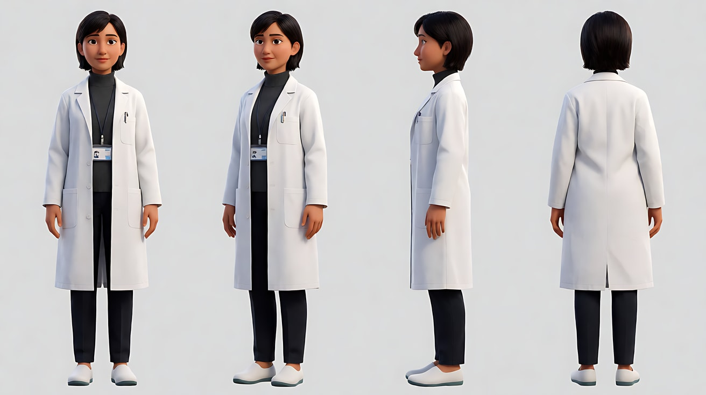

图2 场景：

```
Empty long white research facility corridor deep underground, perfectly symmetrical,
continuous strip lights running along both edges of the ceiling, smooth white wall panels, a glossy grey floor reflecting the lights,
at the far end a massive sealed metal double door with a thin vertical seam in the exact centre, no people, no text, no signs.
Camera on the central axis, eye level, 24mm lens, deep focus, strong one-point perspective with all lines converging on the door seam.
Lighting: cool white strip lights, the far door slightly darker.
Stylized semi-realistic 3D CG rendering, feature-film animation quality. Aspect ratio 16:9.
```

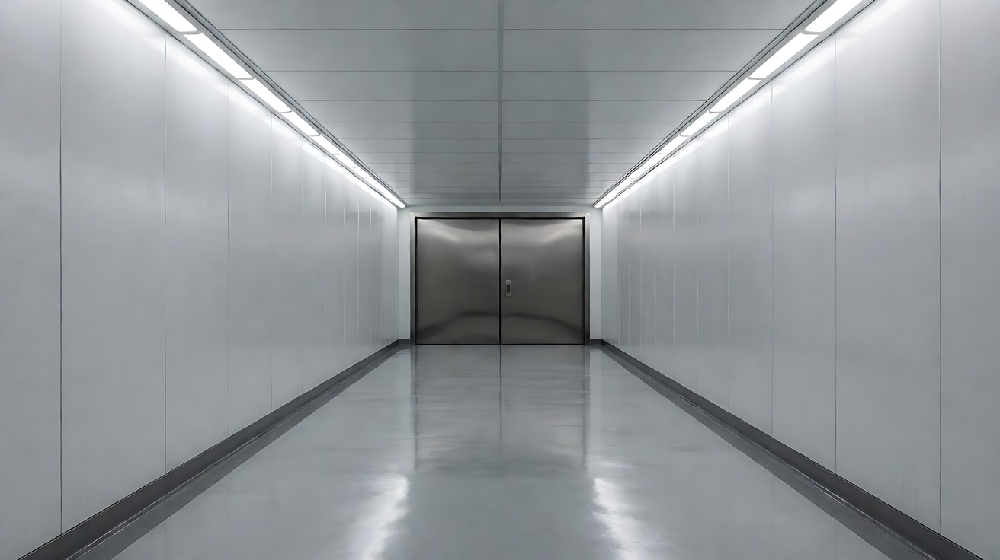

图3 镜头1关键帧：

```
Using the character from image 1 and the corridor from image 2:
a wide shot down the corridor, she walks away from the camera along the exact central axis, seen from behind, mid-distance,
the ceiling strip lights, wall edges and floor reflections all converging on the sealed door seam ahead of her.
Camera on the central axis, eye level, 24mm lens, deep focus, perfectly symmetrical.
Keep the face, hairstyle and outfit exactly as in image 1.
Stylized semi-realistic 3D CG rendering, feature-film animation quality. Aspect ratio 16:9.
```

中文释义：远景，她背对镜头沿正中轴线走向走廊深处，顶灯条、墙沿与地面反光全部汇聚到前方门缝；中轴机位、平视、24mm、深焦、严格对称。

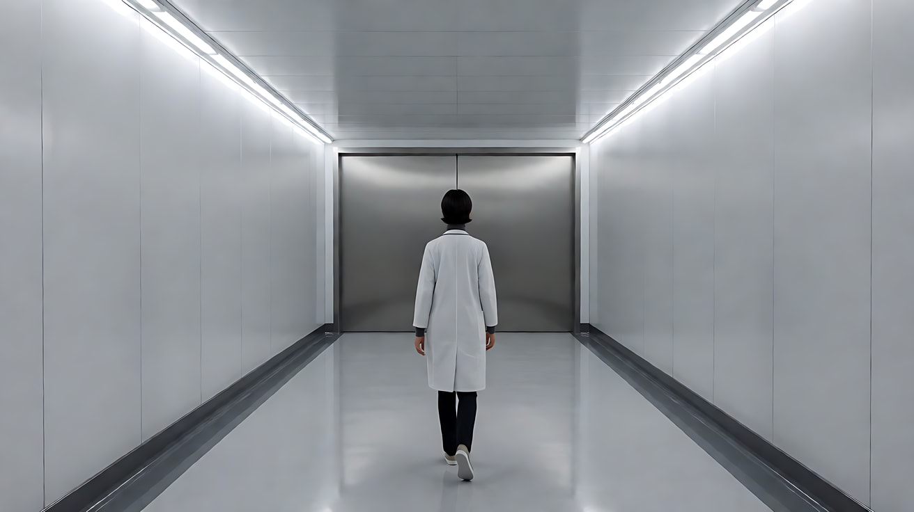

**【多图生视频 · Seedance】**

```
【素材分工】@图片1 锁定人物身份、白大褂与工作证，不参考其灰色背景；@图片2 仅参考走廊结构、灯条与大门样式，不复制其构图；@图片3 为镜头1的首帧。
【画风】风格化写实三维CG质感，冷白色调。
镜头1：固定远景，一点透视的白色长走廊，她背对镜头沿着正中轴线一步步走向尽头紧闭的金属大门，所有灯条与墙线都汇聚到门缝上。她越走越小，始终在中轴线上。鞋底在光滑地面上轻微的摩擦声，灯条低沉的电流声。
镜头2：镜头切至大门前的正面中景，机位在她身后、中轴线上，她的背影位于画面正中，左右两扇门严格对称。她抬起工作证贴近门边的感应面板，门缝中央亮起一条竖直的白光，两扇门向左右对称地缓缓分开，强白光从正中涌出，把她勾成剪影。镜头缓慢向前推近她的背影。沉重的机械解锁声和气压释放的嘶声。
镜头3：镜头切至门内侧的反打正面近景，她位于画面正中，门内的强白光从正前方照亮她的脸，她的眼睛微微眯起，瞳孔里映着光，然后向画右迈出一步，离开中轴，走出画面，画面正中只剩敞开的门和走廊。镜头固定不动。门内低沉持续的嗡鸣声。
【锁定】光线：走廊为冷白色灯条，门内为更强的纯白光，从门的方向照出；人物始终穿白大褂、深灰高领、挂工作证；镜头1、镜头2机位都在走廊中轴线上看向大门，镜头3为门内反打。
【声音】从脚步与电流声，到机械解锁和气压嘶声，再到门内低沉持续的嗡鸣，无配乐。
【约束】保持人物脸型、发型、服装不变；画面中只有她一个人；墙面和门上不出现文字与标识；不要字幕、水印、Logo。
时长：12秒
```

**参数**：时长 12 秒 ｜ 画幅 16:9 ｜ 负载：3 个镜头、无对白，属于"稳妥"档

**【检查点】**
- 镜头1是否是严格的一点透视，她始终在中轴线上
- 镜头2两扇门是否对称分开，光从正中涌出
- 镜头3她离开中轴，是否成为一个"打破"的时刻

**【常见问题与修复】**
| 现象 | 修复 |
|---|---|
| 走廊墙上出现乱码标识 | 生图写 `no text, no signs`，【约束】再写一次 |
| 大门只开一扇或不对称 | 写"两扇门向左右对称地缓缓分开" |
| 镜头3强光过曝，看不到脸 | 写"她的眼睛微微眯起，瞳孔里映着光"，提示脸部需可见 |
| 镜头3她走向门内而不是画右 | 写清"向画右迈出一步，离开中轴，走出画面" |

---

### 练习5：祠堂里的秩序与破缺（难度 ★★★★★，多关键帧 + 多镜头）

**目标**：四个镜头完成"对称的秩序 → 对称的压迫 → 打破对称 → 失衡的余韵"。意图：让观众感到孙子违背了家族为他安排的路，而祖母守着的秩序从此缺了一角。

**【生图 · Nano Banana】**

图1 角色定妆（祖母）：

```
Character turnaround sheet of an original grandmother in her eighties: silver hair in a tight low bun with a dark wooden hairpin,
a dark indigo traditional high-collar jacket with cloth buttons, a black long skirt, cloth shoes, a string of dark wooden prayer beads in one hand.
Front view, three-quarter view, side view and back view, full body, plain light-grey background, even soft studio light.
Stylized semi-realistic 3D CG rendering, feature-film animation quality. Aspect ratio 16:9.
```

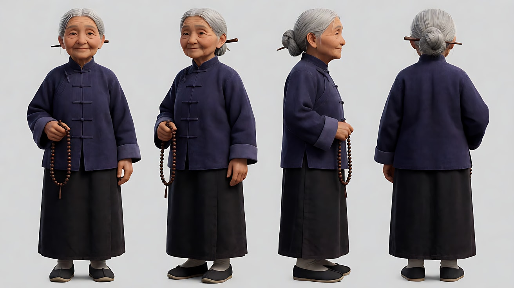

图2 角色定妆（孙子）：

```
Character turnaround sheet of an original young man in his early twenties: short black hair, clean-shaven,
a plain white shirt with sleeves rolled up, dark grey trousers, a canvas travel bag over one shoulder.
Front view, three-quarter view, side view and back view, full body, plain light-grey background, even soft studio light.
Stylized semi-realistic 3D CG rendering, feature-film animation quality. Aspect ratio 16:9.
```

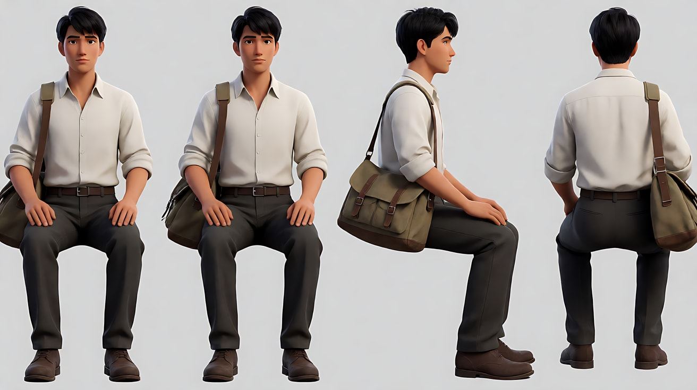

图3 场景（老祠堂正厅）：

```
Empty old ancestral hall interior at dusk, perfectly symmetrical: dark wooden columns in two rows, a raised central platform with a heavy carved wooden armchair dead center,
an identical tall red candle stand on each side of the chair, wooden ancestral tablets on a high shelf behind the chair with no readable text,
a stone floor, the open main doorway behind the camera letting in fading daylight, no people.
Wide shot, camera on the central axis, eye level, 28mm lens, deep focus, one-point perspective.
Stylized semi-realistic 3D CG rendering, feature-film animation quality. Aspect ratio 16:9.
```

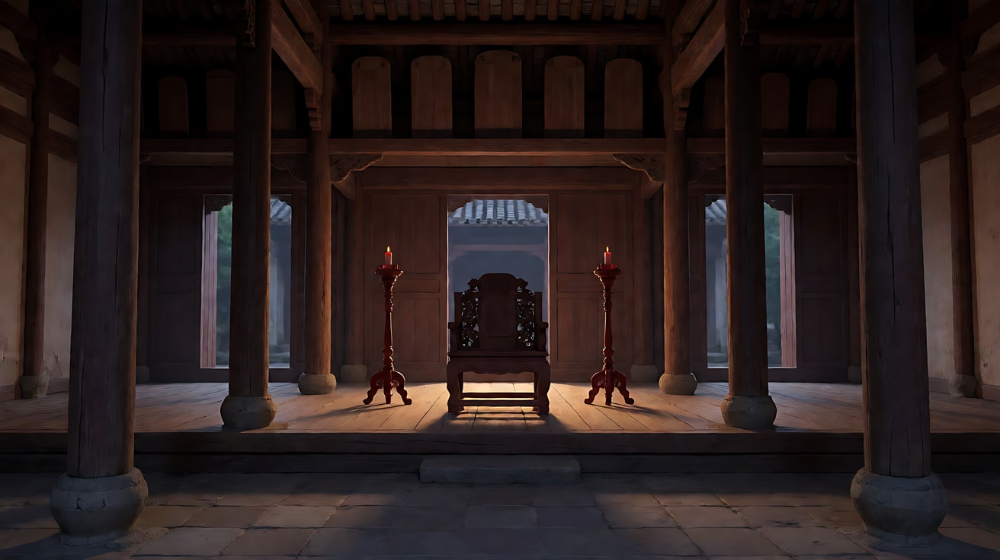

图4 镜头1关键帧：

```
Using the characters from image 1 and image 2 and the hall from image 3:
a wide shot, perfectly symmetrical. The grandmother sits upright in the carved armchair dead center on the raised platform, prayer beads in her hands, looking straight ahead.
The young man kneels on the stone floor in the exact centre of the hall, small in the frame, seen from behind, head bowed, the travel bag on the floor beside him.
Identical candles burning on both sides of her chair.
Camera on the central axis behind the young man, eye level, 28mm lens, deep focus.
Lighting: warm candlelight on both sides of the grandmother, cool fading daylight from the doorway behind the camera falling on the floor around him.
Keep the faces, hairstyles and outfits exactly as in image 1 and image 2.
Stylized semi-realistic 3D CG rendering, feature-film animation quality. Aspect ratio 16:9.
```

中文释义：远景，严格对称；祖母端坐在平台正中的雕花木椅上，手握佛珠，目视前方；孙子背对镜头跪在大厅正中的石地上，人物很小，低着头，旅行包放在身旁；椅子两侧两支相同的蜡烛燃着；中轴机位在他身后、平视、28mm、深焦；祖母两侧暖色烛光，镜头后方门口的冷色余晖落在他周围的地面上。

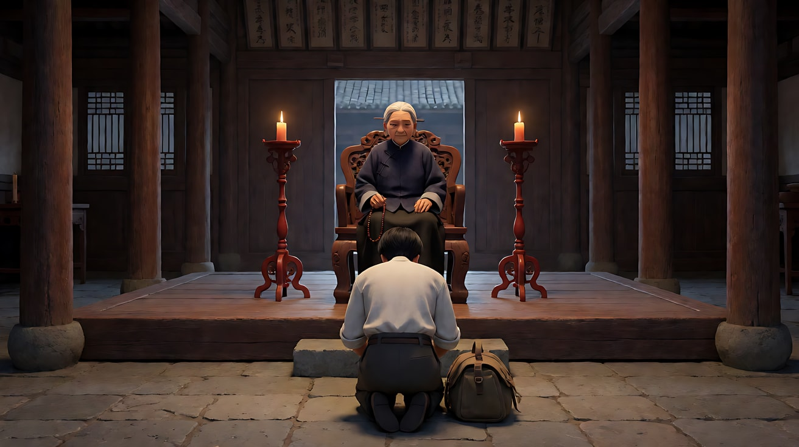

图5 镜头4关键帧：

```
Using the grandmother from image 1 and the hall from image 3, the exact same camera position and framing as image 4:
the grandmother still sits dead center in the armchair, the stone floor in front of her now empty.
The candle on frame right has gone out, a thin line of smoke rising from it; only the candle on frame left still burns,
so her face is lit warmly from one side and falls into shadow on the other.
Keep the face, hairstyle and outfit exactly as in image 1.
Stylized semi-realistic 3D CG rendering, feature-film animation quality. Aspect ratio 16:9.
```

中文释义：与图4同一机位和构图；祖母仍端坐正中，前方石地已空；画右的蜡烛已熄灭，升起一缕细烟，只剩画左蜡烛燃着，她的脸一侧被暖光照亮，另一侧落入阴影。

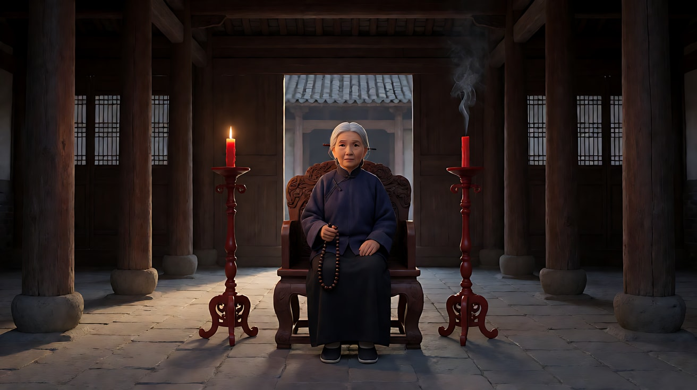

**【多图生视频 · Seedance】**

```
【素材分工】@图片1 锁定祖母身份、发髻、深蓝立领衣与佛珠，不参考其灰色背景；@图片2 锁定孙子身份、白衬衫与帆布包，不参考其灰色背景；@图片3 仅参考祠堂布局、立柱与烛台位置；@图片4 为镜头1的首帧，锁定对称构图；@图片5 为镜头4的目标画面，不作为首帧。
【画风】风格化写实三维CG质感，电影级布光。
镜头1：固定远景，严格对称，祖母端坐在正中木椅上，孙子背对镜头跪在大厅正中，两侧蜡烛对称燃烧。祖母拨动一颗佛珠，目视前方。只有祖母在做主动作，孙子低头不动。佛珠相碰的轻响，烛芯细微的噼啪声。
镜头2：镜头切至祖母的低机位正面中近景，她位于画面正中，两侧烛光对称地照亮她的脸，身后牌位架在虚焦中左右对称。镜头沿中轴线缓慢推近她的脸。祖母停下拨珠的手，开口说："你想好了？"
镜头3：镜头切回镜头1的机位，孙子沉默片刻，拿起地上的帆布包站起身，向祖母深深鞠一躬，然后转身向画右走去，离开中轴线，从右侧立柱之间走出画面。镜头固定不动。他的脚步声在石地上回响，渐渐远去。
镜头4：镜头切至与镜头1相同的远景构图，祖母独自端坐正中，前方石地已空；画右的蜡烛火苗晃了一下，熄灭，升起一缕细烟，只剩画左的蜡烛燃着，她的脸一半暖光一半阴影。镜头固定不动。远处一声木门合上的回响，然后是长长的安静。
【锁定】光线：两支蜡烛在祖母椅子两侧，镜头4画右蜡烛熄灭；门口冷色余晖始终从镜头后方照入；祖母始终端坐正中不起身；孙子始终穿白衬衫、背帆布包；机位始终在大厅中轴线上，看向祖母。
【声音】佛珠轻响与烛芯噼啪，一句对白，石地上渐远的脚步声，一声远处木门合上，最后是长长的安静，无配乐。
【约束】保持两人的脸型、发型、服装不变；两人没有肢体接触；牌位上不出现可读文字；不要字幕、水印、Logo。
时长：15秒
```

**参数**：时长 15 秒 ｜ 画幅 16:9 ｜ 负载：4 个镜头、1 句对白、1 次起身离开，属于"有挑战"档；若失败，拆成镜头1–2 与镜头3–4 两次生成

**【检查点】**
- 镜头1、镜头2是否建立了严格的对称秩序
- 镜头3孙子是否向一侧离开中轴，而不是沿中轴向镜头走来
- 镜头4画右蜡烛熄灭，是否让"失衡"变成看得见的画面
- 观众不看文字，能否读出"秩序被打破了"

**【常见问题与修复】**
| 现象 | 修复 |
|---|---|
| 孙子沿中轴朝镜头走出 | 写"转身向画右走去，从右侧立柱之间走出画面" |
| 两支蜡烛都灭了或都亮着 | 以 @图片5 为目标，写清"只剩画左的蜡烛燃着" |
| 祖母起身或追出 | 【锁定】写"祖母始终端坐正中不起身" |
| 镜头2推镜偏离中轴 | 写"沿中轴线缓慢推近"，生图写 `camera on the central axis` |
| 牌位上出现乱码 | 生图写 `tablets with no readable text`，【约束】重复 |

---

返回教学：[L03-03 对称与一点透视](../教学/L03-03-对称与一点透视.md)
