# L03-04 负空间与画面权力 · 提示词

> 本组练习：用"空白的比例和位置"表达孤独与威胁，用"人物的高度、大小、位置"表达权力，并用走位让权力在镜头里翻转。｜ 配套教学：[L03-04-负空间与画面权力](../教学/L03-04-负空间与画面权力.md) ｜ 规范：[写作规范](../../模板/写作规范.md)
>
> 画风默认使用开关 A（风格化写实 CG）。如改用 2D 动画，删掉所有焦段、光圈、景深词。

---

### 练习1：被空白吞没的人（难度 ★）

**目标**：一个人坐在巨大白墙前的长凳上，只占画面很小的一角，其余全是白墙。意图：让观众感到她在人来人往的城市里，其实没有人看见她。

**【生图 · Nano Banana】**

图1 关键帧：

```
A wide shot of an enormous blank white gallery wall filling almost the entire frame, softly lit with a gentle vertical gradient from bright top to slightly grey bottom.
At the lower right corner of the frame, a small original young woman in a dark olive raincoat sits alone on a long low wooden bench, seen in profile facing frame left,
her hands around a paper cup, occupying less than one tenth of the frame height.
The upper and left parts of the frame are completely empty white wall, no artworks, no text.
Camera at eye level, 50mm lens, moderate depth of field, the wall surface texture subtly visible.
Lighting: soft diffused skylight from above, a faint shadow of the bench on the floor.
Stylized semi-realistic 3D CG rendering, feature-film animation quality. Aspect ratio 16:9.
```

中文释义：远景，一面巨大空白的美术馆白墙几乎填满画面，自上而下有柔和的明暗渐变；画面右下角，一位穿深橄榄色雨衣的原创年轻女子独自坐在一张低矮长木凳上，侧面朝画左，双手捧着纸杯，人物不到画面高度的十分之一；画面上方和左侧完全是空白墙面，没有展品和文字；平视、50mm、中等景深；柔和的顶部天光，长凳在地上投下淡淡的影子。

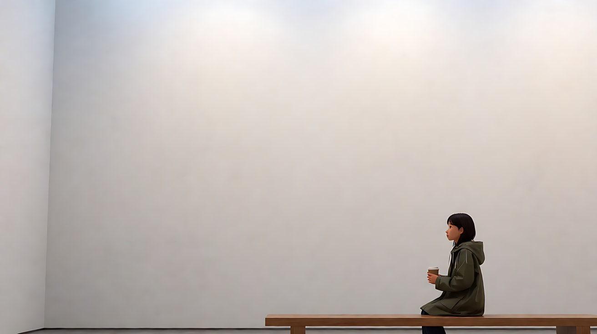

**【图生视频 · Seedance】**

```
【素材分工】@图片1 为首帧，锁定人物身份、服装、位置与大面积白墙的构图比例。
【画风】风格化写实三维CG质感，电影级布光。
女子坐在画面右下角的长凳上，低头看着手里的纸杯，用拇指慢慢摩挲杯沿，然后抬起头望向画左空白的墙面，停住。镜头固定远景，不移动，她始终只占画面右下角很小的一块，其余全是空白墙面。顶部天光缓慢地变暗一点点，像一片云经过。结尾停在她望着空墙的小小侧影上。
【声音】美术馆空旷的回声，远处几串模糊的脚步声经过又远去，纸杯被捏住时轻微的一声，无配乐。
【约束】镜头固定不动；墙面上不出现任何画作、文字或人影；画面中只有她一个人；保持人物脸型、服装不变；不要字幕、水印、Logo。
时长：6秒
```

**参数**：时长 6 秒 ｜ 画幅 16:9

**【检查点】**
- 人物是否始终小于画面高度的十分之一
- 白墙是否保持空白，没有被模型"补"上画作或路人
- 远处经过的脚步声是否加强了"没有人看见她"

**【常见问题与修复】**
| 现象 | 修复 |
|---|---|
| 墙上出现画作 | 生图写 `no artworks, no text`，【约束】再写一次 |
| 镜头推近，负空间被吃掉 | 写"镜头固定远景，不移动" |
| 远处脚步声变成路人入画 | 【约束】写"画面中只有她一个人"，脚步只出现在声音里 |
| 人物太小脸部崩坏 | 改为侧影或略低头，让脸不需要细节 |

---

### 练习2：身后的负空间（难度 ★★）

**目标**：人物坐在画右，身后画左是一大片黑暗的敞开门口，观众会一直盯着那片黑。意图：让观众感到她背后有什么，而她自己还没察觉。

**【生图 · Nano Banana】**

图1 角色定妆：

```
Character turnaround sheet of an original woman in her early thirties: shoulder-length wavy dark brown hair,
a loose oatmeal-coloured knitted sweater, grey lounge trousers, thick wool socks, thin gold-rimmed reading glasses.
Front view, three-quarter view, side view and back view, full body, plain light-grey background, even soft studio light.
Stylized semi-realistic 3D CG rendering, feature-film animation quality. Aspect ratio 16:9.
```

中文释义：原创三十出头女子定妆，及肩深棕卷发，宽松燕麦色针织毛衣，灰色家居裤，厚羊毛袜，细金框阅读眼镜。

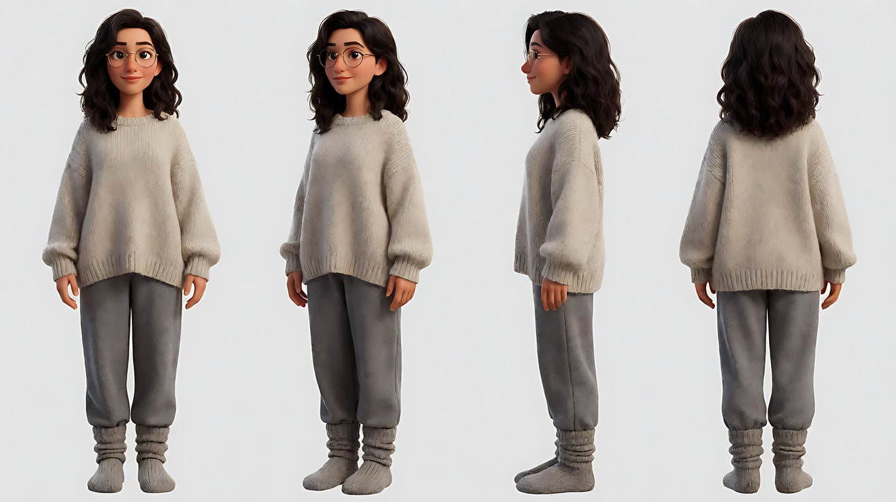

图2 场景：

```
Empty small study room at night, a wooden desk against the right wall with a laptop and a small warm desk lamp,
a wooden chair at the desk, behind the chair on the left side of the room a wide open doorway leading into a completely dark hallway,
the doorway and the darkness occupying the left half of the frame, no people.
Medium-wide shot from the corner of the room, eye level, 35mm lens, deep focus so the dark doorway stays sharp.
Lighting: the warm desk lamp is the only light source, falling off quickly so the doorway is pure deep shadow.
Stylized semi-realistic 3D CG rendering, feature-film animation quality. Aspect ratio 16:9.
```

中文释义：夜晚的小书房，木桌靠右墙，桌上一台笔记本电脑和一盏暖色小台灯，桌前一把木椅；椅子后方、房间左侧是一个敞开的宽门口，通向完全黑暗的走廊，门口和黑暗占据画面左半边；中全景、从房间角落拍、平视、35mm、深焦让门口保持清晰；暖色台灯是唯一光源，光线迅速衰减，门口一片深黑。

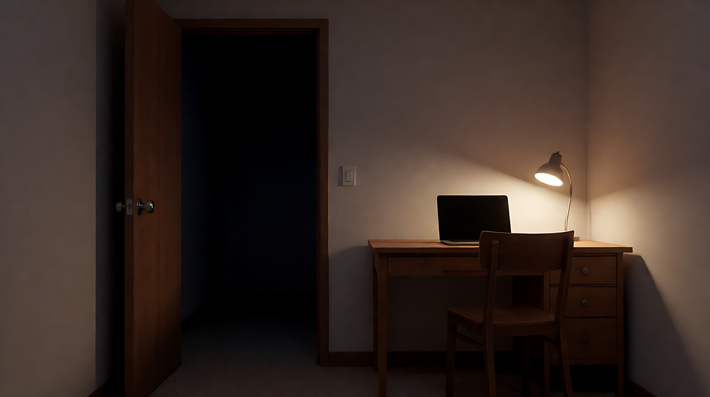

**【多图生视频 · Seedance】**

```
【素材分工】@图片1 锁定人物身份、发型、眼镜与服装，不参考其灰色背景；@图片2 锁定书房布局、机位与左侧黑暗门口的构图，人物坐在右侧书桌前，背对门口。
【画风】风格化写实三维CG质感，低调布光。
她坐在画右的书桌前打字，背对画左那片黑暗的敞开门口，台灯暖光只照亮她和桌面。她打字的手指慢下来，停住，抬起头盯着屏幕，眼镜片上反射着屏幕的冷光，屏住呼吸一拍，然后又低头继续打字，没有回头。镜头固定中全景，不移动，画面左半边始终是黑暗的门口。门口里什么都没有出现。结尾停在她继续打字的侧背影和左侧那片黑暗上。
【声音】键盘敲击声，台灯灯泡细微的电流声，窗外极远处的风声；她停下打字时，房间里出现一段完全的安静，然后键盘声重新响起，无配乐。
【约束】镜头固定不动；黑暗门口里不出现任何人影、物体或光；她不回头；保持人物脸型、发型、服装不变；屏幕内容不可见；不要字幕、水印、Logo。
时长：8秒
```

**参数**：时长 8 秒 ｜ 画幅 16:9

**【检查点】**
- 黑暗门口是否始终占据画面左半边
- 门口里是否真的什么都没有（恐惧来自空白，不来自怪物）
- 她停下打字那一段"完全的安静"是否让观众盯向门口

**【常见问题与修复】**
| 现象 | 修复 |
|---|---|
| 门口里出现了人影 | 【约束】写"黑暗门口里不出现任何人影、物体或光" |
| 她回头看门口 | 写"没有回头"，【约束】重复"她不回头" |
| 台灯把门口也照亮 | 写"台灯暖光只照亮她和桌面"，生图写 `falling off quickly` |
| 屏幕上出现乱码文字 | 【约束】写"屏幕内容不可见"，机位让屏幕背对镜头 |

---

### 练习3：一次起身，权力翻转（难度 ★★★，首尾帧）

**目标**：首帧经理站着、头在画面上方，年轻设计师坐在画面右下、很小；尾帧设计师站起来走近镜头，变得比经理更高更大。只有设计师在动，经理保持原位。意图：让观众感到她不再接受被压着。

**【生图 · Nano Banana】**

图1 角色定妆（两位原创角色）：

```
Character turnaround sheet of two original characters:
a manager in his fifties with slicked-back grey hair, a dark navy three-piece suit, a silver tie;
a young designer in her mid twenties with a short asymmetrical black haircut, a cream oversized shirt, black wide-leg trousers, a pencil tucked behind one ear.
Front view, three-quarter view and side view of each, full body, plain light-grey background, even soft studio light.
Stylized semi-realistic 3D CG rendering, feature-film animation quality. Aspect ratio 16:9.
```

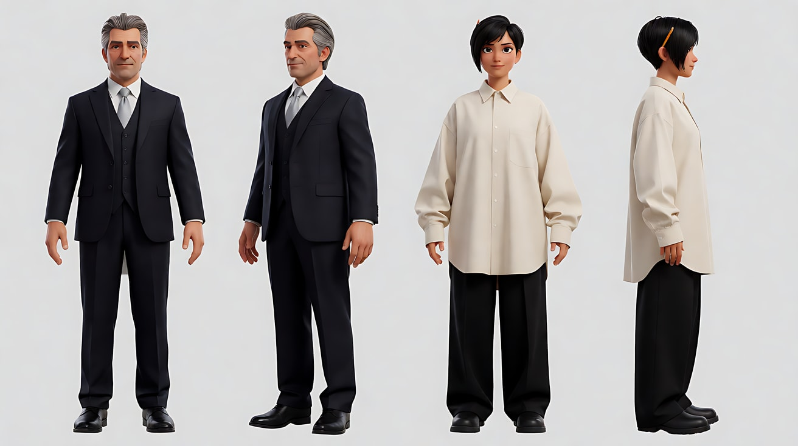

图2 首帧：

```
Using the characters from image 1: a medium-wide shot in a glass-walled office at late afternoon.
The manager stands on frame left, leaning forward with both palms on a desk, his head near the top of the frame, looking down at her.
The designer sits low in a chair on the lower right of the frame, small, her head at the lower third, a sketchbook in her lap, looking down.
Camera slightly above her eye level, 35mm lens, moderate depth of field.
Lighting: hard warm sunset light through the glass wall behind the manager, rimming his shoulders, her face in soft shadow.
Keep the faces, hairstyles and outfits exactly as in image 1.
Stylized semi-realistic 3D CG rendering, feature-film animation quality. Aspect ratio 16:9.
```

中文释义：中全景，傍晚玻璃墙办公室；经理在画左，双手撑桌前倾，头部接近画面顶端，俯视她；设计师坐在画面右下的矮椅上，很小，头部在下三分线，膝上放着速写本，低头；机位略高于她的视线、35mm、中等景深；经理身后玻璃墙透进强烈的暖色夕阳，勾出他的肩膀轮廓，她的脸在柔和阴影里。

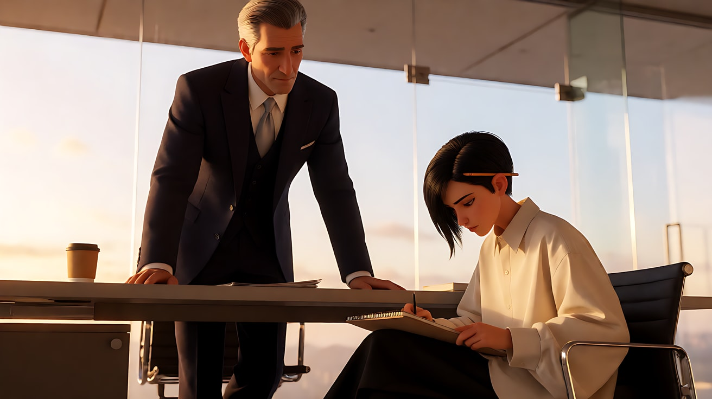

图3 尾帧：

```
Using the characters and the exact same office, camera position and lighting as image 2:
the designer now stands on the right, one step closer to the camera, larger in the frame than the manager,
her head above the upper third line and higher in the frame than his, the sketchbook closed and held against her side, looking straight at him, chin level.
The manager remains on frame left behind the desk in the same leaning position, now smaller and lower in the frame, looking up at her.
The sunset light now falls across her face.
Keep the faces, hairstyles and outfits exactly as in image 1.
Stylized semi-realistic 3D CG rendering, feature-film animation quality. Aspect ratio 16:9.
```

中文释义：同一办公室、机位与光线；设计师已站起来，在画右、向镜头靠近一步，在画面里比经理更大，头部高过上三分线、也高过经理；速写本合上夹在身侧，平视盯着他；经理仍在画左桌后保持原来的撑桌姿势，现在显得更小、更低，抬眼看她；夕阳现在照在她脸上。

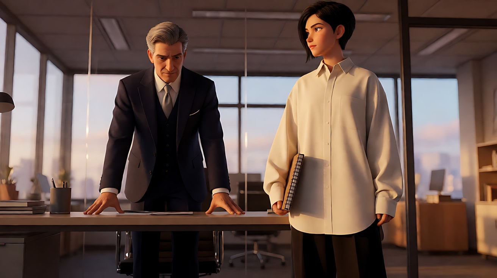

**【首尾帧生视频 · Seedance】**

```
【素材分工】@图片2 为首帧；@图片3 为尾帧，是最终画面目标；@图片1 锁定两位人物的身份与服装，不参考其灰色背景。只生成两帧之间的连续动作。
【画风】风格化写实三维CG质感，电影级布光。
设计师低头坐着，手指按在速写本上，停了一拍。她合上速写本，从椅子上站起来，向镜头方向迈出一步，抬起下巴，直视经理。只有她在做主动作；经理一直双手撑着桌子不动，只有视线跟着她从下往上抬起，喉结动了一下。镜头固定中全景，不移动。夕阳的暖光随着她站起，从照在经理肩上变成落在她的脸上。
【声音】办公室空调的低鸣，速写本合上的一声"啪"，椅子轮子向后滑开的声音，她站定后一段沉默，无配乐。
【约束】镜头固定不动；经理不走动、不起身离开桌子；两人没有肢体接触；保持两人的脸型、发型、服装不变；中间动作连续，不跳切；不要字幕、水印、Logo。
时长：8秒
```

**参数**：时长 8 秒 ｜ 画幅 16:9

**【检查点】**
- 首帧经理更高更大，尾帧设计师更高更大，权力翻转是否一眼可见
- 翻转是否只靠她的起身和走位完成，经理没有动
- 光从经理肩上转到她脸上，是否强化了翻转

**【常见问题与修复】**
| 现象 | 修复 |
|---|---|
| 经理也站直或走开 | 写"经理一直双手撑着桌子不动，只有视线跟着她抬起" |
| 她走得太近，变成近景 | 写清"向镜头方向迈出一步"，以 @图片3 为目标 |
| 两人发生推搡 | 【约束】写"两人没有肢体接触" |
| 夕阳方向没变化 | 删掉光的变化要求，只保留位置翻转；光的变化可在下一课再练 |

---

### 练习4：隔阂、失衡、平衡——三个镜头的父女（难度 ★★★★，多镜头）

**目标**：三个镜头完成一次关系变化：两人分贴画框两侧（隔阂）→ 一高一低（失衡）→ 并肩同高居中（平衡）。意图：让观众感到父女之间的距离终于被一个人先走近了。

**【生图 · Nano Banana】**

图1 角色定妆（两位原创角色）：

```
Character turnaround sheet of two original characters:
a father in his sixties with short grey hair and a grey moustache, a brown corduroy jacket over a checked flannel shirt;
a daughter in her early thirties with long black hair in a loose braid, a dark blue wool coat over a white sweater.
Front view, three-quarter view and side view of each, full body, plain light-grey background, even soft studio light.
Stylized semi-realistic 3D CG rendering, feature-film animation quality. Aspect ratio 16:9.
```

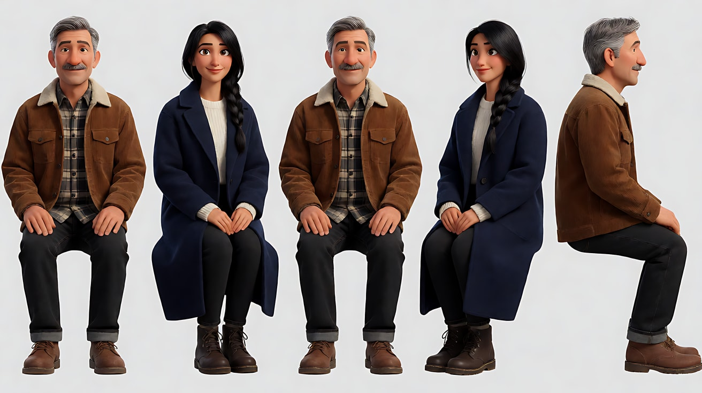

图2 场景：

```
Empty old family dining room on a winter evening, a very long dark wooden dining table running across the frame from left to right,
one chair at each far end, a large window on the back wall showing falling snow, a single warm pendant lamp above the middle of the empty table,
bare walls, no people.
Wide shot from the side of the table, eye level, 35mm lens, deep focus.
Stylized semi-realistic 3D CG rendering, feature-film animation quality. Aspect ratio 16:9.
```

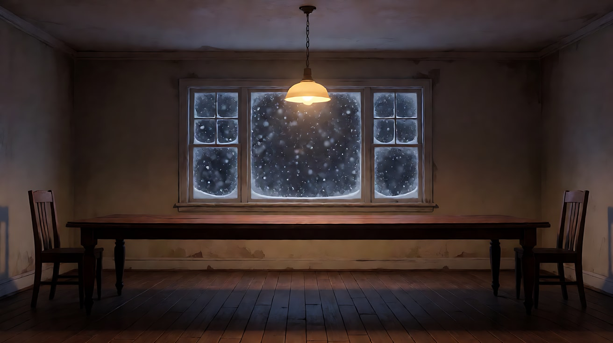

图3 镜头1关键帧：

```
Using the characters from image 1 and the dining room from image 2:
a wide shot, the father sits at the far left end of the long table touching the left edge of the frame, the daughter sits at the far right end touching the right edge,
both in profile facing each other, the long empty table between them filling the middle of the frame as negative space, the pendant lamp lighting only the empty middle.
Camera at seated eye level from the side, 35mm lens, deep focus.
Lighting: warm pendant lamp over the empty middle of the table, cool blue snow light from the window behind, both characters half in shadow.
Keep the faces, hairstyles and outfits exactly as in image 1.
Stylized semi-realistic 3D CG rendering, feature-film animation quality. Aspect ratio 16:9.
```

中文释义：远景，父亲坐在长桌最左端、贴着画面左边缘，女儿坐在最右端、贴着右边缘，两人侧脸相对，中间长长的空桌面是负空间，吊灯只照亮空着的桌子中段；侧面、坐姿视线高度、35mm、深焦；暖色吊灯在空桌中段，窗外雪的冷蓝光从背后来，两人都半身在阴影里。

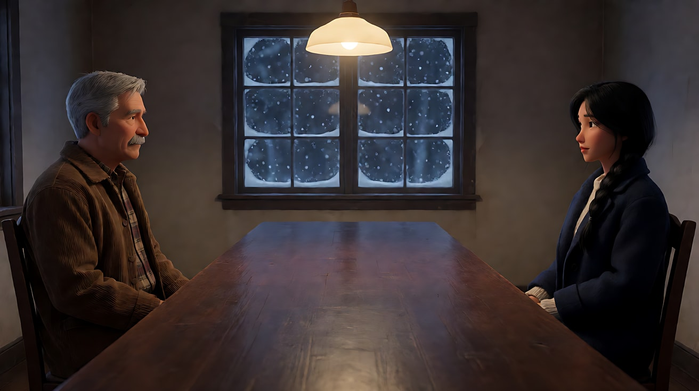

**【多图生视频 · Seedance】**

```
【素材分工】@图片1 锁定父女两人的身份与服装，不参考其灰色背景；@图片2 仅参考餐厅布局、长桌与窗户位置；@图片3 为镜头1的首帧，锁定两人分贴画框两侧的构图。
【画风】风格化写实三维CG质感，电影级布光。
镜头1：固定远景，父女分别坐在长桌两端、贴着左右画边，中间是被吊灯照亮的空桌面。父亲低头用勺子慢慢搅着面前的汤，女儿只是看着他，不动。窗外雪无声地下。勺子碰碗沿的轻响，挂钟滴答。
镜头2：镜头切至侧面中景，女儿已起身站在窗边，位于画面右侧，头部在画面上方，窗外雪光勾出她的侧影；父亲坐在画面左下角，只露出肩膀和头顶，在画面里又小又低。女儿转过身，看着父亲的头顶。镜头缓慢向右横移一小段，让她更靠近画面中心。窗外风声，挂钟滴答。
镜头3：镜头切至正面中景，女儿把椅子拉到父亲身边坐下，两人并肩坐着，头部在同一高度，一起位于画面正中，吊灯暖光同时照在两人脸上。父亲停下搅汤的勺子，没有抬头，把面前的汤碗往她那边推了一点。镜头固定不动。父亲低声说："还热着。"
【锁定】光线：吊灯暖光在桌子正上方，窗外冷蓝雪光始终从背后来；父亲始终穿棕色灯芯绒外套，女儿始终穿深蓝大衣、编松辫子；机位始终在长桌靠镜头的同一侧；三个镜头中两人位置依次为"两侧分离 → 一高一低 → 并肩同高"。
【声音】勺子碰碗、挂钟滴答、窗外风声，最后一句低声对白，无配乐。
【约束】保持两人的脸型、发型、服装不变；两人没有拥抱等肢体接触；画面中只有他们两人；不要字幕、水印、Logo。
时长：12秒
```

**参数**：时长 12 秒 ｜ 画幅 16:9 ｜ 负载：3 个镜头、1 句对白，属于"稳妥"档

**【检查点】**
- 镜头1两人是否真的贴在画框两边，中间是大片空桌
- 镜头2是否形成"女儿高、父亲低"的失衡
- 镜头3两人是否同高居中，画面重新平衡
- 推汤碗这个动作是否替代了"和解"这个情绪词

**【常见问题与修复】**
| 现象 | 修复 |
|---|---|
| 镜头1两人坐得太近 | 依赖 @图片3 首帧，正文写"贴着左右画边" |
| 镜头3两人拥抱 | 【约束】写"没有拥抱等肢体接触"，用推汤碗代替 |
| 镜头2父亲被拍成完整中景 | 写"父亲坐在画面左下角，只露出肩膀和头顶" |
| 三个镜头机位跳到桌子对面 | 【锁定】写"机位始终在长桌靠镜头的同一侧" |

---

### 练习5：王座大厅——空间属于谁（难度 ★★★★★，多关键帧 + 多镜头）

**目标**：四个镜头里，空间和高度先属于国王，最后转到女将军身上。综合使用负空间、画面高度、机位角度、画面边缘与光。意图：让观众感到跪着进来的人，站着成为了这个大厅的中心。

**【生图 · Nano Banana】**

图1 角色定妆（老国王）：

```
Character turnaround sheet of an original elderly king in his seventies: long thin white beard, deep-set eyes,
a heavy dark crimson robe with a wide black fur collar, a thin plain gold circlet on his head, a long carved wooden staff.
Front view, three-quarter view, side view and back view, full body, plain light-grey background, even soft studio light.
Stylized semi-realistic 3D CG rendering, feature-film animation quality. Aspect ratio 16:9.
```

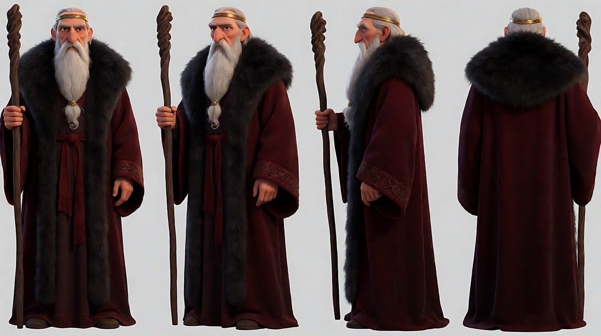

图2 角色定妆（女将军）：

```
Character turnaround sheet of an original female general in her early thirties: black hair in a high tight braid, a thin scar across her left eyebrow,
dark steel-grey lamellar armour over a deep blue tunic, a long dark travel cloak torn at the hem, worn leather boots, no weapons.
Front view, three-quarter view, side view and back view, full body, plain light-grey background, even soft studio light.
Stylized semi-realistic 3D CG rendering, feature-film animation quality. Aspect ratio 16:9.
```

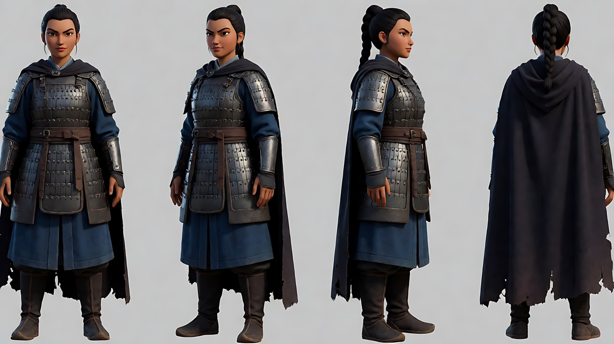

图3 场景（王座大厅）：

```
Empty vast stone throne hall, a long flight of steep stone steps rising to a high throne at the top of the frame,
enormous dark stone walls and columns, a high narrow window behind the throne letting in a single shaft of pale light that falls down the steps onto the centre of the floor,
the rest of the hall in deep shadow, dust in the light, no people.
Extreme wide shot from the hall floor, eye level, 24mm lens, deep focus.
Stylized semi-realistic 3D CG rendering, feature-film animation quality. Aspect ratio 16:9.
```

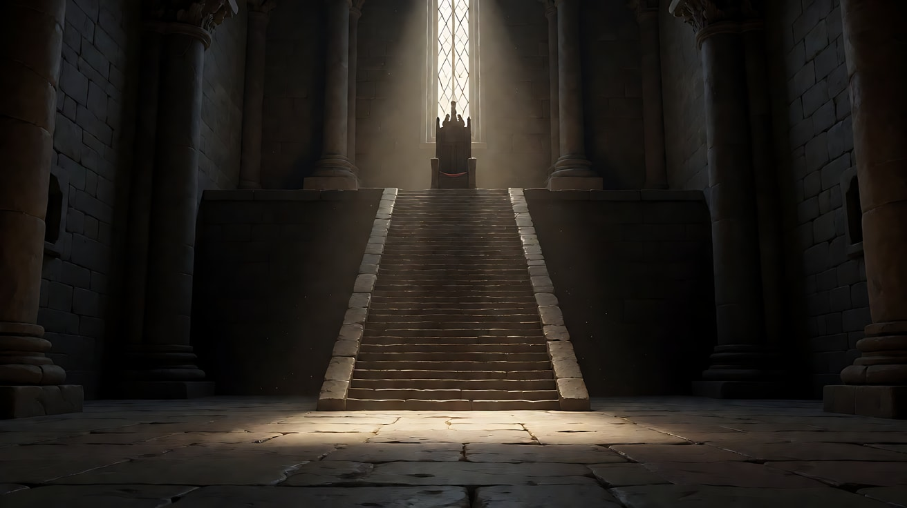

图4 镜头1关键帧：

```
Using the characters from image 1 and image 2 and the hall from image 3:
an extreme wide shot. The king sits on the high throne at the very top of the frame, small but high, lit by the window behind him.
The general kneels on the floor at the very bottom of the frame at the foot of the steps, seen from behind, tiny, head bowed.
Between them, the long empty stone steps and the vast dark walls fill almost the entire frame as negative space.
Camera low on the hall floor behind her, looking up the steps, 24mm lens, deep focus.
Lighting: a single shaft of pale light from the high window behind the throne, the hall in deep shadow, dust floating.
Keep the faces, hairstyles and outfits exactly as in image 1 and image 2.
Stylized semi-realistic 3D CG rendering, feature-film animation quality. Aspect ratio 16:9.
```

中文释义：大远景；国王坐在画面最上方的高高王座上，虽小但位置极高，被身后的窗光照亮；女将军背对镜头跪在画面最底部的台阶脚下，极小，低头；两人之间是漫长的空石阶和巨大的暗墙，几乎占满画面；机位低、在她身后、仰望台阶、24mm、深焦；王座后高窗一束浅色光柱，大厅其余部分深暗，浮尘飘动。

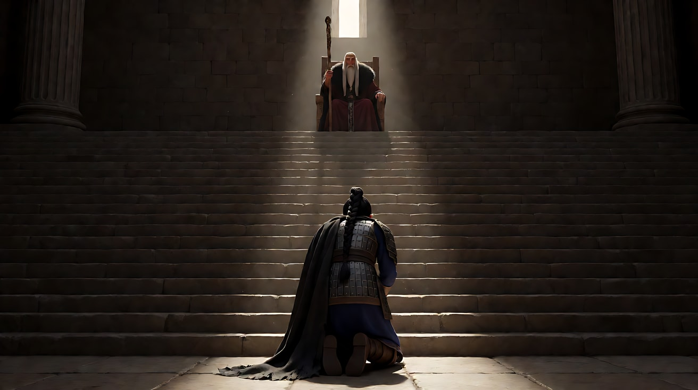

图5 镜头4关键帧：

```
Using the characters from image 1 and image 2 and the hall from image 3:
a wide shot from high up beside the throne, looking down the steps.
In the out-of-focus foreground on the left edge of the frame, the king's shoulder and fur collar are cut off by the frame edge, dark and blurred.
Far below, the general now stands upright dead center in the shaft of pale light on the hall floor, cloak hanging still, looking up toward the camera,
the light falling around her in a bright pool, the vast dark hall framing her on all sides.
Camera high beside the throne, 50mm lens, the foreground soft, the general sharp.
Keep the faces, hairstyles and outfits exactly as in image 1 and image 2.
Stylized semi-realistic 3D CG rendering, feature-film animation quality. Aspect ratio 16:9.
```

中文释义：远景，机位高高在王座旁俯视台阶；画面左边缘前景是国王虚化、发暗的肩膀和毛领，被画框切掉一部分；远处下方，女将军站直在大厅正中那束浅色光柱里，斗篷静垂，抬头望向镜头，光在她周围形成一圈亮池，巨大的暗厅从四面框住她；50mm，前景虚、她清晰。

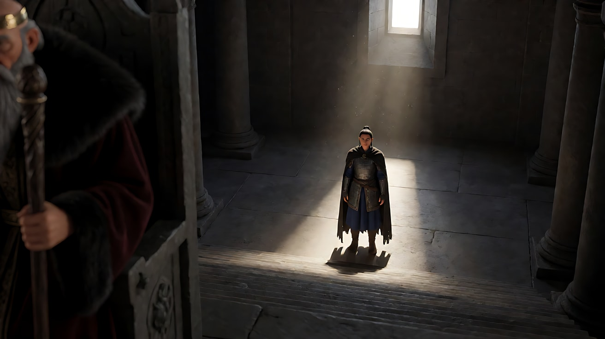

**【多图生视频 · Seedance】**

```
【素材分工】@图片1 锁定国王身份、白须、深红长袍与金色细冠，不参考其灰色背景；@图片2 锁定女将军身份、发辫、眉上疤痕、铠甲与斗篷，不参考其灰色背景；@图片3 仅参考大厅结构、台阶与高窗光柱位置；@图片4 为镜头1的首帧；@图片5 为镜头4的目标画面，不作为首帧。
【画风】风格化写实三维CG质感，低调布光，深暗石色与一束浅色天光。
镜头1：固定大远景，国王坐在画面最上方的王座上，女将军背对镜头跪在画面最底部的台阶下，两人之间是漫长的空石阶与巨大的暗墙。国王把手杖在石台上轻轻顿了一下。只有国王在做主动作，女将军低头不动。手杖顿地的回声在大厅里久久不散。
镜头2：镜头切至从台阶下仰拍国王的中景，他位于画面上方，头部接近画框顶端，背后窗光把他勾成半个剪影，他俯视下方，嘴角向下压。镜头缓慢向上微摇，让他在画面里显得更高。浮尘在光柱里飘动的细微声，大厅空旷的低频回响。
镜头3：镜头切至女将军的正面中近景，她仍跪着，抬起头，眉上的疤痕被光照亮，盯着上方。她一只手撑住膝盖，站了起来，头部从画面下方升到画面上三分线，铠甲片轻轻碰响。镜头固定不动，随她起身构图从低到高。女将军站定，抬眼说："我不再跪了。"
镜头4：镜头切至王座旁的高机位俯视远景，画面左边缘是国王被画框切掉的虚化肩膀与毛领，远处下方，女将军站在大厅正中的光柱里，光在她周围形成一圈亮池，她抬头望向王座方向。镜头缓慢向前推进一小段，越过国王的肩膀。斗篷边角在气流中轻轻一动，大厅里一片安静。
【锁定】光线：唯一光源是王座后方高窗投下的浅色光柱，从上往下落在台阶与大厅中央；国王始终穿深红长袍、黑毛领、戴金色细冠；女将军始终穿钢灰铠甲、深蓝内衫、破边斗篷，手中无任何器物；国王始终在王座上不起身；机位方向：镜头1、镜头3在台阶下方看向王座，镜头2从台阶下仰拍，镜头4从王座旁俯视。
【声音】手杖顿地的回声，大厅低频回响，铠甲片碰响，一句对白，最后是长久的安静，无配乐。
【约束】保持两人的脸型、发型、服装不变；两人没有肢体接触；大厅中没有其他人物；不要字幕、水印、Logo。
时长：15秒
```

**参数**：时长 15 秒 ｜ 画幅 16:9 ｜ 负载：4 个镜头、1 句对白、1 次起身，属于"有挑战"档；若失败，拆成镜头1–2 与镜头3–4 两次生成

**【检查点】**
- 镜头1负空间是否压倒两人，国王"高"、将军"低"
- 镜头2仰拍 + 画面高处，国王的权力是否达到顶点
- 镜头3起身时构图是否从低到高
- 镜头4国王被画框切到边缘、虚化、发暗，将军在光中居中，权力是否完成转移

**【常见问题与修复】**
| 现象 | 修复 |
|---|---|
| 女将军手里出现兵器 | 定妆写 `no weapons`，【锁定】写"手中无任何器物" |
| 镜头4国王完整出现在画面中央 | 写"画面左边缘是国王被画框切掉的虚化肩膀"，依赖 @图片5 |
| 镜头1两人太大，负空间不足 | 依赖 @图片4 首帧，正文写"漫长的空石阶与巨大的暗墙" |
| 国王在镜头3或镜头4起身 | 【锁定】写"国王始终在王座上不起身" |
| 光柱位置在各镜头间漂移 | 【锁定】写清光柱方向"从上往下落在台阶与大厅中央" |

---

返回教学：[L03-04 负空间与画面权力](../教学/L03-04-负空间与画面权力.md)
