# L03-05 画幅与构图 · 提示词

> 本组练习：分别用 21:9（宽银幕）、4:3、9:16（竖屏）构图，并把同一场戏改写成三种画幅，体会"画框的形状决定这场戏的主语"。｜ 配套教学：[L03-05-画幅与构图](../教学/L03-05-画幅与构图.md) ｜ 规范：[写作规范](../../模板/写作规范.md)
>
> 画风默认使用开关 A（风格化写实 CG）。如改用 2D 动画，删掉所有焦段、光圈、景深词。
>
> **本课控制变量**：输入图与目标视频画幅保持一致，便于比较构图。普通参考并非必须同画幅；专门首尾帧任务则跟随首帧，两端比例应一致。入口支持21:9时可生成后微裁到2.39:1，1.85:1可从16:9裁切。字幕在后期添加，版本边界见 [A-04](../../附录/A-04-官方案例与版本差异.md)。

---

### 练习1：宽银幕的横向长路（难度 ★，21:9）

**目标**：用 21:9 的极宽画框，让一个骑车的人从画左一路骑到画右，路和海平线横贯画面。意图：让观众感到这条路很长，而她只有一个人。

**【生图 · Nano Banana】**

图1 关键帧：

```
An ultra-wide extreme wide shot of a long empty coastal road running perfectly horizontally across the entire frame,
a low stone wall along the road, a flat calm grey-blue sea beyond it, the horizon on the upper third, a pale overcast sky.
On the far left edge of the frame, a small original young woman in a mustard-yellow raincoat rides an old green bicycle toward frame right,
occupying less than one eighth of the frame height. The rest of the road ahead of her is empty.
Camera at eye level from across the road, 50mm lens, deep focus.
Lighting: soft flat overcast daylight, a faint silver glow on the sea where the sun is hidden behind clouds on frame right.
Stylized semi-realistic 3D CG rendering, feature-film animation quality. Aspect ratio 21:9.
```

中文释义：21:9 超宽大远景，一条空荡的海滨公路水平横贯整个画面，路边一道矮石墙，墙外是平静的灰蓝色海面，海平线在上三分线，天空浅灰阴沉；画面最左边，一位穿芥末黄雨衣的原创年轻女子骑一辆旧绿色自行车朝画右骑行，人物不到画面高度的八分之一，前方整条路空着；从路对面平视、50mm、深焦；柔和平淡的阴天光，画右云后的太阳在海面上留下一片淡淡的银光。

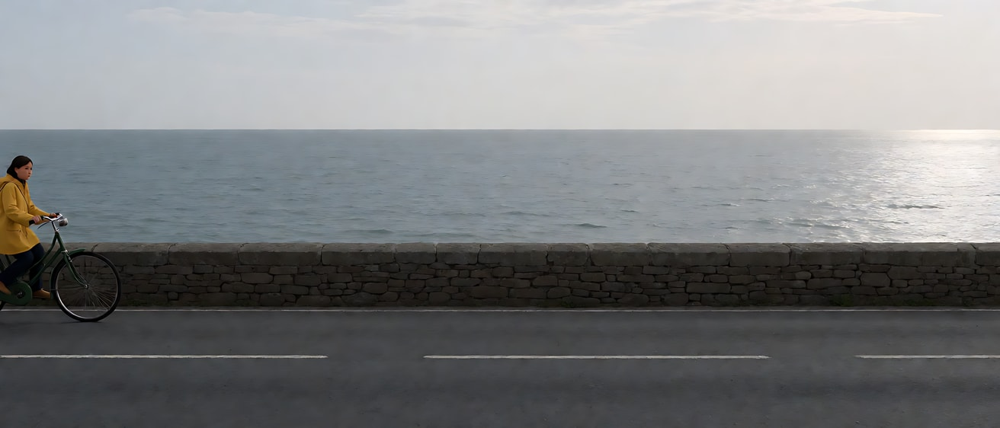

**【图生视频 · Seedance】**

```
【素材分工】@图片1 为首帧，锁定人物身份、雨衣、自行车与公路的横向构图。
【画风】风格化写实三维CG质感，电影级布光，低饱和灰蓝色调。
她沿着海滨公路从画左向画右匀速骑行，身体微微前倾，雨衣下摆被海风吹起。镜头固定超宽大远景，不移动，她在画面里很小，一路横穿画面，骑到画面中部偏右的位置，前方仍有很长一段空路。海面平静，画右海面上的银光缓慢移动。结尾停在她骑到画面右三分处、前方道路依然很长的画面上。
【声音】海浪轻拍石墙，海风声，自行车链条细碎的转动声，一声远处的海鸟叫，无配乐。
【约束】镜头固定不动；她始终沿水平方向骑行，不转弯；画面中只有她一个人，路上没有车辆；保持人物服装与自行车样式不变；不要字幕、水印、Logo。
时长：8秒
```

**参数**：时长 8 秒 ｜ 画幅 21:9（约 2.33:1，后期可裁成 2.39:1）

**【检查点】**
- 她的运动是否是纯横向，充分利用了宽画幅
- 画面是否让人感到"路很长"：结尾她前方仍有大段空路
- 海平线是否横贯全画面，没有被切断

**【常见问题与修复】**
| 现象 | 修复 |
|---|---|
| 她骑得太快，几秒就出画 | 写"骑到画面右三分处"作为终点，并写"匀速" |
| 镜头跟着她横摇 | 写"镜头固定超宽大远景，不移动" |
| 画幅变成 16:9 | 检查平台参数选的是 21:9，首帧也必须是 21:9 |
| 路上出现汽车 | 【约束】写"路上没有车辆" |

---

### 练习2：4:3 的头顶空间与封闭感（难度 ★★，4:3）

**目标**：用接近方形的 4:3 画框拍一个老裁缝在小店里工作，横向空间少、头顶空间多，挂满衣服的天花板压在他上方。意图：让观众感到这间小店装下了他的一辈子。

**【生图 · Nano Banana】**

图1 角色定妆：

```
Character turnaround sheet of an original elderly tailor in his seventies: thin white hair, round tortoiseshell-coloured glasses on the tip of his nose,
a measuring tape draped around his neck, a grey knitted vest over a white shirt with sleeve garters, dark trousers, a pincushion strapped to his left wrist.
Front view, three-quarter view, side view and back view, full body, plain light-grey background, even soft studio light.
Stylized semi-realistic 3D CG rendering, feature-film animation quality. Aspect ratio 4:3.
```

中文释义：原创七十多岁老裁缝定妆，稀疏白发，圆框眼镜架在鼻尖，脖子挂软尺，灰色针织背心配白衬衫和袖箍，深色裤子，左手腕绑着针插。

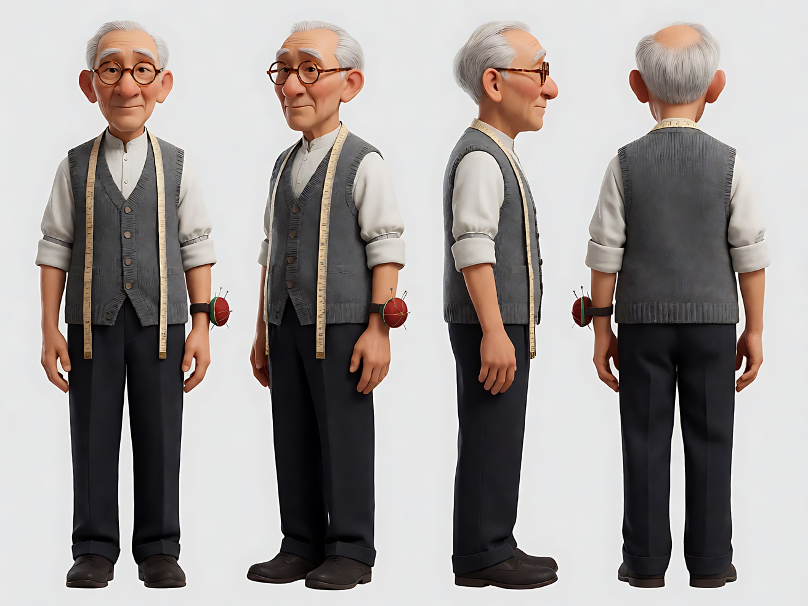

图2 场景：

```
Empty tiny old tailor's shop in the late afternoon, a narrow space with a worn wooden cutting table in the lower part of the frame,
an old black sewing machine on the table, the low ceiling densely hung with finished jackets and coats on hangers, rolls of fabric stacked on high shelves on both sides,
a single small window on the right letting in warm low sunlight, dust floating in the beam, no people.
Medium shot, eye level, 35mm lens, moderate depth of field, generous headroom showing the hanging garments above.
Stylized semi-realistic 3D CG rendering, feature-film animation quality. Aspect ratio 4:3.
```

中文释义：傍晚的小裁缝铺，空间狭窄，画面下部一张磨旧的木裁剪台，台上一台老式黑色缝纫机；低矮的天花板上密密挂满做好的外套；两侧高架上堆着布卷；右侧一扇小窗透进暖色低角度阳光，光柱里有浮尘；中景、平视、35mm、中等景深，头顶空间充足，能看到上方挂着的衣服。

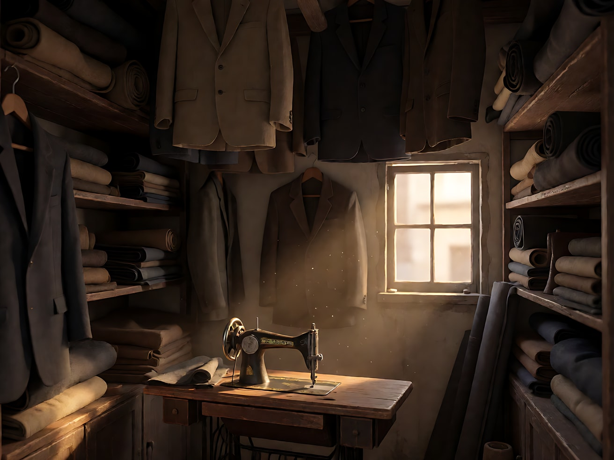

**【多图生视频 · Seedance】**

```
【素材分工】@图片1 锁定裁缝身份、眼镜、软尺与服装，不参考其灰色背景；@图片2 锁定小店布局、头顶挂衣与窗光，人物站在裁剪台后方正中。
【画风】风格化写实三维CG质感，电影级布光，暖色调。
老裁缝站在裁剪台后，位于画面下半部正中，头顶上方是密密挂着的一排排外套，几乎压到他的头。他用划粉在一块深灰色呢料上画出一条线，拿起大剪刀沿线剪开，剪完把剪刀放下，用手掌把布料抚平，抬眼越过眼镜看向窗外。镜头缓慢向前推近一小段，从中景推到中近景，推近后他头顶上方仍保留挂着衣服的空间。右侧小窗的暖色低角度阳光照在他手上和布料上，光柱里浮尘缓慢飘动。结尾停在他抬眼望向窗外的中近景上。
【声音】剪刀剪开呢料的沙沙声，划粉划过布面的声音，墙上老挂钟的滴答声，窗外远处隐约的自行车铃声，无配乐。
【约束】保持人物脸型、发型、眼镜、服装不变；头顶的挂衣始终在画面上方；画面中只有他一个人；不要字幕、水印、Logo。
时长：8秒
```

**参数**：时长 8 秒 ｜ 画幅 4:3

**【检查点】**
- 4:3 画框是否带来"左右窄、上方高"的封闭感
- 推近后头顶的挂衣是否仍在画面上方，没有被裁掉
- 剪布、抚平、抬眼三个动作是否清楚

**【常见问题与修复】**
| 现象 | 修复 |
|---|---|
| 生成了 16:9 画面 | 生图与视频都选 4:3，生图句尾写 `Aspect ratio 4:3.` |
| 推近后头顶空间消失 | 写清终点："推近后他头顶上方仍保留挂着衣服的空间" |
| 剪刀与手指变形 | 动作减为"剪开、放下"，删掉画线 |
| 小店显得宽敞 | 场景写 `a narrow space`、`fabric stacked on both sides` |

---

### 练习3：竖屏上下分层——悬念在头顶（难度 ★★★，首尾帧，9:16）

**目标**：竖屏里，女主在主体层（画面中部偏上）近景，身后长走廊的尽头在顶部层；首帧走廊尽头空着，尾帧那里出现了一个人。只有远处那个人在动，她只做极小的反应。意图：让观众感到危险从她背后的远处靠近，而她刚刚察觉。

**【生图 · Nano Banana】**

图1 角色定妆：

```
Character turnaround sheet of an original young woman in her mid twenties: long straight black hair with side-swept bangs,
a fitted white blouse, a black pencil skirt, a slim black blazer, small pearl stud earrings, a thin black wristwatch.
Front view, three-quarter view, side view and back view, full body, plain light-grey background, even soft studio light.
Stylized semi-realistic 3D CG rendering, feature-film animation quality. Vertical 9:16 frame.
```

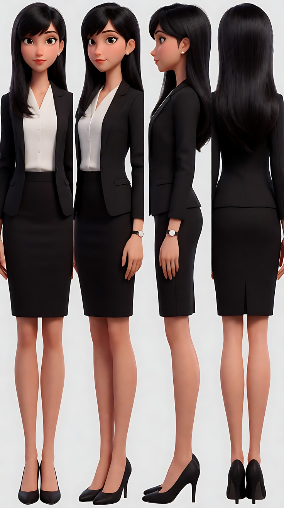

图2 首帧：

```
Using the character from image 1: a vertical medium close-up of her standing in a long dim office corridor at night, facing the camera,
her face centred horizontally and placed in the upper middle of the frame with her eyes about one third from the top,
behind her the corridor recedes in one-point perspective to a dark empty doorway at the far end, which sits in the top third of the frame above her head.
The bottom fifth of the frame is only her blazer and blouse, no important details.
Camera at eye level, 50mm lens, moderate depth of field so the far doorway stays readable but softer.
Lighting: cool blue emergency light along the corridor ceiling, a warm glow from a phone screen in her hand off the bottom of the frame lighting her chin softly.
Keep the face, hairstyle and outfit exactly as in image 1.
Stylized semi-realistic 3D CG rendering, feature-film animation quality. Vertical 9:16 frame.
```

中文释义：竖屏中近景，她站在夜晚昏暗的长办公走廊里，面朝镜头，脸水平居中、放在画面中部偏上，眼睛约在从上往下三分之一处；身后走廊以一点透视延伸到尽头一扇黑暗的空门口，门口位于她头顶上方的画面顶部三分之一；画面底部五分之一只有她的外套和衬衫，没有关键细节；平视、50mm、中等景深，远处门口可辨认但略虚；走廊顶部冷蓝色应急灯，画外手机屏幕的暖光从下方轻轻照亮她的下巴。

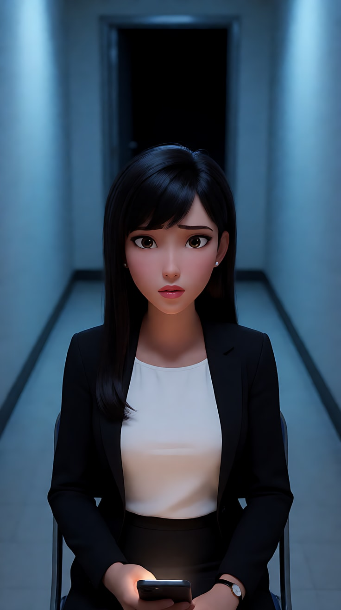

图3 尾帧：

```
Using the character and the exact same corridor, framing and lighting as image 2:
at the far end of the corridor, in the top third of the frame, a tall figure in a long dark coat now stands in the doorway, a dark silhouette, face not visible.
She still faces the camera in the same position, but her eyes have shifted sideways toward her shoulder, listening, her lips slightly parted.
Keep the face, hairstyle and outfit exactly as in image 1.
Stylized semi-realistic 3D CG rendering, feature-film animation quality. Vertical 9:16 frame.
```

中文释义：同一走廊、构图和光线；走廊尽头、画面顶部三分之一的门口里，现在站着一个穿深色长外套的高个剪影，看不清脸；她仍在原位面朝镜头，但眼睛已斜向自己肩膀方向，在听，嘴唇微张。

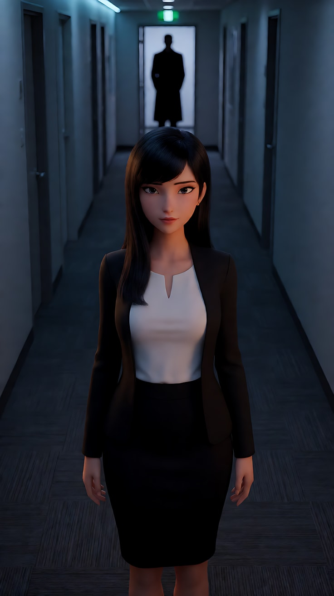

**【首尾帧生视频 · Seedance】**

```
【素材分工】@图片2 为首帧；@图片3 为尾帧，是最终画面目标；@图片1 锁定女主的身份、发型、耳环与服装，不参考其灰色背景。只生成两帧之间的连续画面。
【画风】风格化写实三维CG质感，低调冷色布光。
竖屏画面分上下两层：她的脸在画面中部偏上，走廊尽头的门口在她头顶上方的顶部层。她低头看着画外手里的手机，屏幕暖光照着下巴。顶部层的走廊尽头，一个穿深色长外套的高个人影从门口侧面走进来，停在门口正中，成为一个剪影，不再移动。只有远处的人影在做主动作；她只在人影停下的同时停住手指，眼睛斜向肩膀方向，嘴唇微张，没有回头。镜头固定不动。走廊顶部的冷蓝应急灯轻微闪了一下。
【声音】办公楼空调的低鸣，远处一声轻微的门把转动声，两声缓慢的脚步，然后一片安静，无配乐。
【约束】镜头固定不动；她不回头、不走动；远处人影始终是看不清脸的剪影，不走近；她的脸始终位于画面中部偏上；画面下方约五分之一不放关键内容，留给后期字幕；不要字幕、水印、Logo。
时长：6秒
```

**参数**：时长 6 秒 ｜ 画幅 9:16

**【检查点】**
- 竖屏是否形成清楚的上下两层：上方远处的门口，中部她的脸
- 她的脸是否一直在中部偏上，底部五分之一没有关键内容
- 威胁是否只出现在顶部层，且她只做了极小的反应

**【常见问题与修复】**
| 现象 | 修复 |
|---|---|
| 她回头看 | 写"没有回头"，【约束】再写"她不回头、不走动" |
| 人影一直走到她身后 | 写"停在门口正中，不再移动"，【约束】写"不走近" |
| 她的脸被放在画面正中或偏下 | 首帧生图写 `eyes about one third from the top`，视频【约束】写"脸始终位于画面中部偏上" |
| 远处门口完全糊掉，看不到人影 | 生图把景深写成 `moderate depth of field`，不要写 f/1.4 |

---

### 练习4：同一场戏，三种画幅（难度 ★★★★，多镜头 × 三版本）

**目标**：同一对角色、同一个站台送别场景，分别按 21:9、16:9、9:16 重新构图并生成两个镜头。比较三版：宽银幕讲"距离"，16:9 讲"两个人"，竖屏讲"她的脸"。意图：让观众感到列车开走的那一刻，他们来不及说出口。

**【生图 · Nano Banana】**

图1 角色定妆（两位原创角色，用 16:9 生成即可，仅用于锁定身份）：

```
Character turnaround sheet of two original characters in their late twenties:
a man with short messy black hair, a long dark grey wool coat, a dark red scarf;
a woman with a shoulder-length light brown bob, a camel-coloured duffle coat, a cream knitted hat.
Front view, three-quarter view and side view of each, full body, plain light-grey background, even soft studio light.
Stylized semi-realistic 3D CG rendering, feature-film animation quality. Aspect ratio 16:9.
```

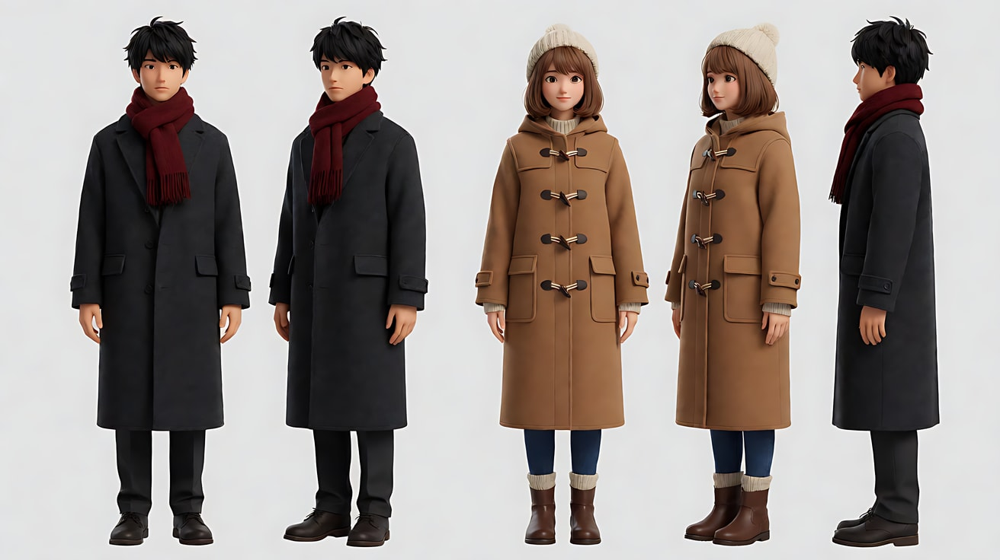

图2 场景（站台，16:9，仅参考环境）：

```
Empty small railway platform in winter at dusk, a waiting train with warm lit windows along the right side, light snow falling,
old lamp posts along the platform, wet concrete reflecting the warm windows, no people.
Wide shot, eye level, 35mm lens, deep focus.
Stylized semi-realistic 3D CG rendering, feature-film animation quality. Aspect ratio 16:9.
```

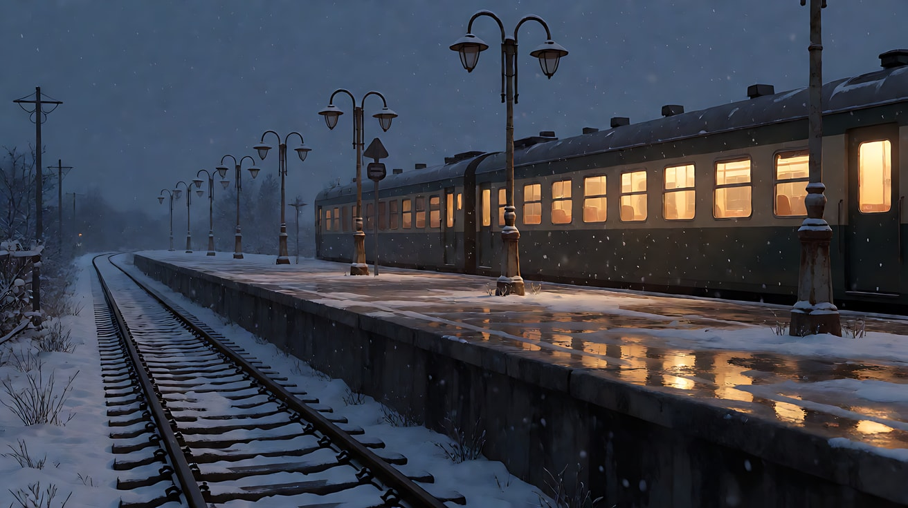

图3 21:9 版首帧：

```
Using the characters from image 1 and the platform from image 2:
an ultra-wide shot. The man stands alone on the far left edge of the frame on the platform, in profile facing right.
On the far right of the frame, the woman sits behind a lit train window, looking left toward him.
Between them, a long empty stretch of snowy platform fills the middle of the frame.
Camera at eye level, 50mm lens, deep focus. Lighting: cool blue dusk, warm light from the train windows, light snow.
Keep the faces, hairstyles and outfits exactly as in image 1.
Stylized semi-realistic 3D CG rendering, feature-film animation quality. Aspect ratio 21:9.
```

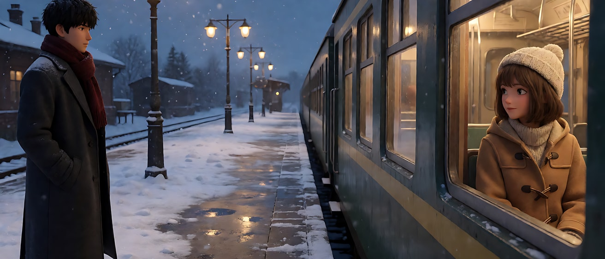

图4 16:9 版首帧：

```
Using the characters from image 1 and the platform from image 2:
a medium-wide shot. The man stands on the left third of the frame in three-quarter view facing right,
the woman sits behind a lit train window on the right third of the frame, looking at him, the two balanced on either side of the frame.
Camera at eye level, 35mm lens, moderate depth of field. Lighting: cool blue dusk, warm light from the train window on her face, light snow.
Keep the faces, hairstyles and outfits exactly as in image 1.
Stylized semi-realistic 3D CG rendering, feature-film animation quality. Aspect ratio 16:9.
```

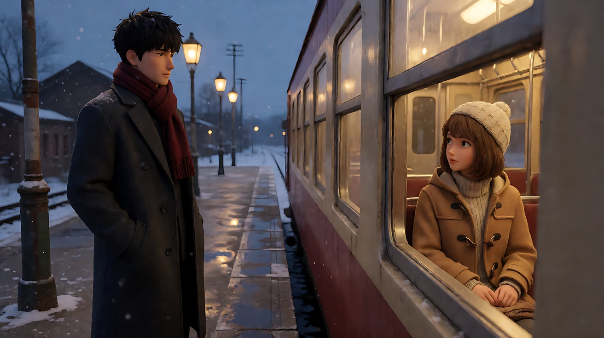

图5 9:16 版首帧：

```
Using the characters from image 1 and the platform from image 2:
a vertical medium close-up. The woman's face behind the lit train window is centred in the upper middle of the frame, her eyes about one third from the top,
the window frame around her face. In the lower part of the frame, the back of the man's head and his dark red scarf in the out-of-focus foreground, looking up at her.
The bottom fifth of the frame is only his blurred coat shoulder, no important details.
Camera at the man's shoulder height looking up slightly, 85mm lens, shallow depth of field.
Lighting: warm light from the train interior on her face, cool blue dusk outside, snowflakes in the foreground.
Keep the faces, hairstyles and outfits exactly as in image 1.
Stylized semi-realistic 3D CG rendering, feature-film animation quality. Vertical 9:16 frame.
```

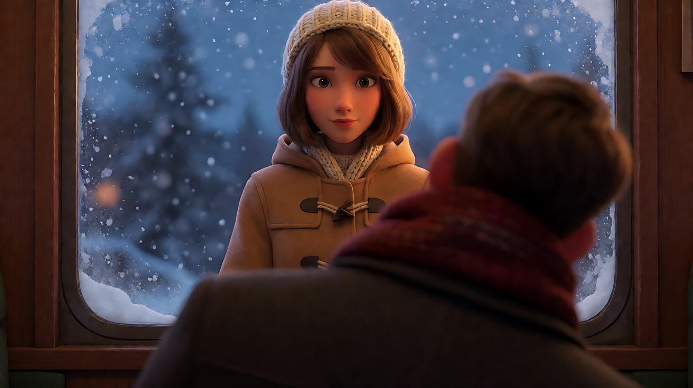

**【多图生视频 · Seedance】**

> 三个版本分三次生成，每次只上传 3 张图：图1、图2，以及该版本自己的首帧（图3、图4 或图5）。Seedance 按上传顺序编号，所以每个版本里首帧都写作 `@图片3`，平台画幅分别选 21:9、16:9、9:16。

**版本 A：21:9——讲"距离"**（上传：图1、图2、图3）

```
【素材分工】@图片1 锁定两位人物的身份与服装，不参考其灰色背景；@图片2 仅参考站台与列车的样式；@图片3 为镜头1的首帧，锁定宽银幕构图。
【画风】风格化写实三维CG质感，电影级布光。
镜头1：固定超宽画面，他站在画面最左边，她坐在画面最右边亮着的车窗里，中间是长长的空站台，雪在两人之间落下。他向前迈了半步，停住，没有再走。只有他在做主动作，她只是看着他。站台广播的回声和列车低沉的怠速声。
镜头2：镜头切至同一超宽机位，列车开始向画右缓缓驶离，她的车窗滑出画面右侧，画面里只剩画左的他和一条空荡荡的长站台。镜头固定不动。车轮压过铁轨接缝的声音由近及远。
【锁定】光线：冷蓝暮色，暖光只来自列车车窗；他始终在画左，穿深灰大衣、深红围巾；她始终在画右车窗里，戴奶白毛线帽；列车行驶方向为向画右。
【声音】站台广播回声，列车怠速与启动，车轮声远去，最后只剩落雪的安静，无配乐。
【约束】保持两人的脸型、发型、服装不变；两人始终不说话；站台上没有其他人物；不要字幕、水印、Logo。
时长：10秒
```

**版本 B：16:9——讲"两个人"**（上传：图1、图2、图4）

```
【素材分工】@图片1 锁定两位人物的身份与服装，不参考其灰色背景；@图片2 仅参考站台与列车的样式；@图片3 为镜头1的首帧，锁定双人平衡构图。
【画风】风格化写实三维CG质感，电影级布光。
镜头1：固定中全景，他在左三分线，她在右三分线的车窗里，两人隔着车窗玻璃相望。他抬起手，掌心贴上冰冷的车窗玻璃。只有他在做主动作，她看着他的手。列车怠速声，雪落在站台上的细响。
镜头2：镜头切至车窗内侧的中近景，她在画面右三分处，抬起手隔着玻璃贴在他手掌的位置，然后列车启动，窗外他的手被慢慢带离，她的手仍贴在玻璃上。镜头固定不动。列车启动的金属摩擦声。
【锁定】光线：冷蓝暮色，车窗暖光照在她脸上；他始终在画左一侧，她始终在画右一侧；列车行驶方向为向画右。
【声音】列车怠速、启动的金属摩擦声，雪落的细响，无配乐。
【约束】保持两人的脸型、发型、服装不变；两人始终不说话；两人的手只隔着玻璃相对，不直接接触；不要字幕、水印、Logo。
时长：10秒
```

**版本 C：9:16——讲"她的脸"**（上传：图1、图2、图5）

```
【素材分工】@图片1 锁定两位人物的身份与服装，不参考其灰色背景；@图片2 仅参考站台与列车的样式；@图片3 为镜头1的首帧，锁定竖屏上下分层构图。
【画风】风格化写实三维CG质感，电影级布光。
镜头1：固定竖屏中近景，她的脸在车窗里，位于画面中部偏上；画面下部是他虚化的后脑和深红围巾。她看着他，嘴唇动了一下，像要说什么，又抿住了，眼眶慢慢发红。只有她在做主动作。列车怠速声。
镜头2：镜头切至竖屏近景，她的脸占满画面宽度，位于画面中部偏上，列车启动，窗外的站台灯光从画面上方依次掠过她的脸。她把额头轻轻抵在车窗玻璃上，闭上眼睛。镜头固定不动。车轮压过铁轨接缝的节奏声逐渐加快。
【锁定】光线：车厢内暖光照在她脸上，窗外冷蓝暮色；她始终戴奶白毛线帽、穿驼色大衣；她的脸始终在画面中部偏上；画面下方约五分之一不放关键内容。
【声音】列车怠速、启动、逐渐加快的车轮节奏，无配乐。
【约束】保持两人的脸型、发型、服装不变；两人始终不说话；画面下方约五分之一留给后期字幕；不要字幕、水印、Logo。
时长：10秒
```

**参数**：每版时长 10 秒 ｜ 画幅分别为 21:9、16:9、9:16 ｜ 负载：每版 2 个镜头、无对白，属于"稳妥"档

**【检查点】**
- 21:9 版：两人之间的空站台是否成为画面主语，列车开走后"距离"是否更大
- 16:9 版：两人是否左右平衡，手贴玻璃的动作是否成为关系的焦点
- 9:16 版：她的脸是否始终在中部偏上，他是否退为前景
- 只看画面，三版是否讲出了三个不同的重点

**【常见问题与修复】**
| 现象 | 修复 |
|---|---|
| 三版构图几乎一样 | 三张首帧必须各自按画幅重新构图，不能把同一张图裁成三种 |
| 9:16 版两人并排，一人被切掉 | 改为前后叠放：她在中部偏上，他的后脑在下方前景 |
| 21:9 版两人被拉到中间靠近 | 依赖 @图片3，正文写"他站在画面最左边，她坐在画面最右边" |
| 列车方向在镜头间翻转 | 【锁定】写"列车行驶方向为向画右" |
| 16:9 版两人的手穿过玻璃 | 【约束】写"两人的手只隔着玻璃相对，不直接接触" |

---

### 练习5：竖屏短剧的反转时刻（难度 ★★★★★，多关键帧 + 多镜头，9:16）

**目标**：一段 4 个镜头的竖屏短剧爽点：女主被前台拦下 → 她平静地亮出一张卡 → 高管从楼梯上方快步下来 → 高管在她面前鞠躬。全程遵守竖屏三条规则：上下分层、人物居中偏上、底部留字幕区。意图：让观众感到被轻视的人原来才是这里的主人。

**【生图 · Nano Banana】**

图1 角色定妆（女主）：

```
Character turnaround sheet of an original woman in her early thirties: long black hair in a low simple ponytail, no makeup look,
a plain beige trench coat over a grey knit dress, flat black shoes, a worn canvas tote bag, a slim matte black card in her coat pocket.
Front view, three-quarter view, side view and back view, full body, plain light-grey background, even soft studio light.
Stylized semi-realistic 3D CG rendering, feature-film animation quality. Vertical 9:16 frame.
```

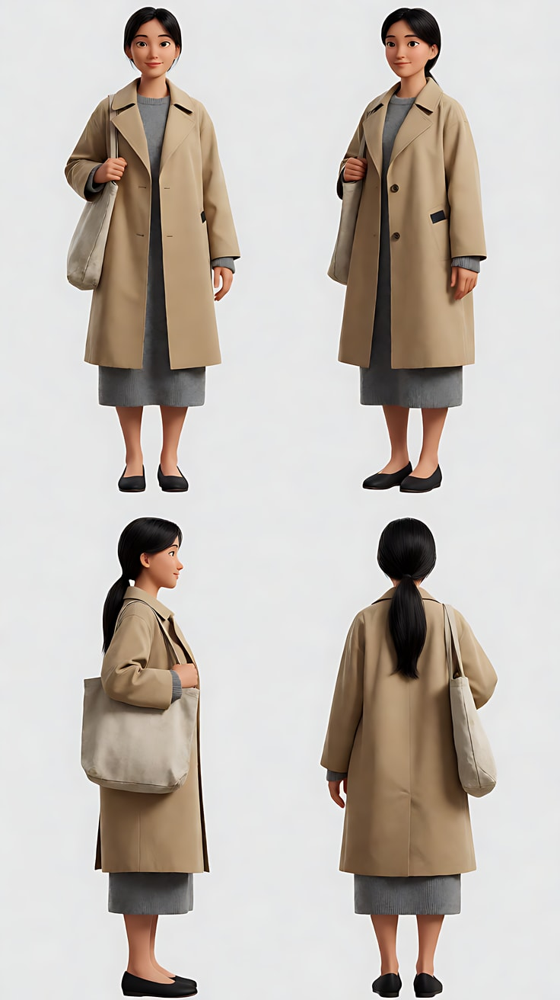

图2 角色定妆（前台与高管）：

```
Character turnaround sheet of two original characters:
a receptionist in her mid twenties with a sleek high ponytail, a fitted navy uniform blazer and a silk scarf;
an executive in his fifties with neatly combed grey hair, rimless glasses, a charcoal three-piece suit.
Front view, three-quarter view and side view of each, full body, plain light-grey background, even soft studio light.
Stylized semi-realistic 3D CG rendering, feature-film animation quality. Vertical 9:16 frame.
```

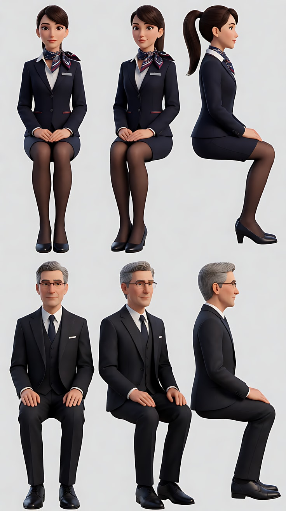

图3 场景（公司大堂，竖屏）：

```
Empty tall modern corporate lobby in the morning, vertical composition: a wide floating staircase of pale stone rising from the lobby floor to a mezzanine at the top of the frame,
a polished reception desk and a row of glass entry gates at the bottom, tall windows letting in cool morning light, no people, no text, no logos.
Full shot from the lobby floor looking slightly up toward the staircase, 28mm lens, deep focus.
Stylized semi-realistic 3D CG rendering, feature-film animation quality. Vertical 9:16 frame.
```

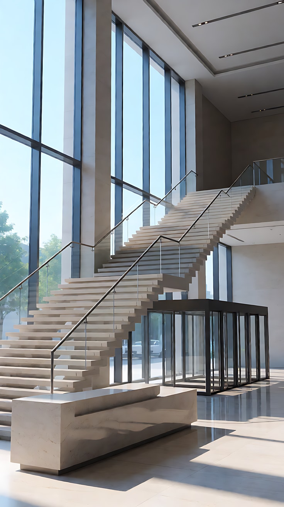

图4 镜头1关键帧：

```
Using the characters from image 1 and image 2 and the lobby from image 3:
a vertical medium shot. In the lower part of the frame, the receptionist's shoulder and the back of her high ponytail in the out-of-focus foreground, her arm extended across a glass entry gate, blocking it.
In the upper middle of the frame, the woman in the beige trench coat stands on the other side of the gate facing the camera, calm, her eyes about one third from the top of the frame.
Behind and above her, the stone staircase rises toward the mezzanine in the top part of the frame.
The bottom fifth of the frame contains only the blurred foreground shoulder, no important details.
Camera at eye level over the receptionist's shoulder, 50mm lens, shallow depth of field.
Lighting: cool morning window light from frame left, soft and even.
Keep the faces, hairstyles and outfits exactly as in image 1 and image 2.
Stylized semi-realistic 3D CG rendering, feature-film animation quality. Vertical 9:16 frame.
```

中文释义：竖屏中景；画面下部是前台虚化的肩膀和高马尾后脑，她的手臂横在玻璃闸机前拦住；画面中部偏上，穿米色风衣的女主站在闸机另一侧面朝镜头，神情平静，眼睛约在从上往下三分之一处；她身后上方，石材楼梯向画面顶部的夹层延伸；画面底部五分之一只有虚化的前景肩膀；越过前台肩膀平视、50mm 浅景深；画左冷色晨光，柔和均匀。

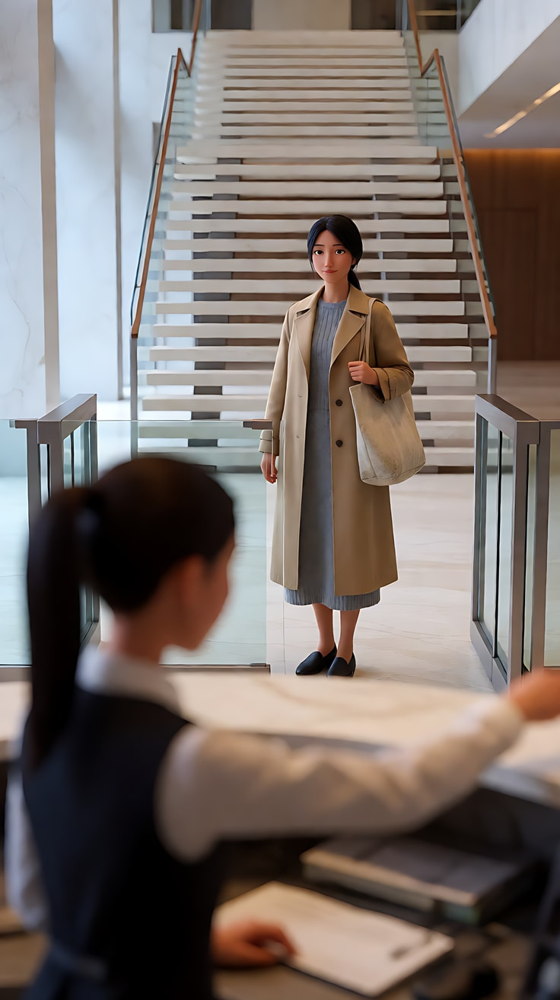

图5 镜头3关键帧：

```
Using the executive from image 2 and the lobby from image 3:
a vertical full shot from the bottom of the staircase looking up. The executive in the charcoal three-piece suit hurries down the floating stone staircase from the mezzanine at the top of the frame,
one hand on the rail, his body leaning forward, mid-step, placed in the upper half of the frame.
The steps lead diagonally down toward the camera. The bottom fifth of the frame is only empty stone steps.
Camera low at the foot of the stairs, 28mm lens, deep focus.
Lighting: cool morning light from the tall windows on frame left, rim light on his shoulders.
Keep the face, hairstyle and outfit exactly as in image 2.
Stylized semi-realistic 3D CG rendering, feature-film animation quality. Vertical 9:16 frame.
```

中文释义：竖屏全景，从楼梯底部仰拍；穿炭灰三件套的高管从画面顶部的夹层沿悬浮石阶快步下楼，一手扶栏杆，身体前倾，正迈步，位于画面上半部；台阶斜向朝镜头延伸；底部五分之一只有空台阶；低机位、28mm、深焦；画左高窗冷色晨光，肩部有轮廓光。

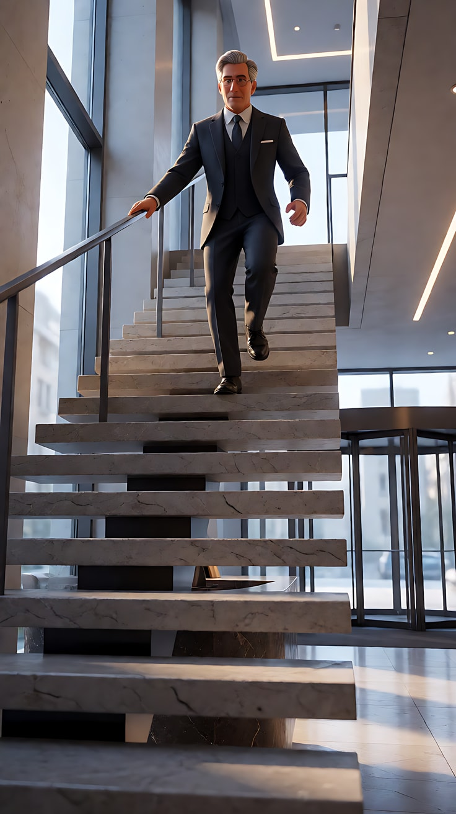

**【多图生视频 · Seedance】**

```
【素材分工】@图片1 锁定女主身份、低马尾、米色风衣与帆布包，不参考其灰色背景；@图片2 锁定前台与高管的身份与服装，不参考其灰色背景；@图片3 仅参考大堂、楼梯与闸机布局，不复制其构图；@图片4 为镜头1的首帧；@图片5 为镜头3的构图参考，不作为首帧。
【画风】风格化写实三维CG质感，明亮冷色晨光。
镜头1：固定竖屏中景，前台虚化的肩膀和高马尾在画面下部前景，她伸手横在玻璃闸机前，挡住去路，轻轻摇了摇头。女主站在闸机另一侧，位于画面中部偏上，神情平静，看着前台。只有前台在做主动作。大堂里高跟鞋走过石材地面的回声，闸机提示的短促电子音。
镜头2：镜头切至女主的竖屏近景，她的脸位于画面中部偏上，水平居中。她从风衣口袋里取出一张哑光黑卡，举到胸口高度，卡在画面中部，不说话，只是平静地看着前台。镜头缓慢向前推近一点。闸机感应区亮起一圈柔和的绿光，"嘀"的一声。
镜头3：镜头切至楼梯底部的竖屏仰拍全景，高管从画面顶部的夹层快步沿石阶下楼，一手扶着栏杆，身体前倾，从画面上方一路下到画面中部。镜头固定不动。皮鞋快速踩在石阶上的急促声响。
镜头4：镜头切至竖屏中景，高管背对镜头站在画面下部前景，深深鞠躬，后背和头顶虚化；女主位于画面中部偏上，面朝镜头，把黑卡收回口袋，嘴角极轻地动了一下。镜头固定不动。高管鞠着躬说："董事长，您怎么亲自来了。"
【锁定】光线：画左高窗的冷色晨光贯穿四个镜头；女主始终穿米色风衣、低马尾、背帆布包；前台始终穿藏青制服、高马尾；高管始终穿炭灰三件套、无框眼镜；女主的脸在每个镜头都位于画面中部偏上；画面下方约五分之一不放脸和关键动作。
【声音】大堂石材地面的回声、闸机电子音、急促下楼的皮鞋声，最后一句对白，无配乐。
【约束】保持三人的脸型、发型、服装不变；三人之间没有肢体接触；黑卡和墙面上不出现文字与标识；画面下方约五分之一留给后期字幕；不要字幕、水印、Logo。
时长：15秒
```

**参数**：时长 15 秒 ｜ 画幅 9:16 ｜ 负载：4 个镜头、3 个人物、1 句对白，属于"有挑战"档；若失败，拆成镜头1–2 与镜头3–4 两次生成，第二次用第一次的末帧作为接续参考

**【检查点】**
- 每个镜头女主的脸是否都在中部偏上，底部五分之一是否空出
- 镜头1和镜头4是否用"前景在下、主体在上"的上下分层代替左右并排
- 镜头3是否用垂直运动（下楼）代替横向运动
- 镜头1与镜头4的前景人物从"拦住"变成"鞠躬"，权力是否完成反转

**【常见问题与修复】**
| 现象 | 修复 |
|---|---|
| 镜头1三人左右并排，有人被切掉 | 写清"前台虚化的肩膀在画面下部前景，女主在中部偏上" |
| 黑卡上出现乱码或标志 | 定妆写 `matte black card with no text`，【约束】写"黑卡上不出现文字与标识" |
| 镜头4高管正脸朝镜头 | 写"高管背对镜头站在画面下部前景"，只露后背和头顶 |
| 女主脸被放到画面下部 | 每个镜头块都写"位于画面中部偏上"，【锁定】再写一次 |
| 高管下楼时横向走出画面 | 写"从画面上方一路下到画面中部"，强调垂直方向 |

---

返回教学：[L03-05 画幅与构图](../教学/L03-05-画幅与构图.md)
