# L03-06 动态构图与 180 度轴线 · 提示词

> 本组练习：让构图在运动中重组并停在一个好的终点，用【锁定】行守住轴线、视线和屏幕方向，并用正确的方式越轴。｜ 配套教学：[L03-06-动态构图与轴线](../教学/L03-06-动态构图与轴线.md) ｜ 规范：[写作规范](../../模板/写作规范.md)
>
> 画风默认使用开关 A（风格化写实 CG）。如改用 2D 动画，删掉所有焦段、光圈、景深词。

---

### 练习1：运动中的引导空间（难度 ★）

**目标**：男孩拉着风筝从画左向画右奔跑，镜头平行跟移，他始终在左三分线，前方留出大片空间。意图：让观众感到他在奔向一个开阔的、属于他的下午。

**【生图 · Nano Banana】**

图1 关键帧：

```
A medium-wide shot of an original boy about ten years old with tousled brown hair, a faded red t-shirt, khaki shorts and white sneakers,
running toward frame right across a wide green meadow, holding a kite string in his raised right hand, the string rising out of the top right of the frame.
He is placed on the left third of the frame, his body leaning forward, with generous open space ahead of him on the right side of the frame.
The horizon on the lower third, a bright blue sky with scattered white clouds.
Camera at the boy's chest height, tracking alongside him, 50mm lens, moderate depth of field, the grass slightly blurred in the foreground.
Lighting: warm late-afternoon sun from behind him on frame left, rim light on his hair and shoulders.
Stylized semi-realistic 3D CG rendering, feature-film animation quality. Aspect ratio 16:9.
```

中文释义：中全景，原创十岁男孩，蓬乱棕发，褪色红T恤、卡其短裤、白球鞋，在宽阔草地上向画右奔跑，右手高举风筝线，线从画面右上方伸出；他位于左三分线，身体前倾，画右是前方大片开阔空间；地平线在下三分线，蓝天白云；机位在他胸口高度平行跟拍、50mm、中等景深，前景草叶微虚；暖色午后阳光从画左他身后照来，头发和肩膀有轮廓光。

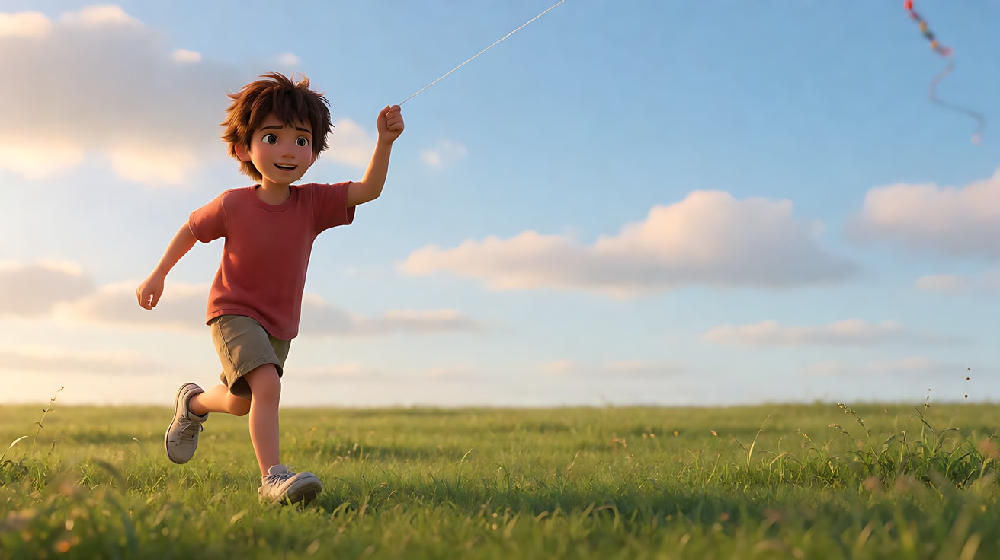

**【图生视频 · Seedance】**

```
【素材分工】@图片1 为首帧，锁定男孩身份、服装、草地环境与构图位置。
【画风】风格化写实三维CG质感，电影级布光。
男孩举着风筝线从画左向画右奔跑，抬头看着画面右上方的风筝，笑着张大嘴喘气。镜头与他平行，以和他相同的速度向右横移跟拍，他始终保持在画面左三分线，前方画右始终留出大片草地和天空。午后的暖阳从画左他身后照来，草叶被他踢起，在逆光里闪亮。结尾停在他仍在左三分线、仰头望着风筝、前方一片开阔的画面上。
【声音】奔跑的脚步踩在草地上的沙沙声，风声，风筝线绷紧的细响，他的笑声与喘气，无配乐。
【约束】始终从画左跑向画右，不转向；他始终位于画面左三分线，不跑到画面中心或右侧；保持人物脸型、服装不变；不要字幕、水印、Logo。
时长：6秒
```

**参数**：时长 6 秒 ｜ 画幅 16:9

**【检查点】**
- 跟移全程他是否保持在左三分线，前方始终有空间
- 奔跑方向是否始终是从画左到画右
- 结尾构图是否仍是一个"好构图"，而不是被截断的半帧

**【常见问题与修复】**
| 现象 | 修复 |
|---|---|
| 他慢慢跑到画面右侧，前方空间消失 | 写"镜头以和他相同的速度横移跟拍"，【约束】写"始终位于画面左三分线" |
| 镜头不动，他跑出画 | 写清"镜头与他平行，向右横移跟拍" |
| 风筝出现在画左，视线方向乱 | 生图写 `string rising out of the top right of the frame` |
| 奔跑动作变形 | 把奔跑改成"小跑"，速度降低 |

---

### 练习2：走位重组构图（难度 ★★）

**目标**：镜头固定，女主从房间深处走到前景，画面从"环境为主"重组成"人物为主"，终点构图是她在右三分线、视线朝左留白的中近景。意图：让观众感到她从远处的一个影子，变成了这场戏要讲的人。

**【生图 · Nano Banana】**

图1 角色定妆：

```
Character turnaround sheet of an original woman in her early forties: short silver-streaked black hair cut to the jaw,
a long charcoal knitted cardigan over a black turtleneck, dark grey wide trousers, a thin silver necklace with a small round pendant.
Front view, three-quarter view, side view and back view, full body, plain light-grey background, even soft studio light.
Stylized semi-realistic 3D CG rendering, feature-film animation quality. Aspect ratio 16:9.
```

中文释义：原创四十出头女子定妆，齐下巴的黑色短发夹着银丝，炭灰长款针织开衫配黑色高领，深灰阔腿裤，细银项链挂一个小圆坠。

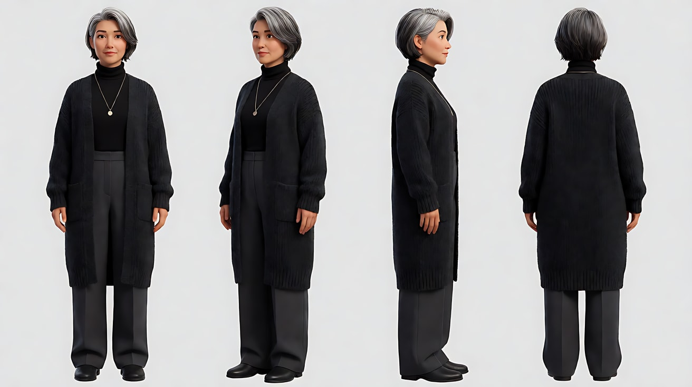

图2 场景：

```
Empty long old apartment at dusk, a deep living space seen from the front: a doorway at the far end of the room leading to a dim hallway,
a long wooden floor, a low bookshelf along the left wall, a large window on the right wall casting warm low sunlight across the floor in long stripes,
in the right foreground a small table with an old film camera on it, no people.
Wide shot, eye level, 35mm lens, deep focus so the far doorway and the near table are both sharp.
Stylized semi-realistic 3D CG rendering, feature-film animation quality. Aspect ratio 16:9.
```

中文释义：黄昏时狭长的老公寓，从正面看进一个很深的起居空间：房间尽头是通向昏暗走廊的门口，长长的木地板，左墙一排矮书架，右墙大窗把暖色低角度阳光投成一条条长光斑落在地上，右前景一张小桌，桌上放着一台旧胶片相机；远景、平视、35mm、深焦，远处门口和近处小桌都清晰。

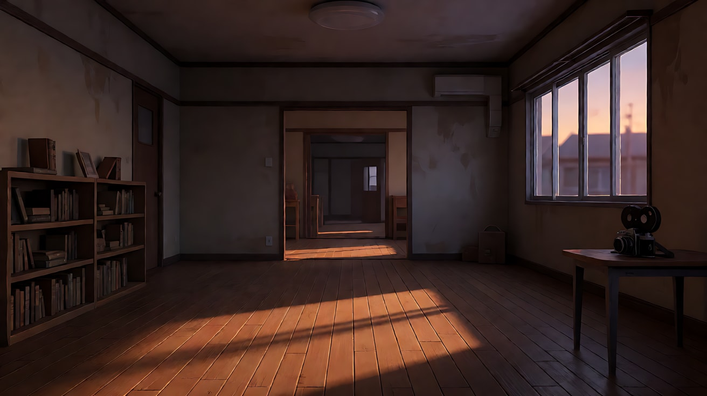

**【多图生视频 · Seedance】**

```
【素材分工】@图片1 锁定人物身份、发型、开衫与项链，不参考其灰色背景；@图片2 锁定房间纵深布局、机位与窗光，人物从房间尽头的门口出现。
【画风】风格化写实三维CG质感，电影级布光。
镜头固定，不移动。起点构图：远景，房间尽头的门口里，她出现在昏暗走廊中，很小，位于画面中央。她穿过一条条地板上的暖色光斑，一步步走向镜头，越走越大，经过左墙的书架，走到右前景的小桌旁停下。终点构图：她位于画面右三分线的中近景，侧身面朝画左，拿起桌上的旧胶片相机，低头看着它，画左留出视线方向的空间，身后的房间纵深变成虚化的背景。窗外暖光从画右照来，她走过光斑时脸一明一暗。结尾停在她低头看相机的中近景上。
【声音】木地板随脚步轻微的吱呀声，窗外远处傍晚的鸟叫，相机被拿起时金属轻碰桌面的一声，无配乐。
【约束】镜头固定不动，构图变化完全靠她的走位完成；保持人物脸型、发型、服装不变；画面中只有她一个人；不要字幕、水印、Logo。
时长：10秒
```

**参数**：时长 10 秒 ｜ 画幅 16:9

**【检查点】**
- 起点是否是"环境大、人很小"，终点是否是"人物为主"
- 终点构图是否在右三分线、视线朝左留白
- 走过光斑时一明一暗，是否让"走近"有了节奏

**【常见问题与修复】**
| 现象 | 修复 |
|---|---|
| 镜头推进代替了她的走位 | 写"镜头固定，不移动"，【约束】写"构图变化完全靠她的走位完成" |
| 她走到画面正中停下 | 写清终点："位于画面右三分线，侧身面朝画左" |
| 她走得太快，几步就到 | 时长给到 10 秒，写"一步步走向镜头" |
| 近处走过来时脸崩 | 终点景别控制在中近景，不要特写 |

---

### 练习3：镜头内越轴（难度 ★★★，首尾帧）

**目标**：两人在咖啡馆对坐。首帧机位在轴线一侧（A 在画左、B 在画右），一个缓慢的环绕运镜让观众看着机位越过两人之间的连线，尾帧到了另一侧（B 在画左、A 在画右）。意图：让观众感到他说出那句话之后，两人之间的关系翻了一面。

机位平面图（俯视）：

```
                       end camera (after crossing)
                                 |
                                 v
        [ A ] ============================== [ B ]    <- axis (table between them)
                                 ^
                                 |
                       start camera
   start: A on screen left, B on screen right
   end:   B on screen left, A on screen right
   the camera orbits around B's side of the table, crossing the axis during the shot
```

**【生图 · Nano Banana】**

图1 角色定妆（两位原创角色）：

```
Character turnaround sheet of two original characters in their early thirties:
character A, a man with short wavy dark hair, a navy denim jacket over a white t-shirt;
character B, a woman with a long straight black ponytail, a mustard-yellow turtleneck sweater, small gold hoop earrings.
Front view, three-quarter view and side view of each, full body, plain light-grey background, even soft studio light.
Stylized semi-realistic 3D CG rendering, feature-film animation quality. Aspect ratio 16:9.
```

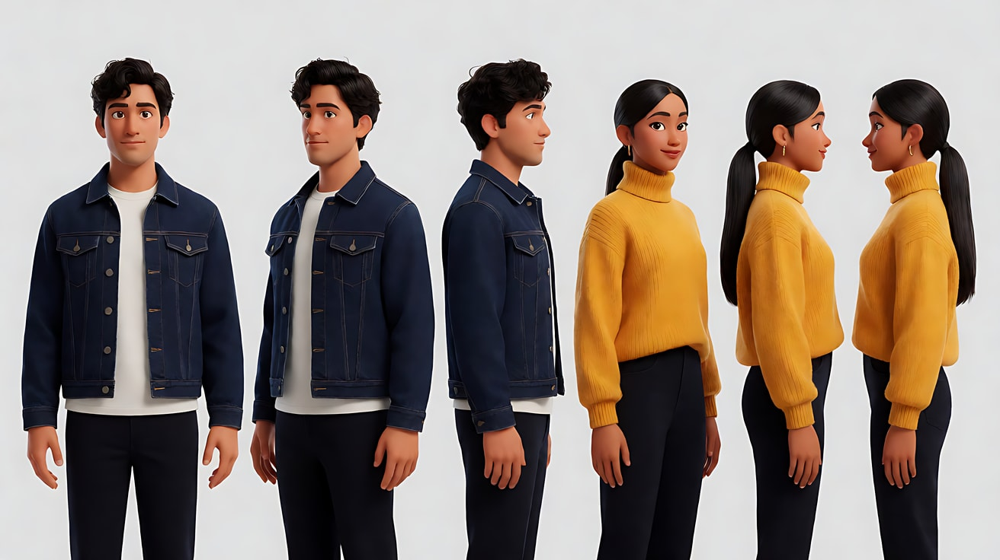

图2 首帧：

```
Using the characters from image 1: a medium two-shot in a quiet café by a rainy window at night, the two sit facing each other across a small round table with two coffee cups.
Character A sits on the left third of the frame in profile facing right; character B sits on the right third facing left, listening, her hands around her cup.
Camera at seated eye level from the side of the table, 50mm lens, shallow depth of field, café lights blurred behind them.
Lighting: warm pendant lamp above the table, cool blue light from the rainy window behind them.
Keep the faces, hairstyles and outfits exactly as in image 1.
Stylized semi-realistic 3D CG rendering, feature-film animation quality. Aspect ratio 16:9.
```

中文释义：中景双人镜头，雨夜咖啡馆靠窗，两人隔着小圆桌对坐，桌上两杯咖啡；A 在左三分线，侧脸朝右；B 在右三分线，朝左，在听，双手捧杯；坐姿视线高度、从桌子侧面拍、50mm、浅景深；桌上方暖色吊灯，身后雨窗冷蓝光。

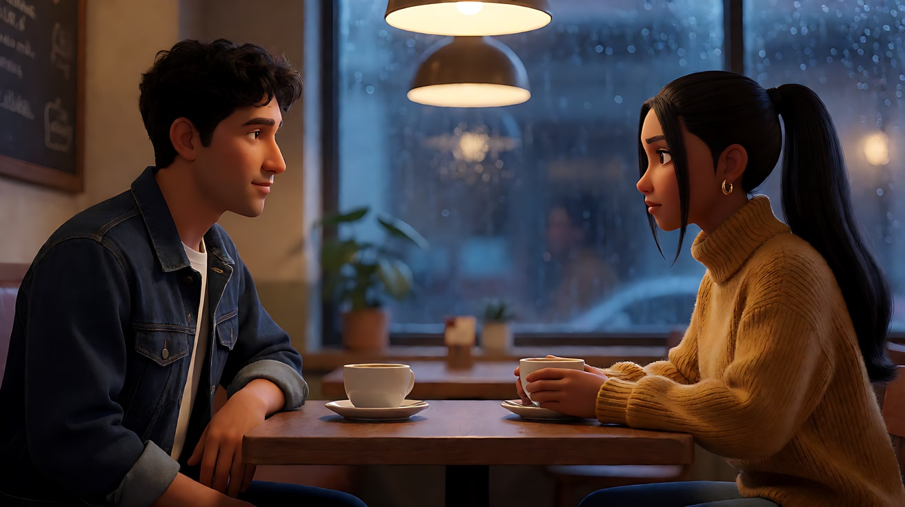

图3 尾帧：

```
Using the characters from image 1, the same café, table and lighting as image 2, seen from the opposite side of the table:
character B is now on the left third of the frame facing right, her hands have let go of the cup, looking at him;
character A is on the right third of the frame facing left, his eyes lowered to the table.
The rainy window is now behind the camera, its cool blue light falling on their faces; the warm interior of the café blurred behind them.
Camera at seated eye level, 50mm lens, shallow depth of field.
Keep the faces, hairstyles and outfits exactly as in image 1.
Stylized semi-realistic 3D CG rendering, feature-film animation quality. Aspect ratio 16:9.
```

中文释义：同一咖啡馆、桌子与光线，从桌子另一侧拍；B 现在在左三分线朝右，双手已离开杯子，看着他；A 在右三分线朝左，垂眼看着桌面；雨窗现在在镜头后方，冷蓝光照在两人脸上，咖啡馆暖色内景在身后虚化。

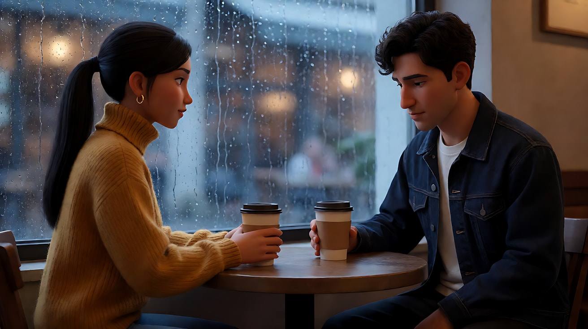

**【首尾帧生视频 · Seedance】**

```
【素材分工】@图片2 为首帧；@图片3 为尾帧，是最终画面目标；@图片1 锁定两位人物的身份与服装，不参考其灰色背景。只生成两帧之间的连续画面。
【画风】风格化写实三维CG质感，电影级布光。
A 坐在画左，垂着眼低声说："我明天就走了。"说完他看着桌面，不再开口。只有 A 先做动作，B 只是慢慢松开捧着杯子的手，看着他。台词落下后，镜头从桌子一侧开始，缓慢匀速地绕着桌子从 B 的身后向另一侧环绕，越过两人之间的连线，终点到达桌子另一侧，此时 B 在画左、A 在画右。环绕过程中，背景从雨窗变成咖啡馆暖色的内景。结尾停在 B 在画左看着他、A 在画右垂眼的双人中景上。
【声音】雨点打在窗上的声音，咖啡馆远处低低的杯碟声，A 的一句低声对白，之后是长长的沉默与雨声，无配乐。
【约束】只有一个环绕运镜，速度均匀；两人始终坐着，不起身；保持两人的脸型、发型、服装不变；中间画面连续，不跳切；不要字幕、水印、Logo。
时长：8秒
```

**参数**：时长 8 秒 ｜ 画幅 16:9

**【检查点】**
- 首帧 A 左 B 右，尾帧 B 左 A 右，换边是否完全发生在镜头运动中、观众"看着越过去"
- 背景是否从雨窗变为咖啡馆内景，帮助观众感知机位已到另一侧
- 越轴的时机是否紧跟在那句台词之后

**【常见问题与修复】**
| 现象 | 修复 |
|---|---|
| 两人直接互换座位 | 写"两人始终坐着，不起身"，强调是"镜头环绕"完成换边 |
| 环绕变成硬切 | 写"一个环绕运镜，速度均匀"，【约束】写"中间画面连续，不跳切" |
| 环绕不够，尾帧没到另一侧 | 以 @图片3 为最终目标；把时长延长到 10 秒 |
| 台词在环绕结束后才说 | 台词放在段落开头，并写"台词落下后，镜头开始环绕"；仍不稳时删掉台词只保留动作 |

---

### 练习4：守住轴线的正反打（难度 ★★★★，多镜头）

**目标**：三个镜头完成一场标准的对话覆盖：双人建立镜头 → 过 A 肩拍 B → 过 B 肩拍 A。全程机位在轴线同一侧，视线方向相反、高度对应。意图：让观众感到少年终于在棋盘上赢了老人一次，而老人是故意的。

机位平面图（俯视）：

```
        [ GRANDPA ] ========= Go board =========== [ BOY ]     <- axis
            face ->                              <- face

                 ^                 ^                 ^
                /                  |                  \
       shot2: over grandpa    shot1: two-shot    shot3: over boy
       looking at the boy                        looking at grandpa
   all cameras stay on the same side of the axis (below in this plan)
   grandpa always screen left facing right, boy always screen right facing left
```

**【生图 · Nano Banana】**

图1 角色定妆（两位原创角色）：

```
Character turnaround sheet of two original characters:
a grandfather in his late seventies with a bald head, white bushy eyebrows, a grey traditional button-up jacket;
a boy about thirteen with a short buzz cut, a blue school tracksuit jacket over a white t-shirt.
Front view, three-quarter view and side view of each, full body, plain light-grey background, even soft studio light.
Stylized semi-realistic 3D CG rendering, feature-film animation quality. Aspect ratio 16:9.
```

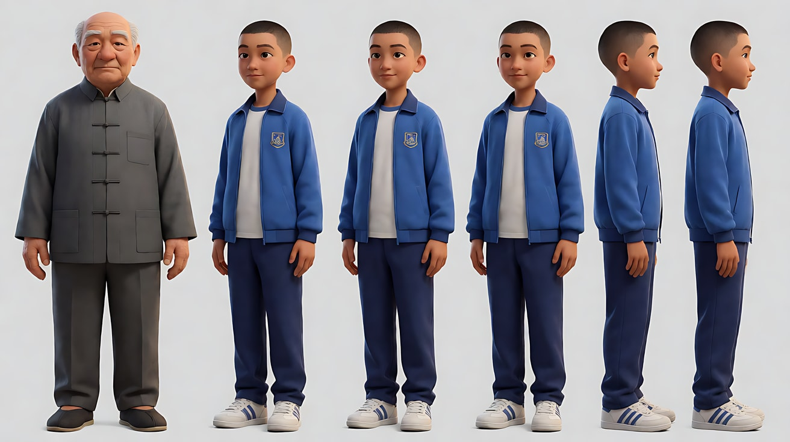

图2 场景：

```
Empty small courtyard under an old tree on a summer afternoon, a low stone table with a wooden Go board and two bowls of black and white stones on it,
two small stools on opposite sides of the table, dappled sunlight through the leaves, a grey brick wall behind, no people.
Medium-wide shot from the side of the table, eye level, 35mm lens, deep focus.
Stylized semi-realistic 3D CG rendering, feature-film animation quality. Aspect ratio 16:9.
```

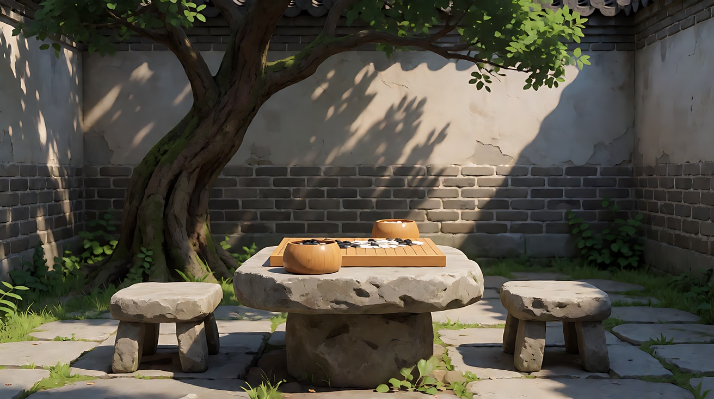

图3 镜头1关键帧：

```
Using the characters from image 1 and the courtyard from image 2:
a medium two-shot from the side of the stone table. The grandfather sits on the left third of the frame in profile facing right,
the boy sits on the right third facing left, leaning forward over the Go board, a white stone pinched between two fingers, his hand hovering above the board.
Camera at seated eye level, 35mm lens, moderate depth of field.
Lighting: dappled warm sunlight through the leaves from above, soft green bounce from the tree.
Keep the faces, hairstyles and outfits exactly as in image 1.
Stylized semi-realistic 3D CG rendering, feature-film animation quality. Aspect ratio 16:9.
```

中文释义：中景双人镜头，从石桌侧面拍；爷爷在左三分线侧脸朝右，少年在右三分线朝左，身体前倾在围棋盘上方，两指夹着一枚白子悬在棋盘上；坐姿视线高度、35mm、中等景深；树叶间洒下的斑驳暖光，树荫的柔和绿色反光。

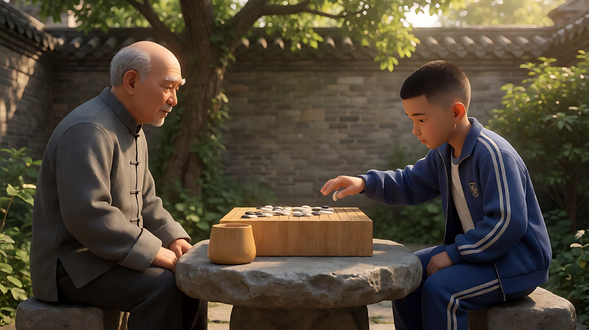

**【多图生视频 · Seedance】**

```
【素材分工】@图片1 锁定爷爷与少年的身份与服装，不参考其灰色背景；@图片2 仅参考院子、石桌与树的布局；@图片3 为镜头1的首帧，锁定两人左右位置。
【画风】风格化写实三维CG质感，电影级布光。
镜头1：固定中景双人镜头，爷爷在画左朝右，少年在画右朝左，隔着围棋盘对坐。少年犹豫了一下，把夹着的白子"啪"地落在棋盘上。只有少年在做主动作，爷爷只是眯起眼睛。树上的蝉鸣，棋子落盘的清脆声。
镜头2：镜头切至越过爷爷右肩的过肩近景，爷爷的肩膀和后脑在画左虚化前景，少年在画右三分线，面朝画左，抬眼盯着爷爷，嘴角憋着笑，视线略微向下，落在镜头左侧近处。镜头缓慢向少年推近一点。少年压低声音说："这盘我赢了。"
镜头3：镜头切至越过少年左肩的过肩近景，少年的肩膀在画右虚化前景，爷爷在画左三分线，面朝画右，看着棋盘，慢慢抬起眉毛，然后视线落到镜头右侧近处的少年脸上，眼角皱起，笑了。镜头固定不动。蝉鸣声，远处一声自行车铃。
【锁定】光线：树叶间斑驳暖光始终从上方落下；爷爷始终在画左、面朝右，少年始终在画右、面朝左；镜头2与镜头3视线方向相反、视线高度一致；机位始终在两人连线的同一侧。
【声音】蝉鸣贯穿，棋子落盘声，一句压低的台词，结尾一声自行车铃，无配乐。
【约束】保持两人的脸型、发型、服装不变；两人始终坐着；棋子只有黑白两色，不出现文字；不要字幕、水印、Logo。
时长：12秒
```

**参数**：时长 12 秒 ｜ 画幅 16:9 ｜ 负载：3 个镜头、1 句短台词，属于"稳妥"档

**【检查点】**
- 三个镜头中爷爷是否始终在画左、少年是否始终在画右
- 镜头2少年看向画左、镜头3爷爷看向画右，视线能否"接上"
- 过肩前景是否分别是爷爷的右肩和少年的左肩（同一侧机位）

**【常见问题与修复】**
| 现象 | 修复 |
|---|---|
| 镜头3两人左右对调 | 【锁定】写清"爷爷始终在画左、面朝右，少年始终在画右、面朝左" |
| 两人在过肩镜头里都看向镜头 | 写"视线落在镜头左侧近处 / 右侧近处"，不写"看向镜头" |
| 过肩前景是另一侧肩膀，空间翻转 | 写清"越过爷爷右肩""越过少年左肩" |
| 棋子数量暴增或棋盘变形 | 生图把棋盘画成残局，写 `a few dozen stones on the board`；视频只让少年落一子 |

---

### 练习5：屏幕方向与中性镜头（难度 ★★★★★，多关键帧 + 多镜头）

**目标**：四个镜头的赶路段落。前两个镜头她从左向右跑（方向一致），第三个镜头是迎面跑来的中性镜头（在运动轴线上），第四个镜头她拐过街角后改为从右向左跑，方向反转有了合理的过渡。意图：让观众感到她一路拼命追赶，并且清楚她在往哪里跑。

路线平面图（俯视）：

```
   shot1 / shot2: shopping street, she runs left -> right
   ---------------------------------------------------->  [corner]
                                                              |
                                                              |  shot3: narrow alley,
                                                              |  she runs straight toward camera
                                                              v  (camera at the alley exit, on the axis)
   <---------------------------------------------------- [riverside road]
   shot4: riverside road, she runs right -> left, the tram stop ahead on screen left
```

**【生图 · Nano Banana】**

图1 角色定妆：

```
Character turnaround sheet of an original teenage girl about seventeen: short black hair with a red hairclip,
a white sailor-collar school blouse with a navy pleated skirt, white socks, brown loafers, a brown leather school satchel across her body, a rolled drawing tube in one hand.
Front view, three-quarter view, side view and back view, full body, plain light-grey background, even soft studio light.
Stylized semi-realistic 3D CG rendering, feature-film animation quality. Aspect ratio 16:9.
```

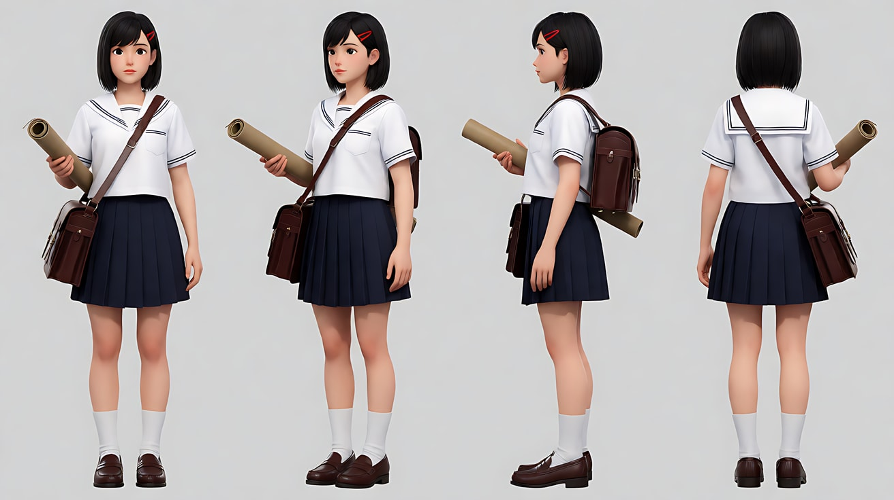

图2 场景（老街）：

```
Empty old narrow shopping street in a small seaside town at early morning, low two-storey shops with closed wooden shutters on both sides, hanging cloth awnings,
the street running horizontally across the frame from left to right, a corner at the far right leading into a narrow alley, no people, no readable signs.
Wide shot from across the street, eye level, 35mm lens, deep focus.
Stylized semi-realistic 3D CG rendering, feature-film animation quality. Aspect ratio 16:9.
```

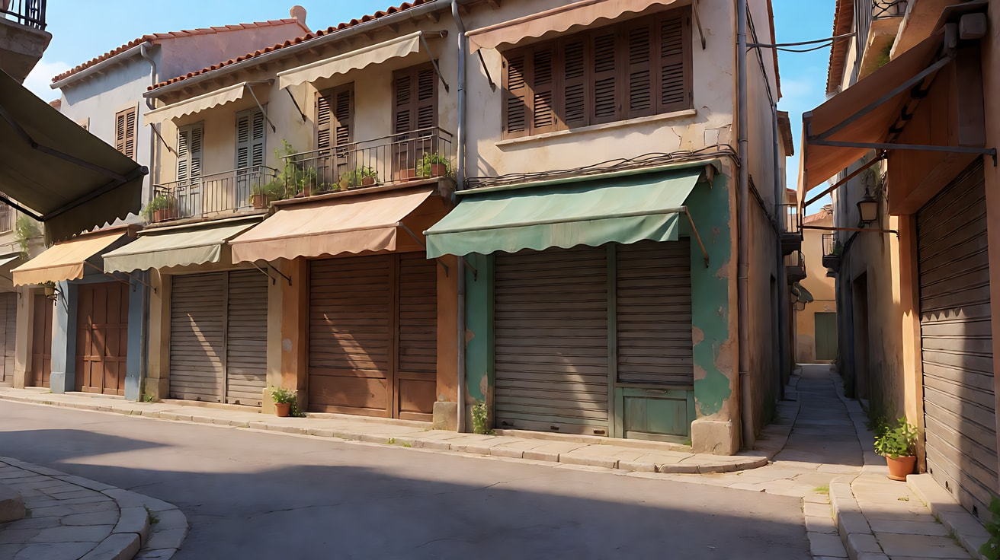

图3 镜头1关键帧：

```
Using the character from image 1 and the street from image 2:
a wide shot from across the street, the girl runs toward frame right along the shop fronts, placed on the left third of the frame,
her satchel bouncing, the drawing tube in her left hand, open street ahead of her on the right.
Camera at eye level, 35mm lens, deep focus.
Lighting: warm low early-morning sun from frame left, long shadows stretching to the right along the street.
Keep the face, hairstyle and outfit exactly as in image 1.
Stylized semi-realistic 3D CG rendering, feature-film animation quality. Aspect ratio 16:9.
```

中文释义：远景，从街对面拍，少女沿着店铺门面向画右奔跑，位于左三分线，书包跳动，左手拿着画筒，前方画右是开阔的街道；平视、35mm、深焦；画左低角度暖色晨光，长长的影子向右延伸。

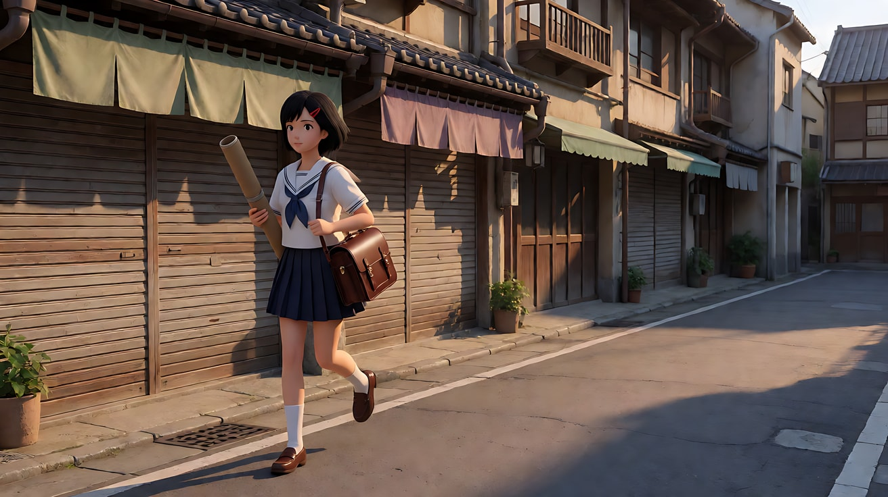

图4 镜头3关键帧（中性镜头）：

```
Using the character from image 1: a medium-wide shot in a very narrow old alley between two brick walls,
the girl runs straight toward the camera down the centre of the alley, frontal, out of breath, hair flying,
the alley walls converging behind her, a strip of bright morning sky above.
Camera at chest height at the alley exit on the central axis, slowly moving backward ahead of her, 35mm lens, deep focus.
Lighting: soft bounce light between the walls, bright sky at the far end behind her.
Keep the face, hairstyle and outfit exactly as in image 1.
Stylized semi-realistic 3D CG rendering, feature-film animation quality. Aspect ratio 16:9.
```

中文释义：中全景，两道砖墙之间极窄的老巷，少女沿巷子中央正面朝镜头跑来，气喘吁吁，头发飞起，身后巷墙汇聚，上方一线明亮晨空；机位在巷口中轴线上、胸口高度，在她前方缓慢后退、35mm、深焦；墙面间柔和的反射光，身后远处明亮的天空。

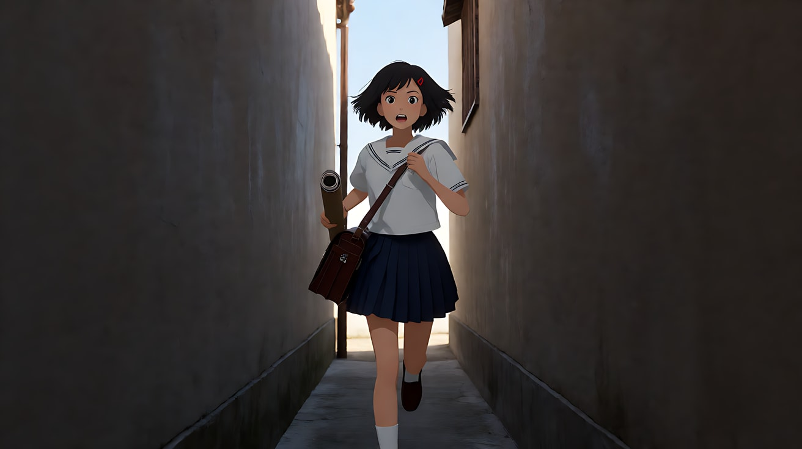

**【多图生视频 · Seedance】**

```
【素材分工】@图片1 锁定少女身份、红发夹、水手领校服、书包与画筒，不参考其灰色背景；@图片2 仅参考老街布局与店铺样式，不复制其构图；@图片3 为镜头1的首帧；@图片4 为镜头3的构图参考，不作为首帧。
【画风】风格化写实三维CG质感，电影级布光，清晨暖光。
镜头1：固定远景，从街对面拍，少女沿着关着门的店铺从画左向画右奔跑，位于画面左侧，前方留出大片空街。画左低角度晨光把她的影子拉长投向画右。皮鞋急促踏在石板路上的声音，书包扣环的叮当声。
镜头2：镜头切至侧面中景，镜头与她平行向右横移跟拍，她仍从画左向画右跑，位于画面左三分线，前方有空间；她一边跑一边低头看了一眼手腕上的表，咬住嘴唇，加快脚步。急促的喘气声，远处传来一声电车的铃声。
镜头3：镜头切至窄巷里的正面中全景，她拐进窄巷，正对镜头沿巷子中央跑来，画面左右两侧砖墙对称地汇聚在她身后。镜头在她前方匀速后退，保持她在画面正中。脚步声在窄巷两侧墙面间回响。
镜头4：镜头切至河边路的侧面远景，她从巷口冲出，转向画左，沿着河边路从画右向画左奔跑；画面左侧远处是一个电车站台，一辆电车正停靠着。镜头固定不动。电车"叮叮"两声铃响，她举起画筒朝电车用力挥手。
【锁定】光线：清晨低角度暖色阳光；人物始终戴红发夹、穿水手领校服、斜挎棕色书包、手拿画筒；屏幕方向：镜头1与镜头2她从画左跑向画右，镜头3为正面迎面跑来的中性镜头，镜头4拐弯后从画右跑向画左；镜头1、镜头2机位始终在她运动方向的同一侧。
【声音】皮鞋踏石板的急促声，书包扣环叮当，喘气声，窄巷里的脚步回声，电车铃声由远到近，无配乐。
【约束】保持人物脸型、发型、服装不变；街上与巷中没有其他人物；店铺招牌与电车上不出现可读文字；不要字幕、水印、Logo。
时长：15秒
```

**参数**：时长 15 秒 ｜ 画幅 16:9 ｜ 负载：4 个镜头、无对白、持续奔跑，属于"有挑战"档；若失败，拆成镜头1–2 与镜头3–4 两次生成，第二次用第一次的末帧作接续参考，并在【锁定】行写明"拐弯后方向改为从画右向画左"

**【检查点】**
- 镜头1、镜头2是否都从画左跑向画右
- 镜头3是否是正面迎面的中性镜头，让观众接受接下来的方向变化
- 镜头4方向反转后，观众是否仍明白她在"往前追"而不是"往回跑"
- 每个运动镜头前方是否都留有空间

**【常见问题与修复】**
| 现象 | 修复 |
|---|---|
| 镜头2她改成从右往左跑 | 【锁定】写清每个镜头的屏幕方向 |
| 镜头3变成侧面跑过 | 写"正对镜头沿巷子中央跑来，镜头在她前方匀速后退"，依赖 @图片4 |
| 镜头4方向没有反转 | 写清"从巷口冲出，转向画左，从画右向画左奔跑" |
| 电车与站台上出现乱码文字 | 【约束】写"店铺招牌与电车上不出现可读文字" |
| 奔跑中手部和画筒变形 | 画筒改为背在背后，或删掉挥手动作改为"抬手" |

---

返回教学：[L03-06 动态构图与 180 度轴线](../教学/L03-06-动态构图与轴线.md)
