# L03-01 三分法、中心构图与黄金比例：决定观众的眼睛先落在哪里

> 段位：基础 ｜ 建议用时：50 分钟 ｜ 配套提示词：[L03-01-三分法中心构图与黄金比例-提示词](../提示词/L03-01-三分法中心构图与黄金比例-提示词.md)

## 学习目标

- 能画出九宫格，说出四个强交点和两条三分线各自适合放什么
- 能说出"视觉重心"由哪些因素决定（亮度、人脸、色彩、清晰度、运动、孤立）
- 能分辨什么时候用三分法、什么时候必须用中心构图，并说出各自的情绪
- 理解黄金比例与黄金螺旋的实际用法，不迷信它
- 能在生图提示词里用 `placed on the left third` / `dead center` 等写法准确控制人物位置

## 一、概念讲解

### 1. 构图在回答一个问题：观众先看哪里

一个画面里有几十样东西，观众只会先看一样。构图就是导演替观众决定"第一眼、第二眼、第三眼"的顺序。景别（第 01 模块）决定离多近，景深（第 02 模块）决定什么清楚，构图决定**东西放在画框的哪个位置**。

### 2. 三分法：九宫格与四个强交点

把画面横竖各分三等份，得到两条横线、两条竖线和四个交点：

```
+---------+---------+---------+
|         |         |         |
|         |         |         |
|---------X---------X---------|  <- 上三分线：近景/特写时眼睛放这里
|         |         |         |
|         |         |         |
|---------X---------X---------|  <- 下三分线：远景时地平线放这里
|         |         |         |
|         |         |         |
+---------+---------+---------+
     ^                   ^
  左三分线            右三分线：人物身体的竖线
  X = 四个强交点：最容易吸引视线的位置
```

三条最常用的落点规则：

| 元素 | 放在哪里 | 为什么 |
|---|---|---|
| 人物的眼睛 | 上三分线 | 眼睛是画面第一视觉点，上三分线让头顶留出合适空间 |
| 地平线 | 上三分线或下三分线，**不放正中** | 放下三分线强调天空（自由、空旷），放上三分线强调大地（沉重、劳作） |
| 人物身体 | 左或右三分线 | 另一侧留出空间，让画面有"呼吸" |

### 3. 视线空间与运动空间（Look Room / Lead Room）

人物脸朝哪边，那一边就要多留空间：

```
  A 常规：视线方向留空间              B 故意违反：鼻子撞墙
+---------+---------+---------+    +---------+---------+---------+
|         |         |         |    |         |         |         |
|   (o)-> | . . . . | . . . . |    | . . . . | . . . . |  (o)->  |
|   /|\   |         |         |    |         |         |  /|\    |
|   / \   |         |         |    |         |         |  / \    |
+---------+---------+---------+    +---------+---------+---------+
  A：人物在左三分线，面朝右，前方开阔
  B：人物贴右边，面朝右，前方没有空间，空白全在身后
```

"鼻子撞墙"不是绝对错误。导演**故意**这样放，是为了让观众感到人物被堵住、没有出路、前方没有未来。规则的价值在于：你知道自己在打破什么。

### 4. 视觉重心：什么东西会"抢眼"

观众的眼睛会被以下因素吸引，强度大致从高到低：

| 因素 | 例子 | 导演用法 |
|---|---|---|
| 人脸与眼睛 | 画面里只要有一张脸，观众先看脸 | 不想让人看脸时，转背、遮挡或放虚 |
| 文字 | 招牌、屏幕、信纸 | AI 生成文字容易乱码，尽量避免让文字承担叙事 |
| 运动 | 静止画面里唯一动的东西 | 一个镜头只让一个主体做主动作 |
| 亮度反差 | 暗场里的一块亮区 | 用光把重点"点亮" |
| 色彩饱和与冷暖 | 灰色人群中的一件红衣 | 一个画面最多一个强色块 |
| 清晰度 | 浅景深里唯一清楚的地方 | 第 02 模块的焦点控制 |
| 孤立 | 大片空白中的一个小人 | 下一课负空间的基础 |

**重心平衡**：画面像一架天平。左边一个大而暗的人物，可以被右边一盏小而亮的灯平衡。平衡给人稳定；故意失衡（所有重量压在一侧）给人不安。

### 5. 中心构图：最直接的力量

把主体放在画面正中，是"规则"之外的另一种规则。它的效果和三分法完全不同：

```
+---------+---------+---------+
|         |         |         |
|         |   (o)   |         |
|         |   /|\   |         |    中心构图：
|         |   / \   |         |    观众无处可逃，只能看着他
|         |         |         |
+---------+---------+---------+
```

| 三分法 | 中心构图 |
|---|---|
| 自然、松弛、有呼吸 | 正式、对抗、仪式 |
| 观众"看见"人物 | 人物"面对"观众 |
| 适合叙事、对话、日常 | 适合宣言、审判、孤立、对质、喜剧式的刻板 |

中心构图配合正面平视，人物直视镜头，会产生"他在对我说话"的压迫。下一课的对称构图是中心构图的极致形态（见 L03-03）。

### 6. 黄金比例与黄金螺旋

黄金比例约为 1 : 1.618。把它换算成画面里的位置，竖线落在约 38% 和 62% 处，比三分法（33%、67%）**更靠近中心**一点（下图 thirds = 三分法，phi = 黄金比例）。

```
thirds:  |-----------|-----------|-----------|
         0          33%         67%        100%

phi:     |-------------|-------|-------------|
         0            38%     62%          100%
```

黄金螺旋是把画面不断切出正方形，最后收束到一个点：

```
+--------------------------+----------------+
|                          |                |
|                          |                |
|                          |       2        |
|            1             |                |
|                          +---------+------+
|                          |    @    |      |
|                          +---------+  3   |
|                          |    4    |      |
+--------------------------+---------+------+
  1 > 2 > 3 > 4 依次是越来越小的正方形
  @ = 螺旋收束点：放眼睛、关键道具或光源
```

**实用的态度**：黄金螺旋是一种"视线流动的路线"：大块的安静区域引导眼睛，一路旋转到一个小而重要的点。实际拍摄中，摄影师很少拿尺子去量 1.618；它和三分法的差别在 AI 生成时几乎看不出来。你需要掌握的是它背后的原理：**大面积引导 + 一个收束点**。网上很多"这幅名作符合黄金螺旋"的分析是事后硬套，不必当真。

### 7. 怎么选

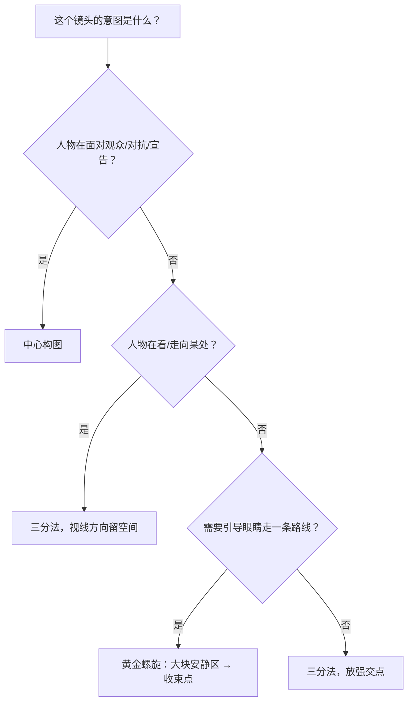

## 图解

> 这些示意图由多种生图模型分别生成（包括 Nano Banana、GPT Image 等），只用来说明镜头概念；不同模型的画面不能互相比较效果，也不能当作视频成片。


白线是后加的三分线或中轴线，用来对照主体落在哪里。黄点是四个强交点。

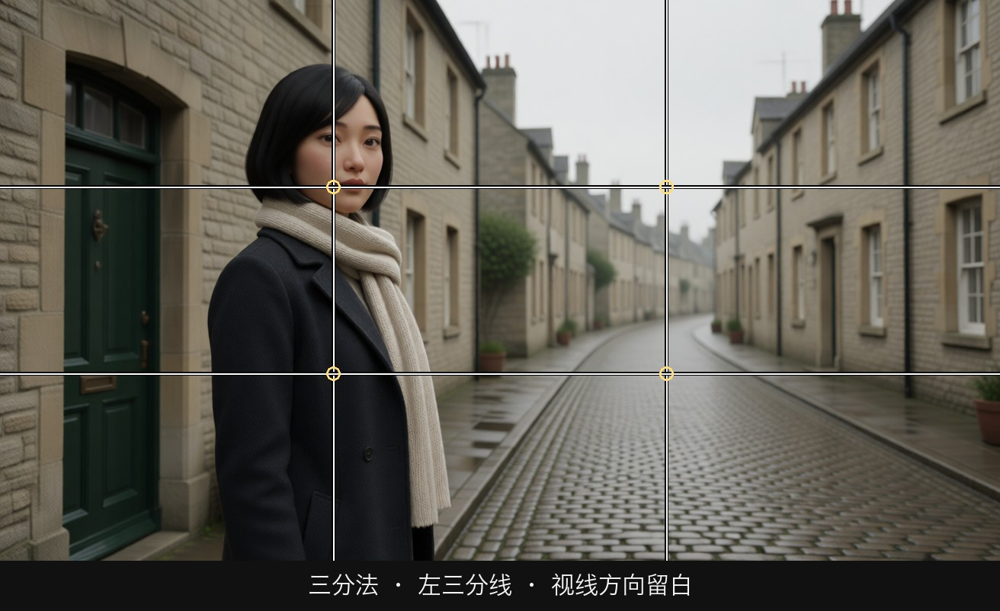

人在左三分线附近，脸朝右，右半边整条街是空的。眼睛顺着她的视线走进留白。这是三分法最常用的一种：视线方向留空间。

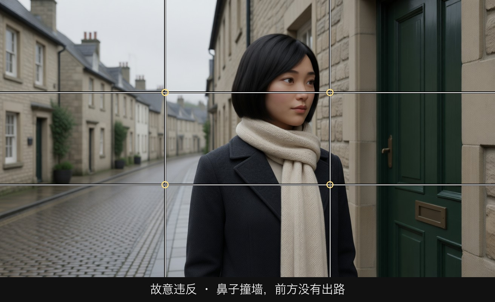

同一个人被推到右边缘，仍然朝右看。前方没有空间，空白全在身后。观众会感到她被堵住。这不是拍歪了，是故意违反留白。

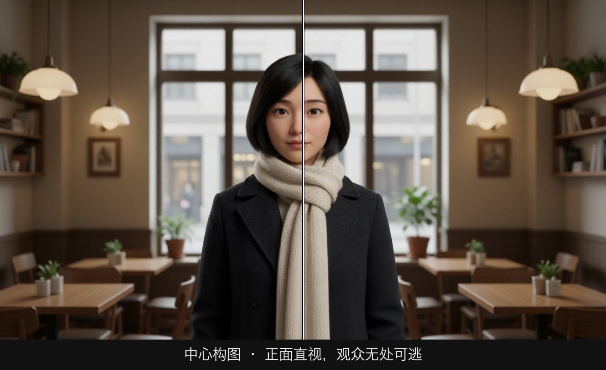

人在正中，身体正面，眼睛看镜头。中轴线从她身上穿过去。观众没有第二眼可看，只能跟她对视。

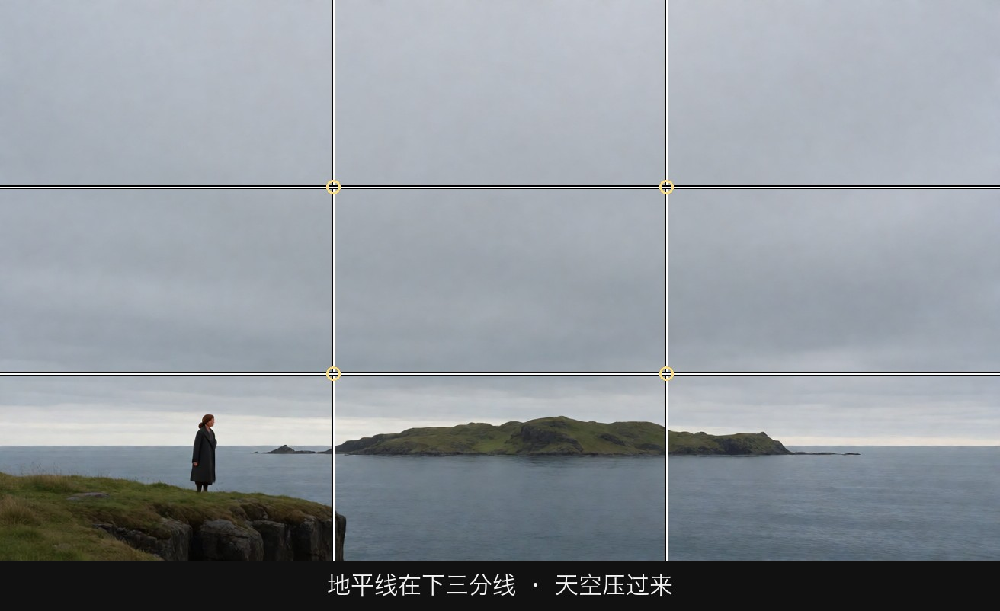

地平线压低，天空占掉大部分。人很小。这个比例让天空成为压力或自由的来源。

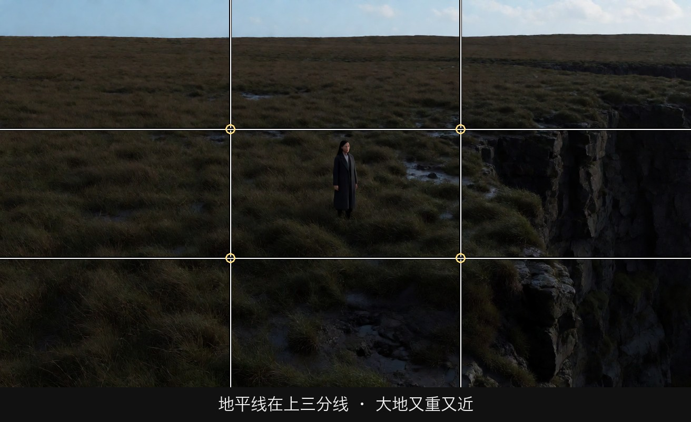

地平线抬高，土地占掉大部分。同样的悬崖，重量落到脚下。

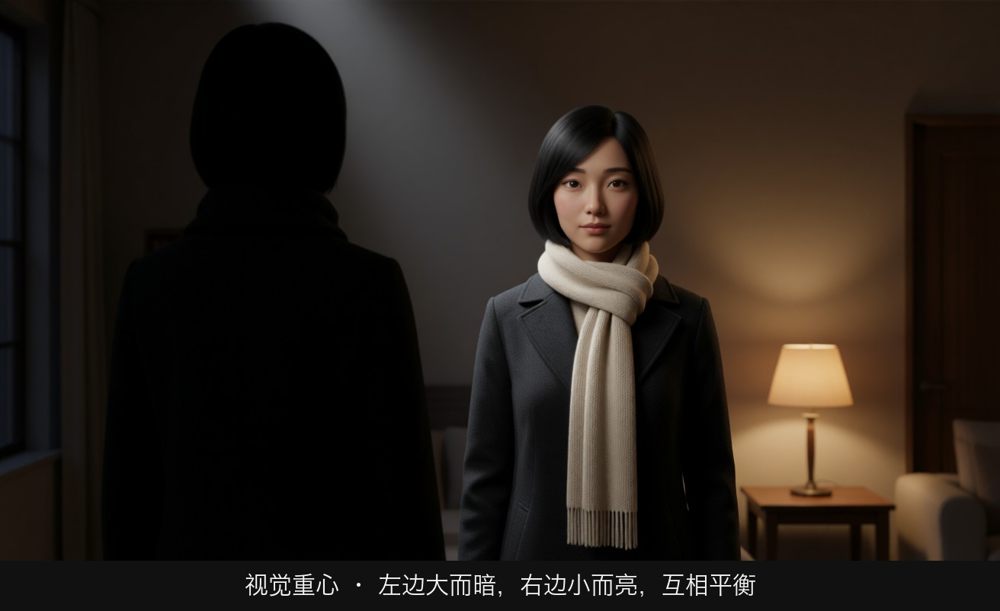

左边是一大块暗的人，右边是一小盏亮灯。面积和亮度可以互相平衡。画面像一架天平，不一定要左右一样大。

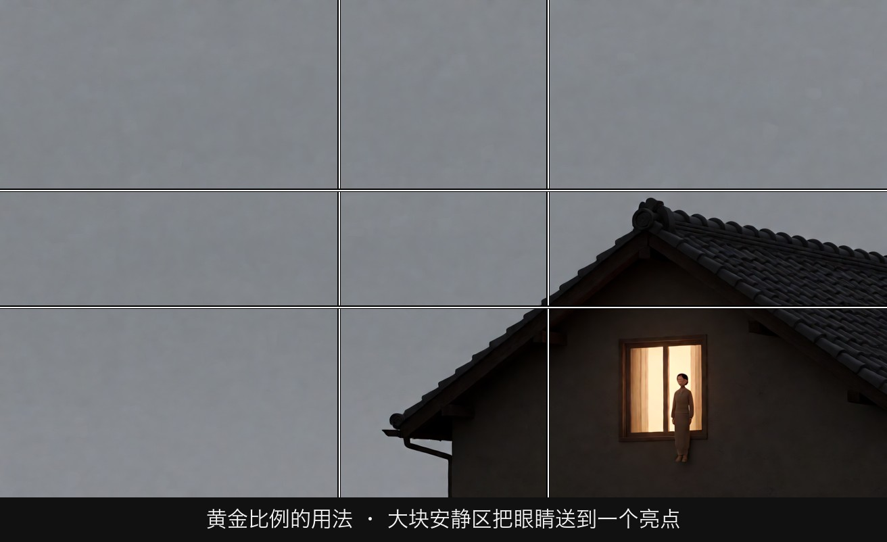

左上方是大片安静的灰天空，眼睛被带到右下角那扇小而亮的窗。黄金螺旋在拍摄时很少拿尺子去量，要掌握的是这条路线：大面积引导，收束到一个点。图上的白线标在约 38% 和 62% 处，比三分线更靠近中心。

## 二、情绪与叙事功能

| 技法 | 观众的感受 | 常用场景 |
|---|---|---|
| 三分法 + 视线留白 | 自然、舒适、人物有去处 | 日常叙事、对话、行走 |
| 地平线在下三分线 | 天空压过来，自由或渺小 | 出发、远望、开放结局 |
| 地平线在上三分线 | 脚下的土地很重 | 劳作、困守、归乡 |
| 中心构图 + 正面 | 对峙、审视、仪式、无处可逃 | 宣言、审讯、登场、喜剧的刻板 |
| 鼻子撞墙（故意违反） | 被堵住、没有未来 | 困境、绝望、被追 |
| 黄金螺旋收束 | 眼睛被一路"带"到一个细节 | 揭示道具、建立场景后落到人物 |
| 重心故意失衡 | 不安、倾斜、即将发生什么 | 悬疑、关系破裂 |

## 三、经典影片案例

### 《布达佩斯大饭店》（2014，韦斯·安德森）
- 场景：全片大量的人物介绍镜头、大堂与房间镜头。
- 怎么拍的：主体几乎总在画面正中，机位正面平视，人物常常直面镜头站定或说话，建筑与陈设左右对称地排在两侧。
- 为什么这样拍：中心构图带来一种"橱窗"或"玩偶屋"的秩序感。这个故事是一个被回忆美化过的旧世界，中心构图让一切显得整齐、刻意、带点喜剧式的拘谨，观众像在翻一本精致的画册。中心构图不只用于压迫，也可以用于**风格化的秩序**。

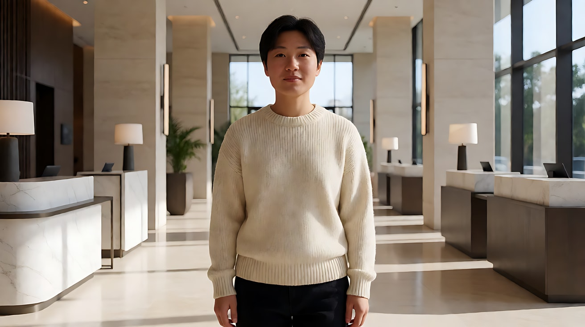

### 《迷失东京》（2003，索菲亚·科波拉）
- 场景：女主角夏洛特坐在酒店房间的窗台上，望着窗外的东京城区。
- 怎么拍的：人物不在画面中心，被放到画面一侧，窗外大片城市景观占据画面其余部分。
- 为什么这样拍：人物偏到一侧，城市成为画面里"更重"的部分，她在构图上被城市压到了边缘。观众感到的是：这个人身处一座巨大城市，却和它没有连接。三分法在这里不只是"好看"，它分配了人物和环境谁更重。

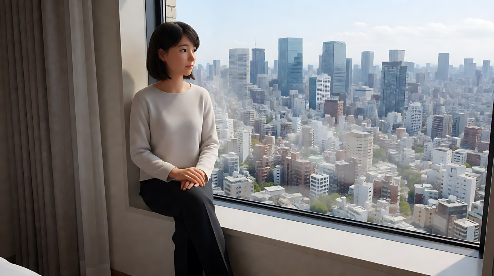

### 《花样年华》（2000，王家卫）
- 场景：周慕云与苏丽珍在狭窄住所、走廊、办公室中的大量镜头。
- 怎么拍的：人物经常被放到画面边缘甚至被画框切掉一部分，画面另一侧被墙面、门框、窗帘占据，大块"无关"的区域压着人物。
- 为什么这样拍：常规三分法会让人物舒服地待在交点上；这里把人物挤到边上，等于在构图上告诉观众"他们没有自己的空间"。这是**故意打破三分法**的典型：知道规则，才能用违反规则表达压抑。

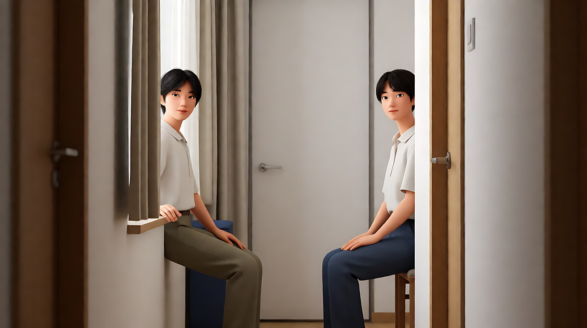

## 四、在 AI 中怎么实现

- **生图阶段**：
  - 位置要写成明确的画面坐标：`placed on the left third of the frame`、`eyes on the upper third line`、`horizon on the lower third`、`dead center of the frame, perfectly frontal`。
  - 视线方向和留白写成一组：`facing right, generous empty space on the right side of the frame`。
  - 中心构图要同时写 `frontal, eye level, looking directly into the lens`（直视镜头）或 `looking straight ahead`，否则模型常给你一个略微侧身的"随意"姿态。
  - 黄金螺旋不要写 `golden spiral composition`（模型理解很不稳定），改写成路线：`a large calm area of sky on the left leads the eye down to a small lit window in the lower right`。
- **视频阶段**：
  - Seedance 会延续首帧的构图。构图在生图阶段定好，视频提示词只需要写"保持人物位于画右三分处"之类的一句锁定。
  - 想让构图在镜头里**变化**（人物从中心走到三分线），用首尾帧锁住两端，比靠文字描述稳。
  - 运镜会破坏构图：推镜头会把三分法人物推向画边。推镜时写清终点："推近后人物仍位于画左三分处"。
- **模型擅长**：中心构图、地平线位置、人物在左/右的大致位置、大面积留白。
- **要避开**：
  - 精确到百分比的位置（"38% 处"），模型做不到；
  - 一个画面里放多个同等强度的视觉重心（两个人都在交点、都在亮处、都在动），画面会"散"；
  - 画面中出现需要阅读的文字。

## 五、练习作业

1. 找三张你手机里的照片，在上面画九宫格，标出主体落在哪里、视觉重心是什么。至少一张改成中心构图重拍，比较情绪差异。
2. 用同一个人物、同一个场景各生成两张图：A 版放在右三分线、面朝左留白；B 版放正中、正面直视镜头。写下两张图各自的一句话意图。
3. 写一张远景生图提示词，分别把地平线放在上三分线和下三分线，观察"天空压人"和"大地压人"的区别。
4. 完成配套提示词练习 1–5，重点做练习 3（首尾帧完成"从中心走向三分线"的构图变化）。

## 六、自检清单

- [ ] 我能画出九宫格，说出四个强交点
- [ ] 人物的视线方向一侧留出了空间（或我是故意不留的）
- [ ] 地平线没有无意中切在画面正中
- [ ] 画面只有一个最强的视觉重心
- [ ] 我选择中心构图时，能说出它服务的意图（对抗、仪式、孤立、刻板）
- [ ] 生图提示词里写了明确的位置（left third / dead center）和视线方向
- [ ] 视频提示词里写了一句构图锁定，推拉镜头写了终点位置

## 七、配套提示词

→ [L03-01-三分法中心构图与黄金比例-提示词](../提示词/L03-01-三分法中心构图与黄金比例-提示词.md)

---

上一课：[L02-05 移轴、分屈光镜与滑动变焦](../../02-景深与焦段/教学/L02-05-移轴分屈光镜与滑动变焦.md) ｜ 下一课：[L03-02 引导线、框中框与前景遮挡](L03-02-引导线框中框与前景遮挡.md) ｜ [返回总目录](../../README.md)
