# L03-02 引导线、框中框与前景遮挡：给观众的眼睛修一条路

> 段位：基础 ｜ 建议用时：50 分钟 ｜ 配套提示词：[L03-02-引导线框中框与前景遮挡-提示词](../提示词/L03-02-引导线框中框与前景遮挡-提示词.md)

## 学习目标

- 能识别画面中的引导线（道路、走廊、栏杆、铁轨、河流、光束、视线），并说出它们把眼睛带向哪里
- 能用门、窗、镜子、拱廊做"框中框"，并说出它带来的三种意义：聚焦、困住、旁观
- 能用前景遮挡制造窥视感和画面层次，知道遮挡多少合适
- 能把这三种手法写成生图提示词，并在 Seedance 中用一个运镜让它们"活"起来

## 一、概念讲解

上一课解决"东西放在哪里"，这一课解决"眼睛怎么走过去"。三种手法都是借用场景里**已经存在的东西**来组织观众的视线。

### 1. 引导线：画面里的箭头

任何有方向感的线都会推着眼睛走：道路、走廊墙角线、栏杆、铁轨、电线、河岸、一束光、一排路灯，甚至一个人的视线和手臂。

```
      引导线汇聚到人物（视线被"送"到主体）

  \                                       /
    \                                   /
      \                               /
        \                           /
          \           o           /
            \        /|\        /
              \      / \      /
                \           /
                  \       /
                    \   /
                      V
               消失点附近 = 最强注视点
```

| 引导线的形态 | 眼睛的路线 | 情绪 |
|---|---|---|
| 汇聚线（走廊、铁轨） | 从画边冲向深处一点 | 目标明确、命运、无法回头 |
| 对角线（楼梯、斜坡、栏杆） | 从一角斜穿到另一角 | 动感、不稳、上升或坠落 |
| S 形曲线（山路、河流） | 慢慢绕进画面深处 | 悠长、旅程、从容 |
| 横线（地平线、桌沿） | 左右平移 | 平静、停滞 |
| 竖线（柱子、栏杆、树干） | 上下，并把画面切开 | 隔离、牢笼、庄严 |

**关键原则**：引导线的终点必须放主体。线把眼睛送到一个空的地方，观众会觉得"那里该有东西"，这可以用于悬疑（下一个出现在那里的人），但不能是无意的。

### 2. 框中框：在画框里再画一个框

用门框、窗框、镜子、拱门、车窗、树枝缝隙、两个人的肩膀之间，把主体再框一次。

```
+---------------------------------------------+
|#############################################|
|######+-------------------------+############|
|######|                         |############|
|######|                         |############|
|######|            o            |############|
|######|           /|\           |############|
|######|           / \           |############|
|######|                         |############|
|######+-------------------------+############|
|#############################################|
+---------------------------------------------+
  # = 暗的前景墙面（门框外）
  内框 = 门洞里亮着的房间与人物
```

框中框有三种意义，同一个门框，用法不同，意义完全不同：

| 意义 | 怎么拍 | 观众感到 |
|---|---|---|
| **聚焦** | 框内亮、框外暗，主体在框正中 | "看这里"，像舞台 |
| **困住** | 框很窄，人物贴着框边，框外大片压迫 | 人物被生活、婚姻、身份关在里面 |
| **旁观/窥视** | 机位在框外的暗处，像有人躲着看 | 我们在偷看；或者有人在偷看他 |

**镜子**是特殊的框：它让一个画面里出现同一个人的两张脸，常用于身份分裂、自我审视、隐藏的另一面。AI 生成镜子反射容易出错（反射里的动作和本人对不上），使用时让人物动作尽量少。

### 3. 前景遮挡：让观众"隔着东西看"

在镜头和主体之间放一样东西：门边、窗帘、植物、栏杆、人的肩膀、货架、玻璃上的雨水。前景通常是虚的（浅景深）或暗的（剪影）。

```
  侧面图：三层空间

  镜头            前景              中景              背景
  [CAM]  ---->   |||| 窗帘  ---->    人物   ---->    窗外街灯
                 (虚、暗)           (清晰)           (虚、亮)

  画面效果：
+---------------------------------------------+
|||||||                                       |
|||||||              o                        |
|||||||             /|\          * *          |
|||||||             / \        *     *        |
|||||||                                       |
+---------------------------------------------+
  左侧 |||| = 虚化的前景窗帘，遮住约四分之一画面
```

前景遮挡的作用：

| 作用 | 说明 |
|---|---|
| **窥视感** | 观众像躲在某物后面偷看，适合悬疑、偷情、监视、秘密 |
| **层次与纵深** | 前、中、后三层让二维画面有了空间（呼应 L02-04 多层调度） |
| **隔阂** | 两个人之间隔着一个前景物，他们的关系也"隔着" |
| **揭示** | 镜头横移越过前景物，主体从遮挡后"出现" |

**遮挡多少合适**：前景占画面 15%–35% 最常用；超过一半就变成"主要在看前景"，除非你就是要观众看不清。前景永远不要挡住主体的眼睛（除非故意）。

### 4. 三种手法组合

最常见的组合：**前景遮挡 + 框中框 + 引导线终点**。例如：镜头躲在门外暗处（前景遮挡），透过门洞（框中框）看到走廊尽头（引导线汇聚）站着一个人。三层手法都指向同一个点，这个点上的人物就有了极强的注视力。

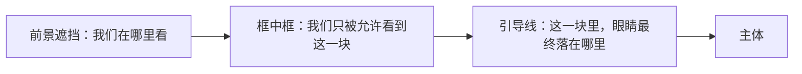

## 图解

> 这些示意图由多种生图模型分别生成（包括 Nano Banana、GPT Image 等），只用来说明镜头概念；不同模型的画面不能互相比较效果，也不能当作视频成片。


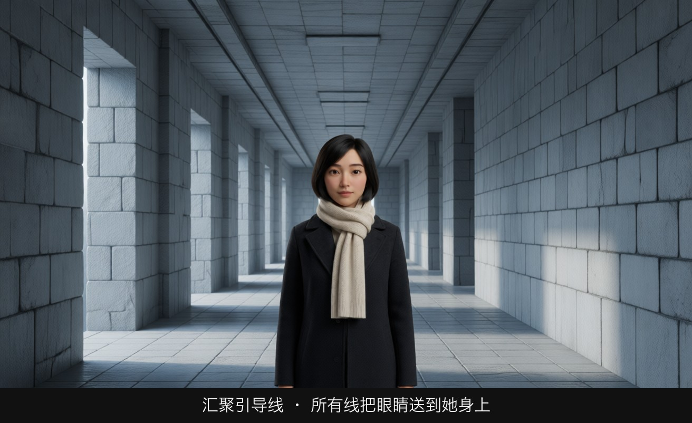

她站在中轴上，墙线、灯和地砖在她身后汇向同一个消失点。人先接住视线，线再把眼睛送进走廊深处。线如果汇到一块空地上，观众会觉得那里缺了人。

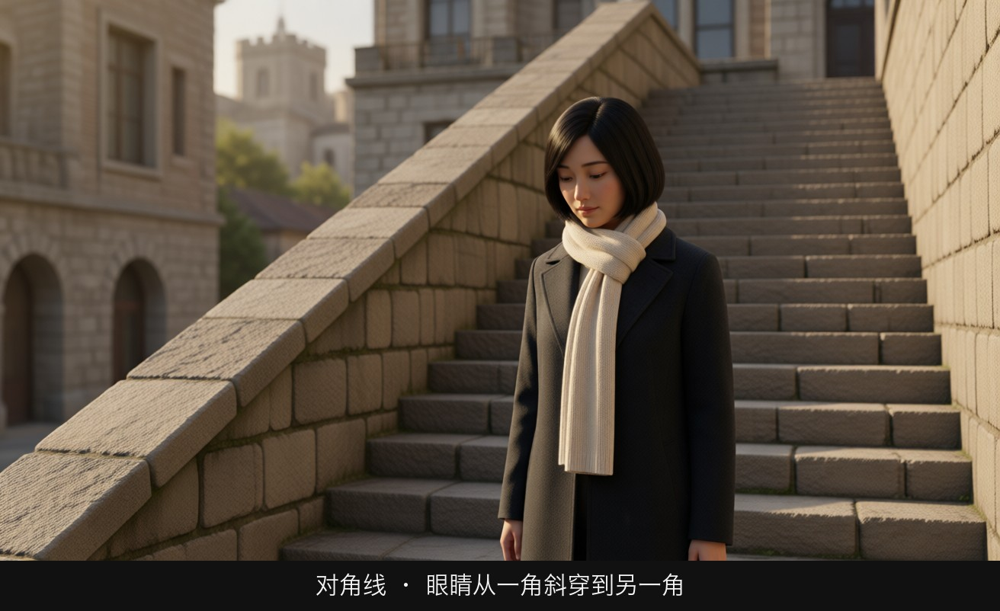

楼梯从一角斜穿到另一角。对角线带来上升或坠落的动势，比水平线更不安稳。

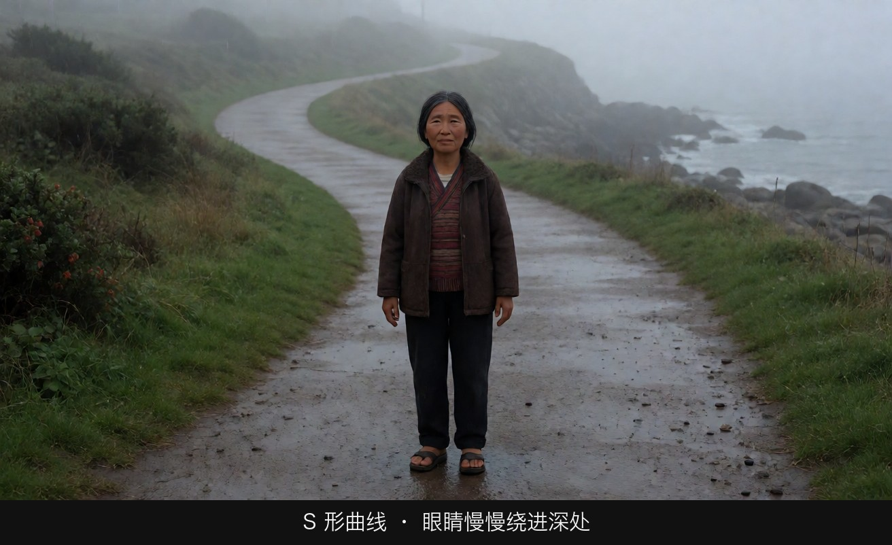

路慢慢绕进雾里。眼睛不是被射向一个点，而是被带着走一段。适合旅程、从容，不适合紧急追逐。

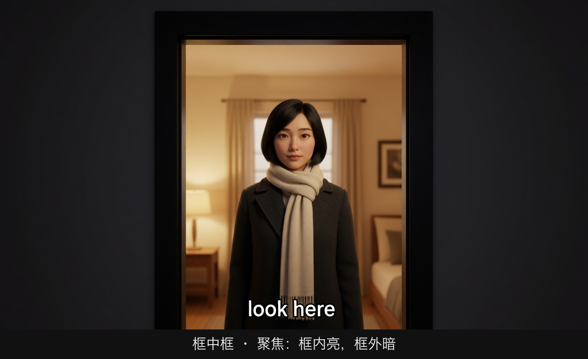

门框外是暗的，门洞里是亮的，人在亮处正中。框的意思是「看这里」，像一小块舞台。

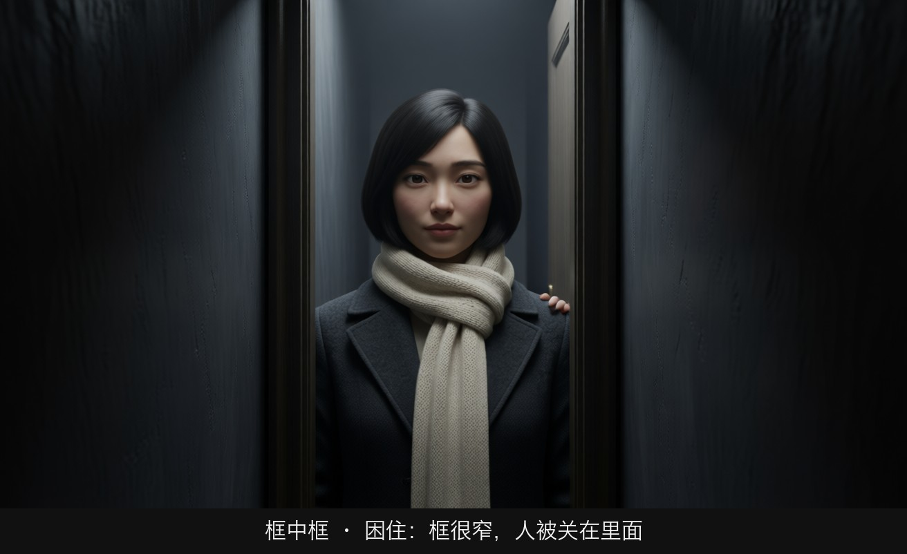

同一个「门」，开口变得很窄，肩膀贴着框。框外的墙又重又大。她不是被展示，是被关在框里。

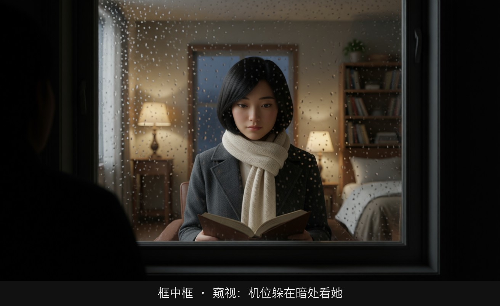

机位在窗外的暗处，隔着有雨的玻璃看亮房间里的她。观众的位置变成偷看的人。

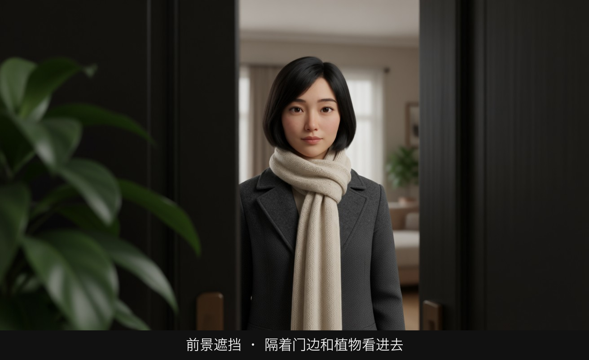

门边和植物糊在镜头前，人在缝隙后面是清楚的。遮挡制造层次，也制造「我们不该这么近」的感觉。遮太多，主体就丢了。

## 二、情绪与叙事功能

| 技法 | 观众的感受 | 常用场景 |
|---|---|---|
| 汇聚引导线 | 目标、命运、被吸进去 | 走向关键房间、长路归来、追逐终点 |
| 对角线 | 不稳、动势、冲突 | 楼梯对峙、逃跑、坠落前 |
| 竖线切割 | 隔离、牢笼 | 栏杆后的人、窗格后的脸 |
| 框中框（聚焦） | 舞台感、仪式感 | 人物登场、揭示房间 |
| 框中框（困住） | 被关住、压迫 | 婚姻、家庭、职场困境 |
| 门框（内外分界） | 归属与排斥 | 有人被关在门外、有人决定离开 |
| 前景遮挡 | 窥视、秘密、被监视 | 悬疑、偷看、暗恋 |
| 前景人物肩膀 | 关系、对话中的压力 | 过肩镜头（L06-02） |

## 三、经典影片案例

### 《搜索者》（1956，约翰·福特）开场与结尾
- 场景：影片开场，一扇门从漆黑的室内打开，门外是明亮的荒漠；结尾，主角伊森站在门口，其他人走进屋，他转身走回荒野，门关上。
- 怎么拍的：机位在暗的室内，门框形成一个"框中框"，框外全黑，框内是亮得刺眼的荒原。
- 为什么这样拍：门框把世界分成"屋内（家、归属）"和"屋外（荒野、流浪）"。开场一家人在门框里迎接他回来；结尾他站在框边，不进屋，转身离开，门在观众面前关上。同一个框中框，首尾呼应，说出了"他永远属于门外"。这是框中框承担主题的经典示范。

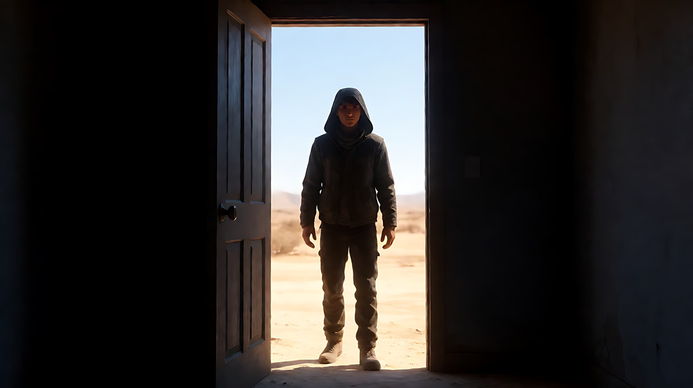

### 《后窗》（1954，阿尔弗雷德·希区柯克）
- 场景：腿部打石膏的摄影师杰弗瑞坐在公寓窗前，观察对面楼各家各户的窗户。
- 怎么拍的：对面楼的每一扇窗都是一个独立的"框中框"，像一排小屏幕；大量镜头从他的视角穿过自家窗口看出去。
- 为什么这样拍：窗框把"看"这个行为本身变成了主题。观众和主角一起偷看，框中框制造的窥视感让观众也成了共谋。窗户既是舞台（聚焦每户的小故事），也是隔阂（他只能看，不能介入）。

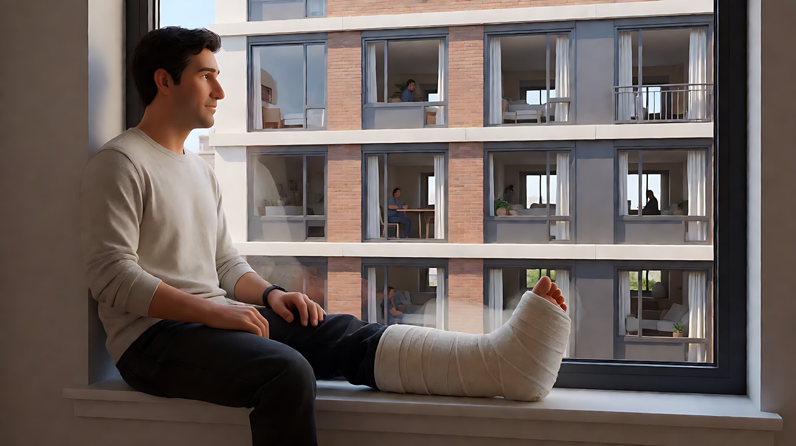

### 《第三人》（1949，卡罗尔·里德）结尾
- 场景：墓园外一条两旁种满树的笔直长路，男主角霍利在路边等待，安娜从远处沿路走来。
- 怎么拍的：固定机位长镜头，道路和两侧树木形成强烈的汇聚引导线，安娜从消失点附近一路走向镜头，走过霍利身边，没有看他一眼，走出画面。
- 为什么这样拍：引导线把观众的注意力牢牢钉在她身上，漫长的路程制造等待和期待；她直接走过去，期待落空。路越长、线越直，这次"错过"就越重。

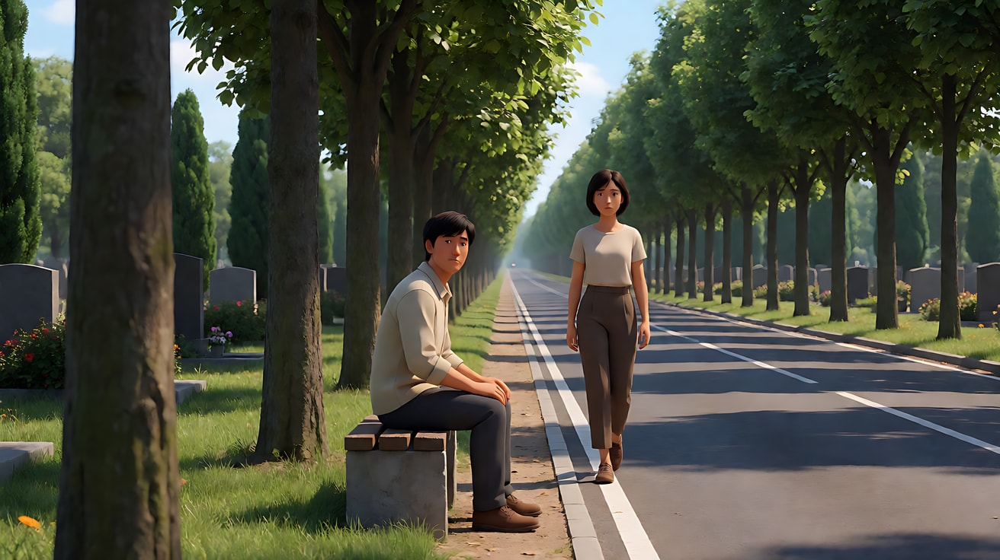

### 《花样年华》（2000，王家卫）
- 场景：两位主角在住所、走廊、办公室中的大量镜头。
- 怎么拍的：镜头常常躲在门框、窗帘、墙角、楼梯栏杆后面，前景物占去画面一部分，人物在缝隙中出现。
- 为什么这样拍：前景遮挡让观众像邻居一样窥视。两人的关系本来就在"别人的目光"下进行，构图本身就在表达"有人在看"和"他们不能光明正大"。

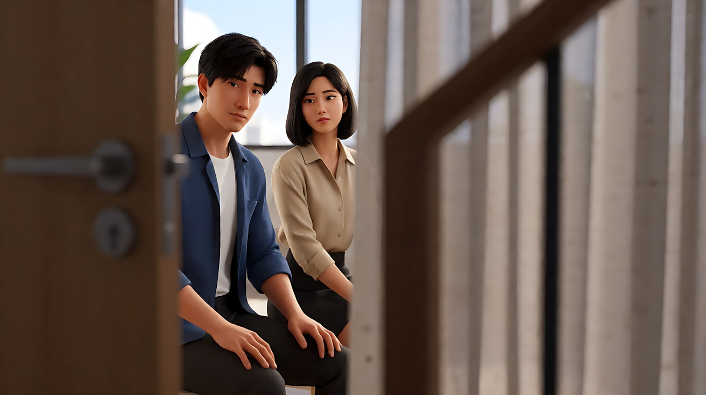

## 四、在 AI 中怎么实现

- **生图阶段**：
  - 引导线写成具体物体和方向：`the corridor walls and ceiling lights converge toward her`、`a railing runs diagonally from bottom left to the figure at upper right`。
  - 框中框写清"机位在框外"：`shot from the dark hallway through an open doorway, the door frame forms a frame within the frame`。只写 `frame within frame` 模型常常给你一个挂在墙上的画框。
  - 前景遮挡写三件事：是什么、在画面哪一侧、占多少、虚还是暗：`out-of-focus sheer curtain in the foreground covering the left quarter of the frame`。
  - 镜子：`her reflection in the bathroom mirror, the mirror frame isolating her face`，并减少动作。
- **视频阶段**：
  - 前景遮挡最适合配**横移**：镜头从遮挡物后横移出来，主体逐渐显露。写成"镜头从左向右缓慢横移，越过前景门框，露出……"。
  - 引导线最适合配**固定机位 + 人物沿线走动**，或**沿线推进**（推轨向消失点）。
  - 框中框最适合**固定机位**，让人物在框里进出。
- **模型擅长**：走廊、道路、铁轨等汇聚线；门框、窗框；虚化的前景植物、窗帘、玻璃雨痕。
- **要避开**：
  - 镜子里的反射与本人做复杂动作（经常对不上）；
  - 前景物太复杂（铁丝网、细格栅），运动时容易闪烁、变形；
  - 前景遮挡写了但没写"虚化/暗"，模型会把前景拍得和主体一样清楚，画面变乱。

## 五、练习作业

1. 在你住的地方找三条引导线（走廊、楼梯扶手、窗格），用手机拍下来，确认每条线的终点在哪。让一个人站到终点，再拍一次，比较注视力的差别。
2. 用同一扇门做三种框中框：聚焦（框内亮）、困住（人物贴框边）、窥视（机位躲在框外暗处）。各写一句意图。
3. 写一张前景遮挡生图提示词，分别让前景占 20% 和 60%，观察"窥视"与"看不清"的差别。
4. 完成配套提示词练习 1–5，重点做练习 3（首尾帧：镜头越过前景遮挡，主体显露）。

## 六、自检清单

- [ ] 引导线的终点放着主体（或我故意让它空着，制造悬念）
- [ ] 框中框写明了机位在框外，框内外有明暗差
- [ ] 我能说出这个框是"聚焦""困住"还是"窥视"
- [ ] 前景遮挡写了物体、位置、比例、虚或暗
- [ ] 前景没有挡住主体的眼睛（或我是故意的）
- [ ] 视频里的运镜和手法匹配：遮挡配横移，引导线配推进或沿线走，框中框配固定

## 七、配套提示词

→ [L03-02-引导线框中框与前景遮挡-提示词](../提示词/L03-02-引导线框中框与前景遮挡-提示词.md)

---

上一课：[L03-01 三分法、中心构图与黄金比例](L03-01-三分法中心构图与黄金比例.md) ｜ 下一课：[L03-03 对称与一点透视](L03-03-对称与一点透视.md) ｜ [返回总目录](../../README.md)
