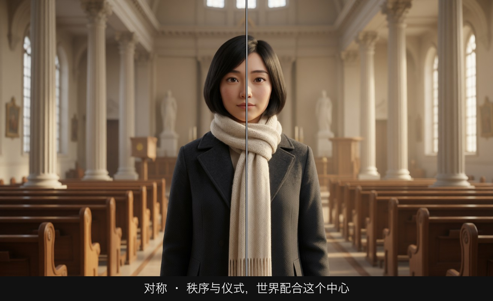
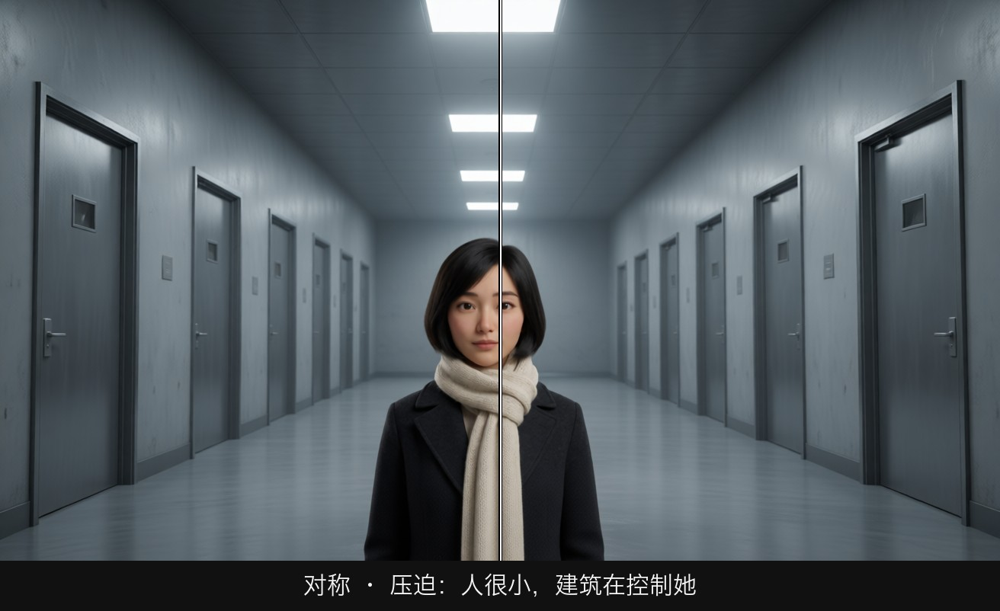
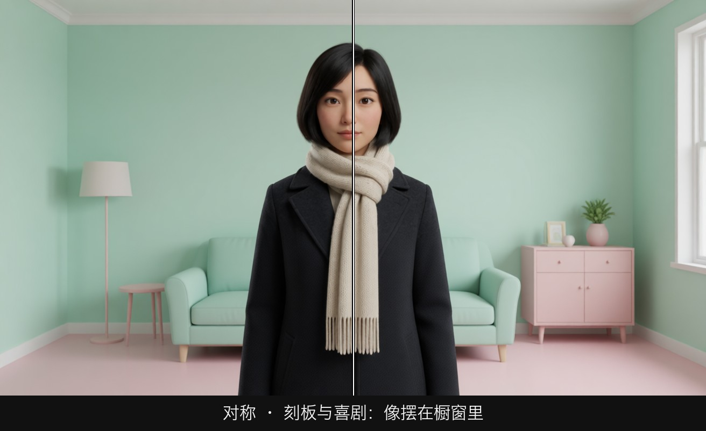
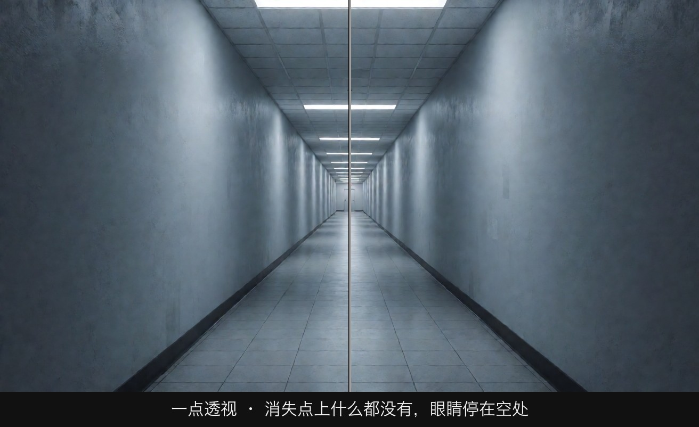
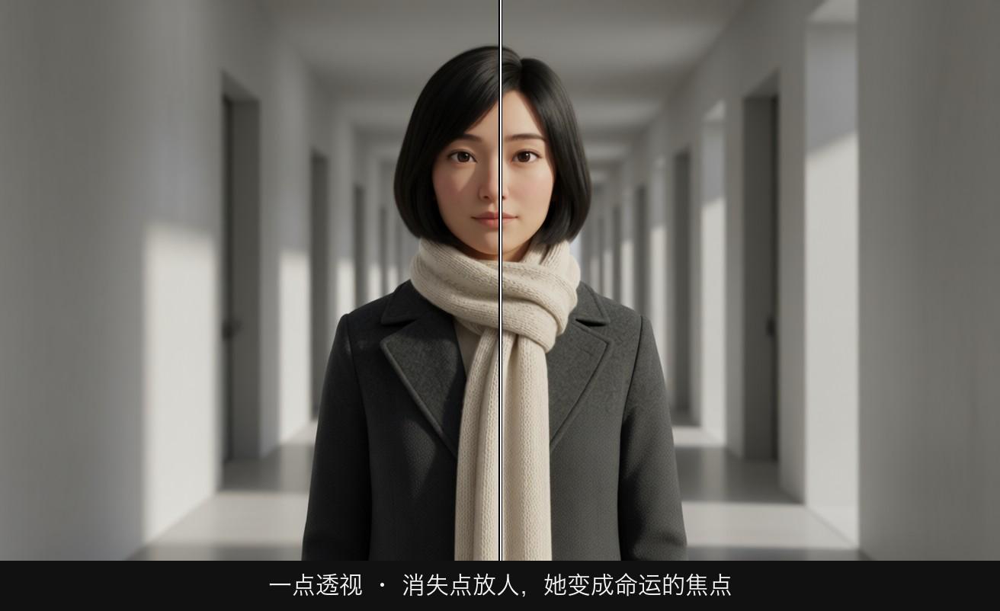
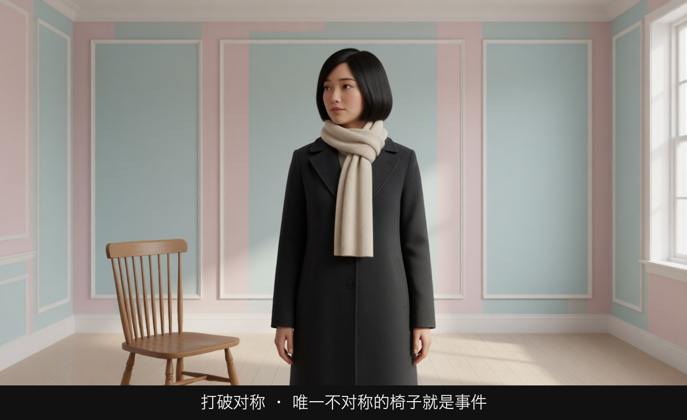
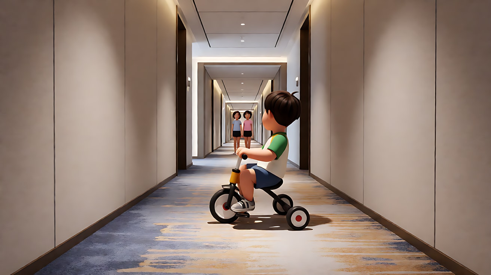
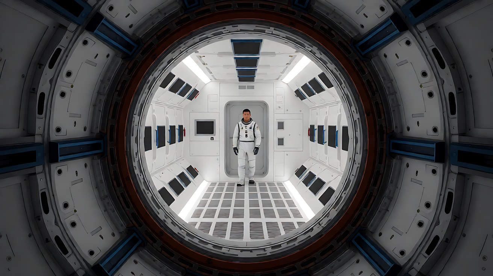
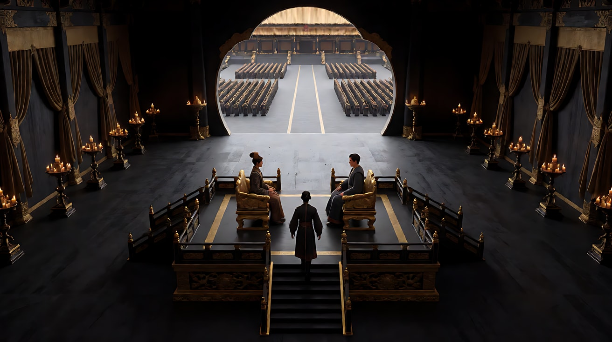

# L03-03 对称与一点透视：秩序、压迫，以及打破它的那一刻

> 段位：基础 ｜ 建议用时：45 分钟 ｜ 配套提示词：[L03-03-对称与一点透视-提示词](../提示词/L03-03-对称与一点透视-提示词.md)

## 学习目标

- 能说出对称构图的三种情绪：秩序与仪式、压迫与控制、刻板与喜剧
- 能找到画面的消失点，说出一点透视需要哪四个条件
- 理解"打破对称"为什么是叙事事件，能设计一个打破对称的镜头
- 能写出稳定的对称/一点透视生图提示词，并用 Seedance 做沿中轴的推进

## 一、概念讲解

### 1. 对称：画面左右（或上下）互为镜像

对称构图把主体放在正中，左右两边的建筑、陈设、人物几乎一样。它是上一课中心构图的"加强版"：不只主体居中，**整个世界都在配合这个中心**。

```
+-----------------------------------------------+
|  ||       ||          |          ||       ||  |
|  ||       ||          |          ||       ||  |
|  ||  [ ]  ||          o          ||  [ ]  ||  |
|  ||       ||         /|\         ||       ||  |
|  ||       ||         / \         ||       ||  |
|==||=======||==========|==========||=======||==|
+-----------------------------------------------+
                        ^
                       中轴线：左右两侧互为镜像
```

对称的三种情绪：

| 情绪 | 怎么做 | 例子 |
|---|---|---|
| **秩序与仪式** | 对称 + 平视 + 柔和光 | 婚礼、加冕、宣誓、教堂 |
| **压迫与控制** | 对称 + 低机位或深纵深 + 冷硬光 + 人物很小 | 体制、权力中心、无法逃离的建筑 |
| **刻板与喜剧** | 对称 + 正面平视 + 鲜明色彩 + 人物站定直视 | 风格化喜剧、童话感 |

**完美对称是"不自然"的**。现实生活很少完全对称，所以观众一看到对称画面，就会感到"这是被安排好的"。这正是它的力量：它告诉观众有一只手在控制这个世界。

### 2. 一点透视：所有线条奔向同一个点

当镜头**正对**一个有纵深的空间（走廊、隧道、道路、长桌），所有向远处延伸的线会汇聚到画面中的一个点，叫**消失点**。

```
+-----------------------------------------------+
|\                                             /|
|  \                                         /  |
|    \                                     /    |
|      \                                 /      |
|        +-----------------------------+        |
|        |                             |        |
|        |              *              |        |
|        |                             |        |
|        +-----------------------------+        |
|      /                                 \      |
|    /                                     \    |
|  /                                         \  |
|/                                             \|
+-----------------------------------------------+
  四条斜线 = 天花板与地板的墙角线；内框 = 走廊尽头的墙
  * = 消失点：所有纵深线条的延长线都交于这里
```

一点透视的四个条件：

1. **机位正对**纵深方向（不能斜着拍）
2. **镜头水平**，不仰不俯（否则竖线会倾斜，出现两点或三点透视）
3. **机位放在中轴线上**（偏了就不对称）
4. **广角或标准焦段**（24mm–35mm 让纵深线条更强；长焦会把纵深压扁）

一点透视通常和对称一起出现，但不必然：机位在中轴线上就是对称的一点透视；机位偏离中轴线，仍然是一点透视，但画面不对称。

### 3. 消失点放什么

消失点是画面最强的注视点（L03-02 的汇聚引导线就是它）。导演的选择：

| 消失点放 | 效果 |
|---|---|
| 人物 | 人物成为整个世界的焦点，命运感 |
| 一扇门 / 一束光 | 目的地、出口、未知 |
| 什么都没有（黑暗） | 悬疑，观众等待那里出现东西 |
| 远去的人物背影 | 离别、不可挽回 |

### 4. 打破对称：秩序里的"错误"

对称建立了一个规则。当规则被打破，观众会立刻察觉，这就是叙事事件。

```
  建立对称                               打破对称
+---------------------+               +---------------------+
|  [ ]     |     [ ]  |               |  [ ]     |          |
|          o          |     ----->    |          o     o    |
|         /|\         |               |         /|\   /|\   |
|         / \         |               |         / \   / \   |
+---------------------+               +---------------------+
  左右各一盏灯，人在中轴               右侧灯灭了，一个陌生人站在那里
```

打破对称的几种方式：

| 方式 | 叙事含义 |
|---|---|
| 一个人从中轴线走开 | 离开秩序、反叛、出走 |
| 一侧多出一个人或物 | 入侵、外来者、第三者 |
| 一侧的光熄灭 | 失去、平衡被破坏 |
| 中心人物倒下或低头 | 权力崩塌 |
| 机位离开中轴（横移） | 观众的视角"脱离"了秩序 |

**原则**：先用一两个镜头建立对称，再打破它。没有建立就打破，观众感觉不到"错"。

### 5. 对称的风险

- 用多了会显得僵硬、做作，像宣传画；
- 对称会削弱人物的个性（人变成建筑的一部分），对话场景慎用；
- 一点透视让画面很"平"，适合短暂停留的仪式镜头，不适合长时间的情感戏。

## 图解

> 这些示意图由多种生图模型分别生成（包括 Nano Banana、GPT Image 等），只用来说明镜头概念；不同模型的画面不能互相比较效果，也不能当作视频成片。


白线是中轴线。对称画面里，左右应该沿着它大致镜像。



柔和的光，左右重复的柱子，人在正中。对称在这里是秩序和仪式：这个世界是被安排好的。



还是对称，但人变得极小，建筑又冷又深。对称不再庄重，变成一种无法逃开的控制。



正面、平视、糖果色、人像摆件一样站定。对称也可以是喜剧：一切太整齐，所以显得不自然。



机位在中轴上、镜头水平、正对纵深。所有线交于尽头那一个点，点上没有人。眼睛会被送到那块空白上，停住。



同样的走廊，人站到交点上。整条走廊的线都在指她。这是一点透视最强的用法。



房间本来左右一样，只有一把椅子被拉了出来。她的头转向那把椅子。打破对称的那一下，就是这场戏的事件。

## 二、情绪与叙事功能

| 技法 | 观众的感受 | 常用场景 |
|---|---|---|
| 对称 + 平视 + 柔光 | 庄重、仪式、秩序 | 婚礼、典礼、宣誓、家族合影 |
| 对称 + 人物极小 + 冷硬光 | 体制压迫、无力 | 权力中心、监狱、大厅、审判 |
| 对称 + 鲜明色彩 + 人物直视 | 刻板、幽默、童话 | 风格化喜剧、角色登场 |
| 一点透视 + 人物在消失点 | 命运、目标 | 走向关键房间、决战 |
| 一点透视 + 消失点黑暗 | 悬疑、未知 | 恐怖片走廊、地下通道 |
| 一点透视 + 沿中轴推进 | 被吸进去、无法回头 | 进入禁地、接近真相 |
| 打破对称 | "出事了" | 入侵者出现、背叛、离开 |

## 三、经典影片案例

### 《闪灵》（1980，斯坦利·库布里克）
- 场景：远望酒店的长走廊；男孩丹尼骑着三轮车转过走廊，看到走廊尽头站着一对双胞胎女孩。
- 怎么拍的：走廊镜头大量采用机位在中轴线上的一点透视，墙线、地毯花纹、天花板全部汇聚到远处；双胞胎并排站在走廊尽头正中，形成严格的左右对称。
- 为什么这样拍：酒店本身就是一个"有意志的空间"，一点透视让走廊像要把人吸进去；双胞胎的完美对称在一个本应自然的场景里显得极度不自然，这种"太整齐"本身就是恐惧来源。对称在这里不是庄重，而是**秩序背后的不对劲**。



### 《2001 太空漫游》（1968，斯坦利·库布里克）
- 场景：发现号飞船的环形舱与通道、分离舱舱室，以及结尾宇航员鲍曼所在的白色房间。
- 怎么拍的：大量镜头机位正对纵深方向，舱室结构左右对称，线条汇聚到画面中心；结尾房间的陈设与地板网格同样整齐、居中。
- 为什么这样拍：对称与一点透视让机器世界显得冷静、精确、没有人的温度。人在这样的构图里只是系统中的一个零件。当人工智能接管飞船时，这种冰冷的秩序就成为了威胁本身。



### 《英雄》（2002，张艺谋）秦王宫
- 场景：无名进入秦王宫，在巨大空旷的大殿中与秦王相对而坐。
- 怎么拍的：宫殿大量使用严格对称的建筑与布景，黑色调的大殿空旷深远，秦王居于中轴线的高处，大殿两侧排列整齐的烛火与帷幔；宫外广场上的军阵同样排成对称的几何方阵。
- 为什么这样拍：对称在这里就是权力本身，一个统一天下的意志把一切排成整齐的秩序。个人在这种构图里渺小而孤立。无名每被允许向前移近一段距离，都是在这种严密秩序里挤出的一点空间，构图的秩序和人物的意图之间形成张力。



## 四、在 AI 中怎么实现

- **生图阶段**：
  - 对称要写全三件事：`perfectly symmetrical composition, camera on the central axis, frontal, eye level`。少写 `eye level` 时模型常给略俯视的视角，竖线就歪了。
  - 一点透视写 `one-point perspective, all lines converging to a single vanishing point at the centre of the frame`，并给焦段 `24mm` 或 `28mm`。
  - 写清左右两侧的"对称物"：`identical lamps on both sides`、`two rows of columns`，模型才知道要镜像什么。
  - 打破对称时，先生成对称版，再用同一张图做参考生成"只改一处"的版本：`exactly the same symmetrical room as image 2, except the right lamp is now off`。
- **视频阶段**：
  - 对称最配**沿中轴推进或拉远**，写"镜头沿中轴线匀速推进，左右始终对称"。
  - 打破对称的事件写成一个动作：人物离开中轴、一侧灯灭、一个人从侧面走入。用首尾帧锁住"对称"与"破缺"两个状态最稳。
  - 横移会立刻破坏对称，除非你就是要打破它。
- **模型擅长**：走廊、大殿、教堂、地铁通道、长桌这类天然对称空间；中轴推进。
- **要避开**：
  - 对称空间里放太多人物（每个人的动作不同会破坏对称）；
  - 复杂的重复图案（地毯花纹、格栅）运动时会闪烁；
  - "双胞胎"或"镜像人物"做同步动作，模型很难让两人动作一致。

## 五、练习作业

1. 在你身边找一个对称空间（走廊、楼梯间、地下通道），站在中轴线上、镜头水平拍一张；再偏离中轴一步拍一张，比较"秩序感"的消失。
2. 写同一个大厅的三种对称：秩序（柔光、平视）、压迫（人物极小、冷硬光）、喜剧（鲜明色彩、人物直视镜头）。
3. 设计一个"建立对称 → 打破对称"的两镜头段落，写出打破的方式和它代表的叙事事件。
4. 完成配套提示词练习 1–5，重点做练习 3（首尾帧：对称被一个人的离开打破）。

## 六、自检清单

- [ ] 生图提示词写了 symmetrical、central axis、frontal、eye level
- [ ] 一点透视写了消失点位置和广角焦段
- [ ] 消失点上放的东西是我选的（人、门、光或故意的黑暗）
- [ ] 我能说出这个对称是"秩序""压迫"还是"刻板"
- [ ] 打破对称之前，至少有一个镜头建立了对称
- [ ] 视频运镜沿中轴进行，或我是故意用横移打破对称

## 七、配套提示词

→ [L03-03-对称与一点透视-提示词](../提示词/L03-03-对称与一点透视-提示词.md)

---

上一课：[L03-02 引导线、框中框与前景遮挡](L03-02-引导线框中框与前景遮挡.md) ｜ 下一课：[L03-04 负空间与画面权力](L03-04-负空间与画面权力.md) ｜ [返回总目录](../../README.md)
