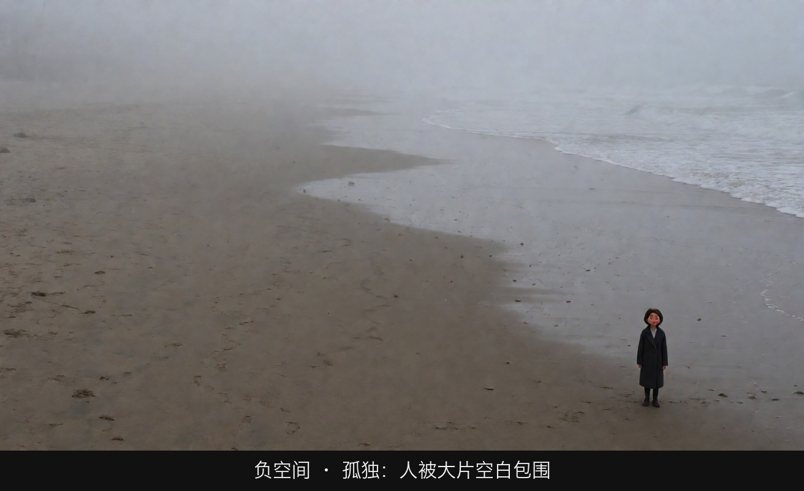
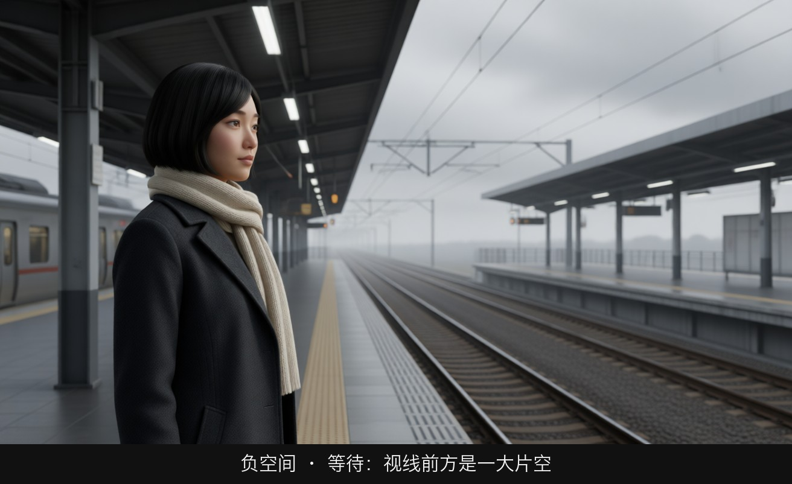
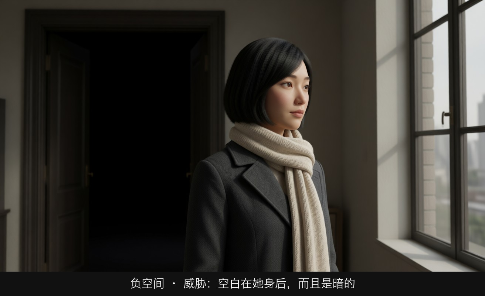
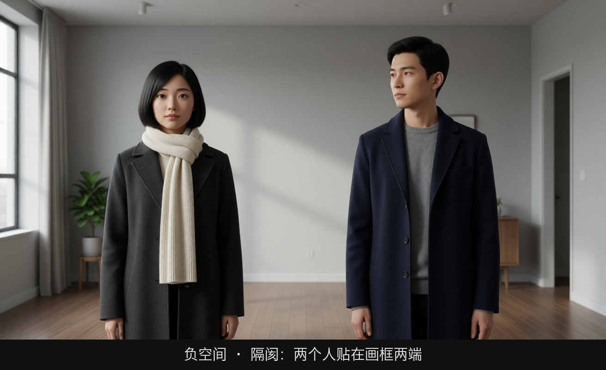
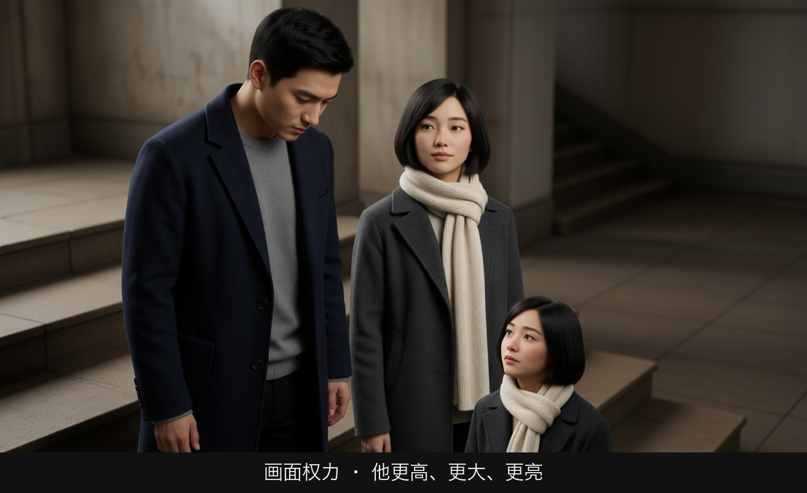
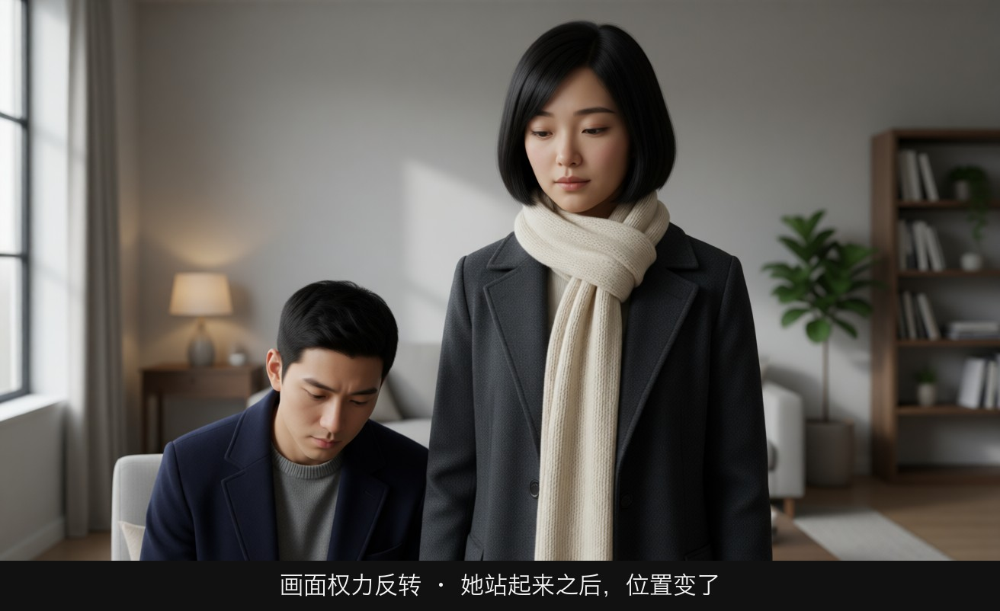
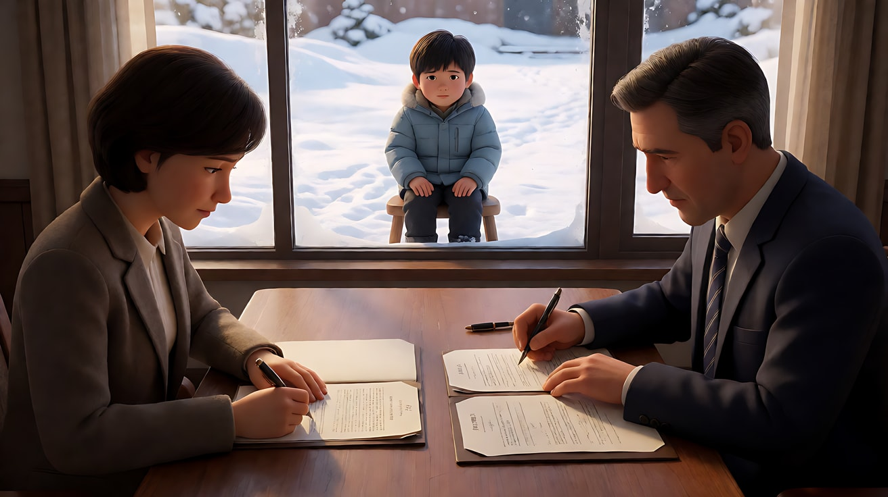
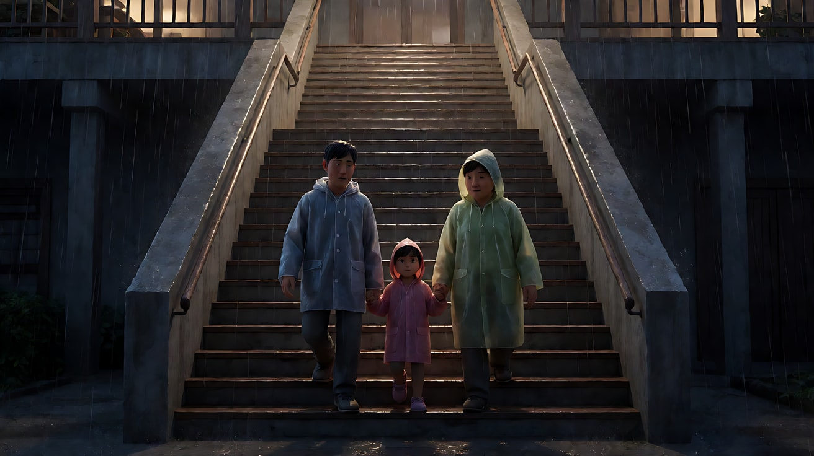
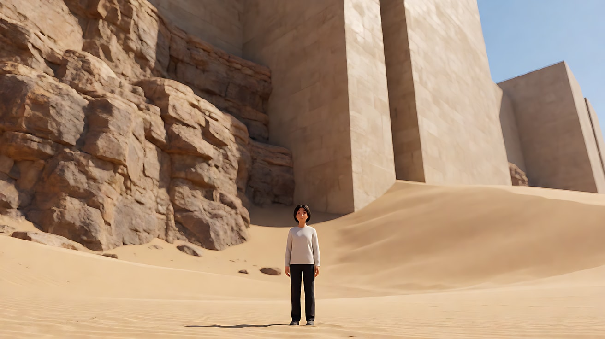

# L03-04 负空间与画面权力：空白会说话，位置即地位

> 段位：基础 ｜ 建议用时：50 分钟 ｜ 配套提示词：[L03-04-负空间与画面权力-提示词](../提示词/L03-04-负空间与画面权力-提示词.md)

## 学习目标

- 能说出负空间的四种情绪：孤独、渺小、等待、威胁
- 能用"高度、大小、位置、朝向、清晰度、光"六个维度分析两个人物谁更有权力
- 能设计一组镜头，让画面权力在两个人之间转移
- 能判断画面比重是平衡还是失衡，并说出失衡的意图
- 能在生图提示词里用比例、位置、高度准确写出权力关系

## 一、概念讲解

### 1. 负空间：画面里"没有东西"的部分

负空间（Negative Space）是主体之外的空白：天空、墙面、海面、雪地、黑暗、一片虚化的背景。新手怕空，总想把画面填满；导演知道**空白和主体一样是被设计出来的**。

```
  主体填满画面                       大面积负空间
+-----------------------------+    +-----------------------------+
|                             |    |                             |
|         ___________         |    |                             |
|        |  o     o  |        |    |                             |
|        | /|\   /|\ |        |    |                             |
|        | / \   / \ |        |    |                             |
|        |___________|        |    |                          o  |
|                             |    |                         /|\ |
+-----------------------------+    +-----------------------------+
  信息、关系、事件                     孤独、渺小、等待
```

负空间的四种情绪：

| 负空间的形态 | 观众感到 | 写法提示 |
|---|---|---|
| 人物很小，周围大片空 | 孤独、渺小、被世界忽略 | 人物占画面高度 1/10 以下 |
| 人物视线方向的大片空 | 等待、思念、期盼 | 视线留白（L03-01）放大到极致 |
| 人物身后的大片空 | 威胁、背后有东西 | 身后是黑暗或门口，观众会盯着那里 |
| 两人之间的大片空 | 距离、隔阂、关系破裂 | 两人分别贴在画框两侧 |

**身后的负空间**特别有用：观众会本能地扫视空白处，如果空白在人物身后且是黑暗，悬念就自动产生了，你什么都不用放。

### 2. 画面权力：谁在画面里更"大"

在同一个画面里，观众会不自觉地判断谁占上风。决定权力的六个维度：

| 维度 | 更有权力 | 更弱势 |
|---|---|---|
| **高度** | 在画面里位置更高（站着、在台阶上、头部更靠上） | 位置低（坐着、跪着、在台阶下） |
| **大小** | 离镜头更近、占画面更多 | 离镜头远、占画面少 |
| **位置** | 画面中心或强交点 | 画面边缘、被画框切掉一部分 |
| **朝向** | 正面或四分之三面对镜头 | 背对镜头、侧面 |
| **清晰度** | 焦点在他身上 | 被虚化 |
| **光** | 被照亮，或站在逆光里形成剪影 | 落在阴影里（不同语境下也可反过来：藏在暗处的人更可怕） |

```
  A 压倒 B                                  B 反客为主
+-------------------------------+         +-------------------------------+
|       o                       |         |                         o     |
|      /|\                      |         |                        /|\    |
|      / \                      |         |                        / \    |
|      A                        |         |   o                    B      |
|                         o     |         |  /|\                          |
|                        /|\    |         |  / \                          |
|                        B      |         |  A                            |
+-------------------------------+         +-------------------------------+
  A 位置高、离镜头近、在左上               B 起身，现在 B 位置更高
  B 在右下、小、低                          A 坐下，在左下角
```

**权力不是固定的**：同一场戏里，通过人物的走位（站起、坐下、走近镜头、退到画边），画面权力可以转移。导演用构图告诉观众"现在谁赢了"。

### 3. 机位角度与画面权力的关系

L01 模块讲过：仰拍赋权，俯拍削弱。构图里的"画面高度"和机位角度经常一起使用，但它们是两回事：

- **画面高度**：人物在画框里的位置靠上还是靠下（构图）
- **机位角度**：镜头从下往上还是从上往下看（机位）

两者同向时效果最强：仰拍 + 人物头部在画面上方 = 绝对的压迫。两者反向时会产生复杂感：俯拍但人物站得很高（例如俯拍一个站在高台上的人），既有权力又显得孤立。

### 4. 画面比重与平衡

上一节课的"视觉重心"可以量化成"比重"：大的比小的重，暗的比亮的重（在亮背景上），近的比远的重，人比物重，有颜色的比灰的重。

```
  平衡：大而远 vs 小而近             失衡：全部重量压在一侧
+-----------------------------+    +-----------------------------+
|      /\                     |    |                             |
|     /  \                    |    |  ###                        |
|    /    \             o     |    |  ###  o                     |
|   /      \           /|\    |    |  ###  |\                    |
|  /        \          / \    |    |  ###  / \                   |
+-----------------------------+    +-----------------------------+
  画左的大山 = 画右的一个近处人物      暗墙、人物都挤在左边，右边空着
  画面稳定                             画面向一侧"倾倒"，不安
```

- **平衡**：稳定、和谐、安全、结束感
- **失衡**：不安、倾斜、即将发生什么、关系不对等

### 5. 负空间与权力结合

负空间本身就是权力工具：**占有空间的人有权力，被空间吞没的人没有**。一个人站在大厅中央，大厅是他的；同一个人缩在大厅角落，大厅在压迫他。区别不在人物大小，在于空间"属于谁"：他是面对空间（拥有），还是被空间包围（吞没）。

## 图解

> 这些示意图由多种生图模型分别生成（包括 Nano Banana、GPT Image 等），只用来说明镜头概念；不同模型的画面不能互相比较效果，也不能当作视频成片。




人缩在角落，其余全是雾和空地。空白不是没拍满，空白就是内容。



她贴在左边，视线前方是整条空站台。留白大到这个程度，等待就变成看得见的东西。



她在前景，身后是一大块暗的门洞。观众会不由自主去看那块黑。你什么都不用放进去，悬念已经在了。



两个人各贴一边，中间是空房间。距离被画出来了。



他站得更高、离镜头更近、更亮；她坐在右下，更小。六个权力维度里，高度、大小和光同时站在他那边。



同一对人、同一个房间。她站到前景，他坐下变小。谁赢了，不用对白，构图已经说完。

## 二、情绪与叙事功能

| 技法 | 观众的感受 | 常用场景 |
|---|---|---|
| 人物极小 + 大片负空间 | 孤独、渺小、无助 | 失落、流放、独自上路 |
| 视线方向大片留白 | 等待、思念 | 等人、离别后、望远方 |
| 身后大片暗区 | 不安、威胁 | 悬疑、恐怖铺垫 |
| 两人分贴画框两侧 | 隔阂、冷战 | 关系破裂、谈判 |
| 一人高一人低 | 地位差、压迫 | 上下级、审问、求情 |
| 位置互换（站起/坐下） | 权力翻转 | 反击、揭穿、逆袭 |
| 画面失衡 | 倾斜、不安 | 关系不对等、危机前 |
| 画面平衡 | 和解、安定 | 结局、和好 |

## 三、经典影片案例

### 《公民凯恩》（1941，奥逊·威尔斯）
- 场景一：童年凯恩在雪地里玩耍，母亲和银行家在屋内签署把他送走的文件。
- 怎么拍的：深焦画面中，签字的大人在前景，占据画面大部分；小凯恩在后景，被窗户框住，在雪地里显得很小。
- 为什么这样拍：孩子的命运在画面的"前景"被决定，而他本人在画面里最小、最远，根本无法参与。构图直接说出了权力在谁手里。
- 场景二：晚年凯恩与妻子苏珊在仙纳度庄园巨大的大厅里，苏珊在拼拼图，两人隔着很远的距离说话。
- 怎么拍的：大厅的空旷吞没了两个人，巨大的壁炉和空间远大于人物，两人之间是大片负空间。
- 为什么这样拍：凯恩用财富建起了这座宫殿，但空间没有属于他，反而吞没了他和他的婚姻。负空间就是他们之间的距离。



### 《寄生虫》（2019，奉俊昊）
- 场景：金家住在半地下室，朴家住在山坡上的豪宅；片中反复出现人物上楼、下楼、沿着长长的台阶向下走的画面。
- 怎么拍的：贫富关系被放进垂直空间：富人在高处，穷人在低处；人物在画面里的上下位置、在楼梯上的高低，持续对应着阶层。暴雨夜金家人一路沿台阶往下走回家，就是一次漫长的"下沉"。
- 为什么这样拍：画面高度 = 社会高度。观众即使不注意台词，也能从人物在画面里"往上"或"往下"感受到阶层的不可逾越。



### 《沙丘》（2021，丹尼斯·维伦纽瓦）
- 场景：保罗与家族成员在巨大的建筑、广袤的沙漠中出现的大量远景。
- 怎么拍的：人物在画面里极小，周围是巨大的建筑体块、粗粝的岩壁或无边的沙丘，负空间占据画面绝大部分。
- 为什么这样拍：这个世界的尺度远超个人，帝国、家族、星球的力量都大于人。负空间不是空，它是"命运"的体积，让观众感到主角面对的是一个庞大的体系。



## 四、在 AI 中怎么实现

- **生图阶段**：
  - 负空间写比例：`the figure occupies less than one tenth of the frame height`、`the right two thirds of the frame is empty grey sky`。只写 `negative space` 模型常常留得不够多。
  - 写清空白是什么："空"也要有质感：`an empty white wall with soft gradient light`、`a vast flat snowfield`、`deep shadow`。
  - 画面权力写高度和位置：`A stands on the upper step, his head near the top of the frame; B sits below on the lower right, small in the frame`。
  - 两人隔阂写位置：`the two characters at opposite edges of the frame, a long empty table between them`。
- **视频阶段**：
  - 权力转移写成一个走位动作："她从椅子上站起来，头部升到画面上方，他仍坐着"。用首尾帧锁住"翻转前"和"翻转后"最稳。
  - 负空间镜头最适合固定机位或极慢的拉远；推镜会吃掉负空间。
  - 两人戏只让一个人做主动作，另一个人保持小动作，否则权力关系会模糊。
- **模型擅长**：雪地、沙漠、海面、天空、空墙这类干净的负空间；大远景中的小人物。
- **要避开**：
  - 负空间里出现模型"自作主张"加的东西（鸟、路人、船），要在约束里明确排除；
  - 两个人物的肢体接触（推、抓）来表现权力，容易变形，改用位置和高度；
  - 人物太小时脸会崩，所以大远景尽量用背影或侧影。

## 五、练习作业

1. 拍或画一组三张图：同一个人物分别占画面高度的 1/2、1/5、1/20，写下每张图的情绪。
2. 设计一场两人对话，用三个镜头让权力翻转一次，写出每个镜头里两人的高度、大小、位置。
3. 找一张你喜欢的电影剧照，分析其中两个人物在六个权力维度上谁占优。
4. 完成配套提示词练习 1–5，重点做练习 3（首尾帧：一次起身完成权力翻转）。

## 六、自检清单

- [ ] 负空间写了比例和质感，不是笼统的"留白"
- [ ] 我能说出这片空白表达的是孤独、等待、威胁还是隔阂
- [ ] 两人画面里，我清楚谁更有权力，并能用至少三个维度说明
- [ ] 权力转移用走位（站起、坐下、走近）表现，而不是肢体接触
- [ ] 画面的平衡或失衡是我选的
- [ ] 视频约束里排除了模型可能往负空间里加的东西

## 七、配套提示词

→ [L03-04-负空间与画面权力-提示词](../提示词/L03-04-负空间与画面权力-提示词.md)

---

上一课：[L03-03 对称与一点透视](L03-03-对称与一点透视.md) ｜ 下一课：[L03-05 画幅与构图](L03-05-画幅与构图.md) ｜ [返回总目录](../../README.md)
