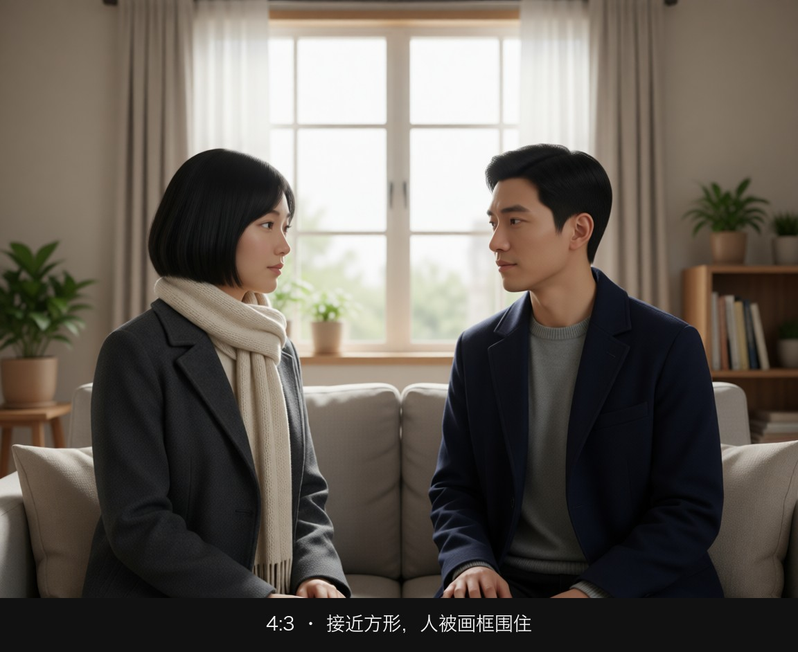
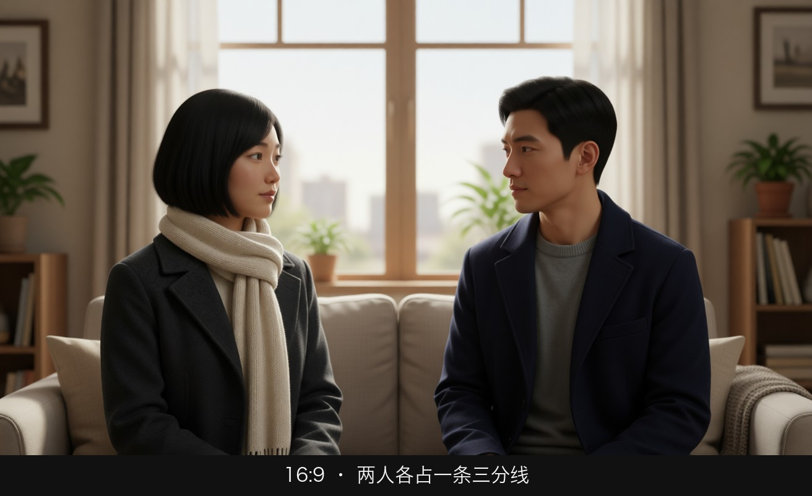
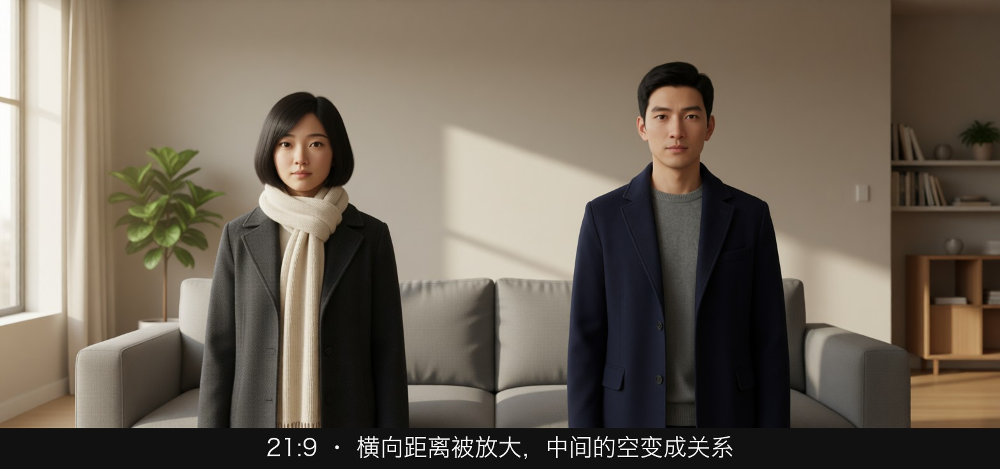
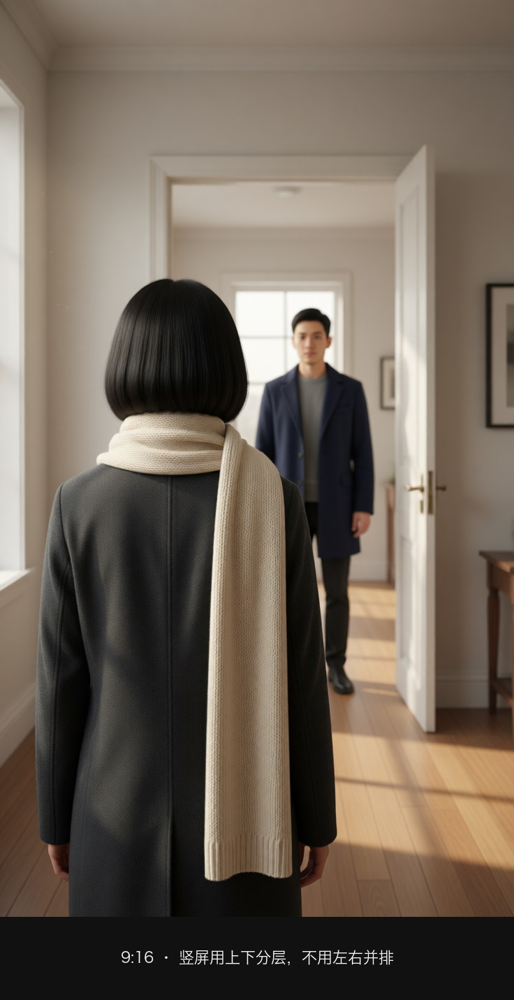
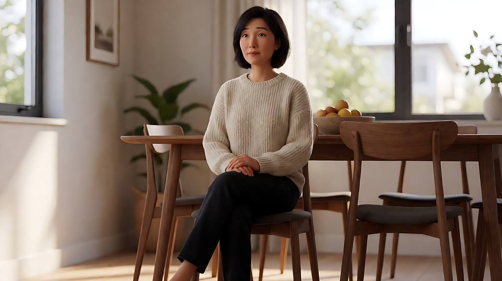
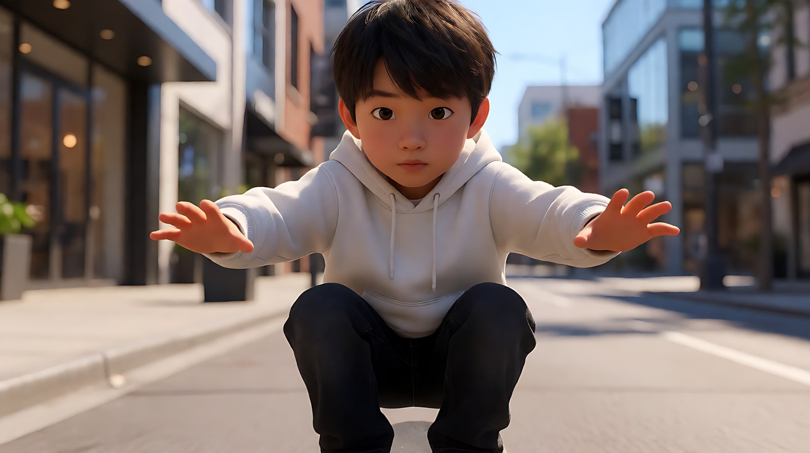
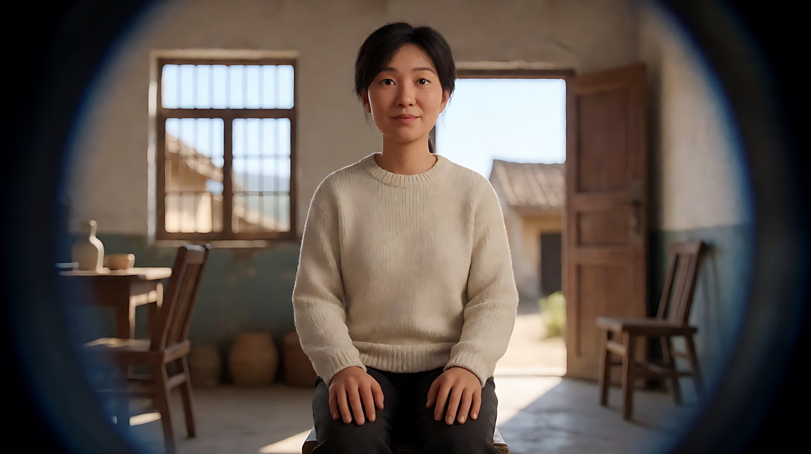

# L03-05 画幅与构图：同一个故事，换一个画框就换了一种讲法

> 段位：基础 ｜ 建议用时：60 分钟 ｜ 配套提示词：[L03-05-画幅与构图-提示词](../提示词/L03-05-画幅与构图-提示词.md)

## 学习目标

- 能说出 4:3、1.85:1、16:9、2.39:1、9:16 五种画幅的形状、来历和情绪倾向
- 能按画幅调整构图：宽画幅重横向关系，窄画幅重纵向与头顶空间，竖屏重上下分层
- 掌握竖屏短剧的三条构图逻辑：上下分层、人物居中偏上、避开字幕与界面安全区
- 能把同一个场景改写成三种画幅版本，并说出每种版本在讲什么
- 能把构图目标与入口支持的画幅分开，知道何时需要后期裁切

## 一、概念讲解

### 1. 画幅是什么

画幅（Aspect Ratio）是画面的宽高比。它是导演在开机前就要做的决定，因为**画框的形状决定了什么能放进来、什么必须被留在外面**。

```
  4:3 (1.33:1)              16:9 (1.78:1)
+--------------+          +----------------------+
|              |          |                      |
|              |          |                      |
|              |          |                      |
|              |          |                      |
+--------------+          +----------------------+

  1.85:1                    2.39:1
+------------------------+  +--------------------------------+
|                        |  |                                |
|                        |  |                                |
|                        |  |                                |
+------------------------+  +--------------------------------+

  9:16 (0.56:1)
+---------+
|         |
|         |
|         |
|         |
|         |
|         |
|         |
+---------+
```

### 2. 五种画幅的性格

| 画幅 | 来历 | 形状带来的倾向 | 适合 |
|---|---|---|---|
| **4:3（1.33:1）** | 早期电影与电视标准 | 接近方形，头顶空间多，横向空间少；人物"被围住" | 回忆、复古、单人肖像、压抑、封闭空间 |
| **1.85:1** | 美国院线常用的"遮幅宽银幕" | 比 16:9 略宽，平衡、自然，日常叙事的默认画框 | 剧情片、家庭戏、对话 |
| **16:9（1.78:1）** | 电视、网络视频标准 | 和 1.85:1 很接近，通用 | 网络视频、剧集、大部分 AI 生成 |
| **2.39:1（常写作 2.35/2.40）** | 变形宽银幕 | 极宽，横向关系强，头顶空间很少；人和环境、人和人之间的横向距离被放大 | 风景、宏大尺度、对峙、孤独、动作 |
| **9:16** | 手机竖屏 | 极窄极高，横向几乎放不下两个人，纵向空间大 | 竖屏短剧、短视频、手机广告 |

**一个常见误解**：宽银幕不等于"更大"。在同一块屏幕上，2.39:1 画面的高度比 16:9 更矮。它的力量来自横向的**关系**：两个人之间的距离、人与地平线的比例。

### 3. 不同画幅下的构图调整

| 构图问题 | 4:3 | 16:9 / 1.85:1 | 2.39:1 | 9:16 |
|---|---|---|---|---|
| 单人近景 | 头顶空间大，可以放墙上的东西 | 视线方向留白 | 大片侧面留白，孤独感强 | 人脸可以占满宽度，极有冲击力 |
| 两人对话 | 两人挤在一起，或只拍一人 | 两人各占三分线 | 两人分站两端，中间是大片空间 | 很难并排，改为前后纵深叠放或正反打 |
| 地平线 | 天空和地面都多 | 三分法 | 地平线横贯，天地比例很重要 | 地平线变短，天空或地面占绝对优势 |
| 运动方向 | 横向运动很快出画 | 横向、纵深均可 | 横向运动最舒服 | 横向运动立刻出画，改为纵深或上下运动 |
| 高大物体 | 适合（塔、树、人站立全身） | 一般 | 不适合，会被切掉 | 最适合（楼梯、高楼、站立全身） |

### 4. 竖屏短剧的构图逻辑

竖屏不是"把横屏转 90 度"。它有自己的规则，因为观众是**单手拿着手机、在一块被界面覆盖的屏幕上**看。

**规则一：上下分层**

横屏用左右讲关系，竖屏用**上下**讲关系。画面通常分三层：

```
+-------------------+
|  TOP              |  <- 顶部层：环境、威胁、对手、悬念（门口、楼梯顶、远处的人）
|                   |
|-------------------|
|                   |
|  MAIN             |  <- 主体层：主角的脸，眼睛在这一层的上部
|      (o_o)        |
|                   |
|-------------------|
|  LOW              |  <- 前景层：手、道具、前景人物的肩膀（但要避开字幕区）
|                   |
+-------------------+
```

两人对话不要并排，而是**前后叠放**：一个人在前景偏下（肩膀或侧脸），另一个人在后景偏上（完整的脸）。这也是竖屏版本的"过肩镜头"。

**规则二：人物居中偏上**

- 人物水平方向基本居中（左右空间很窄，偏了就会出画或被界面挡住）
- 眼睛放在画面从上往下约 1/3 处（竖屏的"上三分线"）
- 近景、特写比例远高于横屏，观众在小屏幕上看不清远景里的表情

**规则三：避开字幕与界面安全区**

竖屏平台会在画面上叠加各种界面元素，关键内容（脸、手上的关键动作、道具）不能放在这些区域：

```
+-------------------+
|//// STATUS ///////|  <- 顶部约 8%：时间、电量、标题
|                   |
|                   |
|                   |
|     SAFE AREA     |  <- 安全区：脸、关键动作、关键道具放在这里
|                   |
|                |##|
|                |##|  <- 右侧约 15%：点赞、评论、分享按钮
|                |##|
|-------------------|
|//// SUBTITLE /////|  <- 底部约 20%：字幕、账号名、文案、进度条
|///////////////////|
+-------------------+
```

具体比例因平台而异，以上数字是保守的经验值。原则是：**脸和关键动作放在画面中部偏上的安全区**，底部五分之一留给字幕，右侧留给按钮。

**其他竖屏要点**：
- 横向运动改成纵深运动（走向镜头/远离镜头）或垂直运动（上楼、下楼、升降）
- 第一帧就要有人脸或强冲突，竖屏观众的耐心以秒计
- 画面信息要少而大：一个人、一个动作、一个道具

### 5. 同一场景，三种画幅

场景：车站站台，男人送别女人，列车即将开动。

```
2.39:1  讲"距离"
+--------------------------------------------------+
|                                                  |
|    o                                    [=TRAIN=]|
|   /|\                                   [   o   ]|
|   / \                                   [  /|\  ]|
|__________________________________________________|
  他在画左，她在画右的车窗里，中间是长长的空站台
  画面在说：两人之间隔着无法跨越的距离

16:9  讲"两个人"
+------------------------------+
|                              |
|        o          [  o  ]    |
|       /|\         [ /|\ ]    |
|       / \         [=====]    |
|______________________________|
  他在左三分线，她在右三分线的车窗里
  画面在说：两个人的关系，平衡、标准

9:16  讲"她的脸"
+-------------+
|   [=====]   |  <- 顶层：车窗边框
|   ( o_o )   |  <- 主体层：她在车窗里的脸，居中偏上
|   [=====]   |
|             |
|      o      |  <- 底层：他的后脑与肩膀（前景，虚）
|     /|\     |
|/////////////|  <- 字幕区
+-------------+
  画面在说：她看着他，这一刻是她的
```

画幅不只是技术参数，它决定了这场戏**以什么为主语**。

### 6. 画幅目标与生成任务的区别

旧版练习使用过 21:9、16:9、4:3、1:1、3:4、9:16 等比例，具体选择以当前入口为准，不把此列表当成所有版本的完整规格。先确定叙事需要的画幅，再检查任务是否允许选择输出比例。

| 你想要的画幅 | 在 Seedance 中怎么做 |
|---|---|
| 2.39:1 | 选 21:9（约 2.33:1，最接近），后期上下再裁一点 |
| 1.85:1 | 选 16:9 生成，构图时上下留一点余量，后期裁成 1.85:1 |
| 4:3 | 直接选 4:3 |
| 9:16 | 直接选 9:16；生图也要用 9:16，首帧画幅必须和视频一致 |

**关键区别**：2.5 专门首尾帧任务的比例随首帧，两端图片比例应一致，避免尾帧被拉伸；视频编辑和延长也沿用源片段比例。普通参考允许重新构图，但横图转竖屏可能改变主体位置，不能保证原布局。依据见 [A-04](../../附录/A-04-官方案例与版本差异.md)。为减少练习变量，本课仍建议输入与目标画幅一致。

## 图解

> 这些示意图由多种生图模型分别生成（包括 Nano Banana、GPT Image 等），只用来说明镜头概念；不同模型的画面不能互相比较效果，也不能当作视频成片。


同一对人、同一间客厅，只换画框。宽银幕不是「更大」，是横向关系被拉长；竖屏则改用上下分层。



接近方形。两个人被框在一个偏方的房间里，头顶空间多，横向挤。



两人可以舒服地分站左右三分线，中间还有墙。这是网络视频最常用的关系画幅。



人被推到两端，中间的沙发和墙变成一大段距离。宽画幅放大的是人和人之间的空。



竖屏里并排站不下两个人。改成前后纵深：近处是她的后脑，占下半幅；门洞里的他更远、更小，落在画面上方。同一块地板把两个人连在同一个空间里。最顶和最底仍要给界面和字幕留空。

## 二、情绪与叙事功能

| 技法 | 观众的感受 | 常用场景 |
|---|---|---|
| 4:3 | 封闭、亲密、怀旧、被困 | 回忆段落、复古风格、心理压抑 |
| 1.85:1 / 16:9 | 自然、平衡、无存在感 | 绝大多数叙事 |
| 2.39:1 | 辽阔、疏离、对峙、横向张力 | 风景、动作、两人对峙、孤独旅程 |
| 9:16 + 近景居中 | 直接、亲密、冲击 | 竖屏短剧、短视频、手机广告 |
| 9:16 + 上下分层 | 压迫来自上方，悬念在头顶 | 竖屏悬疑、反转、霸总登场 |
| 片中切换画幅 | 时空切换、心理状态变化 | 回忆与现实、梦境、解放时刻 |

## 三、经典影片案例

### 《布达佩斯大饭店》（2014，韦斯·安德森）
- 场景：故事在几个时间层之间嵌套切换：1930 年代的饭店往事、1960 年代作家与老板的会面，以及 1980 年代和当下的外框故事。
- 怎么拍的：不同时代使用不同画幅：1930 年代段落为接近方形的 1.37:1，1960 年代段落为 2.40:1 宽银幕，1980 年代与当下段落为 1.85:1。
- 为什么这样拍：画幅本身成了"时间标签"。观众无需字幕提示，从画框的形状就能知道自己在哪个时代。1.37:1 也呼应了那个年代电影的观看经验，让最核心的回忆段落带上一层旧日的质感。



### 《妈妈！》（2014，泽维尔·多兰）
- 场景：全片大部分时间使用 1:1 的正方形画幅；片中有段落，少年史蒂夫在街上滑行时用双手向两侧"推开"画框，画面随之扩展为宽画幅。
- 怎么拍的：极窄的方形让人物几乎总是单独占据画面，周围没有空间；扩展的那一刻，画框随角色的动作打开。
- 为什么这样拍：正方形画幅就是角色被生活困住的感受；画框被推开，是他们难得的自由和希望。当希望破灭，画幅又收回。画幅变成了人物心理状态的直接外化，这是"画幅即叙事"的极端示范。



### 《我不是潘金莲》（2016，冯小刚）
- 场景：李雪莲为一桩离婚案多年上访的故事，在地方与北京之间来回。
- 怎么拍的：在地方的段落大量使用圆形画框，在北京的段落使用方形画框，影片结尾才回到常规的宽画幅。
- 为什么这样拍：圆形和方形带有中国传统美学的意味（如团扇、卷轴、"方圆"），也像一扇窥视的窗。画框把人物圈在里面，和她被困在一件事里十几年的处境相呼应。画框的变化也在提示观众：空间与权力的层级变了。



## 四、在 AI 中怎么实现

- **生图阶段**：
  - 画幅写在句尾：`Aspect ratio 21:9.`、`Aspect ratio 4:3.`、`Vertical 9:16 frame.`；生图界面有比例选项时以界面为准，两边要一致。
  - 竖屏写清层次：`vertical 9:16 frame, her face centred in the upper middle of the frame, the staircase rising above her in the top third, the bottom fifth of the frame kept clear of important details`。
  - 宽银幕写横向关系：`ultra-wide 21:9 frame, he stands on the far left edge, the empty platform stretching to the train on the far right`。
  - 4:3 写头顶空间：`4:3 frame with generous headroom, the low ceiling and hanging lamp visible above her`。
- **视频阶段**：
  - Seedance 的画幅在平台参数里选，首帧画幅必须一致。提示词末尾可再写一次画幅提醒。
  - 竖屏在【约束】里写"人物始终位于画面中部偏上；画面下方约五分之一不放关键内容，留给后期字幕"。
  - 竖屏避免横向大幅移动和横摇，改用推拉、升降或人物走向镜头。
  - 宽银幕适合横移和横向的人物运动，写"人物从画左走到画右"。
- **模型擅长**：16:9 最稳；9:16 单人近景很稳；21:9 风景和横向构图效果好。
- **要避开**：
  - 9:16 里两人并排对话（经常有一个人被切掉一半）；
  - 21:9 里的特写（大量空白无处安放，模型可能自行补东西）；
  - 横屏关键帧去生成竖屏视频；
  - 让模型生成字幕：字幕一律后期加。

## 五、练习作业

1. 打开你最近看的一部竖屏短剧，暂停五个画面，标出人物眼睛的位置和字幕的位置，看它们是否遵循"居中偏上、底部留字幕"。
2. 选一部你喜欢的宽银幕电影，截一张两人画面，试着把它重新构图成 9:16：谁留下？谁变成前景？丢掉了什么？
3. 写同一个场景的三种画幅生图提示词（2.39:1 / 16:9 / 9:16），每一种写一句"这个画幅以什么为主语"。
4. 完成配套提示词练习 1–5，重点做练习 4（同一场景三种画幅对比）。

## 六、自检清单

- [ ] 开拍前我已经决定了画幅，并能说出理由
- [ ] 生图和视频的画幅一致
- [ ] 2.39:1 用 21:9 生成，1.85:1 用 16:9 生成后裁切
- [ ] 竖屏画面人物居中偏上，眼睛在上三分之一处
- [ ] 竖屏底部五分之一、右侧按钮区没有放脸和关键动作
- [ ] 竖屏两人戏用前后叠放，而不是左右并排
- [ ] 竖屏运动改成了纵深或上下方向

## 七、配套提示词

→ [L03-05-画幅与构图-提示词](../提示词/L03-05-画幅与构图-提示词.md)

---

上一课：[L03-04 负空间与画面权力](L03-04-负空间与画面权力.md) ｜ 下一课：[L03-06 动态构图与 180 度轴线](L03-06-动态构图与轴线.md) ｜ [返回总目录](../../README.md)
