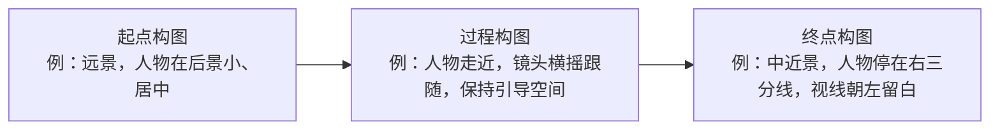
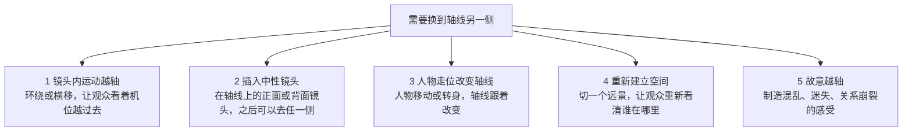
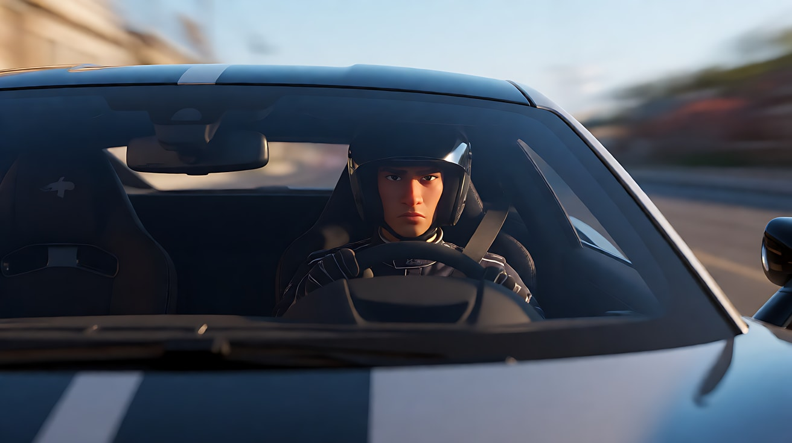
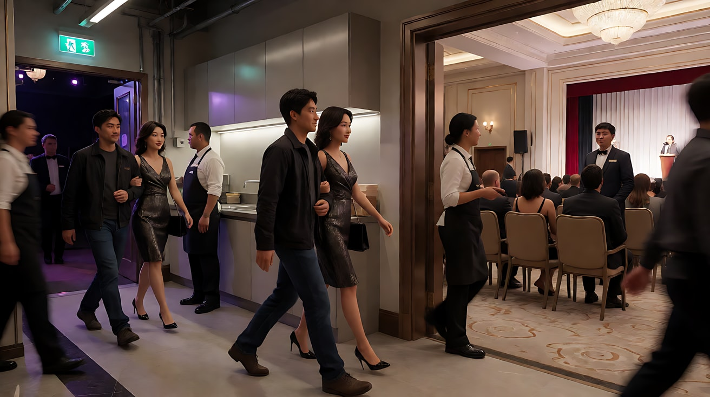

# L03-06 动态构图与 180 度轴线：让观众在运动和切换中不迷路

> 段位：基础 ｜ 建议用时：60 分钟 ｜ 配套提示词：[L03-06-动态构图与轴线-提示词](../提示词/L03-06-动态构图与轴线-提示词.md)

## 学习目标

- 理解"动态构图"：一个运动镜头有起点构图、过程构图和终点构图，三者都要设计
- 能画出两人场景的 180 度轴线和机位平面图，说出越轴后画面会发生什么
- 能在正反打里做到视线匹配：视线方向相反、视线高度一致
- 能保持屏幕方向一致性，知道什么时候允许方向反转
- 掌握四种正确的越轴方式，并能写进 Seedance 多镜头提示词的【锁定】行

## 一、概念讲解

前五课讲的都是"一张画面"。但电影是会动的：人物在走，镜头在动，镜头之间在切换。这一课解决两个问题：**一个镜头之内，构图怎么随运动重组**；**镜头之间，空间关系怎么保持不乱**。

### 1. 动态构图：运动中构图的重组

一个运动镜头不是一张构图，而是一串构图。导演要设计三个点：



动态构图的三条原则：

| 原则 | 说明 | 写法提示 |
|---|---|---|
| **终点必须是好构图** | 运动最终停下的那一帧，要符合前五课的规则（三分、留白、权力） | 视频提示词写"结尾停在……"并写明位置 |
| **运动方向留空间** | 人物在运动时，前方要留出比静止时更多的空间（Lead Room） | "她向画右奔跑，位于画左三分线，前方留出大片空间" |
| **重心在运动中转移** | 人物走位、镜头移动会让视觉重心换位，这是叙事机会 | 一个人走出画框，另一个原本在边缘的人成为中心 |

**走位重组**（不动镜头，让人动）是最可控的动态构图：一个人从后景走到前景，画面从"环境为主"变成"人物为主"。L03-01 练习 3 和 L03-04 练习 3 已经用过这个方法。

**镜头运动重组**：推、拉、摇、移都会改变构图。每种运动都会"消耗"一部分构图：推镜吃掉负空间，横移打破对称，拉远放大环境。第 05 模块会系统讲运镜，这里只记住：**运镜前先想清楚终点构图**。

### 2. 180 度轴线法则

两个人对话时，在他们之间画一条看不见的线，叫**轴线**（也叫"动作线"或"关系线"）。所有机位都放在轴线的**同一侧**，这样无论怎么切换镜头，A 永远在画左、B 永远在画右，观众不会迷路。

机位平面图（俯视）：

```
                                     CX (crossed)
                                         |
                                         v

        ------------- [ A ] ======================== [ B ] -------------   <- axis
                       face ->                    <- face

                          ^              ^              ^
                         /               |               \
                        /                |                \
                   C3 (A's OTS)     C1 (two-shot)     C2 (B's OTS)
```

- 下方 = 允许区：C1 双人镜头、C2 越过 B 肩膀拍 A（A 的正打）、C3 越过 A 肩膀拍 B（B 的反打），三个机位都在轴线同一侧，镜头朝上看向两人
- 上方 = 越轴区：机位 CX 在轴线另一侧，镜头朝下看，画面里的左右会和其他机位相反

各机位拍出来的画面：

| 机位 | 画面中 A 的位置 | 画面中 B 的位置 | 结论 |
|---|---|---|---|
| C1 双人 | 画左，面朝右 | 画右，面朝左 | 建立空间 |
| C3 过 A 肩拍 B | 画左（背影前景） | 画右，面朝左 | 一致 |
| C2 过 B 肩拍 A | 画左，面朝右 | 画右（背影前景） | 一致 |
| **CX 越轴** | **画右，面朝左** | **画左，面朝右** | **两人位置对调，观众以为有人走动或换了地方** |

**轴线也存在于运动中**：一个人从左向右跑，他的运动方向就是轴线。机位都在同一侧，他就始终"从左往右跑"。

### 3. 视线匹配

正反打时，两人看对方的视线要能"接上"：

```
     正打：A 的近景                 反打：B 的近景
+-------------------------+    +-------------------------+
|                         |    |                         |
|     ( A )  -->          |    |          <--  ( B )     |
|                         |    |                         |
+-------------------------+    +-------------------------+
  A 在画左偏左，看向画右          B 在画右偏右，看向画左
  两人的视线高度一致（除非一人站一人坐）
```

视线匹配三要素：

1. **方向相反**：A 看右，B 看左
2. **高度对应**：两人同高时视线都在镜头附近的水平线上；一人站一人坐时，站的人往下看，坐的人往上看
3. **视线离镜头的距离一致**：越接近镜头越亲密（看向镜头左侧/右侧很近处），越偏离越疏远

视线匹配也适用于"人物看向某物"的切换：A 看向画右上方，下一个镜头的物体就应该出现在"他看的那个方向"的合理位置。

### 4. 屏幕方向一致性

人物、车辆、队伍在多个镜头里的移动方向要一致：

```
  镜头1          镜头2          镜头3
+--------+    +--------+    +--------+
| o -->  |    |  o --> |    | --> o  |       一致：观众感到她一直在往前赶
+--------+    +--------+    +--------+

+--------+    +--------+    +--------+
| o -->  |    | <-- o  |    | o -->  |       混乱：观众以为她掉头了
+--------+    +--------+    +--------+
```

**约定俗成的方向含义**（不是硬规则，但观众有直觉）：从左向右 = 前进、出发、去往目标；从右向左 = 返回、阻碍、逆行。两队人对峙时，一方始终从左来，另一方始终从右来。

### 5. 越轴的正确方式

越轴不是禁止的，**无意越轴才是错误**。有四种方式能让观众接受新的轴线：



| 方式 | 怎么做 | AI 中的可行性 |
|---|---|---|
| 镜头内越轴 | 一个环绕运镜从 A 身后绕到 B 身后 | 较好，用首尾帧锁住两侧画面最稳 |
| 中性镜头 | 正对人物运动方向拍（人物迎面跑来或背对远去） | 很好，多镜头中插一个"迎面镜头" |
| 人物走位换轴 | B 起身走到 A 的另一侧，新的关系线形成 | 较好，但需写清新位置 |
| 重新建立 | 切一个大远景交代两人新位置 | 很好 |
| 故意越轴 | 情绪崩溃、争吵升级、心理失衡时有意跳到另一侧 | 可用，但要确保整段只越一次，且有意图 |

### 6. 30 度规则（补充）

同一主体的两个相邻镜头，机位角度变化至少约 30 度，或景别有明显变化。否则看起来像画面"跳了一下"（跳切）。在 AI 多镜头里，每个镜头的机位和景别差异拉大，模型更容易真正切镜。

## 图解

> 这些示意图由多种生图模型分别生成（包括 Nano Banana、GPT Image 等），只用来说明镜头概念；不同模型的画面不能互相比较效果，也不能当作视频成片。


下面六张是同一场咖啡馆对话的机位。前三张在轴线同一侧：她永远在画左，他永远在画右。最后一张故意越轴，左右对调。


总镜头。先让观众记住：左是她，右是他，两人面对面。


他的肩在右前景，她在左，看向画右。和总镜头的左右一致。


她的肩在左前景，他在右，看向画左。仍然没有越轴。


只剩她。人在画左，眼睛看画右。


只剩他。人在画右，眼睛看画左，视线高度和她对齐。正打看右、反打看左，两条视线才能接上。


机位跑到轴线另一侧。她跑到了画右，他跑到了画左。如果这张接在前面任何一张后面，观众会以为两个人换了座位。

## 二、情绪与叙事功能

| 技法 | 观众的感受 | 常用场景 |
|---|---|---|
| 终点构图明确的运动镜头 | 运动有目的地 | 跟随人物进入、揭示 |
| 运动中的引导空间 | 顺畅、有去处 | 奔跑、驾驶、行进 |
| 运动前方空间不足 | 紧迫、受阻、要撞上 | 追逐、被困 |
| 遵守 180 度轴线 | 空间清晰，专注于表演 | 绝大多数对话戏 |
| 视线匹配 | 两人真正在"对视" | 对话、对峙、爱情戏 |
| 屏幕方向一致 | 持续前进、目标明确 | 追逐、旅程、赶路 |
| 屏幕方向反转 | 掉头、返回、局势逆转 | 撤退、回家、反击 |
| 镜头内越轴 | 关系或视角的转变 | 一方说出关键的话后 |
| 故意越轴 | 迷失、混乱、关系破裂 | 争吵、崩溃、梦境 |

## 三、经典影片案例

### 《东京物语》（1953，小津安二郎）
- 场景：老夫妇与子女们在家中的大量对话戏。
- 怎么拍的：小津经常不遵守常规的 180 度轴线。对话中，两个人物的正反打镜头里，常常都是接近正面的低机位拍摄，人物几乎直视镜头方向，两人的视线方向在画面上并不形成常规的"一左一右"。
- 为什么这样拍：小津的空间不是好莱坞式的"一条轴线"，而是一个可以从多个方向观看的完整空间。人物几乎正对观众说话，观众像坐在对面的家人。这种"越轴"不是失误，而是一种贯穿全片、风格统一的选择。它说明了一点：规则可以被打破，但要**系统地、有意图地**打破。


### 《疯狂的麦克斯：狂暴之路》（2015，乔治·米勒）
- 场景：贯穿全片的高速车辆追逐。
- 怎么拍的：导演与摄影师约翰·西尔大量采用"中心构图"拍摄动作，把每个镜头的关键动作放在画面中心附近，配合快速剪辑。
- 为什么这样拍：剪辑节奏极快时，观众的眼睛来不及在每个镜头里寻找重点。把重点始终放在画面中心，观众的视线在切换之间不需要移动，快速剪辑仍然看得清楚。这是"动态构图"在剪辑层面的应用：不只考虑一个镜头，而是考虑**镜头与镜头之间眼睛的位置**。



### 《好家伙》（1990，马丁·斯科塞斯）科帕卡巴纳夜总会长镜头
- 场景：亨利带着女友凯伦从夜总会后门进入，穿过走廊和厨房，进入大厅，被安排在舞台前的座位上。
- 怎么拍的：一个稳定器跟拍的长镜头，镜头跟随两人穿过狭窄通道、拐过多个转角。过程中构图不断重组：时而跟在背后，时而转到侧面，人物与沿途的工作人员不断在画面中进出，最后停在两人入座的画面上。
- 为什么这样拍：这个镜头让观众和凯伦一起体验"被特殊对待"的眩晕感：不用排队，处处有人打招呼。连续不断的运动和不断重组的构图，本身就是亨利权力的展示。终点构图（两人入座，桌子被临时摆到最好的位置）完成了这段运动的意义。



## 四、在 AI 中怎么实现

- **生图阶段**：
  - 关键帧要写清人物在画面左右的位置和面朝方向：`A on the left third facing right, B on the right third facing left`。正反打的两张关键帧要保持这个关系。
  - 过肩镜头写清前景是谁的肩膀、在画面哪一侧：`over A's right shoulder in the left foreground, B on the right third facing left`。
  - 运动关键帧写运动方向和引导空间：`running toward frame right, placed on the left third, open space ahead`。
- **视频阶段**：
  - 多镜头提示词必须写【锁定】行：`人物A始终在画左，面朝右；人物B始终在画右，面朝左；机位始终在两人连线同一侧`。
  - 运动方向写进【锁定】：`她在所有镜头中都从画左跑向画右`。
  - 需要越轴时，用文字明确写出方式："镜头从他身后环绕到她身后，越过两人之间的连线"，或插入"迎面镜头"作为中性镜头。
  - 每个运动镜头写明终点构图："结尾停在她位于画右三分线、视线朝左的中近景上"。
- **模型擅长**：遵守写明的左右位置；单人运动方向；环绕运镜。
- **要避开**：
  - 只写"正反打"不写左右，模型常把两人的位置对调；
  - 一个镜头里两人同时大幅走位，轴线会乱；
  - 追逐段落不写方向，每个镜头方向随机；
  - 镜头之间机位差异太小，模型不切镜或产生跳切感。

## 五、练习作业

1. 选一场你喜欢的电影对话戏，暂停每个镜头，在纸上画出机位平面图，标出轴线，检查是否有越轴。如果有，它是用哪种方式越的？
2. 设计一场三人对话（A、B、C 围坐），画出平面图：当对话从 A-B 转到 B-C 时，轴线如何改变？
3. 写一个四镜头的赶路段落，前两个镜头从左到右，第三个镜头用中性镜头过渡，第四个镜头反转方向，并写出反转的理由。
4. 完成配套提示词练习 1–5，重点做练习 3（首尾帧完成镜头内越轴）和练习 5（屏幕方向与中性镜头）。

## 六、自检清单

- [ ] 每个运动镜头我都写了终点构图
- [ ] 运动中的人物前方留出了足够的空间（或我故意不留）
- [ ] 对话戏我画了平面图，所有机位在轴线同一侧
- [ ] 正反打的视线方向相反、高度对应
- [ ] 多镜头提示词写了【锁定】行：谁在画左、谁在画右、机位在哪一侧
- [ ] 运动段落的屏幕方向一致，反转时有理由（转弯、掉头、中性镜头）
- [ ] 需要越轴时，我选用了四种正确方式之一，或明确是"故意越轴"

## 七、配套提示词

→ [L03-06-动态构图与轴线-提示词](../提示词/L03-06-动态构图与轴线-提示词.md)

---

上一课：[L03-05 画幅与构图](L03-05-画幅与构图.md) ｜ 下一课：[L04-01 光的基础：软硬、方向、色温](../../04-光影与色彩/教学/L04-01-光的基础.md) ｜ [返回总目录](../../README.md)
