# L04-01 光的基础 · 提示词

> 本组练习：把"光"拆成来源、方向、软硬、色温四个参数，一次只改一个参数，亲眼看它如何改变人物与情绪。｜ 配套教学：[L04-01-光的基础](../教学/L04-01-光的基础.md) ｜ 规范：[写作规范](../../模板/写作规范.md)
>
> 画风默认使用开关 A（风格化写实 CG）。如改用 2D 动画，删掉所有焦段、光圈、景深词。

---

### 练习1：同一张脸，硬光 vs 软光（难度 ★）

**目标**：只改变光的软硬，其他全部不变。看阴影边缘、皮肤质感和情绪如何跟着变。意图 A（硬光）：让观众感到他在被盘问；意图 B（软光）：让观众感到他在等一个人。

**【生图 · Nano Banana】**

图1A 硬光版关键帧：

```
A medium close-up of an original man in his forties with short greying hair, light stubble and a dark blue work shirt,
sitting at a plain wooden table and looking slightly off-camera to the right. He is placed in the center of the frame.
Camera at eye level, 50mm lens, moderate depth of field, the bare concrete wall behind him slightly soft.
Lighting: a single small bare bulb hanging above and slightly in front of him as a hard key light,
crisp sharp-edged shadows under his brows, nose and chin, neutral slightly warm 3200K tone, the room falls off to dark.
Stylized semi-realistic 3D CG rendering, feature-film animation quality. Aspect ratio 16:9.
```

中文释义：中近景，四十多岁男人坐在木桌前、画面中央，看向画右；平视、50mm、中等景深；头顶偏前一只裸灯泡做硬主光，眉下、鼻下、下巴下有边缘锐利的阴影，3200K 微暖，房间四周暗下去。

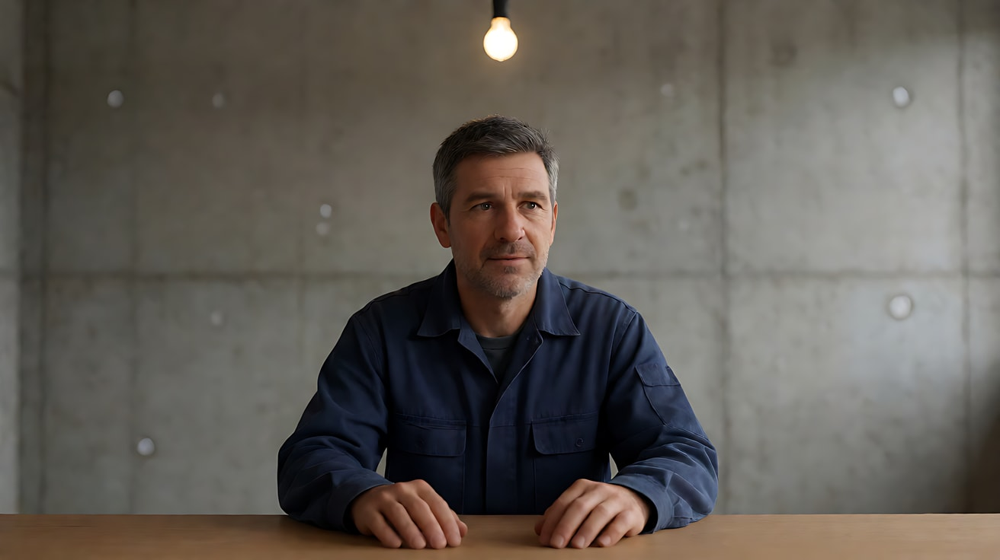

图1B 软光版关键帧（同一人物、同一构图，只改光）：

```
Using the character from image 1A, the exact same framing, pose and room:
the bare bulb is replaced by a large soft overcast window light from frame left, close to him,
wrapping gently around his face, shadows on the right side of his face are soft and gradual,
skin looks smooth, cool neutral 6500K daylight tone, the concrete wall is evenly lit.
Keep the face, hairstyle and outfit exactly as in image 1A.
Stylized semi-realistic 3D CG rendering, feature-film animation quality. Aspect ratio 16:9.
```

中文释义：同一人物、同一构图，换成画左一扇靠得很近的阴天大窗，光包裹脸部，右脸阴影柔和渐变，皮肤平滑，6500K 冷中性。

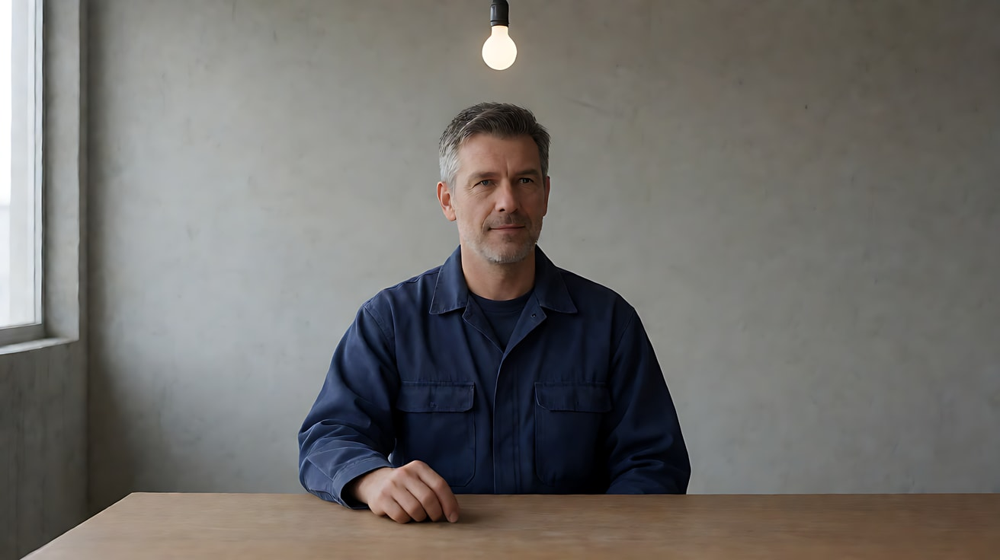

**【图生视频 · Seedance】**

版本 A（用图1A）：

```
【素材分工】@图片1 为首帧，锁定人物身份、服装与房间布局。
【画风】风格化写实三维CG质感，电影级布光。
男人坐在桌前，双手交握放在桌面上，拇指一下一下按着另一只手的指节，目光盯着画右某处，没有眨眼，喉结动了一下。头顶一只裸灯泡投下硬光，眉下和鼻下的阴影边缘锐利，灯泡轻微晃动，阴影随之微微摆动。镜头固定中近景，不移动。结尾停在他吞咽之后抿紧嘴唇的脸上。
【声音】灯泡电流的细微嗡声，远处一扇铁门关上的回响，无配乐。
【约束】保持人物脸型、发型、服装不变；光源始终只有头顶一只灯泡；不要字幕、水印、Logo。
时长：6秒
```

版本 B（用图1B）：

```
【素材分工】@图片1 为首帧，锁定人物身份、服装与房间布局。
【画风】风格化写实三维CG质感，电影级布光。
男人坐在桌前，一只手轻轻转着桌上的空杯子，抬眼看向画右的门口，又低下头，嘴角放松。画左一扇大窗透进阴天柔和的冷光，脸部右侧阴影过渡平缓。镜头固定中近景，不移动。结尾停在他再次抬眼看向门口的瞬间。
【声音】窗外细雨声，杯底与木桌的轻微摩擦声，无配乐。
【约束】保持人物脸型、发型、服装不变；光线始终来自画左窗户，不要出现灯泡；不要字幕、水印、Logo。
时长：6秒
```

**参数**：时长 6 秒 ｜ 画幅 16:9

**【检查点】**
- A 版阴影边缘是否锐利，B 版是否柔和渐变
- 只看画面，A 版是否像"被盘问"，B 版是否像"在等人"
- 两版人物、构图是否一致（这样差异才只来自光）

**【常见问题与修复】**
| 现象 | 修复 |
|---|---|
| A 版仍然很柔 | 加"光源是一只小裸灯泡，阴影边缘清晰锐利，没有柔光" |
| B 版出现灯泡或吊灯 | 约束里写"画面中不出现任何灯具" |
| 两版构图不同 | 生图 1B 时上传 1A 作为参考，写 `the exact same framing` |

---

### 练习2：五种方向——定妆图 + 场景图（难度 ★★）

**目标**：同一人物、同一房间，只改光的方向（顺光、侧光、逆光、顶光、底光），体会"方向即性格"。

**【生图 · Nano Banana】**

图1 角色定妆：

```
Character turnaround sheet of an original young woman in her mid-twenties: a short black bob with straight bangs,
a cream turtleneck sweater, dark grey wide trousers, small silver hoop earrings.
Front view, three-quarter view, side view and back view, full body, standing on a plain light-grey background,
even soft studio light, no shadows on the backdrop.
Stylized semi-realistic 3D CG rendering, feature-film animation quality. Aspect ratio 16:9.
```

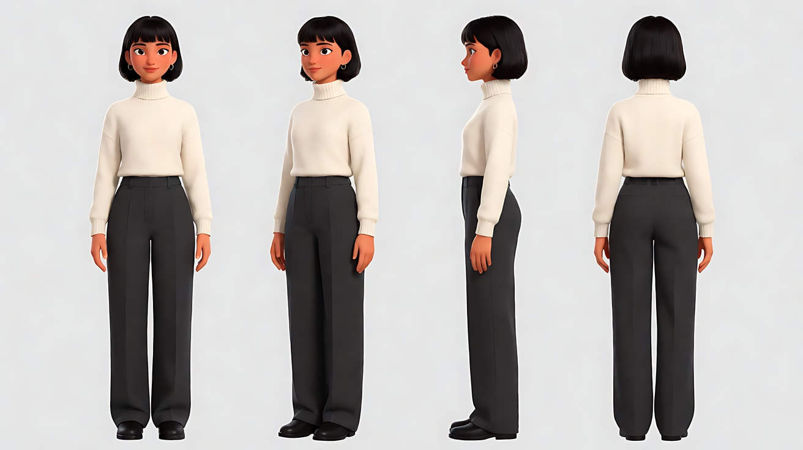

图2 场景（空的暗房）：

```
Empty small dark attic room at night with sloped wooden ceiling, a single wooden chair in the middle,
bare plank floor, one small round window on the back wall showing a cool night sky, no lamps switched on,
very low ambient light, no people.
Wide shot, eye level, 28mm lens, deep focus.
Stylized semi-realistic 3D CG rendering, feature-film animation quality. Aspect ratio 16:9.
```

中文释义：图1 原创女孩定妆，齐刘海短发、米色高领毛衣；图2 夜晚空阁楼，中间一把木椅，后墙一扇小圆窗，没有开灯。

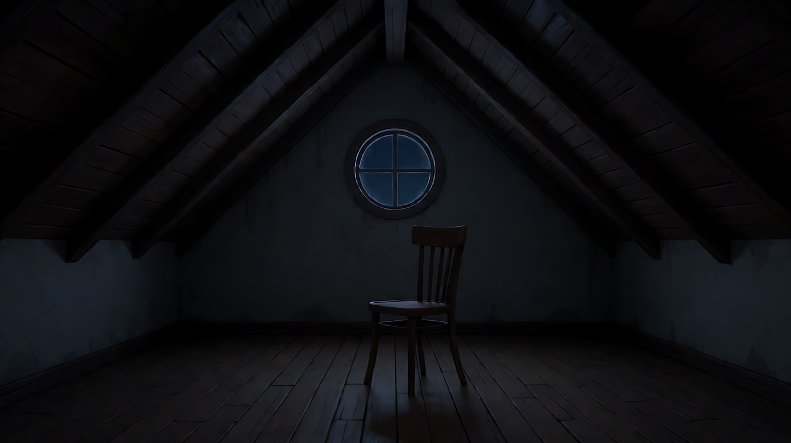

**【多图生视频 · Seedance】**

公共开头（五个版本都相同）：

```
【素材分工】@图片1 锁定人物身份、发型与服装；@图片2 仅参考阁楼布局与陈设，不复制其中的暗光。
【画风】风格化写实三维CG质感，电影级布光。
```

版本 A 顺光（意图：她坦白了一切）：

```
女孩坐在木椅上正对镜头，一只手握着毛衣袖口，抬头直视镜头，轻轻点了一下头。一盏手提灯放在镜头正后方，暖白光从正面平铺在她脸上，阴影落在她身后的墙上，脸部几乎没有阴影。镜头固定中近景。结尾停在她直视镜头、嘴唇微张的脸上。
【声音】阁楼木板轻微的吱呀声，她的一声呼气，无配乐。
【约束】保持人物脸型、发型、服装不变；光源只有镜头后方一盏灯；不要字幕、水印、Logo。
时长：5秒
```

版本 B 侧光（意图：她在两个选择之间）：

```
女孩坐在木椅上，身体正对镜头，脸微微侧向画左。一盏手提灯放在她正右侧的地板上，硬光从画右以九十度打来，她的脸被分成右半亮、左半暗，暗的那一半几乎看不见。她的手指在膝盖上来回摩挲。镜头固定中近景。结尾停在她慢慢把脸转回正面、一半仍在黑暗里的瞬间。
【声音】手提灯的轻微电流声，窗外远处的风声，无配乐。
【约束】保持人物脸型、发型、服装不变；光源只有画右一盏灯；不要字幕、水印、Logo。
时长：5秒
```

版本 C 逆光（意图：她要离开了）：

```
女孩站在后墙小圆窗前，背对窗户、面朝镜头，窗外冷蓝的月光从她身后照进来，在头发和肩膀边缘勾出一圈冷色亮边，正脸偏暗，只能看清轮廓。她把围巾绕上脖子。镜头固定中景。结尾停在她低头整理围巾、只剩剪影轮廓的画面。
【声音】窗外的风声，围巾布料摩擦声，无配乐。
【约束】保持人物脸型、发型、服装不变；光源只有身后的窗户；不要字幕、水印、Logo。
时长：5秒
```

版本 D 顶光（意图：她在被审视）：

```
女孩坐在木椅上，双手放在膝上，头微微低着。阁楼天花板正中垂下一只裸灯泡，硬光从头顶正上方照下，她的眼窝、鼻下和下巴下方陷入深影，只有额头和鼻梁是亮的，地板上椅子周围有一圈锐利的影子。她慢慢抬起头，眼睛仍在阴影里。镜头固定中近景，略微俯视。结尾停在她抬头后、眼睛看不清的脸上。
【声音】灯泡的嗡声，木椅轻响，无配乐。
【约束】保持人物脸型、发型、服装不变；光源只有头顶一只灯泡；不要字幕、水印、Logo。
时长：5秒
```

版本 E 底光（意图：她讲的故事让人发毛）：

```
女孩盘腿坐在木地板上，一盏小提灯放在她面前的地板上，暖橙色的光从下往上照亮她的下巴、鼻底和眉骨下沿，阴影向上倒投在额头和身后的斜屋顶上。她身体前倾，压低声音说话。镜头固定中近景，平视。结尾停在她说完最后一句、慢慢抬眼看向镜头的脸上。
【声音】女孩压低声音：“然后，阁楼的门自己开了。”说完后只剩风声和木板的一声吱呀，无配乐。
【约束】保持人物脸型、发型、服装不变；光源只有地上的提灯；不要字幕、水印、Logo。
时长：6秒
```

**参数**：时长 A–D 版 5 秒、E 版 6 秒 ｜ 画幅 16:9

**【检查点】**
- 五个版本并排，只看截图能否说出光从哪来
- 侧光版是否真正"半脸黑"，顶光版眼睛是否藏在阴影里
- 每个版本是否只有一个光源

**【常见问题与修复】**
| 现象 | 修复 |
|---|---|
| 侧光版暗部被补亮 | 加"左半边脸几乎全黑，没有补光" |
| 逆光版正脸太亮 | 写"正脸偏暗，只能看到轮廓和亮边"，并删除任何正面光源 |
| 底光版被渲染成吓人的恐怖画面 | 去掉吓人词，只写"讲故事"；把灯写成"一盏小提灯" |
| 阁楼原图的暗光被照搬 | 素材分工写"不复制其中的暗光"，正文写清新光源 |

---

### 练习3：环绕一圈，顺光变逆光——首尾帧（难度 ★★★）

**目标**：理解"光的方向是相对摄影机而言的"。光源（窗户）不动、人物不动，摄影机环绕半圈，画面就从顺光变成逆光。意图：让观众感到她从"被看清"变成"看不透"。

**【生图 · Nano Banana】**

图1 角色定妆：沿用练习2 图1。

图2 首帧（顺光）：

```
Using the character from image 1: a medium close-up of her standing still, facing a large window in a bright apartment,
the camera is between her and the window, looking at her face.
She is placed in the center of the frame, eyes looking slightly past the lens.
Camera at eye level, 85mm lens, shallow depth of field, the room behind her softly blurred.
Lighting: soft warm late-afternoon window light hitting her face from the front, almost no shadows on her face,
warm 3500K tone.
Keep the face, hairstyle and outfit exactly as in image 1.
Stylized semi-realistic 3D CG rendering, feature-film animation quality. Aspect ratio 16:9.
```

中文释义：中近景，她面朝大窗站着，摄影机在她和窗户之间，正面柔和暖光，脸上几乎没有阴影；85mm 浅景深。

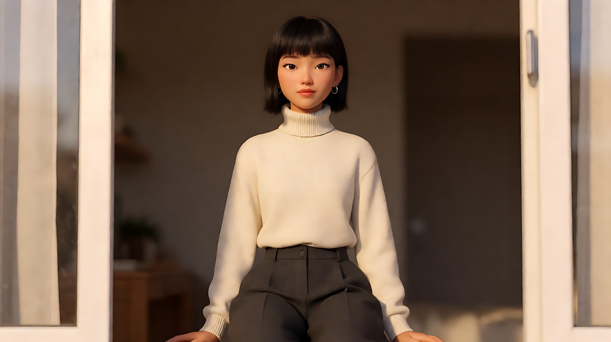

图3 尾帧（逆光）：

```
Using the character from image 1, the same apartment and the same window:
a medium close-up of her from behind and slightly to the side, the large window now in the background behind her,
her face in soft shadow, only the outline of her hair, cheek and shoulders glowing with a warm golden rim light,
bright window slightly overexposed. Camera at eye level, 85mm lens, shallow depth of field.
Keep the face, hairstyle and outfit exactly as in image 1.
Stylized semi-realistic 3D CG rendering, feature-film animation quality. Aspect ratio 16:9.
```

中文释义：同一位置，摄影机绕到她身后侧面，大窗成为背景，她的脸在阴影中，头发、脸颊、肩膀边缘被勾出金色轮廓光。

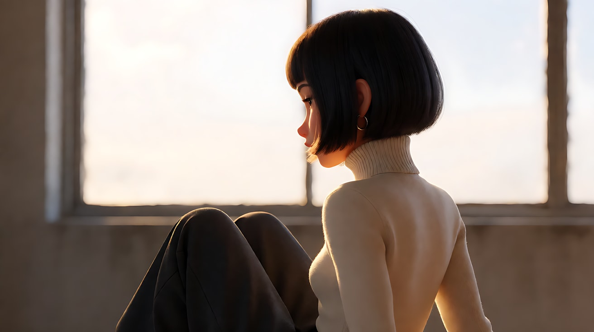

**【首尾帧生视频 · Seedance】**

```
【素材分工】@图片2 为首帧，锁定起始机位与顺光效果；@图片3 为尾帧，是最终画面目标；@图片1 锁定人物身份、发型与服装，不参考其中的棚拍光。只生成两帧之间的连续画面。
【画风】风格化写实三维CG质感，电影级布光。
女孩站在原地不动，只是慢慢垂下眼睛，然后轻轻侧过脸。镜头以她为中心匀速环绕半圈，从窗户一侧绕到她身后，窗户从镜头背后转到画面背景里。正面的暖光逐渐从她脸上退去，变成勾在发丝和肩膀边缘的金色轮廓光。结尾停在她侧脸几乎成剪影、身后窗户发亮的画面。
【声音】窗外远处的车流声，室内安静，一声很轻的呼吸，无配乐。
【约束】保持人物脸型、发型、服装不变；窗户位置不变，光源只有这一扇窗；人物不走动；环绕速度匀速，不跳切；不要字幕、水印、Logo。
时长：8秒
```

**参数**：时长 8 秒 ｜ 画幅 16:9

**【检查点】**
- 窗户和光的方向在世界里是否始终不变，变的只是机位
- 首帧脸部是否几乎无阴影，尾帧是否只剩轮廓光
- 环绕是否平稳、人物没有走动

**【常见问题与修复】**
| 现象 | 修复 |
|---|---|
| 环绕过程中窗户"跟着镜头跑" | 写"窗户固定在房间墙上，位置不变" |
| 人物跟着转身 | 写"女孩站在原地，身体朝向不变，只有眼睛和脸的轻微动作" |
| 尾帧脸还是很亮 | 尾帧生图里强调 `her face in soft shadow`，视频里写"脸逐渐变暗" |

---

### 练习4：三种色温，一段下班路——多镜头（难度 ★★★★）

**目标**：一次生成里切三个镜头，每个镜头一种主色温（荧光灯冷绿 → 蓝调天光 → 朝阳暖金），让色温替人物"说"出从疲惫到松弛的变化。意图：让观众感到夜班终于结束了。

**【生图 · Nano Banana】**

图1 角色定妆：

```
Character turnaround sheet of an original nurse in her early thirties: hair tied in a low ponytail with a few loose strands,
light teal scrub top and trousers under an open dark navy cardigan, white soft-soled shoes, a canvas tote bag on one shoulder.
Front view, three-quarter view, side view and back view, full body, plain light-grey background, even soft studio light.
Stylized semi-realistic 3D CG rendering, feature-film animation quality. Aspect ratio 16:9.
```

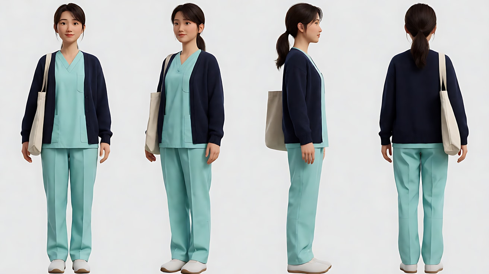

图2 场景 A（医院走廊）：

```
Empty long hospital corridor late at night, flat ceiling fluorescent tubes casting a cold greenish-white 4000K light from above,
glossy floor reflecting the tubes, a row of closed doors, no people.
Wide shot, eye level, 24mm lens, deep focus, one-point perspective.
Stylized semi-realistic 3D CG rendering, feature-film animation quality. Aspect ratio 16:9.
```

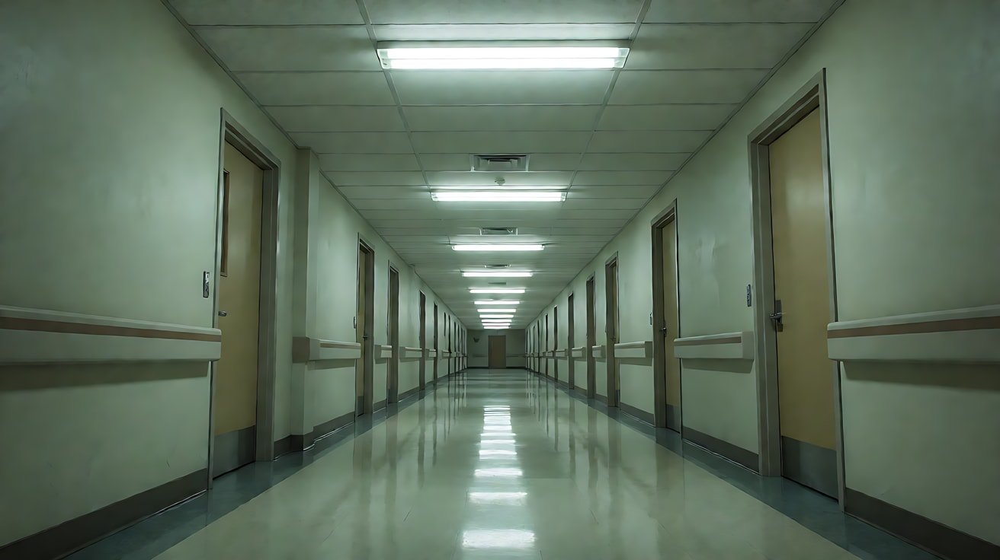

图3 场景 B（楼梯间大窗）：

```
Empty hospital stairwell landing just before sunrise, a tall window showing a deep blue pre-dawn sky,
cool blue 9000K ambient light filling the space softly, no lights switched on, no people.
Medium-wide shot, eye level, 35mm lens, moderate depth of field.
Stylized semi-realistic 3D CG rendering, feature-film animation quality. Aspect ratio 16:9.
```

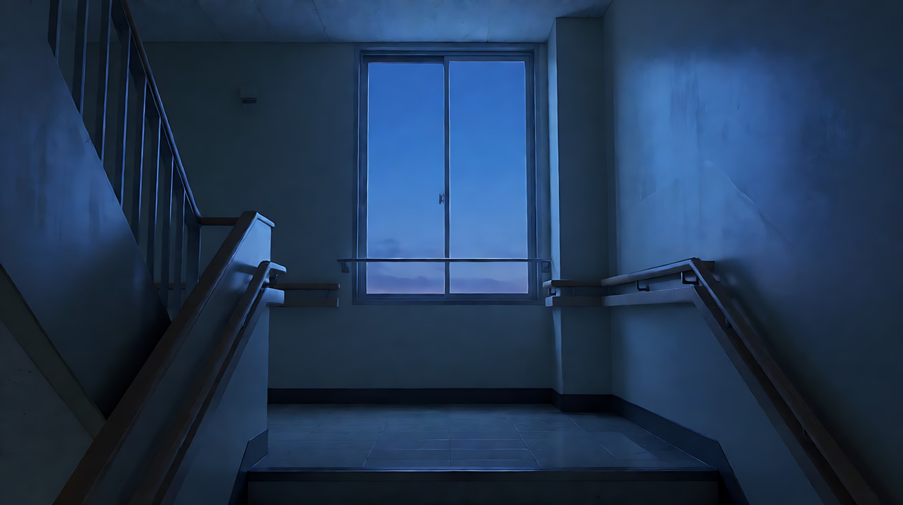

图4 场景 C（医院大门外）：

```
Empty hospital entrance steps at sunrise, the low sun rising behind a row of street trees,
long warm golden 2500K light raking across the steps, long soft shadows, light morning haze, no people.
Wide shot, low angle from the bottom of the steps, 35mm lens, deep focus.
Stylized semi-realistic 3D CG rendering, feature-film animation quality. Aspect ratio 16:9.
```

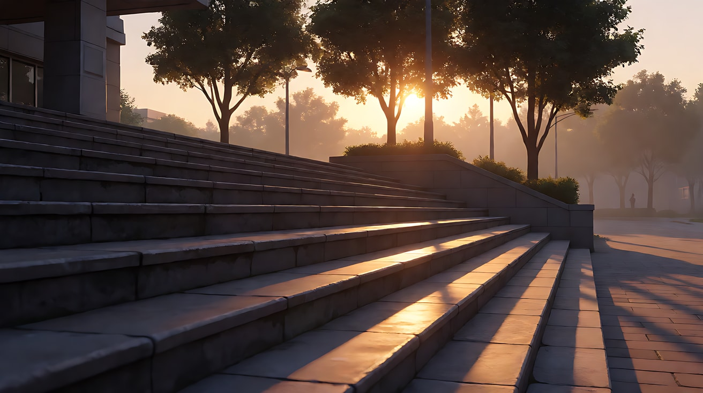

图5 镜头1 关键帧：

```
Using the character from image 1 and the corridor from image 2:
a medium shot of the nurse walking slowly toward the camera down the corridor, shoulders slumped, rubbing the back of her neck,
placed in the center of the one-point perspective.
Camera at eye level, 35mm lens, moderate depth of field.
Lighting: cold greenish-white fluorescent tubes directly overhead, flat top light, dark circles under her eyes.
Keep the face, hairstyle and outfit exactly as in image 1.
Stylized semi-realistic 3D CG rendering, feature-film animation quality. Aspect ratio 16:9.
```

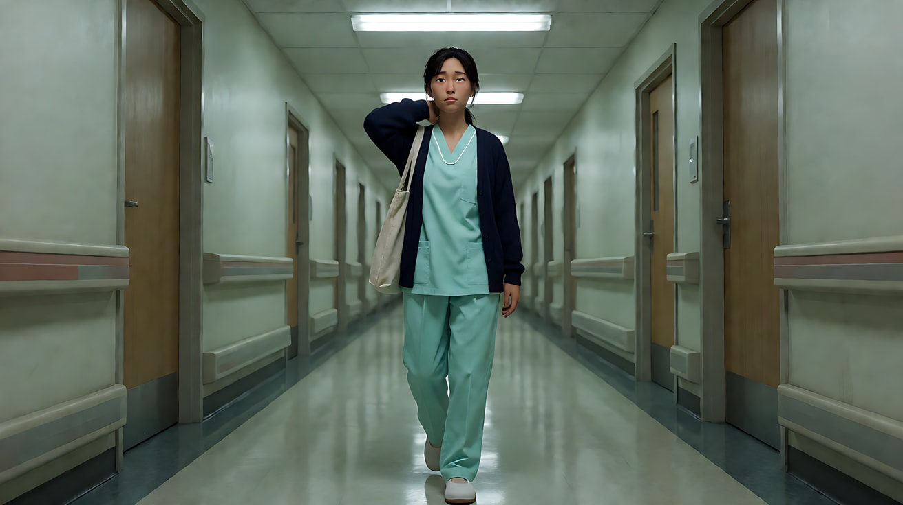

**【多图生视频 · Seedance】**

```
【素材分工】@图片1 锁定人物身份、发型、服装与帆布包；@图片2 仅参考走廊布局与荧光灯光色；@图片3 仅参考楼梯间大窗与蓝调光色；@图片4 仅参考医院大门台阶与朝阳光色；@图片5 为首帧。场景图中均不复制任何人物。
【画风】风格化写实三维CG质感，电影级布光。
镜头1：固定中景，护士沿走廊朝镜头慢慢走来，一手揉着后颈，肩膀塌着。头顶荧光灯管投下冷绿色的平顶光，眼下有暗影。荧光灯的电流嗡声和她拖沓的脚步声。
镜头2：镜头切至楼梯间侧面中近景，她停在大窗前，把额头轻轻抵在冰凉的玻璃上，闭上眼睛。窗外深蓝的天光柔和地铺满她的脸，没有其他光源。只剩她一声长长的呼气。
镜头3：镜头切至大门台阶下方的低角度全景，她推门走出来，迎着刚升起的太阳站定，抬手挡了一下光，然后把手放下，抬起脸。低角度的暖金色阳光从画面深处逆光照来，在她头发和肩上勾出金边，台阶上拖出长长的影子。镜头缓慢上摇，停在她迎着阳光的脸上。远处第一声鸟叫和清晨的扫地声。
【锁定】人物始终穿浅青色工作服和深蓝开衫、肩背帆布包；光色顺序固定为冷绿荧光、深蓝天光、暖金朝阳，每个镜头只有一个主光源。
【声音】从电流嗡声与脚步声，到几乎无声的呼气，再到鸟叫与扫地声，无配乐。
【约束】保持人物脸型、发型、服装不变；不要字幕、水印、Logo。
时长：13秒
```

**参数**：时长 13 秒 ｜ 画幅 16:9 ｜ 负载：3 个镜头、3 个地点，属于"有挑战"档，若失败拆成两次生成（镜头1–2 一次，镜头3 一次）

**【检查点】**
- 三个镜头的主色是否明显不同：青绿、深蓝、金橙
- 色温变化是否和人物状态同步（塌肩 → 闭眼 → 抬脸）
- 切镜是否清楚，没有糊成一个长镜头

**【常见问题与修复】**
| 现象 | 修复 |
|---|---|
| 三个镜头被统一调成同一种暖色 | 每个镜头块里都写出光源名称和颜色；在【锁定】里写光色顺序 |
| 镜头2 窗外已经大亮 | 写"天还没亮，窗外是深蓝色，看不到太阳" |
| 镜头3 逆光把脸完全吃黑 | 写"脸部有台阶反射的柔和暖光，能看清表情" |

---

### 练习5：四参数全控——一个人的生日（难度 ★★★★★）

**目标**：在一个房间里用光讲完一段情绪转折。光源从"冷硬的窗外路灯"换成"暖软的一根蜡烛"，来源、方向、软硬、色温四个参数一起变。意图：让观众感到她决定一个人也要好好过这个生日。

**【生图 · Nano Banana】**

图1 角色定妆：

```
Character turnaround sheet of an original woman in her late twenties: long dark hair loosely clipped up,
an oversized light grey hoodie, black leggings, thick white socks.
Front view, three-quarter view, side view and back view, full body, plain light-grey background, even soft studio light.
Stylized semi-realistic 3D CG rendering, feature-film animation quality. Aspect ratio 16:9.
```

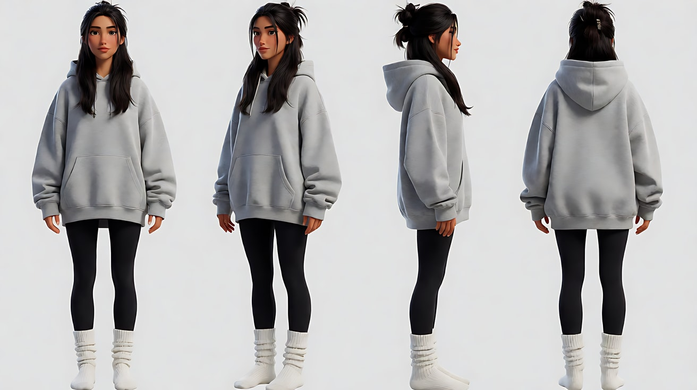

图2 场景（夜晚出租屋）：

```
Empty small rented studio apartment at night, all room lights off, a low table in the middle with a small cake in a plastic box,
a window on the right wall letting in hard cool blue-white streetlight that casts sharp window-frame shadows across the floor,
a pile of unopened delivery boxes by the wall, no people.
Wide shot, eye level, 28mm lens, deep focus.
Stylized semi-realistic 3D CG rendering, feature-film animation quality. Aspect ratio 16:9.
```

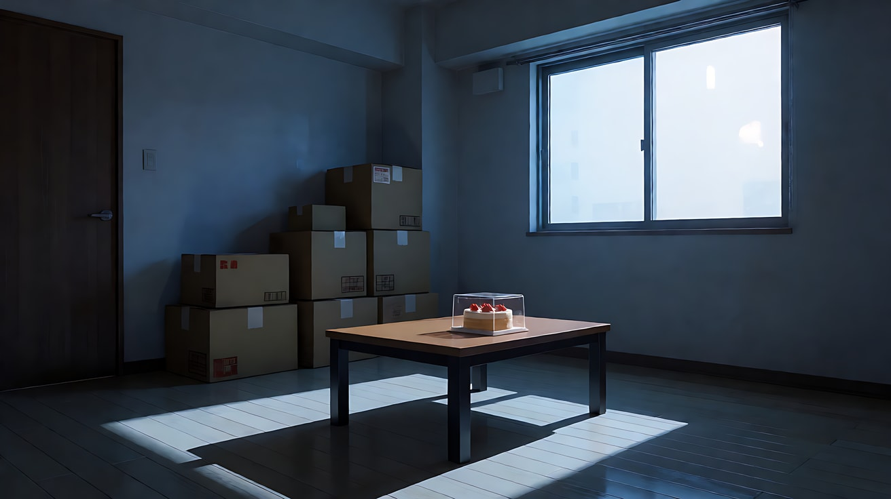

图3 镜头1 关键帧：

```
Using the character from image 1 and the room from image 2:
a wide shot of her sitting on the floor by the low table, hugging her knees, small in the frame, looking at the boxed cake.
Camera at eye level from the far corner, 28mm lens, deep focus.
Lighting: only the hard cool blue-white streetlight from the window on frame right, sharp window-frame shadows across her body,
the rest of the room in deep blue darkness.
Keep the face, hairstyle and outfit exactly as in image 1.
Stylized semi-realistic 3D CG rendering, feature-film animation quality. Aspect ratio 16:9.
```

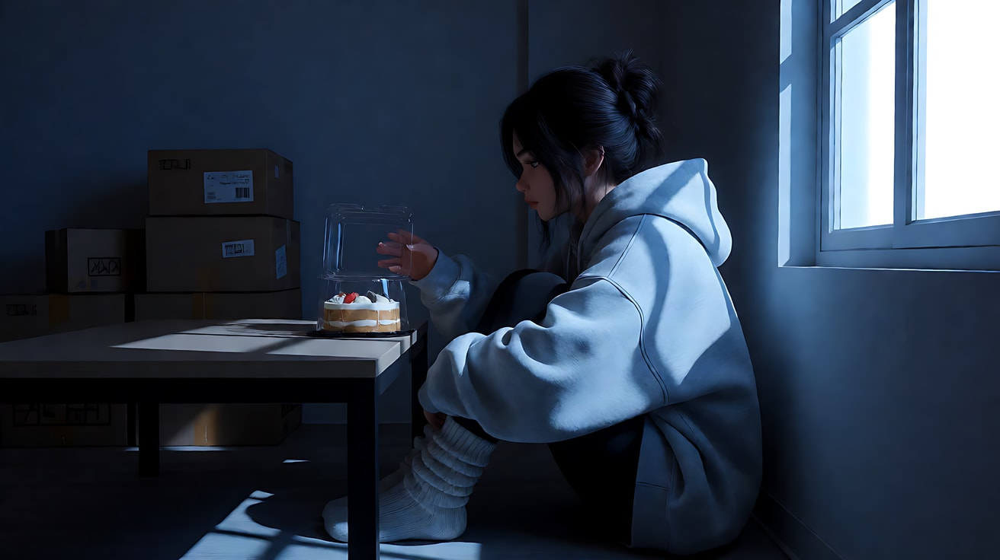

图4 镜头4 关键帧：

```
Using the character from image 1 and the same room:
a close-up of her face lit only by a single candle on the cake in front of her, warm 1800K orange glow from below and in front,
soft gentle shadows, a small warm catchlight in her eyes, the cool window light now only a faint blue edge on the back of her hair.
Camera at eye level, 85mm lens, shallow depth of field, the background dissolving into dark blue.
Keep the face, hairstyle and outfit exactly as in image 1.
Stylized semi-realistic 3D CG rendering, feature-film animation quality. Aspect ratio 16:9.
```

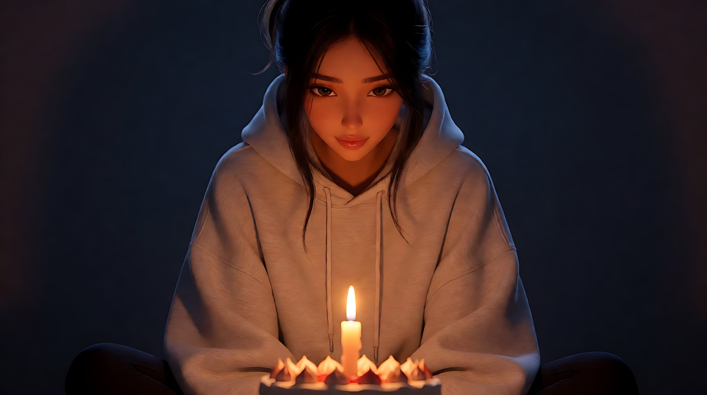

**【多图生视频 · Seedance】**

```
【素材分工】@图片1 锁定人物身份、发型与服装；@图片2 仅参考出租屋布局、窗户位置与窗外路灯光，不复制其中人物；@图片3 为首帧；@图片4 为镜头4的画面目标，锁定烛光近景的光色与构图。
【画风】风格化写实三维CG质感，电影级布光。
镜头1：固定全景，她抱膝坐在矮桌旁的地板上，在画面里很小，盯着盒子里的蛋糕。窗外冷蓝白的路灯硬光从画右射进来，窗框的影子锋利地压在她身上。冰箱低鸣，楼下偶尔驶过一辆车。
镜头2：镜头切至手部特写，她打开蛋糕盒，插上一根蜡烛，划亮火柴。火苗亮起的一瞬，暖橙色光照亮她的手指。火柴擦燃的一声轻响。
镜头3：镜头切至侧面中景，她点燃蜡烛，甩灭火柴，双手放回膝上坐直。蜡烛的暖光从桌面高度柔和地铺开，压过了窗外的冷光，窗框影子退到她身后的墙上。火苗轻轻跳动的细声。
镜头4：镜头切至正面近景，镜头极慢地向前推进，暖橙色烛光从下前方柔和照亮她的脸，眼里有一点暖色的亮光，冷蓝光只剩发梢后缘一条细边。她吸一口气，嘴角慢慢扬起。结尾停在她准备吹蜡烛前、嘴角带笑的脸上。
【锁定】空间：窗户始终在画右，矮桌在房间中间；人物始终穿浅灰色连帽衫；路灯光始终冷蓝白、来自窗户；蜡烛只有一根，点燃后火苗稳定不灭。
【声音】冰箱低鸣与偶尔的车声，火柴擦燃声，火苗细响，最后她很轻地哼出两个音节，无配乐。
【约束】保持人物脸型、发型、服装不变；房间灯始终不打开；不要字幕、水印、Logo。
时长：15秒
```

**参数**：时长 15 秒 ｜ 画幅 16:9 ｜ 负载：4 个镜头、无对白，属于"有挑战"档

**【检查点】**
- 镜头1 是否冷、硬、侧光；镜头4 是否暖、软、低位前光
- 光的变化是否由"点蜡烛"这个动作引起，而不是凭空变暖
- 蜡烛数量是否始终只有一根

**【常见问题与修复】**
| 现象 | 修复 |
|---|---|
| 房间突然亮起顶灯 | 约束里写"房间灯始终不打开，唯一的暖光来自蜡烛" |
| 蜡烛变成好几根或火苗很大 | 【锁定】写"蜡烛只有一根，火苗小而稳定" |
| 火柴手部变形 | 镜头2 改为"她点燃蜡烛"一步，删去划火柴 |
| 镜头4 脸被底光照得吓人 | 写"烛光柔和，从下前方照亮"，并强调"嘴角上扬" |
