# L04-02 三点布光与人像光型 · 提示词

> 本组练习：用主光、辅光、轮廓光和明暗比塑造人物，学会写出蝴蝶光、环形光、伦勃朗光、分割光与宽光 / 窄光的"看得见的特征"。｜ 配套教学：[L04-02-三点布光与人像光型](../教学/L04-02-三点布光与人像光型.md) ｜ 规范：[写作规范](../../模板/写作规范.md)
>
> 画风默认使用开关 A（风格化写实 CG）。如改用 2D 动画，删掉所有焦段、光圈、景深词。

---

### 练习1：一张伦勃朗光肖像动起来（难度 ★）

**目标**：写准伦勃朗光的识别特征（暗侧脸颊的倒三角光斑），并让人物在小动作中保持光型不破。意图：让观众感到这位老人心里有一段很长的往事。

**【生图 · Nano Banana】**

图1 关键帧：

```
A close-up portrait of an original elderly fisherman in his seventies with a weathered face, a short white beard
and a dark knitted wool cap, sitting in a dim wooden cabin, his face turned slightly to frame right.
He is placed on the left third of the frame. Camera at eye level, 85mm lens, shallow depth of field.
Lighting: classic triangle-cheek portrait lighting — a single soft-edged key light from a small high window at about 45 degrees frame left and above,
the nose shadow connects with the cheek shadow, leaving a small inverted triangle of light on his shadow-side cheek below the eye;
no fill, the shadow side falls off to deep brown darkness; warm 3500K tone; a small catchlight in the lit eye.
Background is a dark wooden wall with barely visible fishing nets.
Stylized semi-realistic 3D CG rendering, feature-film animation quality. Aspect ratio 16:9.
```

中文释义：近景，七十多岁的老渔夫，脸微微转向画右，位于左三分之一；平视、85mm、浅景深；伦勃朗光——画左 45° 高处的小窗做主光，鼻影与脸颊阴影相连，暗侧眼下留一块倒三角光斑；无辅光，暗部沉入深褐色；3500K 暖色；亮侧眼睛有一点眼神光。

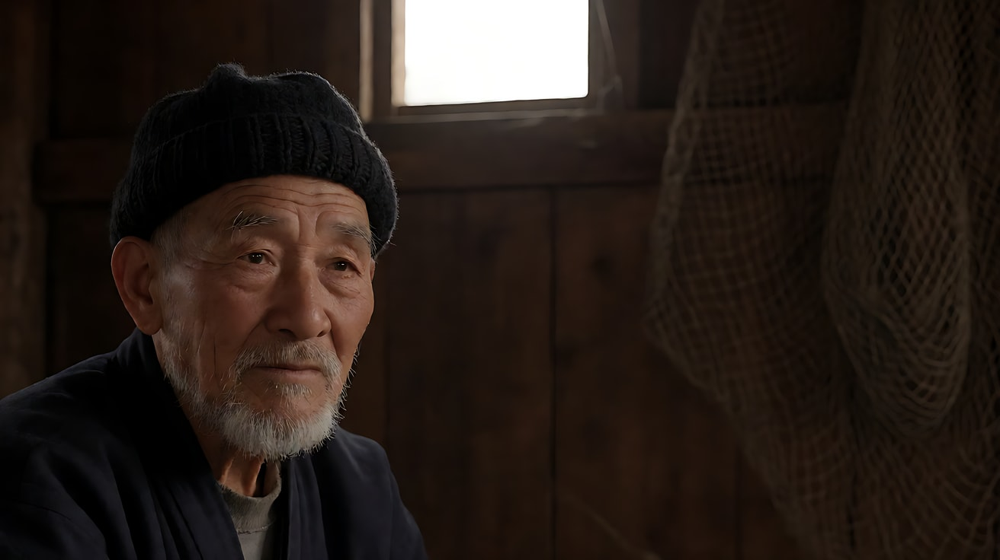

**【图生视频 · Seedance】**

```
【素材分工】@图片1 为首帧，锁定人物身份、服装与光型。
【画风】风格化写实三维CG质感，电影级布光。
老渔夫坐着不动，目光落在画右下方，慢慢眨了一下眼，嘴唇动了动没有出声，粗糙的手指在膝盖上摩挲一根旧渔线。画左高处的小窗透进一束暖光，暗侧脸颊上那块倒三角光斑始终保持在眼睛下方，另一侧沉在深褐色的暗部里。镜头极慢地向前推近一点，从近景推到略紧的近景。结尾停在他的眼睛轻轻抬起、看向画右窗外的瞬间。
【声音】木屋外的海浪声，木板被风吹得轻响，渔线摩擦的细声，无配乐。
【约束】保持人物脸型、胡须、帽子不变；人物头部朝向不变，光型保持不破；不要字幕、水印、Logo。
时长：6秒
```

**参数**：时长 6 秒 ｜ 画幅 16:9

**【检查点】**
- 暗侧脸颊是否有倒三角光斑
- 推镜过程中光型是否稳定
- 有没有凭空出现辅光，把暗部补亮

**【常见问题与修复】**
| 现象 | 修复 |
|---|---|
| 三角光斑消失，变成普通侧光 | 写"鼻影与脸颊阴影连在一起，眼下留一块小三角光" |
| 人物转头，光型破掉 | 写"头部朝向不变，只有眼睛和手指在动" |
| 暗部变亮发灰 | 写"没有补光，暗侧沉入深褐色" |

---

### 练习2：同一人物，三种光型——定妆图 + 场景图（难度 ★★）

**目标**：同一位人物、同一个化妆间，只移动主光的位置，做出蝴蝶光、环形光、分割光三个版本，体会"主光位置 = 人物性格"。

**【生图 · Nano Banana】**

图1 角色定妆：

```
Character turnaround sheet of an original female stage singer in her early thirties: wavy shoulder-length auburn hair,
a deep green satin evening dress, small pearl drop earrings, a thin gold bracelet.
Front view, three-quarter view, side view and back view, full body, standing on a plain light-grey background,
even soft studio light, no shadows on the backdrop.
Stylized semi-realistic 3D CG rendering, feature-film animation quality. Aspect ratio 16:9.
```

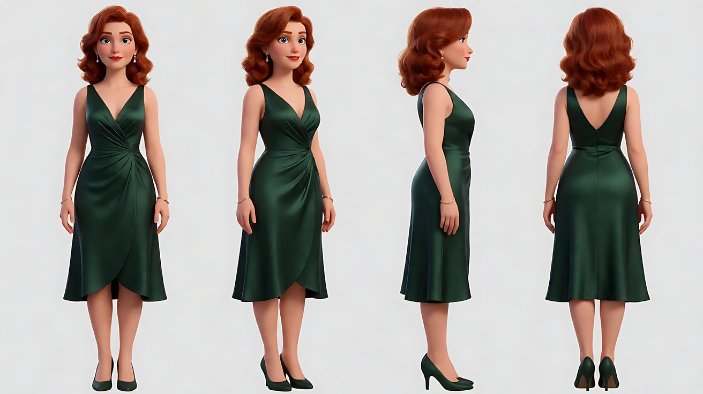

图2 场景（后台化妆间）：

```
Empty old theatre backstage dressing room, a vanity table with a large mirror, a velvet chair, costume rack on one side,
a dark painted wall, a small adjustable spotlight on a stand, all lights off except a dim corridor light through the open door, no people.
Medium-wide shot, eye level, 35mm lens, moderate depth of field.
Stylized semi-realistic 3D CG rendering, feature-film animation quality. Aspect ratio 16:9.
```

中文释义：图1 原创驻唱歌手定妆，墨绿缎面长裙、珍珠耳坠；图2 老剧院后台化妆间，梳妆台、大镜子、丝绒椅、一盏可调聚光灯，只有走廊透进一点暗光。

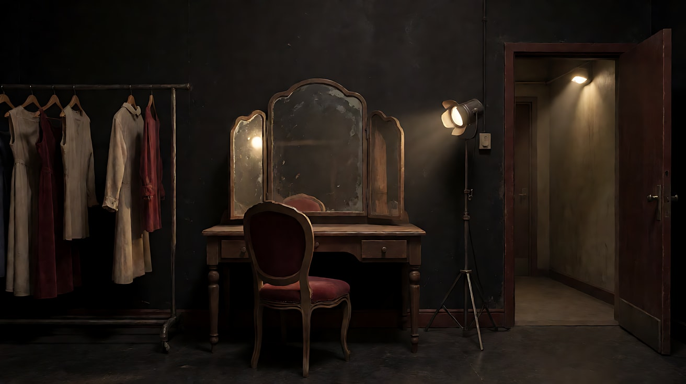

**【多图生视频 · Seedance】**

公共开头：

```
【素材分工】@图片1 锁定人物身份、发型、服装与首饰；@图片2 仅参考化妆间布局与陈设，不复制其中的暗光与空镜构图。
【画风】风格化写实三维CG质感，电影级布光。
```

版本 A 蝴蝶光（意图：她是今晚被所有人仰望的明星）：

```
歌手坐在丝绒椅上正对镜头，下巴微微抬起，涂完口红后把口红盖轻轻合上。一盏聚光灯放在镜头正上方偏高处，从正前方高位照下，鼻子下方投出一小块蝴蝶形阴影，颧骨下方有一道柔和的阴影，脸显得清瘦，双眼里各有一个亮点。镜头固定近景。结尾停在她抬眼直视镜头、嘴角轻轻扬起的脸上。
【声音】口红盖合上的一声轻响，远处舞台传来乐队调音声，无配乐。
【约束】保持人物脸型、发型、服装与首饰不变；主光只有正前方高处一盏；不要字幕、水印、Logo。
时长：5秒
```

版本 B 环形光（意图：她卸下舞台身份，像个普通人）：

```
歌手坐在丝绒椅上，身体略侧，脸转向画左四分之三，正在摘下一只珍珠耳坠。聚光灯放在画右约四十度、略高于眼睛的位置，鼻影向画左下方斜出一个小环，没有和脸颊阴影连在一起；画左一面白墙把一点柔光反射回来，暗部不太深。镜头固定近景。结尾停在她把耳坠放进手心、低头看了一眼的瞬间。
【声音】耳坠落进掌心的细响，走廊里有人路过的脚步声，无配乐。
【约束】保持人物脸型、发型、服装与首饰不变；主光在画右略高处；不要字幕、水印、Logo。
时长：5秒
```

版本 C 分割光（意图：她在考虑今晚要不要上台）：

```
歌手坐在丝绒椅上正对镜头，双手交握放在膝上。聚光灯放在她正左侧，硬光从画左九十度打来，她的脸沿鼻梁中线被分成左半亮、右半黑，右侧几乎看不见。她的拇指一下一下摩挲着金手镯。镜头固定近景。结尾停在她慢慢闭上眼睛、亮的那半边睫毛垂下的画面。
【声音】化妆间里墙上挂钟的滴答声，远处观众入场的模糊人声，无配乐。
【约束】保持人物脸型、发型、服装与首饰不变；主光只有画左一盏，右侧无补光；不要字幕、水印、Logo。
时长：5秒
```

**参数**：时长 5 秒 ｜ 画幅 16:9

**【检查点】**
- 三个版本的鼻影形状是否分别是"蝴蝶""小环""半脸"
- 蝴蝶光版是否有双眼眼神光，分割光版的暗侧是否真的暗
- 三版只看截图能否感到"明星 / 普通人 / 犹豫"

**【常见问题与修复】**
| 现象 | 修复 |
|---|---|
| 蝴蝶光被做成平光，没有鼻下阴影 | 写"灯在正前方明显高于眼睛的位置，鼻下有一块小阴影" |
| 环形光被做成伦勃朗光 | 写"鼻影是一个小环，不连接脸颊阴影" |
| 分割光暗侧被背景光补亮 | 写"右侧无补光，背景是暗墙" |
| 镜子里出现了另一个人 | 写"镜子里只有她自己的倒影"或调整机位不拍镜子 |

---

### 练习3：转头一下，宽光变窄光——首尾帧（难度 ★★★）

**目标**：光源不动，人物把脸从一侧转向另一侧，光型从宽光（开放）变成窄光（隐忍）。意图：让观众感到他从客套变成了认真。

**【生图 · Nano Banana】**

图1 角色定妆：

```
Character turnaround sheet of an original man in his mid-thirties: neatly combed dark brown hair, rectangular thin-frame glasses,
a charcoal grey suit jacket over a white open-collar shirt.
Front view, three-quarter view, side view and back view, full body, plain light-grey background, even soft studio light.
Stylized semi-realistic 3D CG rendering, feature-film animation quality. Aspect ratio 16:9.
```

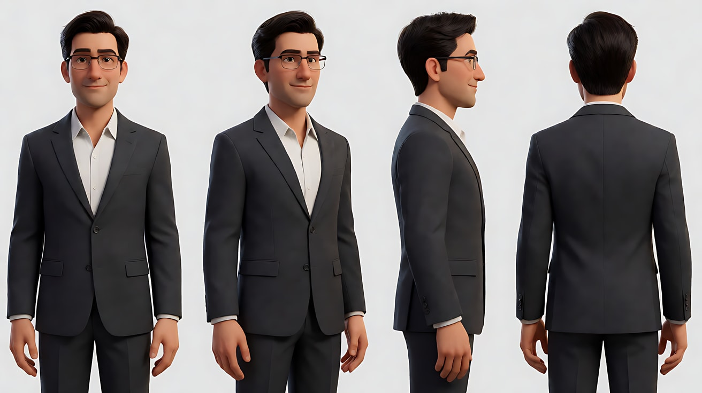

图2 首帧（宽光）：

```
Using the character from image 1: a medium close-up of him sitting at a dark wooden desk in a quiet office at night,
his face turned three-quarters toward frame left, toward a desk lamp on the left side of the desk.
The lamp's warm 3000K light falls on the side of his face nearest the camera, so the broad side of his face is lit — broad lighting,
his expression polite with a slight smile. A soft weak fill from the city glow through the window behind.
Camera at eye level, 50mm lens, shallow depth of field, the window behind him softly blurred.
Keep the face, hairstyle and outfit exactly as in image 1.
Stylized semi-realistic 3D CG rendering, feature-film animation quality. Aspect ratio 16:9.
```

中文释义：中近景，夜间办公室，他把脸转向画左的台灯，台灯照亮靠近镜头的那半边脸（宽光），表情客气带笑。


图3 尾帧（窄光）：

```
Using the character from image 1, the same desk, desk lamp position and office:
he has turned his face three-quarters toward frame right, away from the lamp, so now the side of his face nearest the camera
is in shadow and only the far side is lit by the warm desk lamp — short lighting, the face looks narrower and more sculpted,
his expression serious, lips pressed together, eyes looking down.
Camera at eye level, 50mm lens, shallow depth of field.
Keep the face, hairstyle and outfit exactly as in image 1.
Stylized semi-realistic 3D CG rendering, feature-film animation quality. Aspect ratio 16:9.
```

中文释义：同一办公室、台灯不动，他把脸转向画右，近镜头的半边脸落入阴影，只有远侧被照亮（窄光），表情严肃、低头。


**【首尾帧生视频 · Seedance】**

```
【素材分工】@图片2 为首帧，锁定宽光起点；@图片3 为尾帧，是最终画面目标，锁定窄光终点；@图片1 锁定人物身份、眼镜与服装，不参考其中的棚拍光。只生成两帧之间的连续动作。
【画风】风格化写实三维CG质感，电影级布光。
男人原本对着画左的台灯方向客气地笑着，笑意慢慢收住。他用食指推了一下眼镜，再把脸缓缓转向画右，低下眼睛，嘴唇抿紧。台灯始终固定在画左桌面上，暖光从照亮他近侧的脸，随着转头变成只照亮远侧的脸，近侧沉进阴影里。镜头固定中近景，不移动。
【声音】台灯轻微的电流声，窗外远处的城市车流，他一声很轻的鼻息，无配乐。
【约束】保持人物脸型、发型、眼镜、服装不变；台灯位置不变，光源只有台灯和窗外微弱的城市光；动作连续，不跳切；不要字幕、水印、Logo。
时长：7秒
```

**参数**：时长 7 秒 ｜ 画幅 16:9

> 注意：首尾帧里的道具状态必须一致。两帧他都戴着眼镜，所以视频里只能"推眼镜"，不能"摘眼镜"。

**【检查点】**
- 首帧近镜头的半边脸是否亮，尾帧是否暗
- 台灯是否始终没动
- 道具状态（眼镜）是否与尾帧一致

**【常见问题与修复】**
| 现象 | 修复 |
|---|---|
| 台灯跟着他移动 | 写"台灯固定在画左桌面上不动" |
| 转头太快像甩头 | 写"缓缓转头"，时长加到 8 秒 |
| 眼镜在中途消失或变形 | 约束里写"眼镜始终戴在脸上，形状不变"，并把推眼镜改成更小的动作"手指碰了一下镜框" |

---

### 练习4：一场谈判，两种光型——正反打多镜头（难度 ★★★★）

**目标**：在正反打里给两个人物不同的光型和明暗比：求职者用低明暗比的环形光（坦诚），评审用高明暗比的分割光且没有眼神光（不可读）。意图：让观众感到年轻人完全被看穿，而对方深不可测。

**【生图 · Nano Banana】**

图1 角色定妆（两位原创人物）：

```
Character turnaround sheet of two original characters:
a young man in his early twenties with short neat black hair, a slightly oversized navy blazer over a white shirt, holding a thin folder;
an older woman in her fifties with a silver pixie cut, a black high-neck blouse, a long dark coat, thin black-rimmed glasses.
Front view, three-quarter view and side view of each, full body, plain light-grey background, even soft studio light.
Stylized semi-realistic 3D CG rendering, feature-film animation quality. Aspect ratio 16:9.
```

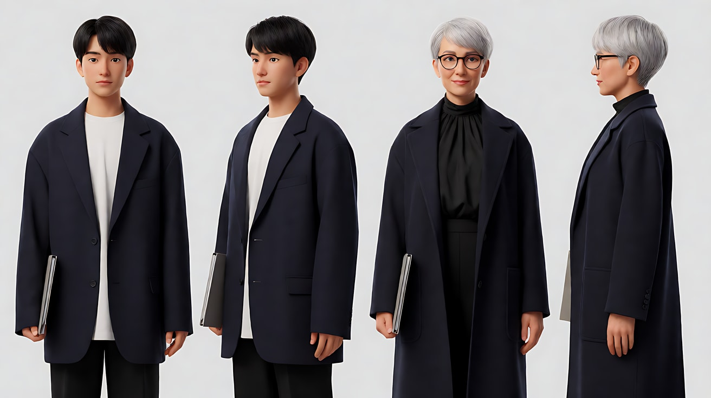

图2 场景（顶层会议室）：

```
Empty top-floor meeting room in the late afternoon, a long dark table, two chairs facing each other across the table,
floor-to-ceiling windows along the left wall with soft overcast daylight, the right side of the room in shadow,
a single pendant lamp above the far end switched off, no people.
Wide shot, eye level, 28mm lens, deep focus.
Stylized semi-realistic 3D CG rendering, feature-film animation quality. Aspect ratio 16:9.
```

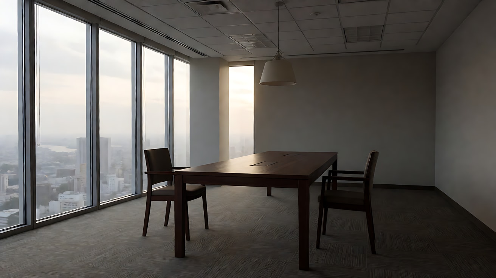

图3 镜头1 关键帧：

```
Using the characters from image 1 and the room from image 2:
a wide two-shot from the side of the table, the young man sitting on frame left facing right, the older woman sitting on frame right facing left,
the long table between them. Camera at seated eye level, 28mm lens, deep focus.
Lighting: the only source is soft overcast daylight from the floor-to-ceiling windows along the left wall;
the young man sits close to the windows and his face is lit evenly with gentle low-contrast shadows;
the woman sits deeper in the room near the dark right side, lit only from her left by the same windows, her right side falling into deep shadow.
Keep the faces, hairstyles and outfits exactly as in image 1.
Stylized semi-realistic 3D CG rendering, feature-film animation quality. Aspect ratio 16:9.
```

中文释义：从桌子侧面拍的双人全景，年轻人在画左面朝右，女评审在画右面朝左；唯一光源是画左的落地窗，年轻人靠窗、脸部均匀受光，女评审坐在房间暗侧，只有左侧被同一扇窗照亮，右半边沉入深影。练习的重点是：**同一扇窗，因为两人位置不同，自然得到两种光型。**

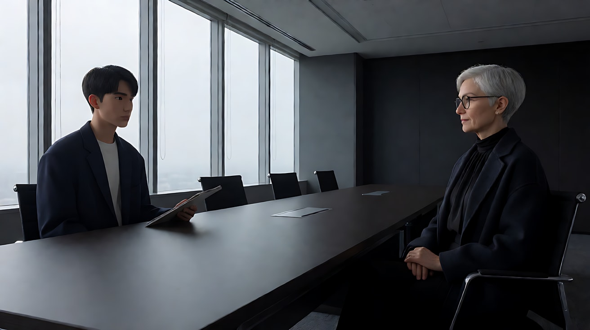

**【多图生视频 · Seedance】**

```
【素材分工】@图片1 锁定两位人物的身份与服装；@图片2 仅参考会议室布局与落地窗位置，不复制空镜构图；@图片3 为首帧，锁定两人站位与轴线。
【画风】风格化写实三维CG质感，电影级布光。
镜头1：固定双人全景，年轻人坐在画左，把文件夹推到桌子中间；女评审坐在画右，没有伸手去拿，只是看着他。画左落地窗透进阴天柔光，年轻人整个人在亮处，女评审半边身子在房间的暗处。空调低鸣，文件夹在桌面上滑动的声音。
镜头2：镜头切至越过女评审肩膀的反打近景，拍年轻人的正脸。阴天窗光从他的前左侧柔和铺开，鼻影是一个小环，暗部很浅，眼睛里有明亮的眼神光。他咽了一下口水，努力保持微笑。年轻人开口：“我准备了三个方案。”
镜头3：镜头切至越过年轻人肩膀的反打近景，拍女评审的正脸。窗光只从她左侧九十度打来，脸沿鼻梁被分成一半亮一半黑，镜片挡住了眼睛的反光，看不到眼神光。她一动不动，只是用指尖慢慢摘下眼镜，放在桌上。结尾停在她亮的那半边脸和暗的那半边脸上，没有表情。
【锁定】轴线：年轻人始终在画左面朝右，女评审始终在画右面朝左，机位始终在桌子同一侧；光线：唯一光源是画左的落地窗，阴天柔光；年轻人始终在亮处，女评审始终半边在暗处。
【声音】空调低鸣，文件夹滑动声，一句台词，眼镜放在桌上的轻响，无配乐。
【约束】保持两人脸型、发型、服装不变；会议室吊灯始终不开；不要字幕、水印、Logo。
时长：12秒
```

**参数**：时长 12 秒 ｜ 画幅 16:9 ｜ 负载：3 个镜头、1 句对白，属于"稳妥"档

**【检查点】**
- 两人的明暗比是否明显不同：年轻人约 2:1，女评审约 8:1
- 年轻人有眼神光，女评审没有
- 正反打是否守住轴线

**【常见问题与修复】**
| 现象 | 修复 |
|---|---|
| 两人光型一样 | 在每个镜头块写清"光从哪侧来、照亮哪半边脸"，并在【锁定】写两人分别在亮处 / 暗处 |
| 反打时人物左右互换 | 【锁定】写轴线，并写"机位始终在桌子同一侧" |
| 吊灯被打开让画面变平 | 约束里写"吊灯始终不开" |

---

### 练习5：从明星光到只剩轮廓光——一盏一盏拆掉（难度 ★★★★★）

**目标**：用"三点布光被逐步拆除"讲一个人物从高光时刻退回孤独的过程：舞台上的蝴蝶光 + 轮廓光 → 化妆镜灯的平光 → 他亲手关灯，只剩走廊一道轮廓光。意图：让观众感到掌声结束后，他只剩自己。

**【生图 · Nano Banana】**

图1 角色定妆：

```
Character turnaround sheet of an original elderly stage magician in his late sixties: slicked-back silver hair, a thin grey moustache,
a black tailcoat with a deep red lining, a white bow tie, white gloves.
Front view, three-quarter view, side view and back view, full body, plain light-grey background, even soft studio light.
Stylized semi-realistic 3D CG rendering, feature-film animation quality. Aspect ratio 16:9.
```

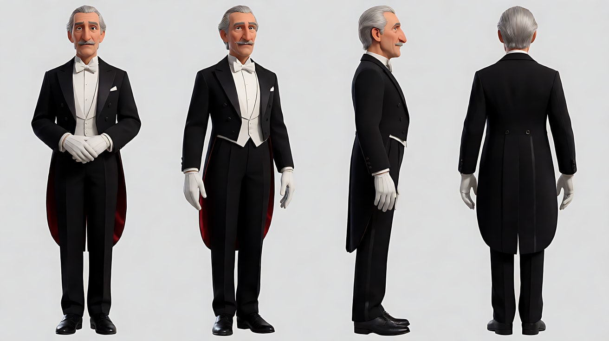

图2 场景 A（舞台）：

```
Empty small old theatre stage at night, a dark red velvet curtain behind, a wooden stage floor,
a single follow spotlight beam from high front and a strong backlight from the rear of the stage creating a bright edge on the haze,
the auditorium in darkness, light haze in the air, no people.
Wide shot from the audience, slightly low angle, 35mm lens, deep focus.
Stylized semi-realistic 3D CG rendering, feature-film animation quality. Aspect ratio 16:9.
```

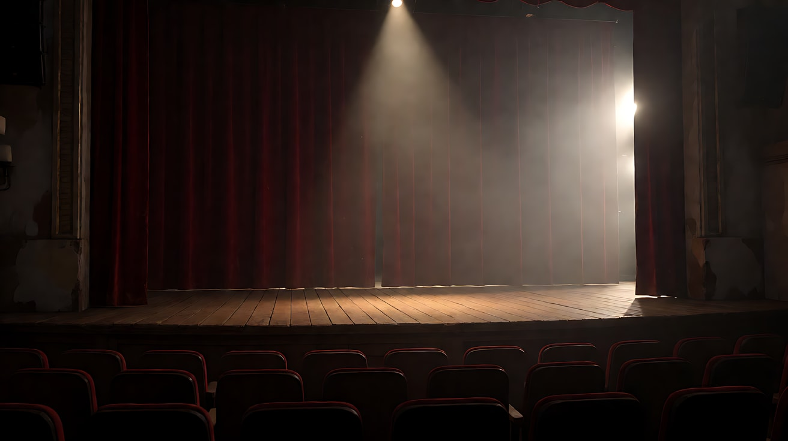

图3 场景 B（化妆间）：

```
Empty cramped backstage dressing room at night, a vanity mirror framed by a ring of round warm bulbs all switched on,
flat even frontal light, a chair, a top hat and white gloves on the table, the door open to a dim corridor with a single cool bulb, no people.
Medium shot, eye level, 35mm lens, moderate depth of field.
Stylized semi-realistic 3D CG rendering, feature-film animation quality. Aspect ratio 16:9.
```

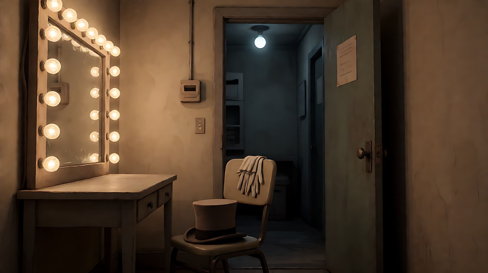

图4 镜头1 关键帧：

```
Using the character from image 1 and the stage from image 2:
a medium shot of the magician taking a deep bow at the center of the stage, his arms spread wide, looking up toward the audience.
Camera at audience eye level, slightly low angle, 50mm lens, shallow depth of field.
Lighting: a bright follow spotlight from high front gives butterfly lighting with a small shadow under his nose and catchlights in both eyes;
a strong backlight from behind draws a bright rim around his silver hair and shoulders through the stage haze.
Keep the face, hairstyle and outfit exactly as in image 1.
Stylized semi-realistic 3D CG rendering, feature-film animation quality. Aspect ratio 16:9.
```

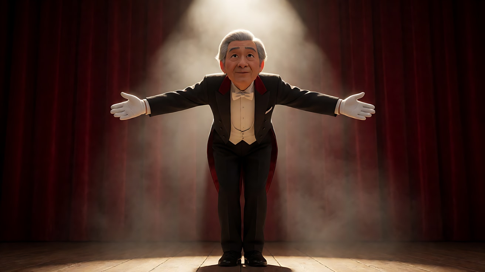

图5 镜头4 关键帧（结尾目标）：

```
Using the character from image 1 and the dressing room from image 3:
a medium close-up of the magician sitting in front of the vanity mirror, all mirror bulbs now switched off,
his face almost completely in darkness, only a thin cool blue-white rim light from the corridor bulb behind him
outlining his silver hair, one ear and the edge of his shoulder; no catchlights in his eyes.
Camera at eye level, 50mm lens, shallow depth of field.
Keep the face, hairstyle and outfit exactly as in image 1.
Stylized semi-realistic 3D CG rendering, feature-film animation quality. Aspect ratio 16:9.
```

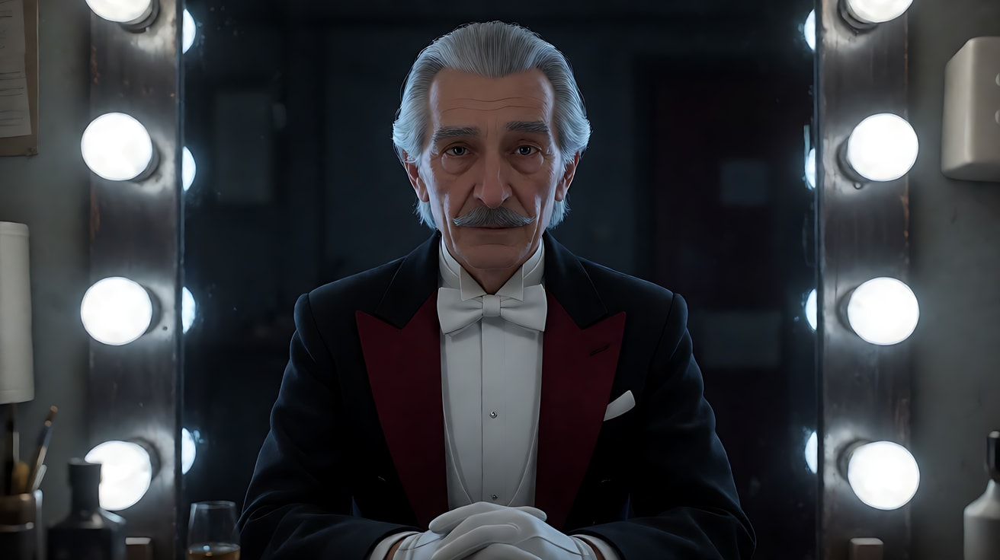

**【多图生视频 · Seedance】**

```
【素材分工】@图片1 锁定人物身份、发型、胡子与燕尾服；@图片2 仅参考舞台布局、帷幕与舞台光方向，不复制空镜构图；@图片3 仅参考化妆间布局、镜框灯泡与走廊灯位置；@图片4 为首帧；@图片5 为镜头4的画面目标，锁定只剩轮廓光的结尾。
【画风】风格化写实三维CG质感，电影级布光。
镜头1：固定中景，略仰拍，魔术师站在舞台中央张开双臂深深鞠躬，再抬起头望向观众席。高处正前方的追光照亮他的脸，鼻下一小块蝴蝶形阴影，双眼有明亮的眼神光；身后的逆光穿过舞台薄雾，在银发和肩膀上勾出一圈亮边。热烈的掌声。
镜头2：镜头切至化妆间平视中近景，他坐在化妆镜前，镜框一圈暖色灯泡全部亮着，平平地照亮他整张脸，几乎没有阴影。他慢慢摘下一只白手套，放在桌上。掌声已经变成远处模糊的回声。
镜头3：镜头切至镜框灯泡的特写，他戴着另一只手套的手伸进画面，拧下开关，灯泡一盏接一盏熄灭，画面从暖黄迅速暗下去。开关咔哒一声，灯丝熄灭时轻微的嘶声。
镜头4：镜头切至他的中近景，镜头固定。镜灯全灭，他的脸沉在黑暗里，只有身后敞开的门外，走廊一盏冷白灯泡在他的银发、一只耳朵和肩膀边缘勾出一条细细的冷色轮廓。眼睛里没有亮点。他一动不动地坐着，只有肩膀随呼吸轻轻起伏。结尾停在这个只剩轮廓的身影上。
【锁定】人物始终穿黑色燕尾服、白领结，银发向后梳；化妆间布局：化妆镜在他正前方，门在他身后；光型顺序固定为舞台蝴蝶光加轮廓光、镜灯平光、只剩走廊冷色轮廓光。
【声音】从热烈掌声到远处回声，再到开关咔哒声，最后只剩走廊灯泡的微弱嗡声和他的一次呼气，无配乐。
【约束】保持人物脸型、发型、服装不变；镜灯熄灭后不再亮起；不要字幕、水印、Logo。
时长：15秒
```

**参数**：时长 15 秒 ｜ 画幅 16:9 ｜ 负载：4 个镜头、2 个地点、无对白，属于"有挑战"档；失败时拆成两次（镜头1 单独一次，镜头2–4 一次）

**【检查点】**
- 镜头1 是否同时有蝴蝶光和轮廓光
- 镜头2 是否是平光（镜灯从正面均匀照亮）
- 镜头4 是否只剩冷色轮廓光、没有眼神光
- 光的每次减少是否都由"关灯"或"换地点"引起

**【常见问题与修复】**
| 现象 | 修复 |
|---|---|
| 镜头4 脸仍被照亮 | 写"脸沉在黑暗里，镜灯全灭，前方没有任何光源" |
| 镜头3 灯泡同时全灭 | 写"灯泡一盏接一盏熄灭"；如仍不行，接受同时熄灭，这不影响意图 |
| 镜头1 观众席出现大量人群 | 写"观众席在黑暗中，看不清人" |
| 手套在镜头2、3 之间数量错乱 | 【锁定】写"镜头2 后他只戴着一只手套" |
