# L04-03 动机光与实用光源 · 提示词

> 本组练习：先写光源本体，再写它落在人物身上的方向、颜色和运动，让每束光都"说得通"。｜ 配套教学：[L04-03-动机光与实用光源](../教学/L04-03-动机光与实用光源.md) ｜ 规范：[写作规范](../../模板/写作规范.md)
>
> 画风默认使用开关 A（风格化写实 CG）。如改用 2D 动画，删掉所有焦段、光圈、景深词。

---

### 练习1：屏幕是唯一的光（难度 ★）

**目标**：用手机屏幕做唯一的实用光源，体会"冷光、正面低位、随内容变化"。意图：让观众感到她在等一条很重要的消息。

**【生图 · Nano Banana】**

图1 关键帧：

```
A medium close-up of an original teenage girl around seventeen with a messy high bun and an oversized faded blue T-shirt,
lying on her side in bed in a completely dark bedroom at night, holding a phone close to her face with both hands.
She is placed on the right third of the frame, the dark room and a blurred window on the left.
Camera at bed level, eye level with her, 50mm lens, shallow depth of field.
Lighting: the phone screen is the only light source, a cool blue-white glow from below and in front lighting her face,
nose and fingers, light falls off quickly so her shoulders and the pillow fade into darkness; a tiny cool reflection in her eyes.
The screen faces her, its content is not visible to the camera.
Stylized semi-realistic 3D CG rendering, feature-film animation quality. Aspect ratio 16:9.
```

中文释义：中近景，少女侧躺在完全黑暗的卧室，双手举着手机贴近脸；位于右三分之一；与床面同高、50mm 浅景深；手机屏幕是唯一光源，冷蓝白光从前下方照亮脸和手指，快速衰减，肩膀和枕头融进黑暗；屏幕背对镜头，看不到内容。

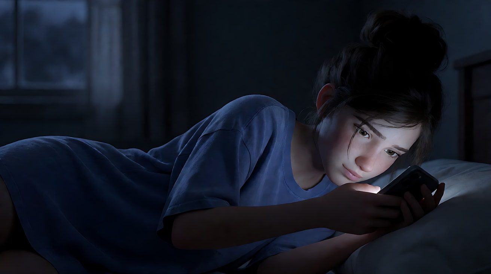

**【图生视频 · Seedance】**

```
【素材分工】@图片1 为首帧，锁定人物身份、服装与卧室布局。
【画风】风格化写实三维CG质感，电影级布光。
少女侧躺着盯着手机，拇指悬在屏幕上方没有按下去，眼睛一眨不眨。屏幕冷蓝白的光是房间里唯一的光，照亮她的脸和手指，光离开她的脸就迅速暗下去。屏幕突然亮了一下，冷光在她脸上跳亮一瞬，她的眼睛睁大，嘴唇微张。镜头固定中近景，不移动。结尾停在她被屏幕光照亮、屏住呼吸的脸上。
【声音】房间安静，窗外远处一声狗叫，手机一声短促的振动，她吸气的声音，无配乐。
【约束】保持人物脸型、发型、服装不变；屏幕背对镜头，不显示任何文字或界面；房间灯始终不开；不要字幕、水印、Logo。
时长：6秒
```

**参数**：时长 6 秒 ｜ 画幅 16:9

**【检查点】**
- 脸上的光是否只来自手机，方向是否从前下方
- 光是否在肩膀处迅速衰减
- 屏幕亮起的一瞬，脸上的光是否同步变亮

**【常见问题与修复】**
| 现象 | 修复 |
|---|---|
| 整个房间都被照亮 | 写"屏幕光是唯一光源，离开她的脸就迅速变暗" |
| 镜头拍到屏幕上的乱码 | 写"屏幕背对镜头，不显示任何文字" |
| 屏幕光变成暖色 | 写"冷蓝白色的屏幕光" |

---

### 练习2：同一张书桌，台灯与烛火——定妆图 + 场景图（难度 ★★）

**目标**：同一个人、同一张书桌，只换实用光源（台灯 → 停电后的蜡烛），看方向、色温、衰减和"会不会动"如何一起改变。意图 A：让观众感到深夜工作的专注；意图 B：让观众感到停电让她慢了下来，开始想念一个人。

**【生图 · Nano Banana】**

图1 角色定妆：

```
Character turnaround sheet of an original woman in her late twenties: long straight black hair tied in a loose low ponytail,
round tortoiseshell glasses, a cream knitted cardigan over a white T-shirt, a thin red string bracelet on her right wrist.
Front view, three-quarter view, side view and back view, full body, plain light-grey background, even soft studio light.
Stylized semi-realistic 3D CG rendering, feature-film animation quality. Aspect ratio 16:9.
```

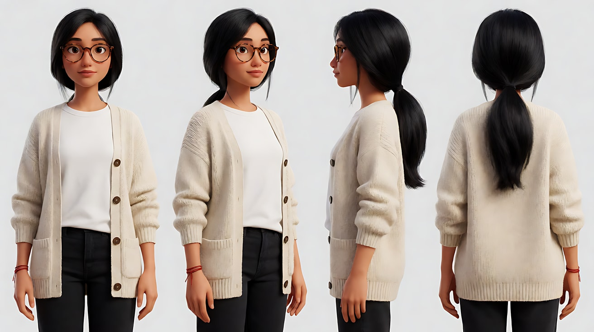

图2 场景（夜晚书房）：

```
Empty small study at night, a wooden desk against the wall, a brass desk lamp with a green glass shade on the left side of the desk,
a short white candle in a small dish on the right side of the desk, unlit, a stack of letters and a fountain pen,
a window on the right wall showing a dark blue night, bookshelves behind, no people, room lights off.
Medium-wide shot, eye level, 35mm lens, moderate depth of field.
Stylized semi-realistic 3D CG rendering, feature-film animation quality. Aspect ratio 16:9.
```

中文释义：图1 原创女孩定妆，低马尾、玳瑁圆框眼镜、米色开衫、右腕红绳；图2 夜晚书房，书桌左侧一盏绿玻璃罩黄铜台灯，右侧一根没点的白蜡烛，信纸与钢笔，右墙窗外深蓝夜色。

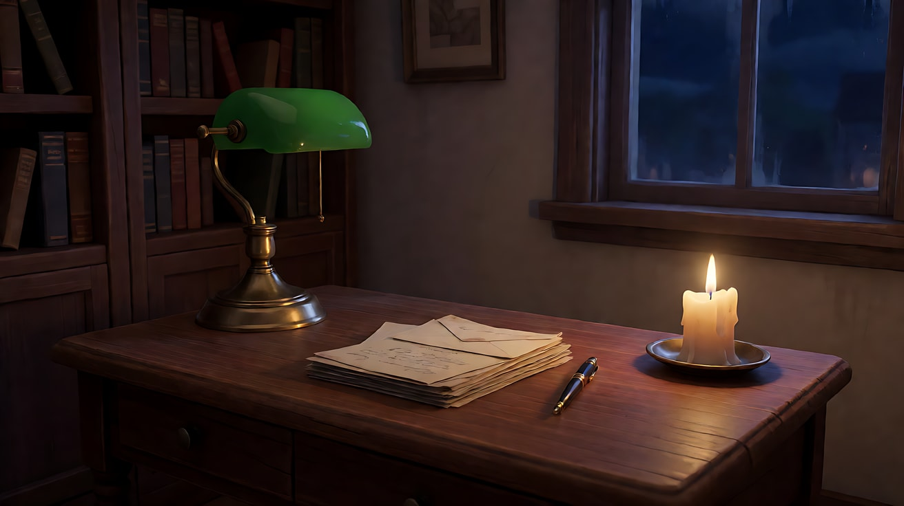

**【多图生视频 · Seedance】**

版本 A 台灯：

```
【素材分工】@图片1 锁定人物身份、发型、眼镜与服装；@图片2 仅参考书房布局、台灯与蜡烛位置，不复制空镜构图。
【画风】风格化写实三维CG质感，电影级布光。
她坐在书桌前，低头用钢笔在信纸上写字，写完一行，用手指推了一下眼镜。书桌左侧的绿罩台灯亮着，暖黄光从画左低处照亮她的左脸、手和信纸，光被灯罩收住，只照亮桌面一圈，书架和房间其余部分沉在暗处。窗外是深蓝夜色。镜头从侧面中景缓慢向前推到中近景。结尾停在她握笔停顿、在想下一句的侧脸上。
【声音】钢笔划过纸面的沙沙声，墙上钟表的滴答声，无配乐。
【约束】保持人物脸型、发型、眼镜、服装不变；蜡烛不点燃；光源只有台灯；不要字幕、水印、Logo。
时长：7秒
```

版本 B 烛火：

```
【素材分工】@图片1 锁定人物身份、发型、眼镜与服装；@图片2 仅参考书房布局、台灯与蜡烛位置，不复制空镜构图。
【画风】风格化写实三维CG质感，电影级布光。
停电了，台灯是黑的。书桌右侧的蜡烛已经点燃，深橙色的烛光从画右低处照亮她的右脸和手，火苗轻轻跳动，她脸上的光和墙上的影子随之微微晃动；光只照亮蜡烛周围一小圈，离开桌面就迅速暗下去。她放下钢笔，双手托着下巴，看着火苗出神，嘴角慢慢松下来。镜头固定中近景，不移动。结尾停在她眼睛里映着一点火光的画面。
【声音】窗外远处的风声，火苗偶尔的细微噼啪，楼道里邻居的模糊说话声，无配乐。
【约束】保持人物脸型、发型、眼镜、服装不变；台灯始终熄灭；蜡烛只有一根；不要字幕、水印、Logo。
时长：7秒
```

**参数**：时长 7 秒 ｜ 画幅 16:9

**【检查点】**
- A 版光从画左来、稳定不动；B 版光从画右来、在跳动
- B 版色温是否明显比 A 版更橙、范围更小
- 两版只看画面，是否一个"专注"一个"出神"

**【常见问题与修复】**
| 现象 | 修复 |
|---|---|
| B 版台灯也亮着 | 正文第一句写"停电了，台灯是黑的"，约束再写一遍 |
| 烛光照亮整个房间 | 写"光只照亮蜡烛周围一小圈，房间其余部分是暗的" |
| 光的方向与灯的位置相反 | 每版都写清"从画左 / 画右低处照亮她的左脸 / 右脸" |
| 钢笔字变成乱码特写 | 不给信纸特写，或写"信纸上的字迹看不清" |

---

### 练习3：对面车灯扫进车里——首尾帧（难度 ★★★）

**目标**：用"会动的光"制造事件。首帧只有仪表盘微光，尾帧被对面车灯照亮；中间是车灯从远到近、从暗到亮的过程。意图：让观众感到等的人终于来了。

**【生图 · Nano Banana】**

图1 角色定妆：

```
Character turnaround sheet of an original man in his early forties: short black hair with grey at the temples, a short dark beard,
a worn brown leather jacket over a dark grey hoodie, a wristwatch on his left wrist.
Front view, three-quarter view, side view and back view, full body, plain light-grey background, even soft studio light.
Stylized semi-realistic 3D CG rendering, feature-film animation quality. Aspect ratio 16:9.
```

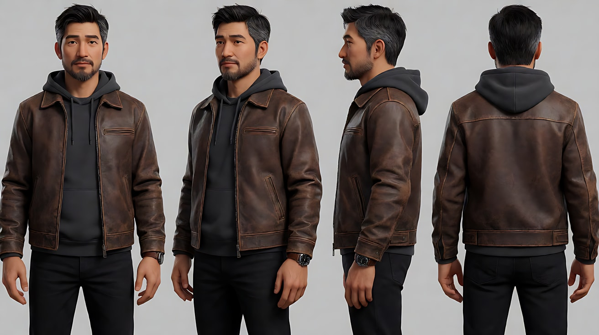

图2 首帧：

```
Using the character from image 1: a medium close-up of him sitting in the driver's seat of a parked car at night on an empty country road,
seen through the windshield from outside, both hands resting on the steering wheel, eyes looking straight ahead into the dark.
Camera at eye level outside the windshield, 50mm lens, shallow depth of field.
Lighting: only the faint cool green-blue glow of the dashboard lighting his chin and hands from below,
the rest of his face in near darkness, the road outside pitch black.
Keep the face, hairstyle and outfit exactly as in image 1.
Stylized semi-realistic 3D CG rendering, feature-film animation quality. Aspect ratio 16:9.
```

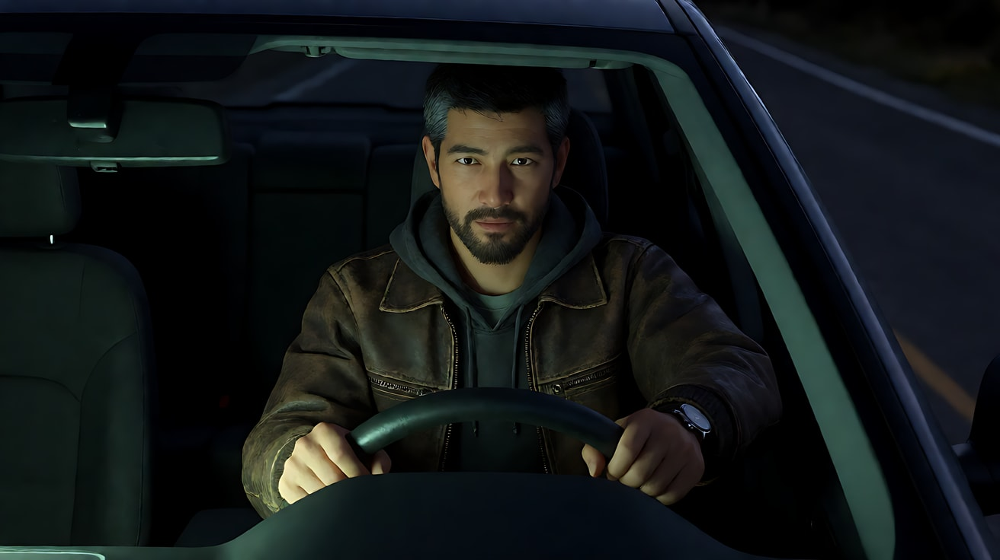

图3 尾帧：

```
Using the character from image 1, the same car, the same framing through the windshield:
bright white headlights from an oncoming car, coming from straight ahead behind the camera, now flood his face from the front with hard light,
he squints and lifts one hand slightly to shield his eyes, the windshield shows a faint glare, sharp shadow of his hand on his cheek.
Keep the face, hairstyle and outfit exactly as in image 1.
Stylized semi-realistic 3D CG rendering, feature-film animation quality. Aspect ratio 16:9.
```

中文释义：首帧——从挡风玻璃外拍中近景，他坐在驾驶座，只有仪表盘冷绿微光照亮下巴和手；尾帧——同一机位，对面车辆的白色前大灯从正前方硬光照亮他的脸，他眯眼、抬手遮挡，手的影子落在脸颊上。

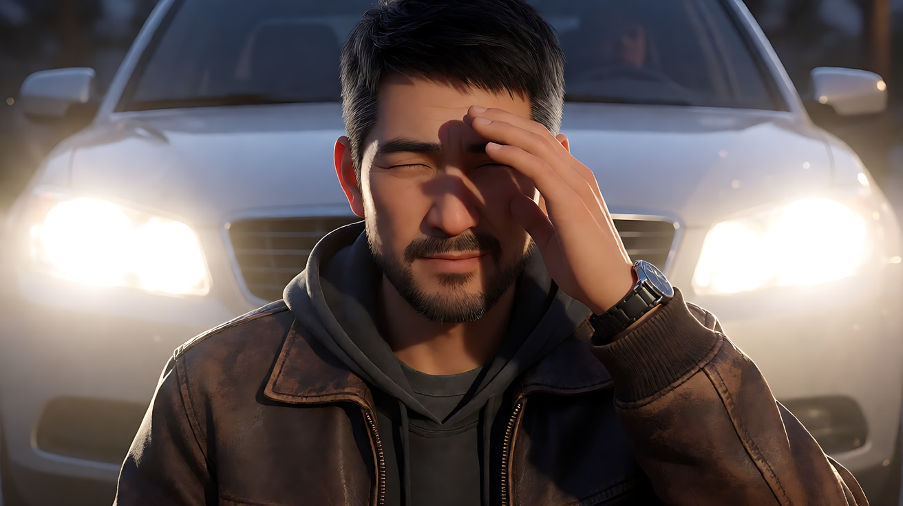

**【首尾帧生视频 · Seedance】**

```
【素材分工】@图片2 为首帧，锁定机位、车内布局和仪表盘微光；@图片3 为尾帧，是最终画面目标，锁定被车灯照亮的结果；@图片1 锁定人物身份与服装，不参考其中的棚拍光。只生成两帧之间的连续画面。
【画风】风格化写实三维CG质感，电影级布光。
男人坐在驾驶座上，双手搭着方向盘，一动不动地盯着前方的黑暗，仪表盘的冷绿微光照着他的下巴。远处出现两点白光，越来越近、越来越亮，白光从他的胸口慢慢爬上他的脸。他的手指在方向盘上收紧，眼睛眯起来，抬起一只手挡在眼前，手的影子清楚地落在脸颊上。镜头固定在挡风玻璃外，不移动。
【声音】车内安静，远处引擎声由弱到强，轮胎压过碎石的声音越来越近，无配乐。
【约束】保持人物脸型、发型、服装不变；车灯只从正前方来，不从侧面扫过；画面里不出现对面车辆的车身细节；不要字幕、水印、Logo。
时长：7秒
```

**参数**：时长 7 秒 ｜ 画幅 16:9

**【检查点】**
- 光是否"从远到近、从弱到强"，而不是一下子亮起
- 光爬上脸的方向是否和车灯来向一致
- 抬手挡光时，手的影子是否落在脸上

**【常见问题与修复】**
| 现象 | 修复 |
|---|---|
| 车灯从侧面扫过 | 写"车灯从正前方迎面而来" |
| 一下子全亮，没有过程 | 写"远处出现两点白光，越来越近、越来越亮" |
| 出现另一辆车的完整车身 | 写"对面车辆藏在强光后面，看不清车身" |

---

### 练习4：凌晨便利店的三种光——多镜头（难度 ★★★★）

**目标**：一个场景里三种实用光源各管一个镜头：门外粉色霓虹与湿地倒影、店内冷白荧光灯、手机屏幕。意图：让观众感到她在城市里只有一个人，和一个回不回的消息。

**【生图 · Nano Banana】**

图1 角色定妆：

```
Character turnaround sheet of an original young woman in her mid-twenties: dyed ash-brown shoulder-length hair under a black beanie,
an oversized olive green parka, a grey hoodie underneath, black jeans, white sneakers, a small crossbody bag.
Front view, three-quarter view, side view and back view, full body, plain light-grey background, even soft studio light.
Stylized semi-realistic 3D CG rendering, feature-film animation quality. Aspect ratio 16:9.
```

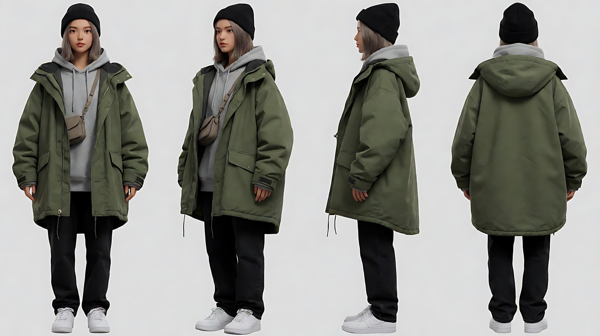

图2 场景（凌晨便利店外）：

```
Empty small corner convenience store on a quiet city street at 2 a.m. after rain, cold white fluorescent light spilling out through
the large glass front, a pink neon sign shaped like a coffee cup glowing above the door, no readable text anywhere,
wet asphalt reflecting the pink neon and white shop light, a bus stop bench nearby, no people.
Wide shot, eye level from across the street, 35mm lens, deep focus.
Stylized semi-realistic 3D CG rendering, feature-film animation quality. Aspect ratio 16:9.
```

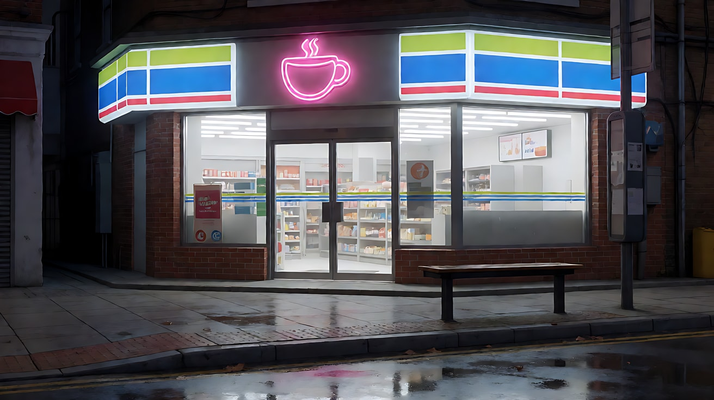

图3 镜头1 关键帧：

```
Using the character from image 1 and the street from image 2:
a wide shot of her standing alone at the bus stop beside the convenience store, small in the frame, hands in her parka pockets,
the pink coffee-cup neon behind her drawing a soft pink rim on her beanie and shoulders, its reflection stretched on the wet road
in the foreground. Camera at eye level from across the street, 35mm lens, deep focus.
Keep the face, hairstyle and outfit exactly as in image 1.
Stylized semi-realistic 3D CG rendering, feature-film animation quality. Aspect ratio 16:9.
```

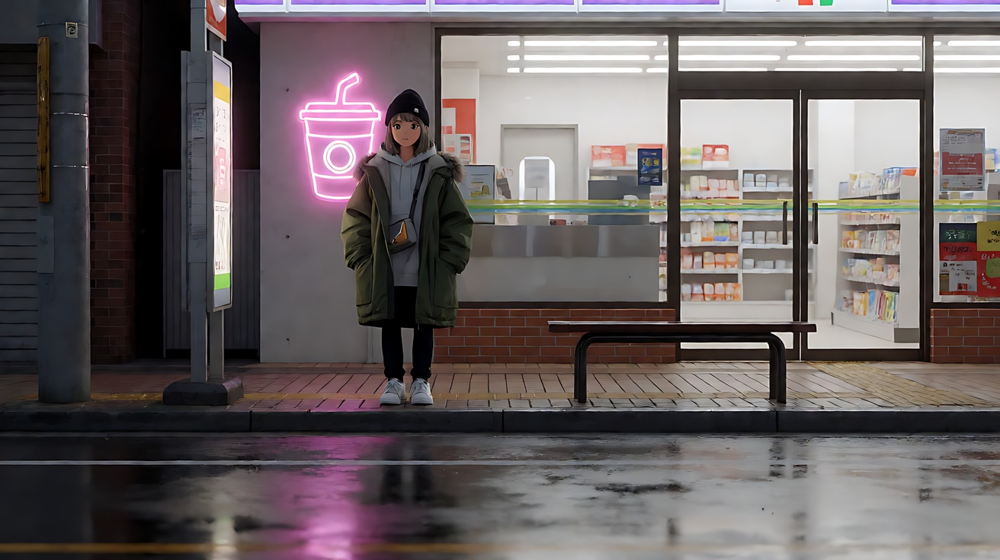

**【多图生视频 · Seedance】**

```
【素材分工】@图片1 锁定人物身份、发型、毛线帽与外套；@图片2 仅参考便利店外观、咖啡杯形霓虹与湿地倒影，不复制空镜构图；@图片3 为首帧。
【画风】风格化写实三维CG质感，电影级布光。
镜头1：固定全景，从街对面拍。她独自站在便利店旁的公交站，双手插在外套口袋里，在画面中很小。门上方的粉色咖啡杯霓虹在她帽子和肩膀上勾出一圈粉色边光，倒影在前景湿漉漉的路面上被拉长、轻轻颤动。远处一辆车驶过的水声。
镜头2：镜头切至便利店玻璃门内的中景，她推门进来，站在冷柜前拿起一瓶水。头顶的荧光灯管投下冷白偏绿的平光，她脸上没有什么阴影，显得很疲惫。冷柜压缩机的嗡声和自动门的提示音。
镜头3：镜头切至店门外屋檐下的中近景，她背靠玻璃站着，掏出手机看了一眼。手机屏幕的冷蓝光从下方照亮她的脸，身后玻璃里透出的白光在她发梢勾出一条亮边，粉色霓虹在她一侧脸颊上留下淡淡的粉。她把手机扣在胸前，抬头看向空荡荡的街。结尾停在她仰起的脸上。
【锁定】光线：粉色霓虹在门上方，店内是冷白荧光灯，手机屏幕是冷蓝光，三者位置始终不变；人物始终戴黑色毛线帽、穿橄榄绿外套；画面里不出现任何可读文字。
【声音】从车驶过的水声，到冷柜嗡声与自动门提示音，最后只剩远处城市的低鸣，无配乐。
【约束】保持人物脸型、发型、服装不变；手机屏幕不朝向镜头；不要字幕、水印、Logo。
时长：12秒
```

**参数**：时长 12 秒 ｜ 画幅 16:9 ｜ 负载：3 个镜头、室内外各一，属于"稳妥"档

**【检查点】**
- 每个镜头的主光是否分别是霓虹、荧光灯、屏幕
- 镜头3 里三种光是否同时存在且方向正确
- 招牌、货架上是否出现乱码文字

**【常见问题与修复】**
| 现象 | 修复 |
|---|---|
| 招牌上出现英文乱码 | 写"图形招牌，没有任何文字"，并在【锁定】重复 |
| 镜头2 荧光灯变暖 | 写"冷白偏绿的荧光灯管" |
| 霓虹闪烁导致全片频闪 | 写"霓虹稳定常亮，不闪烁" |
| 店内出现店员抢戏 | 写"店里没有其他人"，或写店员"在收银台后低头整理，不抬头" |

---

### 练习5：停电的晚饭——光源一个接一个换（难度 ★★★★★）

**目标**：一个场景、四个镜头、四种光源接力：吊灯 → 全黑只剩窗外月光 → 手电 → 蜡烛。每次换光都由一个动作引起，每个镜头只有一种会动的光。意图：让观众感到停电反而让这个家重新坐到了一起。

**【生图 · Nano Banana】**

图1 角色定妆（三位原创人物）：

```
Character turnaround sheet of an original family of three:
a father in his forties with short hair and a grey sweater; a mother in her forties with a shoulder-length bob and a mustard yellow cardigan;
a ten-year-old boy with a round face, messy hair and a red striped T-shirt.
Front view, three-quarter view and side view of each, full body, plain light-grey background, even soft studio light.
Stylized semi-realistic 3D CG rendering, feature-film animation quality. Aspect ratio 16:9.
```

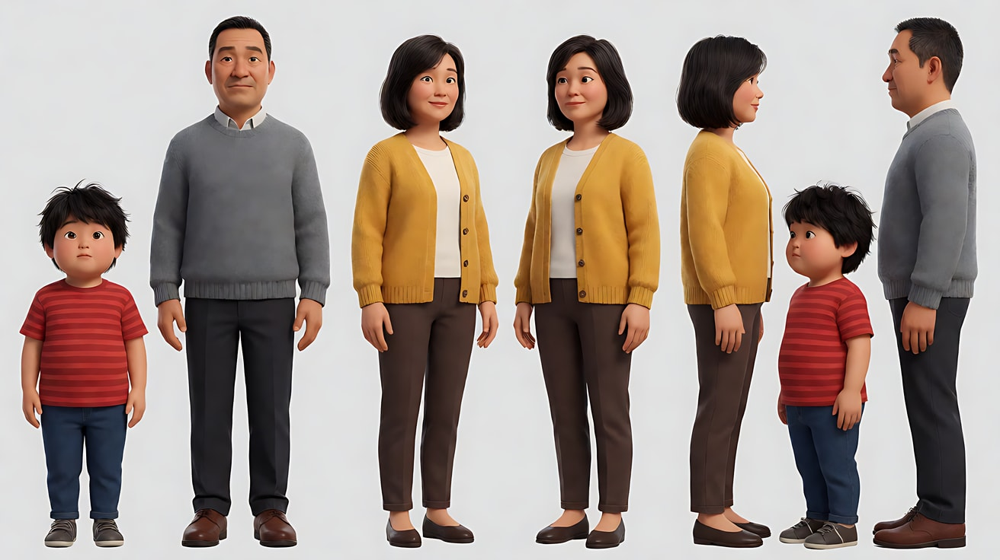

图2 场景（餐厅）：

```
Empty small family dining room at night, a round wooden table with three plates of dinner, a warm pendant lamp hanging above the table switched on,
a window on the left wall showing a cool blue moonlit sky, a sideboard with a flashlight and a box of candles, no people.
Wide shot, eye level, 28mm lens, deep focus.
Stylized semi-realistic 3D CG rendering, feature-film animation quality. Aspect ratio 16:9.
```

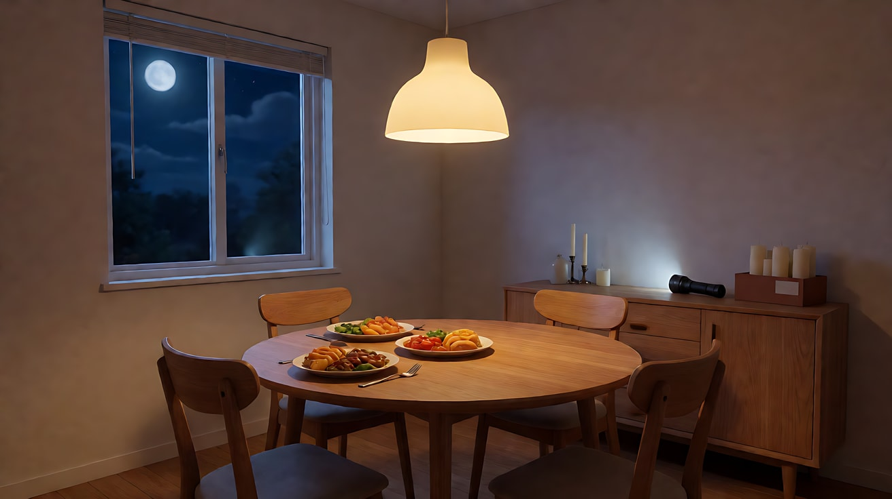

图3 镜头1 关键帧：

```
Using the characters from image 1 and the dining room from image 2:
a wide shot of the family at the round table, each looking down at their own phone beside their plate, not talking,
the father on frame left, the boy in the middle, the mother on frame right.
Camera at seated eye level, 28mm lens, deep focus.
Lighting: the warm pendant lamp above the table gives even top light, cool blue moonlight from the window on the left is barely visible.
Keep the faces, hairstyles and outfits exactly as in image 1.
Stylized semi-realistic 3D CG rendering, feature-film animation quality. Aspect ratio 16:9.
```

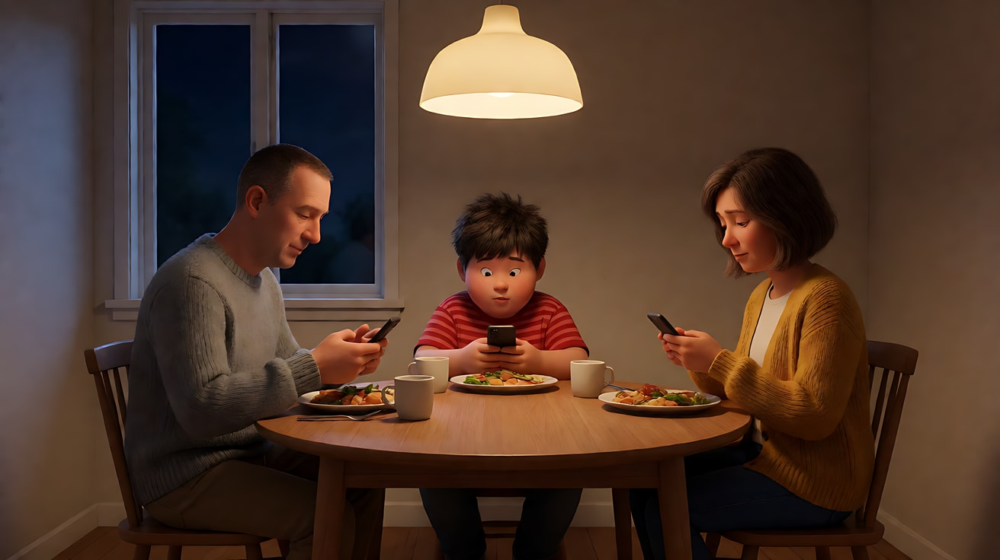

**【多图生视频 · Seedance】**

```
【素材分工】@图片1 锁定三位人物的身份与服装；@图片2 仅参考餐厅布局、吊灯、窗户和柜子上的手电与蜡烛位置，不复制空镜构图；@图片3 为首帧，锁定三人座位。
【画风】风格化写实三维CG质感，电影级布光。
镜头1：固定全景，一家三口围坐圆桌，各自低头看着盘子旁的手机，没人说话。头顶暖色吊灯均匀照亮桌面。吊灯闪了一下，熄灭，整个房间黑了。碗筷声，吊灯熄灭时轻微的咔声，男孩“啊”了一声。
镜头2：镜头切至同一机位的全景，房间里只剩画左窗外冷蓝的月光，三人只剩被月光勾出的轮廓。父亲起身走向画右的柜子，母亲和男孩坐着不动，只转头看他。窗外很远的狗叫。
镜头3：镜头切至柜子前的中景，父亲打开手电，一束硬白光从他手里射出，他用光束在墙上晃了一下，光圈扫过墙面，然后把光束对准桌面。手电开关咔哒一声。
镜头4：镜头切至圆桌的中景，桌子中间已经点着一根蜡烛，暖橙色的烛光从桌面高度柔和地照亮三张脸，火苗轻轻跳动。男孩把双手凑近火苗取暖，母亲看着他笑，父亲把手电关掉放在桌上，坐了下来。结尾停在三人被同一圈烛光照亮的画面上。
【锁定】座位：父亲在画左，男孩在中间，母亲在画右；光源顺序固定为吊灯、月光、手电、蜡烛；吊灯熄灭后不再亮起；窗户始终在画左。
【声音】碗筷声与吊灯熄灭声，男孩一声“啊”，远处狗叫，手电开关声，最后火苗轻微的噼啪声和男孩的一声笑，无配乐。
【约束】保持三人脸型、发型、服装不变；手机屏幕不朝向镜头；蜡烛只有一根；不要字幕、水印、Logo。
时长：15秒
```

**参数**：时长 15 秒 ｜ 画幅 16:9 ｜ 负载：4 个镜头、3 人同框、多次换光，属于"冒险"档。建议先完整生成一次观察，失败就拆成两次：镜头1–2 一次，镜头3–4 一次，用镜头2 的尾帧做第二段首帧

**【检查点】**
- 每次换光是否都有动作原因（灯灭、开手电、点蜡烛）
- 每个镜头里是否只有一种会动的光（镜头3 是手电，镜头4 是烛火）
- 镜头2 的黑暗里，轮廓光方向是否来自画左窗户
- 一个镜头里是否只有一个人做主动作

**【常见问题与修复】**
| 现象 | 修复 |
|---|---|
| 吊灯熄灭后又亮了 | 【锁定】写"吊灯熄灭后不再亮起"，镜头4 再写"吊灯是黑的" |
| 镜头2 太黑什么都看不见 | 写"月光在三人头发和肩膀上勾出冷蓝轮廓" |
| 三个人同时乱动 | 每个镜头只给一个人主动作，其他人写"坐着不动，只转头 / 只看" |
| 手电光束乱扫导致频闪 | 删掉"在墙上晃一下"，只写"把光束对准桌面" |
