# L04-04 自然光与时间 · 提示词

> 本组练习：用"太阳高度 + 天气"代替"好看的光"，让时间和天气替人物说话。｜ 配套教学：[L04-04-自然光与时间](../教学/L04-04-自然光与时间.md) ｜ 规范：[写作规范](../../模板/写作规范.md)
>
> 画风默认使用开关 A（风格化写实 CG）。如改用 2D 动画，删掉所有焦段、光圈、景深词。

---

### 练习1：黄金时刻逆光（难度 ★）

**目标**：写清太阳在人物的哪一侧、多高，让逆光勾出发丝和芦苇。意图：让观众感到这是她离开家乡前的最后一个傍晚。

**【生图 · Nano Banana】**

图1 关键帧：

```
A medium shot of an original young woman around twenty with a long loose braid, a faded yellow cotton dress and a thin denim jacket,
standing among tall reeds on a riverbank, her face in three-quarter profile looking toward the river on frame right.
She is placed on the left third of the frame. Camera at eye level, 85mm lens, shallow depth of field, reeds in the foreground softly blurred.
Lighting: golden hour, the low sun just above the horizon behind her at frame right, warm 2500K backlight drawing a bright golden rim
on her hair, braid and shoulders, the reed tips glowing, her face lit softly by warm light bouncing off the water, long shadows,
fine dust and pollen floating in the backlight.
Stylized semi-realistic 3D CG rendering, feature-film animation quality. Aspect ratio 16:9.
```

中文释义：中景，河堤芦苇中的女孩，四分之三侧脸看向画右的河；位于左三分之一；平视、85mm 浅景深，前景芦苇虚化；黄金时刻，低垂的太阳在她身后画右，2500K 暖色逆光给头发和肩膀勾出金边，芦苇尖发亮，水面反射的暖光柔和照亮脸部，逆光里飘着细小的尘埃和花粉。

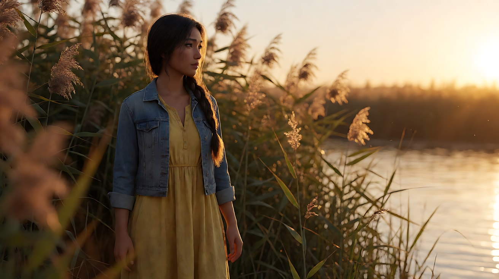

**【图生视频 · Seedance】**

```
【素材分工】@图片1 为首帧，锁定人物身份、服装与河堤环境。
【画风】风格化写实三维CG质感，电影级布光。
女孩站在芦苇丛中看着河面，晚风吹动她的辫梢和裙摆，她抬起一只手，让掌心轻轻擦过芦苇穗。低垂的太阳在她身后画右，暖金色逆光把她的头发和肩膀勾出一圈亮边，芦苇尖在光里发亮，细小的花粉在逆光中缓慢飘动。镜头从侧面缓慢向画右横移，前景芦苇从画面滑过。结尾停在她回头望向画左、脸被水面暖光照亮的瞬间。
【声音】晚风吹过芦苇的沙沙声，河水轻拍岸边，远处一声水鸟叫，无配乐。
【约束】保持人物脸型、发型、服装不变；太阳始终在她身后画右，高度不变；不要字幕、水印、Logo。
时长：7秒
```

**参数**：时长 7 秒 ｜ 画幅 16:9

**【检查点】**
- 太阳是否在人物身后，形成逆光轮廓，而不是正面暖光
- 芦苇和花粉是否在逆光里发亮
- 光是否全程稳定，没有突然变暗

**【常见问题与修复】**
| 现象 | 修复 |
|---|---|
| 太阳出现在画面正中，人物被照成正面 | 写"太阳在她身后画右，只露出光，不露出太阳本身" |
| 脸完全黑成剪影 | 写"水面反射的暖光柔和照亮她的脸" |
| 色调过橙、像滤镜 | 写"暖金色只在逆光边缘和高光处，阴影保持自然" |

---

### 练习2：同一张长椅，三个时刻——定妆图 + 场景图（难度 ★★）

**目标**：同一对人物、同一张长椅、同一句告别，只换时间：正午、黄金时刻、蓝调时刻。体会时间如何改写同一场戏。

**【生图 · Nano Banana】**

图1 角色定妆（两位原创人物）：

```
Character turnaround sheet of two original elderly friends in their seventies:
a tall thin man with a flat cap, a brown tweed jacket and a wooden walking cane;
a short round man with a bald head, a navy windbreaker and thick-framed glasses.
Front view, three-quarter view and side view of each, full body, plain light-grey background, even soft studio light.
Stylized semi-realistic 3D CG rendering, feature-film animation quality. Aspect ratio 16:9.
```

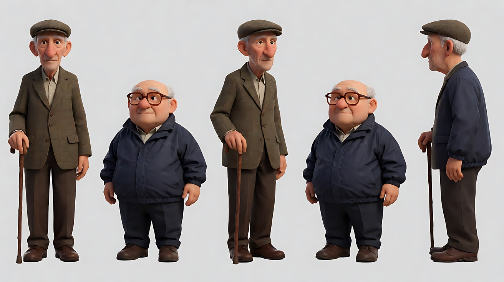

图2 场景（公园长椅）：

```
Empty old park bench under a large plane tree at the edge of a small lake, a gravel path, a street lamp beside the bench,
a few distant apartment buildings across the lake, neutral daylight, no people.
Wide shot, eye level, 35mm lens, deep focus.
Stylized semi-realistic 3D CG rendering, feature-film animation quality. Aspect ratio 16:9.
```

中文释义：图1 两位七十多岁的老朋友，一高一矮；图2 湖边梧桐树下的旧长椅，旁边一盏路灯，对岸有居民楼。

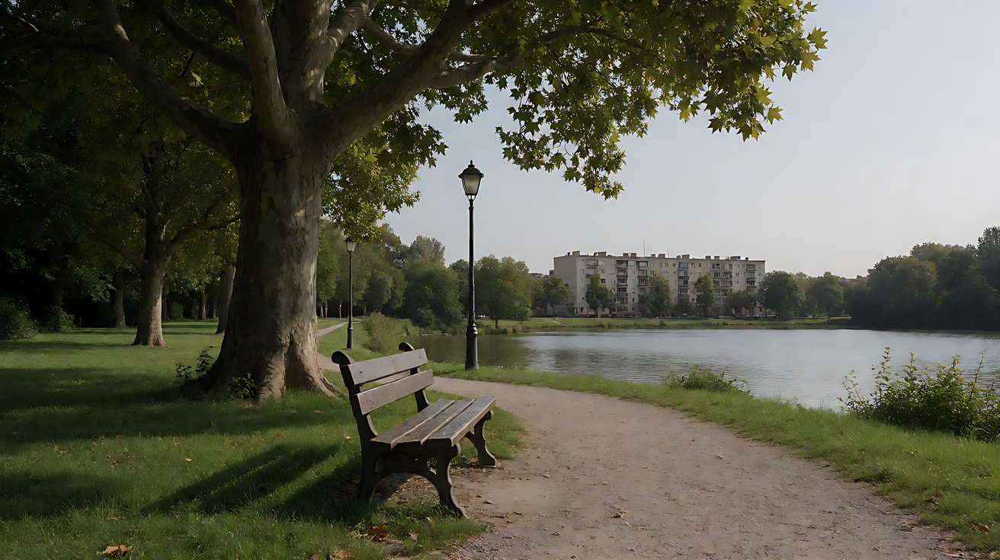

**【多图生视频 · Seedance】**

公共开头：

```
【素材分工】@图片1 锁定两位人物的身份与服装；@图片2 仅参考长椅、梧桐树、路灯和湖的位置，不复制其中的光线。
【画风】风格化写实三维CG质感，电影级布光。
```

版本 A 正午（意图：告别来得仓促，没有准备）：

```
正午，太阳在头顶正上方，硬光把两人的帽檐和眉骨下方压出浓黑的影子，脚下只有一小团锐利的黑影，梧桐树的影子碎碎地落在长椅上。高个老人站起来拄着拐杖，矮个老人坐着没动，眯着眼抬头看他。镜头固定中景双人镜头。高个老人说：“那我先走了。”结尾停在他转身迈出第一步的背影上。
【声音】知了的叫声很密，湖边有孩子的喧闹，砾石路上拐杖的一声轻响，无配乐。
【约束】保持两人脸型、服装不变；不要字幕、水印、Logo。
时长：6秒
```

版本 B 黄金时刻（意图：告别很美，他们都知道以后难再见）：

```
日落前，低垂的太阳在湖对岸画左，暖金色的光几乎水平地照过来，把两人的轮廓勾成金边，长长的影子从长椅一直拖到砾石路上，湖面一片碎金。高个老人站起来，把手搭在矮个老人肩上停了一下。镜头从侧面中景缓慢后拉成全景，露出湖和长长的影子。高个老人说：“那我先走了。”结尾停在两人一站一坐、被逆光勾边的全景上。
【声音】晚风吹动梧桐叶，湖水轻响，远处一声自行车铃，无配乐。
【约束】保持两人脸型、服装不变；太阳始终在画左湖对岸；不要字幕、水印、Logo。
时长：8秒
```

版本 C 蓝调时刻（意图：告别之后，只剩一个人）：

```
日落后，太阳已经沉下去，天空和湖面是均匀的深蓝色，没有直射光，长椅旁的路灯刚刚亮起，暖黄色的光在长椅上圈出一小块，对岸居民楼的窗户亮起一格格暖光。高个老人已经走远，只剩一个小小的背影在画面深处的小路上；矮个老人独自坐在路灯下，摘下眼镜用衣角擦了擦。镜头固定全景。结尾停在他重新戴上眼镜、望向小路尽头的画面。
【声音】湖边虫鸣，路灯的轻微电流声，远处小路上拐杖越来越远的笃笃声，无配乐。
【约束】保持两人脸型、服装不变；画面中没有太阳；不要字幕、水印、Logo。
时长：8秒
```

**参数**：时长 A 版 6 秒、B 版与 C 版 8 秒 ｜ 画幅 16:9

**【检查点】**
- A 版影子是否短而黑、在脚下；B 版是否长而暖；C 版是否没有直射影子
- C 版是否冷蓝天空 + 暖色路灯同框
- 只看三版截图，能否感到"仓促 / 珍惜 / 孤单"

**【常见问题与修复】**
| 现象 | 修复 |
|---|---|
| 正午版光太柔 | 写"太阳在头顶正上方，硬光，眉骨下影子浓黑" |
| 黄金时刻版变成正面暖光 | 写"太阳在湖对岸画左，逆光勾边" |
| 蓝调版天空发黑 | 写"天空和湖面是均匀的深蓝色，还没有全黑" |
| 台词被说成两句不同的话 | 三版统一写同一句台词，用光来区分情绪 |

---

### 练习3：太阳雨——首尾帧（难度 ★★★）

**目标**：理解"雨要逆光才看得见"。首帧在站台棚下，尾帧走进被低角度阳光照亮的雨里，雨丝在逆光中发亮。意图：让观众感到她决定不再等了。

**【生图 · Nano Banana】**

图1 角色定妆：

```
Character turnaround sheet of an original woman in her early thirties: short curly dark hair, a light grey linen shirt,
a long olive skirt, brown leather sandals, a folded transparent umbrella in her hand.
Front view, three-quarter view, side view and back view, full body, plain light-grey background, even soft studio light.
Stylized semi-realistic 3D CG rendering, feature-film animation quality. Aspect ratio 16:9.
```

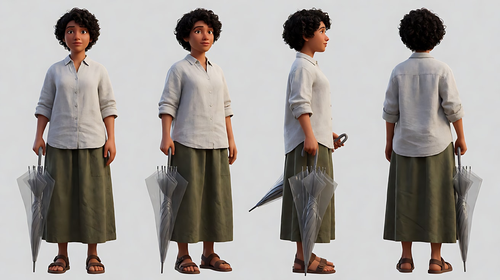

图2 首帧：

```
Using the character from image 1: a medium shot of her standing under the roof of a small rural bus shelter in the late afternoon,
holding the folded umbrella, looking out at the rain. She is placed on the right third, the open road on the left.
Camera at eye level from inside the shelter, 50mm lens, moderate depth of field.
Lighting: a sun shower — the low late-afternoon sun breaks through the clouds from the far end of the road, behind the rain,
the rain outside glows as bright golden streaks against the backlight, the inside of the shelter is in cool soft shade,
her face lit only by soft reflected light.
Keep the face, hairstyle and outfit exactly as in image 1.
Stylized semi-realistic 3D CG rendering, feature-film animation quality. Aspect ratio 16:9.
```

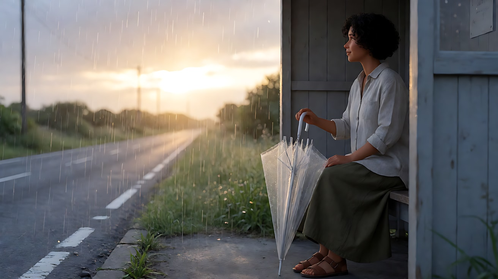

图3 尾帧：

```
Using the character from image 1, the same road and the same light:
a medium-wide shot of her standing in the middle of the road outside the shelter, umbrella still folded in her hand, face tilted up into the rain,
eyes closed, the low golden sun behind her at the far end of the road, backlit rain streaks glowing around her,
a bright golden rim on her wet curly hair and shoulders, the wet road shining like a mirror.
Camera at eye level, 50mm lens, moderate depth of field.
Keep the face, hairstyle and outfit exactly as in image 1.
Stylized semi-realistic 3D CG rendering, feature-film animation quality. Aspect ratio 16:9.
```

中文释义：首帧——乡间候车棚下，她拿着收起的伞看雨，低角度太阳从路的尽头穿透云层，雨丝在逆光里发金；棚内是冷色柔和阴影。尾帧——她站在路中间仰脸闭眼淋雨，伞仍收着，身后的低太阳让雨丝和湿发发亮，路面像镜子。

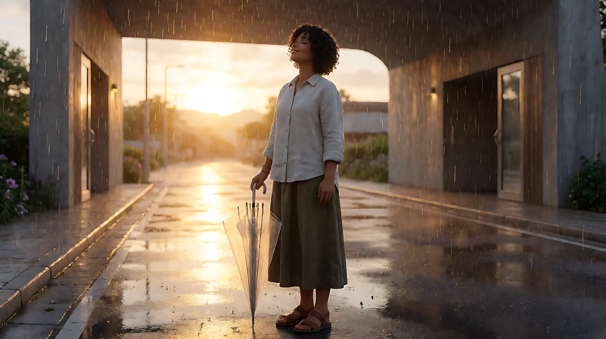

**【首尾帧生视频 · Seedance】**

```
【素材分工】@图片2 为首帧，锁定候车棚机位与逆光雨的光线；@图片3 为尾帧，是最终画面目标；@图片1 锁定人物身份与服装，不参考其中的棚拍光。只生成两帧之间的连续动作。
【画风】风格化写实三维CG质感，电影级布光。
她站在候车棚下看着路的尽头，又低头看了一眼手里收着的伞，没有打开。她走出棚子，雨落在她的肩膀和头发上，她没有加快脚步，走到路中间停下，慢慢仰起脸，闭上眼睛。低角度的太阳一直在路的尽头、在她正前方远处，雨丝在逆光里亮成一根根金线，她的湿发边缘被勾出一圈金色亮边。镜头跟随她缓慢后退，从中景退成中全景。
【声音】雨打在棚顶铁皮上的密集声，走出棚子后变成雨落在路面和她身上的沙沙声，远处一声雷，无配乐。
【约束】保持人物脸型、发型、服装不变；伞始终收着不打开；太阳方向不变；不要字幕、水印、Logo。
时长：8秒
```

**参数**：时长 8 秒 ｜ 画幅 16:9

**【检查点】**
- 雨丝是否在逆光中清晰发亮
- 太阳方向从首帧到尾帧是否一致
- 伞是否始终没有打开

**【常见问题与修复】**
| 现象 | 修复 |
|---|---|
| 雨几乎看不见 | 写"雨丝在逆光里亮成一根根金线"，并确认太阳在雨的后面 |
| 天空变成阴天，没有太阳 | 写"太阳从云缝里露出，低角度金光" |
| 她打开了伞 | 约束写"伞始终收着" |

---

### 练习4：雪原上的邮差——多镜头（难度 ★★★★）

**目标**：三个镜头三种雪地光：阴天雪原的低对比柔光、雪地反光从下方补亮脸部、蓝调时刻小屋窗户的暖光。意图：让观众感到漫长寒冷之后，一扇亮着的窗户有多珍贵。

**【生图 · Nano Banana】**

图1 角色定妆：

```
Character turnaround sheet of an original mail carrier in his fifties: a ruddy round face, a grey moustache with frost,
a dark red knitted hat with ear flaps, a heavy navy down coat, thick mittens, a worn leather mailbag across his body, snow boots.
Front view, three-quarter view, side view and back view, full body, plain light-grey background, even soft studio light.
Stylized semi-realistic 3D CG rendering, feature-film animation quality. Aspect ratio 16:9.
```

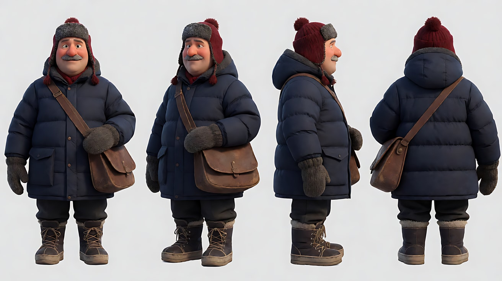

图2 场景 A（雪原）：

```
Empty vast snowfield under a heavy overcast sky, a faint path of footprints leading toward a distant line of bare birch trees,
soft shadowless light, very low contrast, the horizon almost merging with the white sky, no people.
Extreme wide shot, eye level, 35mm lens, deep focus.
Stylized semi-realistic 3D CG rendering, feature-film animation quality. Aspect ratio 16:9.
```

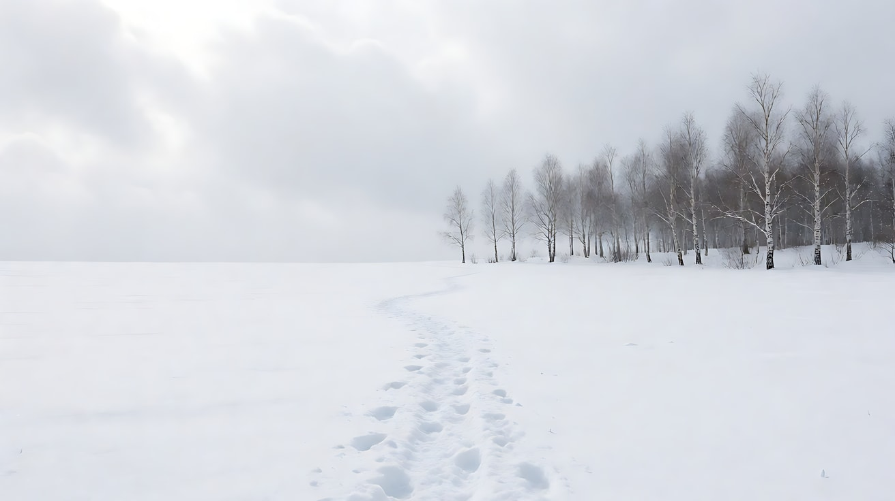

图3 场景 B（林边小屋）：

```
Empty small wooden cabin at the edge of a birch forest at blue hour, deep blue sky, snow on the roof,
one window glowing warm orange 2700K from a lamp inside, warm light spilling onto the snow in front of the door, no people.
Wide shot, eye level, 35mm lens, deep focus.
Stylized semi-realistic 3D CG rendering, feature-film animation quality. Aspect ratio 16:9.
```

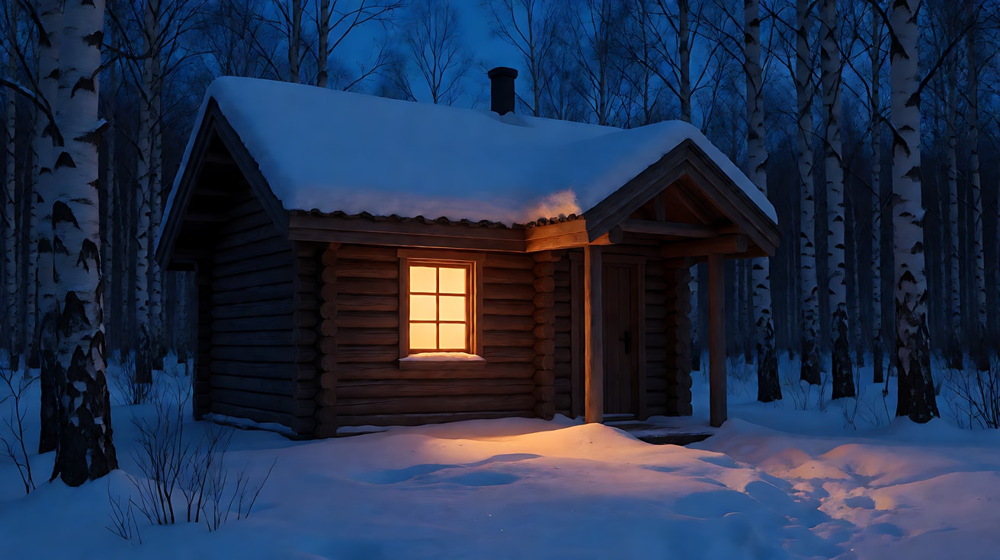

图4 镜头1 关键帧：

```
Using the character from image 1 and the snowfield from image 2:
an extreme wide shot of the mail carrier walking slowly across the snowfield from frame right toward frame left, very small in the frame,
leaning into the wind, a single line of footprints behind him.
Camera at eye level, 35mm lens, deep focus. Lighting: flat overcast light, no shadows, soft white everywhere.
Keep the face, hairstyle and outfit exactly as in image 1.
Stylized semi-realistic 3D CG rendering, feature-film animation quality. Aspect ratio 16:9.
```

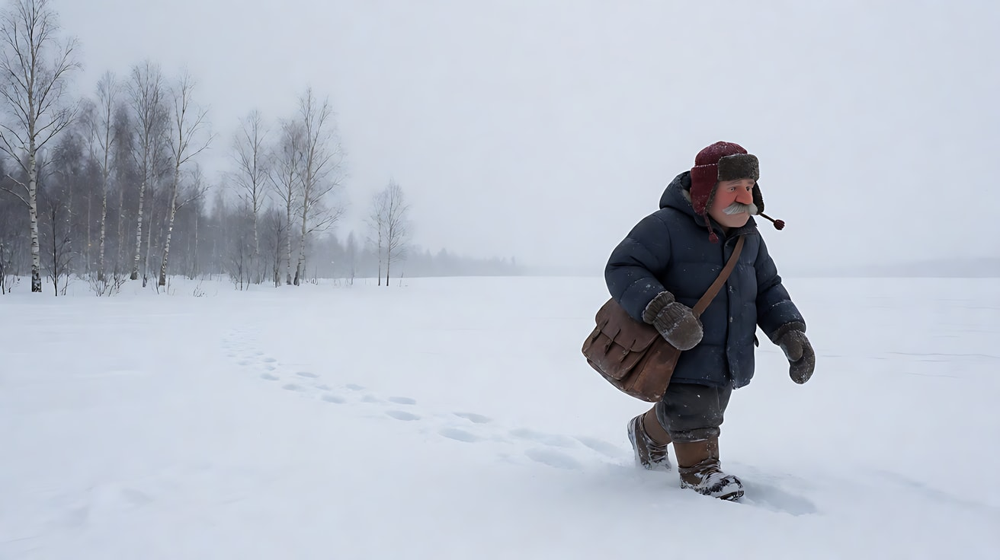

**【多图生视频 · Seedance】**

```
【素材分工】@图片1 锁定人物身份、红色护耳帽、深蓝羽绒服与邮包；@图片2 仅参考雪原与白桦林的环境和阴天光；@图片3 仅参考小屋外观与窗户暖光；@图片4 为首帧。场景图中不复制任何人物。
【画风】风格化写实三维CG质感，电影级布光。
镜头1：固定大远景，邮差在一望无际的雪原上从画右向画左慢慢走，身体前倾顶着风，在画面中很小，身后留下一行脚印。阴天的云层把光铺得又平又软，几乎没有影子，地平线和天空融成一片白。呼啸的风声和踩雪的咯吱声。
镜头2：镜头切至侧面中近景，他停下来喘气，拉下围巾哈出一团白气，抬头看向画左远处。头顶的阴天光很平，雪地把光从下方反射上来，照亮他的下巴和胡子上的霜，脸部几乎没有阴影。他沉重的呼吸声，风声变小。
镜头3：镜头切至小屋前的全景，天已经变成深蓝色，他从画右走进画面，走向那扇亮着暖橙色灯光的窗户，窗光洒在门前的雪地上，他走进这块暖光里，暖光照亮他半边身体，另一半仍是冷蓝。他摘下手套，抬手敲门。镜头缓慢向前推进。结尾停在他站在暖光里、等门打开的背影上。三声敲门声，屋里传来一声模糊的应答。
【锁定】人物始终戴红色护耳帽、穿深蓝羽绒服、斜挎皮邮包；行进方向始终从画右到画左；光线顺序固定为阴天平光、雪地反光、蓝调天空加窗户暖光。
【声音】从呼啸风声与踩雪声，到沉重呼吸，最后是敲门声和屋里的一声应答，无配乐。
【约束】保持人物脸型、胡子、服装不变；不要字幕、水印、Logo。
时长：13秒
```

**参数**：时长 13 秒 ｜ 画幅 16:9 ｜ 负载：3 个镜头、2 个地点，属于"有挑战"档

**【检查点】**
- 镜头1 是否几乎没有影子、对比极低
- 镜头2 下巴和胡子是否被雪地反光照亮
- 镜头3 冷蓝和暖橙是否同框，暖光是否只来自窗户

**【常见问题与修复】**
| 现象 | 修复 |
|---|---|
| 镜头1 出现太阳和硬影子 | 写"厚厚的阴天云层，没有太阳，没有影子" |
| 镜头3 天太黑看不清人 | 写"深蓝色的蓝调天空，还能看清雪地和树" |
| 镜头3 窗户里出现人脸 | 写"窗户里只有灯光，看不到人" |
| 行进方向在镜头间反了 | 【锁定】写方向，镜头3 写"从画右走进画面" |

---

### 练习5：沙漠里的一天——四个时段一次生成（难度 ★★★★★）

**目标**：在一次生成里用四个镜头走完一天：正午顶光 → 下午侧光长影 → 黄金时刻逆光 → 蓝调时刻篝火。太阳方向全程合理（人物向西走，太阳从头顶移到前方再落下）。意图：让观众感到熬过最难的一段之后，她终于能停下来。

**【生图 · Nano Banana】**

图1 角色定妆：

```
Character turnaround sheet of an original female desert traveler in her late twenties: sun-browned skin, a long sand-colored scarf
wrapped around her head and neck, a loose off-white linen shirt, khaki trousers, worn leather boots, a large canvas backpack with a metal water flask.
Front view, three-quarter view, side view and back view, full body, plain light-grey background, even soft studio light.
Stylized semi-realistic 3D CG rendering, feature-film animation quality. Aspect ratio 16:9.
```

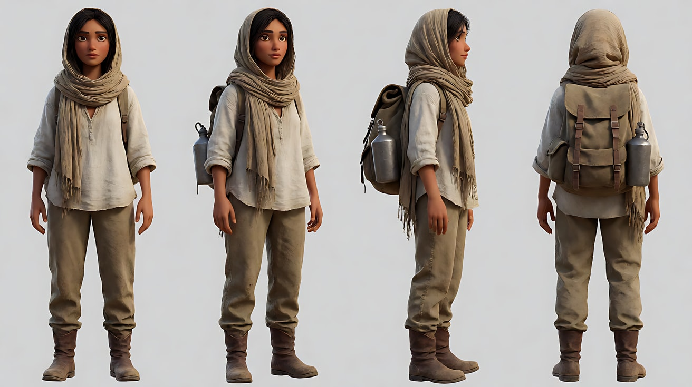

图2 场景（沙丘）：

```
Empty rolling sand dunes in a vast desert, sharp dune ridges, a few dry shrubs, neutral midday light, clear sky, no people.
Extreme wide shot, eye level, 35mm lens, deep focus.
Stylized semi-realistic 3D CG rendering, feature-film animation quality. Aspect ratio 16:9.
```

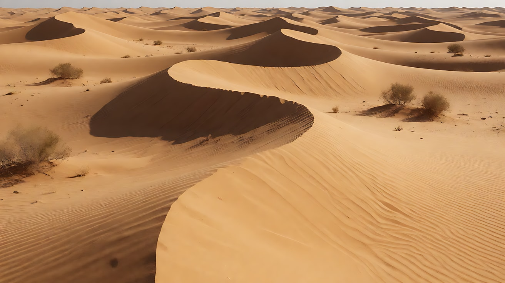

图3 镜头1 关键帧（正午）：

```
Using the character from image 1 and the desert from image 2:
a medium shot of her stopping on a dune slope to drink from the metal flask, head tilted back.
Camera at eye level, 50mm lens, moderate depth of field, heat haze shimmering on the dunes behind.
Lighting: harsh noon sun directly overhead, hard top light, deep black shadows in her eye sockets and under her chin,
a tiny pool of shadow right under her feet, bleached pale sand, 5600K.
Keep the face, hairstyle and outfit exactly as in image 1.
Stylized semi-realistic 3D CG rendering, feature-film animation quality. Aspect ratio 16:9.
```

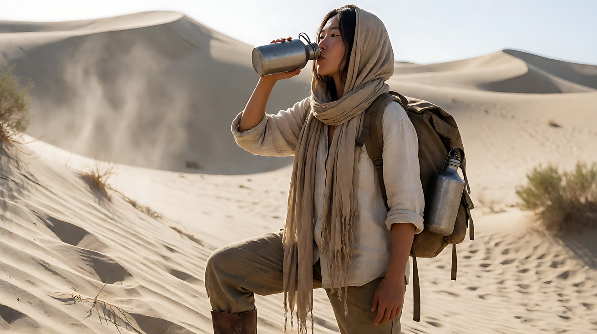

图4 镜头4 关键帧（蓝调篝火）：

```
Using the character from image 1 in the same desert:
a medium close-up of her sitting by a small campfire in a hollow between dunes at blue hour, scarf loosened around her neck,
holding her hands toward the fire. Camera at eye level, 85mm lens, shallow depth of field.
Lighting: deep blue twilight sky as cool ambient light on the dunes and her shoulders, the small fire as warm 1900K key light from below and in front,
flickering on her face. A faint last orange line on the horizon behind her.
Keep the face, hairstyle and outfit exactly as in image 1.
Stylized semi-realistic 3D CG rendering, feature-film animation quality. Aspect ratio 16:9.
```

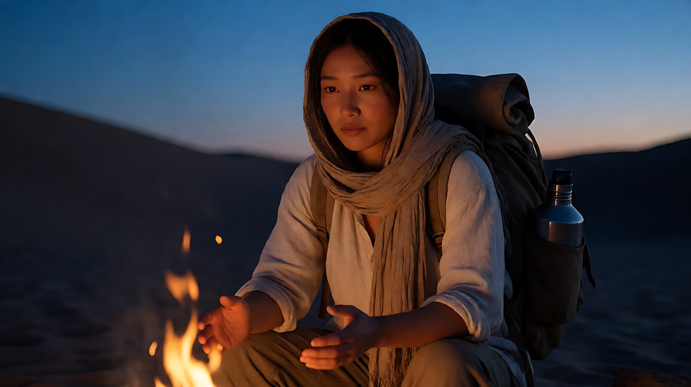

**【多图生视频 · Seedance】**

```
【素材分工】@图片1 锁定人物身份、沙色头巾、亚麻衬衫与背包；@图片2 仅参考沙丘地貌，不复制其中光线；@图片3 为首帧，锁定正午顶光；@图片4 为镜头4的画面目标，锁定蓝调篝火的光色。
【画风】风格化写实三维CG质感，电影级布光。
镜头1：固定中景，正午，太阳在头顶正上方，硬光把她的眼窝和下巴下方压成深黑，脚下只有一小团影子，沙面白得刺眼，远处热浪抖动。她仰头喝了一口水，把水壶摇了摇，听到里面所剩无几。风刮过沙面的声音，水壶里水晃动的空响。
镜头2：镜头切至侧面全景，下午，太阳移到她前方偏高处，斜侧光把沙丘脊线的一面照亮、另一面落进阴影，她身后拖出一条长长的影子。她低着头一步一步往沙丘上爬，脚陷进沙里。沉重的脚步声和她的喘息。
镜头3：镜头切至沙丘顶的背后低角度全景，黄金时刻，太阳低垂在她正前方的地平线上，她站上沙丘顶，整个人成为逆光剪影，头巾的边缘被风吹起，透出暖金色的光，沙粒在逆光里飞成一片金色的细雾。她解下头巾，长长地呼出一口气。风声变轻。
镜头4：镜头切至沙丘之间的中近景，蓝调时刻，天空已是深蓝，地平线只剩一线橙色。她坐在一小堆篝火旁，向火伸出双手，火光从下前方暖暖地照亮她的脸并轻轻跳动，肩膀和身后的沙丘是冷蓝色。镜头极慢地向前推进。结尾停在她闭上眼睛、嘴角放松的脸上。
【锁定】人物始终穿亚麻衬衫、背帆布背包，镜头3 之后头巾解下搭在脖子上；行进方向始终朝画左（向西），太阳从头顶逐渐移到她前方并落下；每个镜头只有一种主光。
【声音】从风刮沙面与水壶空响，到脚步与喘息，再到轻风，最后是篝火噼啪声和远处一声夜鸟，无配乐。
【约束】保持人物脸型、发型、服装不变；不要字幕、水印、Logo。
时长：15秒
```

**参数**：时长 15 秒 ｜ 画幅 16:9 ｜ 负载：4 个镜头、4 个时段，属于"有挑战"档；失败时拆成两次（镜头1–2、镜头3–4），第二次用镜头2 尾帧做首帧

**【检查点】**
- 四个镜头的影子是否从"脚下一小团"变成"长影"再到"剪影"和"无直射影"
- 太阳方向是否和她的行进方向逻辑一致
- 镜头4 是否冷蓝天空 + 暖色篝火同框

**【常见问题与修复】**
| 现象 | 修复 |
|---|---|
| 四个镜头都被调成橙黄色 | 每个镜头开头写时段与太阳位置；镜头1 写"沙面白得刺眼，中性偏冷" |
| 镜头3 太阳在她身后 | 写"太阳在她正前方的地平线上，她被逆光成剪影" |
| 镜头4 篝火太大像火灾 | 写"一小堆篝火，火苗只有手掌高" |
| 头巾状态前后错乱 | 【锁定】写明"镜头3 之后头巾解下搭在脖子上" |
