# L04-05 高调低调与明暗对照 · 提示词

> 本组练习：用画面"调性"签订情绪契约——高调让观众放松，低调和明暗对照让黑暗替你藏信息，百叶窗和门缝把阴影变成道具。｜ 配套教学：[L04-05-高调低调与明暗对照](../教学/L04-05-高调低调与明暗对照.md) ｜ 规范：[写作规范](../../模板/写作规范.md)
>
> 画风默认使用开关 A（风格化写实 CG）。如改用 2D 动画，删掉所有焦段、光圈、景深词。

---

### 练习1：百叶窗条纹光（难度 ★）

**目标**：写出硬光穿过百叶窗形成的清晰条纹，并让条纹随人物动作在脸上滑动。意图：让观众感到他刚听到的话不可信。

**【生图 · Nano Banana】**

图1 关键帧：

```
A medium close-up of an original private investigator in his late forties with slicked-back dark hair, a five o'clock shadow,
a loosened dark tie and a rumpled white shirt with rolled-up sleeves, sitting back in a worn leather chair behind a cluttered desk in a dim office.
He is placed slightly right of center, looking toward frame left. Camera at eye level, 50mm lens, moderate depth of field.
Lighting: low-key, hard late-afternoon sunlight from a window at frame left passing through venetian blinds,
casting sharp parallel horizontal stripes of light and shadow across his face, chest and the wall behind him;
no fill light, the rest of the office falls into deep shadow, slow drifting dust in the light stripes.
Stylized semi-realistic 3D CG rendering, feature-film animation quality. Aspect ratio 16:9.
```

中文释义：中近景，私家调查员靠坐在旧皮椅上，位于略偏右，看向画左；平视、50mm；低调，画左窗外午后硬光穿过百叶窗，在脸、胸口和身后墙上切出清晰的横条纹；无辅光，其余部分沉在暗处，光带里有灰尘缓慢飘动。

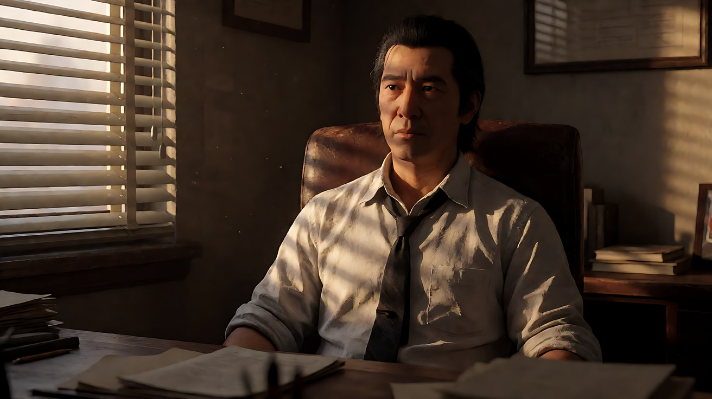

**【图生视频 · Seedance】**

```
【素材分工】@图片1 为首帧，锁定人物身份、服装与办公室布局。
【画风】风格化写实三维CG质感，电影级布光，低调黑色电影质感。
男人靠在椅背上听着画外的人说话，没有表情。他慢慢向前探身，手肘撑到桌面上，十指交叉抵住下巴，百叶窗的横条纹光随着他的移动从额头滑到眼睛，再滑到嘴唇，一条阴影正好遮住他的眼睛。光带里的灰尘缓慢飘动。镜头固定中近景，不移动。结尾停在他眼睛藏在阴影条纹里、只有嘴唇被照亮的脸上。
【声音】窗外远处的街道车流声，墙上电扇缓慢转动的嗡声，皮椅的一声吱呀，无配乐。
【约束】保持人物脸型、发型、服装不变；百叶窗条纹始终清晰锐利；光源只有画左窗户；不要字幕、水印、Logo。
时长：6秒
```

**参数**：时长 6 秒 ｜ 画幅 16:9

**【检查点】**
- 条纹是否清晰、边缘锐利
- 条纹是否随人物前倾在脸上滑动
- 办公室其他部分是否保持暗

**【常见问题与修复】**
| 现象 | 修复 |
|---|---|
| 条纹模糊成一片 | 写"硬光，条纹边缘清晰锐利"，删去任何"柔光"字样 |
| 条纹是竖的 | 写"横向百叶窗，水平条纹" |
| 画面整体被补亮 | 写"无辅光，办公室其余部分沉入阴影" |

---

### 练习2：同一封信，两种调性——定妆图 + 场景图（难度 ★★）

**目标**：同一位人物、同一间办公室、同一个"打开信封"的动作，分别拍成暖色高调喜剧和低调黑色电影。体会"调"是一份情绪契约。

**【生图 · Nano Banana】**

图1 角色定妆：

```
Character turnaround sheet of an original office clerk in her early thirties: a neat high ponytail, large round glasses,
a pale yellow blouse with a small bow at the collar, a grey pencil skirt, low black heels.
Front view, three-quarter view, side view and back view, full body, plain light-grey background, even soft studio light.
Stylized semi-realistic 3D CG rendering, feature-film animation quality. Aspect ratio 16:9.
```

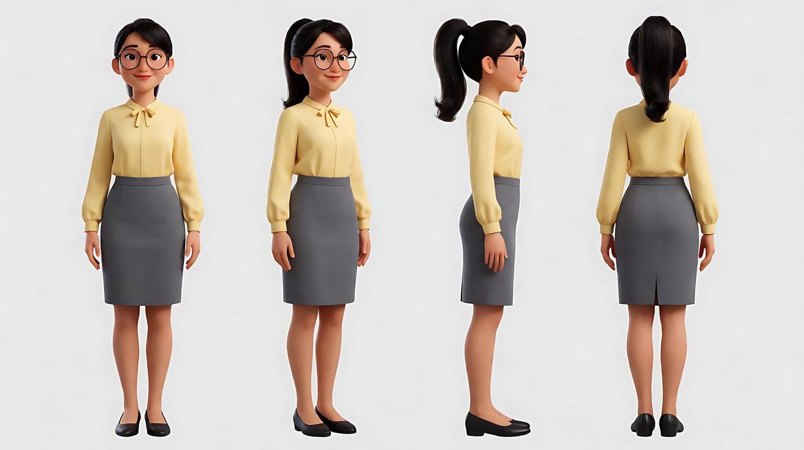

图2 场景（小办公室）：

```
Empty small old-fashioned office, a wooden desk facing the camera, a window with venetian blinds on the left wall,
a coat stand, a filing cabinet, a desk lamp, a sealed envelope on the desk, neutral even light, no people.
Medium-wide shot, eye level, 35mm lens, deep focus.
Stylized semi-realistic 3D CG rendering, feature-film animation quality. Aspect ratio 16:9.
```

中文释义：图1 原创文员定妆，高马尾、大圆框眼镜、淡黄衬衫；图2 老式小办公室，书桌朝向镜头，左墙百叶窗，桌上一封封好的信。

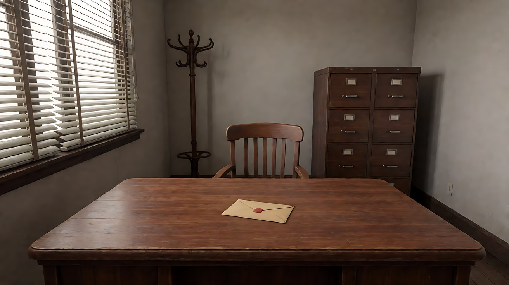

**【多图生视频 · Seedance】**

版本 A 暖色高调喜剧（意图：让观众感到信里是个好消息，她快要藏不住了）：

```
【素材分工】@图片1 锁定人物身份、发型、眼镜与服装；@图片2 仅参考办公室布局与陈设，不复制其中光线。
【画风】风格化写实三维CG质感，明亮的高调布光。
上午，百叶窗全部拉起，大片柔和的暖白阳光从画左窗户铺满整个房间，墙面明亮，几乎没有阴影，她的脸和桌面都清清楚楚。她坐在桌前撕开信封，读了一眼，眼睛瞪大，捂住嘴，双脚在桌下快速地小跺了几下。镜头固定中景，正面平视。结尾停在她把信纸按在胸口、憋着笑的脸上。
【声音】窗外鸟叫，信封撕开的声音，她鞋跟轻轻敲地的嗒嗒声，一段轻快的拨弦配乐。
【约束】保持人物脸型、发型、眼镜、服装不变；画面明亮、细节清楚、不过曝；信纸上的字看不清；不要字幕、水印、Logo。
时长：6秒
```

版本 B 低调黑色电影（意图：让观众感到信里是一个她不该知道的秘密）：

```
【素材分工】@图片1 锁定人物身份、发型、眼镜与服装；@图片2 仅参考办公室布局与陈设，不复制其中光线。
【画风】风格化写实三维CG质感，低调黑色电影质感。
傍晚，百叶窗半合，一道窄窄的硬光穿过百叶片，在桌面和她的脸上切出几条锐利的横条纹，房间其余部分沉在深暗里，台灯没有开。她坐在桌前慢慢撕开信封，读了一眼，动作停住，镜片反着一条冷光，看不清她的眼睛。她把信纸折回去，按在桌面上，抬头看向画右的门。镜头固定中景，正面平视。结尾停在她只有下半张脸被条纹光照亮、望向门口的画面。
【声音】窗外远处的雨声，墙上挂钟滴答，信纸折叠的声音，门外走廊里一阵越来越近的脚步声，无配乐。
【约束】保持人物脸型、发型、眼镜、服装不变；光源只有百叶窗透进来的条纹光；信纸上的字看不清；不要字幕、水印、Logo。
时长：7秒
```

**参数**：时长 A 版 6 秒、B 版 7 秒 ｜ 画幅 16:9

**【检查点】**
- A 版是否大面积明亮、阴影浅；B 版是否大面积暗、亮部只有条纹
- 同一个动作，只因调性不同，能否读出"好消息 / 秘密"
- B 版是否有明确亮部，而不是整体发灰

**【常见问题与修复】**
| 现象 | 修复 |
|---|---|
| A 版脸部过曝丢细节 | 写"明亮柔和、细节清楚、不过曝" |
| B 版整体灰暗看不清任何东西 | 写清亮部："条纹光落在桌面、信纸和她的下半张脸上" |
| 信纸出现乱码文字特写 | 约束写"信纸上的字看不清"，镜头不给信纸特写 |

---

### 练习3：从黑暗里被光"挖"出来——首尾帧（难度 ★★★）

**目标**：用明暗对照法做一次人物登场。首帧只有一束顶光落在空地板上，尾帧人物站进光里，只有脸和手被照亮。意图：让观众感到这个人一直都在暗处看着。

**【生图 · Nano Banana】**

图1 角色定妆：

```
Character turnaround sheet of an original elderly antique dealer in his seventies: a gaunt face, deep-set eyes, neatly trimmed white beard,
a long dark burgundy velvet robe, thin gold-rimmed half-moon glasses on a chain, a large silver ring on his right hand.
Front view, three-quarter view, side view and back view, full body, plain light-grey background, even soft studio light.
Stylized semi-realistic 3D CG rendering, feature-film animation quality. Aspect ratio 16:9.
```

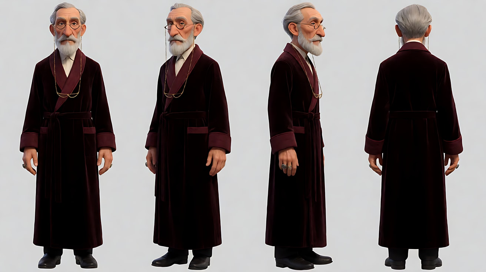

图2 首帧：

```
An almost completely dark old antique shop at night, a single narrow hard beam of light falling from a small skylight above
onto an empty patch of worn wooden floor in the center of the frame, faint dust in the beam,
the edges of shelves with old clocks and vases barely visible in the darkness, nobody visible.
Medium-wide shot, eye level, 35mm lens, deep focus. Chiaroscuro, low-key, everything outside the beam is near black.
Stylized semi-realistic 3D CG rendering, feature-film animation quality. Aspect ratio 16:9.
```

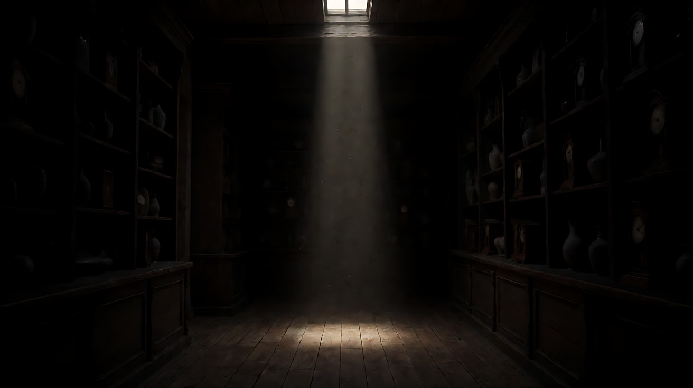

图3 尾帧：

```
Using the character from image 1, the same antique shop and the same skylight beam:
a medium shot of the old man standing exactly in the beam in the center of the frame, the hard top light carving out
his forehead, cheekbones, white beard and his hands folded in front of him with the silver ring catching a highlight,
his eyes in shadow under his brows, his robe fading into darkness below the chest; everything outside the beam is near black.
Camera at eye level, 35mm lens, moderate depth of field. Chiaroscuro, low-key.
Keep the face, hairstyle and outfit exactly as in image 1.
Stylized semi-realistic 3D CG rendering, feature-film animation quality. Aspect ratio 16:9.
```

中文释义：首帧——几乎全黑的古董店，天窗落下一束窄硬光照在画面中央的空地板上，光里有灰尘，四周货架只隐约可见。尾帧——老人站在光束正中，顶光雕出额头、颧骨、胡子和交叠的双手，银戒指闪一个高光，眼睛藏在眉骨阴影里，长袍在胸口以下沉入黑暗。

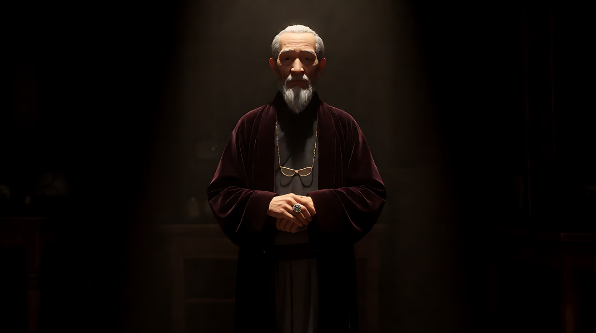

**【首尾帧生视频 · Seedance】**

```
【素材分工】@图片2 为首帧，锁定店内布局、天窗光束位置与低调光；@图片3 为尾帧，是最终画面目标；@图片1 锁定人物身份、眼镜与服装，不参考其中的棚拍光。只生成两帧之间的连续画面。
【画风】风格化写实三维CG质感，低调明暗对照布光。
空荡的地板上只有一束从天窗落下的窄光，灰尘在光里缓慢旋转。黑暗中先是传来一声木地板的吱呀，接着一只戴银戒指的手从画右的黑暗里伸进光束边缘，然后老人慢慢迈步，整个人走进光里，站定，双手交叠放在身前。光束只照亮他的额头、颧骨、胡子和双手，眼睛始终藏在眉骨的阴影里。镜头固定中景，不移动。
【声音】满屋老钟各自的滴答声，木地板一声吱呀，长袍拖过地板的沙沙声，他站定后，所有钟声里只剩一只最响的，无配乐。
【约束】保持人物脸型、胡子、眼镜、服装不变；光束位置不变；光束以外保持近乎全黑；不要字幕、水印、Logo。
时长：7秒
```

**参数**：时长 7 秒 ｜ 画幅 16:9

**【检查点】**
- 光束外是否始终近乎全黑
- 人物走进光的过程是否"先手、后人"
- 尾帧眼睛是否藏在阴影里

**【常见问题与修复】**
| 现象 | 修复 |
|---|---|
| 人物凭空出现在光里 | 写"从画右的黑暗里先伸进一只手，再慢慢走进光里" |
| 店里被照亮 | 写"光束以外近乎全黑，货架只隐约可见" |
| 眼睛被照亮，失去神秘感 | 写"眼睛始终藏在眉骨的阴影里"，并确认光是正顶光 |

---

### 练习4：雨夜三镜——黑色电影低调多镜头（难度 ★★★★）

**目标**：用三种图形化阴影串起一段黑色电影段落：湿街上被拉长的人影、楼梯扶手的栏杆影、百叶窗条纹光。意图：让观众感到她越走越深，已经回不了头。

**【生图 · Nano Banana】**

图1 角色定妆：

```
Character turnaround sheet of an original woman in her early thirties in a 1940s-inspired outfit: dark waved shoulder-length hair,
a belted cream trench coat, a small dark felt hat with a short brim, black gloves, a small black handbag.
Front view, three-quarter view, side view and back view, full body, plain light-grey background, even soft studio light.
Stylized semi-realistic 3D CG rendering, feature-film animation quality. Aspect ratio 16:9.
```

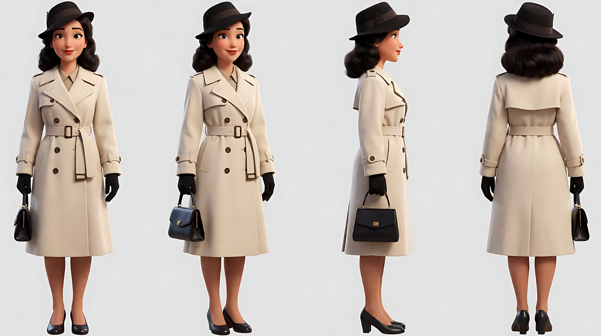

图2 场景 A（雨夜街道）：

```
Empty narrow old city street at night after rain, wet cobblestones shining, a single hard streetlamp low on frame right,
long dark shadows stretching across the street and up the brick wall on the left, deep black alleys, no people.
Wide shot, low angle, 28mm lens, deep focus, slightly tilted horizon. Low-key black-and-white-inspired contrast with muted colors.
Stylized semi-realistic 3D CG rendering, feature-film animation quality. Aspect ratio 16:9.
```

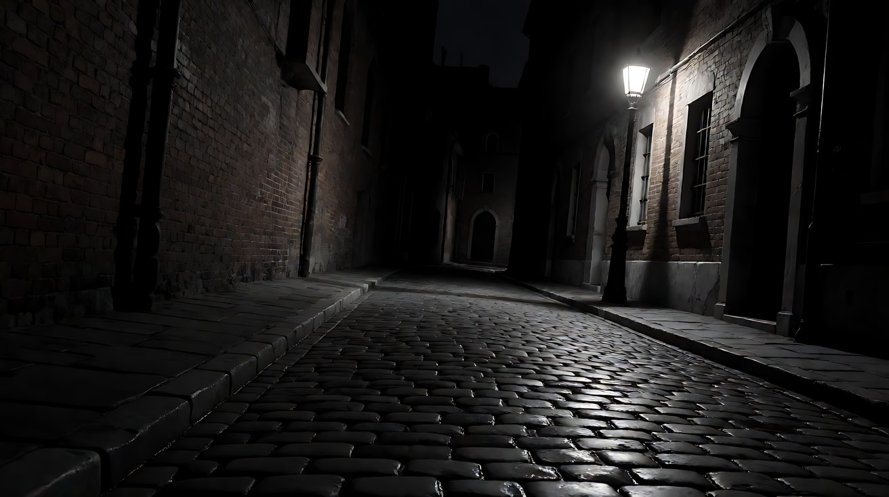

图3 场景 B（老公寓楼梯）：

```
Empty old apartment stairwell at night, a curved wooden staircase with iron balusters, a single hard bulb on the landing above
casting long diagonal shadows of the balusters across the wall like bars, the lower steps in darkness, no people.
Medium-wide shot, low angle looking up the stairs, 28mm lens, deep focus. Low-key.
Stylized semi-realistic 3D CG rendering, feature-film animation quality. Aspect ratio 16:9.
```

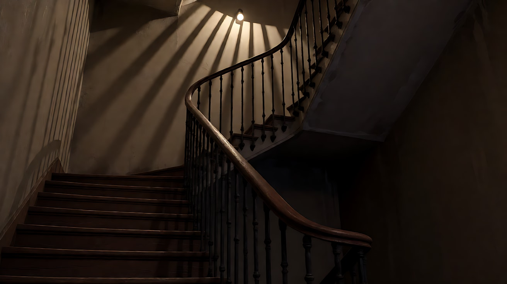

图4 场景 C（百叶窗房间）：

```
Empty small rented room at night, a window with venetian blinds on the right wall, a hard white neon light from outside
passing through the blinds and casting sharp horizontal stripes across a bed and the wall, the rest of the room dark, no people.
Medium shot, eye level, 35mm lens, moderate depth of field. Low-key.
Stylized semi-realistic 3D CG rendering, feature-film animation quality. Aspect ratio 16:9.
```

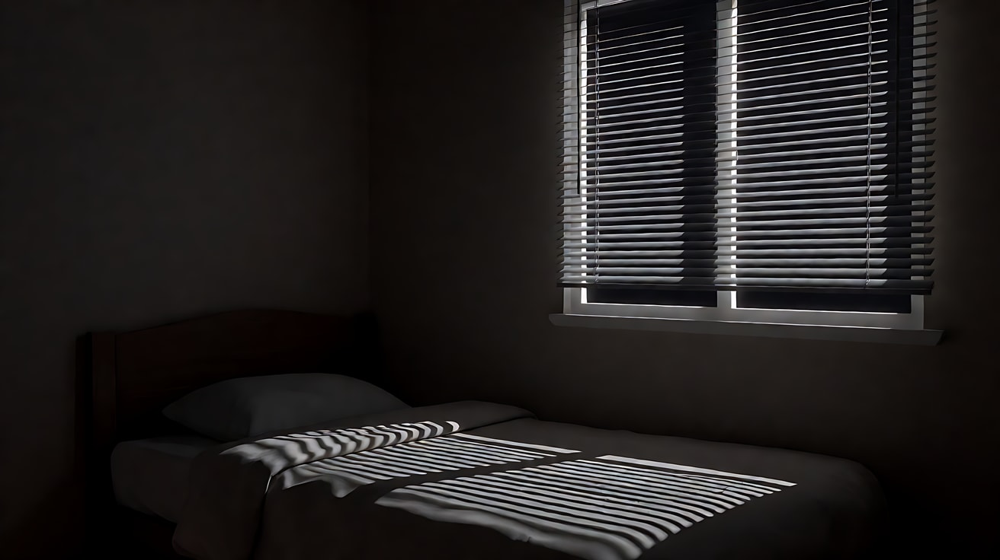

图5 镜头1 关键帧：

```
Using the character from image 1 and the street from image 2:
a wide low-angle shot of her walking away from the camera down the wet street, small in the frame,
her long shadow stretched far ahead of her up the brick wall by the low streetlamp behind her at frame right.
Camera low near the wet cobblestones, 28mm lens, deep focus, slightly tilted horizon.
Keep the face, hairstyle and outfit exactly as in image 1.
Stylized semi-realistic 3D CG rendering, feature-film animation quality. Aspect ratio 16:9.
```

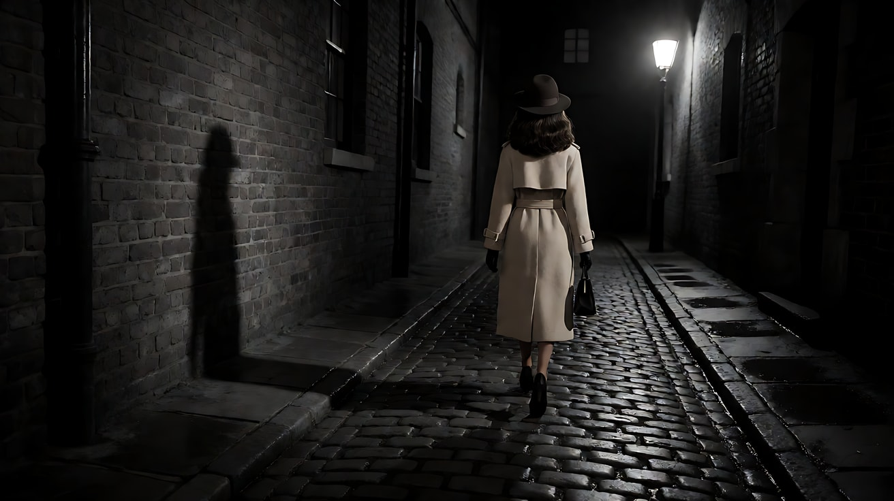

**【多图生视频 · Seedance】**

```
【素材分工】@图片1 锁定人物身份、发型、帽子与风衣；@图片2 仅参考雨夜街道与路灯位置；@图片3 仅参考楼梯与栏杆影；@图片4 仅参考百叶窗房间与条纹光；@图片5 为首帧。场景图中不复制任何人物。
【画风】风格化写实三维CG质感，低调黑色电影质感，低饱和。
镜头1：低角度固定全景，地平线微微倾斜。她背对镜头沿湿漉漉的石板街走远，画右低处一盏路灯在她身后，把她的影子拉得很长，一直投到街道尽头的砖墙上，影子比人大好几倍。高跟鞋敲在湿石板上的回声，远处一声汽笛。
镜头2：镜头切至楼梯底部向上仰拍的全景，她扶着扶手往上走。楼梯平台上一只裸灯泡把铁栏杆的影子斜斜地投在墙上和她身上，像一排栅栏，她从一道道影子里穿过去。脚步踏在木台阶上的吱呀声。
镜头3：镜头切至房间内的中近景，她推门进来，背靠在门上，摘下帽子。窗外白色的霓虹穿过百叶窗，在她脸上切出锐利的横条纹，一条阴影正好落在她的眼睛上。她闭上眼睛，胸口起伏了两下。结尾停在条纹光切过她脸的画面上。窗外霓虹的嗡声，雨又开始下。
【锁定】人物始终穿米色束腰风衣、戴黑手套，镜头3 摘下帽子；每个镜头只有一个硬光源；全片低调，大面积暗部，亮部只在人物身上和光源附近。
【声音】从高跟鞋回声与汽笛，到木台阶吱呀，最后是霓虹嗡声与重新落下的雨声，一段低沉的单簧管配乐若有若无。
【约束】保持人物脸型、发型、服装不变；不要字幕、水印、Logo。
时长：13秒
```

**参数**：时长 13 秒 ｜ 画幅 16:9 ｜ 负载：3 个镜头、3 个地点，属于"有挑战"档

**【检查点】**
- 三个镜头是否分别有：拉长人影、栏杆影、百叶窗条纹
- 全片是否低调，但每个镜头都有清晰的亮部
- 三种阴影是否都是硬边

**【常见问题与修复】**
| 现象 | 修复 |
|---|---|
| 镜头1 影子很短 | 写"路灯在她身后低处"，影子才会向前拉长 |
| 镜头2 栏杆影不明显 | 写"一只裸灯泡，硬光，栏杆影清晰地投在墙上" |
| 色彩过于鲜艳 | 【画风】写"低饱和"，并在【锁定】写"全片低调" |

---

### 练习5：同一个家，两种调——从高调派对走进低调书房（难度 ★★★★★）

**目标**：在一次生成里完成"调性切换"：前两个镜头是暖色高调的生日派对，后两个镜头她推开书房门，走进明暗对照的低调世界。意图：让观众感到热闹背后藏着一个这个家没人说出口的秘密。

**【生图 · Nano Banana】**

图1 角色定妆（两位原创人物）：

```
Character turnaround sheet of two original characters:
a girl around twelve with two short pigtails, a pastel pink party dress and a paper party crown;
her father in his late forties with tired eyes, short greying hair, a dark green cardigan over a white shirt, a wedding ring.
Front view, three-quarter view and side view of each, full body, plain light-grey background, even soft studio light.
Stylized semi-realistic 3D CG rendering, feature-film animation quality. Aspect ratio 16:9.
```

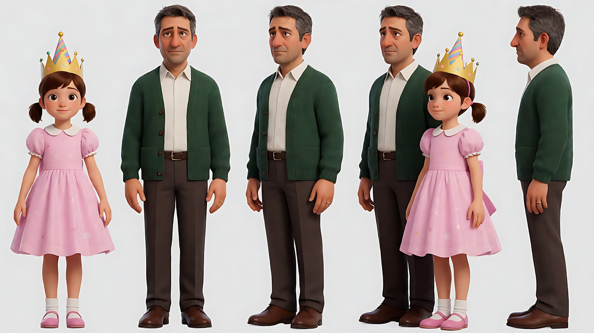

图2 场景 A（客厅派对）：

```
Empty bright living room decorated for a child's birthday party in the afternoon, pastel balloons, paper garlands,
a table with a big cake and colorful cups, large windows with soft warm sunlight filling the whole room,
light cream walls, almost no shadows, high-key, no people.
Wide shot, eye level, 28mm lens, deep focus.
Stylized semi-realistic 3D CG rendering, feature-film animation quality. Aspect ratio 16:9.
```

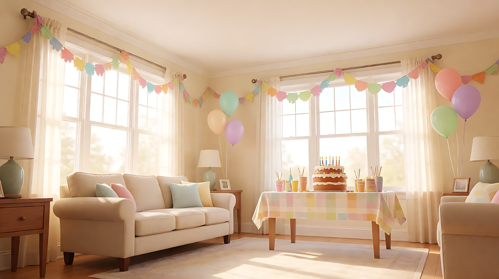

图3 场景 B（书房）：

```
Empty small study at the end of a hallway, curtains fully drawn, the room almost black,
a single hard beam of daylight slipping through a gap between the curtains and falling across a desk with an open old photo album
and a man's chair, chiaroscuro, everything outside the beam near black, no people.
Medium shot, eye level, 35mm lens, moderate depth of field. Low-key.
Stylized semi-realistic 3D CG rendering, feature-film animation quality. Aspect ratio 16:9.
```

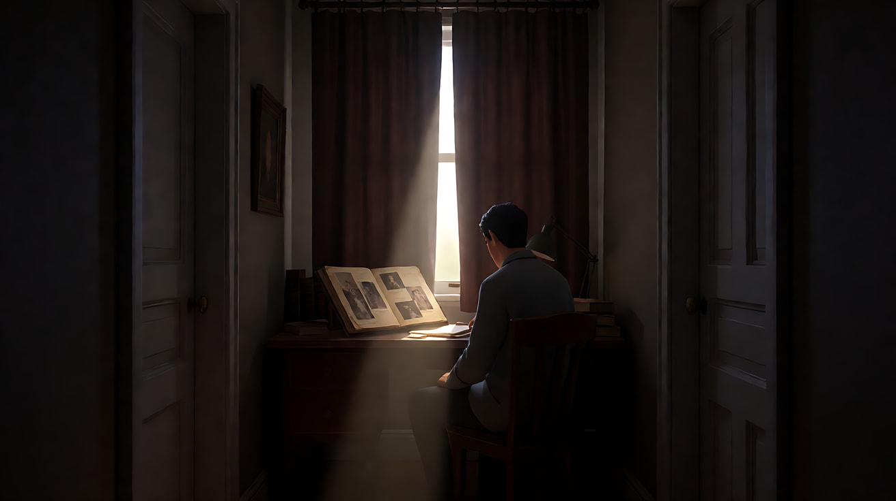

图4 镜头1 关键帧：

```
Using the characters from image 1, only the girl appears, in the living room from image 2:
a medium-wide shot of the girl in the center of the bright party room, blowing a party horn and laughing,
pastel balloons around her, soft warm sunlight filling the room evenly, high-key, almost no shadows.
Camera at the girl's eye level, 35mm lens, deep focus.
Keep the face, hairstyle and outfit exactly as in image 1.
Stylized semi-realistic 3D CG rendering, feature-film animation quality. Aspect ratio 16:9.
```

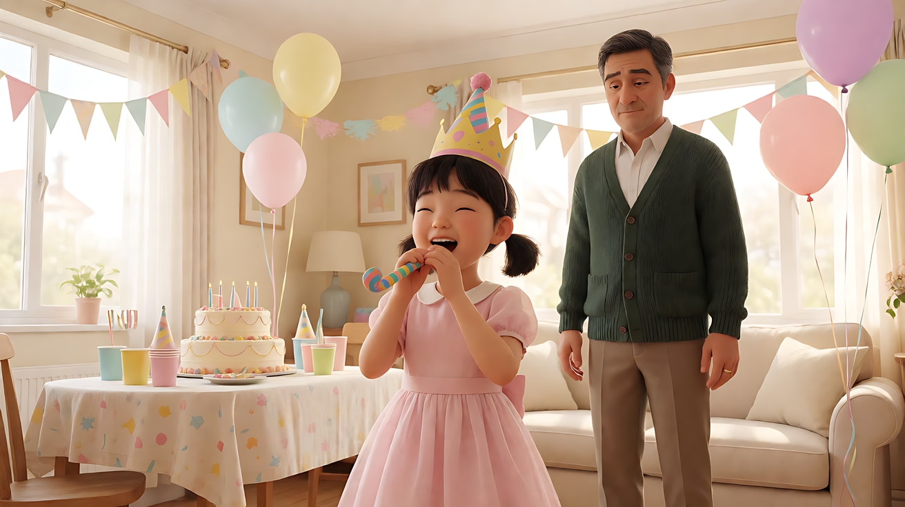

**【多图生视频 · Seedance】**

```
【素材分工】@图片1 锁定女孩与父亲的身份与服装；@图片2 仅参考派对客厅的布局、装饰与明亮光线；@图片3 仅参考书房布局与窗帘缝里的那一束光；@图片4 为首帧，画面中只有女孩。场景图中不复制任何人物。
【画风】风格化写实三维CG质感，电影级布光。
镜头1：固定中全景，明亮的派对客厅里，女孩站在画面中央吹响派对喇叭，哈哈笑着转了一圈，粉色气球在她身边晃动。大窗户的暖白阳光铺满整个房间，墙面明亮，几乎没有阴影。喇叭声，画外一群孩子的笑闹声。
镜头2：镜头切至女孩的中近景，她停下笑，转头看向画右走廊的方向，嘴角还挂着笑意，眼睛却在找人。客厅依旧明亮柔和。画外孩子们开始唱生日歌。
镜头3：镜头切至走廊尽头书房门口的中景，她轻轻推开书房的门，门里几乎全黑，客厅的明亮从她身后照进来，在书房地板上投出她小小的影子。她站在门口没有进去。生日歌被门隔开，变得很远。
镜头4：镜头切至书房内的中景，父亲坐在书桌前，窗帘缝里漏进的一束硬光斜切过桌面，只照亮他放在一本旧相册上的一只手和戴着的婚戒，他的脸在光束外的阴影里，看不清表情。他慢慢合上相册。结尾停在那只压在合上相册上的手上。
【锁定】人物：女孩始终戴纸王冠、穿粉色裙子，父亲始终穿深绿开衫；光线：客厅是暖色高调、几乎无影，书房是低调明暗对照、只有窗帘缝一束光；书房在走廊尽头、画右方向。
【声音】从派对喇叭与孩子笑闹，到生日歌，再到被门隔开的远远歌声，最后书房里只剩相册合上的一声闷响，无配乐。
【约束】保持两人脸型、发型、服装不变；书房不开灯；相册里的照片看不清；不要字幕、水印、Logo。
时长：15秒
```

**参数**：时长 15 秒 ｜ 画幅 16:9 ｜ 负载：4 个镜头、2 个空间，属于"有挑战"档

**【检查点】**
- 镜头1–2 是否是高调（大面积亮、阴影浅），镜头3–4 是否切换为低调
- 镜头3 门口是否形成"亮在身后、暗在面前"的分界
- 镜头4 父亲的脸是否在暗处、只有手和相册被光照亮
- 画外孩子们是否没有闯进画面

**【常见问题与修复】**
| 现象 | 修复 |
|---|---|
| 派对客厅出现很多孩子抢戏 | 写"其他孩子只在画外出声，画面中只有女孩" |
| 书房被补亮 | 写"书房不开灯，只有窗帘缝一束硬光，其余近乎全黑" |
| 镜头4 父亲的脸被照亮 | 写"他的脸在光束外的阴影里" |
| 相册出现清晰人脸照片 | 约束写"相册里的照片看不清"，或改为"一本合着的旧相册" |
