# L04-06 色彩心理与调色风格 · 提示词

> 本组练习：把颜色挂在具体载体上（光、服装、陈设、环境），用主色 + 强调色引导视线，用色调与饱和度定情绪，并为多镜头设计一条色彩弧线。｜ 配套教学：[L04-06-色彩心理与调色风格](../教学/L04-06-色彩心理与调色风格.md) ｜ 规范：[写作规范](../../模板/写作规范.md)
>
> 画风默认使用开关 A（风格化写实 CG）。如改用 2D 动画，删掉所有焦段、光圈、景深词。

---

### 练习1：灰蓝雨天里的一件芥末黄雨衣（难度 ★）

**目标**：大面积冷色类比色铺底 + 一小块暖色强调色，让观众的视线第一眼就落到人物身上。意图：让观众感到整座城市都是灰的，只有她还在等。

**【生图 · Nano Banana】**

图1 关键帧：

```
A wide shot of a rainy elevated train platform in the morning, a crowd of commuters in grey, navy and black coats with dark umbrellas
filling the frame, all moving toward frame left; among them one original young woman in her mid-twenties with a short bob
stands still near the right third of the frame in a bright mustard-yellow raincoat, holding a clear umbrella, looking toward frame right.
Camera at eye level from across the tracks, 50mm lens, moderate depth of field.
Lighting: soft overcast daylight, no direct sun, wet platform reflecting the grey sky.
Color: a muted palette of grey-blue, slate and charcoal, low saturation, the mustard-yellow raincoat is the only warm and saturated color in the frame.
Stylized semi-realistic 3D CG rendering, feature-film animation quality. Aspect ratio 16:9.
```

中文释义：全景，雨天高架站台，灰、藏青、黑色大衣的人群朝画左走；只有一位短发女孩站在右三分之一不动，穿芥末黄雨衣、撑透明伞，看向画右；隔着轨道平视、50mm；阴天柔光；整体是低饱和灰蓝、石板灰、炭黑，黄色雨衣是画面里唯一的暖色和高饱和色。

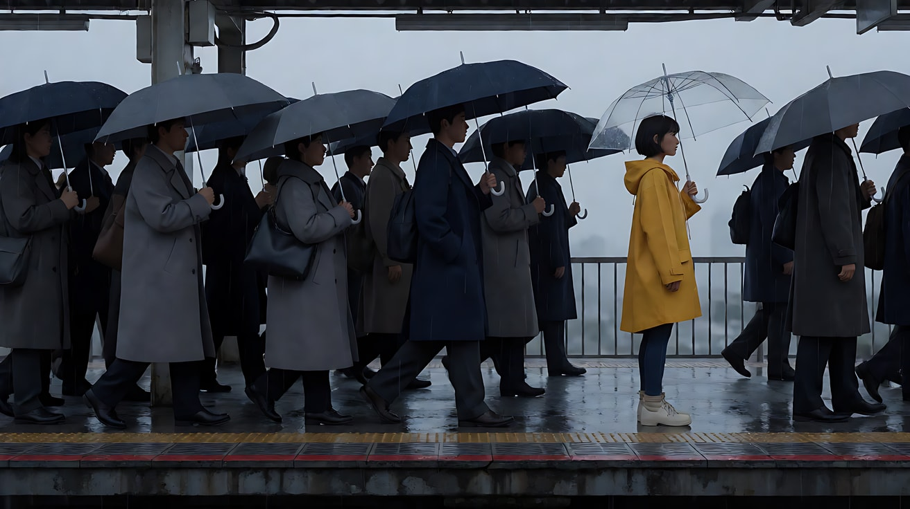

**【图生视频 · Seedance】**

```
【素材分工】@图片1 为首帧，锁定人物身份、黄色雨衣与站台布局。
【画风】风格化写实三维CG质感，低饱和灰蓝色调，只有黄色雨衣保持鲜艳。
雨天的站台上，穿灰色、藏青色、黑色大衣的人群打着深色雨伞从画右向画左匆匆走过，从她身前身后不断经过。穿芥末黄雨衣的女孩站在原地不动，透明伞上滑下雨水，她踮了一下脚，伸长脖子望向画右列车开来的方向。阴天柔光，没有阳光，湿地面映着灰色的天。镜头固定全景，不移动。结尾停在人群散开一瞬、只剩她一点黄色站在灰色站台上的画面。
【声音】密集的雨声，人群杂乱的脚步声，远处列车进站的广播回声，无配乐。
【约束】保持人物脸型、发型、雨衣不变；画面中除雨衣外不出现其他鲜艳颜色；人群面目模糊，不与她互动；不要字幕、水印、Logo。
时长：7秒
```

**参数**：时长 7 秒 ｜ 画幅 16:9

**【检查点】**
- 第一眼是否落在黄色雨衣上
- 画面其余部分是否保持低饱和冷灰
- 人群是否在动，她是否不动（动静对比也在帮色彩引导视线）

**【常见问题与修复】**
| 现象 | 修复 |
|---|---|
| 人群里出现红伞、彩色衣服 | 约束写"除雨衣外不出现其他鲜艳颜色"，人群服装写死为灰、藏青、黑 |
| 黄色变成橙色或土黄 | 写"芥末黄"并在【画风】里写"黄色雨衣保持鲜艳" |
| 人群撞到她或停下来看她 | 写"人群面目模糊，不与她互动" |

---

### 练习2：同一个夜宵摊，三种调色——定妆图 + 场景图（难度 ★★）

**目标**：同一个人物、同一个场景、同一个动作，只改调色结构：暖色类比、冷蓝单色、青橙互补。体会色调如何改写意义。

**【生图 · Nano Banana】**

图1 角色定妆：

```
Character turnaround sheet of an original delivery rider in his mid-twenties: short spiky black hair, a tired face,
a dark grey rain jacket over a plain white T-shirt, black cargo trousers, a helmet hanging from one hand.
Front view, three-quarter view, side view and back view, full body, plain light-grey background, even soft studio light.
Stylized semi-realistic 3D CG rendering, feature-film animation quality. Aspect ratio 16:9.
```

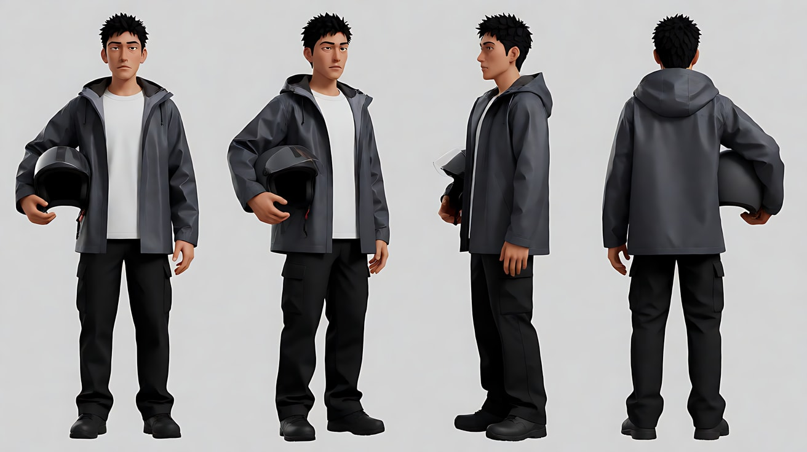

图2 场景（深夜面摊）：

```
Empty tiny late-night noodle stall under a street overpass, a small folding table with a stool, a steaming pot on a gas stove,
a single bare bulb hanging over the table, a wet street beyond, plain unlabeled signs, neutral colors, no people.
Medium-wide shot, eye level, 35mm lens, moderate depth of field.
Stylized semi-realistic 3D CG rendering, feature-film animation quality. Aspect ratio 16:9.
```

中文释义：图1 原创外卖骑手定妆，刺短发、灰色雨衣、手提头盔；图2 高架桥下的深夜面摊，一张折叠桌、一口冒热气的锅、头顶一只裸灯泡，招牌没有文字。

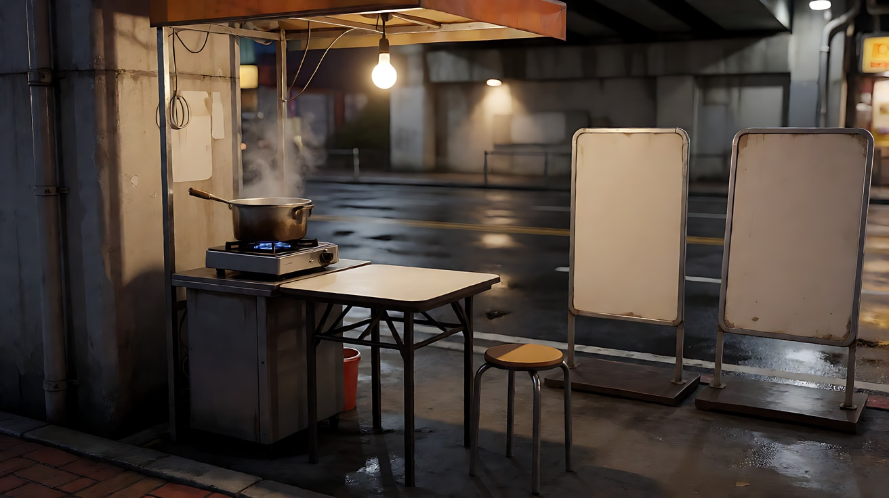

**【多图生视频 · Seedance】**

公共开头（每个版本只改【画风】和光的颜色）：

```
【素材分工】@图片1 锁定人物身份、发型与服装；@图片2 仅参考面摊布局与陈设，不复制其中光线与色调。
```

版本 A 暖色类比（意图：这碗面让他想起家）：

```
【画风】风格化写实三维CG质感，暖色类比色调：琥珀、橙、暖黄，中等饱和。
头顶裸灯泡投下琥珀色暖光，锅里的蒸汽被照成金色，他坐在小凳上，双手捧起面碗，低头吹了一口热气，蒸汽扑在他脸上，他闭了一下眼睛。镜头固定中景。结尾停在他捧着碗、嘴角放松的脸上。
【声音】锅里汤水的咕嘟声，筷子碰碗声，远处高架上车流的低鸣，无配乐。
【约束】保持人物脸型、发型、服装不变；不要字幕、水印、Logo。
时长：6秒
```

版本 B 冷蓝单色（意图：这碗面是他今天唯一的陪伴）：

```
【画风】风格化写实三维CG质感，冷蓝单色调：深浅不同的蓝与青灰，低饱和。
头顶灯泡是冷白色，高架桥下的一切都被染成深浅不同的蓝，蒸汽是冷灰蓝色。他坐在小凳上，双手捧起面碗，低头吹了一口热气，然后停住，看着碗里，没有吃。镜头固定中景。结尾停在他捧着碗一动不动、肩膀塌下来的画面上。
【声音】锅里汤水的咕嘟声，远处高架上车流的低鸣，一声手机提示音后又是安静，无配乐。
【约束】保持人物脸型、发型、服装不变；画面中不出现暖色；不要字幕、水印、Logo。
时长：6秒
```

版本 C 青橙互补（意图：他是这片冷城市里唯一有温度的人）：

```
【画风】风格化写实三维CG质感，青橙互补色调：背景与阴影偏青蓝，人物肤色与灯泡暖光偏橙，中高饱和。
头顶裸灯泡的暖橙色光只罩住桌子和他，桥洞外湿漉漉的街道和远处的楼群是冷青色。他坐在小凳上，双手捧起面碗，低头吹了一口热气，抬眼看向桥洞外的雨。镜头固定中景。结尾停在暖色的他和身后冷青色街道同框的画面上。
【声音】桥洞外的雨声，锅里汤水的咕嘟声，远处一声电动车喇叭，无配乐。
【约束】保持人物脸型、发型、服装不变；不要字幕、水印、Logo。
时长：6秒
```

**参数**：时长 6 秒 ｜ 画幅 16:9

**【检查点】**
- 三版的主色是否分别为琥珀暖黄、冷蓝、青橙分离
- 同一个动作，只看颜色能否读出"想家 / 孤独 / 唯一的温度"
- 版本 B 是否真的没有暖色

**【常见问题与修复】**
| 现象 | 修复 |
|---|---|
| 版本 B 灯泡还是暖色 | 写"头顶灯泡是冷白色"，约束写"画面中不出现暖色" |
| 版本 C 人物也被染青 | 写"人物肤色保持暖橙，只有背景与阴影偏青" |
| 招牌出现乱码文字 | 场景图写 `plain unlabeled signs`，视频不给招牌特写 |

---

### 练习3：卷帘门拉开，颜色回来了——首尾帧（难度 ★★★）

**目标**：让饱和度的变化有物理原因：首帧是清晨低饱和的灰色街道和一扇关着的卷帘门；尾帧卷帘门拉开，满店高饱和的鲜花和暖灯涌进画面。意图：让观众感到她的一天从这一刻才开始。

**【生图 · Nano Banana】**

图1 角色定妆：

```
Character turnaround sheet of an original florist in her late thirties: wavy chestnut hair in a loose low bun, freckles,
a sage-green canvas apron over a cream long-sleeve shirt, rolled-up jeans, rubber garden boots.
Front view, three-quarter view, side view and back view, full body, plain light-grey background, even soft studio light.
Stylized semi-realistic 3D CG rendering, feature-film animation quality. Aspect ratio 16:9.
```

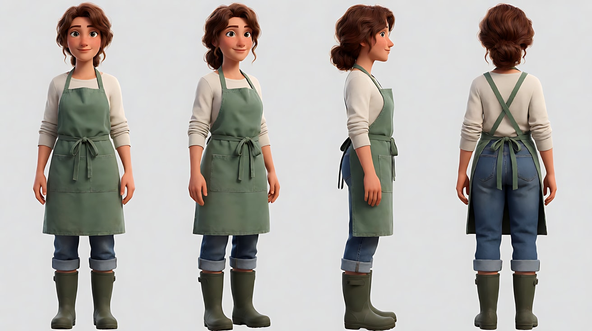

图2 首帧：

```
Using the character from image 1: a medium-wide shot of her standing in front of a closed grey metal roller shutter of a small shop
on a quiet street at dawn, bending down to grab the bottom handle of the shutter. She is placed slightly left of center.
Camera at eye level from across the narrow street, 35mm lens, deep focus.
Lighting: cool flat pre-dawn light, no direct sun. Color: very low saturation, grey, concrete and pale blue, almost monochrome;
only her sage-green apron carries a faint color.
Keep the face, hairstyle and outfit exactly as in image 1.
Stylized semi-realistic 3D CG rendering, feature-film animation quality. Aspect ratio 16:9.
```

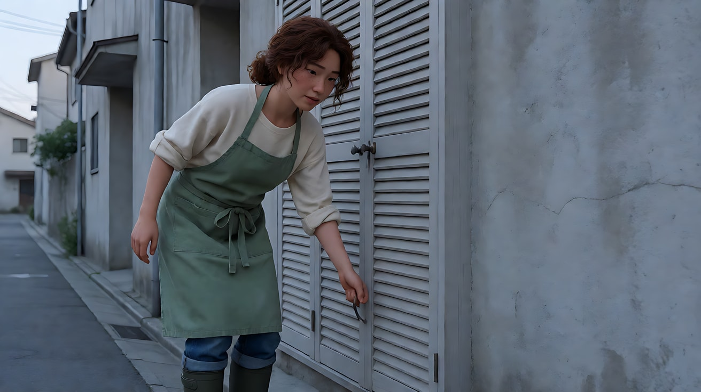

图3 尾帧：

```
Using the character from image 1, the same street, shop front and camera position:
the roller shutter is now fully open, revealing a small flower shop packed with buckets of red roses, orange ranunculus,
yellow tulips and purple statice under warm 3000K shop lights; warm light and color spill out onto the grey pavement.
She stands at the shop entrance, half turned back toward the camera, smiling.
Color: highly saturated inside the shop, the street outside still grey-blue and muted.
Keep the face, hairstyle and outfit exactly as in image 1.
Stylized semi-realistic 3D CG rendering, feature-film animation quality. Aspect ratio 16:9.
```

中文释义：首帧——黎明前灰色街道，她弯腰去拉关着的灰色卷帘门；画面几乎单色，只有她的鼠尾草绿围裙有一点颜色。尾帧——卷帘门全开，店里满是红玫瑰、橙色洋牡丹、黄郁金香、紫色勿忘我，暖灯下高饱和的颜色溢到灰色人行道上；她站在门口回身微笑。

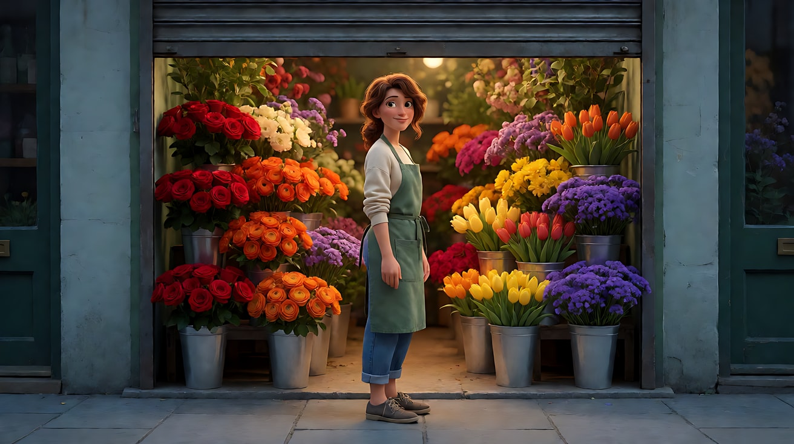

**【首尾帧生视频 · Seedance】**

```
【素材分工】@图片2 为首帧，锁定街道、店面、机位与低饱和灰色起点；@图片3 为尾帧，是最终画面目标，锁定开门后的鲜花与暖光；@图片1 锁定人物身份与服装，不参考其中的棚拍光。只生成两帧之间的连续画面。
【画风】风格化写实三维CG质感，由低饱和灰蓝过渡到店内高饱和暖色。
黎明前灰色的街道上，她弯腰抓住卷帘门的把手，用力往上一推，卷帘门哗啦啦向上卷起。门缝从下往上越开越大，店里暖色的灯光和红、橙、黄、紫的花一层层露出来，暖光一点点铺到她的靴子和灰色人行道上。她把门推到顶，拍了拍手上的灰，转身回头看了一眼街道，笑了。镜头固定在街对面，不移动。
【声音】卷帘门金属卷起的哗啦声，清晨远处一辆早班车驶过，她拍手的声音，一只麻雀叫，无配乐。
【约束】保持人物脸型、发型、服装不变；街道始终保持低饱和灰蓝，鲜艳颜色只来自店内鲜花与暖灯；不要字幕、水印、Logo。
时长：7秒
```

**参数**：时长 7 秒 ｜ 画幅 16:9

**【检查点】**
- 颜色是否随卷帘门拉开、从下往上逐步出现
- 街道是否始终低饱和，鲜艳颜色是否只来自店内
- 暖光是否从店里溢到人行道上

**【常见问题与修复】**
| 现象 | 修复 |
|---|---|
| 整个画面一起变彩色 | 约束写"街道始终保持低饱和灰蓝"，【画风】写颜色来源 |
| 卷帘门打开后店里是空的 | 尾帧图里写清花的种类和颜色，并强调以 @图片3 为最终目标 |
| 卷帘门变形或开合反复 | 写"一次推到顶，不再落下" |

---

### 练习4：黑白小镇里的一条红围巾——多镜头（难度 ★★★★）

**目标**：画面近乎黑白，只保留一件红色物件，让它在三个镜头里引导视线、成为符号。意图：让观众感到他终于在人海里找到了她。

**【生图 · Nano Banana】**

图1 角色定妆（两位原创人物）：

```
Character turnaround sheet of two original characters:
a young man in his late twenties with tousled dark hair, a long charcoal wool coat, a grey knitted sweater;
a young woman in her late twenties with long straight dark hair, a black wool coat and a bright crimson scarf.
Front view, three-quarter view and side view of each, full body, plain light-grey background, even soft studio light.
Stylized semi-realistic 3D CG rendering, feature-film animation quality. Aspect ratio 16:9.
```

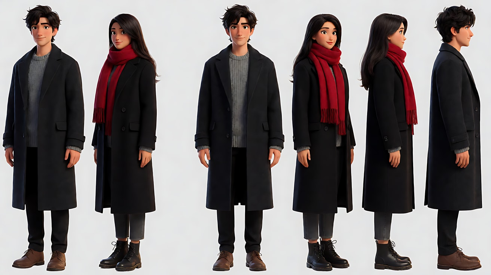

图2 场景（冬日小镇广场）：

```
Empty small old town square in winter afternoon, a stone fountain turned off, bare trees, cobblestones, a clock tower,
light snow on rooftops, overcast sky. The whole image is nearly black and white, desaturated grey tones, no people.
Wide shot, high angle from a balcony, 35mm lens, deep focus.
Stylized semi-realistic 3D CG rendering, feature-film animation quality. Aspect ratio 16:9.
```

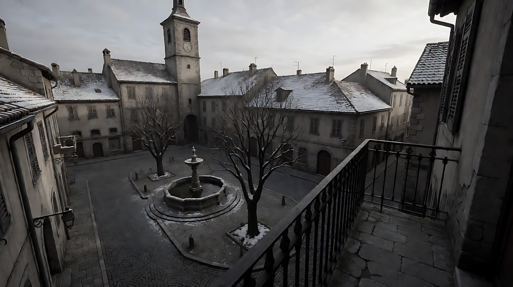

图3 镜头1 关键帧：

```
Using the characters from image 1 and the square from image 2:
a high-angle wide shot of the town square filled with a busy winter market crowd in dark coats, all in black and white tones;
somewhere near the upper right third, a single crimson scarf is the only color in the entire frame, the woman wearing it is small and walking away.
The young man stands in the lower left foreground, seen from behind, searching.
Camera high on a balcony, 35mm lens, deep focus. The image is fully desaturated except the crimson scarf.
Keep the faces, hairstyles and outfits exactly as in image 1.
Stylized semi-realistic 3D CG rendering, feature-film animation quality. Aspect ratio 16:9.
```

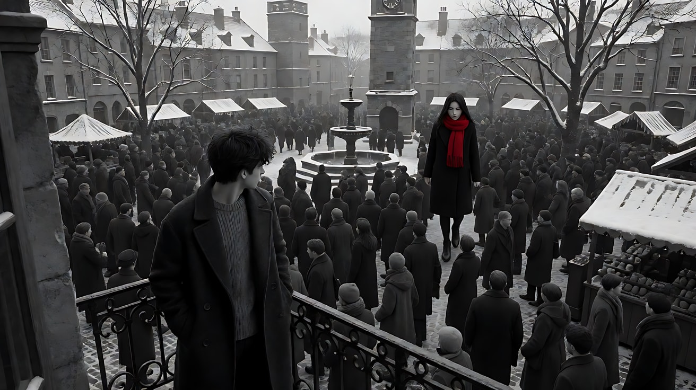

**【多图生视频 · Seedance】**

```
【素材分工】@图片1 锁定两位人物的身份与服装，红围巾的颜色以此为准；@图片2 仅参考广场布局与钟楼位置，不复制空镜构图；@图片3 为首帧，锁定近乎黑白、只有红围巾带颜色的画面。
【画风】风格化写实三维CG质感，近乎黑白的去色画面，只有她的红围巾保持鲜红。
镜头1：高角度固定全景，冬日集市上挤满穿深色大衣的人群，整个画面是黑白灰。画面右上方一条红围巾在人群里一闪一闪地向远处移动。前景左下方的男人背对镜头站着，左右转头寻找。集市的嘈杂人声，钟楼敲响一下。
镜头2：镜头切至男人的正面中近景，他踮起脚，目光扫过人群，突然定住，嘴唇微微张开。他的脸、大衣和身后的人群都是黑白灰。人声在他耳边变得模糊。
镜头3：镜头切至人群中的中景，镜头缓慢向前推进，穿过几个黑白的背影，前方那条红围巾停住了，她慢慢回过头。结尾停在她回头的侧脸和红围巾上。集市的声音退远，只剩钟楼余音。
【锁定】色彩：全片去色近乎黑白，唯一的颜色是她的红围巾，其他任何物件都不带颜色；人物：男人始终穿炭灰色大衣，她始终穿黑大衣、围红围巾；男人在镜头1 中位于画左下方，她在画右上方。
【声音】从集市嘈杂人声与一声钟响，到人声模糊，最后只剩钟楼的余音，无配乐。
【约束】保持两人脸型、发型、服装不变；人群面目模糊，不与两人互动；不要字幕、水印、Logo。
时长：12秒
```

**参数**：时长 12 秒 ｜ 画幅 16:9 ｜ 负载：3 个镜头、人群场景，属于"稳妥"档

**【检查点】**
- 画面是否近乎黑白，红色是否只在围巾上
- 镜头1 观众能否第一眼找到红围巾
- 红色有没有"漏"到人群、招牌、皮肤上

**【常见问题与修复】**
| 现象 | 修复 |
|---|---|
| 颜色漏到其他物件 | 【锁定】写"唯一的颜色是红围巾，其他任何物件都不带颜色"，约束再写一遍 |
| 整个画面变成彩色 | 【画风】第一句写"近乎黑白的去色画面" |
| 人群里出现另一条红围巾 | 写"人群全部穿深色大衣，没有任何红色" |

---

### 练习5：一件黄雨衣的色彩弧线（难度 ★★★★★）

**目标**：在一间公寓里用四个镜头完成一条色彩弧线：暖色高饱和（在一起）→ 冷色开始侵入（争吵）→ 冷蓝低饱和（一个人）→ 黄色回来、暖色恢复一半（她回来了）。黄雨衣从头到尾代表她。意图：让观众不靠台词就看懂一段关系的离开与回来。

**【生图 · Nano Banana】**

图1 角色定妆（两位原创人物）：

```
Character turnaround sheet of two original characters in their late twenties:
a woman with a short wavy bob, a bright mustard-yellow raincoat over a white T-shirt and denim overalls;
a man with short neat hair and round glasses, a navy knitted sweater, beige trousers.
Front view, three-quarter view and side view of each, full body, plain light-grey background, even soft studio light.
Stylized semi-realistic 3D CG rendering, feature-film animation quality. Aspect ratio 16:9.
```

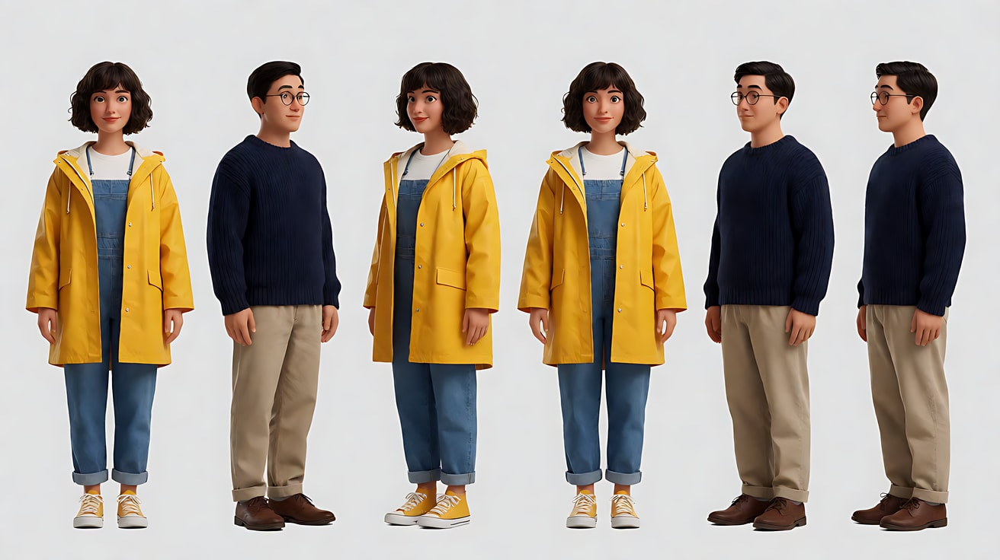

图2 场景（小公寓）：

```
Empty small cozy apartment living room, a front door with a coat hook beside it on frame left, a worn orange sofa,
a window on the right wall, a floor lamp with a warm shade, potted plants, neutral daylight, no people.
Wide shot, eye level, 28mm lens, deep focus.
Stylized semi-realistic 3D CG rendering, feature-film animation quality. Aspect ratio 16:9.
```

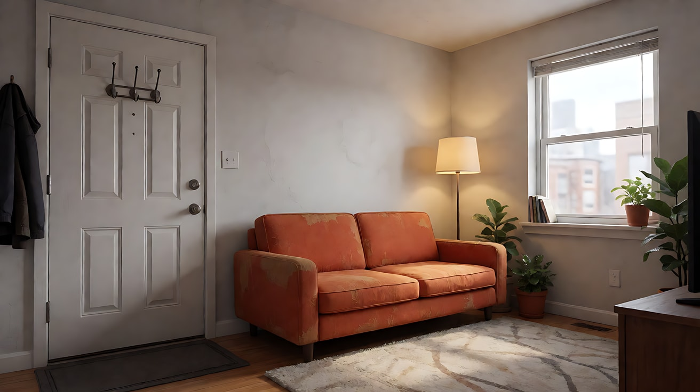

图3 镜头1 关键帧（暖色高饱和）：

```
Using the characters from image 1 and the apartment from image 2:
a medium-wide shot of the couple laughing on the orange sofa on a sunny afternoon, she still wearing the yellow raincoat, leaning on his shoulder.
Camera at seated eye level, 35mm lens, moderate depth of field.
Lighting: warm golden sunlight from the window on frame right, warm floor lamp also on.
Color: warm analogous palette of yellow, orange and amber, rich saturation.
Keep the faces, hairstyles and outfits exactly as in image 1.
Stylized semi-realistic 3D CG rendering, feature-film animation quality. Aspect ratio 16:9.
```

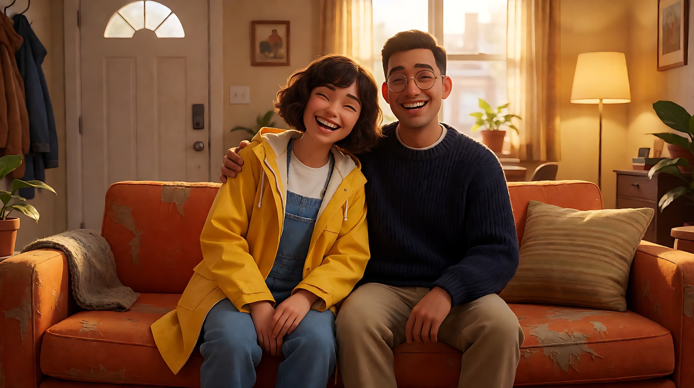

图4 镜头3 关键帧（冷蓝低饱和）：

```
Using the man from image 1 and the same apartment: only he appears in this frame.
A wide shot of him sitting alone at one end of the sofa on a rainy evening, the yellow raincoat hanging on the coat hook by the door on frame left,
the floor lamp switched off. Camera at eye level, 28mm lens, deep focus.
Lighting: cold grey-blue rainy window light from frame right. Color: cool blue monochrome, very low saturation;
the yellow raincoat on the hook is the only warm color, but faded and dim in the shadow.
Keep the face, hairstyle and outfit exactly as in image 1.
Stylized semi-realistic 3D CG rendering, feature-film animation quality. Aspect ratio 16:9.
```

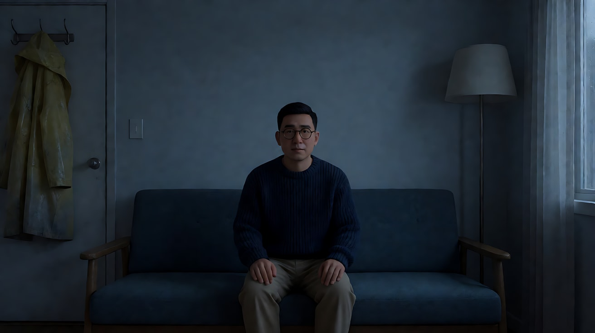

**【多图生视频 · Seedance】**

```
【素材分工】@图片1 锁定两位人物的身份与服装，黄雨衣的颜色以此为准；@图片2 仅参考公寓布局、门口挂钩、橙色沙发、窗户与落地灯的位置；@图片3 为首帧，锁定暖色高饱和起点；@图片4 为镜头3的画面目标，锁定冷蓝低饱和与挂在门边的黄雨衣。
【画风】风格化写实三维CG质感，色彩随镜头变化：暖色高饱和，冷色侵入，冷蓝低饱和，暖色恢复一半。
镜头1：固定中全景，晴朗的午后，两人坐在橙色沙发上笑，她穿着黄雨衣靠在他肩上，他伸手把她额前的头发拨开。画右窗外金色阳光和落地灯的暖光把房间染成黄、橙、琥珀色。两人的笑声，窗外鸟叫。
镜头2：镜头切至同一房间的中景，傍晚，窗外天色转灰，冷蓝的光从画右窗户侵进来，落地灯的暖光只剩房间一角。她站起来，背对他，脱下黄雨衣，挂在画左门边的挂钩上，拉开门走了出去；他坐在沙发上，低头没有看她。雨衣挂上挂钩的轻响，门把手转动的声音。
镜头3：镜头切至全景，雨夜，房间里只剩冷蓝灰的窗光，落地灯关着，颜色几乎褪尽。他独自坐在沙发一端，门边挂钩上挂着那件黄雨衣，黄色在阴影里显得暗淡。他看着那件雨衣，一动不动。窗外雨声，冰箱低鸣。
镜头4：镜头切至门口的中景，门被推开，她站在门口，浑身微湿，没有穿雨衣，伸手从挂钩上取下那件黄雨衣抱在怀里。门外走廊的暖光从她身后照进来，房间里重新出现一小片暖色，但窗外仍是冷蓝。镜头缓慢向前推进。结尾停在她抱着黄雨衣、望向沙发方向的脸上。
【锁定】空间：门和挂钩在画左，窗户在画右，橙色沙发在中间；色彩：黄雨衣的颜色在所有镜头中保持同一种芥末黄，只随光变亮或变暗；人物：她短卷发，他戴圆框眼镜、穿藏青毛衣。
【声音】从笑声与鸟叫，到拉链声与门把手声，再到雨声与冰箱低鸣，最后是开门声和一声很轻的呼吸，无配乐。
【约束】保持两人脸型、发型、服装不变；一个镜头里只有一个人做主动作；不要字幕、水印、Logo。
时长：15秒
```

**参数**：时长 15 秒 ｜ 画幅 16:9 ｜ 负载：4 个镜头、时间跳跃、两人交替，属于"有挑战"档

> 道具逻辑：镜头2 她把雨衣留在门边离开，镜头3 雨衣挂着代表"她不在了"，镜头4 她回来取下雨衣抱在怀里。道具的位置就是关系的位置，写之前先把这条线理清。

**【检查点】**
- 四个镜头的色温与饱和度是否呈"暖饱和 → 冷侵入 → 冷蓝低饱和 → 暖色回来一半"
- 黄雨衣是否在每个镜头都能被一眼认出
- 镜头4 的暖色是否有来源（门外走廊的灯）

**【常见问题与修复】**
| 现象 | 修复 |
|---|---|
| 四个镜头色调差不多 | 每个镜头块写清时间、光源和主色；镜头3 写"颜色几乎褪尽" |
| 黄雨衣颜色在镜头3 变成别的颜色 | 【锁定】写"同一种芥末黄，只随光变亮或变暗" |
| 镜头3 雨衣不在挂钩上 | 【锁定】加一句"镜头2 之后黄雨衣一直挂在门边挂钩上，直到镜头4 被她取下" |
| 镜头4 房间突然全亮 | 写"窗外仍是冷蓝，暖色只来自门外走廊" |
