# L04-07 光随剧情变化 · 提示词

> 本组练习：让光的变化对准剧情转折，并且每次光变都有一个看得见的原因——云、门、开关、闪电、天窗。一个片段只变一次。｜ 配套教学：[L04-07-光随剧情变化](../教学/L04-07-光随剧情变化.md) ｜ 规范：[写作规范](../../模板/写作规范.md)
>
> 画风默认使用开关 A（风格化写实 CG）。如改用 2D 动画，删掉所有焦段、光圈、景深词。

---

### 练习1：云遮住了太阳（难度 ★）

**目标**：用一次缓慢的自然光变制造"不祥的预感"。光变之前稳定、光变之后稳定，变化由云引起，人物有一个对应动作。意图：让观众感到这个平静的下午就要被打破了。

**【生图 · Nano Banana】**

图1 关键帧：

```
A wide shot of an original elderly woman in her sixties with short silver hair, a light blue cotton blouse and a straw sun hat,
kneeling in a small vegetable garden on a hillside, pulling weeds, a wicker basket beside her, a farmhouse behind.
She is placed on the left third of the frame, rolling green hills and a big sky on the right.
Camera at eye level, 35mm lens, deep focus.
Lighting: bright warm afternoon sunlight from frame right, crisp shadows, rich greens; a large dark cloud is approaching
from the far left of the sky but has not yet covered the sun.
Stylized semi-realistic 3D CG rendering, feature-film animation quality. Aspect ratio 16:9.
```

中文释义：全景，六十多岁的银发老太太戴草帽跪在山坡菜园里拔草，位于左三分之一，右侧是起伏的绿色山丘与大片天空；平视、35mm、深景深；画右明亮的午后阳光，影子清晰；画面左上方一大片乌云正在靠近，还没遮住太阳。


**【图生视频 · Seedance】**

```
【素材分工】@图片1 为首帧，锁定人物身份、服装与菜园布局。
【画风】风格化写实三维CG质感，电影级布光。
老太太跪在菜园里拔草，把一把杂草放进篮子里，阳光明亮稳定，她身边的影子清晰。一片乌云从画左慢慢飘过来，云影先落在远处的山坡上，再一路掠过田地，最后盖住菜园和她，阳光熄灭，画面变成阴天的冷灰平光，影子消失。云影盖到她身上的那一刻，她停下手里的动作，慢慢直起身子，抬头看向天空。镜头固定全景，不移动。结尾停在她仰头看天、风吹动草帽边缘的画面。
【声音】鸟叫和虫鸣，云影掠过后鸟叫停了，风声渐起，远处一声闷雷，无配乐。
【约束】保持人物脸型、发型、服装不变；只有一次光变，云盖住太阳后不再露出；不要字幕、水印、Logo。
时长：8秒
```

**参数**：时长 8 秒 ｜ 画幅 16:9

**【检查点】**
- 云影是否从远到近掠过地面，而不是整个画面一下子变暗
- 光变后是否稳定在阴天平光
- 她的抬头动作是否和云影到达同步

**【常见问题与修复】**
| 现象 | 修复 |
|---|---|
| 画面突然整体变暗，像曝光出错 | 写清过程："云影先落在远处山坡，再掠过田地，最后盖住她" |
| 太阳又出来了 | 约束写"云盖住太阳后不再露出" |
| 人物没有反应 | 写"云影盖到她身上的那一刻，她停下动作抬头" |

---

### 练习2：同一间理发店，关灯与开灯——定妆图 + 场景图（难度 ★★）

**目标**：同一个场景，两个方向相反的光变：版本 A 老店主关掉最后一盏灯（结束），版本 B 孙女推门进来把灯一盏盏打开（开始）。体会"关灯 / 开灯"的意义由人物动作决定。

**【生图 · Nano Banana】**

图1 角色定妆（两位原创人物）：

```
Character turnaround sheet of two original characters:
an elderly barber in his late seventies with thin combed-back white hair, a white short-sleeve barber jacket, black trousers, reading glasses in his breast pocket;
his granddaughter in her mid-twenties with a short undercut hairstyle, a black denim jacket over a striped T-shirt, a canvas backpack.
Front view, three-quarter view and side view of each, full body, plain light-grey background, even soft studio light.
Stylized semi-realistic 3D CG rendering, feature-film animation quality. Aspect ratio 16:9.
```

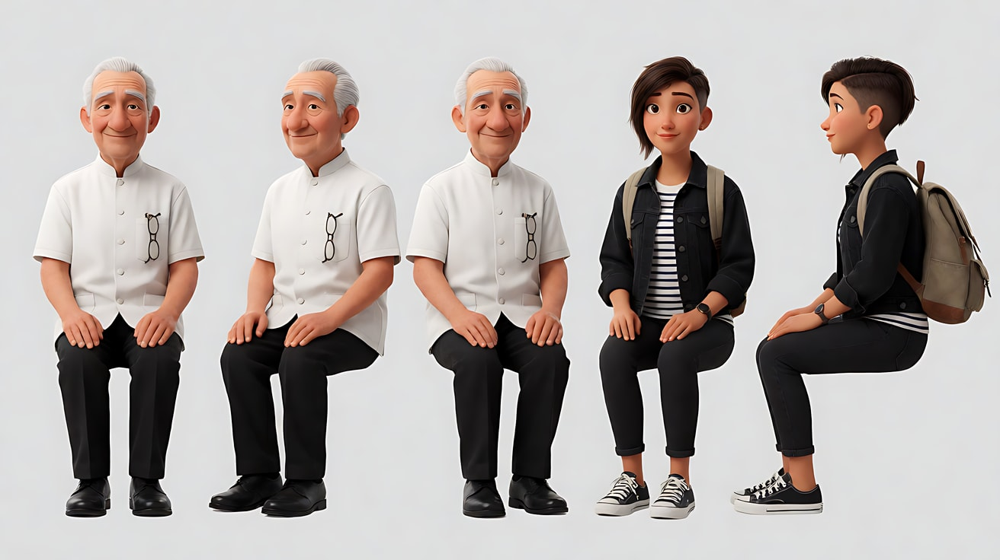

图2 场景（老理发店）：

```
Empty small old barbershop at night, one vintage barber chair facing a large mirror, a row of three warm pendant lamps above,
a light switch panel by the glass front door on frame left, a street lamp outside the door casting cool light through the glass,
old tiles, a wall clock, scissors and combs on the counter, plain shop window without any text, no people.
Wide shot, eye level from the back of the shop, 28mm lens, deep focus.
Stylized semi-realistic 3D CG rendering, feature-film animation quality. Aspect ratio 16:9.
```

中文释义：图1 七十多岁的老理发师和二十多岁的孙女；图2 夜晚的老理发店，一把老式理发椅对着大镜子，头顶三盏暖色吊灯，画左玻璃门边有开关面板，门外路灯冷光透进来，橱窗没有文字。

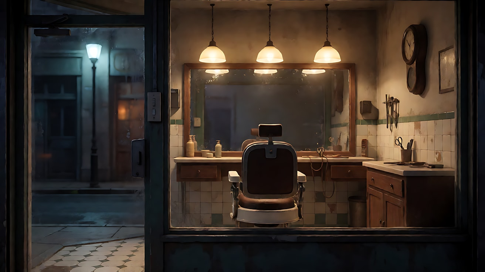

**【多图生视频 · Seedance】**

版本 A 关灯（意图：让观众感到这家店今天是最后一天）：

```
【素材分工】@图片1 锁定老理发师的身份与服装，本片段画面中只出现老理发师；@图片2 仅参考理发店布局、三盏吊灯、开关和门的位置，不复制空镜构图。
【画风】风格化写实三维CG质感，电影级布光。
三盏暖色吊灯都亮着，店里暖黄稳定。老理发师用手掌把理发椅的椅面抚平，把一把剪刀放回柜台，摆正。他走到画左门边，手指在开关上停了一下，按下。三盏吊灯同时熄灭，店里只剩门外路灯透进来的冷蓝光，在地砖上铺出一块玻璃门的形状，理发椅变成一个黑色的轮廓。他站在门口的冷光里，回头看了一眼。镜头固定全景，从店的里侧拍向门口。结尾停在他回头看着黑暗店内的侧影上。
【声音】墙上钟表的滴答声，剪刀放在柜台上的轻响，开关的一声咔哒，之后只剩钟声，无配乐。
【约束】保持人物脸型、发型、服装不变；只有一次光变，灯灭后不再亮起；不要字幕、水印、Logo。
时长：8秒
```

版本 B 开灯（意图：让观众感到这家店要重新开始）：

```
【素材分工】@图片1 锁定孙女的身份与服装，本片段画面中只出现孙女；@图片2 仅参考理发店布局、三盏吊灯、开关和门的位置，不复制空镜构图。
【画风】风格化写实三维CG质感，电影级布光。
店里一片漆黑，只有门外路灯的冷蓝光透过玻璃门铺在地砖上。孙女推门进来，放下背包，手在墙上摸到开关，一个一个按下去，头顶三盏暖色吊灯从门口向店内依次亮起，暖黄光一段一段推开黑暗，最后照亮理发椅和大镜子。她站在灯下，看着镜子里的自己，把袖子卷起来。镜头固定全景，从店的里侧拍向门口。结尾停在暖光里她卷起袖子、看向理发椅的画面。
【声音】门上铃铛轻响，背包落地声，三声开关的咔哒，吊灯亮起时轻微的电流声，无配乐。
【约束】保持人物脸型、发型、服装不变；吊灯依次亮起后保持稳定，不闪烁；不要字幕、水印、Logo。
时长：8秒
```

**参数**：时长 8 秒 ｜ 画幅 16:9

**【检查点】**
- A 版灯灭后是否只剩门外冷光，B 版灯是否依次亮起
- 光变的那一刻人物是否有对应动作（回头 / 卷袖子）
- 两版只看画面，能否读出"结束"与"开始"

**【常见问题与修复】**
| 现象 | 修复 |
|---|---|
| A 版灯灭后又亮了 | 约束写"灯灭后不再亮起" |
| B 版三盏灯同时亮 | 写"从门口向店内依次亮起"；做不到时接受同时亮起，意图不受影响 |
| 镜子里的倒影出错 | 机位避开正对镜子，或写"镜子里只映出她自己" |
| 两人同时出现 | 素材分工写"本片段画面中只出现……" |

---

### 练习3：门开了，一道光找到了他——首尾帧（难度 ★★★）

**目标**：用首尾帧完成"开门放光"：首帧是黑暗储物间里一道门缝光，尾帧门全开、宽光照亮躲着的孩子，光里有丁达尔效应。意图：让观众感到他被找到了，而找到他的人是来接他回家的。

**【生图 · Nano Banana】**

图1 角色定妆：

```
Character turnaround sheet of an original boy around eight: a round face, messy black hair, a red hooded sweatshirt,
grey shorts, one sock pulled lower than the other, holding a small knitted toy rabbit.
Front view, three-quarter view, side view and back view, full body, plain light-grey background, even soft studio light.
Stylized semi-realistic 3D CG rendering, feature-film animation quality. Aspect ratio 16:9.
```

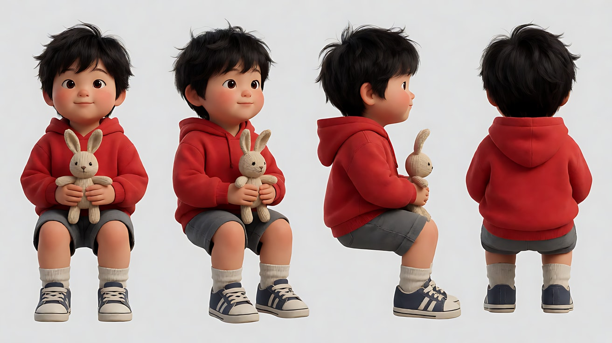

图2 首帧：

```
Using the character from image 1: a medium shot of the boy sitting on the floor of a dark wooden storage room,
knees pulled up, hugging the toy rabbit, half hidden behind a stack of old boxes. The door on frame right is open only a crack,
a thin vertical line of warm light falls across the dusty floor and just touches the toe of his sneaker.
Camera low at the boy's eye level, 35mm lens, moderate depth of field.
Lighting: almost total darkness, the only light is the thin warm 3000K sliver through the door crack, fine dust visible in it.
Keep the face, hairstyle and outfit exactly as in image 1.
Stylized semi-realistic 3D CG rendering, feature-film animation quality. Aspect ratio 16:9.
```

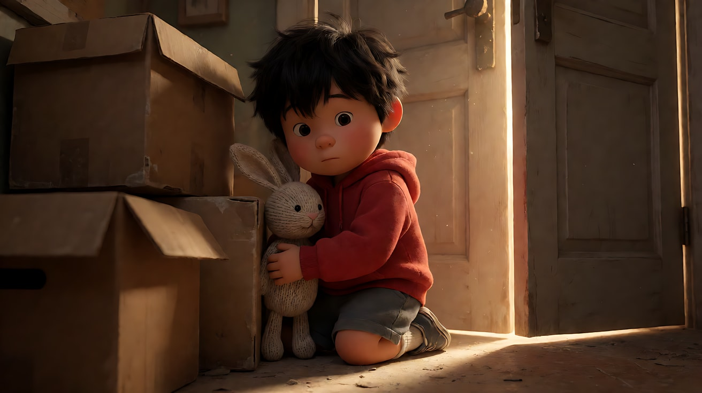

图3 尾帧：

```
Using the character from image 1, the same storage room and camera position:
the door on frame right is now wide open, a broad wedge of warm 3000K hallway light pours in across the floor and over the boy,
visible volumetric light shafts in the dusty air (Tyndall effect), the long shadow of an adult standing in the doorway falls across the floor toward him,
the adult is outside the frame. The boy looks up toward the door with wet eyes, still holding the rabbit, his face fully lit.
Keep the face, hairstyle and outfit exactly as in image 1.
Stylized semi-realistic 3D CG rendering, feature-film animation quality. Aspect ratio 16:9.
```

中文释义：首帧——黑暗储物间，男孩抱着毛绒兔子缩在旧箱子后，画右的门只开一条缝，一线暖光落在地板上刚碰到他的鞋尖。尾帧——门全开，宽阔的暖光楔形铺满地板和男孩，光里灰尘形成可见的光柱；一个大人站在门口（画外），长长的影子投向男孩；男孩眼眶湿润地抬头看向门口。

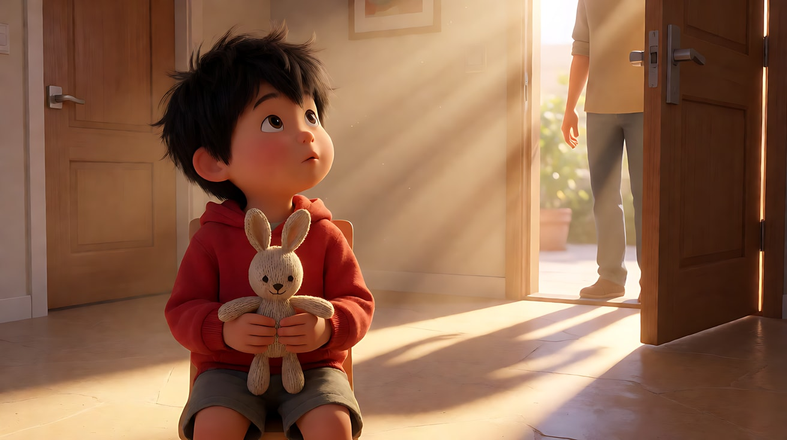

**【首尾帧生视频 · Seedance】**

```
【素材分工】@图片2 为首帧，锁定储物间布局、门缝光和男孩的位置；@图片3 为尾帧，是最终画面目标，锁定门全开后的宽光与光柱；@图片1 锁定男孩身份、红色卫衣与毛绒兔子，不参考其中的棚拍光。只生成两帧之间的连续画面。
【画风】风格化写实三维CG质感，电影级布光。
黑暗的储物间里，男孩抱着毛绒兔子缩在箱子后面，门缝里的一线暖光落在他鞋尖上，灰尘在光里慢慢飘。门外传来脚步声，停住。门慢慢向外打开，那一线光越变越宽，像一扇扇形的光铺过地板，爬上他的膝盖、兔子和脸，光里的灰尘变成一道道清晰的光柱。一个大人的长影子从门口投进来，落在他面前的地板上。男孩眯了一下眼，抬起头看向门口，嘴唇抖了一下。镜头固定在男孩视线高度，不移动。
【声音】储物间里安静，门外脚步声由远到近停住，门轴缓慢的吱呀声，一个女人在画外轻声说：“找到你了。”男孩吸了一下鼻子，无配乐。
【约束】保持男孩脸型、发型、服装与兔子不变；门外的大人不进入画面，只出现影子；只有一次光变，门开后光保持稳定；不要字幕、水印、Logo。
时长：8秒
```

**参数**：时长 8 秒 ｜ 画幅 16:9

**【检查点】**
- 光是否从一线逐渐变宽，而不是一下子全亮
- 光柱里是否能看到灰尘（丁达尔效应）
- 大人是否只出现影子
- 那句台词让光变的意义从"被发现"转为"被接回家"

**【常见问题与修复】**
| 现象 | 修复 |
|---|---|
| 门一下子全开 | 写"门慢慢向外打开，光一点点变宽" |
| 看不到光柱 | 写"光里的灰尘变成一道道清晰的光柱"，并确认房间其余部分是暗的 |
| 大人走进画面 | 约束写"大人不进入画面，只出现影子" |
| 气氛变成恐怖片 | 光写成暖色 3000K，并保留那句温柔的台词 |

---

### 练习4：雷雨夜，闪电照亮走廊——多镜头（难度 ★★★★）

**目标**：用闪电完成两次"一瞬间看见"，每个镜头最多一次闪电，闪电后回到稳定的暗光。意图：让观众感到她终于看清了一直在等她的是谁。避开恐怖触发：走廊尽头的人是她多年未见的父亲。

**【生图 · Nano Banana】**

图1 角色定妆（两位原创人物）：

```
Character turnaround sheet of two original characters:
a woman in her early thirties with long wet dark hair, a dark green rain-soaked trench coat, carrying a small suitcase;
an elderly man in his seventies with a thin white beard, a heavy brown cardigan, holding an old oil lamp that is not lit.
Front view, three-quarter view and side view of each, full body, plain light-grey background, even soft studio light.
Stylized semi-realistic 3D CG rendering, feature-film animation quality. Aspect ratio 16:9.
```

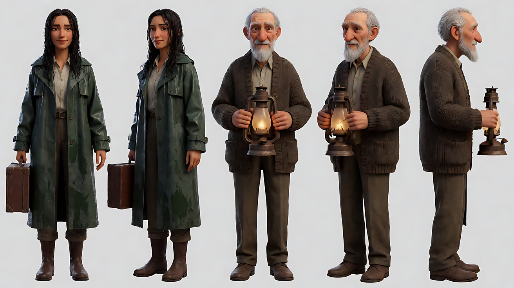

图2 场景（老宅走廊）：

```
Empty long hallway of an old countryside house at night during a thunderstorm, tall windows along the left wall streaked with rain,
wooden floor, old portraits too dark to read on the right wall, the far end of the hallway in total darkness,
very dim cool blue night light from the windows, no lamps on, no people.
Wide shot, eye level from the near end of the hallway, 28mm lens, deep focus, one-point perspective.
Stylized semi-realistic 3D CG rendering, feature-film animation quality. Aspect ratio 16:9.
```

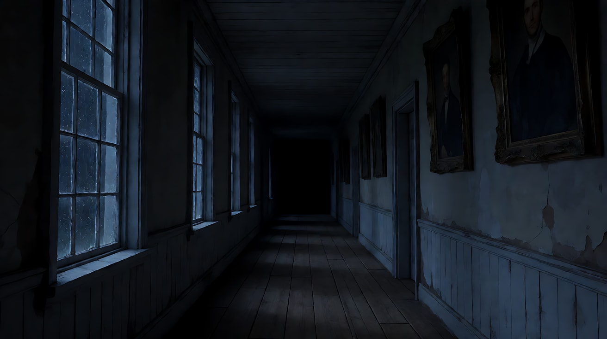

图3 镜头1 关键帧：

```
Using the woman from image 1 and the hallway from image 2: only the woman appears.
A wide shot of her standing at the near end of the hallway, seen from behind, suitcase in hand, water dripping from her coat,
looking down the dark hallway. Camera at eye level behind her, 28mm lens, deep focus, one-point perspective.
Lighting: very dim cool blue window light from frame left, rain shadows trickling on the floor, the far end in total darkness.
Keep the face, hairstyle and outfit exactly as in image 1.
Stylized semi-realistic 3D CG rendering, feature-film animation quality. Aspect ratio 16:9.
```

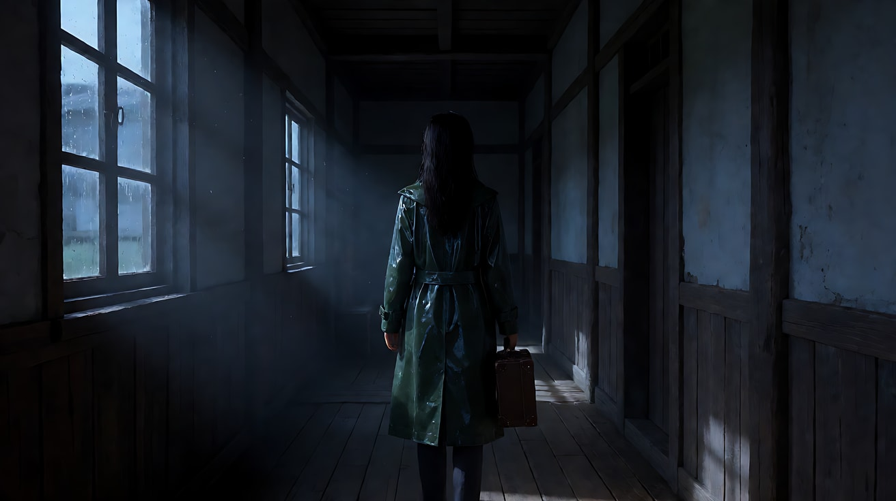

**【多图生视频 · Seedance】**

```
【素材分工】@图片1 锁定两位人物的身份与服装；@图片2 仅参考走廊布局、左侧窗户与一点透视结构，不复制空镜构图；@图片3 为首帧，锁定她在走廊近端的位置。
【画风】风格化写实三维CG质感，低调夜景布光。
镜头1：固定全景，从她身后拍，一点透视。她拎着箱子站在走廊这一头，雨水从风衣下摆滴落，左侧窗户透进极暗的冷蓝夜光，雨痕的影子在地板上缓缓流动，走廊尽头一片漆黑。一道闪电亮起，冷白强光从左侧窗户瞬间灌满整条走廊，一瞬间照出走廊尽头站着一个老人的轮廓，随即回到黑暗。窗外密集的雨声，闪电之后一声滚雷。
镜头2：镜头切至她的正面近景，冷蓝暗光里她的脸只看得清轮廓，她握着箱子把手的手指收紧，往前迈了一步，又停住，嘴唇动了一下，没有发出声音。雨声，她的呼吸声。
镜头3：镜头切至走廊尽头的中景，从她的视线方向拍过去。老人站在黑暗里，手里拎着一盏没点的旧油灯。第二道闪电亮起，冷白光从左侧窗户扫过他的脸，照出白胡子和湿润的眼睛，他微微张开双臂。闪电过后，画面回到冷蓝暗光，他的轮廓仍然站在那里没有动。老人低声说：“你回来了。”
【锁定】轴线：她始终在走廊近端，老人始终在走廊尽头，窗户始终在画左；光线：闪电只来自左侧窗户，每个镜头最多一次闪电，闪电后回到稳定的冷蓝暗光；人物：她穿墨绿风衣、拎箱子，老人穿棕色开衫、拎没点燃的油灯。
【声音】密集雨声与滚雷，她的呼吸声，最后一句台词，台词之后只有雨声，无配乐。
【约束】保持两人脸型、发型、服装不变；不出现频闪；不要字幕、水印、Logo。
时长：12秒
```

**参数**：时长 12 秒 ｜ 画幅 16:9 ｜ 负载：3 个镜头、2 次闪电、1 句对白，属于"稳妥"档

**【检查点】**
- 每个镜头最多一次闪电，闪电后是否回到稳定暗光
- 闪电光是否都来自左侧窗户
- 镜头1 的闪电是否只是"一瞬间看到轮廓"，镜头3 才看清脸
- 整体是否是"重逢"而不是"惊吓"

**【常见问题与修复】**
| 现象 | 修复 |
|---|---|
| 整段频闪 | 【锁定】写"每个镜头最多一次闪电"，约束写"不出现频闪" |
| 被演成恐怖片 | 镜头3 写"白胡子和湿润的眼睛，微微张开双臂"，并加台词 |
| 老人在镜头1 就看得很清楚 | 写"一瞬间照出一个轮廓，随即回到黑暗" |
| 油灯被点亮 | 写"没点的旧油灯"，【锁定】再写一遍 |

---

### 练习5：揭开天窗——体积光完成一次重生（难度 ★★★★★）

**目标**：四个镜头、每个镜头一次光的状态，串成一条完整的情绪弧线：黑暗仓库 → 她扯下天窗的帆布、一束带丁达尔效应的光柱落下 → 光柱落在一台旧钢琴上 → 她弹琴时云开日出、光柱变宽。意图：让观众感到父亲留下的东西重新活了过来。

**【生图 · Nano Banana】**

图1 角色定妆：

```
Character turnaround sheet of an original woman in her mid-thirties: dark hair in a messy bun held by a pencil,
an oversized faded denim work shirt with rolled sleeves over a white tank top, loose khaki trousers, work boots,
a thin silver chain with a small key pendant.
Front view, three-quarter view, side view and back view, full body, plain light-grey background, even soft studio light.
Stylized semi-realistic 3D CG rendering, feature-film animation quality. Aspect ratio 16:9.
```

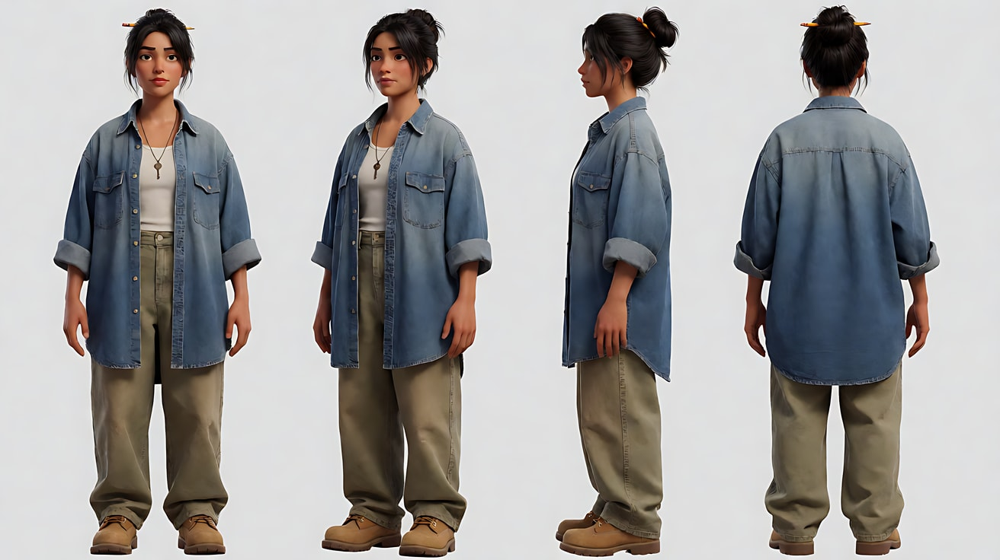

图2 场景（旧仓库）：

```
Empty old wooden warehouse interior, high ceiling with one large square skylight completely covered by a dusty canvas tarp,
a rope hanging from the tarp corner down to a ladder, an old upright piano covered with a white sheet in the center of the floor,
stacks of crates, heavy dust in the air, very dark, only faint grey light leaking through gaps in the wooden walls, no people.
Wide shot, eye level, 24mm lens, deep focus.
Stylized semi-realistic 3D CG rendering, feature-film animation quality. Aspect ratio 16:9.
```

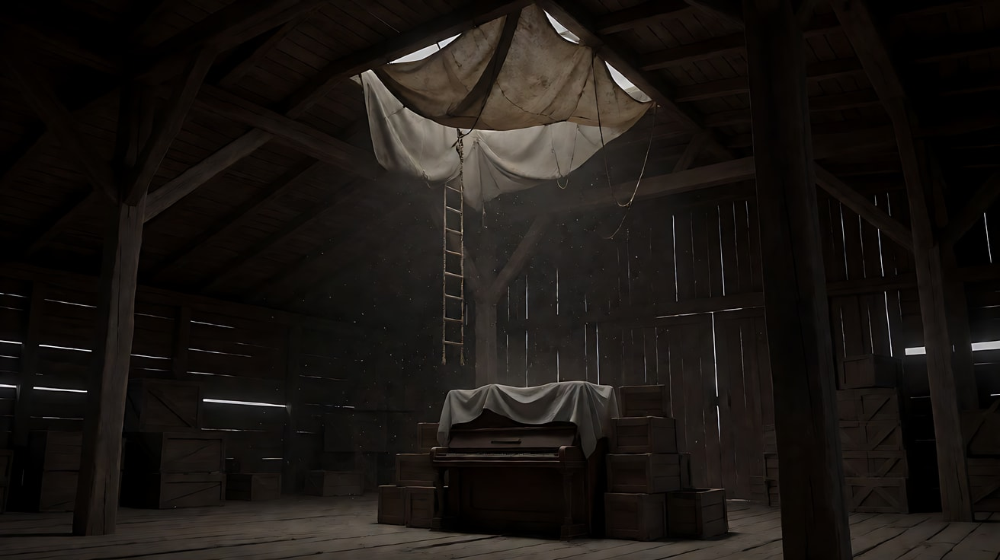

图3 镜头2 关键帧（光柱落下）：

```
Using the character from image 1 and the warehouse from image 2:
a wide shot of her standing on the ladder having just pulled the canvas tarp off the skylight, the tarp falling,
a single strong shaft of morning sunlight pouring down through the skylight into the dark warehouse,
clearly visible volumetric light beam with heavy dust swirling in it (Tyndall effect), the beam landing on the sheet-covered piano below.
Camera at eye level from the far end of the warehouse, 24mm lens, deep focus. Everything outside the beam stays dark.
Keep the face, hairstyle and outfit exactly as in image 1.
Stylized semi-realistic 3D CG rendering, feature-film animation quality. Aspect ratio 16:9.
```

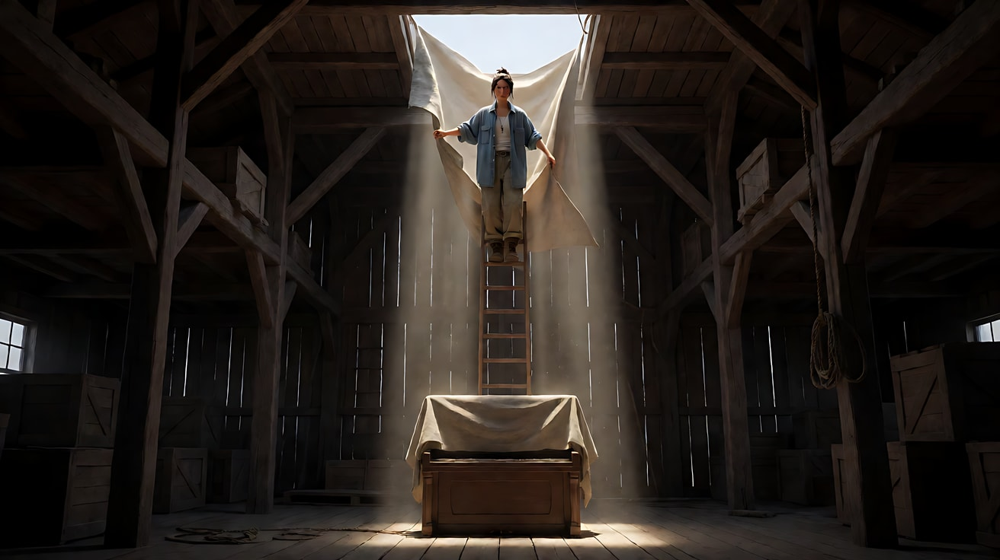

图4 镜头4 关键帧（光柱变宽）：

```
Using the character from image 1 and the same warehouse:
a medium shot of her sitting at the uncovered old upright piano, playing, eyes closed, the key pendant resting on her chest,
the sunlight shaft from the skylight now much wider and brighter, bathing her and the piano in warm golden light,
dust glittering in the broad beam, the warehouse around still dim but warmer.
Camera at eye level, 50mm lens, shallow depth of field.
Keep the face, hairstyle and outfit exactly as in image 1.
Stylized semi-realistic 3D CG rendering, feature-film animation quality. Aspect ratio 16:9.
```


**【多图生视频 · Seedance】**

```
【素材分工】@图片1 锁定人物身份、发型、牛仔衬衫与钥匙吊坠；@图片2 仅参考仓库布局、天窗位置、梯子与盖着白布的钢琴，不复制空镜构图；@图片3 为镜头2的画面目标，锁定第一束光柱；@图片4 为镜头4的画面目标，锁定光柱变宽后的结尾。
【画风】风格化写实三维CG质感，电影级布光。
镜头1：固定全景，黑暗的仓库里只有木墙缝隙漏进的几丝灰光，空气里的灰尘几乎看不见。她站在梯子上，一手抓着天窗帆布角垂下的绳子，低头看了一眼下面盖着白布的钢琴，深吸一口气。木梁偶尔的吱呀声，她的一次呼吸。
镜头2：镜头切至仓库另一端的全景，她用力一拽绳子，帆布从天窗上滑落，一束强烈的晨光从天窗笔直地落进仓库，空气里翻腾的灰尘让光变成一道清晰的光柱，正好落在盖着白布的钢琴上，光柱以外仍然是黑暗。帆布落地的闷响，灰尘扬起的细声。
镜头3：镜头切至钢琴的中景，她走进光柱里，伸手掀开白布，灰尘在光柱中旋转飞起，旧钢琴的木纹在光里露出来。她用手指轻轻按下一个琴键。一个走了点音的单音在仓库里回荡。
镜头4：镜头切至她坐在琴前的中景，她闭上眼睛开始弹一段简单的旋律。天窗外的云散开，光柱慢慢变宽变亮，暖金色的光把她和钢琴整个包裹起来，灰尘在宽阔的光里闪烁，仓库四周也被映暖了一些。镜头极慢地向前推进。结尾停在她闭眼弹琴、钥匙吊坠在胸前反着一点光的画面上。
【锁定】空间：天窗在仓库正中的屋顶，钢琴在天窗正下方，梯子在钢琴旁；光线：镜头1 无光柱，镜头2 和镜头3 是同一束窄光柱，镜头4 光柱变宽，每个镜头只有一种光的状态；人物：牛仔衬衫袖子卷起，铅笔别在发髻上。
【声音】从木梁吱呀与呼吸，到帆布落地闷响，再到一个走音的单音，最后是一段简单的钢琴旋律在空旷仓库里回荡。
【约束】保持人物脸型、发型、服装不变；钢琴只有一台；不要字幕、水印、Logo。
时长：15秒
```

**参数**：时长 15 秒 ｜ 画幅 16:9 ｜ 负载：4 个镜头、2 次光变、1 段演奏，属于"有挑战"档；失败时拆成两次（镜头1–2、镜头3–4），第二次用镜头2 尾帧做首帧

**【检查点】**
- 镜头1 是否真的黑，镜头2 光柱是否清晰可见（丁达尔效应）
- 光柱是否始终来自天窗、落在钢琴上
- 镜头4 的光变（云散开、光柱变宽）是否与"开始弹琴"同步
- 两次光变是否分在两个不同镜头

**【常见问题与修复】**
| 现象 | 修复 |
|---|---|
| 光柱看不见，只是画面变亮 | 写"空气里翻腾的灰尘让光变成一道清晰的光柱，光柱以外仍然是黑暗" |
| 光柱方向乱跑 | 【锁定】写"天窗在屋顶正中，钢琴在天窗正下方" |
| 弹琴手指变形 | 镜头4 改为中景或侧后方机位，不给手部特写 |
| 镜头4 光柱突然变宽像闪光 | 写"云散开，光柱慢慢变宽变亮" |
