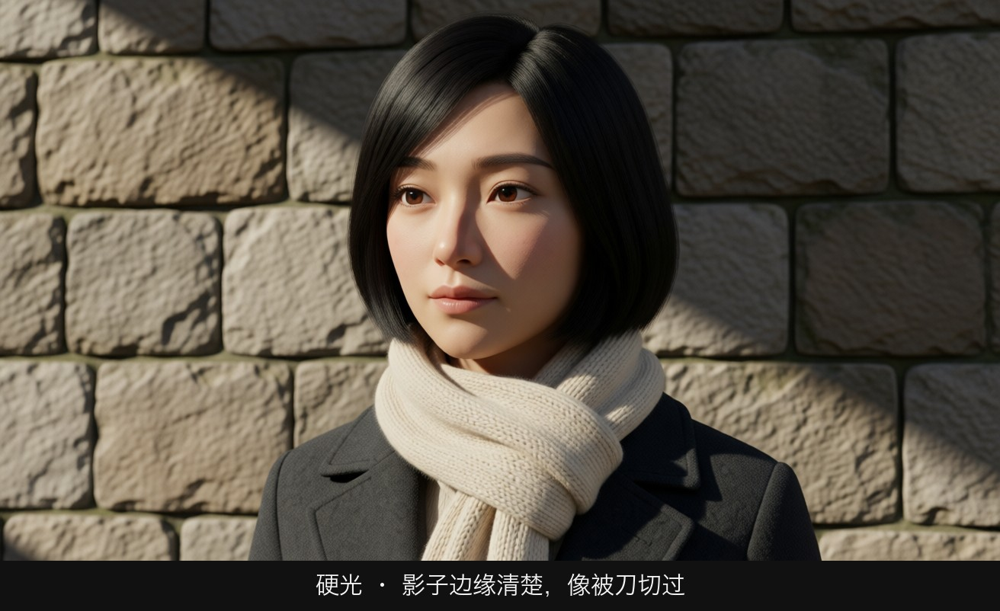
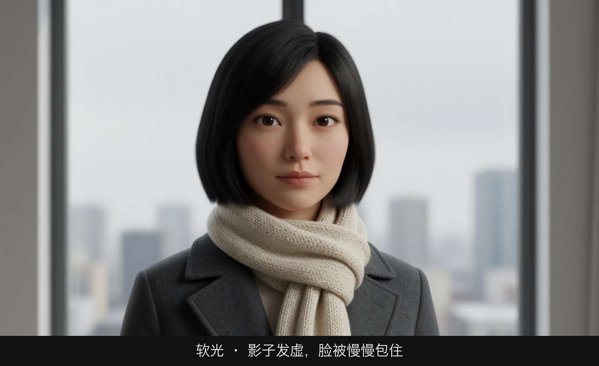
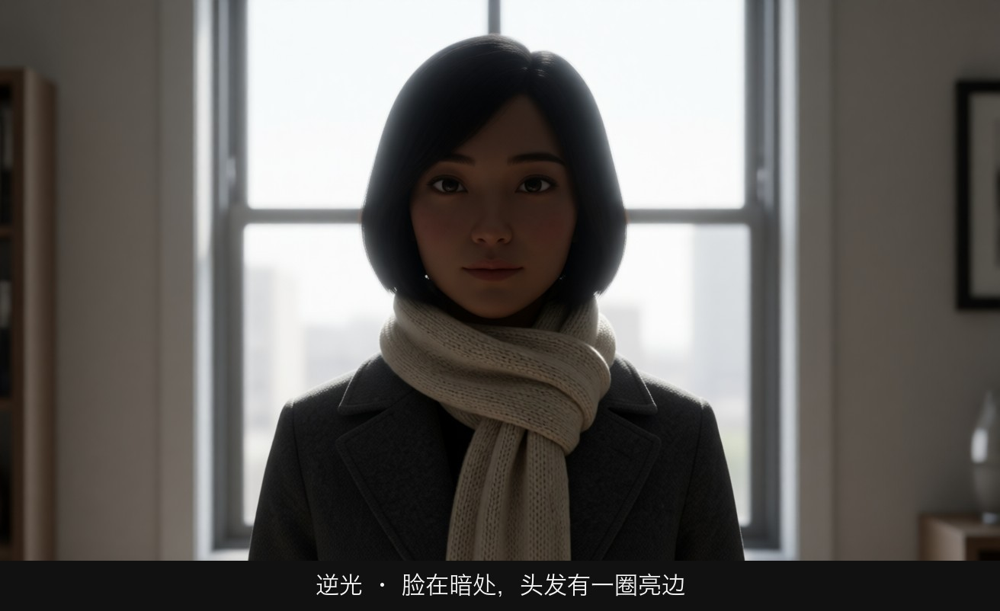
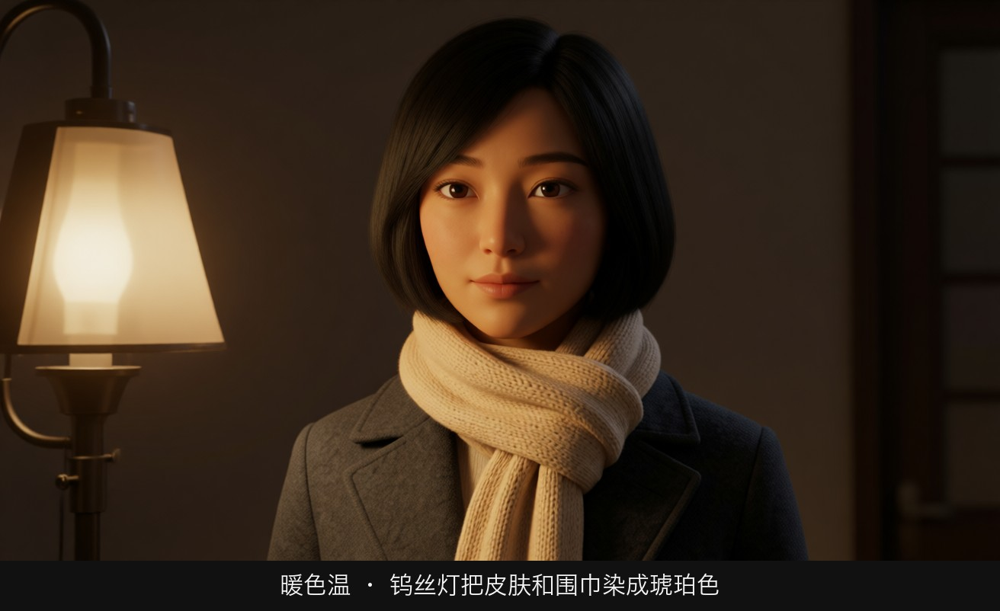
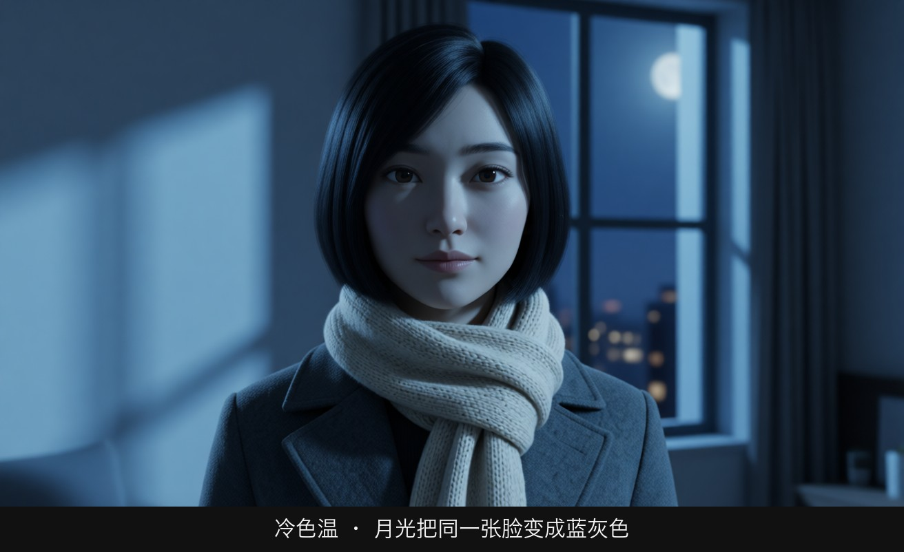
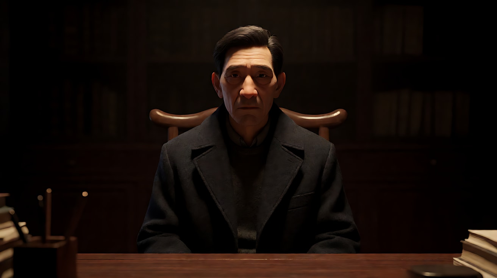
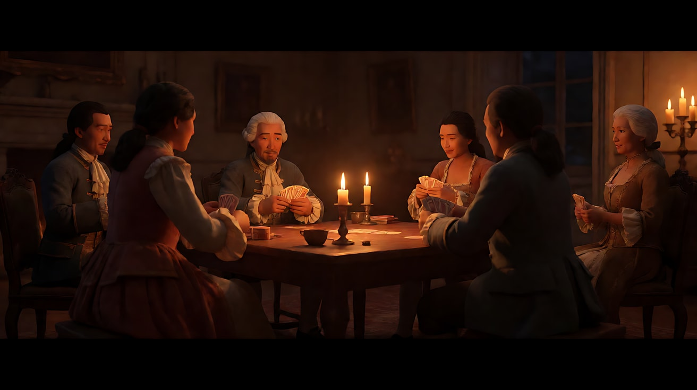
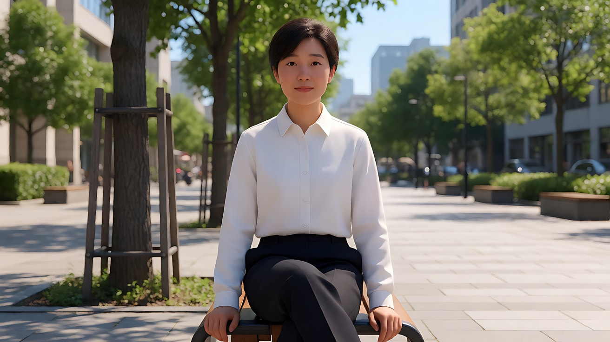

# L04-01 光的基础：软硬、方向与色温

> 段位：进阶 ｜ 建议用时：50 分钟 ｜ 配套提示词：[L04-01-光的基础-提示词](../提示词/L04-01-光的基础-提示词.md)

## 学习目标

- 能分辨硬光和软光，并说出决定软硬的两个因素（光源相对大小、光源距离）
- 能说出五种光的方向（顺光、侧光、逆光、顶光、底光）各自给人物带来的性格
- 记住常见光源的色温范围（烛火、钨丝灯、日出日落、正午日光、阴天、阴影/蓝天），并理解"月光在电影里画成冷蓝"是约定俗成
- 能把"温暖、孤独、危险"这类情绪词翻译成"光源 + 方向 + 软硬 + 色温"四个参数
- 能在生图和 Seedance 提示词里写出有来源、可执行的光

## 一、概念讲解

### 1. 光不是"亮度"，是四个可控参数

新手写光，常写"光线很好""氛围光""唯美的光"。模型拿到这些词只能给一个平均好看的照明。摄影指导看光，只看四件事：

```
┌──────────────────────────────────────────────────────┐
│  光 = 来源（是什么发光） + 方向（从哪打来）              │
│      + 软硬（阴影边缘清不清楚） + 色温（暖还是冷）        │
└──────────────────────────────────────────────────────┘
```

后面所有课程（三点布光、动机光、时间、明暗、色彩）都是这四个参数的组合。

### 2. 硬光与软光

判断方法只有一个：**看阴影的边缘**。

| | 硬光 | 软光 |
|---|---|---|
| 阴影边缘 | 清晰、锋利，一刀切 | 渐变、模糊，慢慢过渡 |
| 典型光源 | 正午太阳、裸灯泡、手电、聚光灯、车灯 | 阴天天空、大窗户、柔光箱、白墙反射 |
| 皮肤质感 | 毛孔、皱纹、疤痕都被放大 | 皮肤平滑，瑕疵被抹平 |
| 情绪 | 坚硬、紧张、真相、审问 | 温柔、安全、亲密、回忆 |

决定软硬的不是灯有多亮，而是**光源相对被摄体有多大**：

```
  硬光：小光源 / 远光源                 软光：大光源 / 近光源

      ●  (小灯泡)                      ┃┃┃┃┃┃┃  (大窗/柔光布)
       \                               ┃┃┃┃┃┃┃
        \   光线几乎平行                 \ \ | / /   光线从多个角度包裹
         ▼                               ▼ ▼ ▼ ▼ ▼
        (人)  ← 阴影一刀切                (人)  ← 阴影慢慢过渡
```

- 太阳本身很大，但离得太远，相对你来说是一个"点"，所以晴天正午是硬光。
- 一旦有云，整片云层变成了一个巨大的柔光布，阴天就是软光。
- 同一盏灯，拿近一点变软，推远一点变硬。

### 3. 光的方向：五种基础位置

从俯视角度看，人物站在中间，摄影机在下方：

```
                    逆光 (Back)
                        ▲
                        │
      侧逆光 ↖          │          ↗ 侧逆光
                        │
   侧光 (Side) ◄────── [人] ──────► 侧光 (Side)
                        │
      45°前侧光 ↙        │         ↘ 45°前侧光
                        │
                    顺光 (Front)
                        │
                     [摄影机]

   另有两个垂直方向：  顶光 (Top) ↓ 从头顶正上方
                      底光 (Under) ↑ 从下巴下方
```

| 方向 | 画面效果 | 人物性格 |
|---|---|---|
| 顺光 | 脸部均匀明亮，立体感最弱，阴影藏在人物身后 | 坦白、无害、被审视（证件照、新闻直播） |
| 45° 前侧光 | 一侧亮一侧有柔和阴影，最常见的人像主光位置 | 自然、可信 |
| 侧光（90°） | 脸被分成一半亮一半暗，纹理强烈 | 矛盾、分裂、内心冲突 |
| 逆光 | 主体轮廓被勾出一圈亮边，正面偏暗甚至成剪影 | 神秘、孤立、离开、浪漫 |
| 顶光 | 眼窝、鼻下、下巴下面全部陷入阴影 | 审判、权力、不可读、神圣 |
| 底光 | 阴影向上倒置，违背日常经验 | 不安、恐怖、篝火讲故事 |

人一辈子看到的光大多来自上方（太阳、天花板灯），所以**底光天然让人觉得"不对劲"**，这就是孩子拿手电照下巴扮鬼的原因。

### 4. 色温：光的颜色用开尔文（K）表示

数字越低越暖（偏橙红），越高越冷（偏蓝）。

```
 1800K    2700K     3200K      4000K      5600K      6500K      7500K     10000K
  │        │         │          │          │          │          │          │
 烛火    家用暖灯   钨丝灯   荧光灯/混合  正午日光   阴天     深阴影     晴天阴影
 篝火    日出日落            (常偏绿)    闪光灯              /蓝调天空  /高原蓝天
  ◄────────────── 暖 ─────────────────── 中性 ──────────────── 冷 ─────────►
```

| 光源 | 大约色温 | 画面颜色 | 常见情绪 |
|---|---|---|---|
| 烛火、篝火 | 1800–1900K | 深橙 | 古旧、亲密、仪式 |
| 钠灯路灯 | 约 2000K | 橙黄、单色感强 | 城市深夜、廉价、疲惫 |
| 日出日落 | 2000–3000K | 金橙 | 回忆、浪漫、告别 |
| 家用暖灯 / 钨丝灯 | 2700–3200K | 暖黄 | 家、安全、私密 |
| 荧光灯 | 约 4000K（常带绿） | 偏青绿 | 医院、办公室、冷漠 |
| 正午日光 | 5500–5600K | 中性白 | 真实、白天、平常 |
| 阴天 | 6500–7500K | 偏冷灰蓝 | 压抑、平静、失落 |
| 晴天阴影 / 蓝调天空 | 8000–10000K 以上 | 明显蓝 | 寒冷、梦境、孤独 |

**关于月光**：月光物理上是反射的太阳光，色温并不算特别冷。但人眼在暗处对蓝色更敏感，电影长期把夜景画成冷蓝色，观众已经接受了"月光 = 冷蓝"。所以提示词里写"冷蓝月光"是**叙事上正确**的。

**冷暖混合**：同一画面里同时出现暖光和冷光（室内台灯 + 窗外月光），是最便宜也最有效的情绪工具，下一课和 L04-06 会反复使用。

### 5. 情绪词 → 光参数翻译表

| 你想要的感受 | 来源 | 方向 | 软硬 | 色温 |
|---|---|---|---|---|
| 温暖的家 | 台灯、炉火 | 45° 前侧 | 软 | 暖 2700K |
| 孤独 | 窗外路灯 | 侧逆 | 偏硬 | 冷 |
| 审问 | 头顶裸灯泡 | 顶光 | 硬 | 中性偏绿 |
| 恐怖 | 手电、篝火 | 底光 | 硬 | 暖或冷皆可 |
| 回忆 | 夕阳窗光 | 逆光 | 软 | 金橙 |
| 内心分裂 | 窗光单侧 | 90° 侧光 | 硬 | 冷暖各半 |

## 图解

> 这些示意图由多种生图模型分别生成（包括 Nano Banana、GPT Image 等），只用来说明镜头概念；不同模型的画面不能互相比较效果，也不能当作视频成片。


同一张脸，先看光的软硬和方向，再看色温。



一束没有被柔化的光从左侧打来，鼻影的边缘是清楚的。



大窗户把光铺开，下巴底下的影子是虚的，脸被慢慢包住。



光源在她身后。脸落在暗里，头发和肩有一圈亮边，人和背景分开。



画面里那盏钨丝灯把围巾和皮肤染成琥珀色。



同一张脸，只剩月光。皮肤变成蓝灰。色温变了，情绪就变了。

## 二、情绪与叙事功能

| 技法 | 观众的感受 | 常用场景 |
|---|---|---|
| 软光 | 安全、被呵护、时间变慢 | 家庭戏、爱情戏、广告人像、儿童 |
| 硬光 | 紧张、坦白、无处可躲 | 审问、对峙、沙漠正午、黑色电影 |
| 顺光 | 平、正、像证件 | 新闻、喜剧、"被摊开审视" |
| 侧光 | 人物有两面 | 抉择、背叛、秘密 |
| 逆光 | 看不清脸，只看到轮廓 | 登场、离别、神秘人物 |
| 顶光 | 眼睛被藏起来，不可读 | 权力人物、审判、神迹 |
| 底光 | 违反常识的不安 | 恐怖、篝火讲鬼故事、怪物揭示 |
| 暖色温 | 亲近、记忆 | 家、童年、夕阳告别 |
| 冷色温 | 疏离、理性、夜 | 医院、都市夜景、失去 |

**一句话记住**：软硬决定"安不安全"，方向决定"人物是谁"，色温决定"离观众多近"。

## 三、经典影片案例

### 《教父》（1972，弗朗西斯·福特·科波拉；摄影：戈登·威利斯）
- 场景：开场维托·柯里昂在昏暗书房里接见求助者。
- 怎么拍的：主光放在人物头顶偏前的位置，几乎是顶光。马龙·白兰度的眼窝陷在阴影里，观众很难看清他的眼神；背景大面积沉入黑暗。
- 为什么这样拍：眼睛是观众读人物的窗口。顶光把窗户关上了，教父变得**不可读**——你不知道他在想什么，这本身就是权力。光的方向直接成为角色塑造。



### 《巴里·林登》（1975，斯坦利·库布里克；摄影：约翰·奥尔科特）
- 场景：多场 18 世纪室内夜戏，人物围坐在烛台旁打牌、交谈。
- 怎么拍的：为了只用真实烛光拍摄，剧组使用了原本为 NASA 研制的超大光圈镜头（f/0.7）。画面里唯一的光源就是蜡烛：极低色温的深橙暖色，光从桌面高度打上来，人脸以外迅速衰减到暗部。
- 为什么这样拍：烛光的色温、方向、衰减方式和电灯完全不同。用真实烛火，观众感受到的是一个"没有电的世界"，光本身把观众送回了那个时代。这是"色温即时代"的教科书。



### 补充观察：任何一部电影的白天外景
随手打开一部片子，对比晴天正午和阴天的外景：晴天的人物脚下有一块边缘锐利的黑影，阴天的人物几乎没有影子。不用懂任何术语，先练会"看影子判断软硬"。



## 四、在 AI 中怎么实现

- **生图阶段**：每条提示词至少写一个光源名词（window / desk lamp / bare bulb / candle / overcast sky）+ 方向（from frame left / from directly above / from behind）+ 软硬（hard light with crisp shadows / soft diffused light）+ 色温（warm 2700K tungsten / cool blue moonlight）。四项写齐，画面才可控。
- **视频阶段**：Seedance 提示词里用中文写同样四项，例如"一盏裸灯泡从头顶正上方投下硬光，眼窝和鼻下有清晰的黑影，光色偏暖黄"。光如果在片段中要变化，只写一次变化，并且写出原因（云飘过、灯被打开）。
- **模型擅长**：逆光勾边、窗光、烛火和篝火的暖色闪动、阴天的柔和平光、冷暖对比。
- **要避开**：
  - 只写"光线很好""氛围光"——没有来源，模型会给"万能柔光"。
  - 同一画面写三四个方向的主光——模型会把阴影打乱，人物像被摆在摄影棚里。
  - 色温数字写了但和光源矛盾（"烛光 6500K"）——模型会二选一，结果不稳定。
  - 底光写得太强又不写来源——容易被渲染成恐怖片，即使你只想要"篝火"。写清"地上的篝火"。

## 五、练习作业

1. **找影子**：拍三张自己手机里的照片（晴天户外、阴天户外、室内台灯下），只看影子边缘，判断硬光或软光，并写出你认为的光源。
2. **方向实验**：用一盏台灯在暗房里照自己的脸，依次放在正前方、45°、90° 侧面、背后、头顶、下巴下面，各拍一张，写下每张让你想到的角色类型。
3. **色温翻译**：把"她一个人在出租屋里过生日"写成两个版本——"冷清"和"温馨"——每个版本列出光源、方向、软硬、色温四项。
4. 完成配套提示词的练习 1–5，重点对比练习 2 的"同一张脸、五种方向"。

## 六、自检清单

- [ ] 我能只看阴影边缘就判断软硬光
- [ ] 我知道软硬取决于光源的相对大小和距离，而不是亮度
- [ ] 我能说出顺光、侧光、逆光、顶光、底光各自的情绪
- [ ] 我记得烛火约 1800K、钨丝灯约 3200K、正午约 5600K、阴天约 6500K 以上
- [ ] 我的提示词里每个光都有来源、方向、软硬、色温
- [ ] 我没有写"氛围光""唯美的光"这类空泛词

## 七、配套提示词

→ [L04-01-光的基础-提示词](../提示词/L04-01-光的基础-提示词.md)

---

上一课：[L03-06 动态构图与轴线](../../03-构图/教学/L03-06-动态构图与轴线.md) ｜ 下一课：[L04-02 三点布光与人像光型](L04-02-三点布光与人像光型.md) ｜ [返回总目录](../../README.md)
