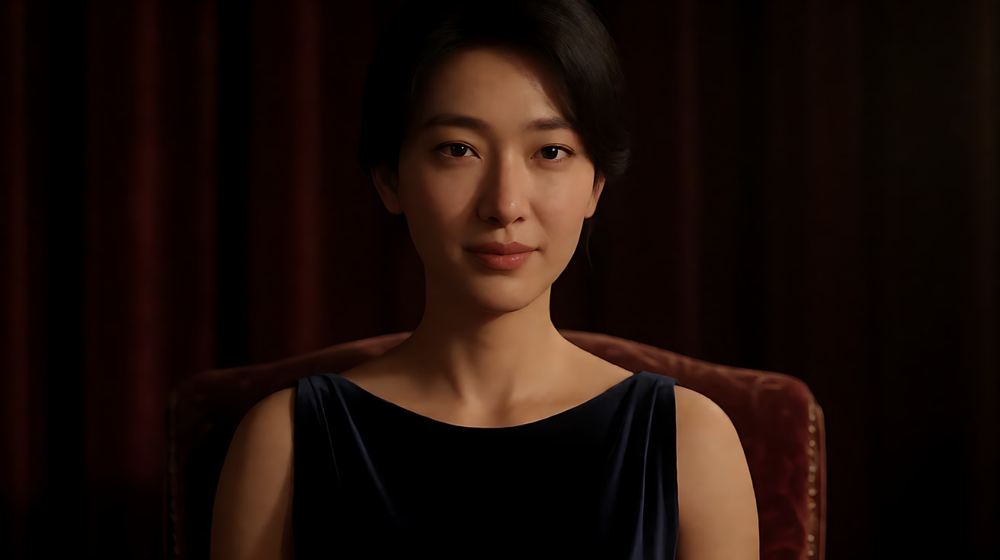
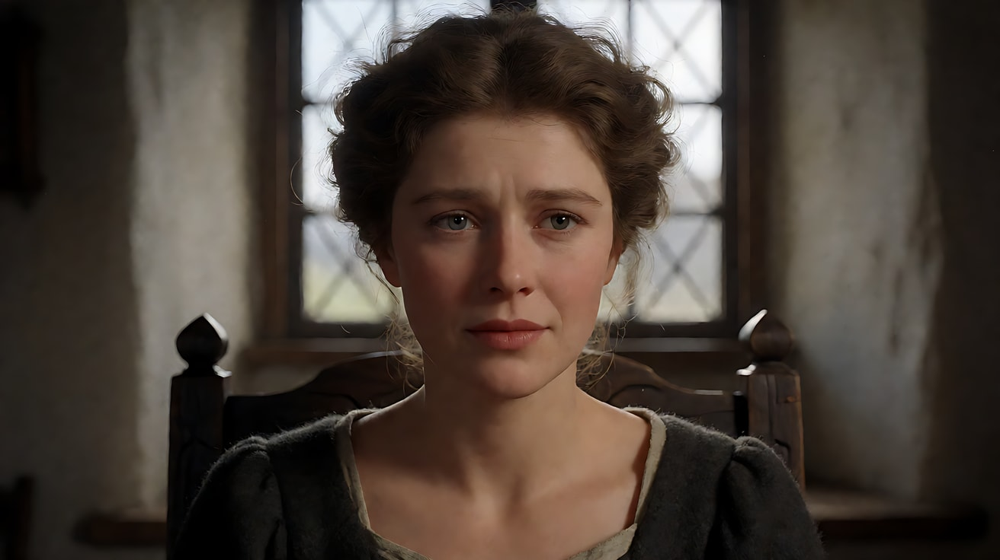
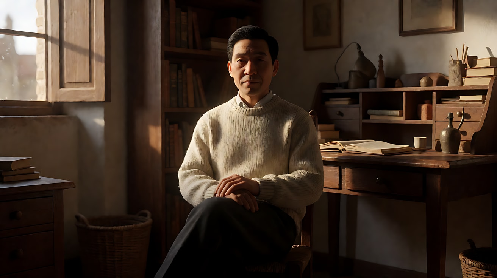

# L04-02 三点布光与人像光型

> 段位：进阶 ｜ 建议用时：60 分钟 ｜ 配套提示词：[L04-02-三点布光与人像光型-提示词](../提示词/L04-02-三点布光与人像光型-提示词.md)

## 学习目标

- 能说出主光、辅光、轮廓光各自的位置和作用
- 理解明暗比（亮面与暗面的亮度比），能用 2:1、4:1、8:1 描述一场戏的情绪
- 能分辨五种经典人像光型：蝴蝶光（派拉蒙光）、环形光、伦勃朗光、分割光，以及宽光 / 窄光
- 能画出一张 ASCII 俯视布光图，并把它翻译成生图和 Seedance 提示词

## 一、概念讲解

### 1. 三点布光：三盏灯，三个任务

三点布光是好莱坞片厂时代沉淀下来的人像基本盘。它不是规定，而是一个**起点**：先把三盏灯放对，再决定拿掉哪一盏。

```
                     轮廓光 / 背光 (Back / Rim)
                     在人物后上方，勾出头发和肩膀的亮边
                              ◉
                               \
                                \
                                 ▼
                               [人物]
                              ↗      ↖
                            ↗          ↖
       主光 (Key)         ↗              ↖        辅光 (Fill)
       45° 前侧、略高    ●                  ○      另一侧、较低、较弱
       最亮，决定光型                              填亮阴影，决定明暗比
                                   │
                                   │
                               [摄影机]
```

| 灯 | 位置 | 任务 | 拿掉它会怎样 |
|---|---|---|---|
| 主光 Key | 通常在摄影机一侧 30°–60°，略高于眼睛 | 塑造脸型，决定光型 | 没有主光就没有形状 |
| 辅光 Fill | 主光对侧，靠近摄影机，较弱、较软 | 把阴影填亮到想要的程度 | 阴影变深，戏剧性增强 |
| 轮廓光 Back/Rim | 人物后上方，对着摄影机方向 | 把人物和背景分开 | 人物"贴"在背景上，发闷 |

在真实世界里，三盏灯往往有更自然的"身份"：主光是窗户，辅光是白墙的反射，轮廓光是身后走廊的灯。下一课会专门讲这件事。

### 2. 明暗比：一个数字决定情绪

明暗比 = 脸部亮面亮度 ÷ 暗面亮度。摄影师常用"差几挡"来说：差 1 挡 = 2:1，差 2 挡 = 4:1，差 3 挡 = 8:1。

```
 明暗比    亮面 ████████     暗面          观感
 ─────────────────────────────────────────────────────
  1:1     ████████   ████████   完全平光，像证件照
  2:1     ████████   ████       柔和，广告、喜剧、家庭戏
  4:1     ████████   ██         有立体感，正剧、悬疑
  8:1+    ████████   ▏          暗面几乎全黑，黑色电影、惊悚
```

- **低明暗比（高调）**：安全、开放、诚实、商业。
- **高明暗比（低调）**：私密、受威胁、隐藏、戏剧化。

**先决定这场戏的人物"暴露程度"，再决定比值**，不要从"好不好看"出发。L04-05 会把这件事展开成高调与低调。

### 3. 五种经典人像光型

所有光型的差别只在**主光的位置**。看鼻子的影子就能认出来。

```
  俯视（人物面朝下方摄影机）            正面看鼻影

  ① 蝴蝶光 / 派拉蒙光
         ● 主光在正前方、高处             ( ˘ ▽ ˘ )
        [人]                              鼻下一只"小蝴蝶"影子
        [机]

  ② 环形光 Loop
       ● 主光 30°–45°，略高               鼻影向一侧下斜成小环
        [人]                              不与脸颊阴影连上
        [机]

  ③ 伦勃朗光 Rembrandt
     ●   主光约 45°，更高                 鼻影与脸颊阴影连上
        [人]                              暗侧脸颊留一块倒三角光斑
        [机]

  ④ 分割光 Split
   ●     主光 90° 正侧面                  脸从鼻梁中线一分为二
        [人]                              一半亮，一半暗
        [机]
```

| 光型 | 主光位置 | 识别特征 | 性格 | 常用场景 |
|---|---|---|---|---|
| 蝴蝶光（派拉蒙光） | 正前方、明显高于眼睛 | 鼻下小蝴蝶影，颧骨下有阴影，脸显瘦 | 光彩、完美、偶像 | 美妆广告、明星海报、女主角登场 |
| 环形光 | 30°–45°，略高 | 鼻影是一个小环，不连接脸颊阴影 | 自然、亲切、可信 | 访谈、日常戏、大多数对白 |
| 伦勃朗光 | 约 45°，更高 | 暗侧脸颊一块倒三角光斑 | 沉思、厚重、故事感 | 人物肖像、正剧独白 |
| 分割光 | 90° 正侧 | 半脸亮半脸黑 | 矛盾、双面、秘密 | 抉择、反派、心理戏 |

"伦勃朗光"得名于 17 世纪荷兰画家伦勃朗，他的许多肖像都用高侧光在暗侧脸颊留下一块三角形亮斑。"派拉蒙光"得名于派拉蒙公司片厂时代为女明星打光的惯用做法。

### 4. 宽光与窄光

人物脸转向一侧时，主光打在哪一面，效果完全不同：

```
            宽光 Broad                        窄光 Short

        ●  主光                                         ●  主光
         \                                           /
          ▼                                         ▼
       ╭──────╮                                ╭──────╮
       │亮│暗 │ 脸转向画右                       │ 暗│亮│ 脸转向画右
       ╰──────╯                                ╰──────╯
     朝向镜头的那面是亮的                     朝向镜头的那面是暗的
     → 脸显宽、开放、坦率                       → 脸显窄、立体、神秘
          [机]                                     [机]
```

- **宽光**：照亮离镜头近的那半边脸。脸显得宽、平、开放，适合喜剧和亲切角色。
- **窄光**：照亮离镜头远的那半边脸，近侧在阴影里。脸更立体、更瘦，情绪更深，是正剧和黑色电影的默认。

### 5. 眼神光（Catchlight）

眼睛里那一点小亮点，就是主光在眼球上的反射。有眼神光，人物是"活的"；拿掉眼神光，人物显得空洞、冷漠或危险。很多反派镜头正是刻意去掉了眼神光。

## 图解

> 这些示意图由多种生图模型分别生成（包括 Nano Banana、GPT Image 等），只用来说明镜头概念；不同模型的画面不能互相比较效果，也不能当作视频成片。


左侧是主光，决定脸的体积；右侧有一点辅光，把暗面打开但不要打平；脑后有一圈轮廓光，把头发从背景上撕开。三盏灯都应该能在画面里被认出来。

## 二、情绪与叙事功能

| 技法 | 观众的感受 | 常用场景 |
|---|---|---|
| 完整三点布光 | 清晰、规整、人物和背景分得开 | 访谈、广告、正剧中规中矩的对白 |
| 去掉辅光 | 阴影变深，人物有秘密 | 悬疑、心理戏 |
| 去掉轮廓光 | 人物沉入背景，被环境吞没 | 绝望、被困 |
| 只留轮廓光 | 剪影，身份未知 | 神秘人登场、离开 |
| 蝴蝶光 | 被仰望的美 | 偶像登场、美妆 |
| 环形光 | 可信、平常 | 日常对白 |
| 伦勃朗光 | 厚重、有故事 | 独白、肖像 |
| 分割光 | 一个人两张脸 | 背叛、抉择 |
| 窄光 | 深、立体、隐忍 | 正剧主角 |
| 无眼神光 | 冷、空、危险 | 反派、失魂 |

## 三、经典影片案例

### 《上海快车》（1932，约瑟夫·冯·斯登堡；摄影：李·加梅斯）
- 场景：玛琳·黛德丽饰演的"上海莉莉"多个近景特写。
- 怎么拍的：主光从正前方很高的位置打下，鼻下形成小小的蝴蝶形阴影，颧骨下方被阴影雕出凹陷，背景压暗。这种为黛德丽打光的方式后来常被称为"黛德丽光"，也就是今天所说的蝴蝶光 / 派拉蒙光的代表样貌。李·加梅斯凭此片获得奥斯卡最佳摄影。
- 为什么这样拍：高位正面光把脸"雕"得更瘦、更有轮廓，同时眼睛依然被照亮。人物既神秘又被观众仰望——这正是片厂时代"明星"的视觉定义。



### 《卡萨布兰卡》（1942，迈克尔·柯蒂斯；摄影：阿瑟·伊迪森）
- 场景：英格丽·褒曼饰演的伊尔莎在里克酒馆里的近景，与里克重逢、回忆巴黎。
- 怎么拍的：片厂时代典型的人像布光——柔和的主光塑形，辅光把阴影填得很浅，背后的轮廓光把头发与背景分开，眼睛里有清晰的眼神光；她的近景还常配合柔焦处理。与之相对，酒馆里的男性角色往往用更硬、对比更强的光。
- 为什么这样拍：明暗比和软硬直接替观众做了判断——伊尔莎是记忆中被理想化的人，所以她的脸被光"保护"着；男性世界是硬的、有阴影的。



### 补充：伦勃朗的肖像画
去美术馆或画册里看伦勃朗的自画像：光从画面一侧高处落下，暗侧脸颊上留一块三角形的光，背景沉入深褐色的黑暗。电影人把这个画面结构借来，起名"伦勃朗光"——学打光，先学看画。



## 四、在 AI 中怎么实现

- **生图阶段**：
  - 直接写光型名在英文里通常有效（`butterfly lighting`、`loop lighting`、`Rembrandt lighting`、`split lighting`、`short lighting`），但**一定要同时写出识别特征**，例如 `a small triangle of light on the shadow-side cheek`，这样模型不会只凭名字猜。
  - 三点布光用三句写清：`key light from 45° frame left, slightly above eye level` / `soft weak fill from frame right` / `thin rim light from behind separating her hair from the dark background`。
  - 明暗比用描述代替数字更稳：`gentle low-contrast fill` ≈ 2:1；`the shadow side falls off to near black` ≈ 8:1。
- **视频阶段**：Seedance 对光型名的理解不稳定，**用中文写看得见的结果**："主光从画左高处打来，右脸颊留下一块三角形光斑，鼻影和脸颊阴影连在一起。"
- **模型擅长**：轮廓光勾边、分割光、强明暗比、眼神光。
- **要避开**：
  - 人物在镜头里大幅转头——光型会跟着破掉（伦勃朗变分割光）。光型镜头里让人物保持朝向，只做小动作。
  - 一次写五盏灯——模型会生成棚拍感的"四面八方都是光"。三点就够，多数时候两点。
  - 只写"三点布光"四个字——模型不知道主光在哪一侧。

## 五、练习作业

1. **画布光图**：选一部你喜欢的电影的一个人物近景，暂停，观察鼻影和脸颊，画出它的 ASCII 俯视布光图，并标注主光、辅光、轮廓光。
2. **台灯实验**：一盏台灯 + 一张白纸（反光板）。先只开台灯拍 45° 伦勃朗光，再用白纸在对侧补光，对比明暗比的变化。
3. **宽窄对比**：让朋友侧过脸，分别照亮靠近镜头和远离镜头的那半边脸，各拍一张，写下哪一张更像"主角在思考"。
4. 完成配套提示词练习 1–5。

## 六、自检清单

- [ ] 我能说出主光、辅光、轮廓光各自的位置和任务
- [ ] 我能用明暗比描述一场戏，而不是用"好看"
- [ ] 我只看鼻影就能分辨蝴蝶光、环形光、伦勃朗光、分割光
- [ ] 我知道宽光和窄光的区别
- [ ] 我写光型时同时写了识别特征
- [ ] 光型镜头里人物不大幅转头

## 七、配套提示词

→ [L04-02-三点布光与人像光型-提示词](../提示词/L04-02-三点布光与人像光型-提示词.md)

---

上一课：[L04-01 光的基础](L04-01-光的基础.md) ｜ 下一课：[L04-03 动机光与实用光源](L04-03-动机光与实用光源.md) ｜ [返回总目录](../../README.md)
