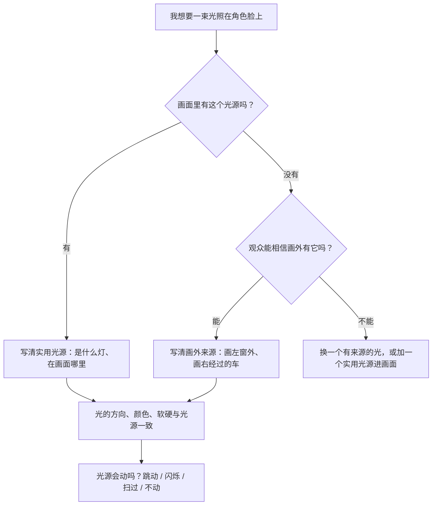

# L04-03 动机光与实用光源：每一束光都要有来源

> 段位：进阶 ｜ 建议用时：55 分钟 ｜ 配套提示词：[L04-03-动机光与实用光源-提示词](../提示词/L04-03-动机光与实用光源-提示词.md)

## 学习目标

- 能区分"实用光源"（画面里看得见的灯）和"动机光"（画面外但有合理来源的光）
- 能说出窗光、台灯、屏幕、烛火、霓虹、车灯六种常见光源各自的方向、软硬、色温和"运动方式"
- 理解为什么"每束光都要有来源"：观众不懂布光，但能感觉到假
- 能在提示词里先写光源，再写它落在人物身上的样子

## 一、概念讲解

### 1. 两个名词

| 名词 | 英文 | 意思 | 例子 |
|---|---|---|---|
| 实用光源 | Practical light | 出现在画面里、本身就发光的道具 | 台灯、吊灯、蜡烛、电视、霓虹招牌 |
| 动机光 | Motivated light | 光源可能不在画面里，但观众能"相信"它从哪来 | 画外的窗户、画外经过的车、画外的路灯 |

在片场，摄影师经常这样做：画面里放一盏小台灯（实用光源），真正照亮演员脸的，是画外一盏大灯，放在和台灯**相同的方向、调成相同的颜色**。观众看到台灯，就相信脸上的光来自台灯。这就是"光有动机"。

### 2. 为什么每束光都要有来源

```
  没有来源的光                          有来源的光

  ┌──────────────────────┐             ┌──────────────────────┐
  │                      │             │  ▒▒窗▒▒              │
  │      (脸全亮)         │             │  ▒▒▒▒▒  ╲            │
  │       [人]           │             │          ╲ (左脸亮)   │
  │                      │             │           [人]        │
  │  阴影方向：？         │             │  阴影落在右侧墙上      │
  │  颜色：？             │             │  冷色，和窗外阴天一致  │
  └──────────────────────┘             └──────────────────────┘
   观众说不出哪里不对，                   观众不会注意光，
   但会觉得"像影楼"                        只会相信这个房间
```

观众几乎不会有意识地分析布光，但大脑会检查：阴影方向和窗户对不对得上？脸上的颜色和台灯颜色一样吗？只要对不上，画面就"假"，情绪也跟着不可信。

在 AI 生成里这件事更重要：**你不写光源，模型就给你一个"万能美颜光"**——四面都亮、没有方向、像修过的图。这是最常见的"AI 味"之一。

### 3. 六种常见光源

| 光源 | 方向 | 软硬 | 色温 / 颜色 | 会怎么动 | 情绪 |
|---|---|---|---|---|---|
| 窗光 | 侧面为主 | 阴天软、晴天硬 | 日光中性、阴天偏冷、黄昏偏暖 | 云飘过时明暗变化；窗帘晃动 | 自然、日常、真实 |
| 台灯 / 落地灯 | 低位侧光 | 有灯罩时偏软 | 暖 2700–3200K | 基本不动；开关时突变 | 家、私密、夜里独处 |
| 屏幕（电脑、手机、电视） | 正面低位 | 偏软 | 冷蓝白，随画面内容变色 | 随屏幕内容闪烁、跳变 | 孤独、沉迷、深夜、信息 |
| 烛火 / 篝火 | 低位 | 小光源，偏硬但衰减快 | 极暖 1800–1900K | 持续轻微跳动 | 亲密、仪式、古旧、危险 |
| 霓虹招牌 | 侧面或背后 | 偏软、范围大 | 高饱和红、粉、青、绿 | 闪烁、交替亮灭；湿地反射 | 都市、夜生活、迷离、廉价 |
| 车灯 | 水平方向 | 很硬 | 卤素偏暖白、LED 冷白、尾灯红 | 扫过画面，光斑在墙上移动 | 有人来了、追逐、打断 |

### 4. 一张房间布光图：所有光都"说得通"

俯视一间夜晚的出租屋：

```
          ┌────────────────────────────────────────┐
          │  窗户 ▒▒▒▒▒▒▒▒   ← 窗外：冷蓝月光 + 偶尔扫过的车灯
          │        ╲  ╲                            │
          │         ╲  ╲  冷色轮廓光                │
          │          ╲  ╲                          │
          │            ▼                           │
          │  [台灯]→→→ [人]  ←← [电脑屏幕]          │
          │   暖主光   坐在桌前    冷色前方补光      │
          │   2800K                 随画面闪动      │
          │                                        │
          │               [摄影机]                  │
          └────────────────────────────────────────┘

  结果：一侧脸暖（台灯），正面一层冷蓝（屏幕），头发后缘冷色亮边（月光）
       三个颜色、三个方向，全部能在画面里或常识里找到来源
```

### 5. 动机检查流程



### 6. 实用光源的三个常见错误

1. **方向错**：台灯在画左，脸却是右边亮。
2. **颜色错**：烛火照出来的是冷白光。
3. **强度错**：一根蜡烛把整个房间照得像白天。烛火和小灯的光会**快速衰减**，离远一点就暗下去。

## 图解

> 这些示意图由多种生图模型分别生成（包括 Nano Banana、GPT Image 等），只用来说明镜头概念；不同模型的画面不能互相比较效果，也不能当作视频成片。


房间是暗的，脸上的光来自桌上那盏灯，灯本身在画里。观众能回答「这光从哪来」。没有来源的光，脸会像被一只看不见的灯追着。

## 二、情绪与叙事功能

| 技法 | 观众的感受 | 常用场景 |
|---|---|---|
| 只有一盏台灯 | 世界缩小到桌面那么大 | 深夜独处、写信、思考 |
| 屏幕光照脸 | 人和屏幕里的东西更亲近，和房间更疏远 | 孤独、沉迷、深夜收到消息 |
| 烛火跳动 | 时间被拉回过去，人物在一个"圈"里 | 仪式、停电、古装、告白 |
| 霓虹映在湿地上 | 城市在呼吸，人物被夜色包围 | 都市夜戏、迷茫、追寻 |
| 车灯扫过 | 外面的世界闯入，有人来了 | 悬疑、等待、紧张 |
| 窗光 | 真实、有时间感 | 日常戏、早晨、生活流 |
| 冷暖两种实用光源同框 | 人物被两种力量拉扯 | 抉择、关系分裂 |

## 三、经典影片案例

### 《出租车司机》（1976，马丁·斯科塞斯；摄影：迈克尔·查普曼）
- 场景：特拉维斯开着出租车穿行在夜晚的纽约街头。
- 怎么拍的：车内几乎没有"灯"，照亮他脸的是窗外经过的霓虹招牌、路灯和车灯，雨后的挡风玻璃和街面把这些彩色光反射、拉长、扭曲；红色、绿色的光轮流从他脸上滑过。
- 为什么这样拍：光全部来自城市本身，并且在不停移动。观众感受到的是：这座城市在不断地侵入他、包围他，他坐在一个移动的铁盒子里，与外面隔着一层玻璃。光源有动机，所以情绪可信。


### 《银翼杀手 2049》（2017，丹尼斯·维伦纽瓦；摄影：罗杰·迪金斯）
- 场景：华莱士的办公空间。
- 怎么拍的：空间里有水面，光透过水面反射到墙壁和人物身上，形成缓慢流动的波纹光斑；整体是浓郁的暖黄色。
- 为什么这样拍：流动的水纹光让一个封闭的室内空间显得奇异、不属于日常，同时它有明确的物理来源（水面反射），所以再怪也不"假"。动机光可以很风格化，前提是来源成立。


### 《巴里·林登》（1975，斯坦利·库布里克）——回顾
在 L04-01 中提到的烛光夜戏，是"实用光源即唯一光源"的极端案例。画面里的蜡烛就是全部照明，光的衰减、跳动、色温全部真实。


## 四、在 AI 中怎么实现

- **生图阶段**：
  - 先写光源本体：`a green-shaded brass desk lamp on the left side of the desk, switched on`。
  - 再写它落在人身上的结果：`its warm 2800K light falls on the left side of her face, the right side falls off into shadow`。
  - 画外光源也要写方位：`cool blue moonlight from an unseen window at frame right, rim-lighting her hair`。
  - 霓虹不写真实店名或品牌，写形状和颜色：`a pink neon sign shaped like a teacup`。
- **视频阶段**：
  - 写光源"怎么动"：烛火"轻微跳动"，屏幕"随画面内容明暗变化"，车灯"从画左扫到画右"，霓虹"红蓝交替闪烁"。
  - 光动的时候，影子也要动：车灯扫过时"窗框的影子在墙上从左滑到右"。
- **模型擅长**：烛火跳动、屏幕蓝光照脸、霓虹在湿地上的倒影、车灯扫过墙面、窗光与灰尘。
- **要避开**：
  - 屏幕内容写得太具体（文字、界面）——会出现乱码。写"屏幕的冷光"，不写屏幕上是什么字。
  - 霓虹写成文字招牌——会生成乱码字母。用图形招牌（茶杯、箭头、星星）。
  - 同时写三种会动的光（跳动 + 闪烁 + 扫过）——画面会频闪。一个片段最多一种运动的光。
  - 烛光、台灯照亮整个大房间——写清"光照不到的地方是暗的"。

## 五、练习作业

1. **找光源**：今晚关掉房间大灯，只留一盏台灯和手机屏幕，拍一张自拍，标出脸上每块亮面分别来自哪个光源。
2. **画布光图**：给"凌晨两点，她在便利店门口等车"画一张俯视布光图，至少包含两种实用光源，并写出各自颜色。
3. **改错**：把这句提示词改成有动机的光——"女孩坐在卧室里，光线柔和唯美"。
4. 完成配套提示词练习 1–5。

## 六、自检清单

- [ ] 我能区分实用光源和动机光
- [ ] 我写的每一束光都有来源（画内或画外方位）
- [ ] 光的方向、颜色与光源一致
- [ ] 小光源写了衰减（远处是暗的）
- [ ] 会动的光一个片段只有一种
- [ ] 屏幕和霓虹没有写具体文字

## 七、配套提示词

→ [L04-03-动机光与实用光源-提示词](../提示词/L04-03-动机光与实用光源-提示词.md)

---

上一课：[L04-02 三点布光与人像光型](L04-02-三点布光与人像光型.md) ｜ 下一课：[L04-04 自然光与时间](L04-04-自然光与时间.md) ｜ [返回总目录](../../README.md)
