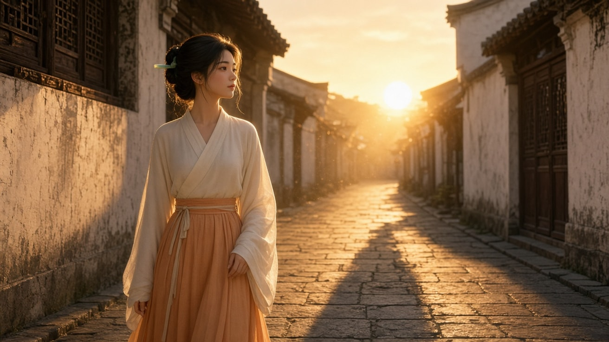
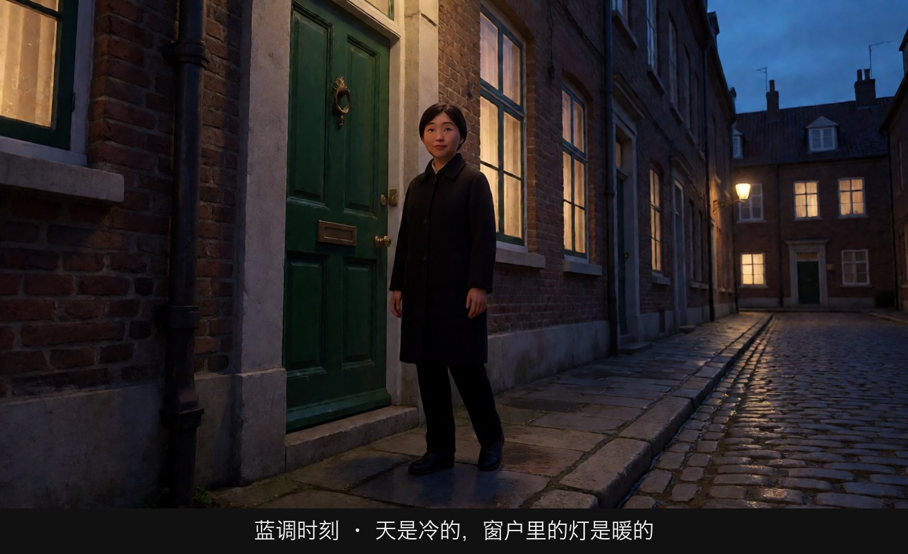
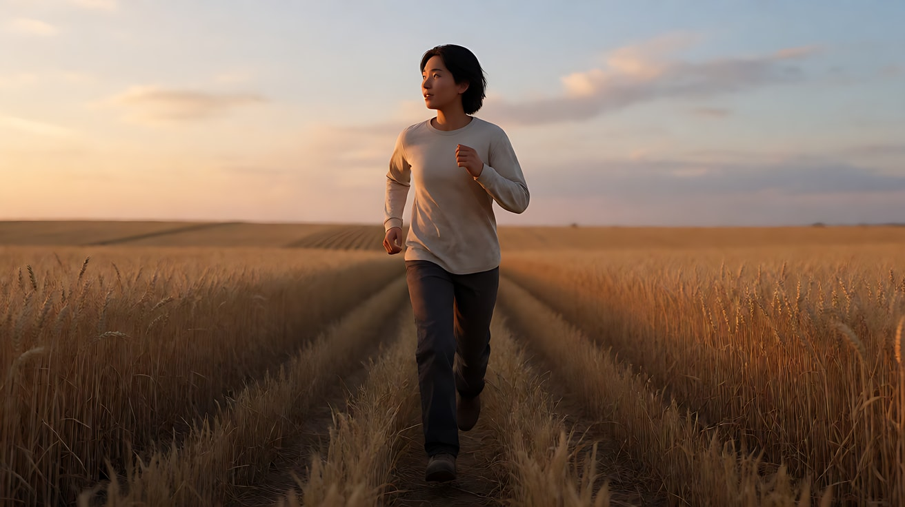
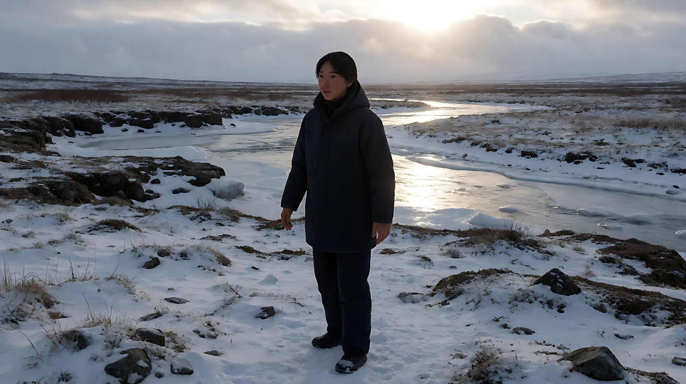
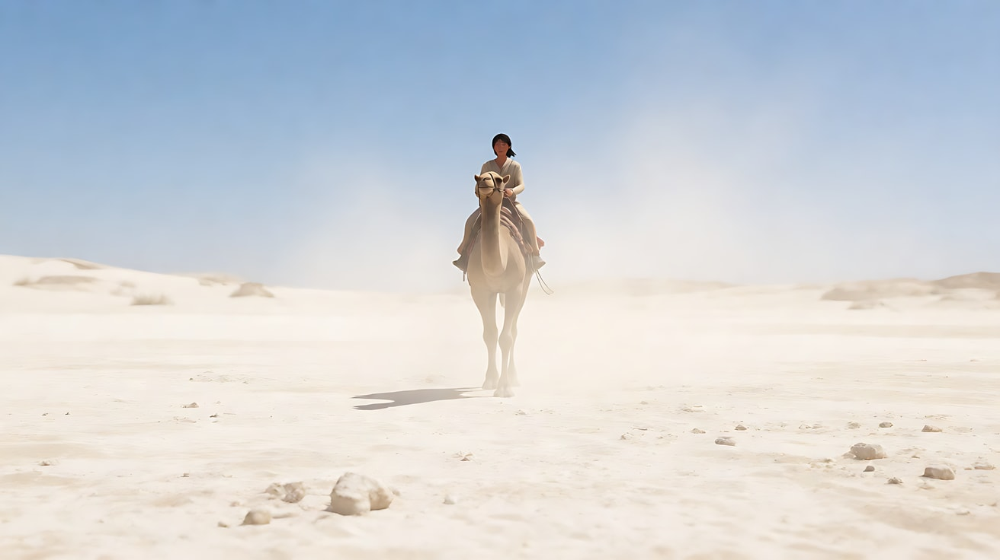

# L04-04 自然光与时间：太阳是最大的一盏灯

> 段位：进阶 ｜ 建议用时：55 分钟 ｜ 配套提示词：[L04-04-自然光与时间-提示词](../提示词/L04-04-自然光与时间-提示词.md)

## 学习目标

- 能说出一天中五个关键光线时段（蓝调清晨、黄金时刻、上午/下午、正午、夜晚）的方向、软硬、色温和情绪
- 理解黄金时刻与蓝调时刻为什么"短"，以及它们各自的叙事用途
- 能说出阴天、雾、雨、雪、沙尘五种天气如何改变光
- 能在提示词里用"太阳高度 + 天气"代替"好看的光"

## 一、概念讲解

### 1. 太阳高度决定一切

太阳是外景唯一的主光。它离地平线越近，光越暖、越软、影子越长；越接近头顶，光越白、越硬、影子越短。

```
 太阳高度
   ▲
   │                          ☀  正午
   │                       ╱  顶光，硬，5600K 左右
   │                    ╱      影子短而黑，眼窝发黑
   │      上午        ╱            下午
   │    侧光，自然  ╱                ╲  侧光，自然
   │             ╱                    ╲
   │  黄金时刻 ☀                          ☀ 黄金时刻
   │  低角度暖光，长影子                     2000–3500K，软，逆光美
───┼──────────────────────────────────────────────────── 地平线
   │ 蓝调时刻                                    蓝调时刻
   │ 太阳在地平线下，天空发蓝                       天空均匀冷蓝，没有直射光
   │ 无影子，冷 9000K+                             城市灯刚亮，冷暖同框
   │
   ▼ 夜晚：月光（电影里画成冷蓝）+ 城市人造光
```

| 时段 | 太阳 | 方向 | 软硬 | 色温 | 情绪 |
|---|---|---|---|---|---|
| 蓝调时刻（日出前 / 日落后） | 在地平线下 | 无直射，只有天空 | 极软 | 冷蓝 9000K 以上 | 静、梦、孤独、过渡 |
| 黄金时刻（日出后 / 日落前约一小时） | 很低 | 低角度侧光、逆光 | 偏软 | 金橙 2000–3500K | 怀旧、浪漫、告别、希望 |
| 上午 / 下午 | 中等高度 | 斜侧光 | 中等 | 4500–5500K | 日常、真实 |
| 正午 | 头顶 | 顶光 | 很硬 | 约 5600K，中性偏冷 | 无处可藏、炙烤、对峙、荒凉 |
| 夜晚 | 无 | 月光 + 人造光 | 看光源 | 冷蓝 + 暖色点光 | 秘密、危险、亲密 |

### 2. 黄金时刻与蓝调时刻

- **黄金时刻**：太阳低，光穿过更厚的大气，蓝光被散射掉，剩下暖橙。光几乎是水平的，人物和地面被拉出长长的影子，逆光时发丝、草叶、灰尘都会发亮。
- **蓝调时刻**：太阳刚落到地平线下，没有直射光，天空像一块巨大的冷蓝色柔光板。如果画面里同时有刚亮起的路灯和窗户，就会自然形成冷暖对比。

这两个时段都很短（往往只有几十分钟），真实拍摄要抢时间。AI 生成没有这个限制——但正因为太容易，很多人把所有镜头都做成黄金时刻，结果"甜得发腻"。**黄金时刻要留给需要它的时刻**：告别、回忆、希望、某种失去之前的美。

### 3. 正午硬光：最"难看"也最诚实

正午太阳在头顶，形成顶光：眼窝、鼻下、下巴下都是黑的，像"熊猫眼"。摄影师通常会躲开它，或用布挡、反光板补。

但叙事上，正午硬光非常有力：沙漠、对峙、劳作、炎热、无处可躲。**你想让观众感到"热、累、暴露"时，就用正午**。

### 4. 天气是巨大的柔光布和反光板

```
  晴天                阴天                 雾                 雨                  雪
  ☀                  ☁☁☁☁☁               ░░░░░░            ╱╱╱╱╱╱             ❄ ❄ ❄
  │ 硬光             ▓▓▓▓▓▓▓ 云层=柔光布   ░░░░░░ 光被散射     ╱╱╱╱╱╱             ❄ ❄ ❄
  ▼                  ↓↓↓↓↓↓↓              ░[人]░ 远处变白     [人]               [人]
 [人]  影子锋利       [人] 几乎无影子        越远越淡           地面变黑、反光        ▒▒▒▒ 地面=反光板
 ███                                                         倒影、高光点           下巴被照亮
```

| 天气 | 对光的影响 | 画面特征 | 情绪 |
|---|---|---|---|
| 阴天 | 云层是巨型柔光布，光极软、偏冷 | 几乎没有影子，色彩低饱和 | 平静、压抑、失落、真实 |
| 雾 | 光被散射，远处景物变淡变白 | 空间层次清晰，有体积光 | 迷茫、神秘、梦境 |
| 雨 | 地面变暗并产生镜面反射 | 倒影、高光点、雨丝逆光发亮 | 悲伤、洗刷、紧张 |
| 雪 | 地面成为巨大反光板，从下方补光 | 高调、偏冷、对比低 | 纯净、寂静、孤独 |
| 沙尘 / 烟霾 | 光被染成橙黄，太阳变成圆盘 | 体积光明显，远景消失 | 末日、炙热、异域 |

**雨的诀窍**：雨要靠**逆光**才拍得出来。顺光下雨丝几乎看不见；光从背后打来，雨丝才会亮成一根根线。

### 5. 夜景：月光和人造光

夜景没有"自然的主光"。电影里的夜景通常是：

- **冷蓝月光**做大面积环境光和轮廓光（电影惯例，见 L04-01）。
- **暖色人造光**（路灯、窗户、车灯、篝火）做局部主光。
- 画面里一定要有一个**可见的亮点**，否则观众会觉得画面只是"曝光不足"。

## 图解

> 这些示意图由多种生图模型分别生成（包括 Nano Banana、GPT Image 等），只用来说明镜头概念；不同模型的画面不能互相比较效果，也不能当作视频成片。


两个时刻。看影子的长度，也看墙、窗和天谁更亮。



太阳很低，墙是蜂蜜色，影子被拉长。



天已经冷了，窗户里的灯反过来变成暖的。冷暖同时在一幅画里。

## 二、情绪与叙事功能

| 技法 | 观众的感受 | 常用场景 |
|---|---|---|
| 黄金时刻逆光 | 美好、短暂、即将失去 | 告别、回忆、初恋、片尾 |
| 蓝调时刻 | 一天结束与开始之间的悬停 | 失眠、过渡、出发、独处 |
| 正午顶光 | 炙烤、暴露、无路可逃 | 沙漠、对峙、苦役 |
| 阴天柔光 | 真实、平静或压抑 | 葬礼、日常、低落 |
| 雾 | 前路不明 | 寻找、迷失、恐怖 |
| 雨 + 逆光 | 情绪被放大 | 分手、重逢、追逐 |
| 雪 | 世界被按了静音 | 孤独、纯净、冬日回忆 |
| 夜景冷暖对比 | 温暖只在一小处 | 回家、守夜、秘密 |

## 三、经典影片案例

### 《天堂之日》（1978，泰伦斯·马力克；摄影：内斯托尔·阿尔门德罗斯）
- 场景：得克萨斯麦田里的劳作、奔跑、守望。
- 怎么拍的：大量外景在日落前后的"魔幻时刻"拍摄——太阳刚落下或即将落下，天空余晖给人物和麦田铺上柔和的金色与蓝色，几乎没有硬影子。每天能拍的时间很短。
- 为什么这样拍：这段光美得不真实，又转瞬即逝，正好对应影片里那段注定不能长久的幸福。光的"短"本身就是情绪。阿尔门德罗斯凭此片获得奥斯卡最佳摄影。



### 《荒野猎人》（2015，亚利桑德罗·冈萨雷斯·伊纳里图；摄影：艾曼努尔·卢贝兹基）
- 场景：荒原上的求生、跋涉、雪地与河流。
- 怎么拍的：几乎完全使用自然光，并且只在每天有限的光线窗口里拍摄；阴天、雪地反光、低角度冬日阳光、火光是主要光源。
- 为什么这样拍：自然光让观众相信"这里没有摄影棚、没有人帮他"。冷、软、没有方向的雪地天光，把人物放在一个漠然的世界里。卢贝兹基凭此片获得奥斯卡最佳摄影。



### 《阿拉伯的劳伦斯》（1962，大卫·里恩；摄影：弗雷迪·杨）
- 场景：沙漠里，一个骑骆驼的人从远方热浪中慢慢出现。
- 怎么拍的：正午附近的强烈日光，沙漠一片亮白，远处的空气因高温而抖动，人影从晃动的地平线里逐渐成形。
- 为什么这样拍：正午硬光和热浪告诉观众"这里能把人烤干"。光不只是照明，而是这片土地的性格。



## 四、在 AI 中怎么实现

- **生图阶段**：
  - 写太阳的位置，而不是写"好看的光"：`low golden sun just above the horizon behind her, long shadows stretching toward the camera`。
  - 写天气对光的影响：`overcast sky acting as a giant softbox, almost no shadows, muted colors`；`morning fog, distant trees fading into white`。
  - 蓝调时刻要同时写天空和人造光：`deep blue twilight sky, streetlights just turned on, warm windows`。
- **视频阶段**：
  - Seedance 擅长"天气在动"：雨丝、雾气流动、雪花飘落、云影掠过麦田、草叶在逆光里发亮。这些都写进去。
  - 光在一个片段里**保持稳定**，除非你明确要它变（云遮日在 L04-07）。不写变化，就写"阳光稳定"。
  - 雨戏写"逆光中雨丝发亮"，否则雨可能不显。
- **模型擅长**：黄金时刻逆光、蓝调城市、雾中层次、雨夜倒影、雪地。
- **要避开**：
  - 同一个片段里写"日落"又写"正午"——时间矛盾，模型会混出奇怪的光。
  - 只写"夕阳"——模型常常让太阳出现在画面正中、把人物照成正面暖光。要写清太阳在人物的哪一侧。
  - 每个镜头都用黄金时刻——失去对比，情绪变平。
  - 夜景不写任何可见光源——容易变成一片灰。

## 五、练习作业

1. **一天拍五次**：选你家窗外或楼下的同一个位置，在清晨、上午、正午、日落前、日落后各拍一张，标注影子长度和颜色。
2. **天气日记**：记录本周每天的天气，写一句"今天的光像……"（例：阴天像一块巨大的毛玻璃）。
3. **时间改写**：把"两个老朋友在公园长椅上道别"分别写成正午、黄金时刻、蓝调时刻三个版本，每个版本写一句光的描述和一句情绪变化。
4. 完成配套提示词练习 1–5。

## 六、自检清单

- [ ] 我能说出五个时段的方向、软硬、色温
- [ ] 我知道黄金时刻适合什么叙事、不适合滥用
- [ ] 我写外景时写了太阳在人物的哪一侧
- [ ] 我能说出阴天、雾、雨、雪对光的影响
- [ ] 雨戏写了逆光
- [ ] 夜景里有可见光源

## 七、配套提示词

→ [L04-04-自然光与时间-提示词](../提示词/L04-04-自然光与时间-提示词.md)

---

上一课：[L04-03 动机光与实用光源](L04-03-动机光与实用光源.md) ｜ 下一课：[L04-05 高调低调与明暗对照](L04-05-高调低调与明暗对照.md) ｜ [返回总目录](../../README.md)
